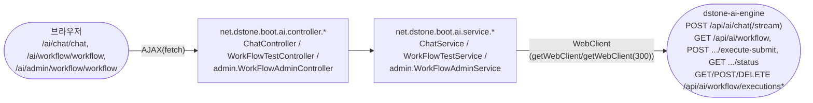
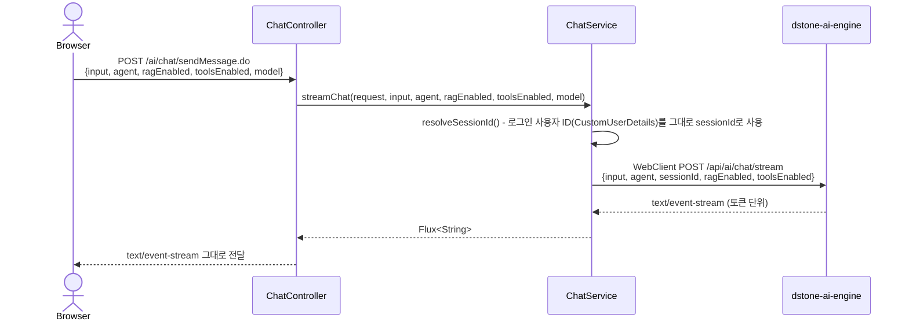
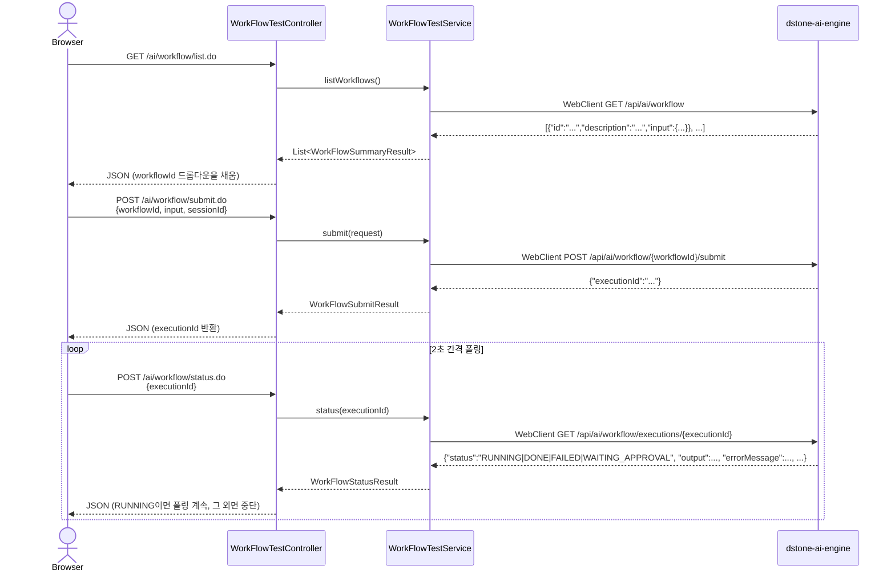
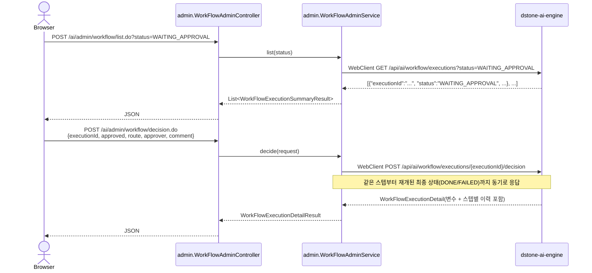

# dstone-boot

## 목차

- [1. 개요](#1-개요)
- [2. 기술 스택](#2-기술-스택)
- [3. 패키지 구조](#3-패키지-구조)
- [4. 설정 (`conf/application.yml`)](#4-설정-confapplicationyml)
  - [4.1 서버 설정](#41-서버-설정)
  - [4.2 다중 데이터소스](#42-다중-데이터소스)
  - [4.3 세션 및 캐시](#43-세션-및-캐시)
  - [4.4 소셜 로그인](#44-소셜-로그인)
  - [4.5 파일 업로드](#45-파일-업로드)
- [5. 소스 코드 분석기 (Analyzer)](#5-소스-코드-분석기-analyzer)
  - [5.1 분석 흐름](#51-분석-흐름)
  - [5.2 주요 클래스](#52-주요-클래스)
  - [5.3 분석 대상 및 추출 정보](#53-분석-대상-및-추출-정보)
- [6. 보안 (Spring Security)](#6-보안-spring-security)
- [7. AOP (Aspect-Oriented Programming)](#7-aop-aspect-oriented-programming)
- [8. 샘플 코드](#8-샘플-코드)
- [9. 빌드 및 실행](#9-빌드-및-실행)
  - [9.1 컨테이너 / 쿠버네티스 배포](#91-컨테이너--쿠버네티스-배포)
- [10. AI 연동 (`dstone-ai-engine` 프록시) 🤖](#10-ai-연동-dstone-ai-engine-프록시-)
  - [10.1 왜 `dstone-boot`가 직접 Spring AI를 쓰지 않는가](#101-왜-dstone-boot가-직접-spring-ai를-쓰지-않는가)
  - [10.2 화면 구성](#102-화면-구성)
  - [10.3 채팅 — SSE 스트리밍 프록시](#103-채팅--sse-스트리밍-프록시)
  - [10.4 Workflow 테스트 — 임의 Workflow 비동기 실행](#104-workflow-테스트--임의-workflow-비동기-실행)
  - [10.5 Workflow 실행 관리(관리자) — 조회 + 승인/반려](#105-workflow-실행-관리관리자--조회--승인반려)
  - [10.6 Workflow 디자이너](#106-workflow-디자이너--정의를-그림으로-보고-고치기)
  - [10.7 설정](#107-설정)

## 1. 개요

`dstone-boot`는 Spring Boot 기반의 통합 웹 애플리케이션 프레임워크입니다. 두 가지 주요 기능을 하나의 애플리케이션으로 제공합니다.

1. **웹 애플리케이션 프레임워크**: 다중 데이터베이스, 소셜 로그인, 메시징(RabbitMQ), WebSocket 등 현대적인 웹 애플리케이션 개발에 필요한 공통 기능과 유틸리티를 통합
2. **소스 코드 분석 도구**: Java 웹 애플리케이션의 소스 코드(Java, JSP, MyBatis XML)를 정적 분석하여 아키텍처와 의존성을 시각적으로 매핑

- **Artifact ID:** `dstone-boot`
- **Packaging:** WAR
- **Main Class:** `net.dstone.boot.DstoneBootApplication`
- **기본 포트:** 7081

---

## 2. 기술 스택

| 영역 | 기술 |
|---|---|
| 코어 | Java 21, Spring Boot 4.1.x (Spring Framework 7), dstone-common |
| 웹 | Spring MVC, JSP/JSTL, jQuery |
| 보안 | Spring Security, OAuth2 (Google/Naver/Kakao) |
| 데이터 | MyBatis, HikariCP, MySQL / Oracle / PostgreSQL / H2 |
| 캐시/세션 | Redis (Lettuce), Spring Session |
| 메시징 | RabbitMQ, WebSocket |
| 코드 분석 | javaparser 3.28.1, JSQLParser 4.7, ClassGraph 4.8.165, jsoup 1.11.3 |
| AOP | AspectJ (aspectjrt, aspectjweaver, aspectjtools) |
| API 문서 | springdoc-openapi 3.1.1 (OpenAPI 3, springfox는 2020년 마지막 릴리스 이후 방치되어 Spring Framework 7 비호환이라 교체됨) |
| 규칙 엔진 | Easy Rules 4.1.0 |
| 외부 연동 | Google Drive API, Google Sheets API |
| 기타 | Weka (머신러닝), Tess4j (OCR), ByteBuddy, Lombok |
| 빌드 | Maven (WAR 패키징) |

---

## 3. 패키지 구조

```
src/main/java/net/dstone/boot/
├── DstoneBootApplication.java          # 메인 진입점 (SpringBootServletInitializer 상속)
├── analyzer/                           # 소스 코드 분석 기능(웹 계층)
│   ├── controller/                     # AnalysisController(분석 요청)·ConfigurationController(분석 설정 화면)·ReportController(리포트)
│   ├── service/                        # ConfigurationService·ReportService
│   ├── dao/                            # ConfigurationDao·ReportDao(MyBatis)
│   ├── cud/                            # 분석 결과 CRUD(AnalyzerCudDao + Tb*CudVo 9종)
│   ├── taskitem/                       # AnalysisItem - 비동기 분석 작업 단위
│   └── vo/                             # 분석 결과 VO(AnalysisVo/OverAllVo/SysVo)
├── ai/                                 # dstone-ai-engine 연동 화면(10절) - REST controller/service/vo 계층
│   ├── controller/                     # ChatController(/ai/chat/*), WorkFlowTestController(/ai/workflow/*) - 사용자용(로그인만 하면 누구나)
│   │   └── admin/                      # WorkFlowAdminController(/ai/admin/workflow/*) - 관리자용
│   ├── service/                        # ChatService(SSE 프록시), WorkFlowTestService(목록/submit/status 프록시)
│   │   └── admin/                      # WorkFlowAdminService(실행 조회/승인 프록시)
│   └── vo/                             # ChatMessageRequest, ChatCallResult, WorkFlow*(Test/Summary/Status/Submit)*, WorkFlowTestRequest
│       └── admin/                      # WorkFlowDecisionRequest, WorkFlowExecution(Summary/Detail)Result, WorkFlowStepHistoryResult
└── common/
    ├── config/                         # 애플리케이션 설정
    │   ├── Config.java                 # 메인 설정
    │   ├── ConfigDatasource.java       # 다중 데이터소스 설정
    │   ├── ConfigTransaction.java      # 트랜잭션 관리(AOP 기반 txAdvisorCommon)
    │   ├── ConfigMapper.java           # MyBatis 매퍼 설정
    │   ├── ConfigRedis.java            # Redis 설정
    │   ├── ConfigRabbitMQ.java         # RabbitMQ 설정
    │   ├── ConfigKafka.java            # Kafka 설정(SAGA/Outbox 샘플용, spring.kafka.enabled 조건)
    │   ├── ConfigMessaging.java        # OutboxAppender/OutboxRelay/SagaOrchestrator 빈 구성(10절 참고)
    │   ├── ConfigAspect.java           # AOP/AspectJ 설정
    │   ├── ConfigListener.java         # SessionListener 서블릿 리스너 등록
    │   ├── ConfigSecurity.java         # Spring Security 설정(URL 권한/로그인/로그아웃, 소셜 로그인 포함) — 6절
    │   ├── ConfigSwagger.java          # springdoc-openapi 설정
    │   ├── ConfigWebMvc.java           # Spring MVC 설정
    │   └── ConfigWebSocket.java        # WebSocket 설정
    ├── security/                       # ConfigSecurity가 참조하는 인증/인가 구현체
    │   ├── Custom*Handler/Provider/Filter.java  # 로그인 성공·실패, 접근거부, 인증 필터/프로바이더
    │   ├── dao/ · svc/                 # CustomUserDao·CustomUserService(사용자/권한 조회)
    │   ├── vo/                         # CustomUserDetails
    │   └── web/                       # CustomSecurityController
    ├── web/                           # SessionListener(HttpSessionListener - 로그인 세션 카운트/속성 관리)
    ├── messaging/                      # SAGA + Outbox 패턴 샘플 기능의 dstone-boot측 배선 — 10.dstone-saga.md 전체 참고
    │   ├── saga/                       # SagaDao·SagaTransactionService(Impl) - dstone-common의 SagaOrchestrator를 트랜잭션 AOP 경계 안에서 호출
    │   └── outbox/                     # OutboxDao·OutboxRelayScheduler - dstone-common의 OutboxRelay를 주기적으로(@Scheduled) 실행
    ├── tools/
    │   ├── analyzer/                   # AppAnalyzer - 핵심 분석 엔진
    │   ├── bizgen/ · datagen/          # BizGenerator/DataGenerator - 코드/데이터 생성 유틸
    │   └── rule/                       # RuleEngine(Easy Rules 래퍼)
    └── biz/                           # BaseController/BaseService/BaseDao/BaseVo - 공통 계층 베이스 클래스

src/main/java/net/dstone/boot/sample/  # 기능별 샘플
    ├── admin/                          # 관리자 화면 샘플(AdminController/Service/Dao)
    ├── analyze/                        # 분석 샘플(BaseBiz/BaseController 등 - analyzer와 별개의 독자 샘플 계층)
    ├── cud/                            # CRUD 샘플
    ├── google/                         # Google Drive/Sheets API 연동 샘플
    ├── kafka/                          # Kafka 프로듀서/컨슈머 샘플(KafkaController/Service, SAGA 샘플과 별개)
    ├── kakao/                          # 카카오 소셜 로그인 샘플
    ├── market/                         # 커머스(구매/판매) 도메인 모델링 샘플
    ├── naver/                          # 네이버 소셜 로그인 샘플
    ├── rabbitmq/                       # RabbitMQ 발행/구독 샘플
    ├── rule/                           # Easy Rules 규칙 구현체 샘플(AgeTestRule/PositionTestRule)
    ├── saga/                           # SAGA+Outbox 주문 처리 샘플(OrderSagaController/Step01~03*Service/OrderSagaReplyListener) — 상세: 10.dstone-saga.md
    ├── swagger/                        # Swagger(springdoc-openapi) API 문서 샘플
    ├── user/                           # 사용자 관리 샘플
    └── vo/                             # 샘플 공용 VO

src/main/webapp/                        # 웹 리소스 (JSP, CSS, JS)
```

---

## 4. 설정 (`conf/application.yml`)

### 4.1 서버 설정

```yaml
server:
  port: 7081
  tomcat:
    max-threads: 200
    min-spare-threads: 10
    max-connections: 10000
  servlet:
    encoding:
      charset: UTF-8
      force-response: true
  ssl:
    enabled: false    # TLS/SSL 활성화 시 true로 변경
```

### 4.2 다중 데이터소스

세 개의 독립적인 데이터소스를 운영합니다:

| 데이터소스 | 용도 | 데이터베이스 |
|---|---|---|
| `common` | 메인 애플리케이션 | sampleDB |
| `sample` | 샘플 데이터 | sampleDB |
| `analyzer` | 분석 결과 저장 | analyzeDB |

### 4.3 세션 및 캐시

```yaml
spring:
  session:
    store-type: redis
    redis:
      namespace: dstone:session   # Redis 세션 네임스페이스
  data.redis:
    enabled: true
    client-type: lettuce
    host: ${REDIS_HOST}
    port: ${REDIS_PORT}
```

### 4.4 소셜 로그인

```yaml
# Naver OAuth2
naver:
  client-id: ...
  client-secret: ...

# Kakao OAuth2
kakao:
  client-id: ...

# Google OAuth2
google:
  client-id: ...
  client-secret: ...
```

### 4.5 파일 업로드

```yaml
spring.servlet.multipart:
  location: ${FILE_UPLOAD_ROOT}
  max-file-size: 100MB
  max-request-size: 100MB
```

---

## 5. 소스 코드 분석기 (Analyzer)

`dstone-boot`의 핵심 차별화 기능입니다. 지정된 경로의 Java 웹 애플리케이션 소스 코드를 정적 분석하여 구조와 의존성을 파악합니다.

### 5.1 분석 흐름

```
사용자 (웹 UI)
    │
    ▼ 분석 경로 지정 & 시작
AnalysisController
    │
    ▼ 비동기 처리 (UI 블로킹 없음)
AppAnalyzer (핵심 엔진)
    │
    ├── Java 파일 파싱    → javaparser    (클래스, 메소드, 어노테이션, 호출 관계)
    ├── JSP 파일 파싱     → jsoup         (화면 구조, URL 링크)
    └── MyBatis XML 파싱  → JSQLParser    (SQL 쿼리, 테이블 CRUD 관계)
    │
    ▼ 분석 결과 저장
analyzer 데이터베이스 (H2 / MySQL)
    │
    ▼ 웹 UI 조회 및 시각화
ReportController
```

### 5.2 주요 클래스

| 클래스 | 역할 |
|---|---|
| `net.dstone.boot.analyzer.controller.AnalysisController` | 분석 작업 웹 요청 처리(비동기 시작/진행상태 조회) |
| `net.dstone.boot.common.tools.analyzer.AppAnalyzer` | 실제 소스 코드 분석 엔진 |
| `net.dstone.boot.analyzer.controller.ConfigurationController` / `analyzer.service.ConfigurationService` | 분석 대상 경로·데이터소스 등 분석 설정 관리 화면 |
| `net.dstone.boot.analyzer.controller.ReportController` / `analyzer.service.ReportService` | 분석 결과 리포트 조회/시각화 |

### 5.3 분석 대상 및 추출 정보

| 파일 유형 | 파싱 라이브러리 | 추출 정보 |
|---|---|---|
| `.java` | javaparser 3.28.1 | 클래스 계층, 메소드 호출 관계, URL 매핑, 어노테이션 |
| `.jsp` | jsoup 1.11.3 | 화면 구조, 스크립트릿, URL 링크 |
| `.xml` (MyBatis) | JSQLParser 4.7 | SQL 쿼리, 파라미터, CRUD 대상 테이블 |

---

## 6. 보안 (Spring Security)

```yaml
spring.security.enabled: true
```

- **자체 인증/인가**: `ConfigSecurity.java`에서 URL별 접근 권한 설정
- **소셜 로그인**: Google, Naver, Kakao OAuth2 지원
- **세션 관리**: Redis 기반 분산 세션 (`dstone:session` 네임스페이스)
- **SSL/TLS**: `application.yml`의 `server.ssl` 설정으로 활성화 가능

---

## 7. AOP (Aspect-Oriented Programming)

`ConfigAspect.java`에서 AspectJ `@Around` 어드바이스로 계층별 호출 로그를 남깁니다(실행 시간 측정은 하지 않음):

| 대상 | 포인트컷 | 하는 일 |
|---|---|---|
| Controller | `net.dstone.boot..*Controller.*(..)` | 호출 시작/종료를 `START`/`END` 구분선과 함께 로깅, 응답 헤더 `successYn`을 `"Y"`로 기본 세팅(예외 발생 시 아래 `DsExceptionResolver`가 `"N"`으로 되돌림) |
| Service | `net.dstone.boot..*Service*.*(..)` | 호출 로그만 남김 |
| DAO | `net.dstone.boot..*Dao.*(..)` | 호출 로그 + `@NoAspectLog`가 붙은 메소드는 `ThreadContext`에 `SUPPRESS_SQL_LOG=Y`를 세팅해 log4jdbc의 SQL 로그를 일시적으로 끔 |

세 어드바이스 모두 `@annotation(net.dstone.common.annotation.NoAspectLog)`가 붙은 메소드는 (DAO의 SQL-로그-억제 용도를 제외하면) 로깅 대상에서 제외한다.

**예외 공통 처리는 AOP가 아니다.** 컨트롤러에서 발생한 예외를 공통 응답(`successYn=N` 등)으로 바꿔주는 것은 `ConfigWebMvc.configureHandlerExceptionResolvers()`에 등록된 `net.dstone.common.exception.resolver.DsExceptionResolver`(`dstone-common`)가 하는 일이며, `ConfigAspect`/AspectJ와는 별개의 Spring MVC `HandlerExceptionResolver` 메커니즘이다.

---

## 8. 샘플 코드

`src/main/java/net/dstone/boot/sample/` 경로에 다음 기능별 샘플을 제공합니다:

| 패키지 | 설명 |
|---|---|
| `admin/` | 관리자 화면(회원/그룹/권한 관리) 예제 |
| `analyze/` | 소스 분석 결과 활용 예제 |
| `cud/` | MyBatis CRUD 연동 예제 |
| `google/` | Google Drive/Sheets API 연동 |
| `kafka/` | Kafka 프로듀서/컨슈머 기본 발행·구독 예제 |
| `kakao/` | 카카오 소셜 로그인 구현 |
| `market/` | 구매자/판매자/상품 도메인 모델링(다형성) 예제 |
| `naver/` | 네이버 소셜 로그인 구현 |
| `rabbitmq/` | RabbitMQ 발행/구독 예제 |
| `rule/` | Easy Rules 규칙 엔진 적용 |
| `saga/` | **SAGA + Outbox 패턴** 주문 처리 샘플(재고차감→결제→주문확정, 실패 시 자동 보상) — 전체 실행 흐름은 [10.dstone-saga.md](10.dstone-saga.md)에 단계별 시퀀스 다이어그램으로 정리되어 있다 |
| `swagger/` | Swagger(springdoc-openapi) API 문서 자동화 |
| `user/` | 사용자 관리 예제 |

---

## 9. 빌드 및 실행

```bash
# 빌드 (WAR, executable)
cd dstone-boot
mvn clean package

# 로컬 실행 (내장 Tomcat)
java -jar target/dstone-boot.war

# 외부 Tomcat 배포 시 WAR 파일을 webapps/에 배포
```

### 9.1 컨테이너 / 쿠버네티스 배포

`dstone-boot`은 `dstone-boot/Dockerfile`(멀티스테이지 리액터 빌드)로 이미지를 만들어 로컬 `kind` 클러스터에 Pod로 배포한다(`dstone-boot/k8s/`). 상세 설계와 절차는 [04.cloud-architecture.md](04.cloud-architecture.md) 참고.

---

## 10. AI 연동 (`dstone-ai-engine` 프록시) 🤖

`dstone-boot`가 제공하는 AI 화면은 "사용자"(로그인만 하면 누구나) 두 개 - **채팅**, **Workflow 테스트** -
와 "관리자"(운영자용) 하나 - **Workflow 실행 관리** - 로 나뉜다. RAG가 검색할 문서를 올리는 화면은 여기에 없고
"코드 분석(Knowledge) > 검색 · 문서"에 있다(2026-10-06에 "문서 임베딩 관리" 화면과 `TB_AI_DOCUMENT` 테이블을 없앴다. 문서의 저장과 검색을
`dstone-knowledge`가 맡게 되면서 같은 일을 하는 화면이 둘이 됐기 때문이다). (2026-09-21
메뉴 개편 - 이전에 있던 "SQL 변환" 전용 화면은 Oracle→PostgreSQL 변환이라는 특정 도메인 하나만
다뤘는데, 이제는 그 자리를 "Workflow 테스트"가 대신한다 - 어떤 Workflow든 골라 실행해볼 수 있으므로
SQL 변환도 `dstone-ai-engine`에 그런 Workflow가 등록돼 있으면 그 화면에서 그대로 확인할 수 있다).
실제 LLM 호출/RAG 검색/Workflow 실행은 전부 [`dstone-ai-engine`](09.dstone-ai-engine.md)이
처리하고, `dstone-boot`의 `net.dstone.boot.ai` 패키지는 그 API를 **로그인 세션과 연결해주는 얇은 프록시
계층**이다.



### 10.1 왜 `dstone-boot`가 직접 Spring AI를 쓰지 않는가

`dstone-ai-engine`이 이미 provider-agnostic AI 서빙 플랫폼으로 따로 존재하므로(09.dstone-ai-engine.md 참고), `dstone-boot`는 Spring AI 의존성을 전혀 추가하지 않고 **순수 HTTP 클라이언트(WebClient)로만** 그 REST API를 호출한다. `dstone-common`이 제공하는 `BaseService.getWebClient()`/`getWebClient(int readTimeoutSeconds)`를 그대로 재사용하므로 `dstone-boot` 쪽에 추가 라이브러리가 필요 없다 — 두 모듈은 REST 계약(JSON 필드 이름)으로만 연동되고 클래스를 공유하지 않는다(`IngestResult`가 `dstone-ai-engine`의 `IngestResponse`와 JSON 모양만 맞춘 별도 record인 것도 같은 이유).

### 10.2 화면 구성

| 구분 | URL | 파일 | 설명 |
|---|---|---|---|
| - | `/defaultLink.do?defaultLink=ai/index` | `WEB-INF/views/ai/index.jsp` | 사용자/관리자 카드로 이동하는 랜딩 페이지(문서 올리기 카드는 코드 분석 화면으로 간다) |
| 사용자 | `/defaultLink.do?defaultLink=ai/chat/chat` | `WEB-INF/views/ai/chat/chat.jsp` + `webapp/ai/assets/js/chat.js` | 채팅 화면 - "올린 문서 검색(RAG)"/Tool 체크박스 + SSE로 토큰 단위 렌더링 |
| 사용자 | `/defaultLink.do?defaultLink=ai/workflow/workflow` | `WEB-INF/views/ai/workflow/workflow.jsp` + `webapp/ai/assets/js/workflow.js` | 등록된 Workflow를 드롭다운에서 골라 submit/status 비동기 호출을 확인 |
| 관리자 | `/defaultLink.do?defaultLink=ai/admin/workflow/workflow` | `WEB-INF/views/ai/admin/workflow/workflow.jsp` + `webapp/ai/assets/js/workflow-admin.js` | Workflow 실행 조회 + APPROVAL 승인/반려 |
| 관리자 | `/defaultLink.do?defaultLink=ai/designer/designer` | `WEB-INF/views/ai/designer/designer.jsp` + `webapp/ai/assets/js/workflow-designer.js` | Workflow 정의를 그림으로 보고 끌어 놓기·화살표로 고쳐 저장(10.6절) |

`BaseController`의 `defaultLink.do` 공통 라우팅(다른 화면들과 동일한 방식, CLAUDE.md 문서화 대상 아님)을 그대로 쓰고, 이 기능만을 위한 별도 `@RequestMapping` 뷰 컨트롤러는 없다. 화면 모양(2026-10-20): AI 화면(Dstone AI)과 코드 분석 화면(Dstone Knowledge)은 분석툴 테마를 쓰지 않는다. 두 화면은 메뉴가 따로이고(서로의 메뉴를 보여 주지 않는다) 모양만 같이 쓴다. 바탕은 `webapp/ai/assets/css/console.css`(색·글꼴·간격 변수와 왼쪽 메뉴, 구역 카드, 조건 표, 단추, 입력 칸, 목록 표, 상태 딱지), AI 부품은 `ai/assets/css/main.css`, 코드 분석 부품은 `knowledge/assets/css/knowledge.css`이고 색은 `console.css`의 `:root` 변수로만 정한다. 두 묶음의 `common/header.jsp`는 왼쪽 메뉴 `WEB-INF/views/console/sidebar.jsp`를 `section` 값(`ai` / `knowledge`)과 함께 include한다. 메뉴 맨 위에 dstone-boot 첫 화면(`/views/main`)으로 돌아가는 "dstone-boot로 돌아가기" 링크가 있고, 그 아래에 그 묶음의 메뉴만 나온다(아이콘은 SVG, 지금 화면 강조). 1024px보다 좁으면 메뉴가 위쪽 가로 막대가 된다. 각 화면은 `section.cs-page-head`(묶음 이름, 제목, 설명)로 시작한다. 화면 스크립트가 쓰는 id와 class는 바꾸지 않았다. "사용자"/"관리자" 구분은 URL 패키지 관례(`controller.admin`, `/ai/admin/**`)일 뿐이고, 그 이상의 별도 권한 체크는 아직 없다(`ConfigSecurity`의 로그인 필수 정책만 공통으로 적용된다 - 6절 참고).

### 10.3 채팅 — SSE 스트리밍 프록시

`ChatController.sendMessage()`(`POST /ai/chat/sendMessage.do`)는 `@RestController`(다른 화면 컨트롤러와 달리 `ModelAndView`를 반환하지 않고 전부 AJAX/SSE라서)로, `text/event-stream`을 그대로 클라이언트에 흘려보낸다.



- **`sessionId` = 로그인 사용자 ID.** 화면에서 별도 세션 ID를 받지 않고 `CustomUserDetails.getUsername()`을 그대로 `dstone-ai-engine`의 `sessionId`로 보낸다 — 사용자 한 명당 대화가 하나만 계속 이어지는 구조다(같은 사용자가 여러 대화방을 동시에 가질 수 없음). `dstone-boot ↔ dstone-ai-engine`은 서버 대 서버 호출이라 브라우저 쿠키가 전달되지 않으므로, `sessionId`를 매 요청 명시적으로 실어 보내야 `dstone-ai-engine`의 Redis 기반 대화 히스토리(09.dstone-ai-engine.md 5.3절)가 끊기지 않는다.
- **로그인 필요.** `resolveSessionId()`가 세션의 `CustomUserDetails`를 곧바로 캐스팅해서 쓰므로, 로그인하지 않은 상태로 호출하면 `NullPointerException`이 난다 — 이 화면은 다른 인증된 화면들과 동일하게 `ConfigSecurity`의 로그인 필수 정책 아래에 있다는 전제다.
- **input은 선택한 Agent의 input 계약 모양으로 보낸다.** `/ai/chat/list.do`(엔진의 `GET /api/ai/chat` 중계)가 Agent마다
  `input`/`output` 스키마를 함께 주므로, `chat.js`가 input이 string이 아닌 Agent면 입력창 내용을 JSON으로 읽어 객체로 보낸다.
  output이 string이 아닌 Agent는 스트리밍으로 부를 수 없어서(엔진이 400) 안내 문구에 그 사실을 표시한다.
- **RAG/Tool 토글은 요청 하나짜리 스위치**: `chat-rag-enabled`/`chat-tools-enabled` 체크박스 값이 그대로 `dstone-ai-engine`의 `ChatRequest.ragEnabled`/`toolsEnabled`로 전달된다(09.dstone-ai-engine.md 6.6절/9절 참고) — `dstone-boot`는 이 값을 검증하거나 가공하지 않고 그대로 중계만 한다.
  - RAG 체크박스("올린 문서 검색(RAG)")를 켜면 `dstone-ai-engine`이 `dstone-knowledge`에 올려 둔 문서에서 질문과 가까운 조각을 찾아 참고자료로 붙인다. 문서는 "코드 분석(Knowledge) > 검색 · 문서"에서 올린다. 방금 올린 문서는 임베딩이 끝난 뒤부터 뜻으로 찾힌다.
  - Tool 체크박스는 선택한 Agent의 `tools` 목록(`agents/**/*.md`)을 이번 요청에 쓸지 말지만 정한다. 체크해도 그 Agent의 `tools`에 없는 Tool은 켜지지 않는다(`sample-general-chat`은 `tools: ["*"]`라 전부 쓸 수 있다).

### 10.4 Workflow 테스트 — 임의 Workflow 비동기 실행

임의의 `dstone-ai-engine` Workflow(09.dstone-ai-engine.md 7절 - `conf/definitions/workflows/**/*.yml`)를 골라
`submit`+`status` 비동기 계약으로 직접 눌러보는 개발/테스트 화면이다. `WorkFlowTestController`
(`/ai/workflow/*`)는 세 액션을 제공한다 - `GET /list.do`(등록된 Workflow id+description+input 스키마 목록,
드롭다운을 채우는 용도), `POST /submit.do`, `POST /status.do`.



- **workflowId는 화면에서 목록으로 고른다.** `WorkFlowTestService.listWorkflows()`가 `GET /api/ai/workflow`를
  그대로 중계한다(`common.registry.WorkFlowRegistry.list()`가 caller의 `allowedCallers`를 통과한
  Workflow만 걸러주므로, 여기 나온 id는 그대로 submit해도 caller 검증에서 막히지 않는다).
- **input 하나만 입력한다.** 선택한 Workflow의 input 스키마(목록 응답의 `input`)를 입력칸 위에 보여 주고,
  string이면 입력칸 글자를 그대로, 그 밖이면 JSON으로 읽어서 엔진의 `{input, sessionId}`로 보낸다(예전의 message/variables 칸은 없다).
  결과(`output`)는 글자일 수도 객체일 수도 있어서, 객체면 JSON으로 펼쳐 보여 준다.
- **workflowId를 고를 때마다 input에 기본 샘플값이 자동으로 채워진다.** 샘플값은
  `ai/assets/js/workflow.js`의 `WORKFLOW_SAMPLES`(workflowId → input/note)에 있고, 각 Workflow
  YAML 맨 위 주석의 "Workflow 테스트" 예시와 같은 값이다(이미 입력해 둔 값은 덮어쓴다). 주의사항(`note`)은
  input 아래에 안내 문구로 보여준다. 여기에 없는 workflowId는 입력칸을 비워 두므로, `dstone-ai-engine`에
  새 Workflow YAML을 추가했다면 이 맵에도 한 줄 추가해 두면 된다.
- **submit()/status() 둘 다 예외를 위로 던지지 않고 결과 VO의 `error` 필드에 담는다** - 화면은 항상
  JSON으로 성공/실패를 받아야 한다(`listWorkflows()`만 예외적으로 그대로 던진다 - 초기 로딩 실패는
  드롭다운이 비는 것으로 화면에서 자연스럽게 드러나면 된다).
- **실행 목록 조회나 APPROVAL 승인/반려는 여기 없다** - 그건 10.5절의 관리자 화면(`WorkFlowAdminController`)
  책임이다. 이 화면은 어디까지나 "Workflow 하나를 골라 실행하고 결과를 확인"하는 개발자용 테스트다.

### 10.5 Workflow 실행 관리(관리자) — 조회 + 승인/반려

이미 시작된 Workflow 실행(10.4절의 "Workflow 테스트" 화면이든, `dstone-ai-engine`을 직접 호출한
다른 caller든)을 목록에서 찾아 상세(스텝별 이력 포함)를 보고, `APPROVAL` 스텝에서 멈춰
`WAITING_APPROVAL` 상태인 실행을 승인/반려하는 운영자용 화면이다. `WorkFlowAdminController`
(`/ai/admin/workflow/*`)가 `dstone-ai-engine`의 `WorkFlowExecutionController`
(`GET /executions`, `GET /executions/{id}`, `POST /executions/{id}/decision`)를 그대로 중계한다.

상세와 승인 결정 응답은 실행 컨텍스트를 담고 있어서 커질 수 있다. 그래서 이 두 호출과 10.4절의 상태 폴링은
`BaseService.getLargeResponseWebClient()`(응답 한도 32MB)로 받는다. WebClient 기본 한도(256KB)로는
`Exceeded limit on max bytes to buffer : 262144` 에러가 났다. 엔진 쪽도 `context` 안의 긴 글자를 앞부분만 내려준다
(`dstone.ai.workflow.detail.max-value-chars`, 기본 2,000자). 그래서 화면의 context 칸에는 긴 값이 잘려 보이고,
전체가 필요하면 엔진에 `GET /api/ai/workflow/executions/{id}?full=true`로 직접 조회한다.



- **`dstone-boot`는 자체 DB를 갖지 않는다** - 실행 상태/이력은 전부 `dstone-ai-engine`이
  `AI_WORKFLOW_EXECUTION*`(PostgreSQL)에 영속화한 것을 그때그때 조회만 한다(09.dstone-ai-engine.md
  11절 참고). 자체 메타데이터를 따로 갖지 않는 이유는, `dstone-ai-engine`이 모르는 정보를 추가할 필요가 없기 때문이다.
- **버튼은 기다리는 APPROVAL step의 방식에 따라 바뀐다.** 상세 응답의 `pendingApproval.routes`가 비어 있으면
  승인/반려 버튼을, 이름이 있으면(step에 `routes`를 적은 선택지 방식) 그 이름마다 버튼을 하나씩 보여 준다
  (`workflow-admin.js`의 `renderDecisionButtons()`). 선택지 버튼을 누르면 그 이름을 `route`로 보낸다.
  같은 승인 step으로 되돌아오는 Workflow면, 재개된 실행이 다시 `WAITING_APPROVAL`로 돌아와 버튼이 다시 보인다.
- **승인/반려(`decision.do`)는 동기 호출이다.** 승인되면 같은 스텝부터 재개돼 다음 스텝들까지 전부
  실행된 뒤(성공하면 `DONE`, 이후 스텝이 실패하면 `FAILED`) 그 최종 상태로 응답한다 - "승인했다"는
  사실만 기록하고 끝나는 게 아니라, 재개 이후의 실행까지 이 호출 하나로 끝까지 지켜본다.

### 10.6 Workflow 디자이너 — 정의를 그림으로 보고 고치기

`dstone-ai-engine`의 Workflow 정의(`conf/definitions/workflows/**/*.yml`)를 그림으로 그리고, 고친 것을 저장하는 화면이다.
화면은 엔진의 정의 API(`/api/ai/definitions`, 09.dstone-ai-engine.md 12절)를 `WorkFlowDesignerController`(`POST /ai/designer/call.do`
`{method, path, body}`) → `WorkFlowDesignerService`를 거쳐 그대로 부른다. 넘겨주는 범위는 `/api/ai/definitions` 아래 경로와
GET/POST뿐이고, 응답은 상태 코드와 본문을 손대지 않고 돌려준다(`KnowledgeProxyService`와 같은 방식).

- **라이브러리.** 그리기는 AntV X6 3.1.8(드래그 놓기, 포트 연결이 본체에 들어 있음), 자동 배치는 dagre 1.1.4, YAML 읽고 쓰기는
  js-yaml 4.1.0이다. 모두 MIT이고, 폐쇄망 현장을 위해 CDN 대신 `webapp/ai/assets/lib/`에 넣어 두었다(라이선스 파일도 같은 곳).
- **그림 = model.** 기준은 YAML을 읽은 객체(model)다. step 하나가 네모 하나, `next`/`onFailure`/`routes`가 화살표, 시작 동그라미에서
  나가는 화살표가 첫 step(엔진은 `steps`의 첫 step부터 실행한다)이다. 그림에서 무엇을 고치면 model을 고치고 그림을 통째로 다시 그린다.
  화살표 종류는 step 종류로 정한다: AGENT/TOOL/SUPERVISOR는 처음 이은 것이 `next`, 두 번째가 `onFailure`이고, ROUTER/APPROVAL은
  `routes`에 새 경로 이름(APPROVAL은 `APPROVED`, `REJECTED`부터, ROUTER는 임시 이름 `경로1`…)으로 들어간다. 이름과 종류는 화살표를 눌러 오른쪽 칸에서 바꾼다.
  경로 이름 칸에 이미 있는 이름을 적으면 "그 경로의 갈 곳을 이 화살표의 갈 곳으로 바꿀까"를 묻고, 예면 기존 이름이 새 갈 곳을 가리키고 임시 이름과 예전 화살표는 없어진다
  (예: `일반: END`인 ROUTER에서 새 step으로 화살표를 그으면 `경로1`로 생기는데, 이름을 `일반`으로 적으면 `일반: 새step`이 된다).
  ROUTER의 임시 이름은 반드시 Agent 프롬프트의 경로 이름으로 바꿔야 한다(엔진은 LLM 답의 route를 `routes` 이름으로만 받고, 프롬프트에 없는 `routes` 이름은 [검사]에서 막는다).
  그래서 SUPERVISOR/ROUTER step 설정의 agent 바로 아래에 엔진이 정한 **답 모양**(`{pass, reason}` / `{route: "A" | "B", reason}`)과,
  ROUTER는 경로 이름마다 Agent 프롬프트에 있는지(✓/✕, 카탈로그의 `agents[].prompt`로 판단)를 보여 주고, 화살표 칸의 경로 이름 아래에도 경고를 띄운다.
  Agent 창은 지금 Workflow의 SUPERVISOR/ROUTER step이 그 Agent를 쓰면 output 편집 칸 대신 엔진이 정한 모양을 보여 주고(이미 적혀 있으면 지우라는 경고와 함께 편집 칸도),
  프롬프트 칸의 검사 표시에 "경로 이름이 프롬프트에 없음"도 함께 띄운다.
  없는 step을 가리키는 화살표는 빨간 점선 상자로 보인다.
- **저장할 글자.** YAML 글자는 model을 고칠 때만 다시 만든다(js-yaml dump, 맨 위 주석만 남긴다). 그래서 노드 위치만 옮기고 저장하면
  파일 글자는 그대로이고, YAML 탭에서 직접 고친 글자는 주석까지 그대로 저장된다. 파일 중간에 주석이 있으면 "그림에서 고치면 사라진다"는
  안내가 나온다.
- **전체 화면.** 그림 탭 줄 오른쪽의 [전체 화면]을 누르면 디자이너 작업 영역(`#wd-workspace`: 팔레트, 그림, 설정 패널)이 화면 전체를 덮는다.
  다른 창을 새로 띄우는 게 아니라 같은 영역을 키우는 것이라 편집 상태가 그대로 이어지고, Agent 창·가이드 창도 그 위에 뜬다.
  맨 위 띠에 Workflow id, 검사·저장 메시지(위쪽 패널의 `#wd-message`와 상태 글자를 옮겨 옴), [자동 배치]/[되돌리기]/[검사]/[저장](위쪽 패널의 같은 단추를 대신 누름)과
  [전체 화면 끝내기]가 있다. Esc로도 끝낸다(열린 창이 있으면 그 창만 닫힘). 그림 크기는 바깥 상자(`#wd-graph-box`)에서 재서 맞춘다
  (X6가 `#wd-canvas`에 픽셀 크기를 적어 두므로 그것을 재면 커지지 않는다).
- **노드 위치**는 Workflow 파일 옆 `이름.layout.json`에 저장한다. 없으면 dagre로 위에서 아래로 자동 배치한다.
- **검사와 저장은 엔진이 한다.** [검사]는 저장하지 않고, [저장]은 전부 검사해서 통과했을 때만 파일을 쓰고 바로 반영한다(재기동 불필요).
  검사 결과 메시지는 엔진의 기동 검사 메시지와 같다. 엔진의 `dstone.ai.definition.edit-enabled`가 `false`면 [저장]/[삭제]가 꺼진다.
- **Agent 파일.** step 설정의 [Agent 파일 열기]/[새 Agent]로 Agent `.md`를 열어 검사·저장한다(그 Agent를 부르는 Workflow까지 함께 검사). 창에는 [양식]과 [텍스트] 탭이 있다.
  [양식]은 항목별 입력 칸이다: 기본(id, version, role, description, allowedCallers), 모델(name, temperature, reasoning), 실행(onInvalidOutput, maxAttempts, timeoutSeconds, maxToolCalls),
  입출력 계약, Tool(전부(*) 또는 고른 Tool; TOOL step 전용 Tool은 빠짐), Sub Agent(설명이 없거나 자기 Sub Agent가 있는 Agent는 고를 수 없음),
  문서 검색(RAG)(`context.sources`에 `retrievedDocuments`를 넣고 빼는 체크 하나, 켜면 retrieval 칸이 나옴. 예전 파일의 `workflowInput`은 늘 전달되는 값이라 화면에 없고 파일에 있으면 그대로 둔다), 프롬프트. 저장·검사하는 것은 늘 [텍스트]의 글자다.
  Tool과 Sub Agent는 고른 것만 칩으로 보이고, 칩의 ×로 빼고 [+ 찾아서 추가]로 고르기 창을 연다. 고르기 창은 이름·설명(Sub Agent는 폴더도)으로 찾고(낱말을 여럿 적으면 모두 들어 있는 것만),
  [고른 것만]으로 추린다. 창 안의 선택은 [고르기]를 눌러야 반영되고 [취소]·Esc는 버린다(Esc는 고르기 창만 닫는다).
  양식에서 설정 항목을 고치면 머리말을 정해진 키 순서로 다시 만들고(머리말 맨 위 주석만 남음), 프롬프트만 고치면 머리말 글자는 그대로 둔다.
  프롬프트 칸 위에는 이 Agent의 input/output 필드가 단추(`${input.필드}`, `${output.필드}`)로 나와 누르면 커서 자리에 들어가고,
  칸 아래에는 엔진 검사(`PromptText`)와 같은 규칙으로 잘못된 자리를 치는 대로 보여 준다(예전 문법 `{필드}`는 [한 번에 바꾸기]).
  [입력·출력 작성 가이드]는 받는 값 → 프롬프트 → 돌려주는 값의 흐름, 문법표, 자주 하는 실수, 전체 예시를 담은 창이다(`designer.jsp`의 `#wd-guide-dialog`.
  JSP가 EL로 읽지 않도록 달러 기호는 `&#36;`로 적었다). 엔진 규칙을 바꾸면 이 창도 함께 고친다.
  [텍스트]에서 고친 글자는 [양식] 탭으로 돌아갈 때 양식에 채워지고 글자는 그대로 남는다.
- **입출력 모양 편집기**(`webapp/ai/assets/js/picoschema-editor.js`). Agent의 input/output과 Workflow 설정의 input(모두 Picoschema)을 입력 칸으로 고친다.
  모양은 적지 않음 / 값 하나(타입 + 설명) / 필드 묶음 / 직접 입력(Picoschema 글자) 중에서 고른다. 필드 묶음은 한 줄에 필드 하나(이름, 타입, 필수, 설명, enum 값 또는 목록의 항목 타입)이고,
  object와 객체 목록의 하위 필드는 들여써서 그 아래에 놓는다(접고 펴기, 위·아래 옮기기, 지우기). 문법 규칙은 엔진의 `common.schema.Picoschema`와 같고,
  엔진이 다르게 읽을 이름(끝이 `?`이거나 `(array…)` 같은 괄호로 끝나는 이름, 같은 이름 두 번)은 그 줄에 경고를 띄운다. 양식으로 나타낼 수 없는 표기(`(*)`)가 있으면 직접 입력으로 연다.
  지금 정의 파일의 input/output 51개는 모두 양식으로 열리고(필드 묶음 34, 값 하나 17), 양식 → 글자로 되돌려도 뜻이 같다(2026-10-20 확인).
- step id 기본값은 `stepNN` 순번이다. `save` 칸에 새 이름을 적으면 `state:` 선언에도 넣고, Workflow 설정의 [step의 save에 맞추기]가
  빠진 이름은 넣고 아무도 저장하지 않는 이름은 지운다.
- **선 모양**: 그림 위의 "선 모양"에서 직각 · 노드 피해 가기(기본, X6 router `manhattan` + connector `rounded`), 직각(`orth`), 곡선(`smooth`), 직선(`normal`)을 고른다. 고른 값은 그 브라우저에만 기억하고(`localStorage`의 `dstone.designer.lineStyle`), 정의 파일이나 노드 위치 파일에는 넣지 않는다.
- 단축키: Delete(고른 step/화살표 지우기), Ctrl+Z(되돌리기), Ctrl+휠(확대/축소). [FAIL로 가는 실패 화살표 숨기기]는 step이 많을 때 그림을 덮는 선을 감춘다.
- 확인한 범위(2026-10-20): 엔진 사본(8181, 정의 폴더 사본)과 이 모듈 사본(7181)을 띄우고 headless Chromium(Playwright)으로 화면을 조작했다 —
  20개 Workflow 목록, `pilot-workflow`(노드 36, 화살표 79) 그리기, 끌어 놓기로 TOOL step 추가 → Tool 고르기 → END로 연결 → YAML 반영 → 검사 통과
  → 복사해서 새 파일로 저장 → 엔진에 바로 등록, ROUTER 경로 이름 바꾸기와 되돌리기, Agent 파일 열기와 검사, 틀린 `next`의 검사 거절과 빨간 상자 표시.
  사람이 실제 브라우저로 써 본 적은 아직 없다.

### 10.7 설정

```yaml
interface:
  ai-engine:
    # 로컬 실행 시 localhost, kind 클러스터 배포 시엔 같은 네임스페이스(dstone)의
    # Service DNS(dstone-ai-engine)를 가리키도록 env.properties의 AI_ENGINE_HOST 값만 바꾸면 된다.
    base-url: http://${AI_ENGINE_HOST}:${AI_ENGINE_PORT}
```

`AI_ENGINE_HOST`/`AI_ENGINE_PORT`는 `conf/env.properties`에서 관리한다(다른 System Properties와 동일한 컨벤션). `dstone-ai-engine`이 아직 이 환경의 kind 클러스터에 실제 배포되지 않은 상태(09.dstone-ai-engine.md 1절 참고)라, 지금은 로컬에서 직접 기동한 `dstone-ai-engine`(포트 8081)을 가리키는 것이 유일하게 검증된 조합이다.

> 전체 모듈 빌드 명령, 배포 방식, CI/CD 파이프라인 종합 정리는 [03.build.md](03.build.md) 참고.
