# dstone-ai-engine — sm-workflow 노드별 해설

`sm-workflow`는 **고객의 운영 요청서 한 장을 받아 요구사항 → 영향도 → 설계 → 개발 → 컴파일 → 자동 검증**까지 이어 가고, 고비마다 사람(PL)이 승인하는 Workflow다.
이 문서는 정의 파일 `dstone-ai-engine/conf/definitions/workflows/sm/sm-workflow.yml`(**2.9.0**)의 노드(step) 하나씩 풀어 쓴다.

- 엔진 전체 개념과 정의 파일 문법은 [`09.dstone-ai-engine.md`](09.dstone-ai-engine.md), 실행이 어떤 클래스를 지나가는지는 [`09.dstone-ai-engine-workflow.md`](09.dstone-ai-engine-workflow.md)에 있다.
- 이 문서는 "sm-workflow가 무엇을, 왜, 어떤 순서로 하는가" 하나만 다룬다.
- 2.9.0(2026-11-26, 테스트 서버 재설계): 요청서의 `## 프로젝트ID`가 필수가 되고 소스는 프로젝트의 리비전([Build] 결과)에서 온다(step02·59). 서버 기동 전에 DDL 반영을 확인한다(step60·61). 격리 시험 서버(DB 복제)는 테스트 서버(개발 DB를 쓰고 원복)로 바뀌었고, 전문가 해결 경로(step22~24)는 없앴다.
- 노드 이름은 yml의 `id`(`step00`~`step61`, 22~24는 비어 있음)와 화면에 보이는 `name`(`01-사전작업` …)을 함께 적는다. `id`는 한 번 정하면 바꾸지 않아서 번호가 흐름 순서와 다르다. **흐름 순서는 `name` 앞의 번호**를 보면 된다.

---

## 목차

1. [한 장으로 보기](#1-한-장으로-보기)
2. [먼저 알아 둘 것 — 노드 모양 읽는 법](#2-먼저-알아-둘-것--노드-모양-읽는-법)
3. [입력과 산출물 — 무엇을 읽고 무엇을 남기나](#3-입력과-산출물--무엇을-읽고-무엇을-남기나)
4. [전체 흐름 지도 (노드 59개)](#4-전체-흐름-지도-노드-59개)
5. [구간별 노드 해설](#5-구간별-노드-해설)
   - [구간 A. 준비](#구간-a-준비--step00step02)
   - [구간 B. 요구사항 분석과 리뷰](#구간-b-요구사항-분석과-리뷰--step03step06-step39-step27)
   - [구간 C. 영향도 분석](#구간-c-영향도-분석--step07step09-step38-step26)
   - [구간 D. 본뜰 기능의 코드 모으기](#구간-d-본뜰-기능의-코드-모으기--step10-step46step49)
   - [구간 E. 설계](#구간-e-설계--step11step13-step37-step50step52-step25)
   - [구간 F. 개발](#구간-f-개발--step14step17-step54-step55-step57)
   - [구간 G. 컴파일과 형식 확인](#구간-g-컴파일과-형식-확인--step18-step53-step56-step58)
   - [구간 H. 검증 수준 고르기](#구간-h-검증-수준-고르기--step28-step42step45)
   - [구간 I. 자동 동작 검증과 자동 수정](#구간-i-자동-동작-검증과-자동-수정--step41-step40-step29step36)
   - [구간 J. 개발 승인과 그 뒤](#구간-j-개발-승인과-그-뒤--step19step21)
6. [사람이 고르는 선택지 모음 (APPROVAL 5개)](#6-사람이-고르는-선택지-모음-approval-5개)
7. [자동으로 되풀이하는 고리와 횟수 한도](#7-자동으로-되풀이하는-고리와-횟수-한도)
8. [실패하면 어디로 가나 (onFailure 정리)](#8-실패하면-어디로-가나-onfailure-정리)
9. [Agent · Skill · Tool 한눈에](#9-agent--skill--tool-한눈에)
10. [state 사전 (공용 메모장)](#10-state-사전-공용-메모장)
11. [실행 예시 세 가지](#11-실행-예시-세-가지)
12. [자주 묻는 것](#12-자주-묻는-것)
13. [노드 전체 색인](#13-노드-전체-색인)

---

## 1. 한 장으로 보기

사람의 SM(운영 유지보수) 업무 절차를 그대로 옮겼다고 보면 된다.

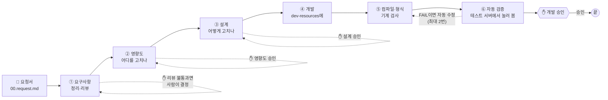

| 단계 | 누가 | 결과물 | 사람이 보는 곳 |
|---|---|---|---|
| ① 요구사항 | `sm-requirement-analyze-agent` → 리뷰 `sm-requirement-analyze-reviewer-agent` | `01.customer_requirement.md` | 리뷰가 불통과일 때만 |
| ② 영향도 | `sm-analyze-impact-agent` | `02.impact.md` | **영향도 승인**(step09) |
| ③ 설계 | `sm-architect-agent` | `03-1.design.md`, `03-2.taskitems.md`, `03-3.ddl(데이터베이스).md` | **설계 승인**(step13) |
| ④ 개발 | `sm-developer-agent` | `dev-resources/` (원본과 같은 경로) | — |
| ⑤ 기계 검사 | Tool `compileJava`, `checkSources` | 컴파일 결과, 형식 검사 결과 | — |
| ⑥ 자동 검증 | Tool `startTestServer` + `sm-verifier-agent`, 실패 시 `sm-auto-fix-agent` | 완료 기준별 PASS·FAIL·BLOCKED | **개발 승인**(step19) |

**사람은 많아야 네 번 결정한다.** 영향도 승인, 설계 승인, 개발 승인이 기본이고, 요구사항 리뷰가 불통과일 때 한 번이 더해진다.
나머지는 엔진·Agent·Tool이 알아서 한다.

### 꼭 기억할 원칙 다섯 가지

| # | 원칙 | 왜 |
|---|---|---|
| 1 | **원본 소스는 절대 건드리지 않는다.** 결과는 작업 폴더의 `dev-resources/`에만 쌓는다. 지울 파일은 `_delete-files.txt`에 적기만 한다 | 사람이 검토하고 직접 반영하기 위해 |
| 2 | **문서는 TOOL이 읽어서 Agent에 넘긴다.** Agent가 파일을 다시 읽지 않는다 | LLM 호출을 아끼고, 파일이 없으면 TOOL이 실패해 거기서 멈추게 하려고 |
| 3 | **고치는 Agent와 처음 쓰는 Agent가 다르다.** `[~ 수정]`은 `document-revise-agent`, `[~ 다시 작성]`은 원래 Agent | 처음 쓰기와 부분 고치기는 성격이 달라서 한 프롬프트에 넣으면 고칠 때도 처음부터 조사하다 한도를 다 썼다 |
| 4 | **앞 문서가 바뀌어도 뒤 문서를 새로 쓰지 않고 맞춘다** | 새로 쓰면 재개발·자동 수정으로 고친 내용이 사라진다 |
| 5 | **설계서가 원본이다.** 개발 중 고친 것은 모두 설계서에도 옮겨 적는다 | 설계를 다시 승인하면 `dev-resources`를 비우고 설계서대로 처음부터 만들기 때문 |

---

## 2. 먼저 알아 둘 것 — 노드 모양 읽는 법

### 2.1 step 종류 다섯 가지 중 네 가지를 쓴다

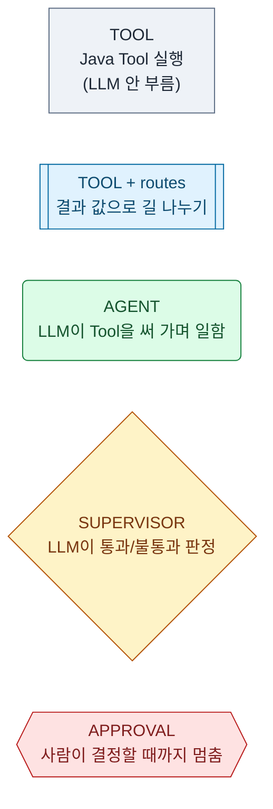

이 문서의 모든 그림은 위 모양과 색을 그대로 쓴다.

| 종류 | 이 Workflow에서 개수 | 하는 일 | 끝난 뒤 갈 곳 |
|---|---|---|---|
| TOOL | 38 | 파일 읽기, 컴파일, 테스트 서버 띄우기 같은 정해진 일 | `next`, 실패하면 `onFailure` |
| TOOL + `routes` | (위 38개 중 14) | 결과 값(`true`/`false`, `within`/`over`, `ok`/`problem`)으로 길을 나눈다 | `routes`의 값별 갈 곳 |
| AGENT | 16 | LLM이 Tool을 여러 번 불러 가며 문서·코드를 만든다 | `next`, 실패하면 `onFailure` |
| SUPERVISOR | 1 | LLM이 `{pass, reason}`만 돌려준다 | 통과면 `next`, 불통과면 `onFailure` |
| APPROVAL | 4 | 실행을 멈추고 사람이 고른 선택지(`routes`)로 간다 | 고른 선택지의 갈 곳 |

> **"분기용 TOOL"이 왜 이렇게 많나?** YAML에는 조건식을 넣지 않는 것이 규칙이다(`${...}`는 값을 읽는 경로일 뿐). 그래서 "파일이 있나", "몇 번째인가", "FAIL이 있나" 같은 판단을 범용 Tool(`isFileExist`, `countUp`, `containsValue`, `checkDocuments`, `checkSources`)에 맡기고, 그 결과 값으로 `routes`를 나눈다.
> 이 판단 결과는 **실패가 아니라 정상 결과**라서 실행 이력에 빨간 줄이 남지 않는다. `onFailure`는 Tool이 정말로 고장났을 때만 쓴다.

### 2.2 노드 사이를 흐르는 세 가지 값

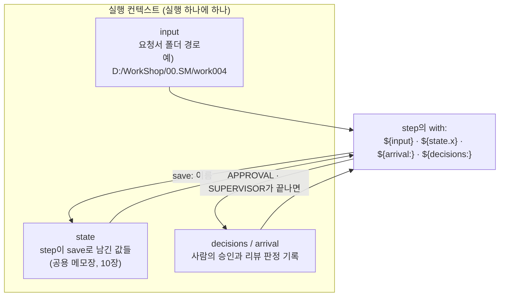

- **`${input}`** — 실행할 때 넣은 요청서 폴더 경로. 59개 노드가 모두 이 경로 아래에서 일한다.
- **`${state.이름}`** — 앞 step이 `save:`로 저장한 값. 저장하지 않은 결과는 뒤에서 읽을 수 없다. 이름은 모두 yml 끝 `state:`에 선언돼 있다.
- **`${arrival:}`** — 이 step으로 오게 만든 **마지막 결정**(사람이 고른 선택지와 의견, 또는 리뷰 불통과 사유). Agent에는 `instruction`으로 들어간다.
- **`${decisions:}`** — 이 실행에서 지금까지 내려진 **결정 전체**. Agent에는 `history`로 들어간다.
- 끝의 `:`는 "값이 없으면 빈 글자"라는 뜻이다. `:`가 없는 `${arrival}`(step25·26·27)은 값이 꼭 있어야 한다. 사람이 고른 선택지로만 오는 step이라 그렇다.

Agent가 `instruction`과 `history`를 읽는 법은 Skill `handling-instructions`에 있다. 요점은 "instruction은 이번에 할 일, history는 참고만. 다만 지난 지시를 되돌리지는 않는다"이다.

---

## 3. 입력과 산출물 — 무엇을 읽고 무엇을 남기나

### 3.1 요청서 `00.request.md`

사람이 쓰는 유일한 입력이다. Workflow는 이 파일이 있는 **폴더 경로**를 입력으로 받는다.

```markdown
## 현업요청
(고객이 원하는 것. 자유롭게)

## 프로젝트ID          ← 필수. 프로젝트 관리에 등록한 ID. 소스(현재 리비전), DB, 테스트계정을 여기서 찾는다
myApp
```

| 절 | 읽는 노드 | 없으면 |
|---|---|---|
| `## 프로젝트ID` | step02 (`readMarkdownSection`), step47, 여러 Agent | **실행이 실패한다**(step59가 프로젝트 관리에서 찾지 못해도 실패) |
| 요청서 전체 | step01 (`readFile`) → 거의 모든 Agent의 `request` | — |

> 계정과 비밀번호는 요청서에 적지 않는다. 화면 로그인용 테스트계정은 **프로젝트 관리**에 암호화해 둔다. `## 소스경로`·`## 시험환경`은 2.9.0부터 읽지 않는다.

### 3.2 작업 폴더와 산출물

실행할 때마다 `입력폴더/실행시각(yyyyMMdd-HHmm)` 작업 폴더가 생긴다(step00이 시각을 정한다).

```text
D:/WorkShop/00.SM/work004/                  ← ${input}
├── 00.request.md                            사람이 씀 (읽기만 한다)
└── 20261125-0930/                           ← ${input}/${state.now} 작업 폴더
    ├── 01.customer_requirement.md           요구사항분석서
    ├── 02.impact.md                         영향도분석서
    ├── 02-1.reference-code.md               본뜰 기능의 원본 코드 묶음
    ├── 03-1.design.md                       상세 설계서  ★ 모든 수정의 원본
    ├── 03-2.taskitems.md                    태스크아이템 목록 (개발 결과 완료/보류 기록)
    ├── 03-3.ddl(데이터베이스).md             DDL (있을 때만)
    ├── dev-resources/                       개발 결과. 원본 루트 기준 같은 경로
    │   ├── src/main/java/…/XxxController.java
    │   ├── src/main/webapp/…/xxx.jsp
    │   └── _delete-files.txt                원본에서 지울 파일 목록 (한 줄에 하나)
    └── compile-check/                       compileJava 출력 (검증 비교에서 제외)
```

### 3.3 누가 쓰고 누가 읽나 (산출물 × 노드)

| 파일 | 처음 쓰는 노드 | 고치는 노드 | 읽는 노드 |
|---|---|---|---|
| `00.request.md` | (사람) | — | step01, 02, 28, 47 |
| `01.customer_requirement.md` | step03 | step27, step39 | step04 |
| `02.impact.md` | step08 | step26, step38 | step07(있나), step10, step46 |
| `02-1.reference-code.md` | step48 | — | step49 |
| `03-1.design.md` | step12 | step25, 37, 52 (문서 수정)<br/>step17·57·58 (재개발일 때)<br/>step34 (고친 것 기록) | step11(있나), 14, 20, 32, 41, 50 |
| `03-2.taskitems.md` | step12 | step17·57·58 (완료/보류 기록), step25·37·52 | step15, 21, 33, 50 |
| `03-3.ddl(데이터베이스).md` | step12 | step25, 37, 52, step34 | step50, step60(개발 DB에 반영됐는지 확인. 반영은 사람이 한다) |
| `dev-resources/` | step17 | step57, 58, 24, 34 (step16이 비움) | step18, 53, 29, 45, 40 |

---

## 4. 전체 흐름 지도 (노드 59개)

한 장에 모두 그렸다. 굵은 흐름만 따라가면 "요구사항 → 영향도 → 설계 → 개발 → 검증 → 승인"이다. 점선은 실패(`onFailure`)할 때 가는 길이다.
구간별 확대 그림과 설명은 5장에 있다.

```mermaid
flowchart TD
    START((시작)) --> step00

    subgraph A["A. 준비"]
        step00["step00 · 01<br/>시각 구하기<br/>getToDate"]:::tool --> step01["step01 · 02<br/>요청서 읽기<br/>readFile"]:::tool --> step02["step02 · 03<br/>프로젝트ID 읽기<br/>readMarkdownSection"]:::tool --> step59["step59 · 03-1<br/>리비전 정하기<br/>resolveProjectRevision"]:::tool
    end

    subgraph B["B. 요구사항"]
        step03("step03 · 04<br/>요구사항 분석<br/>sm-requirement-analyze-agent"):::agent --> step04["step04 · 05<br/>요구사항분석서 읽기"]:::tool --> step05{"step05 · 06<br/>요구사항 리뷰<br/>reviewer-agent"}:::sup
        step06{{"step06 · 07<br/>리뷰 불통과 처리"}}:::appr
        step39("step39 · 46<br/>리뷰 지적대로 수정<br/>document-revise"):::agent
        step27("step27 · 28<br/>요구사항분석서 수정<br/>document-revise"):::agent
    end

    subgraph C["C. 영향도"]
        step07[["step07 · 08<br/>영향도분석서 있나?<br/>isFileExist"]]:::route
        step38("step38 · 09<br/>기존 영향도 맞춤<br/>document-revise"):::agent
        step08("step08 · 45<br/>영향도 분석<br/>sm-analyze-impact-agent"):::agent
        step09{{"step09 · 10<br/>영향도 승인"}}:::appr
        step26("step26 · 27<br/>영향도분석서 수정<br/>document-revise"):::agent
    end

    subgraph D["D. 본뜰 기능 코드"]
        step10["step10 · 11<br/>영향도분석서 읽기"]:::tool --> step46["step46 · 47<br/>참고 기능 절 읽기"]:::tool --> step47["step47 · 48<br/>프로젝트ID 읽기"]:::tool --> step48["step48 · 49<br/>코드 모으기<br/>knowledgeFeatureCode"]:::tool --> step49["step49 · 50<br/>모은 코드 읽기"]:::tool
    end

    subgraph E["E. 설계"]
        step11[["step11 · 12<br/>설계서 있나?"]]:::route
        step37("step37 · 13<br/>기존 설계서 맞춤<br/>document-revise"):::agent
        step12("step12 · 44<br/>아키텍처 설계<br/>sm-architect-agent"):::agent
        step50[["step50 · 51<br/>설계 문서 형식 검사<br/>checkDocuments"]]:::route
        step51[["step51 · 52<br/>형식 고치기 횟수<br/>countUp max 1"]]:::route
        step52("step52 · 53<br/>형식만 고치기<br/>document-revise"):::agent
        step13{{"step13 · 14<br/>설계 승인"}}:::appr
        step25("step25 · 26<br/>설계서 수정<br/>document-revise"):::agent
    end

    subgraph F["F. 개발"]
        step14["step14 · 15<br/>설계서 읽기"]:::tool --> step15["step15 · 16<br/>태스크 목록 읽기"]:::tool --> step16["step16 · 17<br/>dev-resources 비우기"]:::tool --> step17("step17 · 18<br/>개발<br/>sm-developer-agent"):::agent
        step54[["step54 · 55<br/>보류 0건?"]]:::route
        step55[["step55 · 56<br/>보류 재개발 횟수<br/>countUp max 1"]]:::route
        step57("step57 · 58<br/>보류 이어서 개발<br/>sm-developer-agent"):::agent
    end

    subgraph G["G. 컴파일·형식"]
        step18["step18 · 19<br/>컴파일 확인<br/>compileJava"]:::tool
        step53[["step53 · 54<br/>소스 형식 검사<br/>checkSources"]]:::route
        step56[["step56 · 57<br/>형식 고치기 횟수<br/>countUp max 1"]]:::route
        step58("step58 · 59<br/>형식 오류 고치기<br/>sm-developer-agent"):::agent
    end

    subgraph H["H. 검증 수준"]
        step28[["step28 · 33<br/>리비전이 있나?"]]:::route
        step60[["step60 · 33-1<br/>DDL 반영 확인<br/>checkDdlApplied"]]:::route
        step61{{"step61 · 33-2<br/>DDL 반영 승인 (PL)"}}:::appr
        step42[["step42 · 30<br/>첫 검증인가?<br/>countUp max 1"]]:::route
        step43[["step43 · 41<br/>'최소 확인' 골랐나?"]]:::route
        step44[["step44 · 42<br/>'간이 확인' 골랐나?"]]:::route
        step45["step45 · 47<br/>서버 기동만<br/>startTestServer"]:::tool
    end

    subgraph I["I. 자동 검증·수정"]
        step41["step41 · 31<br/>설계서 다시 읽기"]:::tool --> step40["step40 · 32<br/>바뀐 파일 찾기<br/>fileChanges"]:::tool --> step29["step29 · 37<br/>테스트 서버 기동<br/>startTestServer"]:::tool
        step35("step35 · 39<br/>동작 검증<br/>sm-verifier-agent"):::agent
        step36[["step36 · 40<br/>FAIL 있나?"]]:::route
        step30[["step30 · 34<br/>기동 실패가 코드 탓?"]]:::route
        step31[["step31 · 35<br/>자동 수정 횟수<br/>countUp max 2"]]:::route
        step32["step32 · 36<br/>설계서 다시 읽기"]:::tool --> step33["step33 · 37<br/>태스크 목록 다시 읽기"]:::tool --> step34("step34 · 38<br/>자동 수정<br/>sm-auto-fix-agent"):::agent
    end

    subgraph J["J. 개발 승인"]
        step19{{"step19 · 20<br/>개발 승인"}}:::appr
        step20["step20 · 21<br/>설계서 다시 읽기"]:::tool --> step21["step21 · 22<br/>태스크 목록 다시 읽기"]:::tool
    end

    END((끝 END)):::fin
    FAIL((중지 FAIL)):::bad

    %% B
    step02 --> step03
    step05 -->|통과| step07
    step05 -->|불통과| step06
    step06 -->|그대로 진행| step07
    step06 -->|고객요청사항 재분석| step03
    step06 -->|요구사항분석서 수정| step39
    step06 -->|중지| FAIL
    step39 --> step04
    step27 --> step04
    %% C
    step07 -->|true| step38
    step07 -->|false| step08
    step38 --> step09
    step08 --> step09
    step09 -->|"승인(설계진행)"| step10
    step09 -->|영향도 수정| step26
    step09 -->|영향도 재분석| step08
    step09 -->|요구사항 수정| step27
    step09 -->|중지| FAIL
    step26 --> step09
    %% D
    step46 -.-> step11
    step47 -.-> step11
    step48 -.-> step11
    step49 --> step11
    %% E
    step11 -->|true| step37
    step11 -->|false| step12
    step37 --> step50
    step12 --> step50
    step25 --> step50
    step50 -->|ok| step13
    step50 -->|problem| step51
    step51 -->|within| step52
    step51 -->|over| step13
    step52 --> step50
    step13 -->|"승인 3종"| step14
    step13 -->|설계 수정| step25
    step13 -->|설계 다시 작성| step12
    step13 -->|영향도 수정| step26
    step13 -->|중지| FAIL
    %% F
    step17 --> step54
    step54 -->|"true(보류 0)"| step18
    step54 -->|false| step55
    step55 -->|within| step57
    step55 -->|over| step18
    step57 --> step18
    %% G
    step18 -->|통과| step53
    step18 -.->|실패| step19
    step53 -->|ok| step28
    step53 -->|problem| step56
    step56 -->|within| step58
    step56 -->|over| step28
    step58 --> step18
    %% H
    step28 -->|있음| step60
    step28 -.->|빌드된 리비전 없음| step19
    step60 -->|"none · ok"| step42
    step60 -->|missing| step61
    step61 -->|DDL 반영함| step60
    step61 -->|테스트 없이 진행| step19
    step42 -->|"within(처음)"| step43
    step42 -->|"over(다시)"| step41
    step43 -->|true| step19
    step43 -->|false| step44
    step44 -->|true| step45
    step44 -->|false| step41
    step45 --> step19
    step45 -.->|기동 실패| step30
    %% I
    step29 --> step35
    step29 -.->|기동 실패| step30
    step35 --> step36
    step35 -.-> step19
    step36 -->|true| step31
    step36 -->|false| step19
    step30 -->|"true(code)"| step31
    step30 -->|"false(환경)"| step19
    step31 -->|within| step32
    step31 -->|over| step19
    step34 --> step18
    step34 -.-> step19
    %% J
    step19 -->|승인| END
    step19 -->|재개발| step20
    step19 -->|설계 수정| step25
    step19 -->|영향도 수정| step26
    step19 -->|요구사항 수정| step27
    step19 -->|실패| FAIL
    step21 --> step17

    classDef tool fill:#eef2f7,stroke:#5b6b82,color:#1f2937
    classDef route fill:#e0f2fe,stroke:#0369a1,color:#0c4a6e
    classDef agent fill:#dcfce7,stroke:#15803d,color:#14532d
    classDef sup fill:#fef3c7,stroke:#b45309,color:#78350f
    classDef appr fill:#fee2e2,stroke:#b91c1c,color:#7f1d1d
    classDef fin fill:#15803d,stroke:#14532d,color:#ffffff
    classDef bad fill:#7f1d1d,stroke:#450a0a,color:#ffffff
```

> 그림에서 노드 이름은 `id · name 번호`다. 예를 들어 `step08 · 45`는 yml의 `id: step08`, 화면의 `name: 45-영향도 분석`이다.
> 문서를 읽는 TOOL(`readFile`)이 실패하면 대부분 실행 전체가 멈춘다(`onFailure: FAIL`). 이 선은 그림을 단순하게 하려고 뺐다. 8장에 모아 두었다.

---

## 5. 구간별 노드 해설

각 노드를 아래 카드 모양으로 설명한다.

| 칸 | 뜻 |
|---|---|
| **종류** | TOOL / AGENT / SUPERVISOR / APPROVAL |
| **부르는 것** | Tool 이름이나 Agent id |
| **받는 값** | `with:`에 적힌 입력 |
| **남기는 값** | `save:` / `saveError:`로 남기는 state 이름 |
| **다음** | 성공·분기·실패 때 갈 곳 |

---

### 구간 A. 준비 — step00~step02

LLM을 한 번도 부르지 않고 필요한 값(작업 시각, 요청서, 프로젝트ID, 리비전)을 state에 올려 둔다.

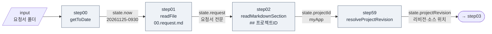

#### step00 · `01-사전작업`

| 항목 | 내용 |
|---|---|
| 종류 | TOOL — `getToDate` |
| 받는 값 | `format: yyyyMMdd-HHmm` |
| 남기는 값 | `now` (예: `20261125-0930`) |
| 다음 | step01 / 실패 → FAIL |

작업 폴더 이름으로 쓸 **지금 시각**을 구한다. 이후 모든 산출물 경로가 `${input}/${state.now}/…`이다.
같은 요청서로 여러 번 실행해도 시각이 달라 폴더가 겹치지 않는다.

#### step01 · `02-고객요청서 읽기`

| 항목 | 내용 |
|---|---|
| 종류 | TOOL — `readFile` |
| 받는 값 | `fileFullPath: ${input}/00.request.md` |
| 남기는 값 | `request` |
| 다음 | step02 / 실패 → FAIL |

요청서 전체를 읽어 둔다. 거의 모든 Agent가 `request`로 받는다. **요청서가 없으면 여기서 멈춘다.**

#### step02 · `03-프로젝트ID 읽기`

| 항목 | 내용 |
|---|---|
| 종류 | TOOL — `readMarkdownSection` |
| 받는 값 | `fileFullPath: ${input}/00.request.md`, `heading: 프로젝트ID` |
| 남기는 값 | `projectId` |
| 다음 | step59 / 실패 → FAIL |

요청서의 `## 프로젝트ID` 절 아래 글만 떼어 낸다. **이 절이 없으면 실행이 실패한다.**

#### step59 · `03-1-프로젝트 리비전 정하기`

| 항목 | 내용 |
|---|---|
| 종류 | TOOL — `resolveProjectRevision` (TOOL step 전용) |
| 받는 값 | `projectId: ${state.projectId}` |
| 남기는 값 | `projectRevision` (`{route: ok \| none, revision, sourceRoot, kind, …}`) |
| 다음 | step03 / 실패 → FAIL |

프로젝트 관리의 현재 리비전([Build] 결과)을 받는다. 이 실행은 끝까지 `projectRevision.sourceRoot`(리비전에 복사한 소스)를 원본으로 쓴다. 그 사이 새 [Build]가 있어도 영향이 없다. 빌드한 리비전이 없으면 `route: none`과 프로젝트의 소스 디렉토리를 돌려주고, 서버 기동 테스트만 하지 않는다(step28). 프로젝트ID가 프로젝트 관리에 없으면 실패한다.

---

### 구간 B. 요구사항 분석과 리뷰 — step03~step06, step39, step27

요청서를 **TASK 표**로 정리하고, 다른 Agent가 빠진 것이 없는지 판정한다.

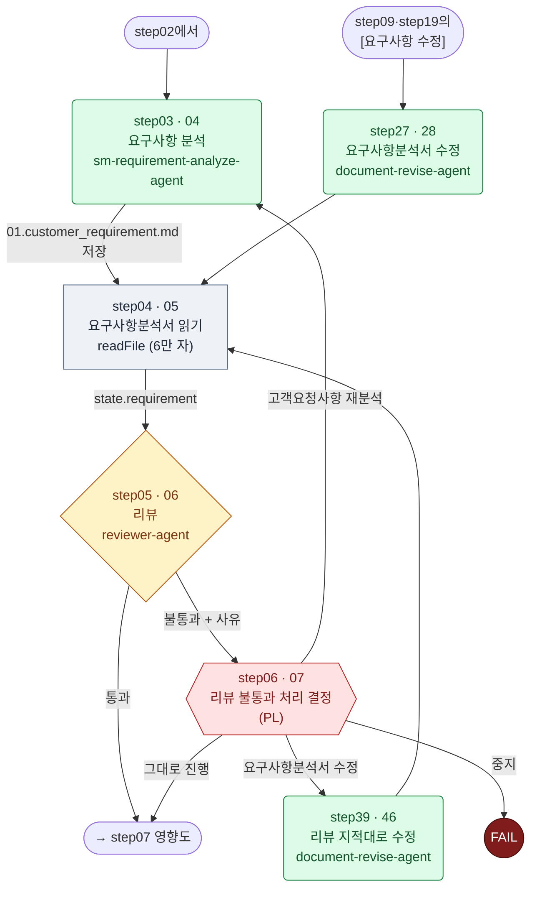

#### step03 · `04-고객요청사항 분석`

| 항목 | 내용 |
|---|---|
| 종류 | AGENT — `sm-requirement-analyze-agent` (2.0.2) |
| 받는 값 | `base_dir`, `request`, `instruction: ${arrival:}`, `history: ${decisions:}` |
| 남기는 값 | (없음. 결과는 파일) |
| 다음 | step04 / 실패하면 실행 실패 |
| 쓸 수 있는 Tool | `writeFile`, `appendFile` (꼭 `writeFile`을 불러야 함) |
| Skill | `handling-instructions`, `document-writing` |

요청서를 읽고 `01.customer_requirement.md`를 쓴다.

- 맨 위에 프로젝트ID를 요청서 그대로 옮긴다.
- **수정사항**과 **신규기능**으로 나누어 표로 적는다: `번호(TASK-01..) | 목적 | 대상 메뉴·기능 | 요구 내용 | 선행 태스크 | 완료 기준`
- 완료 기준은 "그렇다/아니다"로 확인할 수 있게 쓴다. 리뷰와 자동 검증이 이 칸으로 판정한다.
- **소스를 조사하지 않는다.** 그건 영향도 단계의 일이다. 요청서만으로 모르는 것은 "확인 필요"로 둔다.

리뷰 불통과에서 [고객요청사항 재분석]을 고르면 이 노드로 돌아와 **처음부터 다시** 쓴다.

#### step04 · `05-요구사항분석서 읽기`

| 항목 | 내용 |
|---|---|
| 종류 | TOOL — `readFile` (`maxChars: 60000`) |
| 남기는 값 | `requirement` |
| 다음 | step05 / 실패 → FAIL |

step03이 파일을 저장하지 못했으면 여기서 멈춘다. **문서가 6만 자를 넘어도 잘라 넘기지 않고 멈춘다.** 잘린 문서로 다음 단계를 진행하지 않으려는 것이다.
요구사항분석서가 바뀌는 경로(step27, step39)는 모두 이 노드로 돌아와 다시 읽는다.

#### step05 · `06-고객요청사항 분석 리뷰`

| 항목 | 내용 |
|---|---|
| 종류 | SUPERVISOR — `sm-requirement-analyze-reviewer-agent` (1.3.0) |
| 받는 값 | `request`, `requirement` |
| 남기는 값 | `review` (`{pass, reason}`) |
| 다음 | 통과 → step07 / 불통과 → step06 |

요청서와 분석서를 나란히 놓고 TASK마다 네 가지를 본다.

| 검사 | 질문 |
|---|---|
| a | 요청서의 요구가 어느 TASK에든 빠짐없이 들어 있나 |
| b | 요청서와 뜻이 다르거나 없는 내용을 넣지 않았나 |
| c | 완료 기준을 그렇다/아니다로 확인할 수 있나 |
| d | 모르는 것을 단정하지 않고 "확인 필요"로 적었나 |

**판정만 돌려주고 문서는 고치지 않는다**(1.3.0부터). 예전에는 분석서에 판정을 적었는데, 그러면 다시 리뷰할 때 고칠 자리를 못 찾았고 판정 기록이 다음 단계 입력에 섞였다. 불통과 사유는 엔진이 결정 기록에 남겨 step06과 step39로 넘긴다.

#### step06 · `07-리뷰 불통과 처리 결정`

| 항목 | 내용 |
|---|---|
| 종류 | APPROVAL — 승인자 `PL` |
| 남기는 값 | `reviewDecision` |

| 선택지 | 가는 곳 | 언제 고르나 |
|---|---|---|
| 그대로 진행 | step07 | 리뷰 지적이 사소하거나 틀렸을 때 |
| 고객요청사항 재분석 | step03 | 분석서를 처음부터 다시 써야 할 때 |
| 요구사항분석서 수정 | step39 | 지적된 곳만 고치면 될 때 (보통 이것) |
| 중지 | FAIL | 요청 자체를 다시 받아야 할 때 |

#### step39 · `46-리뷰 지적에 따른 요구사항분석서 수정`

| 항목 | 내용 |
|---|---|
| 종류 | AGENT — `document-revise-agent` (1.2.0) |
| 고칠 문서 | `01.customer_requirement.md` |
| instruction | 사람의 의견(`${arrival:}`) + 리뷰어 지적(`${state.review.reason:}`). **둘이 어긋나면 사람의 의견을 따른다** |
| 남기는 값 | `revision` |
| 다음 | step04 (다시 읽고 다시 리뷰) |

#### step27 · `28-고객요구사항분석서 수정`

| 항목 | 내용 |
|---|---|
| 종류 | AGENT — `document-revise-agent` |
| 고칠 문서 | `01.customer_requirement.md` |
| instruction | `${arrival}` — 영향도 승인(step09)이나 개발 승인(step19)에서 [요구사항 수정]을 고르며 적은 의견 |
| 다음 | step04 → step05 리뷰부터 다시 |

요구사항이 바뀌면 리뷰부터 다시 받는다. 리뷰를 통과하면 step07이 기존 영향도분석서를 발견하고 **새로 쓰지 않고 맞춘다**(구간 C).

> **`document-revise-agent`가 고치는 법** (step25·26·27·37·38·39·52 공통)
> 1. 고칠 문서를 한 번씩 읽는다.
> 2. 지시를 항목으로 나누고, 항목 하나를 고친 뒤 다음으로 넘어간다(조사가 필요 없는 항목부터). 중간에 Tool 한도가 끝나도 고친 것은 남는다.
> 3. 함께 맞춰야 할 문서(예: 설계서를 고치면 태스크 목록·DDL)도 같이 고친다.
> 4. 주 문서 끝 `## 수정 이력`에 `- {결정 이름}: 반영 - … / 반영하지 않음 - …` 한 줄을 남긴다.
> 주 문서(목록의 첫 번째)를 실제로 고쳤는지 엔진이 확인한다(`requiredWrites`).

---

### 구간 C. 영향도 분석 — step07~step09, step38, step26

"**어디를** 고치고 **어디에** 영향이 가나"만 찾는다. "어떻게 고칠지"는 설계 단계가 정한다.

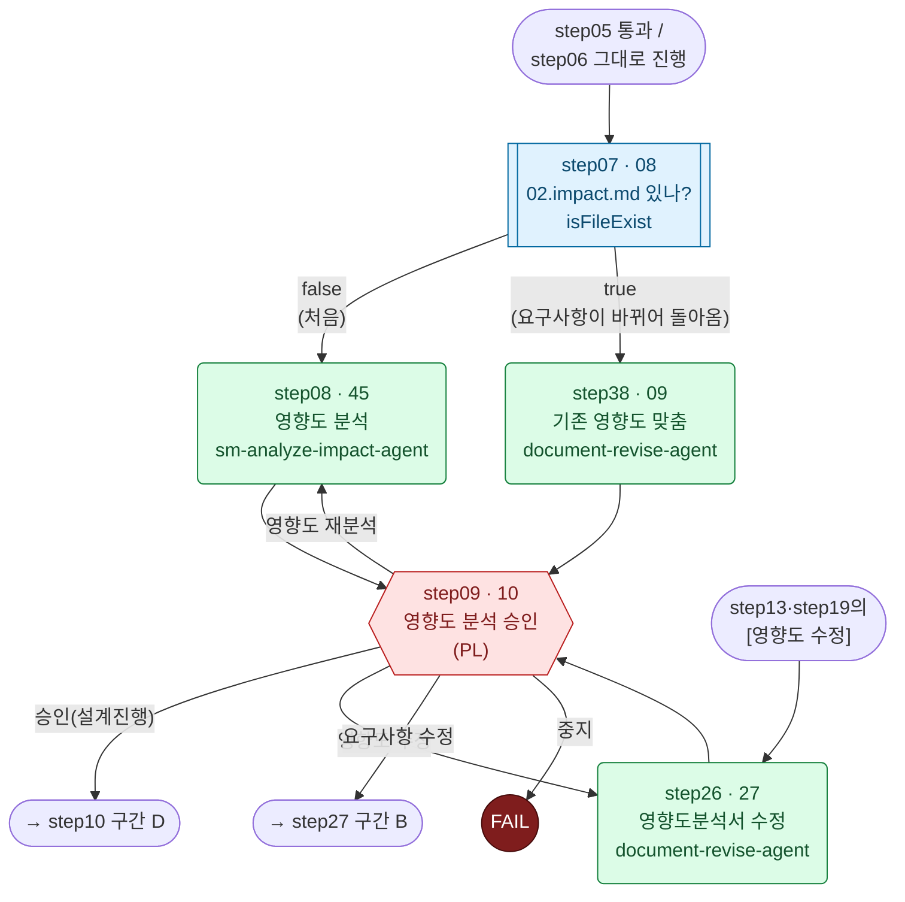

#### step07 · `08-기존 영향도분석서 확인`

| 항목 | 내용 |
|---|---|
| 종류 | TOOL + routes — `isFileExist` |
| 받는 값 | `filePath: ${input}/${state.now}/02.impact.md` |
| 다음 | `"true"` → step38 / `"false"` → step08 / 실패 → FAIL |

처음 실행이면 파일이 없으니 step08로 가서 새로 쓴다. 요구사항을 고친 뒤 돌아온 경우엔 파일이 있으니 step38로 가서 **바뀐 요구사항에 맞춰 고치기만** 한다.
파일이 없는 것은 정상 결과라서 이력에 실패로 남지 않는다(2.4.1).

#### step08 · `45-영향도 분석`

| 항목 | 내용 |
|---|---|
| 종류 | AGENT — `sm-analyze-impact-agent` (2.2.0), `reasoning: high`, Tool 한도 40 |
| 받는 값 | `base_dir`, `request`, `requirement`, `instruction`, `history` |
| 남기는 값 | `impactPath` (저장한 파일과 결정 필요 사항) |
| 다음 | step09 / 실패하면 실행 실패 |
| 쓸 수 있는 Tool | knowledge 6종(`knowledgeSearch`, `knowledgeImpact`, `knowledgeCallers`, `knowledgeCallees`, `knowledgeFindMethods`, `knowledgeTableUsage`), `searchInFiles`, `readFileLines`, DB 조회 4종, 쓰기 3종 |
| Skill | preload `handling-instructions`, `source-investigation`, `document-writing` / allowed `projects/**` |

`02.impact.md`에 쓰는 것:

| 절 | 내용 |
|---|---|
| 수정사항 표 | 번호 / 목적 / 대상 파일 절대경로 / 위치(줄 범위) / 변경 내용 / 영향도 |
| 현재 코드 | 고칠 곳마다 **읽은 원문을 그대로** 옮김(앞뒤 3줄, 40줄 이내). 설계는 이걸 보고 파일을 다시 열지 않는다 |
| 신규기능 | 참고 파일 목록(층별: 화면, Controller, Service, DAO, 쿼리, VO)과 등록 위치. 비슷한 기능이 없으면 "참고 기능 없음" + 층마다 관례 파일 하나 |
| `## 참고 기능` | **본뜰 기존 기능의 화면 경로(또는 대표 주소)**를 한 줄에 하나, 많아야 3개. 구간 D가 이것으로 코드를 모은다 (2.2.0) |
| 현행 확인 | 요구와 현실이 어긋날 때(신규라는데 이미 있음 등) 사실만 표로. 판단은 사람에게 |
| 결정 필요 사항 | 맨 끝 |

요청서에 프로젝트ID가 있으면 **knowledge Tool부터** 쓴다. 파일 검색만으로는 같은 사실을 여러 번 찾고 읽어야 해서 Tool 한도 안에 끝내지 못한다(Skill `source-investigation`의 "알고 싶은 것 → 쓸 Tool" 표).

#### step38 · `09-기존 영향도분석서 맞춤`

| 항목 | 내용 |
|---|---|
| 종류 | AGENT — `document-revise-agent` |
| 고칠 문서 | `02.impact.md` |
| instruction | "reference의 요구사항분석서 지금 내용에 영향도분석서를 맞춘다. 어긋나는 곳과 빠진 곳만 고친다" + `${arrival:}` |
| reference | `[요구사항분석서] ${state.requirement}` |
| 다음 | step09 |

#### step09 · `10-영향도 분석 승인`

| 항목 | 내용 |
|---|---|
| 종류 | APPROVAL — `PL` |
| 남기는 값 | `impactApproval` |

| 선택지 | 가는 곳 | 하는 일 |
|---|---|---|
| 승인(설계진행) | step10 | 설계 단계로 |
| 영향도 수정 | step26 | 의견에 적은 곳만 고침 |
| 영향도 재분석 | step08 | 처음부터 다시 조사·작성 |
| 요구사항 수정 | step27 | 요구사항을 고치고 리뷰부터 다시 |
| 중지 | FAIL | |

#### step26 · `27-영향도분석서 수정`

| 항목 | 내용 |
|---|---|
| 종류 | AGENT — `document-revise-agent` |
| 고칠 문서 | `02.impact.md` |
| instruction | `${arrival}` — step09·step13·step19에서 [영향도 수정]을 고르며 적은 의견 |
| 다음 | step09 (다시 승인받기) |

설계·개발 승인에서 [영향도 수정]을 골라도 여기로 온다. 영향도를 다시 승인하면 step11이 기존 설계서를 발견하고 **맞춤**(step37)으로 간다.

---

### 구간 D. 본뜰 기능의 코드 모으기 — step10, step46~step49

**2.8.0에 새로 생긴 구간이다.** 새 기능을 설계할 때 "비슷하게 동작하는 기존 기능 하나"의 코드를 **화면부터 SQL까지 통째로** 모아 설계 Agent에 넘긴다.

> **왜 필요했나** — 설계 Agent가 참고 코드를 스스로 찾으면 화면은 A 기능에서, 받는 Controller는 B 기능에서 가져와 주고받는 형식이 어긋났다(실행 0bc967d2의 팝업). 업로드 부품이나 공통 서비스의 사전 조건 같은 프로젝트 관례를 모른 채 새로 짓기도 했다(실행 9dc51bb8). dstone-knowledge가 저장한 관계를 따라 모으면 **한 기능의 짝끼리만** 들어온다.

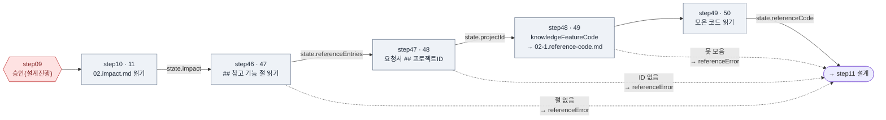

`knowledgeFeatureCode`가 따라가는 관계:

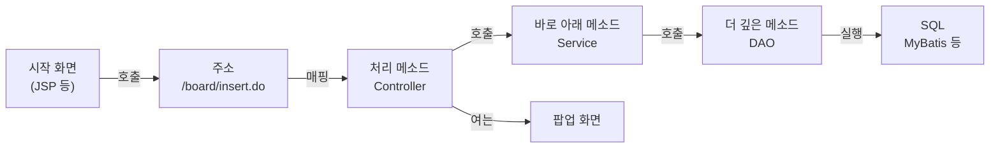

넣는 순서는 **시작 화면 → 팝업 화면 → 처리 메소드 → 바로 아래 메소드 → SQL → 더 깊은 메소드**다. 업로드 부품, 팝업 열기와 값 넘기기 같은 관례는 화면에 있기 때문이다. 글자 수 한도를 넘는 것은 위치만 적는다.

#### step10 · `11-영향도분석서 읽기`

| 항목 | 내용 |
|---|---|
| 종류 | TOOL — `readFile` (6만 자) |
| 남기는 값 | `impact` |
| 다음 | step46 / 실패 → FAIL |

#### step46 · `47-참고 기능 시작점 읽기`

| 항목 | 내용 |
|---|---|
| 종류 | TOOL — `readMarkdownSection` (`02.impact.md`의 `## 참고 기능`) |
| 남기는 값 | `referenceEntries` / 실패하면 `referenceError` |
| 다음 | step47 / 실패 → step11 |

#### step47 · `48-참고 기능을 찾을 프로젝트 확인`

| 항목 | 내용 |
|---|---|
| 종류 | TOOL — `readMarkdownSection` (요청서의 `## 프로젝트ID`) |
| 남기는 값 | `projectId` / 실패하면 `referenceError` |
| 다음 | step48 / 실패 → step11 |

#### step48 · `49-참고 기능 코드 모으기`

| 항목 | 내용 |
|---|---|
| 종류 | TOOL — `knowledgeFeatureCode` |
| 받는 값 | `projectId`, `sourceRoot: ${state.projectRevision.sourceRoot}`, `entries: ${state.referenceEntries}`, `outputFile: …/02-1.reference-code.md` |
| 남기는 값 | `referenceResult` (`{success, file, included, omitted, notFound, message}`) / 실패하면 `referenceError` |
| 다음 | step49 / 실패 → step11 |

dstone-knowledge의 분석 결과(관계)에서 위치를 얻고, 실제 코드는 **지금 원본 소스**에서 읽어 문서에 넣는다.

#### step49 · `50-참고 기능 코드 읽기`

| 항목 | 내용 |
|---|---|
| 종류 | TOOL — `readFile` (6만 자) |
| 남기는 값 | `referenceCode` / 실패하면 `referenceError` |
| 다음 | step11 (성공이든 실패든) |

> **이 구간은 실패해도 멈추지 않는다.** 네 노드 모두 `onFailure: step11`이고 실패 이유를 `state.referenceError`에 둔다. 설계 Agent는 `reference_error`가 있으면 `reference_code`를 쓰지 않고 예전처럼 설계한다. 네 노드가 모두 성공하면 `referenceError`는 비어 있다(`saveError`는 성공하면 빈 값으로 덮어쓴다).

---

### 구간 E. 설계 — step11~step13, step37, step50~step52, step25

설계서·태스크 목록·DDL을 만들고, **사람에게 보여 주기 전에 기계로 형식을 검사**한 뒤 설계 승인을 받는다.

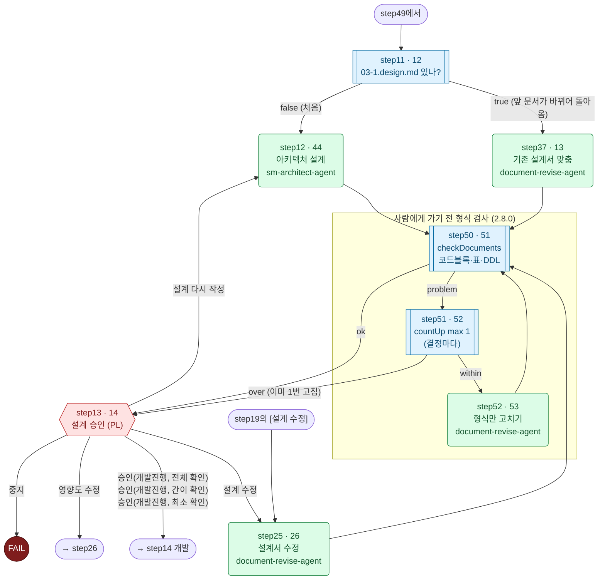

#### step11 · `12-기존 설계서 확인`

| 항목 | 내용 |
|---|---|
| 종류 | TOOL + routes — `isFileExist` (`03-1.design.md`) |
| 다음 | `"true"` → step37 / `"false"` → step12 / 실패 → FAIL |

#### step12 · `44-아키텍처 설계`

| 항목 | 내용 |
|---|---|
| 종류 | AGENT — `sm-architect-agent` (2.3.0), `reasoning: high`, Tool 한도 50 |
| 받는 값 | `base_dir`, `request`, `requirement`, `impact`, `reference_code: ${state.referenceCode:}`, `reference_error: ${state.referenceError:}`, `instruction`, `history` |
| 남기는 값 | `architectPath` |
| 다음 | step50 / 실패하면 실행 실패 |
| 쓸 수 있는 Tool | 파일 읽기·검색·쓰기, knowledge 9종(코드 6 + 문서 3), DB 조회 4종 |
| Skill | preload `handling-instructions`, `source-investigation`, `document-writing` / allowed `projects/**` |

개발자가 **이 설계서만 보고 그대로 구현할 수 있게** 쓴다. 개발 단계는 설계서의 '변경 전'을 찾아 '변경 후'로 바꾸고, 참고 파일을 복사해 이름 바꿈 표대로 바꾸기만 한다. 설계서에 없는 것은 만들어지지 않는다.

| 만드는 파일 | 내용 |
|---|---|
| `03-1.design.md` | 설계 요약(5줄) / **변경 상세**(파일 · 위치 · 변경 전 · 변경 후 · 이유 · TASK) / API·DB(DDL)·예외 처리 / TASK별 확인 방법(화면 조작 순서와 기대 결과) / 회귀 테스트 대상 / **검증 방법 제안** / 결정 필요 사항 |
| `03-2.taskitems.md` | TASK / TASK-ITEM-01.. / 목적 / 대상 파일 / 변경 내용 / 선행 / 완료 기준 / 상태(대기). 아이템 하나가 바꾸는 파일 5개 이하 |
| `03-3.ddl(데이터베이스).md` | DDL이 있을 때만 |

설계하는 법 요점:

- **수정사항** — 영향도분석서의 '현재 코드'로 '변경 전'을 정한다. 한 곳에만 맞도록 앞뒤 줄을 포함해 **글자 그대로** 옮긴다. 기억이나 추정으로 적지 않는다.
- **신규기능** — `reference_code`가 있으면 참고 파일과 주고받는 짝(화면 ↔ Controller ↔ SQL, 팝업 여는 쪽 ↔ 팝업)을 **거기 함께 나온 것끼리** 고른다. 동작하는 방식은 바꾸지 않고 본뜬다. 이름 바꿈 표(클래스, 메서드, URL, 쿼리ID, 테이블, 컬럼… "참고 → 신규"), 빼는 것, 더하는 것을 적는다.
- **스스로 확정하지 않는 것** — 영향도 밖 파일, 아키텍처 규칙을 벗어나는 방식, 새 라이브러리, DB 구조 변경. 설계에 넣되 '결정 필요 사항'에 대안과 장단점을 적는다(요청서가 직접 요구한 테이블 신설은 예외).
- **검증 방법 제안** — 전체 확인 / 간이 확인 / 최소 확인 가운데 하나와 이유. 망설여지면 전체 확인. **고르는 건 사람이다**(step13).

#### step37 · `13-기존 설계서 맞춤`

| 항목 | 내용 |
|---|---|
| 종류 | AGENT — `document-revise-agent` |
| 고칠 문서 | `03-1.design.md`, `03-2.taskitems.md`, `03-3.ddl(데이터베이스).md` |
| instruction | "요구사항분석서와 영향도분석서의 지금 내용에 설계 문서를 맞춘다. 어긋나는 곳과 빠진 곳만 고친다. 재개발과 자동 수정으로 고친 내용(`## 수정 이력`)은 두 문서와 어긋나지 않는 한 그대로 둔다" + `${arrival:}` |
| reference | 요구사항분석서 + 영향도분석서 전문 |
| 다음 | step50 |

#### step50 · `51-설계 문서 형식 확인`

| 항목 | 내용 |
|---|---|
| 종류 | TOOL + routes — `checkDocuments` |
| 받는 값 | `files: [03-1.design.md, 03-2.taskitems.md]`, `ddlFile: 03-3.ddl(데이터베이스).md` |
| 남기는 값 | `docCheck` (`{route, problems, checked, skipped, message}`) |
| 다음 | `ok` → step13 / `problem` → step51 / 실패 → step13 |

서버를 띄우지 않고 몇 초 안에 잡을 수 있는 것을 본다.

| 검사 | 예 |
|---|---|
| 닫히지 않은 코드 블록 | ```` ``` ```` 짝이 안 맞음 |
| 칸이 어긋난 표 | 머리줄은 6칸인데 어떤 줄은 7칸(칸 안에 세로 막대가 들어감) |
| DDL을 DDL 반영 확인(step60)과 같은 규칙으로 읽기 | 실행 ff9ec3c7에서 DDL 문서 끝의 ```` ``` ```` 하나 때문에 기동이 두 번 실패했고, 사람은 승인할 때 못 봤다 |

#### step51 · `52-설계 문서 형식 자동 수정 횟수 확인`

| 항목 | 내용 |
|---|---|
| 종류 | TOOL + routes — `countUp` (`max: 1`, `scope: ${decisions:}`) |
| 남기는 값 | `docCheckRound` |
| 다음 | `within` → step52 / `over` → step13 / 실패 → step13 |

사람의 결정 하나마다 **한 번만** 자동으로 고친다. 고쳐도 또 걸리면 그대로 사람에게 간다(사람이 보고 판단).

#### step52 · `53-설계 문서 형식 고치기`

| 항목 | 내용 |
|---|---|
| 종류 | AGENT — `document-revise-agent` |
| 고칠 문서 | 설계 문서 셋 |
| instruction | "기계 검사가 찾은 형식 오류만 고친다. 내용(코드, 표의 값, SQL)은 바꾸지 않는다. 닫히지 않은 블록은 닫는 줄을 넣거나 빈 여는 줄을 지운다. 표 칸 안의 세로 막대는 역슬래시를 붙여 쓰거나 `코드`로 감싼다" + `${state.docCheck.message}` |
| 다음 | step50 (다시 검사) |

#### step13 · `14-설계 승인`

| 항목 | 내용 |
|---|---|
| 종류 | APPROVAL — `PL` |
| 남기는 값 | `designApproval` (뒤에서 step43·44가 `decision`을 본다) |

| 선택지 | 가는 곳 | 하는 일 |
|---|---|---|
| **승인(개발진행, 전체 확인)** | step14 | 개발 후 **화면 검증**까지 |
| **승인(개발진행, 간이 확인)** | step14 | 개발 후 테스트 서버가 **뜨는지만** 확인 |
| **승인(개발진행, 최소 확인)** | step14 | 개발 후 **서버를 띄우지 않음** |
| 설계 수정 | step25 | 의견에 적은 곳만 고침 |
| 설계 다시 작성 | step12 | 처음부터 다시 (고친 내용이 사라질 수 있음) |
| 영향도 수정 | step26 | 영향도를 고치고 다시 승인 → 설계 맞춤 |
| 중지 | FAIL | |

승인 세 가지는 모두 step14로 가지만, 어느 것을 골랐는지가 `designApproval`에 남아 **구간 H에서 검증 깊이를 가른다**(2.7.0).

#### step25 · `26-설계서 수정`

| 항목 | 내용 |
|---|---|
| 종류 | AGENT — `document-revise-agent` |
| 고칠 문서 | 설계 문서 셋 |
| instruction | `${arrival}` (step13 또는 step19의 [설계 수정] 의견) |
| reference | `${state.compileError:}` — 지난 컴파일 오류가 있으면 같이 본다 |
| 다음 | step50 → (형식 검사) → step13 |

---

### 구간 F. 개발 — step14~step17, step54, step55, step57

설계서대로 `dev-resources/`에 코드를 만든다. **원본은 읽기만 한다.**

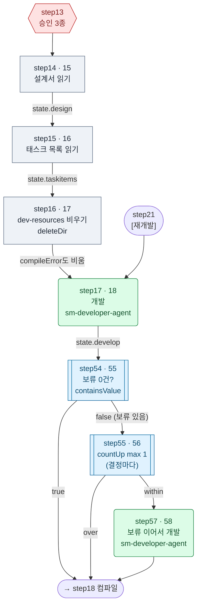

#### step14 · `15-상세 설계서 읽기` / step15 · `16-태스크아이템 목록 읽기`

| 항목 | step14 | step15 |
|---|---|---|
| 종류 | TOOL — `readFile` (6만 자) | TOOL — `readFile` (6만 자) |
| 읽는 파일 | `03-1.design.md` | `03-2.taskitems.md` |
| 남기는 값 | `design` | `taskitems` |
| 다음 | step15 / 실패 → FAIL | step16 / 실패 → FAIL |

#### step16 · `17-기존개발디렉토리초기화`

| 항목 | 내용 |
|---|---|
| 종류 | TOOL — `deleteDir` (`dev-resources`) |
| 남기는 값 | `saveError: compileError` → 성공하면 `compileError`가 **빈 값**이 된다 |
| 다음 | step17 / 실패하면 실행 실패 |

설계를 승인하고 개발로 갈 때만 지난 개발 결과를 비운다. **설계서에서 빠진 파일이 개발 폴더에 남지 않게** 하려는 것이다. 지난 컴파일 오류도 함께 지워서 새 개발에 묵은 오류가 따라가지 않는다.
[재개발]은 이 노드를 지나지 않는다(step21 → step17). 있는 결과를 고치기 때문이다.

#### step17 · `18-개발`

| 항목 | 내용 |
|---|---|
| 종류 | AGENT — `sm-developer-agent` (2.4.0), `reasoning: medium`, Tool 한도 120 |
| 받는 값 | `base_dir`, `source_dir`, `request`, `design`, `taskitems`, `instruction`, `history`, `compile_error: ${state.compileError:}` |
| 남기는 값 | `develop` (`{completed, pending, pendingReasons, notApplied, taskitemsRecorded, designSynced}`) |
| 다음 | step54 / 실패 → FAIL |
| 쓸 수 있는 Tool | `readFileLines`, `isFileExist`, `writeFile`, `editFileTexts`, `appendFile`, `copyFileWithReplace`, `searchInFiles`, `compileJava`, `checkSources` |
| Skill | preload `handling-instructions`, `source-investigation`, `troubleshooting` / allowed `projects/**` |

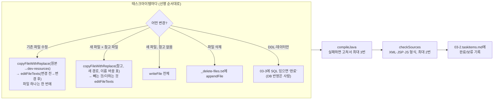

- **설계서와 다르게 만들 이유가 생기면 바꾸지 말고 '보류'로 둔다.** 임의로 바꾼 것은 아무도 검토하지 않은 채 반영되기 때문이다.
- 설계서에 글자 그대로 없는 클래스·메서드·import를 쓰게 되면 선언을 찾아 확인한다. 못 찾으면 지어내지 말고 '보류'.
- **[재개발]일 때**: `dev-resources`의 지난 결과를 고친다. 사람의 지시가 설계서보다 앞선다. 고친 것은 `03-1.design.md`에도 같은 before/after로 옮기고 `## 수정 이력`에 `재개발: …` 한 줄을 남긴다(`designSynced: true`). 나중에 설계를 다시 승인해 폴더를 비워도 고친 것이 사라지지 않는다.

#### step54 · `55-개발 보류가 없는지`

| 항목 | 내용 |
|---|---|
| 종류 | TOOL + routes — `containsValue` (`value: ${state.develop.pending:}`, `expected: "0"`) |
| 다음 | `"true"`(보류 0건) → step18 / `"false"` → step55 / 실패 → step18 |

#### step55 · `56-보류 이어서 개발 횟수 확인`

| 항목 | 내용 |
|---|---|
| 종류 | TOOL + routes — `countUp` (`max: 1`, `scope: ${decisions:}`) |
| 남기는 값 | `pendingRetry` |
| 다음 | `within` → step57 / `over` → step18 |

#### step57 · `58-보류 이어서 개발`

| 항목 | 내용 |
|---|---|
| 종류 | AGENT — `sm-developer-agent` |
| 받는 값 | step17과 같음 + `check_result`: "지난 개발이 '보류'로 남긴 태스크아이템이다. '아직 만들지 않음'처럼 일을 끝내지 못한 것이면 이어서 구현한다. 설계서와 다르게 만들어야 해서 보류한 것은 그대로 둔다" + `${state.develop.pendingReasons:}` |
| 남기는 값 | `develop` |
| 다음 | step18 / 실패 → step18 |

Tool 한도에 걸려 일을 다 못 끝낸 경우를 사람에게 가기 전에 한 번 더 이어 준다. 지난 보류 이유는 **이 경로에서만** `check_result`로 넘긴다. step17로 다시 부르면 다음 설계 승인 때 묵은 지적이 따라가기 때문이다.

---

### 구간 G. 컴파일과 형식 확인 — step18, step53, step56, step58

개발·재개발·자동 수정이 끝나면 **모두 step18로 모인다.** 여기서 기계가 잡을 수 있는 것을 먼저 잡는다.

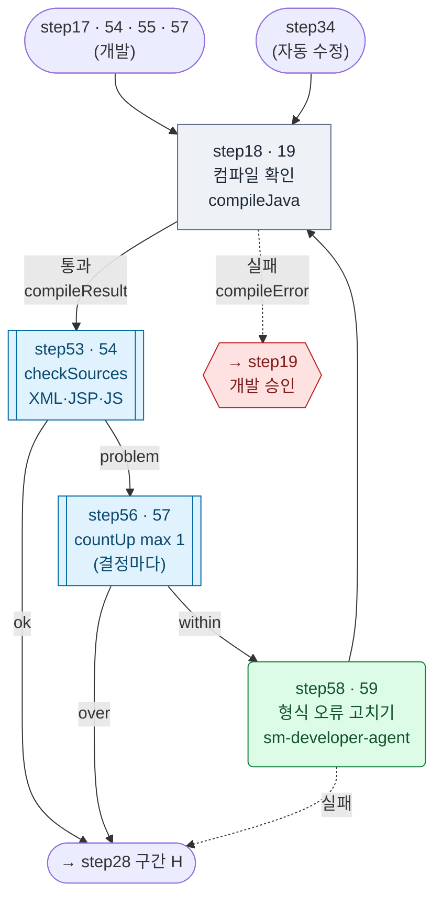

#### step18 · `19-컴파일 확인`

| 항목 | 내용 |
|---|---|
| 종류 | TOOL — `compileJava` |
| 받는 값 | `sourceRoot: ${state.projectRevision.sourceRoot}`, `overlayDir: …/dev-resources`, `outputDir: …/compile-check`, `deleteList: …/dev-resources/_delete-files.txt` |
| 남기는 값 | 통과 → `compileResult` (그리고 `compileError`는 빈 값) / 실패 → `compileError` |
| 다음 | step53 / 실패 → **step19 (개발 승인)** |

원본 전체를 빌드하지 않는다. **원본이 만들어 둔 클래스 폴더와 의존성을 참조해** 바뀐 파일(과 그것을 쓰는 원본 파일)만 컴파일한다. 그래서 **원본을 한 번은 빌드해 두어야** 한다(없으면 그렇다고 실패로 알린다).

개발 Agent가 이미 스스로 컴파일해 고쳤지만(최대 3번), Workflow가 한 번 더 확인한다. 실패해도 사람에게 가서 오류를 보여 주고, 그 오류는 다음 재개발(`compile_error`)과 설계 수정(`reference`)에 전달된다.

#### step53 · `54-개발 결과 형식 확인`

| 항목 | 내용 |
|---|---|
| 종류 | TOOL + routes — `checkSources` (`overlayDir: dev-resources`) |
| 남기는 값 | `sourceCheck` (`{route, problems, checked, skipped, message}`) |
| 다음 | `ok` → step28 / `problem` → step56 / 실패 → step28 |

| 검사 대상 | 보는 것 |
|---|---|
| XML | 올바른 XML인지, MyBatis statement id 중복 |
| JSP | 스크립틀릿(`<% %>`) 짝, 선언한 taglib 접두어의 태그 짝 |
| JavaScript | `node --check` 구문 검사 (JSP 코드가 섞이지 않은 `<script>`만) |

**틀렸다고 확신할 수 있는 것만** problem으로 낸다. 확인할 수 없는 것은 `skipped`에 적는다. Java는 `compileJava`가 보므로 여기서 보지 않는다.

#### step56 · `57-형식 오류 고치기 횟수 확인`

| 항목 | 내용 |
|---|---|
| 종류 | TOOL + routes — `countUp` (`max: 1`, `scope: ${decisions:}`) |
| 남기는 값 | `sourceCheckRound` |
| 다음 | `within` → step58 / `over` → step28 |

#### step58 · `59-형식 오류 고치기`

| 항목 | 내용 |
|---|---|
| 종류 | AGENT — `sm-developer-agent` |
| 받는 값 | step17과 같음 + `check_result: ${state.sourceCheck.message}` |
| 남기는 값 | `develop` |
| 다음 | step18 (다시 컴파일) / 실패 → step28 |

---

### 구간 H. 검증 수준 고르기 — step28, step60, step61, step42~step45

모든 변경에 서버를 띄우고 화면을 누를 필요는 없다. 설계 승인(step13)에서 사람이 고른 검증 수준을 **첫 검증에만** 적용한다(2.7.0).

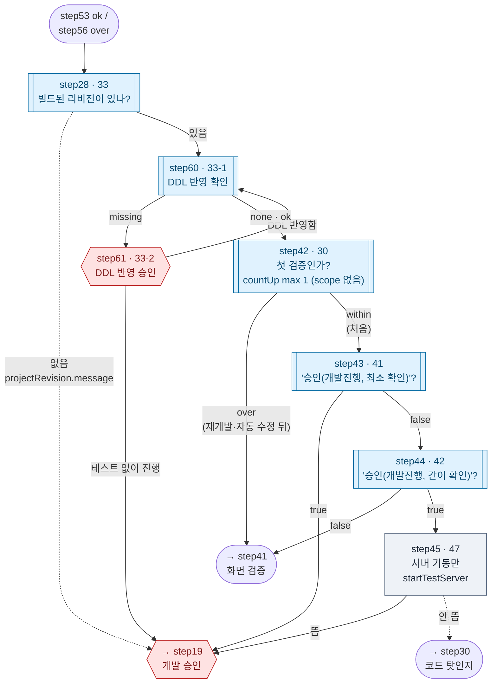

| 설계 승인에서 고른 것 | 첫 검증 | 두 번째부터 |
|---|---|---|
| 승인(개발진행, 전체 확인) | 화면 검증 (구간 I 전체) | 화면 검증 |
| 승인(개발진행, 간이 확인) | 테스트 서버가 뜨는지만 → 개발 승인 | 화면 검증 |
| 승인(개발진행, 최소 확인) | 서버 안 띄움 → 개발 승인 | 화면 검증 |

#### step28 · `33-테스트할 리비전이 있는지`

| 항목 | 내용 |
|---|---|
| 종류 | TOOL+routes — `containsValue` (`${state.projectRevision.route:}`가 `ok`인지) |
| 다음 | `"true"` → step60 / `"false"` → step19 / 실패 → step19 |

테스트 서버는 프로젝트의 리비전([Build] 결과)으로 띄운다. 빌드한 리비전이 없으면 자동 검증을 할 수 없으니 **이유(`projectRevision.message`)를 남기고 사람에게** 간다. 검증하지 못한 것을 통과로 치지 않는다.

#### step60 · `33-1-DDL 반영 확인`

| 항목 | 내용 |
|---|---|
| 종류 | TOOL+routes — `checkDdlApplied` (TOOL step 전용) |
| 받는 값 | `projectId`, `ddlFile: …/03-3.ddl(데이터베이스).md` |
| 남기는 값 | `ddlCheck` (`{route, missing, checked, message}`) |
| 다음 | `none`·`ok` → step42 / `missing` → step61 / 실패 → step42 |

테스트 서버는 DDL을 실행하지 않는다. DDL 문서의 CREATE TABLE·ALTER TABLE ADD 대상이 개발 DB에 있는지 JDBC 메타데이터로 본다.

#### step61 · `33-2-DDL 반영 승인`

| 항목 | 내용 |
|---|---|
| 종류 | APPROVAL — `PL` |
| 남기는 값 | `ddlApproval` |
| 선택지 | **DDL 반영함** → step60(다시 확인) / **테스트 없이 진행** → step19 / 중지 → FAIL |

사람이 DDL 문서를 보고 개발 DB에 반영한 뒤 승인한다. 반영하면 다음 회차부터는 step60이 `ok`라 묻지 않는다.

#### step42 · `30-첫 검증인지(검증 생략은 첫 검증에만)`

| 항목 | 내용 |
|---|---|
| 종류 | TOOL + routes — `countUp` (`previous: ${state.verifyRound:}`, `max: 1`, **scope 없음**) |
| 남기는 값 | `verifyRound` |
| 다음 | `within` → step43 / `over` → step41 / 실패 → step41 |

scope가 없어서 사람이 새로 결정해도 다시 세지 않는다. 이 실행에서 **처음 여기 온 한 번만** `within`이다.
컴파일 실패로 개발 승인에 갔다가 다시 온 경우는 아직 이 노드를 지나지 않았으니 첫 검증으로 친다.

#### step43 · `45-최소 확인으로 승인했는지`

| 항목 | 내용 |
|---|---|
| 종류 | TOOL + routes — `containsValue` (`value: ${state.designApproval.decision:}`, `expected: 승인(개발진행, 최소 확인)`) |
| 다음 | `"true"` → step19 / `"false"` → step44 / 실패 → step41 |

#### step44 · `46-간이 확인으로 승인했는지`

| 항목 | 내용 |
|---|---|
| 종류 | TOOL + routes — `containsValue` (`expected: 승인(개발진행, 간이 확인)`) |
| 다음 | `"true"` → step45 / `"false"` → step41 / 실패 → step41 |

#### step45 · `47-테스트 서버 기동만 확인`

| 항목 | 내용 |
|---|---|
| 종류 | TOOL — `startTestServer` |
| 받는 값 | `projectId`, `revision: ${state.projectRevision.revision}`, `overlayDir`, `deleteList` |
| 남기는 값 | `serverCheck` / 실패하면 `serverError` |
| 다음 | step19 / 실패 → **step30** |

뜨면 바로 개발 승인으로 간다. 안 뜨면 화면 검증 경로와 똑같이 step30에서 "개발 결과 탓인지" 가른다. 코드 탓이면 자동 수정을 거쳐 다시 컴파일하고, 그때 step42는 `over`라 **화면 검증**으로 간다.

---

### 구간 I. 자동 동작 검증과 자동 수정 — step41, step40, step29~step36

사람에게 개발 승인을 묻기 전에 **테스트 서버**에서 실제로 돌려 보고, 안 되면 사람 없이 고친다.

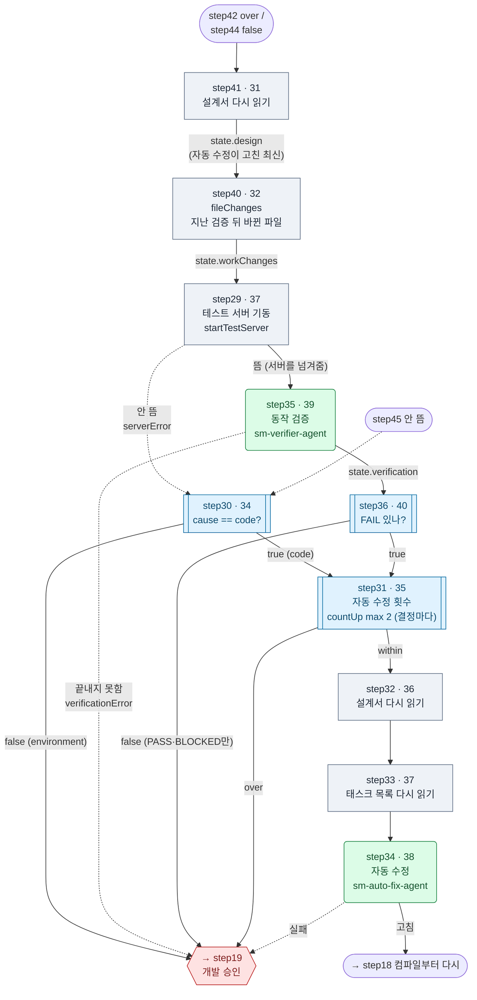

> **고리 한 바퀴** = step18 컴파일 → step53 형식 → step28 → step42(over) → step41 → step40 → step29 기동 → step35 검증 → step36 → step31 → step32~34 자동 수정 → step18 …
> step31이 **사람의 결정 하나마다 최대 2번**으로 묶는다. 사람이 개발 승인에서 [재개발] 등을 고르면 결정 기록이 바뀌어 다시 2번이 생긴다.

#### 테스트 서버가 하는 일 (`startTestServer`)

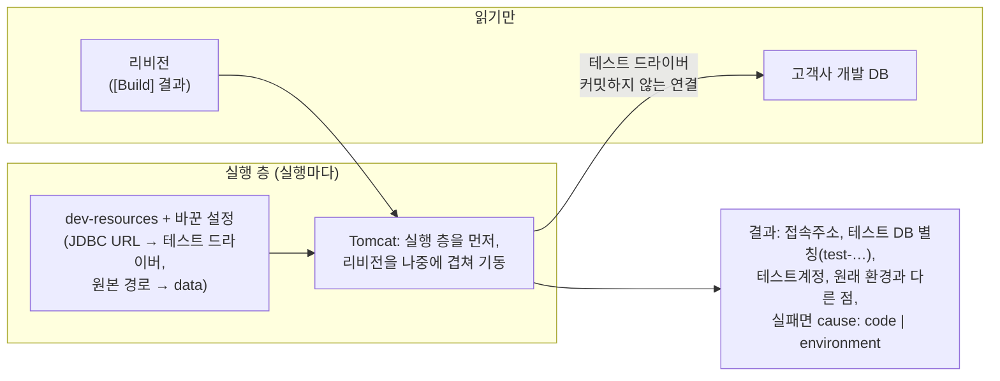

- 앱의 DB 연결은 테스트 드라이버를 거친다. 커밋하지 않으므로 다른 연결에는 보이지 않고, 실행이 승인 대기에 들어가거나 끝나면 원복한다. 테스트 중 DDL은 실행하지 않는다. 그 밖의 외부 접속은 끊는다(`SandboxGuard`).
- 서버는 실행마다 하나라 step29가 띄운 서버를 step35·step34가 그대로 받는다. 다시 부르면 바뀐 파일만 반영한다(JSP 즉시, Java·설정은 context reload).
- 띄울 수 없으면(EJB·벤더 전용 기능, Tomcat·JDK 없음, DB URL을 찾지 못함) `cause: environment`로 실패한다. 자세한 것은 [`09.dstone-ai-engine.md` 11.2절](09.dstone-ai-engine.md).

#### step41 · `31-검증 전 설계서 다시 읽기`

| 항목 | 내용 |
|---|---|
| 종류 | TOOL — `readFile` (`03-1.design.md`) |
| 남기는 값 | `design` |
| 다음 | step40 / 실패 → step19 |

자동 수정은 설계서도 고친다. 검증 Agent가 **고치기 전 설계서**를 받지 않게 다시 읽는다(2.6.0).

#### step40 · `36-검증 전 바뀐 파일 확인(서버 기동 전)`

| 항목 | 내용 |
|---|---|
| 종류 | TOOL — `fileChanges` |
| 받는 값 | `basePath: 작업 폴더`, `previous: ${state.workChanges.snapshot:}`, `excludeDirs: compile-check` |
| 남기는 값 | `workChanges` (`{first, changed, snapshot, summary}`) |
| 다음 | step29 / 실패해도 step29 |

작업 폴더의 파일마다 해시를 떠 두고 지난번과 비교한다. 검증 Agent가 **바뀐 것과 지난번에 안 된 것만 깊게** 보게 하려는 것이다(회차마다 6~7분 들던 것을 줄이려고, 2.5.0).

#### step29 · `37-테스트 서버 기동 확인`

| 항목 | 내용 |
|---|---|
| 종류 | TOOL — `startTestServer` (step45와 같은 인자) |
| 남기는 값 | `serverCheck` / 실패하면 `serverError` |
| 다음 | step35 / 실패 → step30 |

리비전에 개발 결과를 얹어 테스트 서버를 띄운다(첫 기동 testApp 기준 약 12초). 이미 떠 있으면 바뀐 것만 반영한다.

#### step30 · `34-기동 실패가 개발 결과 탓인지`

| 항목 | 내용 |
|---|---|
| 종류 | TOOL + routes — `containsValue` (`value: ${state.serverCheck.cause:}`, `expected: code`) |
| 다음 | `"true"` → step31 (자동 수정) / `"false"` → step19 / 실패 → step19 |

| `cause` | 뜻 | 가는 곳 |
|---|---|---|
| `code` | 개발 결과 때문에 빌드·기동 실패 (컴파일 오류, 잘못된 DDL, 빈 설정 등) | 자동 수정 |
| `environment` | EJB·벤더 전용 기능, Tomcat·JDK 없음, DB URL을 찾지 못함 등 | 사람에게 (이유는 `serverError`) |

#### step35 · `39-동작 검증`

| 항목 | 내용 |
|---|---|
| 종류 | AGENT — `sm-verifier-agent` (2.1.0), `reasoning: medium`, Tool 한도 120 |
| 받는 값 | `base_dir`, `source_dir`, `project_id`, `requirement`(완료 기준), `design`(확인 방법), `history`, `previous: ${state.verification:}`, `changes: ${state.workChanges.summary:}` |
| 남기는 값 | `verification` (`scenarios[]`: `{task, result, steps, evidence}`) / 실패하면 `verificationError` |
| 다음 | step36 / 실패 → step19 |
| 쓸 수 있는 Tool | `startTestServer`, 파일 읽기, DB 조회 3종, `browser_*` 13종 (Playwright MCP). `stopTestServer`는 주지 않는다(서버는 엔진이 내림) |
| 꼭 해야 하는 것 | `startTestServer`를 부르고, 화면을 실제로 열어야 한다(`requiredTools`). 서버를 띄우기 전에는 DB 조회와 브라우저가 막힌다(`toolPrerequisites`) |
| Skill | preload `test-environment`, `browser-testing` / allowed `projects/**` |

완료 기준을 하나씩, 설계서의 'TASK별 확인 방법' 순서대로 **사람처럼 누른다.** 데이터를 바꾸는 기능은 화면 반응 · 다시 조회한 화면 · 테스트 DB의 행 세 가지를 본다. 자동 수정을 거쳐 다시 검증할 때는 서버를 내리지 않으므로 앞 회차의 테스트 데이터가 남아 있다(승인 대기에 들어가거나 실행이 끝날 때 원복).

| 판정 | 뜻 | 뒤에 일어나는 일 |
|---|---|---|
| **PASS** | 기대한 결과를 **직접 봤다** | (일부라도 못 해 봤으면 PASS가 아니라 BLOCKED) |
| **FAIL** | 해 봤고 기대와 다르다. 코드를 고치면 된다 | 자동 수정을 부른다 |
| **BLOCKED** | 못 해 봤거나, 시험 환경 차이로 설명된다(계정·권한 없음, 막힌 외부 접속, 웹앱 밖 폴더 404 등) | 고치지 않고 사람에게 |

다시 검증할 때(`previous`가 있을 때):

| 기준 | 하는 일 |
|---|---|
| 지난번 FAIL·BLOCKED, 기준 글이 바뀜, 대상 파일이 `changes`에 듦 | 처음부터 확인 |
| 요구사항 문서가 바뀜, `changes`를 모름 | 모두 처음부터 |
| 나머지 지난번 PASS | 화면이 깨지지 않았는지만 보고 PASS ("지난 회차 PASS, 바뀐 파일과 무관") |

설계서는 수정 이력 때문에 늘 바뀌므로, 설계서가 바뀐 것만으로 모두 다시 하지는 않는다.

#### step36 · `40-실패한 완료 기준이 있는지`

| 항목 | 내용 |
|---|---|
| 종류 | TOOL + routes — `containsValue` (`value: ${state.verification.scenarios}`, `field: result`, `expected: FAIL`) |
| 다음 | `"true"` → step31 / `"false"` → step19 / 실패 → step19 |

#### step31 · `35-자동 수정 횟수 확인`

| 항목 | 내용 |
|---|---|
| 종류 | TOOL + routes — `countUp` (`previous: ${state.autoFixRound}`, `max: 2`, `scope: ${decisions:}`) |
| 남기는 값 | `autoFixRound` |
| 다음 | `within` → step32 / `over` → step19 / 실패 → step19 |

#### step32 · `36-자동 수정 전 설계서 다시 읽기` / step33 · `37-자동 수정 전 태스크아이템 목록 다시 읽기`

| 항목 | step32 | step33 |
|---|---|---|
| 종류 | TOOL — `readFile` | TOOL — `readFile` |
| 남기는 값 | `design` | `taskitems` |
| 다음 | step33 / 실패 → step19 | step34 / 실패 → step19 |

#### step34 · `38-자동 수정`

| 항목 | 내용 |
|---|---|
| 종류 | AGENT — `sm-auto-fix-agent` (2.1.0), `reasoning: high`, Tool 한도 120 |
| 받는 값 | `base_dir`, `source_dir`, `project_id`, `request`, `design`, `taskitems`, `revision`, `boot_error: ${state.serverError:}`, `verification: ${state.verification}`, `history` |
| 남기는 값 | `autoFix` (`{causes, changes, unresolved}`) |
| 다음 | step18 / 실패 → step19 |
| 꼭 해야 하는 것 | `03-1.design.md`에 기록(`requiredWrites`) |
| Skill | preload `troubleshooting`, `test-environment`, `browser-testing` / allowed `projects/**` |

- `boot_error`가 있으면 그것부터, 없으면 `verification`의 FAIL을 고친다. **BLOCKED는 고치지 않는다.** FAIL도 환경 차이로 보이면 고치지 않고 `unresolved`에 남긴다.
- 원인은 Skill `troubleshooting`대로 **관측한 근거에서** 출발해 원본의 동작하는 기능과 비교한다.
- DB 구조가 원인이면 `03-3.ddl` 원래 문장을 고친다(다음 시험 때 새 복제본에 처음부터 반영되므로 ALTER를 덧붙이지 않는다).
- 고친 것은 설계서에도 옮기고 `## 수정 이력`에 `- 자동 수정: (실패) → (원인) → (고친 것)`을 남긴다.
- 사람 없이 돌기 때문에 원본에 반영하는 Tool(`runShellScript` 등)은 **주지 않는다.** DB 구조가 원인이면 DDL 문서만 고치고 사람에게 반영을 남긴다(테스트 서버는 DDL을 실행하지 않음).

---

### 구간 J. 개발 승인과 그 뒤 — step19~step21

모든 길이 결국 여기로 모인다. 사람이 결과를 보고 끝낼지, 무엇을 다시 할지 고른다.

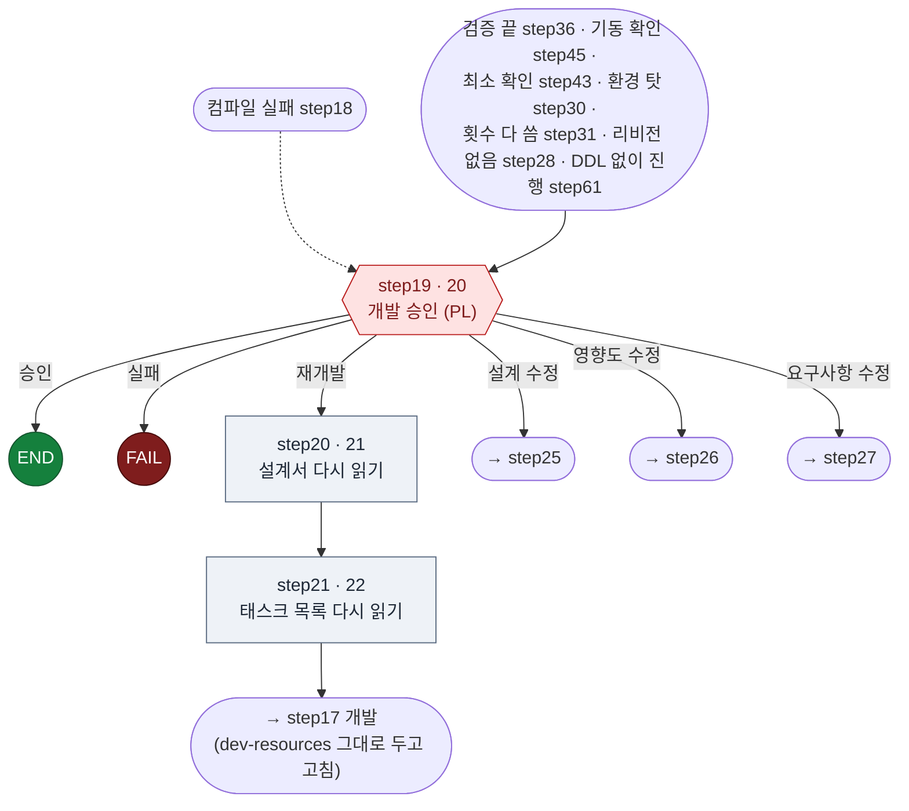

#### step19 · `20-개발 승인`

| 항목 | 내용 |
|---|---|
| 종류 | APPROVAL — `PL` |
| 남기는 값 | `developApproval` |

승인 화면에서 사람이 보는 것: 태스크 목록의 완료/보류, `compileError`, `verification`(PASS·FAIL·BLOCKED와 근거), `serverError`·`projectRevision.message`·`ddlCheck`·`verificationError`, 자동 수정의 `unresolved`.

| 선택지 | 가는 곳 | 언제 |
|---|---|---|
| **승인** | END | 결과에 만족. `dev-resources`를 사람이 원본에 반영한다 |
| **재개발** | step20 → 21 → 17 | 코드만 조금 고치면 될 때. 의견에 고칠 것을 적는다 |
| 설계 수정 | step25 | 설계가 틀렸을 때 |
| 영향도 수정 | step26 | 고칠 곳 자체가 틀렸을 때 |
| 요구사항 수정 | step27 | 요구사항이 틀렸을 때 |
| 실패 | FAIL | 이 요청을 접을 때 |

> **PASS도 LLM의 판정이다.** 그래서 마지막 승인은 사람이 한다. 화면으로만 테스트하므로 API를 바로 부르는 경로의 결함은 놓칠 수 있다.

#### step20 · `21-재개발 전 설계서 다시 읽기` / step21 · `22-재개발 전 태스크아이템 목록 다시 읽기`

| 항목 | step20 | step21 |
|---|---|---|
| 종류 | TOOL — `readFile` | TOOL — `readFile` |
| 남기는 값 | `design` | `taskitems` |
| 다음 | step21 / 실패 → FAIL | **step17** / 실패 → FAIL |

지난 개발·자동 수정이 설계서와 목록을 고쳤을 수 있으니 최신을 다시 읽는다. **step16(폴더 비우기)을 거치지 않는다.**

## 6. 사람이 고르는 선택지 모음 (APPROVAL 5개)

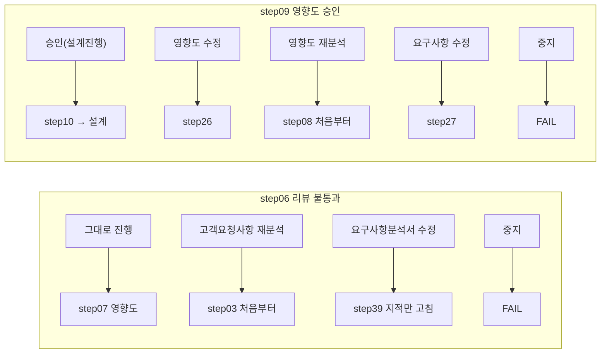

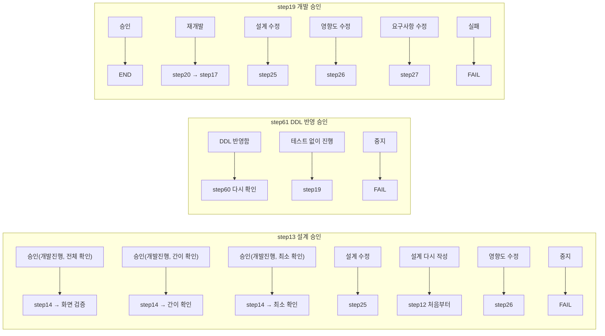

### "수정"과 "다시 작성"의 차이

| | `[~ 수정]` | `[~ 재분석]` / `[~ 다시 작성]` |
|---|---|---|
| 누가 | `document-revise-agent` (범용 편집자) | 그 문서를 처음 만든 Agent |
| 하는 일 | 의견에 적은 곳만 고치고 나머지는 한 글자도 안 바꿈 | 처음부터 조사하고 다시 씀 |
| 지난 수정 | 남는다 (`## 수정 이력`도 쌓임) | **사라질 수 있다** |
| 언제 | 대부분 이것 | 방향 자체가 틀렸을 때만 |

### 앞 문서를 고치면 뒤 문서는?

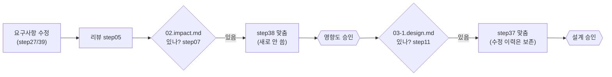

뒤 문서를 새로 쓰면 재개발·자동 수정으로 고친 것이 사라진다. 그래서 **있으면 맞추고, 없을 때만 새로 쓴다**(2.3.0).

---

## 7. 자동으로 되풀이하는 고리와 횟수 한도

사람 승인 한 번에 20~40분이 걸린다(실행 daa7c276: 118분 중 76%가 승인 대기). 그래서 기계가 고칠 수 있는 건 사람에게 가기 전에 고치되, **무한히 돌지 않게** `countUp`으로 묶는다.

| 고리 | 세는 노드 | 한도 | scope | 다 쓰면 |
|---|---|---|---|---|
| 설계 문서 형식 고치기 (step50 → 52 → 50) | step51 | 1 | 결정마다 | 설계 승인으로 |
| 보류 이어서 개발 (step54 → 57 → 18) | step55 | 1 | 결정마다 | 컴파일로 |
| 소스 형식 고치기 (step53 → 58 → 18) | step56 | 1 | 결정마다 | 검증 단계로 |
| 자동 동작 검증 → 자동 수정 (step36/30 → 34 → 18) | step31 | **2** | 결정마다 | 개발 승인으로 |
| 첫 검증인지 | step42 | 1 | **없음 (실행 전체)** | 이후 늘 화면 검증 |

**`scope: ${decisions:}`의 뜻** — `countUp`은 scope 값의 해시가 지난번과 다르면 처음부터 센다. 사람이 결정을 내릴 때마다 결정 기록이 바뀌므로, "사람의 결정 하나마다 N번"이 된다.

```mermaid
sequenceDiagram
    participant H as 사람(PL)
    participant C as countUp (step31, max 2)
    participant F as 자동 수정
    Note over C: 결정 기록 = [설계 승인]
    C->>F: within 1/2
    C->>F: within 2/2
    C-->>H: over → 개발 승인
    H->>C: [재개발] 선택 → 결정 기록이 바뀜
    Note over C: 결정 기록 = [설계 승인, 재개발]
    C->>F: within 1/2 (다시 셈)
```

> 엔진 쪽 안전장치도 있다. `settings.maxIterations: 100`은 한 실행에서 step을 도는 총 횟수의 상한이다.

---

## 8. 실패하면 어디로 가나 (onFailure 정리)

"실패"는 Tool이 `실패:`를 돌려주거나 Agent가 계약(필수 Tool, 출력 모양)을 어긴 경우다. 네트워크 단절 같은 시스템 오류는 `settings.onError: STOP`에 따라 실행을 바로 멈춘다.

| 실패하면 | 노드 | 이유 |
|---|---|---|
| **실행 전체 실패** (`FAIL` 또는 `onFailure` 없음) | step00, 01, 02, 04, 07, 10, 11, 14, 15, 20, 21, 22, 23 (문서 읽기·확인)<br/>step03, 08, 12, 16, 17, 25, 26, 27, 37, 38, 39, 52 (문서·개발 Agent) | 앞 단계 산출물이 없으면 진행하는 것이 의미 없다. 이어서 실행(재개)으로 그 자리부터 다시 할 수 있다 |
| **설계로 건너뜀** (step11) | step46, 47, 48, 49 | 본뜰 코드는 있으면 좋은 것. 이유만 `referenceError`에 남긴다 |
| **설계 승인으로** (step13) | step50, 51 | 형식 검사를 못 해도 사람이 본다 |
| **컴파일로** (step18) | step54, 55, 57 | 보류 이어 하기는 덤 |
| **검증 단계로** (step28) | step53, 56, 58 | 형식 검사·고치기는 덤 |
| **화면 검증으로** (step41) | step42, 43, 44 | 판단이 안 되면 가장 깊은 검증으로 |
| **서버 기동으로** (step29) | step40 | 바뀐 파일 목록이 없으면 모두 처음부터 검증한다 |
| **코드 탓인지 보러** (step30) | step29, step45 | 기동 실패의 원인을 가른다 |
| **개발 승인으로** (step19) | step18, 24, 28, 30, 31, 32, 33, 34, 35, 36, 41 | 사람에게 이유와 함께 보여 준다. **검증 못 한 것을 통과로 치지 않는다** |

---

## 9. Agent · Skill · Tool 한눈에

### 9.1 Agent 8종

| Agent id | 버전 | 쓰는 노드 | reasoning | Tool 한도 | 한마디로 |
|---|---|---|---|---|---|
| `sm-requirement-analyze-agent` | 2.0.2 | step03 | medium | — | 요청서 → TASK 표 |
| `sm-requirement-analyze-reviewer-agent` | 1.3.0 | step05 | — | — | 빠짐·왜곡 판정만 |
| `sm-analyze-impact-agent` | 2.2.0 | step08 | high | 40 | 어디를 고치고 어디에 영향이 |
| `sm-architect-agent` | 2.3.0 | step12 | high | 50 | 그대로 구현할 수 있는 설계서 |
| `sm-developer-agent` | 2.4.0 | step17, 57, 58 | medium | 120 | 설계서대로 dev-resources에 |
| `sm-verifier-agent` | 2.1.0 | step35 | medium | 120 | 테스트 서버에서 눌러 보고 판정 |
| `sm-auto-fix-agent` | 2.1.0 | step34 | high | 120 | 사람 없이 FAIL 고치기 |
| `document-revise-agent` (공용) | 1.2.0 | step25, 26, 27, 37, 38, 39, 52 | high | 40 | 지시받은 곳만 고치는 편집자 |

모델은 모두 provider 기본 모델(폐쇄망 POC 기준 `qwen/qwen3.8-27b`)이고 `reasoning` 세기만 다르다.

### 9.2 Skill 5종 (`skills/sm/`)

| Skill | 내용 | preload하는 Agent |
|---|---|---|
| `handling-instructions` | instruction(이번 지시)과 history(지난 결정) 읽는 법 | 요구사항, 영향도, 설계, 개발, 문서 수정 |
| `document-writing` | 문서 저장법(5천 자 넘으면 나눠 쓰기, 고칠 땐 부분만) | 요구사항, 영향도, 설계, 문서 수정 |
| `source-investigation` | "알고 싶은 것 → 쓸 Tool" 표, knowledge Tool 우선, 조사는 필요한 만큼만 | 영향도, 설계, 개발, 문서 수정 |
| `troubleshooting` | 증상별로 먼저 볼 것, 값 대조표, 고친 뒤 확인 | 개발, 자동 수정 |
| `test-environment` | 시험 환경 차이(BLOCKED)와 개발 결과 탓(FAIL) 가르기 | 검증, 자동 수정 |
| `browser-testing` | 눌리지 않는 요소, iframe 안의 요소를 locator 표기로 지정 | 검증, 자동 수정 |

대상 프로젝트만의 관례는 `skills/projects/{프로젝트ID}/<이름>/SKILL.md`에 두고 Agent가 필요할 때 부른다(`allowed: projects/**`).

### 9.3 TOOL step이 쓰는 범용 Tool

| Tool | 노드 | 돌려주는 것 |
|---|---|---|
| `getToDate` | step00 | 지금 시각 글자 |
| `readFile` | step01, 04, 10, 14, 15, 20~23, 32, 33, 41, 49 | 파일 내용 (6만 자 넘으면 실패) |
| `readMarkdownSection` | step02, 28, 46, 47 | 마크다운 절 하나의 본문 |
| `isFileExist` | step07, 11 | `true` / `false` |
| `knowledgeFeatureCode` | step48 | 기능 하나의 코드를 모은 문서 |
| `checkDocuments` | step50 | `ok` / `problem` + 걸린 줄 |
| `countUp` | step31, 42, 51, 55, 56 | `within` / `over` + 횟수 |
| `deleteDir` | step16 | 폴더 삭제 |
| `containsValue` | step30, 36, 43, 44, 54 | `true` / `false` |
| `compileJava` | step18 | 컴파일 통과 출력 또는 오류 |
| `checkSources` | step53 | `ok` / `problem` + 걸린 파일:줄 |
| `resolveProjectRevision` | step59 | 프로젝트의 현재 리비전과 소스 위치 |
| `checkDdlApplied` | step60 | DDL의 테이블·컬럼이 개발 DB에 있는지 |
| `startTestServer` | step29, 45 | 접속주소·테스트 DB 별칭·테스트계정 / 실패면 `cause` |
| `fileChanges` | step40 | `{first, changed, snapshot, summary}` |

---

## 10. state 사전 (공용 메모장)

| 이름 | 쓰는 노드 | 읽는 노드 | 내용 |
|---|---|---|---|
| `now` | step00 | 거의 전부 (경로) | 작업 시각 `yyyyMMdd-HHmm` |
| `request` | step01 | Agent 대부분 | 요청서 전문 |
| `requirement` | step04 | 05, 08, 12, 35, 37, 38 | 요구사항분석서 |
| `review` | step05 | step39 (`review.reason`) | `{pass, reason}` |
| `reviewDecision` | step06 | — | 리뷰 불통과 때 고른 것 |
| `impactPath` | step08 | — | 영향도 Agent의 답 |
| `impactApproval` | step09 | — | 영향도 승인 결과 |
| `impact` | step10 | 12, 37 | 영향도분석서 |
| `referenceEntries` | step46 | step48 | `## 참고 기능` 본문 |
| `projectId` | step02, step47 | 29, 34, 35, 45, 48 | 프로젝트ID |
| `referenceResult` | step48 | — | `{success, file, included, omitted, notFound, message}` |
| `referenceCode` | step49 | step12 | 본뜰 기능의 코드 문서 |
| `referenceError` | step46~49 | step12 | 코드를 못 모은 이유 (다 성공하면 빈 값) |
| `architectPath` | step12 | — | 설계 Agent의 답 |
| `docCheck` | step50 | step52 (`docCheck.message`) | 설계 문서 형식 검사 결과 |
| `docCheckRound` | step51 | step51 | 형식 고치기 횟수 |
| `designApproval` | step13 | 43, 44 (`designApproval.decision`) | 설계 승인 결과 |
| `design` | 14, 20, 22, 32, 41 | 17, 24, 34, 35, 57, 58 | 설계서 (늘 최신으로 다시 읽음) |
| `taskitems` | 15, 21, 23, 33 | 17, 24, 34, 57, 58 | 태스크 목록 |
| `develop` | 17, 57, 58 | 54 (`pending`), 57 (`pendingReasons`) | 개발 Agent의 답 |
| `pendingRetry` | step55 | step55 | 보류 이어 하기 횟수 |
| `compileResult` | step18 | — | 컴파일 통과 출력 |
| `compileError` | step18, step16 | 17, 24, 25, 57, 58 | 컴파일 오류 (통과하거나 step16이 비우면 빈 값) |
| `sourceCheck` | step53 | step58 (`sourceCheck.message`) | 소스 형식 검사 결과 |
| `sourceCheckRound` | step56 | step56 | 형식 고치기 횟수 |
| `projectRevision` | step59 | 17, 18, 29, 34, 35, 45, 48, 57, 58 | 리비전, 소스 위치(`sourceRoot`), 빌드한 리비전이 없으면 `route: none` |
| `ddlCheck` | step60 | (승인 화면) | DDL 반영 확인 결과 |
| `ddlApproval` | step61 | — | DDL 반영 승인의 결정 |
| `verifyRound` | step42 | step42 | 첫 검증인지 |
| `workChanges` | step40 | 40 (`snapshot`), 35 (`summary`) | 지난 검증 뒤 바뀐 파일 |
| `serverCheck` | step29, 45 | step30 (`serverCheck.cause`) | 테스트 서버 기동 결과 `{success, cause, message, url, dbAliases}` |
| `serverError` | step29, 45 | step34 (`boot_error`) | 테스트 서버 기동 실패 이유 |
| `verification` | step35 | 34, 35 (`previous`), 36 (`scenarios`) | 완료 기준별 판정 |
| `verificationError` | step35 | (승인 화면) | 검증 Agent가 끝내지 못한 이유 |
| `autoFixRound` | step31 | step31 | 자동 수정 횟수 |
| `autoFix` | step34 | — | 자동 수정 Agent의 답 |
| `developApproval` | step19 | — | 개발 승인 결과 |
| `revision` | 25, 26, 27, 37, 38, 39, 52 | — | 문서 수정 Agent의 답 |

---

## 11. 실행 예시 세 가지

### 11.1 가장 순탄한 길 — 승인 세 번으로 끝

```mermaid
sequenceDiagram
    autonumber
    actor PL as 사람(PL)
    participant WF as Workflow 엔진
    participant AG as Agent들
    participant TL as Tool들
    WF->>TL: step00~02·59 시각·요청서·프로젝트ID·리비전
    WF->>AG: step03 요구사항 작성
    WF->>AG: step05 리뷰 → 통과
    WF->>TL: step07 영향도분석서 없음(false)
    WF->>AG: step08 영향도 분석
    WF-->>PL: step09 영향도 승인 대기
    PL->>WF: 승인(설계진행)
    WF->>TL: step10, 46~49 본뜰 기능 코드 모음
    WF->>TL: step11 설계서 없음(false)
    WF->>AG: step12 설계
    WF->>TL: step50 형식 검사 ok
    WF-->>PL: step13 설계 승인 대기
    PL->>WF: 승인(개발진행, 전체 확인)
    WF->>TL: step14~16 읽기·폴더 비우기
    WF->>AG: step17 개발 (보류 0)
    WF->>TL: step54 보류 없음 → step18 컴파일 통과 → step53 ok
    WF->>TL: step28 리비전 있음 → step60 DDL 없음 → step42 within → step43·44 false
    WF->>TL: step41 설계서 · step40 바뀐 파일 · step29 테스트 서버 기동
    WF->>AG: step35 동작 검증 → 모두 PASS
    WF->>TL: step36 FAIL 없음
    WF-->>PL: step19 개발 승인 대기
    PL->>WF: 승인
    Note over WF: END → DONE
```

### 11.2 자동 검증에서 FAIL → 자동 수정 → 통과

```mermaid
sequenceDiagram
    autonumber
    participant WF as Workflow 엔진
    participant SB as 테스트 서버
    participant VF as sm-verifier-agent
    participant FX as sm-auto-fix-agent
    WF->>SB: step29 기동
    WF->>VF: step35 (같은 서버를 받음)
    VF-->>WF: TASK-02 FAIL (등록 후 목록에 안 보임)
    WF->>WF: step36 true → step31 within 1/2
    WF->>FX: step32~34 자동 수정 (SQL 조건 누락 고침, 설계서 기록)
    WF->>WF: step18 컴파일 → step53 ok → step28 → step42 over(다시)
    WF->>WF: step41 설계서 다시 읽기 → step40 바뀐 파일 = Mapper.xml
    WF->>SB: step29 바뀐 파일만 반영(Mapper.xml → context reload, DB 테스트 데이터는 남음)
    WF->>VF: step35 (TASK-02만 깊게, 나머지는 화면만 확인)
    VF-->>WF: 모두 PASS
    WF->>WF: step36 false → step19 개발 승인
```

### 11.3 DDL이 있는 개발

```mermaid
sequenceDiagram
    autonumber
    actor PL as 사람(PL)
    participant WF as Workflow 엔진
    participant DB as 개발 DB
    WF->>DB: step60 checkDdlApplied (새 테이블 TB_IMAGE 없음)
    WF-->>PL: step61 DDL 반영 승인 대기
    PL->>DB: 03-3.ddl(데이터베이스).md를 보고 반영
    PL->>WF: DDL 반영함
    WF->>DB: step60 다시 확인 → ok
    WF->>WF: step42 … step29 테스트 서버 기동 → step35 검증
```

---

## 12. 자주 묻는 것

**Q. 원본 소스에 반영은 누가 하나?**
사람이 한다. Workflow는 `dev-resources/`(원본과 같은 경로)와 `_delete-files.txt`, DDL 문서만 남긴다. DB 변경도 사람이 `03-3.ddl(데이터베이스).md`를 보고 적용한다.

**Q. 문서가 6만 자를 넘어서 멈췄다.**
문서를 줄이거나, 그 step의 `maxChars`와 엔진의 `max-result-chars`를 함께 올린 뒤 이어서 실행한다. 잘린 문서로 진행하지 않으려고 일부러 멈추는 것이다.

**Q. 프로젝트ID를 안 적으면?**
2.9.0부터는 실행이 시작하자마자 실패한다(step02). 프로젝트ID로 소스(리비전)·DB·테스트계정을 찾기 때문이다.

**Q. 프로젝트를 [Build]하지 않았으면?**
요구사항·영향도·설계·개발·컴파일 확인은 프로젝트의 소스 디렉토리로 진행한다. 서버 기동 테스트는 하지 않고 이유와 함께 개발 승인으로 간다(step28).

**Q. 검증이 PASS인데 사람이 해 보니 안 된다.**
개발 승인에서 [재개발]을 고르고 의견에 증상·재현 순서·오류 메시지를 적는다. 그 실패 사례는 실행 관리 > 진행 기록 > [평가 사례로 만들기]로 남겨 Agent 평가에 쓴다.

**Q. 예전 버전으로 시작한 실행을 이어 가도 되나?**
step 구성이 바뀐 뒤에는 새로 시작하는 것이 안전하다. 재개는 step id로 자리를 찾으므로 같은 id가 다른 일을 할 수 있다.

**Q. step id 번호와 화면 순서가 왜 다른가?**
id는 한 번 정하면 바꾸지 않고, 새 step은 그때까지의 최댓값 + 1을 받는다(그래서 2.8.0에 더한 노드가 step46~58이다). 흐름 순서는 `name` 앞 번호(`01-` … `59-`)로 본다. 다만 `name` 번호도 추가된 시점에 따라 붙어서 완전히 흐름 순서는 아니다(예: step08이 `45-영향도 분석`).

---

## 13. 노드 전체 색인

| id | name | 종류 | 부르는 것 | 구간 | 다음 (성공 / 분기) | 실패 |
|---|---|---|---|---|---|---|
| step00 | 01-사전작업 | TOOL | `getToDate` | A | step01 | FAIL |
| step01 | 02-고객요청서 읽기 | TOOL | `readFile` | A | step02 | FAIL |
| step02 | 03-프로젝트ID 읽기 | TOOL | `readMarkdownSection` | A | step59 | FAIL |
| step03 | 04-고객요청사항 분석 | AGENT | `sm-requirement-analyze-agent` | B | step04 | 실행 실패 |
| step04 | 05-요구사항분석서 읽기 | TOOL | `readFile` | B | step05 | FAIL |
| step05 | 06-고객요청사항 분석 리뷰 | SUPERVISOR | `sm-requirement-analyze-reviewer-agent` | B | 통과 step07 | 불통과 step06 |
| step06 | 07-리뷰 불통과 처리 결정 | APPROVAL | PL | B | 07 / 03 / 39 / FAIL | — |
| step07 | 08-기존 영향도분석서 확인 | TOOL+routes | `isFileExist` | C | true step38 / false step08 | FAIL |
| step08 | 45-영향도 분석 | AGENT | `sm-analyze-impact-agent` | C | step09 | 실행 실패 |
| step09 | 10-영향도 분석 승인 | APPROVAL | PL | C | 10 / 26 / 08 / 27 / FAIL | — |
| step10 | 11-영향도분석서 읽기 | TOOL | `readFile` | D | step46 | FAIL |
| step11 | 12-기존 설계서 확인 | TOOL+routes | `isFileExist` | E | true step37 / false step12 | FAIL |
| step12 | 44-아키텍처 설계 | AGENT | `sm-architect-agent` | E | step50 | 실행 실패 |
| step13 | 14-설계 승인 | APPROVAL | PL | E | 14(×3) / 25 / 12 / 26 / FAIL | — |
| step14 | 15-상세 설계서 읽기 | TOOL | `readFile` | F | step15 | FAIL |
| step15 | 16-태스크아이템 목록 읽기 | TOOL | `readFile` | F | step16 | FAIL |
| step16 | 17-기존개발디렉토리초기화 | TOOL | `deleteDir` | F | step17 | 실행 실패 |
| step17 | 18-개발 | AGENT | `sm-developer-agent` | F | step54 | FAIL |
| step18 | 19-컴파일 확인 | TOOL | `compileJava` | G | step53 | step19 |
| step19 | 20-개발 승인 | APPROVAL | PL | J | END / 20 / 22 / 25 / 26 / 27 / FAIL | — |
| step20 | 21-재개발 전 설계서 다시 읽기 | TOOL | `readFile` | J | step21 | FAIL |
| step21 | 22-재개발 전 태스크아이템 목록 다시 읽기 | TOOL | `readFile` | J | step17 | FAIL |
| step25 | 26-설계서 수정 | AGENT | `document-revise-agent` | E | step50 | 실행 실패 |
| step26 | 27-영향도분석서 수정 | AGENT | `document-revise-agent` | C | step09 | 실행 실패 |
| step27 | 28-고객요구사항분석서 수정 | AGENT | `document-revise-agent` | B | step04 | 실행 실패 |
| step28 | 33-테스트할 리비전이 있는지 | TOOL+routes | `containsValue` | H | true step60 / false step19 | step19 |
| step29 | 37-테스트 서버 기동 확인 | TOOL | `startTestServer` | I | step35 | step30 |
| step30 | 34-기동 실패가 개발 결과 탓인지 | TOOL+routes | `containsValue` | I | true step31 / false step19 | step19 |
| step31 | 35-자동 수정 횟수 확인 | TOOL+routes | `countUp` (2) | I | within step32 / over step19 | step19 |
| step32 | 36-자동 수정 전 설계서 다시 읽기 | TOOL | `readFile` | I | step33 | step19 |
| step33 | 37-자동 수정 전 태스크아이템 목록 다시 읽기 | TOOL | `readFile` | I | step34 | step19 |
| step34 | 38-자동 수정 | AGENT | `sm-auto-fix-agent` | I | step18 | step19 |
| step35 | 39-동작 검증 | AGENT | `sm-verifier-agent` | I | step36 | step19 |
| step36 | 40-실패한 완료 기준이 있는지 | TOOL+routes | `containsValue` | I | true step31 / false step19 | step19 |
| step37 | 13-기존 설계서 맞춤 | AGENT | `document-revise-agent` | E | step50 | 실행 실패 |
| step38 | 09-기존 영향도분석서 맞춤 | AGENT | `document-revise-agent` | C | step09 | 실행 실패 |
| step39 | 46-리뷰 지적에 따른 요구사항분석서 수정 | AGENT | `document-revise-agent` | B | step04 | 실행 실패 |
| step40 | 36-검증 전 바뀐 파일 확인(서버 기동 전) | TOOL | `fileChanges` | I | step29 | step29 |
| step41 | 31-검증 전 설계서 다시 읽기 | TOOL | `readFile` | I | step40 | step19 |
| step42 | 30-첫 검증인지 | TOOL+routes | `countUp` (1) | H | within step43 / over step41 | step41 |
| step43 | 45-최소 확인으로 승인했는지 | TOOL+routes | `containsValue` | H | true step19 / false step44 | step41 |
| step44 | 46-간이 확인으로 승인했는지 | TOOL+routes | `containsValue` | H | true step45 / false step41 | step41 |
| step45 | 47-테스트 서버 기동만 확인 | TOOL | `startTestServer` | H | step19 | step30 |
| step46 | 47-참고 기능 시작점 읽기 | TOOL | `readMarkdownSection` | D | step47 | step11 |
| step47 | 48-참고 기능을 찾을 프로젝트 확인 | TOOL | `readMarkdownSection` | D | step48 | step11 |
| step48 | 49-참고 기능 코드 모으기 | TOOL | `knowledgeFeatureCode` | D | step49 | step11 |
| step49 | 50-참고 기능 코드 읽기 | TOOL | `readFile` | D | step11 | step11 |
| step50 | 51-설계 문서 형식 확인 | TOOL+routes | `checkDocuments` | E | ok step13 / problem step51 | step13 |
| step51 | 52-설계 문서 형식 자동 수정 횟수 확인 | TOOL+routes | `countUp` (1) | E | within step52 / over step13 | step13 |
| step52 | 53-설계 문서 형식 고치기 | AGENT | `document-revise-agent` | E | step50 | 실행 실패 |
| step53 | 54-개발 결과 형식 확인 | TOOL+routes | `checkSources` | G | ok step28 / problem step56 | step28 |
| step54 | 55-개발 보류가 없는지 | TOOL+routes | `containsValue` | F | true step18 / false step55 | step18 |
| step55 | 56-보류 이어서 개발 횟수 확인 | TOOL+routes | `countUp` (1) | F | within step57 / over step18 | step18 |
| step56 | 57-형식 오류 고치기 횟수 확인 | TOOL+routes | `countUp` (1) | G | within step58 / over step28 | step28 |
| step57 | 58-보류 이어서 개발 | AGENT | `sm-developer-agent` | F | step18 | step18 |
| step58 | 59-형식 오류 고치기 | AGENT | `sm-developer-agent` | G | step18 | step28 |
| step59 | 03-1-프로젝트 리비전 정하기 | TOOL | `resolveProjectRevision` | A | step03 | FAIL |
| step60 | 33-1-DDL 반영 확인 | TOOL+routes | `checkDdlApplied` | H | none·ok step42 / missing step61 | step42 |
| step61 | 33-2-DDL 반영 승인 | APPROVAL | — | H | DDL 반영함 step60 / 테스트 없이 진행 step19 | — |

---

> 이 문서는 `sm-workflow.yml` **2.8.0** 기준이다. 노드를 더하거나 바꾸면 4장 지도, 해당 구간 그림, 7·8·10·13장 표를 함께 고친다.

