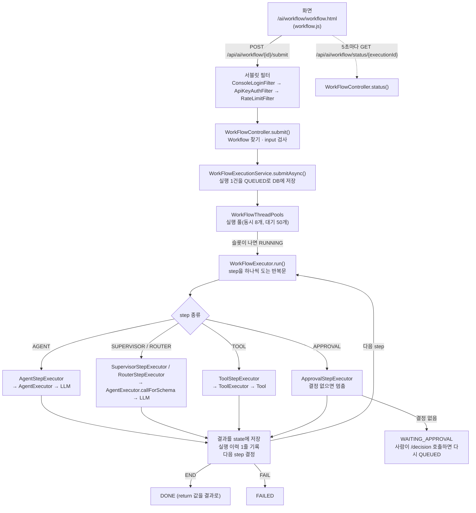
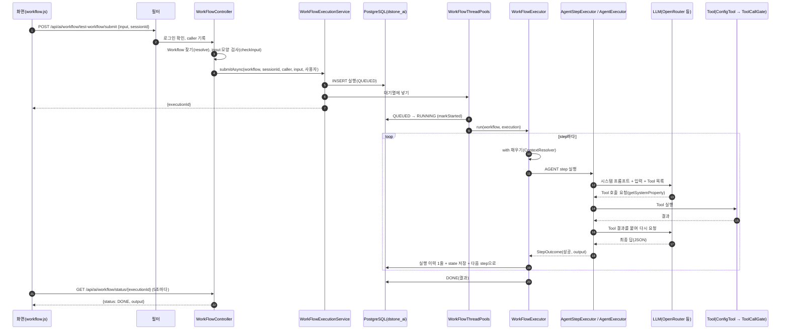
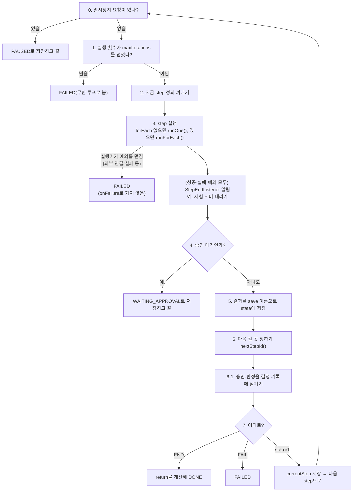
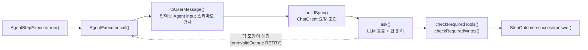
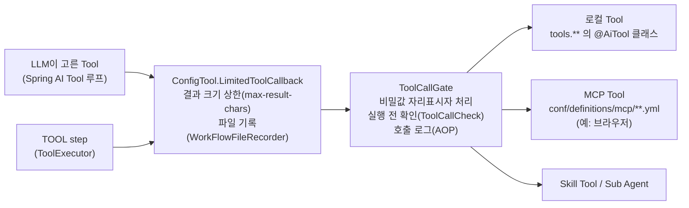
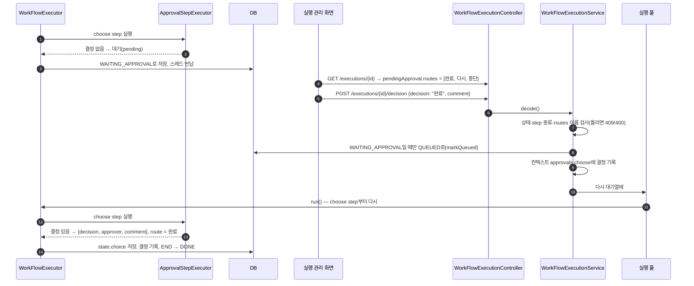
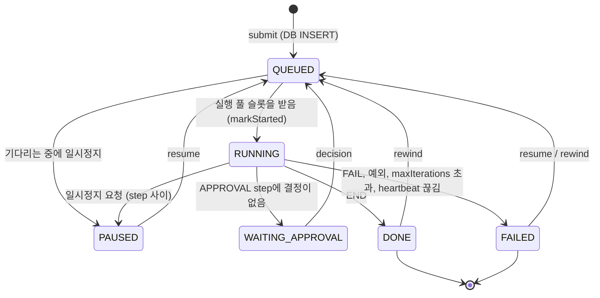

# dstone-ai-engine — Workflow 한 번이 지나가는 길

화면에서 [실행]을 누른 순간부터 Workflow가 끝날 때까지 요청이 어떤 클래스를 어떤 순서로 지나가는지 따라간다.
처음 보는 개발자가 10분 안에 큰 구조를 잡고, 궁금한 곳이 생기면 어느 파일을 열어야 하는지 알게 하는 것이 목표다.

- 대상 코드: `dstone-ai-engine` (루트 패키지 `net.dstone.ai`)
- 개념과 정의 파일 문법 전체는 [`09.dstone-ai-engine.md`](09.dstone-ai-engine.md)에 있다. 이 문서는 "실행 흐름" 하나만 다룬다.
- 코드 위치는 `net.dstone.ai`를 뺀 경로로 적는다. 예: `runtime.workflow.WorkFlowExecutor` → `src/main/java/net/dstone/ai/runtime/workflow/WorkFlowExecutor.java`

---

## 목차

1. [10분 요약](#1-10분-요약)
2. [먼저 알아 둘 말](#2-먼저-알아-둘-말)
3. [예로 쓸 Workflow](#3-예로-쓸-workflow)
4. [한 단계씩 따라가기](#4-한-단계씩-따라가기)
5. [승인(APPROVAL)에서 멈췄다가 이어 가기](#5-승인approval에서-멈췄다가-이어-가기)
6. [실행 상태가 바뀌는 모양](#6-실행-상태가-바뀌는-모양)
7. [어디에 무엇이 남나 (DB, Redis, 로그, 파일)](#7-어디에-무엇이-남나-db-redis-로그-파일)
8. [서버가 죽거나 LLM이 늦을 때](#8-서버가-죽거나-llm이-늦을-때)
9. [API 전체 목록](#9-api-전체-목록)
10. [application.yml 항목과 의미](#10-applicationyml-항목과-의미)
11. [어느 파일을 열어야 하나 (패키지 지도)](#11-어느-파일을-열어야-하나-패키지-지도)
12. [디버깅할 때 보는 곳](#12-디버깅할-때-보는-곳)

---

## 1. 10분 요약

한 문장으로 줄이면 이렇다.

> **화면이 `POST /api/ai/workflow/{id}/submit`을 부르면, 엔진은 실행 한 건을 DB에 `QUEUED`로 만들고 실행 풀에 넣는다.
> 풀의 스레드가 `WorkFlowExecutor`로 step을 하나씩 돌린다. step마다 입력을 채우고 → 종류에 맞는 실행기를 부르고 → 결과를 `state`에 저장하고 → 다음 step을 정한다.
> AGENT step은 LLM을 부르고, LLM이 고른 Tool은 엔진이 대신 실행한다. 승인 step에서는 멈춰서 사람의 결정을 기다린다.
> `END`에 닿으면 `DONE`, `FAIL`이나 오류면 `FAILED`가 된다. 화면은 그동안 `GET /status/{executionId}`로 상태를 물어본다.**

### 한 장 그림



### 계층별로 보면

| 층 | 하는 일 | 대표 클래스 |
|---|---|---|
| 화면 | 입력을 받아 실행을 요청하고 상태를 물어본다 | `static/ai/workflow/workflow.html`, `assets/js/workflow.js`, `assets/js/ai-common.js` |
| 필터 | 로그인 확인, 호출 주체(caller) 정하기, 요청 수 제한 | dstone-common `ConsoleLoginFilter`, `common.security.ApiKeyAuthFilter`, `RateLimitFilter` |
| 컨트롤러 | URL을 받아 검사하고 서비스에 넘긴다 | `api.controller.WorkFlowController`, `WorkFlowExecutionController` |
| 서비스 | 실행 한 건을 만들고, 대기열에 넣고, 승인·일시정지·되감기를 처리한다 | `api.service.WorkFlowExecutionService` |
| 실행 풀 | 동시에 도는 Workflow 수를 묶는다 | `runtime.workflow.WorkFlowThreadPools` |
| 실행기 | step 순서·분기·반복·멈춤을 제어한다 | `runtime.workflow.WorkFlowExecutor` |
| step 실행기 | step 하나를 종류에 맞게 돌린다 | `runtime.step.*StepExecutor` |
| Agent 호출 | LLM 요청을 조립하고 답을 계약대로 받는다 | `runtime.agent.AgentExecutor` |
| Tool 호출 | Tool을 찾아 실행한다(LLM이 고른 것이든 TOOL step이든) | `common.config.ConfigTool`, `runtime.tool.ToolExecutor`, `runtime.tool.ToolCallGate`, `tools.**` |
| 저장 | 실행 상태·이력·파일 기록을 DB에 남긴다 | `runtime.workflow.execution.WorkFlowExecutionStore`, `runtime.workflow.file.WorkFlowFileStore` |

**핵심 원칙 하나만 기억하면 된다.** 흐름(순서, 분기, 반복, 멈춤)은 Java가 정하고, step 안의 판단만 LLM에게 맡긴다. "무엇을 하는가"는 Java 코드가 아니라 `conf/definitions/` 아래 정의 파일(YAML, Markdown)에 있다.

---

## 2. 먼저 알아 둘 말

| 말 | 뜻 | 어디에 있나 |
|---|---|---|
| **Workflow** | step을 이어 놓은 업무 흐름 하나 | `conf/definitions/workflows/**/<id>.yml` |
| **step** | Workflow의 한 단계. 종류는 AGENT, SUPERVISOR, ROUTER, TOOL, APPROVAL 다섯 가지 | Workflow 파일의 `steps:` |
| **Agent** | LLM에게 일을 맡기는 단위. 프롬프트, 입출력 모양, 쓸 Tool을 적는다 | `conf/definitions/agents/**/<id>.md` (머리말 + 프롬프트 본문) |
| **Tool** | Java로 만든 기능 하나(파일 읽기, DB 조회 등). LLM이 고르거나 TOOL step이 직접 부른다 | `tools.**`에서 `@AiTool`이 붙은 클래스의 `@Tool` 메소드, MCP 서버의 Tool |
| **실행(execution)** | Workflow를 한 번 돌리는 것. `executionId`로 구분한다 | DB `AI_WORKFLOW_EXECUTION` 한 행 |
| **state** | step 결과를 이름 붙여 담는 곳. 뒤 step은 `${state.이름}`으로 읽는다 | 실행 컨텍스트(`CONTEXT_JSON`)의 `state` |
| **caller** | 엔진을 부른 "앱"(API 키에 묶인 이름). 인증을 끄면 비어 있다 | `common.security.CallerContext` |
| **requester** | 실행을 시작한 "사람"(화면 로그인 사용자) | `common.security.RequesterContext`, DB `REQUESTED_BY` |
| **sessionId** | 대화 묶음 id. 요청에 없으면 새로 만든다. `memory: true`인 step의 대화 기억에 쓴다 | `WorkFlowController.resolveSessionId()` |

---

## 3. 예로 쓸 Workflow

설명은 저장소에 있는 작은 시험용 Workflow `test-workflow`를 따라간다. AGENT step 하나와 SUPERVISOR step 하나로 되어 있고, AGENT 안에서 LLM이 Tool을 한 번 부른다.

`conf/definitions/workflows/test/test-workflow.yml`

```yaml
id: test-workflow
version: 1.0.0
input:
  inputStr: string
  div: string
state:
  step01_output: step01 step의 결과
  step02_output: step02 step의 결과
steps:
  - id: step01
    name: 테스트
    type: AGENT
    agent: input-check-agent
    with: ${input}                       # 요청 input을 그대로 Agent에 넣는다
    save: step01_output                  # 결과를 state.step01_output에 저장
    next: step02
  - id: step02
    name: 테스트 판정
    type: SUPERVISOR
    agent: test-supervisor-agent
    with: ${state.step01_output.outArr[0]}   # 앞 step 결과의 첫 글자를 넘긴다
    save: step02_output
    next: END                            # 통과하면 끝
    onFailure: FAIL                      # 불통과면 실패로 끝
```

`conf/definitions/agents/.../input-check-agent.md` (머리말만)

```yaml
id: input-check-agent
input:
  inputStr: string, 토큰으로 나눌 인풋스트링
  div: string, 토큰으로 나눌 구분자
output:
  outArr(array, 토큰으로 나뉜 input 스트링): string
  os: string, os 명
tools:
  allowed:
    - getSystemProperty          # tools.system.SystemTool.getSystemProperty
execution:
  maxAttempts: 3
  onInvalidOutput: RETRY         # 답 모양이 틀리면 다시 부른다
```

화면에서 Workflow `test-workflow`를 고르고 입력 칸에 `{"inputStr": "a,b,c", "div": ","}`을 넣어 [실행]을 눌렀다고 하자.

---

## 4. 한 단계씩 따라가기



### 4.1 화면: 실행 요청 보내기

| 항목 | 내용 |
|---|---|
| 화면 | `Workflow 테스트` — `static/ai/workflow/workflow.html` |
| 스크립트 | `static/ai/assets/js/workflow.js`의 `submit()` |
| 공통 호출 함수 | `static/ai/assets/js/ai-common.js`의 `DstoneAi.api(method, url, body)` (fetch로 JSON을 주고받는다) |

1. 화면이 열리면 `GET /api/ai/workflow`로 실행할 수 있는 Workflow 목록을 받아 드롭다운을 채운다.
2. [실행]을 누르면 `submit()`이 입력 칸을 읽는다. Workflow의 input이 글자 하나면 그대로, 아니면 `JSON.parse`로 객체로 바꾼다.
3. `POST /api/ai/workflow/{workflowId}/submit`에 `{ "input": ..., "sessionId": ... }`를 보낸다. sessionId 칸이 비어 있으면 `null`을 보낸다.
4. 응답으로 받은 `executionId`를 화면에 적고, 5초마다 `GET /api/ai/workflow/status/{executionId}`를 부른다(`startTracking()` → `fetchStatus()`). 상태가 `DONE`이나 `FAILED`가 되면 멈춘다.

> 실행 과정을 자세히 보거나 승인을 내리는 화면은 따로 있다. **실행 관리** 화면(`static/ai/admin/workflow/workflow.html`, `workflow-admin.js`)이 `/api/ai/workflow/executions/**`를 부른다(5장, 9장).
> 화면은 세션 쿠키(`DSTONE_AI_SESSION`)로 로그인 상태를 엔진에 전한다. API 키는 쓰지 않는다.

### 4.2 서블릿 필터: 컨트롤러에 닿기 전

요청은 컨트롤러 전에 필터 세 개를 지난다. 순서대로 적는다.

| 순서 | 필터 | 하는 일 | 켜고 끄는 설정 |
|---|---|---|---|
| 1 | `ConsoleLoginFilter` (dstone-common, 등록은 `common.config.ConfigConsole`) | 화면과 `/console/**`은 로그인이 있어야 연다. 메뉴에 등록된 화면은 그 메뉴 권한이 있어야 한다. **`/api/**`는 이 필터가 막지 않고 다음 필터에 맡긴다** | 항상 켜짐 |
| 2 | `common.security.ApiKeyAuthFilter` (`@Order(1)`) | 누가 불렀는지(caller)를 정한다. `X-API-Key` 헤더의 키를 `dstone.ai.security.auth.keys`에서 찾아 그 caller를 기록한다. 키가 없어도 화면 로그인 세션이 있으면 caller를 `dstone-ai-screen`으로 둔다. 둘 다 없으면 401 | `dstone.ai.security.auth.enabled` (지금 `false` → 필터를 건너뛰고 caller는 빈 값) |
| 3 | `common.security.RateLimitFilter` (`@Order(2)`) | caller(없으면 IP)별로 정해진 시간 안의 요청 수를 센다. 넘으면 429 | `dstone.ai.security.ratelimit.enabled` (지금 `false`) |

- caller는 request attribute에 담기고 `CallerContext.get(request)`로 꺼낸다. Workflow·Agent·Tool의 "이 caller만 써도 된다" 검사(`allowedCallers`, `dstone.ai.tool.allowed-by-caller`)가 이 값을 쓴다. 비어 있으면 모든 검사를 통과한다.
- 사람(requester)은 `RequesterContext.userOf(request)`가 정한다. 화면에서 온 요청이면 세션 사용자이고, API 키로 인증된 앱이 보낸 요청이면 `X-Dstone-User` 헤더 값이다. 키 없이 온 헤더는 믿지 않는다.

### 4.3 컨트롤러: `WorkFlowController.submit()`

`api.controller.WorkFlowController` (`@RequestMapping("/api/ai/workflow")`)

```java
@PostMapping("/{workflowId}/submit")
public ResponseEntity<Object> submit(@PathVariable String workflowId, @RequestBody WorkFlowRequest request, HttpServletRequest servletRequest) {
    String caller = CallerContext.get(servletRequest);
    WorkFlowDefinition workflow = this.workFlowRegistry.resolve(workflowId, caller);   // ① 찾기
    this.checkInput(workflow, request);                                                 // ② input 검사
    String sessionId = this.resolveSessionId(request);                                  // ③ 세션 id
    String executionId = this.workFlowExecutionService.submitAsync(workflow, sessionId, caller, request.input(),
            RequesterContext.userOf(servletRequest));                                   // ④ 실행 시작
    return ResponseEntity.ok(new WorkFlowSubmitResponse(executionId));
}
```

1. **Workflow 찾기** — `common.registry.WorkFlowRegistry.resolve(id, caller)`. 정의 파일은 엔진이 뜰 때 이미 읽어서 검사까지 마쳐 두었다(아래 "정의 파일은 언제 읽나"). 없는 id이거나 caller에게 허용되지 않은 Workflow면 여기서 바로 실패한다. 비동기로 걸어 놓고 한참 뒤에야 실패를 알게 되는 일을 막으려는 것이다.
2. **input 검사** — `WorkFlowExecutionService.checkInput()`이 요청 input이 Workflow의 `input:` 모양(Picoschema를 JSON Schema로 바꾼 것)과 맞는지 본다. 틀리면 400이다.
3. **세션 id** — 요청에 없으면 UUID를 새로 만든다.
4. **실행 시작** — 서비스에 넘기고 `executionId`만 바로 돌려준다. 대기열이 꽉 차면 503과 사유를 돌려준다.

같은 컨트롤러의 `/execute`는 끝날 때까지 기다렸다가 결과를 주는 동기 방식이다(`executeSync()`). 안에서 하는 일은 같고, 기다리느냐만 다르다. 승인 step을 만나면 기다리지 않고 `WAITING_APPROVAL`로 바로 응답한다.

> **정의 파일은 언제 읽나**
> 엔진이 뜰 때 `common.loader.YamlDefinitionLoader`가 `dstone.ai.definition.location` 아래 파일을 읽는다. `AgentRegistry`, `SkillRegistry`, `WorkFlowRegistry`가 차례로 등록하면서 검사한다. 없는 step을 가리키는 화살표, 선언하지 않은 `state` 이름, Agent input과 맞지 않는 `with` 같은 오류가 있으면 **엔진이 아예 뜨지 않는다**.
> 디자이너 화면에서 저장하면 `common.registry.DefinitionReloader`가 같은 검사를 거쳐, 통과했을 때만 재시작 없이 바꿔 끼운다.

### 4.4 서비스: 실행 한 건을 만들고 대기열에 넣기

`api.service.WorkFlowExecutionService.submitAsync()`

1. `checkRoom()` — 실행 풀의 대기열에 자리가 있는지 먼저 본다. 없으면 DB에 아무것도 쓰지 않고 503을 던진다.
2. `newExecution()` — 실행 컨텍스트를 만든다(`WorkFlowContext.create()`). 처음 모양은 이렇다.
   ```json
   {
     "input": {"inputStr": "a,b,c", "div": ","},
     "state": {},
     "definition": {"id": "test-workflow", "version": "1.0.0"},
     "currentStep": "step01"
   }
   ```
   그리고 `WorkFlowExecution.queue(...)`로 상태가 `QUEUED`인 실행 객체를 만든다. `WorkFlowExecution`은 불변 record라서 상태가 바뀔 때마다 새 객체가 생긴다(`started()`, `done()`, `failed()` …). 단, 컨텍스트 맵은 같은 맵을 계속 함께 쓴다.
3. `executionStore.insert()` — DB `AI_WORKFLOW_EXECUTION`에 한 행을 넣는다. 이때 `OWNER_INSTANCE`에 이 엔진 인스턴스 id를 적는다(8장의 heartbeat에 쓴다).
4. `enqueue()` — `WorkFlowThreadPools.submit()`으로 실행 풀에 일을 맡긴다.
5. `executionId`를 바로 돌려준다. 여기까지 걸리는 시간은 몇 ms다.

### 4.5 실행 풀: 차례가 오면 RUNNING

`runtime.workflow.WorkFlowThreadPools`

- 실행 풀은 동시에 도는 Workflow 수를 `dstone.ai.workflow.pool.max-running`(기본 8)개로 묶는다. 넘치는 실행은 `QUEUED`로 기다리고, 대기열은 `max-queued`(기본 50)개까지만 받는다.
- forEach step의 반복은 별도 풀(`for-each-threads`)에서 돈다. 반복이 많은 step이 남의 Workflow 슬롯을 차지하지 않게 하려는 것이다.

차례가 온 스레드는 `WorkFlowExecutionService.runQueued()`를 부른다.

1. `executionStore.markStarted(id)` — DB에서 **상태가 아직 `QUEUED`일 때만** `RUNNING`으로 바꾼다(조건부 UPDATE). 기다리는 사이 누가 일시정지했으면 바꾸지 못하고, 이 실행은 돌리지 않는다.
2. `WorkFlowExecutor.run(workflow, execution)`을 부른다.
3. 실행기 안에서 예상하지 못한 예외가 나면 `FAILED`로 저장한다. 그냥 두면 heartbeat가 계속 살아 있어서 `RUNNING`으로 남기 때문이다.

### 4.6 실행기: step을 하나씩 도는 반복문

`runtime.workflow.WorkFlowExecutor.run()` — 엔진의 심장이다. 단순한 상태 기계라서, "지금 몇 번째 step → 다음 몇 번째 step"만 계속 따라간다.



각 단계에서 쓰는 코드는 아래와 같다.

| 단계 | 하는 일 | 코드 |
|---|---|---|
| 0 | DB의 `PAUSE_REQUESTED`를 본다. 돌고 있는 step은 멈추지 못하므로 **step 사이에서만** 멈춘다 | `executionStore.isPauseRequested()` |
| 1 | 루프 방지. Workflow의 `settings.maxIterations`(없으면 엔진 기본값) | `Constants.WorkFlow.DEFAULT_MAX_ITERATIONS` |
| 3 | 입력을 채우고 step 실행기를 부른다(4.7, 4.8) | `call()` → `resolveInput()` → `runStep()` |
| 3 | 끝나면 실행 이력을 한 줄 남긴다 | `appendHistory()` → `AI_WORKFLOW_EXECUTION_STEP_HISTORY` |
| 5 | `save`, `saveInput`, `saveError`, `saveEach`에 적은 이름으로 저장. 성공이든 실패든 저장한다 | `WorkFlowContext.saveOutput()` |
| 6 | 다음 갈 곳 규칙은 아래 표 | `nextStepId()` |
| 6-1 | APPROVAL은 고른 결정·의견을, SUPERVISOR는 통과·불통과·사유를 `decisions`에 쌓고 `arrival`로 둔다. LLM step이 성공하면 `arrival`을 비운다 | `noteDecision()` |
| 7 | 이동할 때마다 상태를 DB에 저장한다. 그래서 서버가 죽어도 그 step부터 다시 시작할 수 있다 | `executionStore.update()` |

**다음 갈 곳을 정하는 규칙** (`nextStepId()`)

| step 결과 | 갈 곳 |
|---|---|
| 실패 | `onFailure`에 적은 곳. 비어 있으면 `FAIL` |
| 성공 + ROUTER(LLM이 고름) 또는 APPROVAL(사람이 고름) | `routes`에서 고른 이름이 가리키는 곳 |
| 그 밖의 성공 | `next`에 적은 곳. 비어 있으면 목록상 다음 step, 마지막이면 `END` |

> **실패에는 두 가지가 있다.** step 실행기가 "값이 틀렸다"며 실패 결과를 돌려주면(업무 실패) `onFailure`를 따라간다. 반면 실행기가 예외를 던지면(LLM 연결 실패 같은 시스템 오류) `onFailure`를 거치지 않고 실행 전체가 바로 `FAILED`가 된다. 같은 오류를 재시도 루프로 되풀이하지 않으려는 설계다.

### 4.7 입력 채우기: `${...}` 표현식

step의 `with`에 적은 `${...}`는 실행 직전에 `common.expression.ContextResolver`가 컨텍스트에서 값을 읽어 채운다. **표현식은 값을 읽기만 한다.** 계산이나 조건은 쓸 수 없고, 그런 일은 TOOL step이 부르는 Java Tool이 한다.

| 쓰는 모양 | 읽는 값 |
|---|---|
| `${input}`, `${input.div}` | 요청 input, 그 안의 필드 |
| `${state.step01_output}`, `${state.step01_output.outArr[0]}` | 앞 step이 `save`로 저장한 값, 그 안의 필드·n번째 |
| `${item}`, `${item.path}` | forEach 반복 중의 이번 항목 |
| `${arrival:}` | 이 step으로 오게 만든 마지막 결정(승인 의견, 판정 사유)을 사람이 읽는 글로 |
| `${decisions:}` | 이 실행에서 내려진 결정 전체 |
| `${state.x:기본값}` | 값이 없으면 콜론 뒤의 기본값(비우면 빈 글자) |

값 전체가 표현식 하나면 읽은 값을 타입 그대로(객체, 리스트 등) 넘긴다. 글자 사이에 섞어 쓰면 글자로 바꿔 끼운다. 예시의 step01은 `with: ${input}`이라 `{"inputStr":"a,b,c","div":","}` 맵이 그대로 Agent 입력이 된다.

표현식을 계산하지 못하면 step 실행기를 부르지 않고 "input을 채우지 못했습니다" 실패 결과를 만든다(onFailure를 따른다).

### 4.8 step 종류별 실행기

`runStep()`이 step 정의의 종류를 보고 실행기 하나를 고른다. 정의와 실행기는 1:1이다. `StepDefinition`이 sealed interface라서 새 종류를 추가하고 여기서 빠뜨리면 컴파일이 안 된다.

| step 종류 | 실행기(`runtime.step`) | 하는 일 | 결과(save되는 값) | 실패하는 경우 |
|---|---|---|---|---|
| AGENT | `AgentStepExecutor` | Agent를 한 번 부른다 | Agent `output` 모양의 값(없으면 LLM 답 글자) | 입력·답이 Agent 계약과 안 맞음(재시도 후에도) |
| SUPERVISOR | `SupervisorStepExecutor` | LLM에게 통과 여부를 판정하게 한다 | `{pass, reason}` | 불통과, 답 모양이 깨짐 |
| ROUTER | `RouterStepExecutor` | LLM에게 갈 길(`routes` 이름 중 하나)을 고르게 한다 | `{route, reason}` | 답 모양이 깨짐 |
| TOOL | `ToolStepExecutor` | LLM 없이 Tool 하나를 직접 부른다 | Tool 응답(JSON이면 값, 아니면 글자) | `{"success": false}`이거나 "실패"로 시작하는 글자 |
| APPROVAL | `ApprovalStepExecutor` | 사람의 결정이 있는지만 본다 | `{decision, approver, comment}` | 실패하지 않음(결정이 없으면 대기) |

#### 4.8.1 AGENT step: LLM을 부르는 길

예시의 step01이 여기를 지난다. 가장 많은 클래스를 거치는 길이라 자세히 적는다.



**① `AgentStepExecutor.run()`**
`AgentRegistry.resolve(agentId, caller)`로 Agent 정의를 꺼내고 `AgentExecutor.call()`을 부른다. 이때 넘기는 값은 다음과 같다.
- `conversationId` — step에 `memory: true`가 있으면 `sessionId:stepId`, 없으면 `null`(대화 기억 없음)
- `extraTools`, `modelOverride` — Workflow에서는 항상 `null`. Agent 정의 그대로 쓴다(채팅 화면만 바꿀 수 있다)
- `StepRef(executionId, stepId)` — Tool 호출까지 따라가서 "어느 실행의 어느 step이 어떤 파일을 읽고 썼나"를 기록하는 데 쓴다

**② `AgentExecutor.call()` — 계약을 지키는 재시도 고리**
- `toUserMessage()`: 입력을 Agent `input` 스키마로 검사한 뒤 사용자 메시지로 바꾼다(글자면 그대로, 맵이면 JSON 글자).
- `execution.maxAttempts`번까지 돈다. 답 모양이 틀리면(`AgentContractException`) 지난 시도가 왜 실패했는지와 지난 답을 메시지 끝에 붙여 다시 부른다(`retryNote()`). 같은 조사를 처음부터 되풀이하지 않게 하려는 것이다. 빈 답은 설정과 상관없이 한 번 더 부른다.
- 외부 연결 오류 같은 예외는 잡지 않고 그대로 올려보낸다(→ 4.6의 "시스템 오류", 실행 전체 `FAILED`).

**③ `buildSpec()` — ChatClient 요청 조립** (코드 안에 1~6번 주석이 있다)

| 번호 | 하는 일 |
|---|---|
| 1 | Agent의 provider에 맞는 ChatClient를 고른다(`common.config.ConfigProviders`). Agent에 `model.provider`가 없으면 `spring.ai.model.chat`의 provider |
| 2 | 대화방 id가 있으면 Redis에서 최근 대화를 불러오는 `MessageChatMemoryAdvisor`를 붙인다 |
| 3 | 시스템 프롬프트 = **엔진 규칙 + Agent 프롬프트 본문** 순서(`runtime.prompt.EnginePrompt`). 본문의 `${input.필드}`, `${output.필드}` 자리를 채운다(`common.expression.PromptText`) |
| 4 | Tool·Skill·Sub Agent를 붙인다. Tool은 Agent의 `tools.allowed`에 있으면서 caller 화이트리스트도 통과한 것만 붙는다. 이어서 Tool 결과 압축, 추론 글 빼기, 폭주 재시도, 호출 통계 Advisor를 붙이고, 마지막에 LLM 요청 문지기(`LlmCallGateAdvisor`)를 붙인다 |
| 5 | 모델 이름, 추론 세기(`model.reasoning`), temperature, 응답 대기 시간을 요청 옵션으로 싣는다(`ConfigChatClient.requestOptions()`) |
| 6 | (자리만 있음) caller 값을 쓰는 Advisor를 붙일 곳 |

Advisor는 ChatClient 요청을 감싸는 "가로채기 층"이다. 바깥에서 안쪽 순서로 아래와 같이 돈다.

| Advisor (`common.advisors`) | 하는 일 |
|---|---|
| `LlmLoggerAdvisor` (기본 Advisor, `ConfigChatClient`) | LLM에 실제로 보낸 것과 받은 것을 로그로 남긴다 |
| `ToolCallingAdvisor` (Spring AI) | LLM이 Tool을 고르면 실행하고, 결과를 붙여 다시 LLM을 부르는 **Tool 루프** |
| `ReasoningStripAdvisor` | 앞 라운드 답의 추론 글을 다음 라운드에 다시 보내지 않는다(입력 토큰 절약) |
| `ToolResultCompactionAdvisor` | 쌓인 Tool 결과가 너무 크면 오래된 것부터 줄인다 |
| `RunawayRetryAdvisor` | 같은 생각만 되풀이하다 출력 한도에 걸린 라운드를 한 번 다시 부른다 |
| `AgentCallStatsAdvisor` | LLM 회차, Tool 호출 수, 토큰을 센다 |
| `LlmCallGateAdvisor` | provider별 동시 요청 수를 묶고, 429와 응답 시간 초과는 그 요청 하나만 다시 보낸다(8장) |

> Advisor를 Spring bean으로 만들지 않는다. bean으로 만들면 `defaultAdvisors` 목록이 바뀌어 `LlmLoggerAdvisor`가 빠진다. 새 Advisor는 `buildSpec()`에서 호출마다 붙인다.

**④ `ask()` — LLM 호출과 Tool 루프**
1. ChatClient가 LLM에 시스템 프롬프트, 사용자 메시지, Tool 목록(이름·설명·인자 스키마)을 보낸다.
2. LLM이 "getSystemProperty를 `os.name`으로 불러 달라"고 답하면 Spring AI의 Tool 루프가 그 Tool을 실행한다(4.9의 길). 결과를 대화에 붙여 LLM을 다시 부른다.
3. LLM이 Tool 호출 없이 최종 답을 내면 끝난다. Agent `output`이 객체면 답을 JSON으로 읽고 스키마로 검사한다(`convert()`). 틀리면 `AgentContractException`이다.

Tool 루프에는 안전장치가 있다.
- `ToolCallBudgetCallback` — Agent 호출 한 번에 Tool을 부를 수 있는 횟수(`execution.maxToolCalls` 또는 `dstone.ai.agent.tool.max-calls`)
- `RereadGuardCallback` — 같은 호출 안에서 이미 읽은 파일 범위를 또 읽으면 실행하지 않고 안내만 준다
- `UnknownToolGuard` — 없는 Tool 이름을 부르면 실행하지 않고 고칠 방법을 알려 준다

**⑤ 계약 확인**
- `checkRequiredTools()` — `execution.requiredTools`(예: 문서를 쓰는 Agent의 `writeFile`)가 한 번 이상 성공했는지
- `checkRequiredWrites()` — 꼭 써야 하는 파일을 실제로 썼는지

**⑥ 결과**: `StepOutcome.success(답)`. 예시라면 `{"outArr": ["a","b","c"], "os": "Linux"}`가 `state.step01_output`에 저장된다.

#### 4.8.2 SUPERVISOR·ROUTER step: 엔진이 답 모양을 정하는 LLM 호출

예시의 step02가 SUPERVISOR다. 길은 AGENT와 거의 같고 `AgentExecutor.callForSchema()`를 쓴다는 점이 다르다.
- 답 모양은 Agent가 아니라 엔진이 정한다. SUPERVISOR는 `{pass, reason}`, ROUTER는 `{route, reason}`이다(`common.schema.JsonSchemaUtil`). ROUTER의 `route`는 `routes` 이름만 허용한다(enum).
- 엔진 규칙이 하나 더 붙는다. SUPERVISOR에는 "판정만 하고 대상을 고치지 말라", ROUTER에는 "경로만 고르라"는 규칙이다(`EnginePrompt`).
- SUPERVISOR가 불통과(`pass: false`)면 step 실패다 → `onFailure`. 예시에서는 `FAIL`로 끝난다.

#### 4.8.3 TOOL step: LLM 없이 Tool을 직접 부르는 길

```
ToolStepExecutor.run()
  → with 맵을 JSON 인자로 바꾼다
  → ToolExecutor.call(caller, StepRef, toolName, 인자JSON)
       · caller 화이트리스트 검사
       · ToolContext에 caller, 실행 id, step id를 싣는다
  → ConfigTool의 LimitedToolCallback → ToolCallGate → 실제 Tool 메소드
  → 응답을 output으로 바꾼다(JSON이면 값, 아니면 글자)
  → 성공/실패 판정
       · {"success": true|false, "message": ...} 모양이면 success 값으로
       · 글자가 "실패"로 시작하면 실패
       · 그 밖에는 성공
```

엔진 전용 Tool(`@AiTool(stepOnly = true)`)은 TOOL step에서만 부르고 LLM에게는 보이지 않는다.

### 4.9 Tool이 실제로 실행되는 곳

LLM이 고른 Tool(4.8.1)이든 TOOL step(4.8.3)이든, Tool 실행은 같은 길을 지난다.



| 클래스 | 하는 일 |
|---|---|
| `common.config.ConfigTool` | 엔진이 뜰 때 `@AiTool`이 붙은 bean과 MCP 서버의 Tool(`ConfigMcp`)을 모아 하나의 Tool 목록으로 만든다. 모든 Tool을 `LimitedToolCallback`으로 감싼다 |
| `LimitedToolCallback` (ConfigTool 안) | 결과가 `dstone.ai.tool.max-result-chars`를 넘으면 앞부분만 남기고 "범위를 좁혀 다시 부르라"는 안내를 붙인다. Workflow 안의 파일 Tool이면 읽고 쓴 파일을 `WorkFlowFileRecorder`로 기록한다 |
| `runtime.tool.ToolCallGate` | 모든 Tool 실행이 지나는 문. 인자의 `${secret:...}`를 허용된 Tool에만 실제 값으로 바꾸고, 결과의 비밀값은 `****`로 가린다. `ToolCallCheck` bean이 막으면(예: 격리 시험 중 원래 DB 조회) 실행하지 않는다 |
| `tools.**` | 실제 기능. 파일(`FileTool`), DB 조회(`DbQueryTool`), 컴파일(`JavaCompileTool`), 시험 서버(`TestServerTool`), knowledge 검색(`KnowledgeTool`), 데이터 가공(`DataTool`) 등 |

예시의 `getSystemProperty`는 `tools.system.SystemTool`에 있다.

```java
@AiTool
public class SystemTool {
    @Tool(description = "시스템 프로퍼티명을 받아서 시스템 프로퍼티값을 반환한다.")
    public String getSystemProperty(@ToolParam(description = "시스템 프로퍼티명") String systemPropertyName) {
        return SystemUtil.getSystemProperty(systemPropertyName);
    }
}
```

### 4.10 결과 저장과 다음 step

step01이 끝나면 실행기(4.6)가 다음을 한다.
1. 실행 이력 한 줄 → `AI_WORKFLOW_EXECUTION_STEP_HISTORY` (step id, 종류, 부른 대상, 성공 여부, 걸린 시간, 결과 요약, 실패 사유)
2. `state.step01_output`에 결과 저장
3. `next: step02` → 컨텍스트의 `currentStep`을 `step02`로 바꾸고 `AI_WORKFLOW_EXECUTION`을 UPDATE
4. 반복문 처음으로 돌아가 step02를 실행

### 4.11 끝: END 또는 FAIL

- **END** — Workflow에 `return:`이 있으면 그 표현식을 계산한 값, 없으면 `state` 전체를 결과로 `DONE` 저장한다(`RESULT_TEXT`).
- **FAIL** — 실패 사유를 `ERROR_MESSAGE`에 남기고 `FAILED` 저장한다.

### 4.12 화면이 결과를 받기

화면은 5초마다 `GET /api/ai/workflow/status/{executionId}`를 부른다. `WorkFlowController.status()`는 DB에서 실행 한 건을 읽어 `{executionId, status, output, error}` 네 가지만 돌려준다. 가벼운 조회라서 호출 로그도 남기지 않는다(`@NoAspectLog`).

step별 이력, 읽고 쓴 문서, 승인 대기 정보까지 보려면 실행 관리 화면이 부르는 `GET /api/ai/workflow/executions/{executionId}`를 쓴다(`WorkFlowExecutionController.detail()`).

---

## 5. 승인(APPROVAL)에서 멈췄다가 이어 가기

사람의 결정이 필요한 step이다. 예를 들어 `sample-approval-routes-loop`는 이렇게 생겼다.

```yaml
  - id: choose
    type: APPROVAL
    approval:
      approverRole: team-lead
    save: choice
    routes:
      완료: END
      다시: stamp
      중단: FAIL
```



알아 둘 점:
- 대기하는 동안은 **스레드를 잡고 있지 않다.** 상태만 DB에 남기고 실행 풀 슬롯을 돌려준다. 몇 시간, 며칠을 기다려도 된다.
- 결정은 `decide()`에서 조건부 UPDATE(`markQueued`)로 넣는다. 두 사람이 동시에 눌러도 한 번만 이어지고, 늦은 쪽은 409를 받는다.
- 결정을 내린 사람은 요청 본문이 아니라 `RequesterContext`(세션 사용자)로 남긴다.
- 결정은 한 번 쓰면 지운다(`WorkFlowContext.clearApproval()`). 흐름이 다시 이 step으로 돌아오면 사람에게 다시 묻는다.
- 결정과 의견은 `decisions`에 쌓이고 `arrival`이 된다. 다음 AGENT step이 `instruction: ${arrival:}`로 받아서 "승인자가 이렇게 고치라고 했다"를 반영한다.

**실행 중 사람이 할 수 있는 다른 일** (모두 실행 관리 화면에서)

| 동작 | API | 서비스 메소드 | 설명 |
|---|---|---|---|
| 일시정지 | `POST /executions/{id}/pause` | `pause()` | 지금 step이 끝난 뒤 `PAUSED`. 대기 중이면 바로 `PAUSED` |
| 재개 | `POST /executions/{id}/resume` | `resume()` | 컨텍스트의 `currentStep`(step id)부터 다시. `FAILED`도 같은 방법으로 다시 돌린다 |
| 되감기 | `GET`·`POST /executions/{id}/rewind` | `rewindPoint()`, `rewind()` | 지난 step부터 다시 돌린다. 그 구간의 step이 새로 만든 파일은 지우고(원래 있던 파일을 고친 것은 그대로), 그 뒤에 저장한 state를 지울지는 `clearState`로 고른다. GET은 무엇이 지워지는지 미리 보여 준다 |
| 문서 보기·고치기 | `GET /executions/{id}/files`, `GET`·`POST /files/content` | `WorkFlowFileService` | step이 읽고 쓴 문서를 보고, 승인 전에 직접 고친다(확장자 제한 있음) |

일시정지·재개·되감기·문서 저장은 그 실행을 시작한 사람이나 관리자만 한다(`RequesterContext.checkOwner()`).

---

## 6. 실행 상태가 바뀌는 모양



| 상태 | 뜻 |
|---|---|
| `QUEUED` | 실행 풀 슬롯을 기다리는 중 |
| `RUNNING` | step을 돌리는 중 |
| `WAITING_APPROVAL` | 승인 step에서 사람을 기다리는 중(스레드는 쓰지 않음) |
| `PAUSED` | 사람이 멈춤 |
| `DONE` | 성공. `RESULT_TEXT`에 결과 |
| `FAILED` | 실패. `ERROR_MESSAGE`에 사유 |
| `CANCELLED` | 닫힘. 지금은 Agent 평가가 정한 자리에서 멈추고 채점한 실행만 이 상태가 된다 |

상태 전이는 반드시 조건부 UPDATE(`markQueued`, `markStarted`)로 한다. 같은 실행을 두 스레드가 동시에 돌리지 않게 하려는 것이다.

---

## 7. 어디에 무엇이 남나 (DB, Redis, 로그, 파일)

### 7.1 PostgreSQL `dstone_ai`

스키마는 `src/main/resources/schema/02-create-table-postgresql-dstone-ai.sql`, SQL은 `src/main/resources/sqlmap/workflow/*.xml`(MyBatis)에 있다.

| 테이블 | 한 행이 뜻하는 것 | 주요 컬럼 | 쓰는 클래스 |
|---|---|---|---|
| `AI_WORKFLOW_EXECUTION` | 실행 한 건의 **현재** 상태 | `STATUS`, `CURRENT_STEP_INDEX`, `CONTEXT_JSON`(input·state·결정 기록 전부), `RESULT_TEXT`, `ERROR_MESSAGE`, `PAUSE_REQUESTED`, `REQUESTED_BY`, `OWNER_INSTANCE`, `HEARTBEAT_AT` | `WorkFlowExecutionStore` |
| `AI_WORKFLOW_EXECUTION_STEP_HISTORY` | step 한 번 실행한 기록. 같은 step을 다시 돌면 또 쌓인다 | `STEP_ID`, `STEP_TYPE`, `STEP_REF`, `SUCCESS`, `DURATION_MS`, `OUTPUT_SUMMARY`, `FAILURE_REASON` | `WorkFlowExecutionStore.appendHistory()` |
| `AI_WORKFLOW_EXECUTION_FILE` | step이 파일 Tool로 읽고 쓴 파일(내용은 저장하지 않음) | `STEP_ID`, `FILE_PATH`, `ACTION`(READ/WRITE), `CREATED`(새로 만든 파일인지) | `WorkFlowFileRecorder`, `WorkFlowFileStore` |

`CONTEXT_JSON`의 모양(`runtime.workflow.execution.WorkFlowContext`)

```
input:       요청 input 그대로
state:       { save 이름: 값 }                       ← step 사이에 값이 오가는 유일한 길
approvals:   { stepId: {decision, approver, comment} } ← 아직 쓰지 않은 승인 결정(엔진 내부)
definition:  { id, version }                         ← 실행을 시작한 정의
currentStep: 지금 차례인 step id                       ← 재개할 자리
decisions:   [ {step, name, kind, decision, approver, comment, to, at} ] ← ${decisions}
arrival:     마지막 결정 하나                           ← ${arrival}
```

### 7.2 Redis

`memory: true`인 step과 채팅 화면의 대화 기억만 Redis에 둔다(`dstone.ai.session.max-messages`, `ttl-seconds`). Workflow 실행 상태는 Redis에 두지 않는다.

### 7.3 로그

| 로그 | 남기는 곳 | 내용 |
|---|---|---|
| 호출 흐름 | `common.config.ConfigCallLog` (AOP) | 컨트롤러·서비스·Tool(`ToolCallGate`)의 public 메소드 입출력. `@NoAspectLog`가 붙은 메소드는 빠진다 |
| LLM 입출력 | `common.advisors.LlmLoggerAdvisor` | LLM에 보낸 프롬프트와 받은 답 |
| LLM 회차 통계 | `AgentCallStatsAdvisor` | `agent[...] N회차 Xms, 입력 토큰, 출력 토큰, Tool 요청 [...]` |
| SQL | log4jdbc | 실행한 SQL |

파일 위치는 `conf/log4j2.xml`이 정한다. 기본은 `${APP_HOME}/LOGS/dstone-ai-engine/execution/execution.log`다.

### 7.4 작업 파일

Workflow가 만드는 문서·소스는 Workflow 정의가 정한 폴더(보통 요청 input으로 받은 폴더 아래)에 생긴다. 엔진은 어떤 파일을 읽고 썼는지만 `AI_WORKFLOW_EXECUTION_FILE`에 남기고, 화면은 열 때마다 파일에서 바로 읽는다.

---

## 8. 서버가 죽거나 LLM이 늦을 때

### 8.1 엔진이 내려가면: heartbeat 정리

`runtime.workflow.execution.WorkFlowExecutionRecovery`
- 엔진은 `heartbeat-seconds`(30초)마다 자기가 맡은 `RUNNING`·`QUEUED` 실행의 `HEARTBEAT_AT`을 지금 시각으로 바꾼다.
- `sweep-seconds`(60초)마다 `stale-seconds`(120초) 넘게 heartbeat가 끊긴 실행을 찾아 `FAILED`로 바꾼다.
- 그래서 엔진을 다시 띄우면 끊긴 실행은 2~3분 뒤 `FAILED`가 되고, 실행 관리 화면에서 멈춘 step부터 다시 돌릴 수 있다.
- heartbeat 기준이라 같은 DB에 엔진을 여러 대 띄워도 서로의 실행을 건드리지 않는다.

### 8.2 LLM이 늦거나 거절하면: 요청 문지기

`runtime.agent.LlmCallGate` + `common.advisors.LlmCallGateAdvisor`. Tool 루프 안쪽에서 "LLM 요청 한 번"마다 돈다. 그래서 다시 보내도 이미 실행한 Tool이 두 번 돌지 않는다.

| 상황 | 동작 | 설정 |
|---|---|---|
| 동시에 너무 많이 보냄 | provider별 동시 요청 수를 묶고 차례를 기다린다 | `dstone.ai.llm.gate.max-concurrent`, `providers.{provider}.max-concurrent` |
| 429(요청 한도 초과) | 2초, 4초, 8초…로 쉬었다가 그 요청만 다시 보낸다 | `rate-limit-retries`, `backoff-*` |
| 응답을 기다리다 시간 초과 | 그 요청만 바로 한 번 더 보낸다 | `read-timeout-retries` |
| 그래도 실패 | 예외가 올라가 step이 실패한다 → 실행 전체 `FAILED`(4.6) | — |

---

## 9. API 전체 목록

모두 `api.controller` 패키지에 있다. Workflow 실행과 관계된 것만 적는다.

### 9.1 `WorkFlowController` — `/api/ai/workflow`

| 메소드 | URL | 하는 일 | 부르는 화면 |
|---|---|---|---|
| GET | `/api/ai/workflow` | 이 caller가 실행할 수 있는 Workflow 목록 | Workflow 테스트 |
| GET | `/api/ai/workflow/overview` | Workflow마다 step 종류와 순서 | 개요 |
| GET | `/api/ai/workflow/{workflowId}/steps` | Workflow 하나의 step 목록 | 실행 관리 |
| POST | `/api/ai/workflow/{workflowId}/submit` | **비동기 실행 시작.** 본문 `{input, sessionId}` → `{executionId}` | Workflow 테스트 |
| POST | `/api/ai/workflow/{workflowId}/execute` | 동기 실행(끝나거나 승인 대기까지 기다림) | 다른 앱(API) |
| GET | `/api/ai/workflow/status/{executionId}` | 가벼운 상태 조회 `{status, output, error}` | Workflow 테스트 |

### 9.2 `WorkFlowExecutionController` — `/api/ai/workflow/executions`

| 메소드 | URL | 하는 일 |
|---|---|---|
| GET | `/executions?status=&workflowId=&page=&size=…` | 실행 목록(검색, 페이지) |
| GET | `/executions/{id}?full=false` | 상세: 상태, step 이력, 승인 대기 정보(`pendingApproval.routes`), 재개 지점 |
| POST | `/executions/{id}/decision` | 승인 결정. 본문 `{decision, comment}` (`route`나 `approved: true/false`도 받음) |
| POST | `/executions/{id}/pause` | 일시정지 |
| POST | `/executions/{id}/resume` | 재개(PAUSED, FAILED) |
| GET | `/executions/{id}/rewind?fromStep=` | 되감기 미리보기(지워질 파일·state) |
| POST | `/executions/{id}/rewind` | 되감기. 본문 `{fromStep, clearState}` |
| GET | `/executions/{id}/files` | step이 읽고 쓴 파일 목록 |
| GET | `/executions/{id}/files/content?path=` | 파일 내용 |
| POST | `/executions/{id}/files/content` | 파일 저장(승인 전 수정) |

### 9.3 그 밖

| 컨트롤러 | URL | 용도 |
|---|---|---|
| `ChatController` | `/api/ai/chat/**` | Agent 하나와 채팅(Workflow 밖에서 `AgentExecutor`를 직접 부름) |
| `DefinitionController` | `/api/ai/definitions/**` | 디자이너 화면의 정의 파일 읽기·검사·저장·다시 읽기 |
| `ProjectController` | `/api/ai/projects/**` | 프로젝트·프로젝트 DB 관리(DB Tool 별칭) |
| `EvalController` | `/api/ai/eval/**` | Agent·Workflow 평가 |
| (dstone-common) `ConsoleController` | `/console/login`, `/console/session` … | 화면 로그인·세션·사용자 관리 |

---

## 10. application.yml 항목과 의미

설정 파일은 jar 밖의 `dstone-ai-engine/conf/application.yml`이다.

**설정이 읽히는 순서**
1. `DstoneAiEngineApplication.main()`이 `setSysProperties()`로 `conf/env.properties`(프로파일이 있으면 `env-{profile}.properties`)를 **System 프로퍼티**로 먼저 넣는다.
2. `spring.config.location`을 `${APP_CONF_DIR}/application.yml`로, `logging.config`를 `${APP_CONF_DIR}/log4j2.xml`로 정해 Spring Boot를 띄운다.
3. `application.yml`의 `${DB_HOST}` 같은 자리는 1번에서 넣은 값으로 채워진다.
4. `ENC(...)` 값은 dstone-common의 `ConfigProperty.EncPropertyEnvironmentPostProcessor`가 바인딩 전에 풀어 준다(`EncUtil`).

### 10.1 `server`, `management`

| 항목 | 값 | 뜻 |
|---|---|---|
| `server.port` | `8081` | 엔진 포트 |
| `server.servlet.session.cookie.name` | `DSTONE_AI_SESSION` | 화면 로그인 쿠키 이름. 쿠키는 포트를 가리지 않으므로 같은 호스트의 다른 앱(`JSESSIONID` 등)과 이름이 겹치면 안 된다 |
| `server.servlet.session.timeout` | `120m` | 화면 로그인 유지 시간 |
| `management.endpoints.web.exposure.include` | `health` | `/actuator/health`만 연다(k8s 생존 확인용, 인증 없이 통과) |

### 10.2 `spring`

| 항목 | 값 | 뜻 |
|---|---|---|
| `spring.http.clients.read-timeout` | `5m` | Spring이 만드는 HTTP 클라이언트의 응답 대기 시간 |
| `spring.data.redis.host`·`port` | `${REDIS_HOST}`·`${REDIS_PORT}` | 대화 기억을 담는 Redis |
| `spring.datasource.*` | `jdbc:log4jdbc:postgresql://${DB_HOST}:${DB_PORT}/dstone_ai` | 실행 이력 DB. log4jdbc가 실제 드라이버를 감싸 SQL을 로그로 남긴다. 비밀번호는 `ENC(...)` |
| `spring.datasource.hikari.maximum-pool-size` | `10` | DB 연결 풀 크기 |
| `spring.autoconfigure.exclude` | Security 5개, Rabbit, Kafka | Spring Security를 쓰지 않는다(인증은 4.2의 필터). RabbitMQ·Kafka도 쓰지 않는다 |
| `spring.ai.model.chat` | `openai` | **기본 LLM provider**. `anthropic`·`openai`·`ollama` 중 하나. Agent에 `model.provider`가 없으면 이것을 쓴다. 비우면 세 개가 동시에 켜져 기동에 실패한다 |
| `spring.ai.model.embedding` 등 | `none` | 임베딩·음성·이미지·검열은 쓰지 않는다(임베딩은 dstone-knowledge의 일) |
| `spring.ai.tools.limits.max-calls-per-tool-default` | `-1` | Spring AI 자체의 Tool 하나당 호출 한도(-1 = 없음). 엔진이 따로 센다(`dstone.ai.agent.tool.max-calls`) |
| `spring.ai.tools.limits.max-total-tool-calls` | `300` | Spring AI 자체의 Tool 전체 호출 한도 |
| `spring.ai.anthropic.*` | 키, 모델, `max-tokens`, `timeout: 5m`, `max-retries: 1` | Anthropic을 쓸 때 |
| `spring.ai.openai.base-url` | `https://openrouter.ai/api/v1` | OpenAI 호환 API 주소. 지금은 OpenRouter |
| `spring.ai.openai.chat.options.model` | `qwen/qwen3.8-27b` | 기본 모델 |
| `spring.ai.openai.chat.options.temperature`·`max-tokens` | `0.4`·`60000` | 기본 생성 옵션(Agent의 `model.temperature`가 있으면 그것) |
| `spring.ai.openai.timeout`·`max-retries` | `5m`·`1` | LLM 응답 대기 시간, 연결 오류 재시도 횟수. 대기 시간은 요청마다 다시 실어야 적용된다(`ConfigChatClient.requestOptions()`) |
| `spring.ai.ollama.*` | 주소, 모델, 시간 | 로컬 Ollama를 LLM으로 쓸 때 |

### 10.3 `dstone.ai` — 엔진 설정

**정의 파일과 시험**

| 항목 | 값 | 뜻 |
|---|---|---|
| `dstone.ai.test.llmcall` | `true` | JUnit 테스트 전용. `false`면 테스트가 미리 넣은 답을 쓰고, `true`면 실제 LLM을 부른다. 엔진 실행과는 상관없다 |
| `dstone.ai.definition.location` | `file:${APP_CONF_DIR}/definitions` | 정의 파일 폴더(workflows, agents, skills, mcp) |
| `dstone.ai.definition.edit-enabled` | `true` | 디자이너 화면에서 저장·삭제 허용. 운영 서버는 `false` 권장 |

**대화 기억과 Workflow 실행**

| 항목 | 값 | 뜻 |
|---|---|---|
| `dstone.ai.session.max-messages` | `20` | 대화방 하나에 기억하는 메시지 수 |
| `dstone.ai.session.ttl-seconds` | `86400` | Redis 대화 기억의 만료 시간(1일) |
| `dstone.ai.workflow.detail.max-value-chars` | `2000` | 실행 상세 응답에서 값 하나를 잘라 보여 줄 길이 |
| `dstone.ai.workflow.file.edit-enabled` | `true` | 실행 관리 화면에서 문서 저장 허용 |
| `dstone.ai.workflow.file.editable-extensions` | `md` | 저장할 수 있는 확장자 |
| `dstone.ai.workflow.file.max-read-bytes` | `2097152` | 화면에 여는 파일 크기 상한(2MB) |
| `dstone.ai.workflow.pool.max-running` | `8` | 동시에 도는 Workflow 수 |
| `dstone.ai.workflow.pool.max-queued` | `50` | 기다릴 수 있는 Workflow 수. 넘치면 503 |
| `dstone.ai.workflow.pool.for-each-threads` | `8` | forEach 반복용 스레드 수 |
| `dstone.ai.workflow.recovery.enabled` | `true` | heartbeat와 끊긴 실행 정리 |
| `dstone.ai.workflow.recovery.heartbeat-seconds` | `30` | 살아 있다고 알리는 간격 |
| `dstone.ai.workflow.recovery.stale-seconds` | `120` | 이만큼 끊기면 죽은 것으로 본다 |
| `dstone.ai.workflow.recovery.sweep-seconds` | `60` | 정리 주기 |

**LLM 요청 문지기** (8.2)

| 항목 | 값 | 뜻 |
|---|---|---|
| `dstone.ai.llm.gate.enabled` | `true` | 문지기 사용 |
| `dstone.ai.llm.gate.max-concurrent` | `6` | provider 하나에 동시에 보내는 요청 수 |
| `dstone.ai.llm.gate.providers.openai.max-concurrent` | `2` | openai(OpenRouter)만 따로 2개 |
| `dstone.ai.llm.gate.acquire-timeout-seconds` | `600` | 차례를 이만큼 못 받으면 step 실패 |
| `dstone.ai.llm.gate.rate-limit-retries` | `3` | 429일 때 다시 보내는 횟수 |
| `dstone.ai.llm.gate.backoff-initial-millis`·`backoff-max-millis` | `2000`·`30000` | 429 재시도 전에 쉬는 시간(두 배씩, 상한) |
| `dstone.ai.llm.gate.read-timeout-retries` | `1` | 응답 시간 초과로 끊긴 요청을 다시 보내는 횟수 |

**Agent 호출 한 번의 한도**

| 항목 | 값 | 뜻 |
|---|---|---|
| `dstone.ai.agent.keep-reasoning` | `false` | 앞 라운드의 추론 글을 다음 라운드에 보내지 않는다 |
| `dstone.ai.agent.runaway-retry` | `true` | 출력 한도에 걸려 아무것도 못 한 라운드를 한 번 다시 부른다 |
| `dstone.ai.agent.redundant-skill-end` | `true` | 이미 받은 Skill을 안내를 받고도 또 부르는 응답을 끝내고 본문을 최종 답으로 삼는다 |
| `dstone.ai.agent.sub-agent.max-calls` | `10` | Agent 호출 한 번에 Sub Agent를 부를 수 있는 횟수 |
| `dstone.ai.agent.sub-agent.background-threads` | `4` | 기다리지 않고 맡긴 Sub Agent 일을 돌리는 스레드 수 |
| `dstone.ai.agent.tool.max-calls` | `100` | Agent 호출 한 번에 Tool을 부를 수 있는 횟수(Agent의 `execution.maxToolCalls`가 있으면 그것) |
| `dstone.ai.agent.tool.keep-result-chars` | `200000` | 쌓인 Tool 결과가 이 글자 수를 넘으면 오래된 것부터 줄인다 |
| `dstone.ai.agent.tool.reread-guard` | `true` | 이미 읽은 파일 범위를 다시 읽거나 이미 받은 Skill을 또 부르면 막는다 |
| `dstone.ai.agent.tool.repeat-guard.notice-at` / `fail-at` | `3` / `5` | 같은 Tool을 같은 인자로 연달아 불러 결과까지 같으면 notice-at번째부터 결과 대신 안내, fail-at번째에 "반복 호출"로 중단(0은 끔). 결과가 바뀌거나 다른 Tool이 끼면 다시 센다. `@RepeatableTool`·MCP `repeatableTools`·Sub Agent는 세지 않는다 |

**Tool**

| 항목 | 값 | 뜻 |
|---|---|---|
| `dstone.ai.tool.shell.timeout-seconds`, `allowed-commands` | `600`, `test-server-deploy` | 미리 등록한 셸 스크립트만 실행(`ShellExecTool`) |
| `dstone.ai.tool.secret.allowed-tools` | `browser_type,browser_fill_form` | `${secret:...}` 자리표시자를 실제 값으로 바꿔 줄 Tool |
| `dstone.ai.tool.test-server.work-root` | `${TEST_SERVER_WORK_ROOT:}` | 시험 서버 사본을 둘 폴더(비우면 `~/.dstone-ai-engine`) |
| `dstone.ai.tool.test-server.sandbox-mysql-home`·`sandbox-postgresql-home` | env 값 | 격리 시험용 일회용 DB를 띄울 설치 폴더 |
| `dstone.ai.tool.test-server.sandbox-oracle-*` | env 값 | Oracle 격리 시험용 전용 서버(비우면 Oracle은 자동 검증 안 함) |
| `dstone.ai.tool.test-server.sandbox-max-db-mb` | `2048` | 복제할 DB 하나의 크기 상한 |
| `dstone.ai.tool.test-server.sandbox-allow-hosts`·`sandbox-trusted-libs` | env 값 | 격리 중에도 접속을 허용할 곳, 사람이 확인한 NIO 라이브러리(프로젝트별) |
| `dstone.ai.tool.test-server.tomcat-home`·`maven-command` | env 값 | WAR을 올릴 Tomcat, Maven 실행 파일 |
| `dstone.ai.tool.test-server.start-timeout-seconds`·`lock-wait-seconds` | `600`·`60` | 빌드·기동 대기 시간, 같은 프로젝트를 다른 실행이 쓸 때 기다리는 시간 |
| `dstone.ai.tool.test-server.java-home-8`~`21` | env 값 | Java 버전별 JDK 경로 |
| `dstone.ai.tool.jenkins.*` | 비어 있음 | Jenkins Job 기동 Tool. `allowed-jobs`가 비면 항상 실패 |
| `dstone.ai.tool.knowledge.base-url` | `http://${KNOWLEDGE_HOST}:${KNOWLEDGE_PORT}` | dstone-knowledge 주소(코드 분석·문서 검색 Tool). 비우면 그 Tool은 꺼진 것과 같다 |
| `dstone.ai.tool.knowledge.timeout-seconds`·`max-content-chars`·`max-top-k` | `60`·`800`·`5` | 응답 대기 시간, 검색 결과 한 건의 글자 수, 결과 개수 상한 |
| `dstone.ai.tool.db.max-rows`·`max-cell-chars`·`query-timeout-seconds` | `100`·`200`·`30` | DB 조회 Tool의 행 수·칸 글자 수·대기 시간 상한. 조회할 DB는 관리자 > 프로젝트관리에 등록한다 |
| `dstone.ai.tool.max-result-chars` | `60000` | 어떤 Tool이든 결과 한 건의 상한(넘으면 잘라서 안내) |
| `dstone.ai.tool.file.*` | `max-read-chars: 30000` 등 | 파일 Tool이 한 번에 돌려주는 양의 상한, 검색에서 뺄 폴더(`.git`, `target` …) |

**보안과 화면**

| 항목 | 값 | 뜻 |
|---|---|---|
| `dstone.ai.security.auth.enabled` | `false` | API 키 인증(4.2). 켜면 `keys: [{key: ENC(...), caller: 이름}]`을 적는다 |
| `dstone.ai.security.ratelimit.enabled` | `false` | caller별 요청 수 제한. 켜면 `window-seconds`, `default-limit`, `overrides` |
| `dstone.ai.console.urls.ai`·`knowledge` | `${AI_ENGINE_PUBLIC_URL}`·`${KNOWLEDGE_PUBLIC_URL}` | 브라우저가 여는 두 앱의 주소(앱 사이 링크) |

### 10.4 yml에는 없지만 코드에 기본값이 있는 설정

| 항목 | 기본값 | 쓰는 곳 |
|---|---|---|
| `dstone.ai.eval.location` | `${APP_CONF_DIR}/eval` | Agent 평가 사례 폴더 |
| `dstone.ai.eval.threads` | `1` | 평가 스레드 수 |
| `dstone.ai.eval.work-root` | `${APP_HOME}/LOGS/dstone-ai-engine/eval` | 평가 작업 폴더 |
| `dstone.ai.eval.workflow-max-steps` | `300` | Workflow 평가 한 번의 step 상한 |
| `dstone.ai.tool.allowed-by-caller` | (없음 = 모두 허용) | caller별 Tool 화이트리스트 |

### 10.5 `conf/env*.properties` — 환경마다 다른 값

| 변수 | 예(wsl) | 뜻 |
|---|---|---|
| `APP_HOME`·`APP_CONF_DIR` | `/app/dstone`·`…/dstone-ai-engine/conf` | 앱 홈, 설정 폴더 |
| `DB_HOST`·`DB_PORT` | `localhost`·`5432` | PostgreSQL |
| `REDIS_HOST`·`REDIS_PORT` | `localhost`·`6379` | Redis |
| `KNOWLEDGE_HOST`·`KNOWLEDGE_PORT` | `localhost`·`4081` | dstone-knowledge(엔진이 부르는 주소. k8s에서는 `172.18.0.1`) |
| `AI_ENGINE_PUBLIC_URL`·`KNOWLEDGE_PUBLIC_URL` | `http://localhost:8081`… | 브라우저가 여는 주소 |
| `PLAYWRIGHT_MCP_HOME`·`PLAYWRIGHT_BROWSER` | `/opt/playwright-mcp`… | 브라우저 MCP 서버 |
| `MCP_STDIO_COMMAND_PREFIX` | (비움) | Windows에서 `cmd.exe /c` 등 |
| `TEST_SERVER_*`, `JAVA_HOME_*` | — | 시험 서버·격리 시험 도구 위치 |

---

## 11. 어느 파일을 열어야 하나 (패키지 지도)

```
net.dstone.ai
├── DstoneAiEngineApplication        시작점(env.properties → application.yml)
├── api
│   ├── controller                  URL 입구 (WorkFlowController, WorkFlowExecutionController, ChatController …)
│   ├── service                     WorkFlowExecutionService(실행 만들기·승인·일시정지·되감기), WorkFlowFileService
│   └── dto                         요청·응답 record
├── common
│   ├── config                      Spring 설정: ConfigChatClient(LLM), ConfigProviders, ConfigTool(Tool 목록), ConfigMcp, ConfigCallLog(AOP 로그), ConfigConsole(로그인 필터)
│   ├── security                    ApiKeyAuthFilter, RateLimitFilter, CallerContext, RequesterContext
│   ├── loader / registry           정의 파일 읽기·검사·등록(WorkFlowRegistry, AgentRegistry, SkillRegistry, DefinitionReloader)
│   ├── definition                  정의 record(WorkFlowDefinition, StepDefinition 다섯 종류, AgentDefinition …)
│   ├── expression                  ${...} 계산(ContextResolver, PromptText)
│   ├── advisors                    ChatClient Advisor(로그, 문지기, 압축 …)
│   └── schema                      Picoschema → JSON Schema, 답 모양 검사
├── runtime
│   ├── workflow                    WorkFlowExecutor(반복문), WorkFlowThreadPools, StepEndListener
│   │   ├── execution               WorkFlowExecution(record), WorkFlowContext, WorkFlowExecutionStore, Recovery
│   │   └── file                    WorkFlowFileRecorder, WorkFlowFileStore
│   ├── step                        AgentStepExecutor, SupervisorStepExecutor, RouterStepExecutor, ToolStepExecutor, ApprovalStepExecutor
│   ├── agent                       AgentExecutor(LLM 요청 조립), LlmCallGate, Tool 루프 안전장치들
│   ├── tool                        ToolExecutor(TOOL step), ToolCallGate(모든 Tool 실행의 문)
│   ├── prompt                      EnginePrompt(엔진 규칙)
│   └── eval                        Agent·Workflow 평가
└── tools                           실제 Tool(file, db, build, knowledge, data, http, shell …)

src/main/resources
├── static/ai/**                    화면(HTML, JS, CSS)
├── sqlmap/**/*Dao.xml              MyBatis SQL
└── schema/*.sql                    DB 스키마

conf/
├── application.yml, env*.properties, log4j2.xml
└── definitions/                    workflows/**.yml, agents/**.md, skills/**/SKILL.md, mcp/**.yml
```

**"이럴 때는 여기"**

| 하고 싶은 일 | 열 곳 |
|---|---|
| step 순서·분기 규칙을 알고 싶다 | `runtime.workflow.WorkFlowExecutor.run()`, `nextStepId()` |
| LLM에 무엇이 가는지 알고 싶다 | `runtime.agent.AgentExecutor.buildSpec()`, `runtime.prompt.EnginePrompt` |
| 새 Tool을 만들고 싶다 | `tools.**`에 `@AiTool` 클래스 + `@Tool` 메소드(범용으로, 특정 Workflow 전용 금지) |
| 새 step 종류가 필요하다 | 먼저 기존 Tool·정의 파일로 안 되는지 본다. 정말 필요하면 `StepDefinition` + `runtime.step` 실행기 + `WorkFlowExecutor.runStep()` |
| 실행 상태가 왜 그런지 보고 싶다 | DB `AI_WORKFLOW_EXECUTION`(CONTEXT_JSON), `AI_WORKFLOW_EXECUTION_STEP_HISTORY` |
| 서버 없이 Workflow를 시험하고 싶다 | `src/test`의 `WorkflowTestBase`, `WorkflowStepper`, `ScriptedChatModel` (`.claude/docs/ai-engine-testing.md`) |

---

## 12. 디버깅할 때 보는 곳

| 증상 | 먼저 볼 곳 |
|---|---|
| 엔진이 아예 안 뜬다 | 로그의 정의 파일 검사 오류(`WorkFlowRegistry`, `AgentRegistry`). 대개 YAML의 step id·state 이름·with 모양 |
| `/submit`이 400 | input이 Workflow `input:` 모양과 다름(`checkInput`) |
| `/submit`이 503 | 실행 풀 대기열이 꽉 참(`pool.max-queued`) |
| 계속 `QUEUED` | 실행 풀 슬롯이 다 참(`pool.max-running`). 실행 관리 화면에서 `RUNNING`인 실행을 본다 |
| step이 실패했다 | 실행 상세의 step 이력 `FAILURE_REASON`. LLM 답이 궁금하면 `LlmLoggerAdvisor` 로그 |
| `step[...] 실행 중 예외가 발생했습니다` | 시스템 오류(LLM 연결, 시간 초과 등). 로그에 스택이 있다. `onFailure`로 가지 않고 실행이 끝난 것이 정상 동작 |
| Agent가 Tool을 안 쓰거나 이상하게 쓴다 | `AgentCallStatsAdvisor` 로그의 회차별 Tool 요청. 프롬프트를 고치기 전에 실패를 먼저 분류한다(`.claude/docs/ai-engine-agent-principles.md`) |
| 엔진을 재시작했더니 실행이 `FAILED` | 정상. heartbeat 정리(8.1). 실행 관리 화면에서 재개 |
| 승인 버튼이 409 | 이미 다른 사람이 결정했거나 상태가 바뀜. 다시 조회 |

**더 읽을 문서**
- 개념, 정의 파일 문법, 템플릿: [`09.dstone-ai-engine.md`](09.dstone-ai-engine.md)
- 패키지별 역할과 정의 키: `.claude/docs/ai-engine-packages.md`
- step 간 데이터 흐름, Tool 호출 구조, timeout: `.claude/docs/ai-engine-dataflow.md`
- 일시정지·재개·되감기, 파일 기록, Skill, Sub Agent: `.claude/docs/ai-engine-features.md`
