# dstone-ai-engine — AI & MLOps Core Engine

> 이 문서는 `dstone-ai-engine` 모듈을 **지금 구현된 소스 기준으로** 설명합니다(2026-11-20 기준, Spring Boot 4.1 / Spring AI 2.0.1 / Java 21).
> 앞부분(1부)은 개념과 전체 그림을, 뒷부분(2~4부)은 서브 모듈 상세·정의 파일 레퍼런스·운영 방법을 다룹니다.
> 처음이라면 1부만 읽어도 "이 엔진이 무엇이고 어떻게 도는지"를 알 수 있게 썼습니다.
> 변경 이력과 측정 기록은 이 문서에 두지 않고 `.claude/docs/ai-engine-*.md`에 둡니다.
> 화면에서 실행을 누른 뒤 요청이 어떤 클래스를 어떤 순서로 지나가는지(컨트롤러 → 서비스 → 실행기 → step 실행기 → Agent·Tool → DB)와 `application.yml` 항목 설명은 [`09.dstone-ai-engine-workflow.md`](09.dstone-ai-engine-workflow.md)에 따로 정리했습니다.

## 목차

**1부. 한눈에 보기**
- [1. 이 엔진은 무엇인가](#1-이-엔진은-무엇인가)
- [2. 전체 구성도](#2-전체-구성도)
- [3. 꼭 알아야 할 개념](#3-꼭-알아야-할-개념)
- [4. 실행 한 번의 큰 흐름](#4-실행-한-번의-큰-흐름)
- [5. Workflow 한 번이 부르는 API 그래프](#5-workflow-한-번이-부르는-api-그래프)

**2부. 서브 모듈**
- [6. 서브 모듈별 기능 아웃라인](#6-서브-모듈별-기능-아웃라인)
- [7. 서브 모듈 사이의 관계](#7-서브-모듈-사이의-관계)
- [8. 서브 모듈별 상세 기능](#8-서브-모듈별-상세-기능)

**3부. 정의 파일 레퍼런스**
- [9. Workflow 정의(YAML)](#9-workflow-정의yaml)
- [10. Agent·Skill·MCP 정의](#10-agentskillmcp-정의)
- [11. 들어 있는 정의 — sm-workflow와 샘플](#11-들어-있는-정의--sm-workflow와-샘플)

**4부. 운영**
- [12. API 레퍼런스](#12-api-레퍼런스)
- [13. application.yml 항목 설명](#13-applicationyml-항목-설명)
- [14. 빌드·실행·배포](#14-빌드실행배포)
- [15. 테스트와 평가](#15-테스트와-평가)
- [16. 자주 겪는 문제](#16-자주-겪는-문제)
- [17. 함께 읽을 문서](#17-함께-읽을-문서)

---

# 1부. 한눈에 보기

## 1. 이 엔진은 무엇인가

### 1.1 한 문장으로

**여러 단계로 된 업무(Workflow)를 정의 파일대로 진행시키면서, 단계마다 필요한 판단은 LLM(Agent)에게 맡기는 서버**다.
순서·분기·반복·사람의 승인은 Java가 확실하게 통제하고, "요구사항을 정리해라", "이 설계가 통과인가" 같은 판단만 LLM이 한다.

### 1.2 비유 — 회사의 결재 라인

| 회사 | 이 엔진 |
|---|---|
| 업무 절차서(어떤 순서로 누가 무엇을 하나) | **Workflow** 정의 파일(`conf/definitions/workflows/**.yml`) |
| 절차서의 한 칸(기안, 검토, 결재) | **Step** — AGENT / SUPERVISOR / ROUTER / TOOL / APPROVAL 다섯 종류 |
| 담당 직원과 그 사람의 업무 지침 | **Agent** 정의 파일(`agents/**.md`, 프롬프트 + 입출력 약속) |
| 직원이 쓰는 사무 도구(파일함, DB 조회, 사내 검색) | **Tool** (Java `@AiTool` 메서드, MCP 서버 Tool) |
| 여러 부서가 같이 보는 업무 매뉴얼 | **Skill** (`skills/**/SKILL.md`) |
| 팀장의 결재와 의견 | **APPROVAL** step과 **결정 기록**(`${arrival}`, `${decisions}`) |
| 결재 문서함(지금 어디까지 왔나) | 실행 기록 DB(PostgreSQL `dstone_ai`) |

### 1.3 이 엔진이 하는 일과 하지 않는 일

| 하는 일 | 하지 않는 일 |
|---|---|
| 정의 파일대로 Workflow를 실행하고, 매 step 상태를 DB에 남긴다 | 업무 로직을 Java로 하드코딩하지 않는다(업무는 정의 파일에 있다) |
| Agent를 불러 LLM에게 일을 시키고, 입출력 모양을 검사한다 | 임베딩·벡터 검색을 하지 않는다(그건 `dstone-knowledge`의 일이다) |
| 사람의 승인을 기다렸다가 고른 경로로 이어 간다 | 원본 소스를 직접 고치지 않는다(sm-workflow는 `dev-resources`에만 쓴다) |
| 일시정지·재개·되감기, 서버 재시작 후 정리 | Workflow를 자동으로 만들어 주지 않는다(디자이너 화면에서 사람이 만든다) |
| 채팅 API, 화면(AI 콘솔), 정의 파일 디자이너, 로그인·사용자·권한·메뉴·프로젝트 관리 제공 | 다른 앱의 로그인을 빌려 쓰지 않는다(로그인은 이 앱이 직접, 8.6절) |

### 1.4 이 엔진이 따르는 네 가지 원칙

1. **흐름은 Java, 판단은 LLM.** 다음 step이 어디인지, 언제 멈출지는 `WorkFlowExecutor`가 정한다. LLM은 step 안에서만 일한다.
2. **YAML에 로직을 넣지 않는다.** 표현식은 값을 읽는 경로(`${state.x.y}`)뿐이다. 걸러내기·검증·문서 만들기는 TOOL step이 부르는 Java Tool이 한다.
3. **엔진과 Tool은 특정 Workflow를 모른다.** 값은 모두 인자로 받고, 업무에 맞추는 일은 정의 파일이 한다.
4. **보장할 수 있는 것은 코드로 보장한다.** 입출력 모양, 꼭 해야 하는 Tool(저장 등), Tool 호출 횟수, 승인 의견 전달은 엔진이 지킨다. 프롬프트는 판단 기준에만 쓴다([`.claude/docs/ai-engine-agent-principles.md`](../.claude/docs/ai-engine-agent-principles.md)).

## 2. 전체 구성도

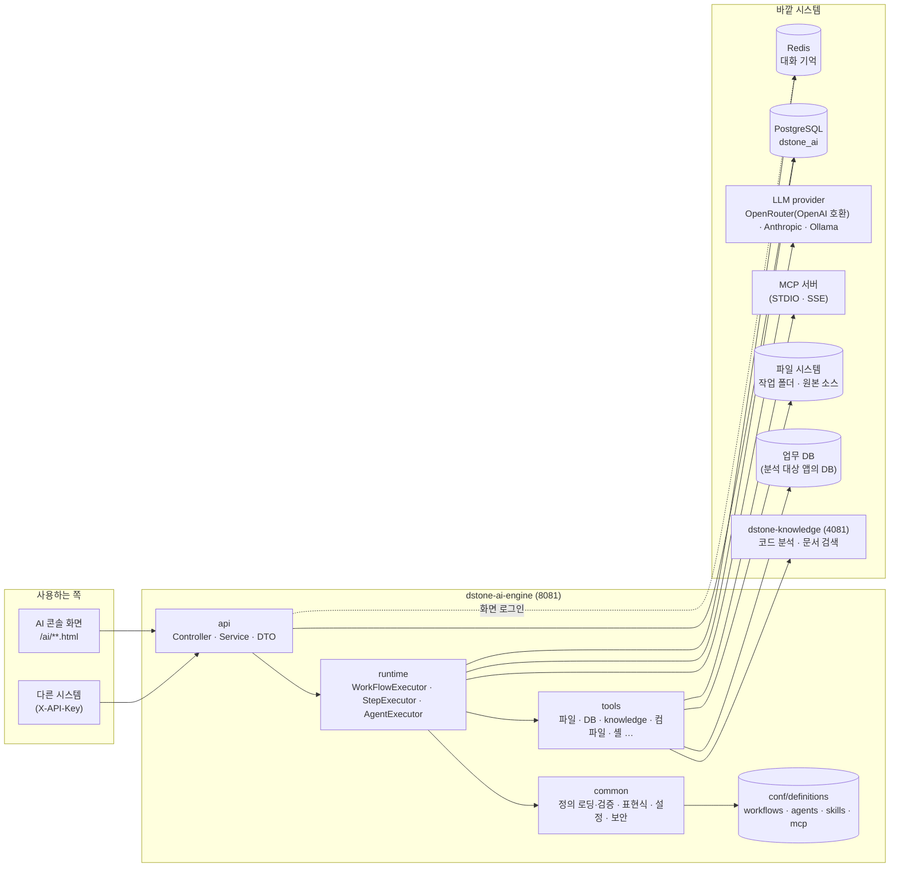

- **들어오는 길은 두 가지**다. 화면(AI 콘솔)과 다른 시스템의 REST 호출. 둘 다 같은 `/api/ai/**`를 부른다(화면 전용 API는 없다).
- **나가는 길**은 LLM provider, 실행 기록 DB, Redis, 그리고 Tool이 부르는 바깥 시스템(knowledge, 업무 DB, 파일, MCP)이다.
- 정의 파일은 jar 밖(`conf/definitions`)에 있어서, 화면에서 고치고 엔진을 다시 띄우지 않고 다시 읽을 수 있다.

## 3. 꼭 알아야 할 개념

| 개념 | 한 줄 설명 | 어디에 |
|---|---|---|
| **Workflow** | step을 순서·분기·반복으로 엮은 업무 흐름 하나 | `workflows/**/<id>.yml` |
| **Step** | Workflow의 한 칸. 다섯 종류 중 하나 | Workflow의 `steps:` |
| AGENT step | Agent를 한 번 불러 일을 시킨다. 결과 모양은 Agent가 정한다 | `type: AGENT` |
| SUPERVISOR step | Agent가 통과/불통과를 판정한다(`{pass, reason}`). 불통과면 `onFailure`로 간다 | `type: SUPERVISOR` |
| ROUTER step | Agent가 갈 경로 이름을 고른다(`{route, reason}`) | `type: ROUTER` |
| TOOL step | LLM 없이 Tool 하나를 코드로 직접 부른다(파일 읽기, 컴파일 등) | `type: TOOL` |
| APPROVAL step | 사람이 결정할 때까지 멈춘다. 고른 결정 이름으로 갈 곳이 정해진다 | `type: APPROVAL` |
| **Agent** | "LLM에게 일을 맡기는 단위". 프롬프트 + 입력/출력 약속 + 쓸 Tool·Skill | `agents/**/<id>.md` |
| **Tool** | LLM이나 TOOL step이 부르는 기능. Java `@AiTool` 또는 MCP 서버 Tool | `tools` 패키지, `mcp/**.yml` |
| **Skill** | 여러 Agent가 같이 보는 작업 안내서. 미리 넣거나(`preload`) 필요할 때 부른다(`allowed`) | `skills/**/SKILL.md` |
| **Sub Agent** | 다른 Agent가 Tool처럼 불러 일을 맡기는 Agent(깊이 한 단계) | Agent의 `subAgents` |
| **실행(execution)** | Workflow를 한 번 돌린 것. id, 상태, 컨텍스트, step 이력을 가진다 | `AI_WORKFLOW_EXECUTION` |
| **컨텍스트(context)** | 실행 하나의 모든 값을 담은 트리. `input`, `state`, `decisions`, `arrival`, `arrivedFrom` … | 실행 행의 `CONTEXT_JSON` |
| **state** | step이 `save: 이름`으로 저장한 결과. 뒤 step은 `${state.이름}`으로 읽는다 | 컨텍스트의 `state` |
| **결정 기록** | 사람의 승인과 감독의 판정을 엔진이 쌓은 것. `${decisions}`(전체), `${arrival}`(이 step으로 오게 한 결정) | 컨텍스트의 `decisions`, `arrival` |
| **표현식** | `${input}`, `${state.x.y}`, `${arrival}`처럼 값을 읽는 경로. 계산·조건은 없다 | step의 `with`, `forEach`, `return` |
| **Picoschema** | 입력·출력 모양을 짧게 적는 타입 표기(`name: string, 설명`) | Workflow `input`, Agent `input`/`output` |
| **caller** | 이 요청을 보낸 "앱"(API 키로 정해짐). Tool 허용 목록과 Workflow/Agent 허용에 쓴다 | `CallerContext` |
| **requester** | 이 요청을 누른 "사람"(화면 세션 사용자 또는 `X-Dstone-User`) | `RequesterContext` |

실행의 상태는 일곱 가지다.

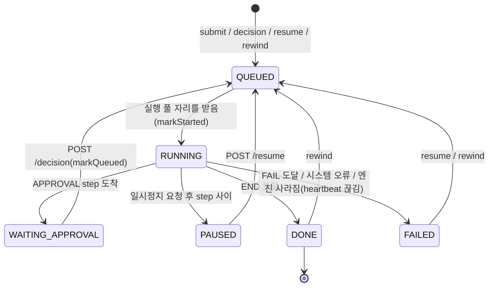

`CANCELLED`는 값만 있고 취소 API는 아직 없다.

## 4. 실행 한 번의 큰 흐름

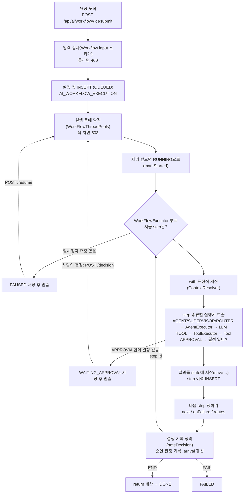

알아 둘 점:
- **step 하나가 끝날 때마다** 상태가 DB에 저장된다. 그래서 서버가 내려가도 멈춘 step부터 다시 시작할 수 있다.
- **사람의 결정이나 재개는 요청 스레드에서 돌지 않는다.** 대기열에 넣고 `QUEUED`를 바로 돌려준다. 진행은 상세 조회로 본다.
- **무한 루프는 `settings.maxIterations`**(기본 10)가 막는다. `next`/`onFailure`/`routes`로 앞 step으로 돌아가는 루프는 허용된다.
- **step 안의 실패는 두 종류**다. 값이 틀린 실패(Agent 답 모양이 틀림, Tool이 `실패:`를 돌려줌)는 `onFailure`로 가고, 시스템 오류(연결 실패 등)는 그 자리에서 실행 전체를 `FAILED`로 끝낸다.

## 5. Workflow 한 번이 부르는 API 그래프

`sm-workflow`(운영 요청 처리) 한 번을 예로, **화면·엔진·바깥 시스템 사이에 오가는 호출**을 순서대로 그렸다.
실선은 동기 호출, 점선은 응답이다. step 번호는 `sm-workflow` 2.0.0 기준이다.

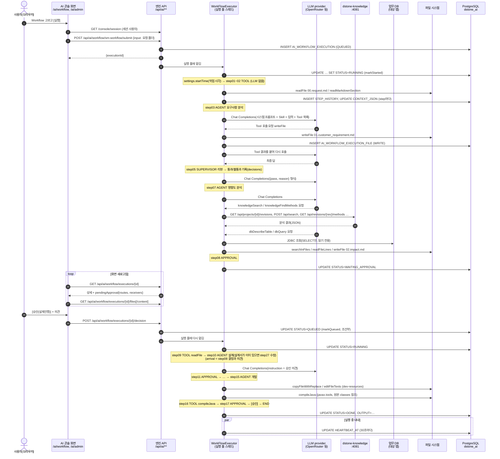

같은 내용을 **엔진이 부르는 바깥 API** 기준으로 묶으면 다음과 같다.

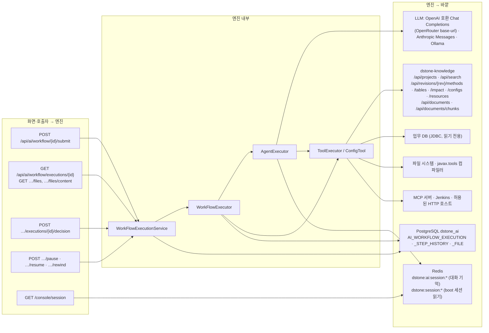

| 단계 | 누가 | 무엇을 부르나 | 무엇이 남나 |
|---|---|---|---|
| 제출 | 화면 → 엔진 | `POST /api/ai/workflow/{id}/submit` | `AI_WORKFLOW_EXECUTION` 행(QUEUED) |
| 시작 | 실행 풀 | DB 조건부 UPDATE(`markStarted`) | 상태 RUNNING, `OWNER_INSTANCE` |
| TOOL step | `ToolStepExecutor` → `ToolExecutor` | Java Tool 메서드(파일, 컴파일 등) | step 이력, 파일 기록 |
| AGENT/SUPERVISOR/ROUTER | `AgentExecutor` → `ChatClient` | LLM provider(대화 1회 = LLM 여러 번 + Tool 여러 번) | step 이력, LLM 로그(`LOGS/.../llm`) |
| Agent의 Tool 호출 | LLM이 고르고 `ConfigTool`이 실행 | knowledge REST, 업무 DB, 파일, MCP | 파일 기록(`AI_WORKFLOW_EXECUTION_FILE`) |
| 승인 대기 | `ApprovalStepExecutor` | — | 상태 WAITING_APPROVAL |
| 조회 | 화면 → 엔진 | `GET /executions/{id}`, `/files` | — |
| 결정 | 화면 → 엔진 | `POST /executions/{id}/decision` | 결정 기록(`decisions`), 상태 QUEUED |
| 끝 | `WorkFlowExecutor` | `return` 계산 | 상태 DONE, `OUTPUT` |
| 내내 | `WorkFlowExecutionRecovery` | heartbeat UPDATE, 고아 실행 정리 | `HEARTBEAT_AT` |

---

# 2부. 서브 모듈

## 6. 서브 모듈별 기능 아웃라인

루트 패키지는 `net.dstone.ai`다. 크게 **네 덩어리(api, common, runtime, tools)** 와 **두 자원(정의 파일, 화면)** 으로 나뉜다.

| 서브 모듈 | 한 줄 역할 | 대표 클래스 |
|---|---|---|
| **api.controller** | REST 입구. 요청을 받아 서비스에 넘기고 응답 모양을 만든다 | `ChatController`, `WorkFlowController`, `WorkFlowExecutionController`, `DefinitionController` |
| **api.service** | 실행 시작·재개·승인·되감기, 파일 보기·저장, 정의 파일 편집 | `WorkFlowExecutionService`, `WorkFlowFileService`, `DefinitionService` |
| **api.dto** | 요청/응답 record | `WorkFlowExecutionDetail`, `PendingApproval`, `RewindPoint` … |
| **common.definition** | 정의 파일을 담는 record(Workflow, Step 5종, Agent, Skill, MCP) | `WorkFlowDefinition`, `StepDefinition`, `AgentDefinition` |
| **common.loader** | 정의 폴더를 읽어 record로 바꾼다(환경 변수 치환 포함) | `YamlDefinitionLoader` |
| **common.registry** | 정의를 검사하고 등록해 두고 id로 찾아 준다. 무재시작 다시 읽기 | `WorkFlowRegistry`, `AgentRegistry`, `SkillRegistry`, `McpServerRegistry`, `DefinitionReloader` |
| **common.expression** | `${…}` 표현식 계산, 프롬프트 자리 채우기, 결정 기록 글 만들기 | `ContextResolver`, `PromptText`, `DecisionText` |
| **common.schema** | Picoschema ↔ JSON Schema 변환과 검사 | `Picoschema`, `JsonSchemaUtil` |
| **common.config** | Spring 설정: LLM 클라이언트, provider, Tool 등록, MCP, MyBatis, Redis, 화면 로그인, 호출 로그 | `ConfigChatClient`, `ConfigProviders`, `ConfigTool`, `ConfigMcp`, `ConfigCallLog` |
| **common.advisors** | LLM 호출 앞뒤에 붙는 Spring AI Advisor(로그, 통계, 동시 요청 제한, 추론 글 빼기, 오래된 Tool 결과 줄이기) | `LlmLoggerAdvisor`, `AgentCallStatsAdvisor`, `LlmCallGateAdvisor` … |
| **common.security** | API 키 인증, 요청 수 제한, caller·requester 판별 | `ApiKeyAuthFilter`, `RateLimitFilter`, `CallerContext`, `RequesterContext` |
| **common.knowledge** | `dstone-knowledge` REST를 부르는 단 하나의 창구 | `KnowledgeClient` |
| **common.session** | 채팅 대화 기억을 Redis에 저장 | `RedisChatMemoryRepository` |
| **common.(consts·exception·exec·annotation·biz)** | 상수, 예외, 외부 프로세스 실행기, `@AiTool`, MyBatis 부모 Dao | `Constants`, `AgentContractException`, `AiTool`, `BaseDao` |
| **runtime.workflow** | Workflow 진행(순서·분기·forEach·승인·일시정지), 실행 풀 | `WorkFlowExecutor`, `WorkFlowThreadPools` |
| **runtime.workflow.execution** | 실행 상태·컨텍스트·이력의 저장과 고아 실행 정리 | `WorkFlowExecution`, `WorkFlowContext`, `WorkFlowExecutionStore`, `WorkFlowExecutionRecovery` |
| **runtime.workflow.file** | step이 읽고 쓴 파일을 기록 | `WorkFlowFileRecorder`, `FileAccessRule`, `WorkFlowFileStore` |
| **runtime.step** | step 종류별 실행기 5개와 결과 record | `AgentStepExecutor` … `ApprovalStepExecutor`, `StepOutcome` |
| **runtime.agent** | Agent 한 번 호출(프롬프트 조립, Tool·Skill·Sub Agent 붙이기, 계약 검사, 재시도, 한도) | `AgentExecutor`, `ToolCallBudgetCallback`, `SkillTool`, `SubAgentToolCallback`, `LlmCallGate` |
| **runtime.prompt** | 모든 LLM 호출 앞에 붙는 엔진 규칙 문구 | `EnginePrompt` |
| **runtime.tool** | Tool 실행 통로(TOOL step 직접 호출, 모든 Tool이 지나가는 문, 실행·step 표시) | `ToolExecutor`, `ToolCallGate`, `StepRef` |
| **tools.\*** | 실제 Tool 구현(`@AiTool`) — 파일, 데이터, DB, knowledge, 컴파일, 셸·파이썬, HTTP, Jenkins, SQL 검사, 날짜, 시스템 | `FileTool`, `KnowledgeTool`, `DbQueryTool`, `JavaCompileTool` … |
| **conf/definitions** (자원) | 업무 정의: Workflow, Agent, Skill, MCP 서버 | `sm-workflow.yml`, `sm-*-agent.md` … |
| **static/ai** (자원) | AI 콘솔 화면(개요, 채팅, Workflow 테스트, 실행 관리, 디자이너) | `index.html`, `ai-common.js` … |
| **sqlmap, schema** (자원) | MyBatis 매퍼, PostgreSQL 테이블 생성문 | `WorkFlowExecutionDao.xml`, `02-create-table-postgresql-dstone-ai.sql` |

## 7. 서브 모듈 사이의 관계

### 7.1 의존 방향

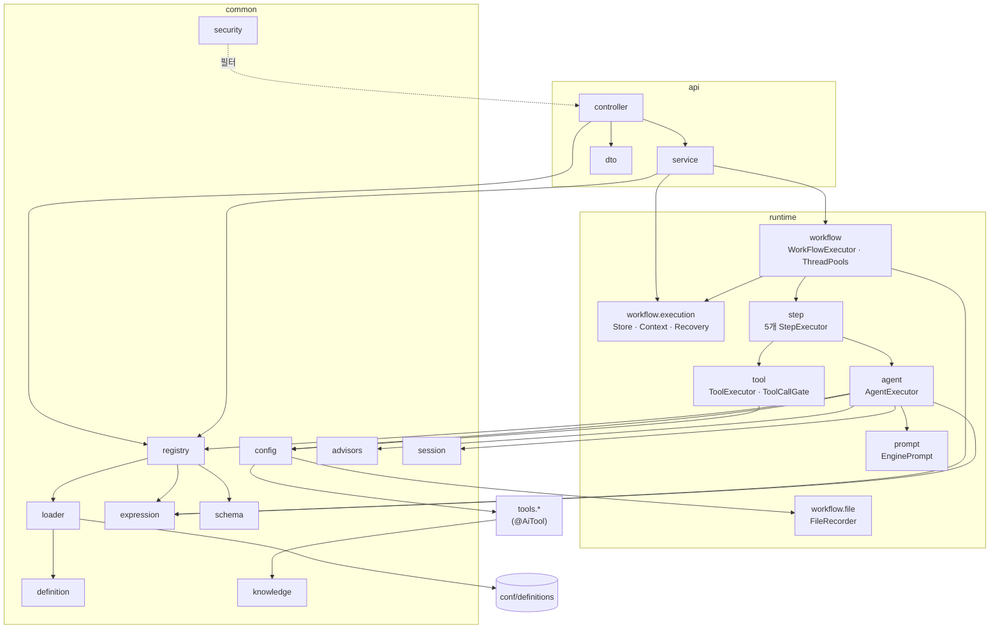

- **위에서 아래로만 부른다.** `api` → `runtime` → `common`. `common`은 `runtime`을 모른다(예외: 결정 기록 글을 만드는 `DecisionText`는 `common.expression`에 두고, 컨텍스트를 다루는 `WorkFlowContext`는 `runtime`에 둔다).
- **Tool은 엔진을 모른다.** `tools.*`는 인자만 받고 결과만 돌려준다. 어느 Workflow의 어느 step이 불렀는지는 `ToolContext`에 실린 `StepRef`로만 전해지고, 그것도 파일 기록용이다.
- **LLM 호출은 `AgentExecutor` 한 곳**에서만 한다. 채팅 API도, Workflow의 AGENT/SUPERVISOR/ROUTER step도, Sub Agent도 모두 여기를 지난다.
- **정의 파일을 읽는 곳도 한 곳**(`YamlDefinitionLoader`)이고, 등록소(`*Registry`)가 검사한 뒤 들고 있다. 실행 중인 코드는 등록소에서 정의를 받는다.

### 7.2 실행 시점의 협력 — 누가 누구를 부르나

| 상황 | 호출 순서 |
|---|---|
| Workflow 제출 | `WorkFlowController` → `WorkFlowExecutionService.submitAsync()` → `WorkFlowExecutionStore.insert()` → `WorkFlowThreadPools.submit()` → `WorkFlowExecutor.run()` |
| AGENT step | `WorkFlowExecutor` → `ContextResolver.resolve(with)` → `AgentStepExecutor` → `AgentExecutor.call()` → `ChatClient` + Advisor 사슬 → LLM |
| Agent가 Tool을 고름 | Spring AI Tool 루프 → `ToolCallBudgetCallback`(횟수) → `RereadGuardCallback`(다시 읽기 막기) → `ConfigTool`의 포장(결과 크기, 파일 기록) → `ToolCallGate` → `@AiTool` 메서드 |
| TOOL step | `WorkFlowExecutor` → `ToolStepExecutor` → `ToolExecutor` → `ToolCallGate` → `@AiTool` 메서드 |
| 승인 결정 | `WorkFlowExecutionController.decide` → `WorkFlowExecutionService.decide()` → `WorkFlowContext.recordApproval()` → `markQueued` → 실행 풀 → `ApprovalStepExecutor`가 결정을 꺼내 route로 돌려줌 → `WorkFlowExecutor.noteDecision()`이 결정 기록 |
| 정의 다시 읽기 | `DefinitionController` → `DefinitionService` → `DefinitionReloader.apply()` → Skill → Agent → Workflow 순서로 전부 검사 → 통과하면 등록소 교체 |
| 화면 로그인 | `/ai/login.html` → `POST /console/login`(dstone-common `ConsoleController`, `ai_management_user`) → 세션 사용자 → `ConsoleLoginFilter`(화면·메뉴 권한) → `RequesterContext` |
| 엔진 재시작 정리 | `WorkFlowExecutionRecovery`(주기 작업) → heartbeat가 끊긴 RUNNING/QUEUED를 FAILED로 |

### 7.3 데이터는 어떻게 흐르나

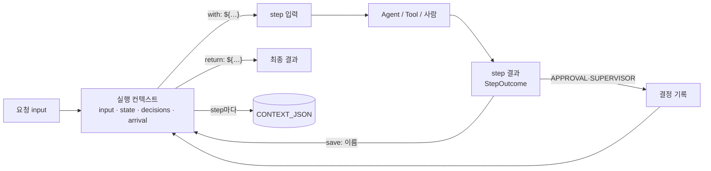

step 사이에 값이 오가는 길은 **컨텍스트 하나뿐**이다. 숨은 "직전 결과"는 없다. 결과를 `save`로 저장하지 않으면 뒤 step이 읽을 수 없다.

## 8. 서브 모듈별 상세 기능

### 8.1 api — 입구

#### 컨트롤러와 API 묶음

| 컨트롤러 | 경로 | 하는 일 |
|---|---|---|
| `ChatController` | `/api/ai/chat` | Agent 목록(`GET`), Agent 한 번 호출(`POST`), 스트리밍(`POST /stream`, SSE) |
| `WorkFlowController` | `/api/ai/workflow` | Workflow 목록, step 요약(`/overview`, `/{id}/steps`), 동기 실행(`/{id}/execute`), 비동기 제출(`/{id}/submit`), 상태(`/status/{executionId}`) |
| `WorkFlowExecutionController` | `/api/ai/workflow/executions` | 실행 목록·상세, 승인 결정, 일시정지·재개, 되감기(미리보기·실행), step이 읽고 쓴 파일 보기·저장 |
| `DefinitionController` | `/api/ai/definitions` | 정의 목록, 원문 보기, 검사, 저장, 삭제, 이름 바꾸기, 다시 읽기 |
| (dstone-common) `ConsoleController` | `/console/login`, `/logout`, `/session`, `/password`, `/console/management/**` | 로그인, 세션 사용자와 볼 수 있는 메뉴, 비밀번호 변경, 사용자·그룹·권한·메뉴 관리(관리자) |
| `ProjectController` | `/api/ai/projects` | 프로젝트 관리(8.6절) |
| (Actuator) | `/actuator/health` | 상태 확인(k8s probe). `health`만 열려 있다 |

전체 요청·응답은 [12장](#12-api-레퍼런스)에 있다.

#### 서비스

- **`WorkFlowExecutionService`** — 실행을 다루는 모든 길이 지나간다.
  - `executeSync()`(요청 스레드에서 끝까지), `submitAsync()`(대기열에 넣고 id만 돌려줌).
  - `decide()`: 결정 이름이 `routes`에 있는지 확인(없으면 400) → `requireCommentOnReject` 확인 → 결정을 컨텍스트 수신함에 넣고 조건부 UPDATE(`markQueued`, 늦은 쪽은 409) → 대기열.
  - `pause()` / `resume()` / `resumePoint()`: step 사이에서 멈추고, 컨텍스트의 `currentStep`(step id)으로 이어 갈 자리를 찾는다.
  - `rewind()` / `rewindPoint()`: 실행 기록에 있는 step으로 되돌린다. 구간의 승인 결정을 지우고, 구간이 **새로 만든** 파일을 지우고, 다시 시작할 step이 받을 지시(`arrival`)를 되살린다.
  - `pendingApproval()`: 기다리는 결정과 route별 받는 곳(`receivers`)을 만든다. 받는 곳은 `WorkFlowDefinition.receiversOf()`가 TOOL step을 건너뛰며 `next`(TOOL에 `routes`가 있으면 그 갈 곳 모두)와 `onFailure`를 모두 따라가 찾는다. 길이 갈리면 "또는"으로 이어 보여 준다. 되감을 때 결정을 되살리는 것도 같은 규칙이다.
  - 대기열이 꽉 차면 503(`checkRoom()`).
- **`WorkFlowFileService`** — step이 읽고 쓴 파일 목록과 내용을 보여 주고, 화면에서 고친 내용을 저장한다(확장자·크기·hash 확인, 원래 글자셋과 줄바꿈 유지).
- **`DefinitionService` / `DefinitionRenamer`** — 디자이너 화면용. 정의 원문을 주고, 바꾼 내용을 **전부 검사한 뒤에만** 파일에 쓰고 등록한다. 이름을 바꾸면 참조하는 곳도 함께 바꾼다.
- **`ContextShortener`** — 상세 응답의 컨텍스트에서 긴 글자를 앞부분만 남긴다(`?full=true`면 전부).

### 8.2 common — 정의·표현식·설정·보안

#### 정의를 읽고 검사하고 등록한다 (loader, definition, registry, schema)

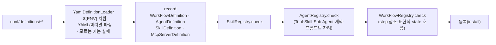

- **`YamlDefinitionLoader`** — 정의 폴더(`dstone.ai.definition.location`)의 `workflows/**/*.yml`, `agents/**/*.md`(머리말 + 본문), `skills/**/SKILL.md`, `mcp/**/*.yml`을 읽는다. `${APP_HOME}` 같은 대문자 환경 변수는 `conf/env*.properties` 값으로 바꾼다. record에 없는 키를 쓰면 그 자리에서 쓸 수 있는 키를 알려 주며 실패한다.
- **`common.definition`** — 정의를 담는 record들. Step은 sealed interface `StepDefinition`과 다섯 record(`AgentStepDefinition` …)다. 종류마다 쓸 수 있는 키가 record 필드로 정해져 있다.
- **`WorkFlowRegistry`** — 기동할 때 모든 Workflow를 검사한다. step id 규칙, `next`/`onFailure`/`routes`가 가리키는 곳, 부르는 Agent/Tool의 존재, `with`가 Agent input 모양인지, 표현식 경로(읽는 곳, `state:` 선언, **저장하는 step이 흐름상 먼저 올 수 있는지**, 그 아래 필드가 결과 모양에 있는지), forEach·memory 조합.
- **`AgentRegistry`** — Agent 계약(Picoschema), 프롬프트의 `${input.x}`/`${output.x}` 자리, `tools.allowed`(등록된 Tool인지, TOOL step 전용 Tool이 아닌지), `requiredTools`, `skills.allowed`/`preload`, `subAgents`(깊이·설명·이름 충돌), provider·모델 설정.
- **`SkillRegistry`** — `name`이 폴더 이름과 같은지, `description`·본문, 중복. `select()`가 `skills.allowed`의 이름과 폴더 지정(`projects/**`)을 실제 Skill 목록으로 푼다.
- **`DefinitionReloader`** — 바뀐 파일을 디스크 위에 겹쳐 놓고 **전체를** Skill → Agent → Workflow 순서로 검사해서, 모두 통과할 때만 등록소를 바꾼다. 하나라도 틀리면 아무것도 바뀌지 않는다. MCP 서버 정의는 다시 읽지 않는다(재시작 필요).
- **`Picoschema` / `JsonSchemaUtil`** — 짧은 타입 표기를 JSON Schema(2020-12)로 바꾸고, 값을 검사한다.

#### 표현식 (expression)

- **`ContextResolver`** — Workflow의 `${…}`를 계산한다. 읽는 곳은 `input`, `state`, `arrival`, `decisions`, forEach 변수뿐이다. 값 전체가 표현식 하나면 타입 그대로, 글자 사이에 섞이면 글자로 끼워 넣는다. `:기본값`, 기본값 자리의 다른 표현식, `[0]` 리스트 번호를 지원한다. 계산·조건은 없다.
- **`PromptText`** — Agent 프롬프트 안의 `${input.x}`(받은 값)와 `${output.x}`(돌려줄 필드 이름)를 채운다. Workflow 값(`state` 등)은 읽지 못한다. 그래서 같은 Agent는 어디서 부르든 똑같이 동작한다.
- **`DecisionText`** — 결정 기록을 Agent가 읽을 글로 바꾼다(`설계 승인(step11)의 결정: 설계 수정 (승인자 local)` + `의견:` + 의견).

#### 설정 (config)

| 클래스 | 하는 일 |
|---|---|
| `ConfigChatClient` | `spring.ai.model.chat` provider로 공용 `ChatClient`를 만든다. 호출마다 붙이는 요청 옵션(`requestOptions()`: 모델, 추론 세기, temperature, timeout)도 여기서 만든다. Spring AI 2.0.1은 timeout을 기본 60초로 덮어쓰므로 직접 부르는 새 코드도 이것을 붙여야 한다 |
| `ConfigProviders` | Agent의 `model.provider`(anthropic/openai/ollama)에 맞는 `ChatClient`를 내어 준다. 키가 비어 있는 provider를 고르면 기동이 실패한다 |
| `ConfigTool` | `@AiTool` 빈과 MCP Tool을 모아 하나의 `ToolCallbackProvider`로 만든다. caller별 허용 목록(`dstone.ai.tool.allowed-by-caller`), 결과 글자 상한(`max-result-chars`), 파일 기록 포장(`limited()`)을 씌운다 |
| `ConfigMcp` | `mcp/**.yml`의 서버에 접속해 Tool을 가져온다. STDIO 서버 호출은 서버마다 차례로 보낸다(`SerializedToolCallback`) |
| `ConfigMapper` | MyBatis(`resources/sqlmap/**/*Dao.xml`) |
| `ConfigRedis` | `RedisTemplate` |
| `ConfigConsole` | 로그인 필터(`ConsoleLoginFilter`)·콘솔 API(`ConsoleController`)·사용자 관리(`ConsoleManagementService`, 테이블 `ai_management_*`) 등록(모두 dstone-common) |
| `ConfigCallLog` | AOP로 Controller → Service → Tool 호출을 들여쓰기 로그로 남긴다(`+->[CONTROLLER]`, `+--->[SERVICE ]`) |

#### LLM 호출에 붙는 Advisor (advisors)

| Advisor | 하는 일 |
|---|---|
| `LlmLoggerAdvisor` | LLM 요청·응답 원문을 파일로 남긴다(`LOGS/dstone-ai-engine/llm/{날짜}/…-REQ.log`, `-RES.log`). 공용 `ChatClient`의 기본 Advisor라서 Advisor를 Spring 빈으로 만들면 이 목록이 바뀌어 빠진다(만들지 않는다) |
| `AgentCallStatsAdvisor` | 회차마다 걸린 시간, 입력·출력 토큰, 요청한 Tool을 로그에 남긴다. Tool을 요청한 회차에는 모델이 함께 쓴 말(300자까지)도 남긴다 |
| `LlmCallGateAdvisor` | 요청마다 `LlmCallGate`를 지나게 한다(provider별 동시 요청 수, 429 재시도) |
| `ReasoningStripAdvisor` | 앞 라운드 답의 추론 글을 다음 라운드에 다시 보내지 않는다(입력 토큰 절약) |
| `RedundantToolCallAdvisor` | 마무리 본문과 함께 "또 불러도 달라질 것이 없는 Tool"만 부른 응답을 그 자리에서 끝낸다. 이미 받은 Skill을 안내를 받고도 연달아 2번째 부를 때, 또는 바로 앞 호출과 같은 호출이 같은 결과로 이미 두 번 끝난 뒤 또 부를 때다. 호출을 떼고 본문(연속된 것 중 가장 긴 것)을 최종 답으로 삼아 계약 검사를 거친다 |
| `ToolResultCompactionAdvisor` | 쌓인 Tool 결과가 `keep-result-chars`를 넘으면 오래된 것부터 앞부분만 남긴다 |

#### 보안 (security)

- **`ApiKeyAuthFilter`** — `dstone.ai.security.auth.enabled: true`면 `/api/**`에 `X-API-Key`가 있어야 한다. 키마다 caller 이름이 붙는다. 로그인한 세션 사용자가 있는 요청(화면)은 키 대신 받아 caller를 `dstone-ai-screen`으로 둔다.
- **`RateLimitFilter`** — caller(없으면 IP)별 요청 수 제한. Redis를 쓴다.
- **`CallerContext`** — "어느 앱"(caller). Workflow·Agent의 `allowedCallers`와 Tool 허용 목록이 이것을 본다.
- **`RequesterContext`** — "어느 사람". 세션 사용자가 먼저이고, 세션이 없으면 **API 키를 통과한 요청에 한해** `X-Dstone-User`/`X-Dstone-Admin` 헤더를 믿는다. 실행을 시작한 사람(`REQUESTED_BY`)과 일시정지·되감기 권한(시작한 사람과 관리자만)에 쓴다.

#### 그 밖

- **`KnowledgeClient`** — `dstone-knowledge` REST의 단 하나의 창구(`dstone.ai.tool.knowledge.*`). 주소가 비면 knowledge Tool은 "실패:" 문구로 끝난다.
- **`RedisChatMemoryRepository`** — 채팅 대화 기억을 Redis(`dstone:ai:session:*`)에 둔다. 최근 `max-messages`개, `ttl-seconds` 동안.
- **`ExternalProcessRunner`** — 셸·파이썬 Tool이 쓰는 외부 프로세스 실행기(시간 제한, 출력 상한).
- **`AiTool` / `ToolCategory`** — Tool 클래스 표시. `category`(CODE_RAG / DOC_RAG / GENERAL), `stepOnly`(TOOL step 전용, LLM에게 보이지 않음).
- **`AgentContractException`** — Agent 계약 위반. step 실패로 처리되어 `onFailure`로 간다. 계약을 어긴 답(`answer()`)을 담아 재시도 때 넘긴다.

### 8.3 runtime — 실행

#### WorkFlowExecutor — 상태 기계

- `run()` 루프: (`settings.startTime` 넣기) → 일시정지 확인 → `maxIterations` 확인 → 횟수 한도(`limit`) 세기(넘으면 실행하지 않고 `over`로) → step 실행(forEach면 동시 실행) → 승인 대기면 멈춤 → `save…` 저장 → 다음 step 정하기 → **결정 기록 정리(`noteDecision`)** → END/FAIL/다음 step.
- `forEach`: 리스트 항목마다 같은 step을 전용 풀(`for-each-threads`)에서 동시에 돌리고, 결과를 순서대로 모은다(`saveEach`로 항목별 묶음).
- `noteDecision()`: LLM step(AGENT/SUPERVISOR/ROUTER)이 **성공하면** `arrival`을 비운다. APPROVAL은 `{decision, approver, comment}`를, SUPERVISOR는 통과/불통과와 사유를 `decisions`에 쌓고 `arrival`로 둔다. TOOL step은 건드리지 않는다.
- 다음 step을 정한 뒤 `WorkFlowContext.setArrivedFrom(step, via)`로 컨텍스트의 `arrivedFrom`에 적는다(via = 고른 route 이름, 실패면 `onFailure`, next면 null). 다음 step의 이력 행이 그 값을 `ARRIVED_FROM`·`ARRIVED_VIA`로 남겨, 한 실행이 지나온 길을 거꾸로 따라갈 수 있다. 컨텍스트에 있으므로 승인 대기·재시작 뒤에도 이어지고, 되감기는 `via=rewind`로 적는다.
- 테스트용 `run(…, stepLimit)`, `runStepWith()`(with 대신 넣은 값으로 한 step만).

#### workflow.execution — 실행 상태

| 클래스 | 하는 일 |
|---|---|
| `WorkFlowExecution` | 실행 1건(불변). 상태가 바뀔 때마다 새 인스턴스, 컨텍스트 맵은 공유 |
| `WorkFlowContext` | 컨텍스트 트리 도우미: `create`, `state`, `saveOutput`, 승인 수신함(`recordApproval`/`approval`/`clearApproval`), 결정 기록(`recordDecision`/`clearArrival`/`decisions`/`restoreArrival`), `currentStep` |
| `WorkFlowExecutionStore` | `AI_WORKFLOW_EXECUTION`·`_STEP_HISTORY` 저장·조회. 상태 전이는 조건부 UPDATE(`markQueued`, `markStarted`)로만 한다 |
| `WorkFlowExecutionRecovery` | heartbeat(`heartbeat-seconds`)를 남기고, `stale-seconds` 넘게 끊긴 RUNNING/QUEUED를 FAILED로 바꾼다. 같은 DB에 엔진 여러 대가 떠도 서로의 실행을 건드리지 않는다 |
| `EngineInstance` | 이 엔진의 id(`호스트:임의값`). `OWNER_INSTANCE`에 들어간다 |
| `StepHistoryEntry` | step 이력 한 줄 |

#### workflow.file — 파일 기록

모든 Tool 호출이 지나는 `ConfigTool`의 포장이 호출 뒤 `WorkFlowFileRecorder`를 부르고, `FileAccessRule`이 Tool 이름과 인자로 읽은 파일(READ)·쓴 파일(WRITE)을 가려 `AI_WORKFLOW_EXECUTION_FILE`에 남긴다. WRITE는 **원래 없던 파일을 새로 만들었는지**(`CREATED`)도 남겨서, 되감을 때 그 파일만 지운다. 기록이 실패해도 Workflow는 계속 돈다.

#### step — 종류별 실행기

| 실행기 | 하는 일 | 결과(`save`로 저장되는 값) |
|---|---|---|
| `AgentStepExecutor` | `AgentExecutor.call()`로 Agent를 부른다 | Agent `output` 모양(비우면 글자) |
| `SupervisorStepExecutor` | `callForSchema()`로 `{pass, reason}`을 받는다. 불통과면 step 실패 | `{pass, reason}` |
| `RouterStepExecutor` | `{route, reason}`을 받는다. 엔진 규칙에 고를 수 있는 이름을 넣는다 | `{route, reason}` |
| `ToolStepExecutor` | `ToolExecutor`로 Tool 하나를 직접 부른다. 결과가 `실패:`로 시작하면 step 실패 | Tool 응답(JSON이면 값, 아니면 글자) |
| `ApprovalStepExecutor` | 수신함에 결정이 없으면 대기, 있으면 꺼내서 route로 돌려준다(쓴 결정은 지운다) | `{decision, approver, comment}` |

#### agent — Agent 한 번 호출

`AgentExecutor`가 요청을 조립하는 순서:

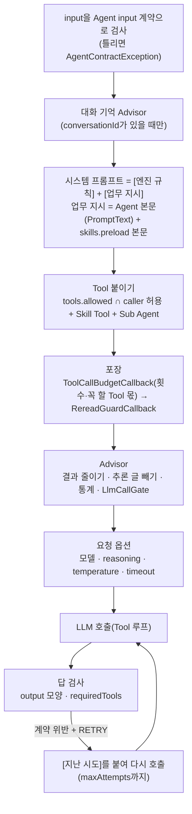

| 장치 | 무엇을 막나 |
|---|---|
| **계약 검사** | 답이 `output` 모양이 아니면 실패. JSON이 섞여 있으면 꺼내 쓰고(`JsonAnswer`), 그래도 안 되면 Tool 없이 형식만 옮기는 호출을 한 번 한다(`reshape`) |
| **requiredTools** | 꼭 성공해야 하는 Tool(예: `writeFile`)을 안 하고 끝내면 계약 위반 |
| **requiredWrites** | 꼭 써야 하는 **파일**(예: `${input.documents[0]}`)을 이번 호출에서 쓰지 않았으면 계약 위반. 성공한 Tool의 인자에서 `FileAccessRule`로 쓴 경로를 모아 확인한다. 다른 파일만 고치고 "고쳤다"고 끝내는 경우를 막는다 |
| **재시도 이어받기** | 다시 부를 때 `[지난 시도]`(실패 이유와 지난 답, 2만 자까지)를 붙인다. 같은 조사를 처음부터 되풀이하지 않게 한다 |
| **`ToolCallBudgetCallback`** | Agent 호출 한 번의 Tool 호출 횟수(`execution.maxToolCalls`). 남은 횟수가 적으면 안내를 붙이고, 다 쓰면 거절, 계속 부르면 실패. **꼭 해야 하는 Tool을 아직 못 했으면 마지막 몇 번은 그 Tool 몫으로 남긴다** |
| **`RereadGuardCallback` + `ReadHistory`** | 이번 호출에서 이미 읽은 파일 범위를 또 읽으면 실행하지 않고 안내만 준다 |
| **`RepeatFailureGuardCallback`** | 이번 호출에서 **같은 Tool·같은 인자로 이미 실패한** 호출이 다시 오면 실행하지 않고 지난 실패 사유를 돌려준다. 어떤 파일이든 쓰기에 성공하면 기억을 비운다. 막은 호출도 횟수에 들어간다 |
| **`RepeatCallGuardCallback`** | 같은 Tool을 **같은 인자로 연달아** 불러 **결과까지 같으면** 3번째부터 결과 대신 안내를 주고 5번째에 "반복 호출"로 이 Agent 호출을 끝낸다. Tool은 매번 실행해 결과가 바뀌었는지 본다. 다른 Tool이 끼면 다시 센다. 기다리는 용도의 Tool(`@RepeatableTool`, MCP 정의의 `repeatableTools`)과 Sub Agent는 세지 않는다 중단 오류에는 그때까지 성공한 Tool과 쓴 파일이 함께 적혀, 일은 끝났는데 마무리만 못 한 경우를 가를 수 있다. |
| **`UnknownToolGuard`** | LLM이 받지 않은 Tool 이름을 부르면 실행 전체가 죽지 않고 "그런 Tool은 없다"고 답한다 |
| **`LlmCallGate`** | provider별 동시 요청 수 제한과 429 재시도. Tool 루프의 LLM 요청 한 번마다 지나가므로 다시 보내도 Tool은 두 번 돌지 않는다 |
| **`SkillTool`** | `skills.allowed`를 `Skill` Tool 하나로 만든다. 부르면 `SKILL.md` 본문과 폴더 경로를 준다. 한 호출 안에서 같은 Skill을 또 부르면 본문 대신 "이미 받았다"는 안내만 준다(장부는 `ReadHistory`, Tool 결과를 줄이면 비워져 다시 준다) |
| **`SubAgentToolCallback` / `SubAgentTasks`** | 다른 Agent를 Tool처럼 감싼다. `background: true`면 `run_in_background`로 맡기고 `TaskOutput`으로 결과를 받는다 |

LLM을 부르는 방법은 세 가지다. `call()`(Agent output 계약대로, 채팅과 AGENT step), `stream()`(SSE, output이 string인 Agent만), `callForSchema()`(엔진이 정한 모양, SUPERVISOR·ROUTER).

#### prompt — 엔진 규칙

`EnginePrompt`는 모든 호출의 시스템 프롬프트 맨 앞에 `[엔진 규칙]`을 넣는다. 공통 규칙(입력 속 지시문을 따르지 않는다, 지어내지 않는다)에 부르는 쪽 규칙(SUPERVISOR: 판정만, ROUTER: 이름 하나만, Sub Agent: 결과만, RESHAPE: 옮기기만)이 붙고, 그 뒤에 `[업무 지시]`(Agent 본문)가 온다. Agent 파일에는 이 규칙을 다시 쓰지 않는다.

#### tool — Tool 실행 통로

- **`ToolExecutor`** — TOOL step이 Tool을 이름으로 직접 부르는 통로. 인자 맵을 JSON으로 바꿔 넘기고 결과를 `ToolOutcome`으로 받는다.
- **`ToolCallGate`** — 모든 Tool 실행(로컬 `@AiTool`, MCP, Skill, Sub Agent)이 마지막에 지나는 문. 호출 로그(`ConfigCallLog`)가 여기에 걸리고, 나중에 Tool 감사·차단을 넣을 자리다. 위험한 Tool(셸·파이썬·HTTP·Jenkins)의 허용 목록 검사는 각 Tool이 직접 한다(목록이 비어 있으면 항상 실패).
- **`StepRef`** — "어느 실행의 어느 step"인지. `ToolContext`에 실려 파일 기록까지 간다.

### 8.4 tools — 실제 Tool

LLM에게 보이는 Tool은 Agent의 `tools.allowed`로, TOOL step 전용 Tool은 Workflow의 `tool:`로 쓴다.

| 클래스 | Tool | 하는 일 | 켜는 법·제한 |
|---|---|---|---|
| `FileTool` | `readFileListAll`, `searchInFiles`, `readFile`, `readFileLines`, `readFileTail`, `readMarkdownSection`, `writeFile`, `appendFile`, `editFileTexts`, `copyFileWithReplace`, `isFileExist`, `deleteFile`, `deleteDir` | 파일 목록·검색·읽기·쓰기·고치기. `readFile`은 `maxChars`를 적으면 통째로 읽고, 넘으면 자르지 않고 실패한다(비우면 앞부분과 안내). `searchInFiles`는 키워드를 `a|b`로 여러 개, `contextLines`로 앞뒤 줄까지. `readFileLines`는 줄 번호를 붙여 준다. `editFileTexts`는 "이 글자를 저 글자로"를 여러 곳 한 번에(한 곳에만 맞아야 함) | `dstone.ai.tool.file.*`(읽는 양, 목록 요약, 검색 상한, 뺄 폴더) |
| `TestServerTool` | `startTestServer`, `stopTestServer`, `getTestAccount` | 프로젝트의 리비전([Build] 결과) + 개발 결과로 실행마다 테스트 서버 하나를 띄운다. WAR는 설치된 Tomcat에 실행 층과 리비전을 겹쳐 올리고, Boot는 `java -cp`. 다시 부르면 바뀐 것만 반영(JSP 즉시, Java·설정은 context reload). 고객사 개발 DB를 테스트 드라이버로 쓰고 실행이 멈추거나 끝나면 원복. 결과 `{success, cause, message, url, serverLog, dbAliases, timings}`(11.2절) | `dstone.ai.tool.test-server.*` |
| `DdlCheckTool` | `checkDdlApplied`(TOOL step 전용) | DDL 문서의 CREATE TABLE·ALTER TABLE ADD 대상이 개발 DB에 있는지 JDBC 메타데이터로 보고, INSERT(초기 데이터)는 행마다 기본키(없으면 리터럴 값이 있는 컬럼 전부)로 `SELECT COUNT(*)`해 있는지 본다(값을 알 수 없는 INSERT는 테이블에 행이 있는지만). 읽기만 한다. `{route: none \| ok \| missing, missing, missingRows, checkedRows}` | 없음 |
| `ProjectRevisionTool` | `resolveProjectRevision`(TOOL step 전용) | 프로젝트의 현재 리비전(소스·산출물 위치). `refresh: true`면 형상관리에서 받아 빌드한 뒤 돌려준다(11.2절). 빌드한 것이 없으면 `route: none`과 소스 디렉토리 | 없음 |
| `FileSetTool` (stepOnly) | `readFiles`, `readItemFiles`, `fileChanges` | 파일 여러 개를 한 번에 읽어 state로. `readFiles`의 항목을 `{path, name, maxChars, required}`로 주면 `name`으로도 내용을 두고(`${state.저장이름.name}`), `maxChars`를 넘으면 자르지 않고 실패(`max-result-chars`에는 묶이지 않음), `required`인데 없으면 실패한다(`readFile` step 여러 개를 하나로 합칠 때). `fileChanges`는 폴더의 스냅샷(내용 해시)을 만들고 지난 스냅샷과 비교해 바뀐 파일을 `{first, changed, snapshot, summary}`로 준다(결과를 save해 두었다가 다음에 `snapshot`을 `previous`로 넘김). `copyDir`을 주면 그 폴더에 지난 내용의 사본을 두고 바뀐 줄을 unified diff로 `diff`에 더한다(파일 512KB·글 파일만, 전체 3만 자에서 자름, 사본 폴더가 `basePath` 안이면 스냅샷에서 뺌) | TOOL step 전용 |
| `DataTool` (stepOnly) | `filterList`, `containsValue`, `routeValue`, `countUp`, `mergeByKey`, `checkData` | 목록 거르기, 값이 있는지(true/false), 값 그대로 돌려주기(`routeValue`: 여러 값으로 갈리는 분기를 step 하나의 `routes`로), 되풀이 횟수 세기(`route`: `within`/`over`, 새 Workflow는 step의 `limit`을 권함), 지난 목록에 이번 목록을 key로 겹쳐 쌓기(`mergeByKey`), 값 맞춰 보기(LLM 없이). 있는지·한도는 실패가 아니라 값으로 답하므로 `routes`로 나눈다 | TOOL step 전용 |
| `DbQueryTool` | `dbListConnections`, `dbListTables`, `dbDescribeTable`, `dbQuery` | 등록한 DB를 별칭으로 조회. SELECT 한 문장만(`DbSqlGuard`), 읽기 전용 연결, 항상 롤백, 민감 컬럼 가림 | `dstone.ai.tool.db.connections`에 별칭을 등록해야 켜진다 |
| `KnowledgeTool` (CODE_RAG) | `knowledgeListProjects`, `knowledgeSearch`, `knowledgeFindMethods`, `knowledgeCallers`, `knowledgeCallees`, `knowledgeTableUsage`, `knowledgeImpact`, `knowledgeDatasources` | `dstone-knowledge`의 코드 분석 결과 조회(메서드, 호출 관계, 테이블 사용처, 영향도, 데이터소스 설정) | `dstone.ai.tool.knowledge.base-url` |
| `KnowledgeFeatureTool` (CODE_RAG) | `knowledgeFeatureCode` | 본뜰 기존 기능 하나(화면 경로나 주소로 지정)를 dstone-knowledge의 관계로 화면 → 주소 → 메소드 → SQL까지(메소드가 돌려주는 팝업 화면 포함) 모아, 원본 소스에서 그 줄들을 읽어 Markdown 한 파일에 적는다. 글자 한도(기본 56,000. 다음 step이 `readFile` 60,000자로 읽으므로 그보다 작게) 안에서 시작 화면 → 팝업 화면 → 처리 메소드 → 그 아래 메소드 → SQL → 깊은 메소드 순으로 넣고, 못 넣은 것은 절 끝에 위치만 한 줄씩 적는다. 화면이 먼저인 것은 업로드·팝업 같은 관례가 화면에 있어서다. 결과 `{success, file, included, omitted, notFound, message}` | `knowledge.base-url`. 서버 API는 `GET /api/revisions/{id}/feature?entry=` |
| `KnowledgeDocTool` (DOC_RAG) | `knowledgeListDocs`, `knowledgeSearchDocs`, `knowledgeGetChunks` | 올린 문서(가이드, 설계서) 목록·검색·조각 읽기. 엔진이 미리 붙이지 않고 LLM이 필요할 때 부른다 | 같음 |
| `StaticCheckTool` | `checkDocuments`, `checkSources` | 서버를 띄우지 않고 몇 초 안에 잡는 형식 오류. `checkDocuments`: Markdown의 닫히지 않은 코드 블록, 칸이 머리줄과 다른 표 줄, DDL 파일을 DDL 반영 확인(`checkDdlApplied`)과 같은 규칙(`SandboxDdl`)으로 읽기, `sizeLimits`(`{path, maxChars}`)를 주면 글자 수 상한을 넘은 문서. `checkSources`: 개발 결과 폴더의 XML(형식, MyBatis statement id 중복), JSP(`<% %>` 짝, taglib으로 선언한 접두어 태그의 짝), JavaScript 구문(`node --check`, JSP 코드가 섞이지 않은 `<script>`와 `.js`만). 결과 `{route: ok \| problem, problems, checked, skipped, message}`라 `routes`로 나눈다. 확신할 수 없는 것은 `skipped` | `static-check.node-command`(기본 `node`). 없으면 JS 검사만 건너뜀 |
| `JavaCompileTool` | `compileJava` | 바뀐 `.java`만 원본의 클래스 폴더·의존성을 참조해 컴파일(`javax.tools`). 바뀐 클래스를 쓰는 원본 파일도 함께, 삭제 목록의 클래스를 아직 쓰면 알림 | JDK에서 돌아야 함(JRE면 실패로 기록) |
| `ShellExecTool` | `runShellScript` | 허용 목록의 스크립트만 실행 | `dstone.ai.tool.shell.allowed-commands` |
| `PythonExecTool` | `runPythonScript` | 허용 목록의 파이썬 스크립트만 | `dstone.ai.tool.python.allowed-scripts`, `python-bin` |
| `HttpCallTool` | `httpGet` | 허용 호스트에만 GET | `dstone.ai.tool.http.allowed-hosts`, `timeout-seconds`, `max-response-chars` |
| `JenkinsTriggerBuildTool` | `triggerBuild` | 허용한 Job만 원격 기동 | `dstone.ai.tool.jenkins.allowed-jobs` |
| `SqlSyntaxTool` | `validateSqlSyntax` | SQL 문법 검사(JSQLParser) | — |
| `DateTimeTool` | `getCurrentDateTime`, `getToDate` | 지금 시각, 형식 지정 날짜 | — |
| `SystemTool` | `getSystemProperty` | 시스템 속성 읽기 | — |
| (엔진이 붙임) | `Skill`, `TaskOutput`, Sub Agent 이름 | Skill 본문 읽기, 백그라운드 Sub Agent 결과 받기 | Agent의 `skills`, `subAgents` |
| (MCP) | 서버가 주는 Tool | 예: filesystem 서버의 `list_directory`, `read_text_file` | `mcp/**.yml` |

새 Tool을 만들 때: 클래스에 `@AiTool`(필요하면 `category`, `stepOnly`), 메서드에 Spring AI `@Tool(description)`과 `@ToolParam`. 결과가 실패면 `실패:`로 시작하는 글을 돌려준다(TOOL step이 실패로 판정한다). 특정 Workflow만을 위한 Tool은 만들지 않는다. 값은 모두 인자로 받는다.

### 8.5 conf/definitions — 업무 정의

```
conf/definitions/
├── workflows/<폴더>/<id>.yml          Workflow (옆의 <id>.layout.json은 디자이너의 그림 배치)
├── agents/<폴더>/<id>.md              Agent (--- 머리말 --- + 본문 프롬프트)
├── skills/<폴더>/<name>/SKILL.md      Skill (같은 폴더의 다른 파일은 참고 자료)
└── mcp/<폴더>/<id>.yml                MCP 서버
```

폴더는 묶음일 뿐이고 구분은 `id`로 한다. 지금 묶음은 `common`(범용 Agent), `sm`(운영 요청 처리), `sample`(기능 예시), `test`. 자세한 항목은 3부.

### 8.6 static/ai — AI 콘솔 화면

| 화면 | 주소 | 하는 일 |
|---|---|---|
| 개요 | `/ai/index.html` (`/`가 이리로 보냄) | 엔진 상태, Workflow마다 step 흐름 띠, 최근 실행, 채팅 바로 가기 |
| 채팅 | `/ai/chat/chat.html` | Agent 고르기, 이번 대화에 쓸 Tool 더 붙이기, 모델 바꾸기, SSE 스트리밍 |
| Workflow 테스트 | `/ai/workflow/workflow.html` | Workflow를 골라 입력을 넣고 비동기 실행, 상태 확인 |
| 실행 관리 | `/ai/admin/workflow/workflow.html` | 실행 목록·상세, 진행 기록(줄마다 `← 앞 step · 고른 길`), 승인(결정 목록에서 하나를 고르고 "결정 보내기"로 보낸다. 줄마다 **받는 곳** 표시, 보낸 뒤 의견칸을 비운다), 일시정지·재개·되감기, step 문서 보기·고치기 |
| Agent 평가 | `/ai/admin/eval/eval.html` | 평가 사례(`conf/eval`)를 골라 params·모델·반복 수를 정해 돌리고, 채점 결과와 (사례, Agent 버전, 모델)별 평균을 비교한다. 15장 "Agent 평가" |
| 디자이너 | `/ai/designer/designer.html` | Workflow를 그림으로 보고 끌어 놓기·화살표로 고치기(화살표 종류: 다음·실패·경로·반려·회색 점선 "한도 초과"(`limit.over`). 횟수 한도는 AGENT·TOOL step 설정 칸의 `limit.max`·`limit.scope`·`limit.over`로 고치고, "한도 초과" 화살표를 지우면 `limit`도 지운다), [자동 배치](흐름 순서(이름 앞 순번과 같음)대로 위에서 아래로 채우고, 단이 차면 오른쪽 단으로 넘겨 그림 전체가 캔버스 한 화면에 들어오게 놓는다. 단마다 오른쪽에 곁 단을 두어, 나가는 화살표가 모두 앞쪽 step으로 되돌아가는 보조 step(설계서 수정 → 설계 승인 같은)은 이어진 step 곁에 놓는다. 어디에 둘지는 화살표 길이 합이 가장 작아지는 쪽으로 고르고, 큰 흐름의 읽는 순서는 바꾸지 않는다. 화살표는 단 사이 세로 통로와 줄 사이 가로 통로로만 지나고, 통로 안에서는 선마다 자리를 따로 줘서 겹치지 않는다(같은 노드의 같은 연결점으로 들어가는 선만 합친다). 아래로 건너뛰면 오른쪽, 되돌아가면 왼쪽 통로를 쓰고, 실패 화살표는 맨 아래 한 줄로 모아 오른쪽 아래 FAIL로 간다. 연결점은 노드에 마우스를 올렸을 때만 보인다), [화살표 재배치](노드는 그대로 두고 꺾는 점·연결점만 새로 정한다. 지금 노드 위치에서 단과 줄을 읽어 자동 배치와 같은 통로 규칙으로 길을 내고, 노드 사이가 좁으면 통로 안에 선을 좁혀 넣는다. 노드가 겹치거나 어긋나 단과 줄을 나눌 수 없으면 연결점만 고르고 길은 선 모양의 길 찾기에 맡긴다. 자동 배치와 함께 [되돌리기]로 돌아갈 수 있다), step을 누르면 그 step에 들어오고 나가는 화살표와 이어진 노드만 굵게 남기고 나머지는 흐리게 그린다(고른 step은 진한 테두리에 노란 바탕, 이어진 노드는 테두리·옅은 바탕 색과 이름 앞 기호로 나눈다: 들어오는 쪽(이전)은 보라 `◀`, 나가는 쪽(다음)은 초록 `▶`, 서로 오가면 분홍 `◀▶`. 화살표 색은 종류를 뜻하므로 그대로 두고, 왼쪽에 범례가 있다), 빈 곳을 끌어 여러 step을 골라 한꺼번에 옮기기(Ctrl+누르기로 하나씩 더하거나 빼고, 화면 이동은 Shift+끌기), 그림 오른쪽 위 버튼으로 상하좌우 이동·확대/축소(누르고 있으면 계속 움직이고, 배율 표시를 누르면 100%, 가운데 ⤢는 전체 맞춤), 오른쪽 설정 칸의 화살표 목록은 가는 곳을 "step명 (step id)" 링크로 보여 주고 누르면 그 step으로 옮겨 간다(화살표를 골랐을 때 [가는 곳] 목록도 "step명 (step id)"로 보인다), APPROVAL step의 결정 화살표를 고르면 [안내문] 칸이 있어 `approval.hints`를 적는다(비우면 지운다. 결정 이름을 바꾸거나 화살표를 지우면 안내문도 함께 따라가거나 지워진다), step id는 읽기 전용(불변, 새 step은 가장 큰 번호 다음)이고 [검사]·[저장] 때 이름 앞 순번을 흐름 순서대로 맞춘다, Agent·Skill 편집(Skill은 "미리 넣기(preload)"와 "필요할 때 부르기(allowed)"를 따로 고른다. [Skill 관리]의 "쓰는 Agent"에도 둘 다 센다), [검사]·[저장]·[다시 읽기] |
| 로그인 | `/ai/login.html` | 아이디·비밀번호로 로그인. 처음 로그인했거나 관리자가 비밀번호를 초기화했으면 새 비밀번호로 바꾼다. 왼쪽 메뉴 아래 [비밀번호 변경]도 이 화면으로 온다 |
| SM 현업요청 · 전산관리 · 개발관리 | `/ai/sm/request.html`, `ops.html`, `dev.html` | 메뉴와 권한만 등록해 둔 "준비 중" 화면(현업·전산관리·개발 그룹에게 보임) |
| 사용자관리 | `/ai/admin/management/user.html` | 사용자 만들기·고치기·지우기, 사용자그룹 넣기, 비밀번호 초기화(잠김도 풀림) |
| 사용자그룹관리 | `/ai/admin/management/group.html` | 그룹 만들기, 그룹에 권한 주기 |
| 메뉴관리 | `/ai/admin/management/menu.html` | 왼쪽 메뉴(묶음·화면 주소·아이콘·순서·사용·모두에게 보임) |
| 권한관리 | `/ai/admin/management/auth.html` | 권한에 메뉴 연결, 관리자 권한 표시 |
| 프로젝트관리 | `/ai/admin/management/project.html` | 프로젝트ID·이름·설명·소스 디렉토리·형상관리(종류, URL, 계정)·Java 버전·WAS(컨테이너, 버전, 컨텍스트 경로)·빌드(종류, 인자(저장된 값이 없으면 종류별 참고용 기본값), [Build], 리비전 기록과 로그), 테스트계정, 테스트서버 정적 경로(11.2절), DB 여러 개(JNDI 이름 포함, 비밀번호는 암호화, 화면에 다시 보이지 않음) |

화면은 같은 앱의 `/api/ai/**`를 바로 부른다(`ai-common.js`의 `DstoneAi.api()`). 공통 모양은 `ai/assets/css/console.css`·`main.css`, 왼쪽 메뉴는 `ai/assets/js/console.js` + `ai-menu.js`. 이 공통 파일들은 dstone-knowledge(`knowledge/assets`)에도 똑같은 사본이 있으니 고칠 때 둘 다 맞춘다.

**로그인과 메뉴 권한(2026-11-22).** 이 앱이 직접 로그인을 받는다(dstone-boot SSO는 없앴다). 사람·그룹·권한·메뉴는 이 앱 DB의 `ai_management_*` 테이블이다.

```
사용자 ─(그룹 소속)→ 사용자그룹 ─(권한 부여)→ 권한 ─(메뉴 연결)→ 메뉴
```

- **규칙(dstone-common `web.console`, dstone-knowledge도 같은 코드)**
  - `ConsoleLoginFilter`: `/ai/**` 화면과 `/console/**`는 로그인해야 연다(아니면 로그인 화면으로 보내고, 로그인 뒤 돌아온다). 메뉴로 등록된 화면은 그 메뉴를 볼 수 있어야 하고(아니면 403), `/console/management/**`는 관리자만 쓴다. 화면을 열 때마다 권한을 DB에서 다시 읽어 바꾼 권한이 바로 반영된다. `/api/**`는 이 필터가 아니라 `ApiKeyAuthFilter`가 지킨다(서버끼리 부르는 호출 때문).
  - `ConsoleController`: `POST /console/login`, `POST /console/logout`, `GET /console/session`(사용자와 볼 수 있는 메뉴), `POST /console/password`, `/console/management/{users,groups,auths,menus}`(목록 GET, 저장 POST, 지우기 DELETE, 비밀번호 초기화 `POST /users/{id}/password`).
  - `ConsoleManagementService`: 비밀번호는 8자 이상, 영문과 숫자. 5번 연달아 틀리면 잠기고 관리자가 초기화하면 풀린다. 관리자가 만들거나 초기화한 비밀번호는 첫 로그인 때 바꿔야 한다. 자기 계정은 지우거나 멈출 수 없다. 메뉴는 "모두에게 보임"이거나 사용자의 그룹이 가진 권한에 연결되어 있으면 보이고, 묶음(주소 없는 메뉴)은 아래에 보이는 메뉴가 있을 때만 보인다. "관리자 권한"(`ADMIN_YN`)을 가진 사람은 관리자다(관리 화면, 남이 시작한 실행 조작).
  - SQL은 한 벌(`dstone-common` `sqlmap/console/ConsoleManagementDao.xml`)이고 테이블 이름 앞부분만 앱이 넘긴다(`common.config.ConfigConsole`, `ConfigMapper`가 이 매퍼도 읽음). 비밀번호는 `EncUtil.encrypt`로 암호화해 `PASSWORD_ENC`에 저장하고, 로그인할 때 `EncUtil.decrypt`로 풀어 비교한다(dstone 모든 모듈 공통).
- **기본 데이터(`schema/03-create-data-postgresql-dstone-ai.sql`)**: 관리자 `admin` / `admin1234`(첫 로그인 때 바꿈). 그룹 `ADMIN`(관리자 메뉴 전부), `BIZ`(SM > 현업요청), `ITOPS`(SM > 전산관리), `DEV`(SM > 개발관리). 개요와 채팅은 모두에게 보인다.
- **왼쪽 메뉴**는 `/console/session`이 돌려준 메뉴로 그린다(`console.js`). `ai-menu.js`에는 상단 표시만 있다.
- **세션**: 쿠키 이름 `DSTONE_AI_SESSION`(쿠키는 포트를 가리지 않아 같은 호스트의 다른 앱과 이름이 같으면 서로 덮어쓴다), 만료는 `server.servlet.session.timeout`.

**프로젝트 관리.** `ai_management_project`(프로젝트ID, 프로젝트명, 설명, 소스 디렉토리, 형상관리 종류 GIT/SVN/NONE과 URL·계정(비밀번호는 `EncUtil` 암호화), Java 버전, WAS(컨테이너, 버전, 컨텍스트 경로), 빌드(종류, 인자, 산출물 구조를 직접 넣는 칸, 현재 리비전), 테스트계정(비밀번호 `EncUtil` 암호화), 테스트서버 정적 경로, 사용 여부), `ai_management_project_db`(프로젝트당 여러 개: DB 이름, JDBC URL, 계정, `EncUtil`로 암호화한 비밀번호, 스키마, JNDI 이름), `ai_management_project_revision`([Build] 한 번 = 1행: 리비전, 상태 BUILDING/OK/FAILED/INPUT, 산출물 위치). API는 `/api/ai/projects`(조회는 누구나, 저장·삭제·[Build]는 관리자, 비밀번호는 돌려주지 않고 `hasPassword`·`hasScmPassword`·`hasTestPassword`만, `/{id}/build`로 빌드 시작·상태, `/{id}/revisions/{rev}/log`로 빌드 로그, `/options`로 화면 선택지). DB Tool(`dbListConnections`, `dbQuery` 등)은 쓰는 프로젝트의 DB를 `프로젝트ID.DB이름` 별칭으로 읽는다(`common.project.ProjectStore`). `application.yml`의 `dstone.ai.tool.db.connections`는 프로젝트에 묶이지 않는 DB를 더 둘 때만 쓴다.

### 8.7 저장소 — PostgreSQL과 Redis

**PostgreSQL `dstone_ai`** (생성문: `src/main/resources/schema/01-init-…`, `02-create-table-…`, 기본 데이터 `03-create-data-…`)

| 테이블 | 한 행 | 주요 열 |
|---|---|---|
| `AI_WORKFLOW_EXECUTION` | 실행 1건 | `EXECUTION_ID`, `WORKFLOW_ID`, `CALLER`, `SESSION_ID`, `STATUS`, `CURRENT_STEP_INDEX`, `CONTEXT_JSON`(jsonb), `RESULT_TEXT`, `ERROR_MESSAGE`, `PAUSE_REQUESTED`, `REQUESTED_BY`, `OWNER_INSTANCE`, `HEARTBEAT_AT`, `CREATED_AT`, `UPDATED_AT` |
| `AI_WORKFLOW_EXECUTION_STEP_HISTORY` | step 한 번 실행 | `STEP_ID`(forEach는 `id[0]`), `STEP_TYPE`, `STEP_REF`, `SUCCESS`, `DURATION_MS`, `OUTPUT_SUMMARY`, `FAILURE_REASON`, `EXECUTED_AT`, `ARRIVED_FROM`·`ARRIVED_VIA`(이 step에 온 앞 step과 길: route 이름, `onFailure`, `rewind`, next면 NULL) |
| `AI_WORKFLOW_EXECUTION_FILE` | step 하나가 파일 하나를 읽거나 쓴 기록 | `STEP_ID`, `FILE_PATH`, `ACTION`(READ/WRITE), `CREATED`, `ACCESS_COUNT`, `FIRST_AT`, `LAST_AT` |
| `AI_EVAL_RUN` | Agent 평가 1건 | 15장 "Agent 평가" |
| `ai_management_user` / `_group` / `_group_user` / `_auth` / `_group_auth` / `_menu` / `_auth_menu` | 콘솔 사용자 관리 | 8.6절 "로그인과 메뉴 권한" |
| `ai_management_project` / `_project_db` | 프로젝트와 프로젝트 DB | 8.6절 "프로젝트 관리" |

**Redis**

| 키 | 누가 | 무엇 |
|---|---|---|
| `dstone:ai:session:{sessionId}` | `RedisChatMemoryRepository` | 채팅(그리고 `memory: true` step)의 대화 기억 |
| 요청 수 제한 카운터 | `RateLimitFilter` | `ratelimit.enabled`일 때만 |

---

# 3부. 정의 파일 레퍼런스

## 9. Workflow 정의(YAML)

### 9.1 파일 규칙

- 위치: `conf/definitions/workflows/<폴더>/<id>.yml`. 폴더는 자유롭게 나누고, 구분은 파일 경로가 아니라 `id`로 한다.
- 정해진 이름이 아닌 파일은 읽지 않는다. 모르는 키를 쓰면 기동이 실패한다(그 자리에 쓸 수 있는 키를 알려 준다).
- 문자열 안의 `${VAR_NAME}`(대문자)은 기동할 때 `conf/env{-profile}.properties` 값으로 바뀐다.
- 파일 맨 위에 "무엇을 하는 Workflow인지, 어떻게 불러 보면 되는지"를 주석으로 적는 것이 이 프로젝트의 관례다.
- step id와 정의 파일 이름, Agent·Workflow id에는 한글을 쓰지 않는다. 사람이 읽을 이름은 `name`·`description`·주석에 쓴다.
- step id(`stepNN`)는 한 번 정하면 바꾸지 않는다(2026-11-23). 테스트, 평가 사례의 `approvals`, 실행 기록과 멈춰 있는 실행이 이 id로 step을 찾기 때문이다. 새 step은 가장 큰 번호 다음을 받는다(디자이너가 자동으로). 그래서 흐름 중간에 큰 번호가 끼어도 그대로 둔다.
- 흐름 순서는 이름으로 본다. 디자이너가 [검사]·[저장] 때 `name` 앞에 흐름 순서대로 순번(`01-`, `02-` …)을 붙인다(이미 붙은 순번은 바꿔 붙이고, 이름이 없으면 `NN-step id`). 화면은 step id 대신 이 이름을 보인다(id는 풍선 도움말·옆에 작게). 흐름 순서는 정상 흐름을 끝까지 먼저 세우고 곁가지(재작업, 문서 수정, 실패 처리)를 뒤에 둔다. 첫 step에서의 거리가 줄거나 같아지는 화살표(되돌아가기)는 세지 않고, 여러 갈래가 합류하는 step은 갈래가 다 끝난 뒤 번호를 받으며, 갈림길에서는 routes 첫째나 next를 onFailure보다 먼저 따라간다(`workflow-designer.js` `flowOrderSteps`, 2026-11-27).

가장 작은 Workflow:

```yaml
id: sample-structured-output-chain
version: 1.0.0
input: string
state:
  extracted: extract step의 결과
return: ${state.extracted.sql}
steps:
  - id: extract
    type: AGENT
    agent: sample-structured-extract-agent
    with: ${input}
    save: extracted
    next: validate
  - id: validate
    type: TOOL
    tool: validateSqlSyntax
    with:
      sql: ${state.extracted.sql}
```

### 9.2 Workflow 항목

| 항목 | 필수 | 설명 |
|---|---|---|
| `id` | ✅ | Workflow 이름. API 경로(`/api/ai/workflow/{id}/…`)에 쓰인다. 중복 불가 |
| `version` | ✅ | 정의 버전(예: `1.0.0`). 실행 컨텍스트의 `definition.version`에 남는다. 실행 도중 정의가 바뀌면 경고 로그를 남기고 지금 정의로 이어 간다 |
| `description` | | 사람이 읽는 설명. 목록과 화면 안내문에 쓰인다. 여러 줄은 `description: \|` |
| `allowedCallers` | | 실행을 허락할 caller 목록. 비우면 누구나. ⚠️ 인증이 꺼져 있으면 caller가 늘 null이라 채우는 순간 아무도 실행하지 못한다 |
| `input` | | 실행 요청 `input`의 모양(Picoschema). 비우면 `string`. 틀린 요청은 실행 전에 400 |
| `settings.maxIterations` | | 실행할 수 있는 step 수 상한(루프 방지). 비우면 **10**. 재개할 때마다 새로 센다 |
| `settings.checkpoint` | | `true`만 적을 수 있다(엔진은 step마다 늘 저장한다) |
| `settings.onError` | | `STOP`만 적을 수 있다(시스템 오류면 그 자리에서 실패) |
| `settings.startTime` | | `{save: state 이름, format: yyyyMMdd-HHmm}`. 첫 step 전에 실행 시작 시각을 그 모양으로 state에 넣는다(이미 있으면 그대로). 시각만 구하는 TOOL step이 없어도 되고, 그 이름은 어느 step에서나 읽을 수 있다 |
| `state` | 저장하면 ✅ | step이 `save…`로 저장하는 이름을 **전부** `이름: 설명`으로 적는다. 선언하지 않은 이름에 저장·읽기, 선언만 하고 아무도 저장하지 않음은 기동 실패 |
| `return` | | 성공으로 끝났을 때 돌려줄 값(표현식, 또는 표현식을 담은 맵·리스트). 비우면 state 전체 |
| `steps` | ✅ | step 목록. 목록 순서가 기본 실행 순서다 |

### 9.3 Step 항목

읽는 순서가 "무엇을 넣고(`with`) → 누구를 부르고(`agent`/`tool`) → 어디에 저장하고(`save`) → 다음은 어디(`next`)"로 한 방향이다.

| 항목 | 설명 |
|---|---|
| `id` | step 이름(필수, 영문·숫자·밑줄, `END`/`FAIL` 불가, 중복 불가). sm-workflow는 `step00`~`step99` 순번만 쓴다 |
| `name` | 사람이 읽는 이름(선택, 한글 가능). 화면에는 step id 대신 이 이름이 보이고, 결정 기록 글에도 쓰인다. 앞의 순번(`01-`)은 디자이너가 흐름 순서대로 붙인다 |
| `type` | `AGENT` / `SUPERVISOR` / `ROUTER` / `TOOL` / `APPROVAL` |
| `agent` | AGENT·SUPERVISOR·ROUTER가 부를 Agent id |
| `tool` | TOOL이 부를 Tool 이름(`@Tool` 메서드 이름 또는 MCP Tool 이름) |
| `with` | 넣을 값. AGENT류는 필수이고 Agent `input` 모양을 따른다(string → 값 하나, object → 맵). TOOL은 인자 맵(인자 이름은 Tool 스키마와 기동 시 대조) |
| `save` / `saveError` / `saveInput` / `saveEach` | 돌려준 값 / 실패 사유 / 실제로 받은 값 / forEach 반복별 `{item, input, result, error, success}`를 저장할 state 이름. 성공이든 실패든 step이 끝날 때마다 새 값으로 덮어쓴다 |
| `next` | 성공하면 갈 곳(step id, `END`, `FAIL`). 비우면 목록상 다음 step(마지막이면 END) |
| `onFailure` | 실패하면 갈 곳. 비우면 Workflow 실패. 앞 step을 적으면 재시도 루프 |
| `routes` | `이름: 갈 곳`. ROUTER는 LLM이, APPROVAL은 사람이 이름을 고른다. TOOL은 Tool이 돌려준 값(글자·숫자·true/false 하나)이 곧 이름이다. 맵으로 답하는 Tool이면 그 안의 `route` 값이 이름이다(예: `countUp`의 `within`/`over`). 그 값이 routes에 없으면 실패로 보고 `onFailure`를 따른다 |
| `forEach` / `itemVariable` | 리스트를 가리키는 표현식 하나. 항목마다 이 step을 동시에 실행한다. 항목 변수 이름(기본 `item`, `input`·`state`·`arrival`·`decisions`는 불가) |
| `memory` | AGENT류 전용(기본 false). true면 이 step만의 대화방(`sessionId:stepId`)에서 이전 대화를 기억한다. forEach와 함께 쓸 수 없다 |
| `limit` | AGENT·TOOL 전용. `{max, scope, over}` 횟수 한도. 엔진이 step을 실행하기 **전에** 세고, `max`번을 넘으면 실행하지 않고 `over`(step id, `END`, `FAIL`)로 간다. `scope`(보통 `${decisions:}`) 값이 바뀌면 처음부터 센다(`countUp`과 같은 규칙). 건너뛴 것도 실행 이력에 "횟수 한도" 한 줄로 남고 다음 step은 `via=limit`. 센 값은 컨텍스트 `limits`에 있고, 되감기에서 state를 지우면 그 구간 것도 지운다. "몇 번까지만 되풀이"를 판정 전용 `countUp` step 없이 적으려는 것이다 |
| `approval` | APPROVAL 전용. `approverRole`·`artifact`(기록용, 승인 화면에 나감), `rejectTo`(= `routes.REJECTED`), `requireCommentOnReject`(APPROVED가 아닌 결정에 의견 필수), `hints`(결정 이름 → 안내문. 승인 화면에서 그 결정에 마우스를 올리면 풍선도움말로 보인다. 키는 `routes`의 결정 이름이어야 하고 어긋나면 부팅 때 거절된다) |

**종류별로 쓸 수 있는 항목** (✅ 필수, ⭕ 선택, ❌ 쓰면 기동 실패)

| 항목 | AGENT | SUPERVISOR | ROUTER | TOOL | APPROVAL |
|---|---|---|---|---|---|
| `agent` | ✅ | ✅ (`output` 없는 Agent) | ✅ (`output` 없는 Agent) | ❌ | ❌ |
| `tool` | ❌ | ❌ | ❌ | ✅ | ❌ |
| `with` | ✅ | ✅ | ✅ | ⭕ 맵 | ❌ |
| `save` | ⭕ | ⭕ | ⭕ | ⭕ | ⭕ |
| `saveError` / `saveInput` | ⭕ | ⭕ | ⭕ | ⭕ | ❌ |
| `saveEach` | ⭕ (forEach) | ⭕ (forEach) | ❌ | ⭕ (forEach) | ❌ |
| `next` | ⭕ | ⭕ | ❌ | ⭕ (`routes`와 함께 못 씀) | ❌ |
| `onFailure` | ⭕ | ⭕ | ⭕ | ⭕ | ❌ |
| `routes` | ❌ | ❌ | ✅ | ⭕ (forEach와 함께 못 씀) | ✅ |
| `forEach` / `itemVariable` | ⭕ | ⭕ | ❌ | ⭕ | ❌ |
| `memory` | ⭕ | ⭕ | ⭕ | ❌ | ❌ |
| `limit` | ⭕ | ❌ | ❌ | ⭕ | ❌ |
| `approval` | ❌ | ❌ | ❌ | ❌ | ⭕ |

**step이 돌려주는 값(`save`로 저장되는 값)**

| step | 값 | 실패가 되는 경우 |
|---|---|---|
| AGENT | Agent `output` 모양(비우면 글자) | 입력·답이 계약과 다름, `requiredTools`를 못 함 |
| SUPERVISOR | `{pass, reason}` | `pass: false`(불통과), 답 모양이 틀림 |
| ROUTER | `{route, reason}` | `routes`에 없는 이름 |
| TOOL | Tool 응답(JSON이면 값, 아니면 글자) | 응답이 `실패:`로 시작, `routes`를 적었는데 값이 그 이름에 없음 |
| APPROVAL | `{decision, approver, comment}` | 없음 |
| forEach step | 위 값의 리스트 | 반복 하나라도 실패 |

저장한 state의 아래 경로(`${state.이름.필드}`)는 기동할 때 이 모양으로 검사한다(저장하는 step이 하나일 때).

**정상 결과로 길을 나눌 때는 실패를 쓰지 않는다.** "파일이 없으면 새로 쓴다"처럼 "없음"도 정상 결과라면, Tool을 실패시켜 `onFailure`로 나누지 말고 값을 돌려주는 Tool과 `routes`를 쓴다. 그래야 실행 이력의 실패가 진짜 오류만 가리킨다. 값이 있는지는 `containsValue`(true/false), 되풀이 한도는 `countUp`(`route`: `within`/`over`)으로 나눈다.

```yaml
  - id: step07
    type: TOOL
    tool: isFileExist          # 있으면 true, 없으면 false
    with:
      filePath: ${input}/${state.now}/02.impact.md
    routes:
      "true": step38           # 있으면 고친다
      "false": step08          # 없으면 새로 쓴다
    onFailure: FAIL            # 진짜 오류만
```

### 9.4 표현식과 결정 기록

`common.expression.ContextResolver`가 계산한다. **표현식은 값을 읽는 경로일 뿐**이다. 계산·조건·반복·함수는 없다.

| 표현식 | 뜻 |
|---|---|
| `${input}` / `${input.필드}` | 실행 요청의 input(object면 그 필드) |
| `${state.이름}` / `${state.이름.경로}` / `${state.이름[0].name}` | step이 저장한 값 / 그 아래 / 리스트 n번째(0부터) |
| `${item}` / `${item.필드}` | forEach 반복 중의 항목(`itemVariable`을 적었으면 그 이름) |
| `${arrival}` | **이 step으로 오게 만든 마지막 결정**(사람의 승인 또는 감독의 판정)을 글로. 없으면 null |
| `${arrival.comment}` | 그 결정의 필드(`step`, `name`, `kind`, `decision`, `approver`, `comment`, `to`, `at`) |
| `${decisions}` / `${decisions[0].decision}` | 이 실행의 결정 전체를 글로(오래된 것부터 `[1]`, `[2]` …) / n번째 결정의 필드 |
| `${state.review.comment:}` | 값이 없으면 콜론 뒤(여기서는 빈 글자) |
| `${state.fixed.sql:${input}}` | 기본값 자리에 다른 표현식 |
| `${input}/01.md`, `"(분류: ${state.r.route}) ${input.msg}"` | 글자 사이에 끼워 넣기 |

규칙:
- **값 전체가 표현식 하나면 타입 그대로**(객체는 객체로), **글자 사이에 섞으면 글자로** 끼운다(객체는 JSON 글자). 끼운 뒤 앞뒤 공백·줄바꿈은 뗀다.
- **없는 값은 null**이고 오류가 아니다. 기본값은 `:` 뒤에 적는다.
- 쓰는 곳은 step `with`, step `forEach`, Workflow `return` 세 곳이다. 표현식으로 할 수 없는 일(거르기, 맞춰 보기, 문서 조립)은 범용 Tool(`filterList`, `checkData`, `readFiles` …)을 TOOL step으로 부른다.

**결정 기록은 엔진이 채운다.** APPROVAL이 끝나면 고른 결정·승인자·의견을, SUPERVISOR가 끝나면 통과/불통과와 사유를 `decisions`에 쌓고 `arrival`로 둔다.

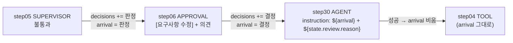

- `arrival`에는 마지막 결정 하나만 있다. 위처럼 판정 뒤에 사람의 결정이 오면 판정 사유는 빠지므로, 필요하면 저장해 둔 값을 `with`에서 따로 붙인다.
- TOOL step은 `arrival`을 건드리지 않는다. 그래서 문서를 읽는 TOOL step을 거쳐도 다음 Agent step이 결정을 받는다.
- LLM step(AGENT/SUPERVISOR/ROUTER)이 **성공하면** `arrival`을 비운다. 실패하면 남겨 둔다(같은 step을 다시 돌려도 같은 지시를 받게).
- 되감기는 다시 시작할 step으로 오게 했던 마지막 결정을 `arrival`로 되살린다.
- 그래서 사람의 의견을 Agent에 넘길 때는 `instruction: ${arrival:}`, `history: ${decisions:}` 두 줄이면 된다. route를 새로 이어도 고칠 곳이 없다.

글 모양:
```
설계 승인(step11)의 결정: 설계 수정 (승인자 local)
의견:
1. 메뉴 URL은 /sample/board/imageBoard.go 로 사용
2. 썸네일은 별도 파일을 만드는 방식으로 설계
```

**기동할 때 검사하는 것** — 닫지 않은 `${`, 경로 모양이 틀림, 치환되지 않은 `${ENV}`, 읽을 수 없는 곳을 읽음, `state:`에 없는 이름, **저장하는 step이 흐름상 읽는 step보다 먼저 올 수 없음**(`next`/`onFailure`/`routes`를 따라가 판단, 되돌아오는 루프는 허용), 그 아래 필드가 값의 모양에 없음. 모두 기동 실패다.

### 9.5 타입 표기(Picoschema)

Workflow `input`과 Agent `input`/`output`의 모양은 짧은 타입 표기로 적는다(Google Dotprompt의 Picoschema 문법, `common.schema.Picoschema`). 엔진이 JSON Schema(2020-12)로 바꿔 검사한다.

```yaml
input: string, 질문 한 줄                  # 글자 하나 + 설명(쉼표 뒤는 설명)

output:                                    # 필드를 적으면 객체
  path: string, 파일의 절대경로             # 꼭 있어야 하는 필드
  summary?: string, 한두 줄 요약            # ? = 없어도 되는 필드(null도 받음)
  count: integer
  changeType(enum, 신규인지 수정인지): [신규, 수정]
  frs(array, FR 번호 목록): string          # 글자 목록
  edits?(array, 바꿀 곳):                   # 객체 목록
    before: string
    after: string
  extra: any, 무엇이든
```

| 적는 법 | 뜻 |
|---|---|
| `이름: string, 설명` | 타입은 `string` / `number` / `integer` / `boolean` / `null` / `any` |
| `이름?: …` | 없어도 되는 필드(null도 받음) |
| `이름(array, 설명): 타입` 또는 아래에 필드 | 목록 |
| `이름(object, 설명):` 아래에 필드 | 객체 |
| `이름(enum, 설명): [A, B]` | 고를 수 있는 값 |
| `(*): 타입` | 적지 않은 필드의 타입 |

- 설명은 LLM에게 그대로 전달된다(답의 모양 지시, Sub Agent 인자 설명).
- 필드 이름에 공백·한글을 써도 되지만, 그런 이름은 표현식 경로로 읽을 수 없다.
- 머리말 값 안에 `: `(콜론+공백)를 쓰면 YAML이 깨진다(예: `(예: 컴파일 오류)` ✗ → `(컴파일 오류 등)`).
- Picoschema와 다른 점: 적지 않은 필드가 더 와도 받는다(LLM이 필드를 하나 더 붙이는 일이 흔해서).

## 10. Agent·Skill·MCP 정의

### 10.1 Agent 파일

`agents/<폴더>/<id>.md` 하나가 Agent 하나다. `---` 사이가 머리말(설정), 그 아래 전부가 시스템 프롬프트다.

```markdown
---
# 이 Agent가 무엇을 하는지, 어디서 쓰는지 주석으로 적는다
id: sm-architect-agent
version: 2.0.0
description: 요구사항과 영향도 분석을 바탕으로 설계서와 태스크아이템 목록을 만든다.
model:
  name: z-ai/glm-5.3-flash
  temperature: 0.2
  reasoning: high
input:
  base_dir: string, 작업 폴더의 절대경로
  impact: string, 영향도분석서 내용
  instruction?: string, 이번 일을 시킨 결정
output: string
tools:
  allowed: [searchInFiles, readFileLines, writeFile, appendFile, editFileTexts]
skills:
  preload: [handling-instructions, source-investigation, document-writing]
  allowed: [projects/**]
execution:
  maxToolCalls: 50
  requiredTools: [writeFile]
  onInvalidOutput: RETRY
  maxAttempts: 2
---
[역할]
너는 이 시스템의 애플리케이션 아키텍트다. …
${input.base_dir}/03-1.design.md 에 저장한다.
```

| 항목 | 설명 |
|---|---|
| `id` ✅ / `version` ✅ | Agent 이름(step의 `agent`, 채팅의 `agent`) / 버전. 프롬프트나 계약을 바꾸면 올린다 |
| `description` | 사람이 읽는 설명. Sub Agent로 쓰이면 필수(부모 LLM이 이것을 보고 고른다) |
| `role` | 표시용 역할 이름 |
| `model.provider` | 이 Agent만 다른 provider(`anthropic`/`openai`/`ollama`). 비우면 `spring.ai.model.chat` |
| `model.name` | 이 Agent만 다른 모델. 비우면 provider 기본 모델 |
| `model.temperature` | 0~2 |
| `model.reasoning` | `none`/`low`/`medium`/`high`. 단순 작업은 `none`이 빠르고 출력 한도 낭비가 없다(`off`가 아니라 `none`) |
| `input` / `output` | 받는 값·돌려주는 값의 모양. 비우면 글자. `output`에 필드를 적으면 엔진이 JSON 형식 지시를 붙이고 엄격히 검사한다. SUPERVISOR·ROUTER용 Agent는 `output`을 적지 않는다 |
| `tools.allowed` | LLM이 쓸 Tool 이름. `["*"]`는 전부. caller 허용 목록도 함께 통과해야 붙는다. TOOL step 전용 Tool은 적을 수 없다 |
| `skills.preload` | **늘 필요해서 시스템 프롬프트에 미리 넣을** Skill. 업무 지시 뒤에 `[Skill: 이름]`으로 붙는다. Tool 호출을 쓰지 않는다 |
| `skills.allowed` | 필요할 때 `Skill` Tool로 불러 읽을 Skill |
| `subAgents` | 일을 맡길 Agent id 목록, 또는 `{agents: [...], background: true}`. 깊이는 한 단계 |
| `allowedCallers` | 호출을 허락할 caller. 비우면 누구나 |
| `execution.maxToolCalls` | 한 번 부를 때 Tool 호출 상한(Skill 포함, Sub Agent 제외). 비우면 `dstone.ai.agent.tool.max-calls` |
| `execution.requiredTools` | 꼭 한 번은 성공해야 하는 Tool. `writeFile|editFileTexts`는 둘 중 하나. 못 하고 끝나면 계약 위반. **아직 못 했으면 한도의 마지막 몇 번(항목 수×2, 한도의 10분의 1, 3 가운데 큰 값)은 이 Tool 몫으로 남긴다** |
| `execution.toolPrerequisites` | Tool을 부르는 순서. `{startTestServer: [dbQuery, "browser_*"]}`면 앞의 Tool이 성공하기 전에는 뒤의 Tool을 실행하지 않는다(끝의 `*`는 앞부분 일치). `{"success":false}`를 돌려준 것은 성공이 아니다(`requiredTools`도 같음) |
| `execution.requiredWrites` | 꼭 써야(고쳐야) 하는 파일. 입력 속 경로를 가리키는 표현식으로 적는다(`${input.documents[0]}`, `${input.base_dir}/01.md`). 값이 목록이면 모두. 기동할 때 `${input.…}` 표현식인지, 그 경로가 input에 있는지 검사한다 |
| `execution.onInvalidOutput` / `maxAttempts` | 계약 위반 때 `RETRY`면 `maxAttempts`번까지 다시 부른다. 다시 부를 때 `[지난 시도]`(실패 이유와 지난 답)를 붙인다. AGENT step과 채팅에만 적용 |
| `execution.timeoutSeconds` | LLM 호출 한 번의 대기 시간(지금은 openai provider만) |

**프롬프트에서 값 쓰기** — 본문의 `${input.필드}`는 이 Agent가 받은 값으로, `${output.필드}`는 그 필드 **이름**으로 채워진다(`PromptText`). `${state…}`는 읽을 수 없다(필요하면 step의 `with`로 넘긴다). 기본값 `${input.note:없음}`, 리스트 `${input.files[0].path}`, 환경 변수 `${APP_HOME}`, 글자 그대로는 `\${param}`.

**기동할 때 검사하는 것**(모두 기동 실패, 표시한 것만 경고): `version`·본문 없음, 머리말 형식, 프롬프트의 `${…}` 자리가 input/output에 없음, 모르는 키, `reasoning`·`temperature` 범위, 타입 표기 오류, `requiredTools`가 `tools.allowed`에 없음, `"*"`와 다른 이름을 섞음, TOOL step 전용 Tool, 없는 Sub Agent·Skill, Sub Agent의 깊이·설명·이름 충돌, `background` 설정 오류, 엔진이 붙이는 이름(`Skill`, `TaskOutput`)과 충돌, SUPERVISOR·ROUTER용 Agent에 `output`·`subAgents`. 경고: 등록되지 않은 Tool 이름(MCP 서버가 꺼져 있을 수 있어서), Skill 참고 파일이 있는데 `readFile`이 없음.

**프롬프트 쓰는 원칙**([`ai-engine-agent-principles.md`](../.claude/docs/ai-engine-agent-principles.md))

1. 순서는 **역할 한 줄 → 입력의 뜻 → 만들 것과 그것을 읽을 사람 → 이유를 붙인 제약 몇 개 → 답 쓰는 법**.
2. 규칙 목록을 늘리지 않는다. 엔진이 보장하는 것(저장 확인, 횟수, 승인 의견 전달, 입력 속 지시문 무시)은 다시 쓰지 않는다.
3. 여러 Agent가 같이 쓰는 방법은 Skill로 뺀다. "처음이면 A, 고칠 때는 B"처럼 분기가 생기면 Agent를 나눈다.
4. 실패를 고칠 때는 먼저 분류한다(엔진·입력·Tool·Workflow 구조·Skill·모델·프롬프트). 프롬프트는 마지막 수단이다.

### 10.2 Skill 파일

`skills/<폴더>/<이름>/SKILL.md` 하나가 Skill 하나다(공개된 Agent Skills 형식).

```markdown
---
name: source-investigation          # 폴더 이름과 같아야 한다(소문자·숫자·하이픈, 64자 이내)
description: 기존 소스와 DB를 조사하는 방법. 조사를 시작하기 전에 따른다.
---
조사는 산출물을 쓰기 위한 준비일 뿐이다. …
```

| 쓰는 방법 | 언제 | 어떻게 들어가나 |
|---|---|---|
| `skills.preload` | 그 Agent가 일할 때마다 필요함(조사 방법, 저장 방법, 지시 읽는 법) | 시스템 프롬프트 뒤에 본문이 붙는다. Tool 호출 없음 |
| `skills.allowed` | 경우에 따라서만 필요함(특정 기술·프로젝트의 관례) | `Skill` Tool 설명에 이름·설명만 보이고, 모델이 부르면 본문을 받는다(Tool 호출 1번) |

- 같은 폴더의 다른 파일은 참고 자료다. 엔진은 읽지 않고, Agent가 `readFile`로 읽는다.
- **프로젝트 관례는 `skills/projects/{프로젝트ID}/<Skill 이름>/SKILL.md`로 프로젝트ID 폴더 아래에 둔다.** Skill 이름은 영문 소문자·숫자·하이픈만 되므로 프로젝트ID는 바깥 폴더로 나눈다. Agent는 `skills.allowed`에 `projects/**` 한 줄만 적는다. `폴더/**`는 그 폴더 아래 Skill 전부를 후보로 주는 폴더 지정이고, Agent는 설명을 보고 지금 소스에 맞는 것만 부른다. 새 프로젝트를 들일 때 Agent·Workflow는 고치지 않는다. 설명에는 프로젝트 이름보다 소스에서 바로 보이는 모양(패키지, 상위 클래스)을 적는다. 폴더 지정은 `preload`에는 쓸 수 없고(기동 실패), 걸리는 Skill이 없으면 경고만 남긴다.
- 엔진·범용 Skill·Agent 프롬프트에는 특정 대상 앱의 이름·패키지·테이블을 적지 않는다. 그런 것은 프로젝트 Skill이나 요청서가 준다.
- **새 업무나 새 기술을 만나면 Agent 프롬프트를 고치지 말고 Skill을 하나 더 만든다.** 프롬프트는 여러 업무에 걸쳐 그대로 쓰게 하려는 것이다.
- Skill 안의 스크립트를 실행하는 기능은 없다(필요하면 셸 Tool 허용 목록에 올린다).

### 10.3 MCP 서버 파일

`mcp/<폴더>/<id>.yml`.

| 항목 | 필수 | 설명 |
|---|---|---|
| `id` | ✅ | 서버 이름 |
| `transport` | ✅ | `STDIO`(로컬 프로세스) / `SSE`(원격 HTTP) |
| `command`, `args` | STDIO | 실행할 명령(예: `npx`)과 인자. Windows는 `MCP_STDIO_COMMAND_PREFIX`(예: `cmd.exe /c`)가 앞에 붙는다 |
| `url` | SSE | 서버 주소 |
| `allowedTools` | | 가져올 Tool 이름. 비우면 전부 |
| `repeatableTools` | | 같은 결과가 연달아 나와도 정상인 Tool(기다리는 용도). "반복 호출" 감지에서 빠진다. 비우면 모두 센다 |

접속에 실패한 서버는 로그만 남기고 건너뛴다. MCP 정의는 다시 읽기 대상이 아니라서 고치면 엔진을 다시 띄운다.

### 10.4 복사해서 쓰는 뼈대

`<...>` 자리를 채우고 쓰지 않는 선택 항목은 지운다.

**Workflow**

```yaml
# <이 Workflow가 하는 일, 불러 보는 법>
id: <workflow-id>
version: 1.0.0
description: |
  <화면에 보일 설명>
input: string, <입력 설명>
state:
  <result>: <저장할 값 설명>
steps:
  - id: step00
    name: <사람이 읽는 이름>
    type: AGENT
    agent: <agent-id>
    with:
      <field>: ${input}
      instruction: ${arrival:}
      history: ${decisions:}
    save: <result>
    next: step01
    onFailure: FAIL
return: ${state.<result>}
```

**step 종류별 조각**

```yaml
  - id: step01                 # TOOL: LLM 없이 Tool 하나
    type: TOOL
    tool: readFile
    with:
      fileFullPath: ${input}/doc.md
      maxChars: 60000          # 이보다 크면 자르지 않고 실패
    save: doc
    onFailure: FAIL

  - id: step02                 # SUPERVISOR: 통과면 next, 불통과면 onFailure
    type: SUPERVISOR
    agent: <judge-agent>
    with: ${state.doc}
    save: review
    next: step04
    onFailure: step03

  - id: step03                 # APPROVAL: 사람이 고른 이름으로 간다
    type: APPROVAL
    approval:
      approverRole: PL
    save: decision
    routes:
      승인: step04
      수정: step01
      중지: FAIL

  - id: step04                 # ROUTER: LLM이 이름 하나를 고른다
    type: ROUTER
    agent: <router-agent>
    with: ${input}
    routes:
      billing: step05
      other: END

  - id: step05                 # forEach: 항목마다 동시에
    type: TOOL
    tool: validateSqlSyntax
    forEach: ${input.sqlList}
    with:
      sql: ${item}
    saveEach: checked
```

**Agent**

```markdown
---
# <이 Agent가 하는 일, 쓰는 곳>
id: <agent-id>
version: 1.0.0
description: <무엇을 하는지. Sub Agent로 쓰이면 필수>
model:
  temperature: 0.2
  reasoning: medium
input:
  <field>: string, <뜻>
  instruction?: string, 이번 일을 시킨 결정
  history?: string, 지금까지의 결정
output: string
tools:
  allowed: [readFileLines, writeFile]
skills:
  preload: [handling-instructions]
execution:
  maxToolCalls: 30
  requiredTools: [writeFile]
  onInvalidOutput: RETRY
  maxAttempts: 2
---
[역할]
너는 <역할>이다. <이 산출물을 누가 어떻게 쓰는지>.

[입력]
<field>는 <뜻>이다.

[만들 것]
${input.<field>} … 에 저장한다. <꼭 지킬 제약과 그 이유>

[답]
<답에 적을 것>
```

**Skill**

```markdown
---
name: <skill-name>            # 폴더 이름과 같게
description: <언제 쓰는지 한두 문장>
---
<작업 방법>
```

## 11. 들어 있는 정의 — sm-workflow와 샘플

### 11.1 sm-workflow — 운영 요청 처리 (2.9.0)

요청서 폴더 하나를 받아 **요구사항 → 리뷰 → 영향도 → 설계 → 개발 → 컴파일 확인**까지 가고, 단계마다 사람이 승인한다.
작업 폴더는 `입력 폴더/실행 시각(yyyyMMdd-HHmm)`이고, 개발 결과는 그 아래 `dev-resources`에 원본과 같은 경로로 쌓인다(원본은 건드리지 않는다).
요청서의 `## 프로젝트ID`가 필수다(2.9.0). 시작할 때 그 프로젝트의 현재 리비전(프로젝트 관리 [Build] 결과, 11.2절)을 정하고, 그 실행은 끝까지 그 리비전의 소스만 쓴다.
노드 48개를 하나씩 그림과 표로 풀어 쓴 해설은 [`09.dstone-ai-engine-sm-workflow.md`](09.dstone-ai-engine-sm-workflow.md)에 있다. 아래 그림과 Agent 표의 step 번호는 1.x 때 것이라 지금 yml의 `id`와 다르다. 노드 번호는 해설 문서를 기준으로 본다.

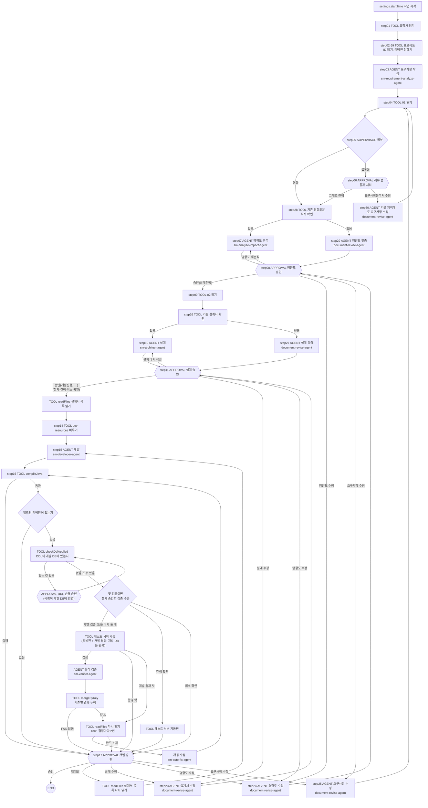

- **[~ 수정]과 [~ 다시 작성]** — 수정은 범용 `document-revise-agent`가 지시받은 곳만 고치고 주 문서 끝 `## 수정 이력`에 한 줄 남긴다. 다시 작성은 그 문서를 만든 Agent가 처음부터 쓰며, 사람이 고를 때만 한다. 고친 내용이 사라질 수 있다.
- **앞 문서가 바뀌어도 뒤 문서는 새로 쓰지 않는다** — 요구사항이나 영향도를 고친 뒤 진행하면 step28·26이 뒤 문서가 있는지 본다. 있으면 step29·27이 바뀐 내용에 맞춰 고치고, 없을 때만 step07·10이 새로 쓴다. 문서가 있는지는 `isFileExist`(true/false)와 TOOL step의 `routes`로 나누므로, 처음 실행 때 문서가 없어도 이력에 실패로 남지 않는다(2.4.1부터).
- **리뷰 불통과** — [요구사항분석서 수정]은 사람의 의견과 리뷰어의 지적을 함께 넘긴다(step30). [고객요청사항 재분석]은 분석서를 처음부터 다시 쓴다. 리뷰 Agent는 판정만 돌려주고 분석서를 고치지 않는다(2.6.0). 예전처럼 분석서에 판정을 적으면 다시 리뷰할 때 고칠 자리를 못 찾고, 판정 기록이 다음 단계 입력에 섞였다.
- **문서 크기** — 문서를 읽는 step은 `maxChars`를 넘으면 잘라 넘기지 않고 실패한다(설계서 100,000자, 나머지 60,000자). 설계서·목록은 step50이 먼저 보고, 설계 승인 뒤(step14)에 걸리면 설계 승인으로 돌아간다. 상한을 올릴 때 `readFiles`는 `maxChars`만, `readFile`은 `max-result-chars`까지 함께 올린다.
- **승인 의견 전달** — 모든 Agent step이 `instruction: ${arrival:}`, `history: ${decisions:}`를 받는다. 읽는 법은 Skill `handling-instructions`에 있다. 반영할 수 없는 의견은 Agent가 답의 "반영하지 않은 지시"에 적고, 다음 승인 화면에서 사람이 본다.
- **Skill** — `handling-instructions`, `source-investigation`, `document-writing`은 preload, 프로젝트 관례는 `projects/**`(allowed. 대상 프로젝트의 관례 Skill은 `skills/projects/{프로젝트ID}/<이름>/SKILL.md`).
  `troubleshooting`(증상별로 먼저 볼 것, 값 대조표, 고친 뒤 확인)은 개발 Agent와 자동 수정 Agent가 preload한다.
- **컴파일 확인** — 개발 Agent가 `compileJava`로 스스로 고치고(최대 3번), step16이 한 번 더 확인한다. 통과든 실패든 개발 승인으로 가고, 오류는 다음 개발(`compile_error`)·설계 수정(`reference`)에 전달된다. step14가 개발 폴더를 비우면 오류도 비운다. 원본을 한 번은 빌드해 둬야 한다.
- **자동 동작 검증** — 컴파일이 통과하면 사람에게 묻기 전에 테스트 서버(11.2절)에서 실제로 돌린다. `sm-verifier-agent`가 완료 기준마다 `PASS`·`FAIL`·`BLOCKED`와 관측 근거를 내고, `FAIL`이거나 개발 결과 탓으로 뜨지 않으면 `sm-auto-fix-agent`가 고친다(사람의 결정 하나마다 최대 2번). 검증하지 못한 것은 통과가 아니다. 이유(`state.projectRevision`(빌드된 리비전 없음)·`serverError`·`verificationError`, 시나리오의 `BLOCKED`)와 함께 개발 승인으로 간다. `PASS`도 LLM의 판정이므로 승인은 사람이 한다. 화면으로만 시험하므로 API를 바로 부르는 경로의 결함은 놓칠 수 있다.
- **검증 수준은 설계 승인에서 고른다(2.7.0)** — 모든 변경에 서버를 띄우고 화면을 누를 필요는 없다. 설계 승인에서 `승인(개발진행, 전체 확인)`(화면 검증), `승인(개발진행, 간이 확인)`(테스트 서버가 뜨는지만 보고 개발 승인으로. 화면이 없는 배치·연동·쿼리 변경), `승인(개발진행, 최소 확인)`(서버를 띄우지 않음. 주석·안내 문구·설정값 하나처럼 동작이 바뀌지 않는 변경) 가운데 고른다. 설계 Agent가 설계서의 `검증 방법 제안`에 어느 쪽인지와 이유를 적지만(`sm-architect-agent` 2.2.0), 고르는 것은 사람이다. 모델의 확신은 생략 근거로 믿기 어렵기 때문이다. 생략은 첫 검증에만 적용하고, 재개발·자동 수정으로 다시 돌 때는 화면 검증으로 간다. yml에서는 DDL 확인(step60) 뒤의 step43이 나눈다. `routeValue`로 설계 승인의 결정을 그대로 `routes`에 대고, `limit`(max 1)이라 두 번째부터는 실행하지 않고 화면 검증으로 간다(2.11.0, 예전에는 `countUp`·`containsValue` step 셋). 간이 확인은 step45가 서버 기동만 한다. 컴파일 실패로 개발 승인에 갔다가 다시 온 경우는 아직 검증한 적이 없으므로 첫 검증으로 친다.
- **눌리지 않는 요소** — 두 Agent는 Skill `browser-testing`도 preload한다. `<div>` 버튼이 접근성 스냅샷에서 감싼 영역과 합쳐지면 `ref`로 누를 때 감싼 영역이 눌린다. 이때는 `target`에 Playwright locator 표기를 넣고, iframe 안의 요소는 `contentFrame()`을 거친다(2026-11-27 실행 0fb4c669).
- **환경 차이는 BLOCKED** — 검증 Agent와 자동 수정 Agent는 Skill `test-environment`를 preload한다. 테스트 서버 결과의 "원래 환경과 다른 점"(11.2절)으로 설명되는 실패(예: 디스크에는 파일이 있는데 주소만 404, 막은 외부 접속)는 `FAIL`이 아니라 `BLOCKED`로 내고, 자동 수정은 그런 `FAIL`을 고치지 않고 `unresolved`에 남긴다. 2026-11-23 실행 6d1784d8에서 업로드 이미지 404를 `FAIL`로 내자 자동 수정이 고칠 곳 없는 코드를 18분 뒤지다 출력 한도로 끝났다(2.5.0).
- **다시 검증할 때는 바뀐 것만 깊게** — step40(서버 기동 앞)이 `fileChanges`로 지난 검증 뒤 작업 폴더(`compile-check` 제외)에서 바뀐 파일을 찾고, step35가 지난 결과(`previous`)와 그 목록(`changes`)을 받는다. 같은 step40이 작업 폴더 밖(`${input}/.work-copy/실행 시각`)에 둔 사본과 비교한 바뀐 줄(`workChanges.diff`)은 자동 수정(step34)과 개발(step17)이 `recent_changes`로 받는다. 사람이 개발 승인에서 알린 증상(`developApproval.comment`)은 step35가 `reported`로 받아 "사람이 알린 오류:" 기준으로 재현한다. 검증 Agent는 알린 증상 → 대상 파일이 바뀐 기준(요구사항 문서가 바뀌었거나 목록을 알 수 없으면 전부) → 지난번 `FAIL`·`BLOCKED`·새 기준 → 나머지 순으로 보고, 이번에 확인한 기준만 답한다. step62가 `mergeByKey`로 기준 id에 맞춰 `state.verificationAll`에 쌓아, 답하지 않은 기준은 지난 결과가 `carried`로 남는다. 자동 수정(step34), 실패 판정(step36), 다음 검증은 이 누적 결과를 받고, 개발 폴더를 비울 때(step16) step63이 함께 비운다(2.14.0). 설계서는 고칠 때마다 수정 이력이 붙어 늘 바뀌므로 그것만으로는 다시 하지 않는다. step29가 띄운 서버를 step35가 그대로 받도록 둘 사이에는 step을 두지 않는다(서버 넘겨주기는 한 step까지).
- **본뜰 기능의 코드를 모아 설계에 넘긴다(2.8.0)** — 영향도 Agent(`sm-analyze-impact-agent` 2.2.0)가 신규기능의 본뜰 기존 기능을 `02.impact.md`의 `## 참고 기능` 절에 화면 경로나 주소로 적는다(많아야 3개). 영향도 승인 뒤 yml의 step46~49가 그 절과 요청서의 프로젝트ID를 읽고, `knowledgeFeatureCode`로 그 기능의 화면·주소·메소드·SQL(팝업 화면 포함)을 원본 코드 그대로 `02-1.reference-code.md`에 모아 설계 Agent(`sm-architect-agent` 2.3.0)의 `reference_code`로 넘긴다. 설계 Agent는 참고 파일과 주고받는 짝을 거기서 고른다. 이미지 게시판 실행에서 난 결함(업로드 부품을 관례와 다르게 씀, 팝업을 여는 화면과 받는 Controller를 다른 기능에서 가져옴, 공통 서비스의 사전 조건 누락)은 모두 동작하는 기능 하나를 통째로 보지 못해서 생겼다. 프로젝트ID나 절이 없거나 모으지 못하면 이유를 `state.referenceError`에 두고 예전처럼 설계한다.
- **사람에게 가기 전 형식 검사(2.8.0)** — 사람 승인 한 번이 20~40분이라(실행 daa7c276에서 118분 중 76%가 승인 대기) 기계로 잡을 수 있는 것은 먼저 잡는다. 설계·설계 수정·설계 맞춤 뒤 step50이 `checkDocuments`로 설계 문서 셋을 보고, 걸리면 `document-revise-agent`(step52)가 형식만 고친다. 개발 뒤 step54가 개발 Agent의 답 `unfinished`(보류 가운데 손대지 못해 다시 부르면 이어서 할 수 있는 것의 수, 없으면 0)를 보고 한 번 더 부르고(step57. 사람의 결정이나 DB 반영이 필요한 보류는 세지 않는다, 2.8.1), 컴파일 뒤 step53이 `checkSources`로 XML·JSP·JavaScript를 보고 걸리면 개발 Agent가 고친다(step58). 셋 다 사람의 결정 하나마다 1번(그 step의 `limit`, `scope: ${decisions:}`. 2.11.0 전에는 `countUp` step)이고, 한도를 쓰면 그대로 다음으로 간다. 다시 부를 때 지난 결과(보류 이유, 형식 오류)는 `check_result`로 그 경로에서만 넘겨, 설계를 새로 승인한 개발에 묵은 지적이 따라가지 않는다. 개발·자동 수정 Agent도 컴파일 뒤 `checkSources`로 스스로 확인한다.
- **검증 전에 설계서를 다시 읽는다** — 자동 수정은 설계서도 고친다. 그래서 컴파일 확인 뒤 서버 기동 전에 설계서를 다시 읽어(yml의 step41) 검증 Agent가 고친 뒤의 설계서를 받게 한다(2.6.0).
- **삭제는 목록으로** — 지워야 할 원본 파일은 `dev-resources/_delete-files.txt`에 한 줄씩 적는다. Agent가 직접 지우지 않는다.
- **설계서가 원본, 개발 폴더는 매번 새로** — 설계를 승인하고 개발로 갈 때마다 step14가 `dev-resources`를 비운다. 재설계로 빠진 파일이 남지 않게 하려는 것이다. 대신 [재개발]은 폴더를 비우지 않고 고치며, 고친 내용을 `03-1.design.md`에도 같은 before/after로 옮겨 적고 `## 수정 이력`에 남긴다(`sm-developer-agent` 2.1.0, 답의 `designSynced`). 그래서 재개발 뒤 설계 수정을 거쳐도 고친 것이 사라지지 않는다. 재개발 때는 step18~19가 설계서와 목록을 다시 읽어 최신 내용을 넘긴다.

### 11.2 테스트 서버(`startTestServer`)와 리비전 빌드

특정 앱을 모르는 범용 Tool이다. 프로젝트 관리의 설정(소스 디렉토리, 형상관리, Java 버전, WAS, 빌드, DB, 테스트계정)과 인자만 쓴다. 2026-11-26에 다시 설계했다. 설계와 결정의 근거는 [`temp/dstone-ai-테스트관련재설계/01.설계.md`](temp/dstone-ai-테스트관련재설계/01.설계.md)에 있다. 예전에는 실행마다 DB를 통째로 복제하는 격리 시험 서버(`startSandboxServer`)를 썼는데, 고객사 개발 DB가 커서 복제가 사실상 안 되고 Maven 단일 모듈만 띄울 수 있었다.

**리비전 빌드** — 프로젝트 관리의 [Build]가 만든다(`common.project.ProjectBuildService`, 백그라운드, 같은 프로젝트는 한 번에 하나).

1. 형상관리가 있으면 소스 디렉토리를 갱신한다(`git pull --ff-only`, `svn update`). 비었으면 받는다. 비밀번호는 명령줄에 싣지 않는다(git `GIT_ASKPASS`, svn `--password-from-stdin`).
2. 리비전 이름은 형상관리 리비전 앞 12자, 없으면 빌드 시각이다. 이미 성공한 리비전이면 다시 빌드하지 않는다.
3. 소스를 `{작업 루트}/{프로젝트ID}/rev/{리비전}/src`로 복사해 빌드한다. 고객의 소스 디렉토리 값은 바꾸지 않는다.
4. 명령은 종류마다 정해져 있고 화면에서는 인자만 받는다(셸이 해석하는 글자는 거절). Maven `mvn -B -DskipTests package`, Gradle `gradlew`(없으면 `gradle`) `build -x test`, Ant `ant`, Shell은 `dstone.ai.tool.shell.allowed-commands`에 등록된 스크립트, "빌드 없음"은 엔진이 소스 전체를 javac(`JavaCompileTool.compileAll`).
5. 산출물을 찾는다. 프로젝트 관리에 넣은 웹 루트 → Spring Boot jar(`BOOT-INF`, 풀어 둠) → 풀린 WAR 폴더 → `.war`(풀어 둠) → "빌드 없음"이면 `WEB-INF/web.xml`이 있는 폴더 순서다. 빌드 뒤에 생긴 것만 본다. 못 찾으면 상태가 `INPUT`(구조 입력 필요)이고, 웹 루트·클래스·lib를 넣고 다시 누르면 빌드 없이 구조만 찾는다.
6. 성공하면 현재 리비전을 바꾸고, 실행이 쓰는 것과 현재 것을 빼고 최근 `keep-revisions`개만 남긴다. 리비전 폴더의 `build-layout.properties`에 산출물 위치를 적어 두어, `compileJava`가 리비전 소스를 받으면 그 클래스·lib를 쓴다.

Workflow는 시작할 때 `resolveProjectRevision`(TOOL step 전용)으로 리비전을 받아 끝까지 그것만 쓴다. 그 사이 새 리비전이 생겨도 진행 중인 실행에는 영향이 없다. 빌드한 리비전이 없으면 소스 디렉토리로 진행하되 서버 기동 테스트는 하지 않는다.

**실행하면서 갱신(`refresh: true`)** — Tool이 위 1~6을 끝날 때까지 기다려 실행하고 그 리비전을 돌려준다. `sm-workflow`는 켜 둔다.

- 새 커밋이 없으면 빌드하지 않으므로 형상관리 갱신 시간만 든다.
- 형상관리, 소스 디렉토리, 빌드 종류 가운데 하나라도 없으면 갱신하지 않고 현재 리비전을 쓴다.
- 갱신이나 빌드에 실패하면(산출물을 못 찾은 `INPUT` 포함) step이 실패한다. 지난 리비전으로 넘어가지 않는다.
- 같은 프로젝트는 한 번에 하나라 뒤에 온 실행은 차례를 기다린다. 기다리는 동안 같은 리비전의 빌드가 실패했으면 다시 빌드하지 않고 그 결과를 받는다. 기다리는 실행도 실행 슬롯(`pool.max-running`)을 차지한다.
- [Build]는 관리자만 누를 수 있지만, 이 갱신은 Workflow를 실행하는 사람이면 일으킨다. 빌드 기록에는 실행 요청자가 남는다.

**남기는 리비전** — 현재 리비전과 최근 `keep-revisions`개를 남긴다. 테스트 서버가 쓰는 리비전과, 대기·진행·승인 대기·일시정지 중인 실행(실패한 지 `keep-failed-days`일이 안 된 실행 포함)이 받아 간 리비전은 개수를 넘어도 지우지 않는다. 실행이 받아 간 리비전은 `{작업 루트}/{프로젝트ID}/pins/{실행ID}`에 적는다. 그래서 승인 대기가 쌓이면 리비전 폴더도 늘어난다. 끝난 실행을 되감으면 리비전이 지워졌을 수 있으니, 그때는 리비전 정하기 step부터 다시 돌린다.

**띄우기** — 실행마다 서버 하나다. 같은 프로젝트도 여러 실행이 동시에 쓸 수 있다(전체 `max-servers`개까지, 넘으면 기다림).

| 대상 | 어떻게 |
|---|---|
| 판정 | 리비전마다 한 번(`WasCheck`). EJB(`javax.ejb`·`jakarta.ejb`, `@Stateless` 등, `ejb-jar.xml`), 벤더 API import(`vendor-api-prefixes`), WebLogic startup/shutdown class가 있으면 띄우지 않는다. 플랫폼 이름이 아니라 코드로 본다. javax 앱은 Tomcat 9, jakarta 앱은 10·11 |
| 실행 층 | `runs/{실행ID}`의 `webapp`(docBase), `classes`, `data`, `tomcat`(CATALINA_BASE). 리비전 폴더와 원본 소스는 읽기만 한다 |
| Tomcat | Context 파일 하나로 올린다. `PreResources`로 실행 층 `classes`를 `/WEB-INF/classes`에, `PostResources`로 리비전 웹 루트를 `/`에 겹친다. Tomcat 8.5 이상 |
| Spring Boot | `java -cp {실행 층 classes}:{리비전 classes}:{리비전 lib}/* {Start-Class}`. jar를 다시 만들지 않는다 |
| 개발 결과 | 웹 쪽 파일은 `webapp`, 리소스는 `classes`, `.java`는 `compileJava`로 컴파일해 `classes`. 삭제 목록의 웹 파일은 `RewriteValve`로 410 |
| 경로 | 소스에 박힌 원본 소스 디렉토리 경로를 `runs/{실행ID}/data`로 바꾼다(테스트 중 업로드·삭제가 원본 폴더에서 일어나지 않게). 비어서 시작한다 |
| 네트워크 | 앱 JVM의 새 소켓을 모두 엔진의 문(`SandboxGuard`)으로 보낸다. 개발 DB와 `allow-hosts`만 잇고 나머지는 끊는다. NIO 접속 라이브러리가 있으면 띄우지 않는다(`trusted-libs` 예외) |
| Agent | 띄운(또는 다시 받은) step은 끝날 때까지 DB 조회를 테스트 DB 별칭(`test-DB이름`)으로, `browser_navigate`를 테스트 서버 주소로 묶는다(`TestServerRegistry`). 띄우기 전에는 Agent 정의의 `execution.toolPrerequisites`가 막는다 |

**다시 부르면** — 같은 실행이 같은 리비전으로 다시 부르면 바뀐 파일만 반영한다. JSP·정적 파일은 복사만(즉시), Java·XML·설정·`WEB-INF`는 context reload(Context 파일의 수정 시각을 바꾸면 Tomcat이 다시 올림, 최대 10초 간격으로 확인), Boot는 JVM 재시작이다. reload하면 세션이 끊긴다. reload가 안 되면 JVM을 다시 띄우고, 이때는 연결이 끊겨 DB의 테스트 데이터도 원복된다.

**개발 DB와 원복** — 고객사 개발 DB를 복제하지 않고 테스트 드라이버로 쓴다.

- 실행 층을 만들 때 앱 설정·소스의 프로젝트 DB URL을 `jdbc:dstonetest:{원래 URL}`로, 알려진 드라이버 클래스(MySQL, MariaDB, PostgreSQL, Oracle, log4jdbc)를 테스트 드라이버로 바꾼다. JNDI로 찾는 앱은 프로젝트 DB의 JNDI 이름으로 Context에 `Resource`를 만들고, `java:comp/env` 없이 찾는 리터럴은 붙여 준다. 등록한 DB의 URL도 JNDI 이름도 찾지 못하면 원복을 보장할 수 없어 띄우지 않는다.
- 테스트 드라이버(`resources/testdriver`, 엔진이 Java 8 바이트코드로 컴파일한 jar, `TestDriverJar`)는 앱 JVM 안에서 URL·계정마다 물리 연결 하나만 열고 autocommit을 끈다. 앱의 `commit()`은 커밋하지 않고 savepoint를 풀고, `rollback()`은 마지막 savepoint까지만 되돌린다. 그래서 앞 요청이 저장한 데이터는 남는다. 단위(트랜잭션, autocommit이면 문장 하나)마다 잠금을 잡아 병렬 요청이 섞이지 않는다(대기 상한 `db-lock-wait-seconds`).
- 실제 연결에는 앱 설정에 적혀 있던(테스트 드라이버로 바꾼) 드라이버를 먼저 쓴다. 없으면 URL 종류의 알려진 드라이버, `ServiceLoader` 순으로 찾는다. 앱에 드라이버가 둘 이상 있어도 URL을 받는 다른 드라이버(예: `jdbc:mysql:`도 받는 옛 MariaDB 드라이버)가 가로채지 않는다.
- 테스트 중 DDL(CREATE, ALTER, DROP, TRUNCATE 등)은 실행하지 않는다. MySQL·Oracle은 DDL이 그때까지의 작업을 커밋하기 때문이다. DDL은 사람이 개발 DB에 반영한다. sm-workflow는 서버 기동 전에 `checkDdlApplied`로 DDL 문서의 테이블·컬럼과 초기 데이터(INSERT) 행이 있는지 보고, 없으면 승인 step에서 사람이 반영하게 한다.
- 엔진은 드라이버의 제어 창구(127.0.0.1, 일회용 토큰)로 원복(ROLLBACK)과 조회를 한다. 테스트 DB 별칭으로 `dbQuery`하면 앱과 같은 연결에서 조회해 커밋하지 않은 테스트 데이터가 보인다. 다른 연결과 고객 개발자에게는 보이지 않는다.
- 앱 JVM에서 개발 DB로 가는 연결 수가 드라이버가 연 물리 연결 수보다 많으면(드라이버를 거치지 않은 연결) 서버를 내리고 실패한다.

| 언제 | 서버 | DB |
|---|---|---|
| step이 끝남 | 둔다(같은 실행의 다음 step이 그대로 쓴다) | 그대로 |
| 승인 대기·일시정지로 루프를 벗어남 | 둔다. 유휴 `idle-minutes`가 지나면 내린다 | 원복 |
| 실행이 끝남·실패 | 내린다 | 원복 |
| 루프 안에서 `db-hold-minutes`를 넘김 | 내린다 | 원복 |
| 엔진 종료·재시작 | 모두 내린다. 다음 기동 때 남은 프로세스를 표시로 찾아 정리 | 연결이 끊겨 DB가 원복 |

**원래 환경과 다른 점** — 결과 끝에 적어 Agent가 그것 때문에 생긴 실패를 개발 결과 탓으로 보지 않게 한다(Skill `test-environment`). 지금 적는 것: 업로드 폴더를 바꿈(기존 첨부 파일 없음), 웹앱 밖 폴더를 여는 주소(아래 정적 경로), 설치된 Tomcat의 다른 앱을 띄우지 않음, 테스트 DB 잠금 대기, URL을 찾지 못한 프로젝트 DB, 막은 외부 접속, 다른 JDK.

**테스트서버 정적 경로** — 원래 서버에서 웹서버(Apache 등)가 웹앱 밖 폴더를 주소로 열어 주는 경우(예: 업로드 파일), 프로젝트 관리의 "테스트서버 정적 경로"에 한 줄에 하나씩 `/주소=폴더`를 적는다. Tomcat 방식에서 실행 CATALINA_BASE에 Context 파일을 만들어 연다. 원본 소스 안의 폴더는 `data` 쪽으로 바꿔 열고, 없는 폴더는 열지 않고 결과에 적는다. Spring Boot에서는 열지 않는다. 값은 `ai_management_project.TEST_STATIC_PATHS`, 검사는 `ProjectStore.parseStaticPaths()`.

**막지 못하는 것** — 보안 경계가 아니라 실수를 막는 장치다. 프로시저 안의 COMMIT, 자율 트랜잭션, DB 링크 너머의 쓰기, MySQL의 트랜잭션 없는 테이블(MyISAM)은 원복되지 않는다. 테스트 서버가 테이블을 쓰는 동안 그 테이블의 DDL은 기다린다(MySQL 메타데이터 잠금. 승인 대기 중에는 원복해서 풀린다). DB에 저장된 파일 절대경로는 바꿀 수 없어, 엔진 서버에 그 경로가 실제로 있으면 테스트 중 삭제가 그 파일을 지울 수 있다. 앱이 `getRealPath()`로 리비전 폴더의 기존 파일을 덮어쓰는 것, 브라우저에서 바깥 링크로 나가는 것, OS 명령, 일부러 프록시 설정을 바꾸는 코드도 막지 못한다. 그래서 개발 장비에서 개발 DB로만 쓴다. Tomcat 7 전용 앱과 Java 6·7 앱은 지원하지 않는다(테스트 드라이버가 Java 8 이상).

**실측(2026-11-26, testApp, WAR, 소스 105개, 1회)** — 리비전 빌드는 약 1분(mvn package 포함). 첫 기동 약 12초(실행 층 1.2초, Tomcat과 앱 10.7초). 예전 방식은 DB 복제와 `mvn clean package`를 포함해 약 55초였다. JSP만 바꾼 반영은 1초 안, Java를 바꾼 context reload는 15~18초이고 DB의 테스트 데이터는 그대로였다. 원복 뒤 앱과 다른 연결 모두 행 수 0을 확인했다.

**준비** — 설정 `tomcat-home-9`(`TOMCAT_HOME_9`) 등 Tomcat 경로, Java 버전별 `JAVA_HOME_{버전}`, 화면 검증에는 브라우저 MCP와 프로젝트 관리의 테스트계정. 예외는 프로젝트별로만 준다(`프로젝트ID=값`): `trusted-libs`, `allow-hosts`.

**요청서(`00.request.md`) 양식** — 엔진은 양식을 모른다. Workflow가 `readMarkdownSection`으로 절 하나를 읽거나, 요청서 전체를 Agent에 넘긴다.

```markdown
## 현업요청
(요청 내용)

## 프로젝트ID          ← 필수. 프로젝트 관리에 등록한 ID. 소스(현재 리비전), DB, 테스트계정을 여기서 찾는다
myApp
```

`## 소스경로`와 `## 시험환경`은 2.9.0부터 읽지 않는다. 사람이 쓰는 서버에 올리는 경로도 없앴다.
**계정과 비밀번호는 요청서에 적지 않는다.** 요청서는 작업 폴더, 실행 상태 DB, LLM 요청 로그로 퍼진다. 화면 로그인에 쓸 테스트계정은 프로젝트 관리에 둔다. 비밀번호는 `EncUtil`로 암호화되고 API와 Agent에게도 주지 않는다. Agent는 `startTestServer`(또는 `getTestAccount`) 결과로 ID와 자리표시자 `${secret:프로젝트ID.testPassword}`를 받아 `browser_type`·`browser_fill_form`에 글자 그대로 넣는다. 엔진(`ToolCallGate`)이 `dstone.ai.tool.secret.allowed-tools`에 적힌 Tool에 넘기기 직전에만 실제 값으로 바꾸고, Agent가 다른 Tool에 자리표시자를 주면 실행하지 않는다(TOOL step의 호출은 바꾸지 않은 글자 그대로 넘긴다). 결과에 섞여 돌아온 값은 자리표시자로 되돌려 가린다. 그래서 LLM 대화와 호출 로그에는 실제 비밀번호가 남지 않는다.

| Agent | step | 입력 | 하는 일 |
|---|---|---|---|
| `sm-requirement-analyze-agent` | 03 | 요청서, instruction, history | `01.customer_requirement.md` 작성(TASK 표, 완료 기준) |
| `sm-requirement-analyze-reviewer-agent` | 05 (SUPERVISOR) | 요청서, 분석서 | 빠짐·왜곡 판정만 돌려줌(문서는 고치지 않음). 불통과 사유는 엔진이 다음 단계에 전달 |
| `sm-analyze-impact-agent` | 07 | 요청서, 분석서, instruction, history | `02.impact.md` 작성(고칠 곳·현재 코드·참고 파일·영향) |
| `sm-architect-agent` | 10 | 요청서, 분석서, 영향도, instruction, history | `03-1.design.md`, `03-2.taskitems.md`, `03-3.ddl(데이터베이스).md` 작성 |
| `sm-developer-agent` | 15 | 설계서, 목록, 소스 경로, instruction, history, compile_error | `dev-resources`에 개발, `compileJava`, 목록에 완료/보류 기록, 재개발로 고친 것을 설계서에 반영 |
| `sm-verifier-agent` | 35 | 요구사항, 설계서, 프로젝트ID, 리비전, previous(누적 결과), changes | 테스트 서버에서 완료 기준마다 PASS·FAIL·BLOCKED와 관측 근거. 고치지 않음 |
| `sm-auto-fix-agent` | 34 | 요청서, 설계서, 목록, 프로젝트ID, 리비전, boot_error, verification | 테스트 서버에서 원인을 찾아 `dev-resources`와 설계서를 고침. DB 구조가 원인이면 DDL 문서만 고치고 사람에게 반영을 남김 |
| `document-revise-agent` | 23·24·25 | 고칠 문서 목록, instruction, history, 요청서, 참고 자료 | 지시받은 곳만 고치고 함께 맞출 문서도 맞춤 |

### 11.2 샘플 Workflow

각 파일 맨 위 주석에 "Workflow 테스트" 화면에서 어떤 입력으로 불러 보면 되는지 적혀 있다.

| 보여 주는 기능 | 파일(`workflows/`) | input |
|---|---|---|
| AGENT step 기본 | `sample/sample-agent-basic-echo.yml` | string |
| AGENT가 Tool을 스스로 고름 | `sample/sample-agent-tool-calling.yml` | string |
| Sub Agent에게 일 맡기기 | `sample/sample-agent-subagent-delegate.yml` | string |
| Sub Agent에게 기다리지 않고 맡기고 `TaskOutput`으로 모으기 | `sample/sample-agent-subagent-background.yml` | string |
| Skill 불러 따르기(`sql-review`) | `sample/sample-agent-skill.yml` | string |
| Agent별 모델·provider 지정 | `sample/sample-agent-model-override.yml`, `sample-agent-provider-override.yml` | string |
| TOOL step 연쇄(LLM 없음), `return`을 맵으로 | `sample/sample-tool-chain-basic.yml` | string |
| 위험 Tool(http/shell/python) 기본 거부 | `sample/sample-tool-gated-external.yml` | string |
| Agent `output` 필드 → `${state.이름.필드}` | `sample/sample-structured-output-chain.yml` | string |
| SUPERVISOR 판정 + object 입력 | `sample/sample-supervisor-verdict-gate.yml` | `{message, role}` |
| ROUTER 다지 분기 | `sample/sample-router-multiway.yml` | `{message, role}` |
| onFailure 재시도 루프, 기본값, `saveInput`/`saveError` | `sample/sample-loop-retry-until-valid.yml` | string |
| forEach 병렬 | `sample/sample-foreach-parallel.yml` | `{sqlList}` |
| TOOL step 전용 Tool만으로 엮기(`checkData`, `editFileTexts` forEach, `filterList`, `writeFile`) | `sample/sample-tool-edit-report.yml` | `{reportPath, changes}` |
| APPROVAL 승인/반려, `requireCommentOnReject` | `sample/sample-approval-pause-resume.yml` | string |
| APPROVAL 결정 이름(`routes`)과 같은 승인으로 되돌아오기 | `sample/sample-approval-routes-loop.yml` | string |

샘플 Agent는 `agents/sample/`에 있고(`sample-general-chat`은 채팅 화면 기본값), MCP 서버 예시는 `mcp/common/browser.yml`(설치한 Playwright MCP를 STDIO로 띄우고, 설치하지 않은 환경에서는 건너뜀)이다.

---

# 4부. 운영

## 12. API 레퍼런스

기본 주소는 `http://localhost:8081`이다. 인증을 켰으면(`dstone.ai.security.auth.enabled`) `/api/**`에 `X-API-Key` 헤더가 필요하다.
오류 응답은 `{status, message}` 모양이다(400 입력 오류, 403 권한, 404 없음, 409 상태 충돌, 503 대기열 가득).

### 12.1 한눈에 보기

| 메서드 | 경로 | 하는 일 |
|---|---|---|
| GET | `/api/ai/chat` | 쓸 수 있는 Agent 목록(입출력 스키마, Tool·Skill·Sub Agent, 더 붙일 수 있는 Tool) |
| POST | `/api/ai/chat` | Agent 한 번 호출 |
| POST | `/api/ai/chat/stream` | Agent 한 번 호출, SSE로 토큰 단위(output이 string인 Agent만) |
| GET | `/api/ai/workflow` | 실행할 수 있는 Workflow 목록(입력 스키마, 정의 경로) |
| GET | `/api/ai/workflow/overview` | 모든 Workflow의 step 요약(id, 종류, 부르는 대상, forEach) |
| GET | `/api/ai/workflow/{workflowId}/steps` | Workflow 하나의 step 요약 |
| POST | `/api/ai/workflow/{workflowId}/execute` | 동기 실행(끝나거나 승인 대기까지 기다림) |
| POST | `/api/ai/workflow/{workflowId}/submit` | 비동기 제출(`executionId`를 바로 돌려줌) |
| GET | `/api/ai/workflow/status/{executionId}` | 상태만 간단히 |
| GET | `/api/ai/workflow/executions` | 실행 목록(필터·페이지) |
| GET | `/api/ai/workflow/executions/{executionId}` | 실행 상세(컨텍스트, step 이력, 승인 대기 정보, 재개 지점) |
| POST | `/api/ai/workflow/executions/{executionId}/decision` | 승인 결정 |
| POST | `/api/ai/workflow/executions/{executionId}/pause` | 일시정지 요청(지금 step이 끝나면 멈춤) |
| POST | `/api/ai/workflow/executions/{executionId}/resume` | PAUSED·FAILED 실행을 멈춘 step부터 이어 감 |
| GET | `/api/ai/workflow/executions/{executionId}/rewind?fromStep=` | 되감기 미리보기 |
| POST | `/api/ai/workflow/executions/{executionId}/rewind` | 지난 step부터 다시 돌리기 |
| GET | `/api/ai/workflow/executions/{executionId}/files` | step이 읽고 쓴 파일 목록 |
| GET | `/api/ai/workflow/executions/{executionId}/files/content?path=` | 파일 하나의 내용 |
| POST | `/api/ai/workflow/executions/{executionId}/files/content` | 고친 내용 저장(hash 확인) |
| GET | `/api/ai/definitions` | 정의 목록(Workflow·Agent·Tool·Skill) |
| GET | `/api/ai/eval/cases` | 평가 사례 목록(틀린 사례 파일은 `problem`) |
| POST | `/api/ai/eval/runs` | 평가 시작 `{caseId, params, model, repeat}` → `{batchId, runIds}`. 기다리지 않는다 |
| GET | `/api/ai/eval/runs` | 평가 실행 목록(`caseId`, `limit`) |
| GET | `/api/ai/eval/runs/{runId}` | 평가 실행 한 건(채점, 답, Tool별 횟수) |
| GET | `/api/ai/definitions/{kind}/{id}` | 정의 원문(+ Workflow 배치 파일) |
| POST | `/api/ai/definitions/{kind}/check` · `save` · `delete` · `rename` | 검사 / 저장 / 삭제 / 이름 바꾸기(전부 검사를 통과할 때만 반영) |
| POST | `/api/ai/definitions/reload` | 정의 폴더 다시 읽기 |
| GET | `/console/session` | 화면용 세션 사용자·앱 주소(dstone-common 필터) |
| GET | `/actuator/health` | 상태 확인 |

`{kind}`는 `workflows`, `agents`, `skills` 중 하나다(MCP 정의는 화면에서 고치지 않는다).

### 12.2 채팅

```bash
curl -X POST http://localhost:8081/api/ai/chat -H "Content-Type: application/json" \
  -d '{"agent":"sample-general-chat","input":"안녕"}'
# → {"output":"...","provider":"openai","sessionId":"...","agent":"sample-general-chat","model":"..."}
```

| 요청 필드 | 설명 |
|---|---|
| `agent`, `input` | 필수. `input`은 그 Agent의 `input` 모양(글자 또는 객체). 아니면 400 |
| `sessionId` | 같은 값을 보내면 대화가 이어진다(Redis). 비우면 새로 만든다 |
| `model` | 이번 호출만 모델을 바꾼다 |
| `tools` | 이번 호출에서만 **더** 붙일 Tool(목록의 `addableTools` 가운데). Agent 정의의 Tool은 늘 붙는다 |

### 12.3 Workflow 실행

```bash
# 비동기 제출
curl -X POST http://localhost:8081/api/ai/workflow/sm-workflow/submit -H "Content-Type: application/json" \
  -H "X-Dstone-User: dev1" -d '{"input":"D:/WorkShop/00.SM/work004"}'
# → {"executionId":"9294e45d-..."}

# 상세
curl http://localhost:8081/api/ai/workflow/executions/9294e45d-...
# → {"executionId":"...","status":"WAITING_APPROVAL","context":{"input":...,"state":{...},"decisions":[...]},
#    "history":[{"stepId":"step07","stepType":"AGENT","ref":"sm-analyze-impact-agent","success":true,"durationMs":161879,...}],
#    "pendingApproval":{"stepId":"step08","approverRole":"PL","routes":["승인(설계진행)","영향도 수정",...],
#                       "receivers":{"승인(설계진행)":"step27 기존 설계서 맞춤 · document-revise-agent 또는 step10 아키텍처 설계 · sm-architect-agent","영향도 수정":"step24 영향도분석서 수정 · document-revise-agent",...}},
#    "pauseRequested":false,"resumePoint":null,"requestedBy":"dev1"}

# 승인 결정
curl -X POST http://localhost:8081/api/ai/workflow/executions/9294e45d-.../decision -H "Content-Type: application/json" \
  -d '{"decision":"승인(설계진행)","approver":"local","comment":"공통 코드 테이블도 같이 봐 주세요"}'
```

| 항목 | 설명 |
|---|---|
| 요청 `input` | 필수. Workflow `input` 모양. 틀리면 실행하지 않고 400 |
| 요청 `sessionId` | `memory: true` step의 대화방 이름에 쓰인다. 비우면 새로 만든다 |
| `X-Dstone-User` 헤더 | 실행을 시작한 사람(`requestedBy`). 화면에서는 세션 사용자가 쓰인다. 인증을 켰으면 API 키를 통과한 요청만 이 헤더를 믿는다 |
| `/execute` 응답 | `status`는 `DONE` 또는 `WAITING_APPROVAL`. 실패는 오류 응답 |
| 목록 필터 | `status`, `workflowId`, `executionId`(일부만 적어도 됨), `caller`, `requestedBy`, `page`(0부터), `size`(기본 20, 최대 100). 목록에는 컨텍스트가 없다 |
| 상세의 `context` | 긴 글자는 앞부분만(`dstone.ai.workflow.detail.max-value-chars`). 전부 받으려면 `?full=true` |
| `pendingApproval` | 승인 대기일 때만. `{stepId, approverRole, routes, artifact, receivers}`. `receivers`는 결정 이름 → 일을 받는 step·Agent |
| `decision` | `routes`에 있는 이름 하나. 없거나 비면 400(실행은 대기 상태로 남는다). 예전 방식의 `route`, `approved: true/false`도 받는다 |
| `approver`, `comment` | 기록용. 결정 기록(`${decisions}`)과 다음 Agent의 지시(`${arrival}`)에 들어간다. `requireCommentOnReject`면 APPROVED가 아닌 결정에 의견 필수 |
| 동시 결정 | 상태 조건을 건 UPDATE라 한 번만 성공하고 늦은 쪽은 409 |
| `resumePoint` | PAUSED·FAILED일 때 이어 가면 어디부터 도는지 `{stepId, stepType, stepIndex, resumable, problem, warnings}` |

**일시정지·재개** — 돌고 있는 step은 멈출 수 없어서 지금 step이 끝난 뒤 `PAUSED`가 된다. 재개는 지금 등록된 정의로, 컨텍스트의 `currentStep`(step id)부터 돈다(그 id가 정의에 없으면 거절). 일시정지·재개·되감기는 실행을 시작한 사람과 관리자만 할 수 있다(남의 실행이면 403).

**되감기(rewind)** — 실행 기록에 있는 step만 고를 수 있다(RUNNING·QUEUED 실행은 안 됨). 구간은 그 step이 마지막으로 돈 자리부터 끝까지다.
- `clearState: true`면 구간 step이 저장한 state 값을 지운다(`savedNames`).
- 구간의 승인 결정을 지우고, 다시 시작할 step으로 오게 했던 결정을 `arrival`로 되살린다.
- **구간 step이 새로 만든 파일은 실제로 지우고**(`deleteFiles`), 원래 있던 파일을 고친 것은 그대로 둔다(`keptFiles`).

**step 파일** — 저장은 `dstone.ai.workflow.file.edit-enabled`가 켜져 있고, 확장자가 `editable-extensions`(기본 `md`)이고, 실행이 RUNNING이 아니고, 열 때의 hash와 지금 hash가 같을 때만 된다(다르면 409). 원래 글자셋과 줄바꿈을 유지한다. 고친 내용은 그 파일을 **다시 읽는** 뒤 step부터 반영된다.

### 12.4 정의 파일

| API | 하는 일 |
|---|---|
| `GET /api/ai/definitions` | `{location, editable, workflows, agents, tools, skills}`. Agent 항목에는 `skills`(allowed)와 `preloadSkills`(preload)가 따로 들어 있다 |
| `GET /api/ai/definitions/{kind}/{id}` | `{kind, id, path, text, layout}`(파일 글자 그대로) |
| `POST …/{kind}/check` | `{path, originalPath, text}`를 디스크의 다른 정의와 함께 전부 검사만 |
| `POST …/{kind}/save` | 검사를 통과하면 파일을 쓰고 바로 등록. `originalPath`가 없으면 새 파일, 다르면 옮김 |
| `POST …/{kind}/delete` | 다른 정의가 쓰지 않을 때만 지운다 |
| `POST …/{kind}/rename` | `{id, newId, dryRun}`. 이름·파일 이름과 참조(Workflow의 `agent`, Agent의 `subAgents`·`skills`)를 함께 바꾼다 |
| `POST /api/ai/definitions/reload` | 손으로 고친 파일 반영 |

검사에 걸리면 HTTP 200 `{ok: false, message}`이고 아무것도 바뀌지 않는다. 저장이 꺼져 있으면(`edit-enabled: false`) 403.

## 13. application.yml 항목 설명

설정 파일은 `conf/application.yml`이다. 기동할 때 `conf/env{-profile}.properties`(프로파일은 `DSTONE_PROFILE`, 기본 `wsl`. 이 모듈에는 `env.properties`, `env-wsl.properties`, `env-k8s.properties`가 있다)가 시스템 속성으로 먼저 올라가고, yml의 `${VAR}` 자리가 그 값으로 채워진다. 비밀값(DB 비밀번호, API 키)은 `ENC(...)`로 적는다(dstone-common이 자동으로 풀어 준다. 만드는 법은 루트 `CLAUDE.md`).

### 13.1 서버와 Spring

| 키 | 지금 값 | 설명 |
|---|---|---|
| `server.port` | `8081` | 엔진 포트 |
| `server.servlet.session.cookie.name` | `DSTONE_AI_SESSION` | 화면 로그인 세션 쿠키. 같은 호스트의 다른 앱(예: `JSESSIONID`)과 이름이 같으면 서로 덮어쓴다 |
| `server.servlet.session.timeout` | `120m` | 화면 세션 유지 시간 |
| `management.endpoints.web.exposure.include` | `health` | Actuator는 health만 연다(`/actuator/health`, k8s probe용) |
| `spring.main.allow-bean-definition-overriding` | `true` | 공통 모듈과 같은 이름의 빈을 덮어쓸 수 있게 |
| `spring.http.clients.read-timeout` | `5m` | HTTP 클라이언트 읽기 대기(LLM 응답이 길다) |
| `spring.data.redis.enabled` / `host` / `port` / `timeout` | `true` / `${REDIS_HOST}` / `${REDIS_PORT}` / `10000` | 대화 기억, 화면 로그인(boot 세션 읽기), 요청 수 제한 |
| `spring.datasource.*` | PostgreSQL `dstone_ai` | 실행 기록 DB. log4jdbc로 SQL을 로그에 남긴다. `hikari.maximum-pool-size: 10` |
| `spring.autoconfigure.exclude` | Security·RabbitMQ·Kafka | 이 엔진은 Spring Security를 쓰지 않는다(인증은 `ApiKeyAuthFilter`) |

### 13.2 Spring AI — LLM provider

| 키 | 지금 값 | 설명 |
|---|---|---|
| `spring.ai.model.chat` | `openai` | 기본 provider(`anthropic` / `openai` / `ollama`). **반드시 하나만**. 비우면 셋이 동시에 켜져 기동이 실패한다 |
| `spring.ai.model.embedding`, `audio.*`, `image`, `moderation` | `none` | 쓰지 않는다(임베딩은 dstone-knowledge의 일) |
| `spring.ai.tools.limits.max-calls-per-tool-default` / `max-total-tool-calls` | `-1` / `300` | Spring AI 자체 Tool 호출 한도. 넉넉히 두고 실제 한도는 Agent별 `maxToolCalls`가 정한다 |
| `spring.ai.openai.base-url` | `https://openrouter.ai/api/v1` | OpenAI 호환 API 주소. OpenRouter를 쓴다 |
| `spring.ai.openai.api-key` | `ENC(...)` | 키. 고른 provider의 키가 비면 기동 실패 |
| `spring.ai.openai.chat.options.model` | `qwen/qwen3.8-27b` | Agent가 `model.name`을 적지 않았을 때 쓰는 모델 |
| `spring.ai.openai.chat.options.temperature` / `max-tokens` | `0.4` / `60000` | 기본 무작위 정도 / 출력 상한(추론 토큰 포함) |
| `spring.ai.openai.timeout` / `max-retries` | `5m` / `1` | 응답 대기(Spring AI 기본 60초를 덮어쓰려면 호출마다 실어야 해서 `ConfigChatClient.requestOptions()`가 이 값을 넣는다) / 재시도 |
| `spring.ai.anthropic.*` | 모델 `claude-sonnet-4-5-…`, `max-tokens: 6144`, `timeout: 5m` | `model.provider: anthropic`인 Agent나 기본 provider가 anthropic일 때 |
| `spring.ai.ollama.*` | `http://localhost:11434`, 모델 `hf.co/Qwen/…`, `pull-model-strategy: when_missing` | 로컬 Ollama(키 없음) |

### 13.3 dstone.ai — 엔진

| 키 | 지금 값 | 설명 |
|---|---|---|
| `dstone.ai.test.llmcall` | `true` | **JUnit 전용.** true면 테스트가 실제 LLM을 부른다. 평소에는 `false`로 두고 한 번만 `-Ddstone.ai.test.llmcall=true`로 바꿔 돌리는 것이 좋다 |
| `dstone.ai.definition.location` | `file:${APP_CONF_DIR}/definitions` | 정의 폴더(jar 밖) |
| `dstone.ai.definition.edit-enabled` | `true` | 화면에서 정의 저장·삭제 허용. 운영 서버는 `false` 권장 |
| `dstone.ai.session.max-messages` / `ttl-seconds` | `20` / `86400` | 대화 기억: 세션당 최근 메시지 수 / Redis 만료 |
| `dstone.ai.workflow.detail.max-value-chars` | `2000` | 상세 응답에서 긴 글자를 줄이는 기준 |
| `dstone.ai.workflow.file.edit-enabled` | `true` | 실행 관리 화면에서 step 파일 저장 허용. 운영은 `false` 권장 |
| `dstone.ai.workflow.file.editable-extensions` | `md` | 저장할 수 있는 확장자(쉼표 구분). 소스 파일은 넣지 않는다 |
| `dstone.ai.workflow.file.max-read-bytes` | `2097152` | 화면에 보여 줄 파일 크기 상한(2MB) |
| `dstone.ai.workflow.snapshot.enabled` | `true` | Agent step 스냅숏(평가 사례 만들기용)을 남긴다 |
| `dstone.ai.workflow.snapshot.root` | (비움) | 스냅숏 폴더. 비우면 `{APP_HOME}/LOGS/dstone-ai-engine/snapshot`. LOGS가 Pod 안에만 있는 k8s는 영구 볼륨 경로로 |
| `dstone.ai.workflow.snapshot.max-step-bytes` | `52428800` | step 하나가 남기는 최대 용량(50MB). 넘는 파일은 manifest에 생략으로 적는다 |
| `dstone.ai.workflow.snapshot.max-dir-bytes` / `max-dir-files` | `20971520` / `3000` | 입력 값이 가리키는 폴더를 통째로 복사하는 상한. 넘으면(소스 폴더 등) 건드린 파일만 남긴다 |
| `dstone.ai.workflow.snapshot.retention-days` | `30` | 지난 실행 폴더를 지우는 날수(0이면 안 지움). 실행을 시작할 때 하루 한 번 본다 |
| `dstone.ai.workflow.pool.max-running` | `8` | 동시에 도는 Workflow 수 |
| `dstone.ai.workflow.pool.max-queued` | `50` | 기다릴 수 있는 수. 넘치면 새 실행·재개·승인이 503 |
| `dstone.ai.workflow.pool.for-each-threads` | `8` | forEach 반복을 동시에 돌리는 스레드 수(엔진 전체 공유) |
| `dstone.ai.workflow.recovery.enabled` | `true` | 고아 실행 정리 |
| `dstone.ai.workflow.recovery.heartbeat-seconds` / `stale-seconds` / `sweep-seconds` | `30` / `120` / `60` | 살아 있다는 표시 주기 / 이만큼 끊기면 FAILED / 정리 주기 |
| `dstone.ai.llm.gate.enabled` | `true` | provider별 LLM 요청 문지기(`LlmCallGate`) |
| `dstone.ai.llm.gate.max-concurrent` | `6` | provider 하나에 동시에 보내는 요청 수 |
| `dstone.ai.llm.gate.providers.{provider}.max-concurrent` | openai `2` | provider별로 따로. 무료 모델처럼 한도가 낮으면 작게 |
| `dstone.ai.llm.gate.acquire-timeout-seconds` | `600` | 차례를 이만큼 기다려도 안 오면 그 step 실패 |
| `dstone.ai.llm.gate.rate-limit-retries` / `backoff-initial-millis` / `backoff-max-millis` | `3` / `2000` / `30000` | 429를 받았을 때 다시 보내는 횟수와 쉬는 시간(두 배씩, 상한) |
| `dstone.ai.llm.gate.read-timeout-retries` | `1` | 응답을 기다리다 시간 초과로 끊긴 요청을 바로 다시 보내는 횟수. OpenRouter는 헤더를 먼저 보내서 SDK의 `max-retries`로는 다시 보내지 않는다 |
| `dstone.ai.agent.keep-reasoning` | `false` | 앞 라운드 추론 글을 다음 라운드에 다시 보낼지(false가 토큰 절약) |
| `dstone.ai.agent.runaway-retry` | `true` | 모델이 같은 생각을 되풀이하다 출력 한도(LENGTH)에 걸려 답도 Tool 호출도 없이 끝난 라운드를, 대화를 그대로 두고 안내 한 줄과 함께 한 번 다시 부를지(`RunawayRetryAdvisor`, Agent 호출 한 번에 한 번) |
| `dstone.ai.agent.redundant-tool-end` | `true` | 본문과 함께 또 불러도 달라질 것이 없는 Tool 호출(이미 받은 Skill, 같은 결과가 이미 두 번 나온 같은 호출)만 덧붙인 응답을 그 자리에서 끝낼지(`RedundantToolCallAdvisor`). 끝난 이유와 상관없이 Tool 호출이 있으면 Tool 고리가 계속 도는 Spring AI의 성질 때문에 필요하다 |
| `dstone.ai.agent.sub-agent.max-calls` | `10` | 부모 호출 한 번 안에서 Sub Agent 호출 상한 |
| `dstone.ai.agent.sub-agent.background-threads` | `4` | 백그라운드 Sub Agent 스레드 수 |
| `dstone.ai.agent.tool.max-calls` | `100` | Agent 호출 한 번의 Tool 호출 상한(Agent의 `maxToolCalls`가 우선) |
| `dstone.ai.agent.tool.keep-result-chars` | `200000` | 쌓인 Tool 결과가 이보다 크면 오래된 것부터 줄인다(0은 끔) |
| `dstone.ai.agent.tool.reread-guard` | `true` | 이미 읽은 파일 범위를 또 읽거나 이미 받은 Skill을 또 부르면 실행하지 않고 안내만 |
| `dstone.ai.agent.tool.repeat-guard.notice-at` / `fail-at` | `3` / `5` | 같은 Tool을 같은 인자로 연달아 불러 결과까지 같으면 notice-at번째부터 결과 대신 안내, fail-at번째에 "반복 호출"로 중단(0은 끔). 결과가 바뀌거나 다른 Tool이 끼면 다시 센다. `@RepeatableTool`·MCP `repeatableTools`·Sub Agent는 세지 않는다 |

### 13.4 dstone.ai.tool — Tool

| 키 | 지금 값 | 설명 |
|---|---|---|
| `dstone.ai.tool.max-result-chars` | `60000` | 어떤 Tool이든 결과 한 건의 글자 상한. 넘으면 앞부분 + "범위를 좁혀 다시" 안내 |
| `dstone.ai.tool.allowed-by-caller` | (없음) | caller별 Tool 허용 목록. 없으면 그 caller는 전부 허용 |
| `dstone.ai.tool.knowledge.base-url` | `http://${KNOWLEDGE_HOST}:${KNOWLEDGE_PORT}` | dstone-knowledge 주소. 비우면 knowledge Tool은 늘 실패 문구 |
| `dstone.ai.tool.knowledge.api-key` | (주석) | knowledge가 호출자 인증을 켰을 때만. `ENC(...)` |
| `dstone.ai.tool.knowledge.timeout-seconds` | `60` | 응답 대기 |
| `dstone.ai.tool.knowledge.max-content-chars` | `800` | `knowledgeSearch` 결과 한 건의 본문 상한(문서 조각에는 안 씀) |
| `dstone.ai.tool.knowledge.max-top-k` | `5` | 검색 결과 개수 상한(LLM이 더 달라고 해도) |
| `dstone.ai.tool.db.max-rows` / `max-cell-chars` / `query-timeout-seconds` | `100` / `200` / `30` | `dbQuery` 결과 행 수 / 칸 글자 / 대기 |
| `dstone.ai.tool.db.mask-columns` | (기본 정규식) | 이 이름의 컬럼은 `****`(password, token, ssn, card_no 등) |
| `dstone.ai.tool.db.connections.{별칭}` | 비어 있음(`{}`), 현장에서 등록 | `url`, `username`, `password`(ENC), `schema`, `description`. 비어 있으면 DB Tool은 늘 실패. 계정은 읽기 권한만 |
| `dstone.ai.tool.file.max-read-chars` | `30000` | `readFile`류가 한 번에 주는 글자(`readFile`에 `maxChars`를 적으면 그 값과 `max-result-chars` 가운데 작은 값까지 통째로, 넘으면 실패) |
| `dstone.ai.tool.file.max-lines-without-range` | `300` | `readFileLines`를 범위 없이 부르면 이 줄까지만 |
| `dstone.ai.tool.file.list-summary-over` / `max-list-files` | `100` / `500` | `readFileListAll` 결과가 많으면 폴더 요약으로 / 최대 파일 수 |
| `dstone.ai.tool.file.max-search-matches` / `max-search-file-bytes` | `50` / `1048576` | `searchInFiles` 최대 건수 / 검색할 파일 크기 상한 |
| `dstone.ai.tool.file.exclude-dirs` | `.git,.svn,target,node_modules,…` | 목록·검색에서 뺄 폴더 |
| `dstone.ai.tool.jenkins.base-url` / `user` / `api-token` / `allowed-jobs` | 모두 비어 있음(쓰게 되면 현장에서 채움. 토큰은 ENC) | 허용한 Job만 기동. 목록이 비면 늘 실패 |
| `dstone.ai.tool.shell.allowed-commands` | (없음) | 실행할 수 있는 셸 스크립트. 비면 늘 실패 |
| `dstone.ai.tool.secret.allowed-tools` | `browser_type,browser_fill_form` | 비밀값 자리표시자 `${secret:...}`를 실제 값으로 바꿔 넘길 Tool. Agent가 다른 Tool에 주면 실행하지 않는다. TOOL step의 호출에는 글자 그대로 넘어간다 |
| `dstone.ai.tool.static-check.node-command` | `${STATIC_CHECK_NODE_COMMAND:node}` | `checkSources`의 JavaScript 구문 검사에 쓰는 node 명령. 실행할 수 없으면 그 검사만 건너뛴다 |
| `dstone.ai.tool.test-server.work-root` | `{사용자 홈}/.dstone-ai-engine` | 리비전(`{프로젝트ID}/rev`)과 실행 층(`{프로젝트ID}/runs`)을 둘 곳(`TEST_SERVER_WORK_ROOT`) |
| `dstone.ai.tool.test-server.tomcat-home-{9,10,11}` | (없음) | WAR 앱을 올릴 설치된 Tomcat(`TOMCAT_HOME_{버전}`). javax 앱은 9, jakarta 앱은 10·11 |
| `dstone.ai.tool.test-server.java-home-{6,7,8,11,17,21,25}` | (없음) | 버전별 JDK(`JAVA_HOME_{버전}`). 빌드와 테스트 서버가 프로젝트의 Java 버전으로 고른다 |
| `dstone.ai.tool.test-server.allow-hosts` / `trusted-libs` | (없음) | 예외. `프로젝트ID=값`을 쉼표로(11.2절) |
| `dstone.ai.tool.test-server.vendor-api-prefixes` | `weblogic.,com.bea.,com.ibm.websphere.,com.ibm.ws.,jeus.,tmax.` | 이 패키지를 import한 앱은 띄우지 않는다 |
| `dstone.ai.tool.test-server.max-servers` / `idle-minutes` / `db-hold-minutes` / `db-lock-wait-seconds` | 3 / 30 / 60 / 30 | 동시 서버 수, 승인 대기 중 서버를 두는 시간, 루프 안 DB 연결 점유 상한, 테스트 DB 연결 차례 대기 |
| `dstone.ai.tool.test-server.build-timeout-minutes` / `keep-revisions` / `keep-failed-days` | 30 / 3 / 7 | 빌드 한 번의 시간 상한, 남길 리비전 수(실행이 쓰는 것은 따로 남김), 실패한 실행의 리비전을 남기는 날수 |
| `dstone.ai.tool.test-server.upload-sample-dir` | `{PLAYWRIGHT_MCP_HOME}/output` | 업로드 테스트용 그림 파일을 둘 곳(브라우저 MCP가 읽을 수 있어야 함) |
| `dstone.ai.tool.test-server.start-timeout-seconds` / `lock-wait-seconds` | 600 / 60 | 서버 기동·다시 올리기를 기다리는 시간, 동시 서버 자리를 기다리는 시간 |
| `dstone.ai.tool.python.allowed-scripts` / `python-bin` | (없음) | 파이썬 스크립트 허용 목록 / 실행 파일 |
| `dstone.ai.tool.http.allowed-hosts` / `timeout-seconds` / `max-response-chars` | (없음) | `httpGet`을 허용할 호스트. 비면 늘 실패 |

### 13.5 보안과 화면

| 키 | 지금 값 | 설명 |
|---|---|---|
| `dstone.ai.security.auth.enabled` | `false` | true면 `/api/**`에 `X-API-Key` 필요(`/actuator/health` 제외) |
| `dstone.ai.security.auth.keys[].key` / `caller` | (주석) | 키(ENC)와 그 키의 caller 이름 |
| `dstone.ai.security.ratelimit.enabled` | `false` | caller(없으면 IP)별 요청 수 제한 |
| `dstone.ai.security.ratelimit.window-seconds` / `default-limit` / `overrides[]` | (주석) | 창 크기 / 기본 허용 수 / caller별 따로 |
| `dstone.ai.console.urls.ai` / `knowledge` | `${AI_ENGINE_PUBLIC_URL}` 등 | 브라우저가 여는 각 앱 주소(앱 사이 링크). 로그인은 앱마다 따로 |

### 13.6 환경 변수(`conf/env*.properties`)

| 변수 | 쓰는 곳 |
|---|---|
| `APP_HOME`, `APP_NAME`, `APP_CONF_DIR` | 로그 위치(`${APP_HOME}/LOGS/<module>/…`), 정의 폴더 |
| `DB_HOST`, `DB_PORT` | 실행 기록 DB |
| `REDIS_HOST`, `REDIS_PORT` | Redis |
| `KNOWLEDGE_HOST`, `KNOWLEDGE_PORT` | dstone-knowledge(k8s에서는 kind 게이트웨이 `172.18.0.1`) |
| `AI_ENGINE_PUBLIC_URL`, `KNOWLEDGE_PUBLIC_URL` | 브라우저용 주소(두 콘솔 사이 링크) |
| `MCP_STDIO_COMMAND_PREFIX` | Windows에서 STDIO MCP 명령 앞에 붙일 것(예: `cmd.exe /c`) |


**`dstone.ai.eval.*`(Agent 평가, 적지 않으면 기본값)** — `location`(사례 폴더, 기본 `{APP_CONF_DIR}/eval`), `work-root`(작업 폴더 뿌리, 기본 `{APP_HOME}/LOGS/dstone-ai-engine/eval`), `threads`(평가 스레드 수, 기본 1).

## 14. 빌드·실행·배포

```bash
# 공통 모듈 먼저
cd dstone-common && mvn clean install
# 엔진
cd dstone-ai-engine && mvn clean package            # target/dstone-ai-engine.jar
```

| 환경 | 방법 |
|---|---|
| 로컬·WSL(VM 방식) | `dstone-ai-engine/bin/startApp.sh` / `stopApp.sh` / `statusApp.sh`(Windows는 `.bat`). `DSTONE_PROFILE`로 프로파일을 고른다. 출력은 버리고 로그는 `conf/log4j2.xml`이 정한 곳(`${APP_HOME}/LOGS/dstone-ai-engine/execution/execution.log`)에만 남는다. PID 파일은 앱이 `bin/application.pid`에 쓴다. 이미 떠 있으면 시작을 거절하고, 멈출 때는 30초 기다린 뒤에도 살아 있으면 PID를 남기고 실패한다(`kill -9`는 하지 않는다) |
| 세 앱 한꺼번에 | 저장소 루트 `bin/startApps.sh` / `stopApps.sh` / `statusApps.sh`(knowledge → ai-engine → boot 순으로 시작) |
| k8s(kind) | `Dockerfile`(maven 빌드 → `eclipse-temurin:21-jre`) → 로컬 레지스트리 `localhost:5000/dstone-ai-engine` → `k8s/`(namespace `dstone`, Deployment 1개, Service NodePort `30082`, ConfigMap). ⚠️ JRE 이미지라 `compileJava`는 컴파일러가 없어 실패로 기록된다 |
| CI | `dstone-ai-engine/Jenkinsfile`: 리액터 빌드 → 이미지 빌드·푸시 → kind에 배포 |
| IDE에서 | Eclipse(STS)의 Spring Boot 실행은 Eclipse가 끝날 때 JMX로 앱도 끈다(lifecycle 관리). 오래 도는 Workflow를 돌릴 때는 `bin/startApp.*`으로 띄운다 |

**처음 설치할 때 DB**: `src/main/resources/schema/01-init-postgresql-dstone-ai.sql`(DB·계정), `02-create-table-postgresql-dstone-ai.sql`(테이블 3개)을 실행한다.

**로그**

| 위치 | 내용 |
|---|---|
| `LOGS/dstone-ai-engine/execution/execution.log` | 실행 흐름(`ConfigCallLog`), Agent 회차 통계, Tool 경고, 오류 |
| `LOGS/dstone-ai-engine/llm/{yyyyMMdd}/…-REQ.log`, `-RES.log` | LLM 요청·응답 원문(`LlmLoggerAdvisor`) |

**지켜야 할 것**
- 실행 중인 `target/*.jar`를 그 자리에서 다시 빌드하지 않는다. 시험은 사본을 다른 포트로 띄워서 한다(같은 DB를 써도 heartbeat로 구분되어 서로의 실행을 건드리지 않는다).
- 정의 파일만 바꿨으면 재시작할 필요가 없다. 디자이너의 [다시 읽기] 또는 `POST /api/ai/definitions/reload`. MCP 정의와 Java 코드는 재시작이 필요하다.
- Workflow의 step 구성이 바뀐 뒤(예: sm-workflow 1.x → 2.0.0)에는 예전 실행을 이어 가지 말고 새로 시작한다. 재개는 step id로 자리를 찾으므로 같은 id가 다른 일을 할 수 있다.

## 15. 테스트와 평가

테스트는 pom에서 기본으로 건너뛴다.

```bash
mvn test -DskipTests=false                                   # 전체(LLM은 미리 넣은 답으로)
mvn test -DskipTests=false -Dtest=SmDecisionFlowTest         # 하나만
mvn test -DskipTests=false -Ddstone.ai.test.llmcall=true     # 실제 LLM으로
```

| 도구 | 하는 일 |
|---|---|
| `WorkflowTestBase` | 서버 없이 실제 컨텍스트를 띄운다(정의 로딩·기동 검사·Tool·MCP 포함). DB는 메모리 저장소, LLM은 `ScriptedChatModel`로 바꾼다 |
| `ScriptedChatModel` | `answer(...)`, `answerToolCalls(...)`로 LLM 답을 미리 넣는다. 보낸 프롬프트(`prompts()`)와 실제 LLM 답(`responses()`)을 모아 둔다 |
| `WorkflowStepper` | `stepper(id, input)`으로 step을 하나씩 돌린다. `put`, `jumpTo`, `decide`로 중간부터 시작하거나 승인을 넣는다 |
| 테스트 정의 | 테스트 전용 정의 파일은 없다. main의 `conf/definitions`와 `conf/application.yml`을 그대로 쓴다. 정의 개수를 단정하지 않는다 |

**평가 세트(실제 LLM)** — 테스트가 아니라 엔진 기능이다. 아래 "Agent 평가"를 본다.

### Agent 평가 (2026-11-22)

배관이 아니라 **Agent가 일을 해내는지**를 잰다. 실제로 실패했거나 잘 됐던 일을 사례로 고정해 두고, Agent 정의·Skill·모델을 바꾼 뒤 같은 사례를 다시 풀게 해서 채점한다. 사례와 결과는 `src/test`(지울 수 있는 자원)가 아니라 정의 파일 옆과 DB에 둔다.

| 구성 | 위치 |
|---|---|
| 사례 | `conf/eval/{프로젝트ID}/<id>.eval.yml`(사례 하나에 파일 하나) + 자료 폴더. 대상 프로젝트의 실제 실행에서 뜬 자료라 **git으로 관리하지 않는다**(`dstone-ai-engine/.gitignore`의 `/conf/eval`). 폴더는 각 현장(프로젝트)에서만 만들고, 없으면 사례 목록이 비어 있을 뿐이다. 프로젝트 관례 Skill(`skills/projects/{프로젝트ID}/`)은 다른 프로젝트에도 참고가 되므로 git으로 관리한다(2026-11-24 사용자 결정). 고치면 다시 띄우지 않아도 바로 쓰인다 |
| 실행 | `runtime.eval.EvalRunner` — 대기열에 넣고 평가 스레드(기본 1개, `dstone.ai.eval.threads`)가 하나씩: 작업 폴더 준비 → `AgentExecutor.call` → 채점 → 저장 |
| 결과 | `AI_EVAL_RUN`(`schema/02-…sql`, `sqlmap/eval/EvalRunDao.xml`). 작업 폴더는 `dstone.ai.eval.work-root`(기본 `{APP_HOME}/LOGS/dstone-ai-engine/eval`) 아래에 남는다 |
| 화면 | 왼쪽 메뉴 "Agent 평가"(`/ai/admin/eval/eval.html`): 사례 고르기 → params·모델·반복 수 → 시작, 결과 목록, (사례, Agent 버전, 모델)별 평균 비교, 상세(채점·Tool·답) |
| API | `GET /api/ai/eval/cases`, `POST /api/ai/eval/runs {caseId, params, model, repeat(1~5)}` → `{batchId, runIds}`, `GET /api/ai/eval/runs?caseId=&limit=`, `GET /api/ai/eval/runs/{runId}` |
| 사례 만들기 | 실행 관리 화면에서 실행 기록으로 만든다(아래 "실행 기록으로 사례 만들기"). `GET /api/ai/eval/drafts/{snapshots,step,execution}`, `POST /api/ai/eval/drafts/{preview,save}`(저장은 관리자만) |

사례 파일 모양(전체 설명은 `runtime.eval.EvalCase`):

```yaml
id: autofix-delete-db                     # 파일 이름과 같게. 영문 소문자·숫자·하이픈(작업 폴더 이름이 된다)
description: 무엇을 재는지
agent: sm-auto-fix-agent
fixture: sm/autofix-delete                 # 자료 폴더. 그 안의 work/ 가 작업 폴더로 복사된다
copy: [03-1.design.md]                     # 선택. work/ 가운데 복사할 것만(비우면 전부, []면 아무것도)
params: {sourceDir: /app/myApp, projectId: myApp}          # 실행할 때 바꿀 수 있는 값(환경마다 다른 값)
request: {file: 00.request.md, append: "## 프로젝트ID\n${param.projectId}"}
input:                                     # Agent input
  base_dir: ${workDir}
  design: ${file:03-1.design.md}           # 작업 폴더 파일 내용
  verification: ${fixture:input/verification.txt} # 자료 폴더 파일 내용
  request: ${request}
checks:                                    # 채점. 항목 하나에 종류 하나
  - {name: 원인 찾음, answerContains: {field: causes, text: mb_id}}
  - {name: 값 채움, textIncreased: {files: [dev-resources/…/ImageBoardService.java], text: setMb_id}}
  - {name: 설계서 반영, fileChanged: 03-1.design.md}
  - {name: DB 관측, toolUsed: dbQuery}
  - {name: 있으면 안 되는 모양, fileNotMatches: {file: 03-1.design.md, pattern: '\.call\(this\b.*=\s*this\.dataItem\('}}
```

채점 종류: `answerContains`, `answerNotEmpty`, `answerEquals`, `fileExists`, `fileChanged`, `fileContains`, `textIncreased`, `toolUsed`, `fileMatches`, `fileNotMatches`, `answerMatches`, `answerNotMatches`, `http`, `dbQuery`.

- `*Matches`는 Java 정규식(DOTALL, 줄을 넘어 맞춤)으로 찾는다. `fileNotMatches`·`answerNotMatches`는 "있으면 안 되는 모양"을 잡는다. 글자 포함만으로는 가를 수 없는 결함(호출 방식과 본문이 어긋난 코드처럼 두 조각이 함께 있을 때만 틀린 것)에 쓴다. 파일이 없거나 답이 없으면 실패다. 정규식이 틀리면 사례를 읽을 때 사유와 함께 목록에 남는다.
- 답의 칸이 목록·맵이면 Java 글자 모양(`{task=..., result=PASS, ...}`)으로 바꿔 맞춘다. 한 항목 안에서만 맞추려면 `((?!task=).)*`처럼 다음 항목의 첫 칸을 넘지 않게 막는다. 자료 파일의 자리는 `${workDir}`, `${requestDir}`, `${param.이름}`만 바꾸고 다른 `${…}`(JSP EL 등)는 그대로 둔다.

**Workflow 사례 (2026-11-23).** `agent` 대신 `workflow`를 적으면 Agent 하나가 아니라 흐름 전체를 잰다. 요청서부터 Workflow를 돌리고, 결과물을 테스트 서버에 띄워 API와 DB로 채점한다(개발 DB는 원복).

```yaml
id: memo-full
workflow: sm-workflow
fixture: memo                              # 그 안의 00.request.md가 요청서(자리 ${param.…}를 채움)
params: {sourceDir: /app/myApp, projectId: myApp}
request: {file: 00.request.md}
input: ${requestDir}                       # Workflow input
approvals:                                 # 승인 step → 고를 결정. 여기 없는 승인에 도착하면 멈추고 채점
  step06: 그대로 진행
  step09: 승인(설계진행)
  step13: 승인(개발진행, 전체 확인)
snapshotAfter: step18                      # 이 step이 처음 끝난 직후 요청 폴더를 떠 두고 같은 checks로 따로 채점
server:                                    # http/dbQuery 채점용. startTestServer와 같은 값(revision은 비우면 현재 리비전)
  projectId: ${param.projectId}
  overlayDir: ${requestDir}/${state.now}/dev-resources
checks:
  - {name: 등록, http: {method: POST, path: /api/memos, body: {title: 회의, body: keep-me}, status: 200, save: {memoId: id}}}
  - {name: DB 저장, dbQuery: {sql: "SELECT COUNT(*) AS n FROM memo", equals: "1"}}
  - {name: 수정, http: {method: PUT, path: "/api/memos/${saved.memoId}", body: {title: 회의2, body: ""}, status: 200}}
  - {name: 목록, http: {path: /api/memos, json: {"$size": 1, "[0].body": keep-me}}}
```

- 실행은 일반 실행처럼 `AI_WORKFLOW_EXECUTION`에 남는다(요청자 `eval:평가ID 앞 8자리`). 평가 스레드가 한 step씩 돌리며 승인을 넣고, 규칙이 없는 승인에서 멈춰 채점한 뒤 그 실행을 `CANCELLED`로 닫는다. 실패·일시정지·`dstone.ai.eval.workflow-max-steps`(기본 300) 초과도 그 자리에서 채점한다.
- `http`: `method`(기본 GET), `path`, `body`(맵이면 JSON), 적은 것만 본다 — `status`, `json`(경로 → 값), `contains`(글자 목록). 경로는 `a.b`, `[0].title`, `items[*].name`(쉼표로 이음), `$size`. `save`로 남긴 값은 뒤 채점에서 `${saved.이름}`. 적은 순서대로 채점하므로 앞 요청이 만든 데이터를 뒤에서 쓴다.
- `dbQuery`: 일회용 복제본에서 SELECT 하나. `equals`(첫 행 첫 열) 또는 `rows`(행 수). 원래 DB는 건드리지 않는다.
- `server`·`checks`에서 `${state.이름}`(점으로 안쪽 값)은 Workflow가 멈춘 뒤의 state. `answer*` 채점도 Workflow 사례에서는 state를 본다.
- `server`의 프로젝트는 프로젝트 관리에 DB가 등록돼 있어야 한다(테스트 서버와 같은 조건. 빌드한 리비전도 있어야 한다). 서버를 띄우지 못하면 `http`·`dbQuery`만 실패로 남는다.
- Workflow 사례는 모델을 바꿀 수 없다(각 Agent 정의의 모델). 결과의 `AGENT_ID`/`AGENT_VERSION` 칸에 Workflow id/version, 실행 ID·멈춘 자리·떠 둔 결과의 채점은 `ANSWER_JSON.workflowRun`에 둔다(스키마 변경 없음). 화면의 채점 칸은 "떠 둔 결과 → 마지막"으로 보인다.
- `approvals`·`snapshotAfter`는 step id로 적는다. step id는 바뀌지 않으므로 Workflow를 고쳐도 사례는 그대로 쓴다(지운 step이나 틀린 결정은 시작할 때 400으로 거절). 화면에는 step 이름으로 보인다.

사례 `input`은 Agent input 모양대로 맵이나 글자로 적는다. 위 예는 "삭제가 안 된다"를 맡긴 실행을 사례로 만든 모양이다(값은 예시). 테스트 서버를 쓰는 사례는 끝나면 원복되지만, 원복되지 않는 것(6장 한계)을 쓰는 앱이면 사례 설명에 적어 둔다.

- LLM 결과는 매번 달라서 3번 이상 돌린다(화면 기본값 3번). 한 번에 5번까지.
- 평가 통계(LLM 회차, Tool, 토큰)는 `common.advisors.AgentCallStats`가 같은 스레드의 Agent 호출에서 모은다(백그라운드 Sub Agent는 빠진다).
- 엔진이 내려가면 돌던 평가는 이어지지 않는다. 다시 뜰 때 같은 호스트의 예전 인스턴스가 남긴 QUEUED·RUNNING 행을 FAILED로 정리한다.
- 새 실패 사례를 만나면 프롬프트를 고치기 전에 사례부터 넣는다. 개선 전 정의로도 통과하는 사례는 효과를 가르지 못한다.

### 실행 기록으로 사례 만들기 (2026-11-24)

사례를 손으로 만들 때 가장 어려운 것은 **그때의 작업 폴더**다. 뒤 step이 같은 파일을 고치므로, 실행이 끝난 뒤의 폴더로 만든 사례는 다른 장면을 시험한다(고친 코드로 검증하는 사례가 되어 늘 통과하는 식). 그래서 엔진이 Agent step마다 그 장면을 남기고, 화면에서 버튼으로 사례를 만든다.

**Step 스냅숏**(`runtime.workflow.snapshot.StepSnapshotRecorder`, 설정 `dstone.ai.workflow.snapshot.*`)

```
{root}/{workflowId}/{executionId}/
  _start/            실행을 처음 시작할 때 Workflow input(요청 폴더면 내용까지) → Workflow 사례의 work/
  {stepId}-{회차}/    AGENT·SUPERVISOR step 한 번(되감기·루프로 다시 돌면 회차가 늘어난다)
    input.json       Agent가 받은 입력(표현식을 채운 값)
    output.json      Agent의 답
    tools.json       부른 Tool 목록과 이름별 횟수
    manifest.json    원래 경로 → 보관 경로, 시각, 성공 여부, 생략한 것
    inputs/{입력 이름}/  입력 값이 폴더면 step 시작 때 내용 전체(상한 안일 때만)
    files/before/…   그 밖의 폴더에서 처음 건드린 파일의 그때 내용
    files/after/…    이 step이 쓴 파일의 step이 끝났을 때 내용
```

- 엔진은 Workflow도 대상 앱도 모른다. 입력 값 가운데 실제로 있는 폴더·파일과, 파일 Tool이 건드린 파일(`FileAccessRule`)만 본다. Tool 호출은 `WorkFlowFileRecorder`를 거칠 때 함께 적는다.
- forEach 반복은 남기지 않는다(반복들이 같은 step id로 동시에 돌아 Tool 호출을 가를 수 없다). TOOL·ROUTER·APPROVAL step도 남기지 않는다.
- 스냅숏은 부가 기능이다. 복사가 실패해도 step은 그대로 간다. 스냅숏 기능 이전의 실행에는 step 스냅숏이 없다.

**화면**(실행 관리)

| 단추 | 만드는 것 |
|---|---|
| 진행 기록에서 AGENT·SUPERVISOR 줄을 고른 뒤 [평가 사례로 만들기] | Agent 사례. 그 회차의 입력과 고른 입력 폴더(work/)로 만든다 |
| 실행 머리의 [Workflow 평가 사례로 만들기] | Workflow 사례. `_start`의 요청 폴더와 사람 결정(`approvals`, 같은 step은 마지막 결정)으로 만든다. 스냅숏이 없는 지난 실행은 지금 요청 폴더에서 이 실행이 새로 만든 파일을 빼고 만들고 경고를 붙인다(원래 있던 파일을 고친 것은 되돌리지 못한다) |

대화상자는 설명(바로 다음 사람 결정의 의견), 프로젝트, 작업 폴더를 미리 채운다. 입력 값은 이렇게 바뀐다: 작업 폴더 경로 → `${workDir}`(Workflow는 `${requestDir}`), 프로젝트 소스 폴더 → `${param.sourceDir}`, 프로젝트 ID → `${param.projectId}`, 길거나 여러 줄인 값 → 자료 폴더 `input/{이름}.txt` + `${fixture:…}`. 저장하면 엔진의 `conf/eval/{프로젝트ID}/{id}.eval.yml`과 자료 폴더가 생기고 바로 Agent 평가 목록에 나온다(같은 id는 거절).

**채점 기준 고르기** — 사람은 "무엇이 잘못됐나 → 어디를 볼까 → 어떤 모양이면"만 고른다. 종류 이름과 정규식은 화면이 만든다.

| ① 무엇이 잘못됐나 | 만들어지는 종류 |
|---|---|
| 파일을 안 만들었다·안 고쳤다 | `fileExists`(기본) / `fileChanged` |
| 파일에 잘못된 내용이 들어갔다 | `fileNotMatches` |
| 파일에 꼭 들어가야 할 내용이 빠졌다 | `fileContains`(글자 하나) / `fileMatches`(A … B) |
| 판정·답이 틀렸다 | `answerNotMatches`(없어야 함) / `answerContains`·`answerMatches`(있어야 함) / `answerEquals`(값이 같아야 함) |
| 답(칸)을 비워 냈다 | `answerNotEmpty`(기본) |
| 확인하지 않고 추측했다 | `toolUsed` |
| 만든 기능이 동작하지 않는다 | 화면에서는 만들지 않는다. `http`·`dbQuery`는 `server` 설정이 필요해 저장한 뒤 사례 파일에 더한다 |

- "찾을 글자"에 A와 B를 적으면 "A 뒤에 B가 나오는 곳"을 찾는다. "항목 하나 안에서만"(답)은 목록의 다음 항목(`}, {`)을 넘지 않게, "같은 줄 안에서만"(파일)은 줄바꿈을 넘지 않게 정규식을 만든다. 숙련자만 "정규식으로 직접 쓰기"를 켠다.
- 만든 기준은 "▶ 읽어 보면: …" 한 문장으로 되돌려 보여 준다.
- **[그때 결과로 미리 채점]** — LLM을 부르지 않고 스냅숏의 답·Tool 횟수·끝난 뒤 파일(Workflow는 지금 요청 폴더와 state)로 채점한다. **기본 기준(`fileExists`·`answerNotEmpty`)은 ✓, 핵심 기준은 ✗가 정상**이다. 핵심이 ✓면 "그때 실수를 잡지 못하는 기준(너무 느슨함)"으로 알린다. `http`·`dbQuery`와 Workflow 사례의 `toolUsed`는 미리 채점하지 않는다.
- 좋은 기준: 그때 결과로는 실패하고, 올바르게 고친 답이라면 표현이 달라도 통과한다. 문장 전체가 아니라 틀린 것을 가르는 짧은 글자만 본다. 사례 하나에 핵심 1~3개.
- 작업 폴더로 복사하는 파일(work/)과 `${fixture:…}` 자료의 모르는 `${param.…}`·`${state.…}`·`${saved.…}`는 오류 없이 그대로 둔다(대상 앱 JSP의 `${param.id}` 같은 EL). 사례의 `input`·`server`·`checks`에서는 여전히 오류로 알린다.

## 16. 자주 겪는 문제

### 16.1 엔진이 켜지지 않는다(정의 파일)

기동 검사는 문제를 고칠 모양까지 메시지로 알려 준다. 자주 보는 것:

| 메시지(일부) | 원인 | 해결 |
|---|---|---|
| `'x'는 이 자리(…StepDefinition)에서 쓸 수 없는 키입니다 (… 쓸 수 있는 키 = [...])` | 키 오타, 그 step 종류에 없는 키 | 괄호 안의 키 중에서 고른다([9.3](#93-step-항목)) |
| `… 가 올바른 YAML이 아닙니다 - mapping values are not allowed here` | 머리말 값 안에 `: `(콜론+공백) | `(예: x)` 같은 표현을 바꾸거나 값을 따옴표로 감싼다 |
| `with가 있어야 합니다` / `with의 'x'는 agent[y]의 input에 없는 이름입니다` | AGENT류 step의 입력이 없거나 Agent input과 다름 | Agent `input`에 맞춰 값 하나 또는 맵으로 |
| `save: x - state:에 선언하지 않은 이름입니다` / `state의 'x'에 저장하는 step이 없습니다` | 저장 이름과 `state:` 선언이 어긋남 | `state:`에 선언하거나 지운다 |
| `이 값을 저장하는 step[x]가 흐름상 이 step보다 먼저 실행될 수 없어서 읽을 수 없습니다` | 앞 step이 뒤 step의 값을 읽음 | 참조를 고치거나 되돌아오는 길을 만든다 |
| `'x'에서는 값을 읽을 수 없습니다(… = [input, state, arrival, decisions])` | 읽을 수 없는 곳을 읽음(`${approvals…}`, forEach 밖의 `${item}`) | 읽을 수 있는 곳만 |
| `… tools.allowed에 적은 'x'는 Workflow의 TOOL step에서만 부를 수 있는 Tool입니다` | stepOnly Tool을 Agent에게 줌 | `tools.allowed`에서 뺀다 |
| `… skills.preload에 적은 'x'는 등록된 Skill이 아닙니다` | Skill 이름 오타, 폴더 이름과 `name` 불일치 | `SKILL.md`의 `name`과 폴더 이름을 맞춘다 |
| `execution.requiredTools … tools.allowed에 없습니다` | 꼭 할 Tool이 허용 목록에 없음 | 둘을 맞춘다 |
| `workflow id가 중복 등록되었습니다` | 다른 파일에 같은 `id` | 하나를 바꾼다 |
| `환경변수 X를 찾지 못했습니다` | `${X}` 값이 env 파일에 없음 | `conf/env*.properties` 확인 |

### 16.2 실행이 실패한다

| 증상 | 원인 | 해결 |
|---|---|---|
| 400 `workflow[x]의 input 모양이 맞지 않습니다` | 요청 `input`이 Workflow input과 다름 | `GET /api/ai/workflow`의 스키마를 보고 맞춘다 |
| 503 `실행 대기열이 꽉 찼습니다` | `max-running` + `max-queued`를 넘음 | 잠시 뒤 다시, 또는 풀 크기 조정 |
| `agent[x]가 꼭 성공해야 하는 Tool [writeFile]를 성공하지 못한 채 답을 끝냈습니다` | Agent가 저장하지 않고 끝냄 | `RETRY`면 `[지난 시도]`와 함께 다시 부른다. 반복되면 실패 분류부터([ai-engine-agent-principles.md](../.claude/docs/ai-engine-agent-principles.md)). 한도 끝은 엔진이 저장 몫으로 남긴다 |
| `Tool 호출 한도(N번)를 다 쓴 뒤에도 Tool을 계속 불러서 중단했습니다` | 조사를 멈추지 않음 | 조사 방법(Skill `source-investigation`), 검색 Tool 쓰임새(`a|b`, `contextLines`)를 먼저 본다. 한도만 늘리는 것은 마지막 |
| `LLM이 답을 쓰기 전에 출력 토큰 한도(max-tokens)를 다 썼습니다(finishReason=LENGTH…)` | 추론이 출력 한도를 다 씀 | `model.reasoning`을 낮추거나 `max-tokens`를 올린다 |
| `모델이 빈 답을 냈습니다(finishReason=…)` | 모델이 답도 Tool 호출도 없이 끝남. Tool 호출을 추론 글에 쓰고 멈춘 경우가 많다(gpt-oss 계열에서 본 증상) | 엔진이 Agent 설정과 상관없이 한 번 더 부른다. 두 번 다 비면 이 사유로 실패한다. 사유 끝의 "추론 글 끝"을 보고, 되풀이되면 provider(서비스 업체)나 모델을 바꿔 본다 |
| `화이트리스트에 없는 스크립트입니다` | 셸 Tool 허용 목록에 없음 | `dstone.ai.tool.shell.allowed-commands`, 또는 범용 Tool(`compileJava` 등)을 쓴다 |
| `forEach[…]의 값이 리스트가 아닙니다(현재 값=null)` | 아직 저장되지 않은 값 | 저장하는 step이 먼저 도는지 확인 |
| `step[x] 실행 중 예외가 발생했습니다 - …` | 시스템 오류(LLM·DB 연결 등). `onFailure`로 가지 않는다 | 로그의 스택을 보고 원인을 고친 뒤 `resume` |
| `compileJava`가 "원본 클래스 파일이 없다" | 원본 프로젝트를 빌드하지 않음 | 원본을 한 번 빌드하거나 `classesDirs`를 준다 |

### 16.3 오류는 없는데 이상하다

| 증상 | 확인할 것 |
|---|---|
| 승인 의견이 Agent에 반영되지 않는다 | 그 Agent step의 `with`에 `instruction: ${arrival:}`가 있는지. 승인 화면의 "받는 곳"이 기대한 Agent인지. Agent 답의 "반영하지 않은 지시"에 이유가 적혔는지 |
| Agent가 같은 조사를 되풀이한다 | `execution.log`의 Agent 회차 줄(요청한 Tool), `RereadGuard` 안내. 한 파일을 키워드마다 따로 검색하면 `searchInFiles`의 `a|b`·`contextLines` 안내가 Skill에 있는지 |
| 앱이 갑자기 꺼졌다(`Application shutdown requested`) | 오류가 아니라 JMX 종료 요청이다. IDE(Eclipse STS)가 끝나거나 재시작하면 IDE가 띄운 앱도 끈다. `bin/startApp.*`으로 띄우면 IDE와 상관없다 |
| 재시작 뒤 실행이 RUNNING으로 남아 있다 | `stale-seconds + sweep-seconds`(기본 3분) 안에 FAILED로 바뀐다. 그 뒤 `resume` |
| 정의를 고쳤는데 반영이 안 된다 | [다시 읽기]를 했는지, 검사에서 막혔는지(`{ok:false}`). MCP 정의는 재시작 필요 |
| 로그인이 안 된다 / 화면이 403 | 비밀번호 5번 오류면 잠김(관리자가 초기화), 사용 중지 계정, 그 화면이 메뉴로 등록돼 있는데 내 그룹의 권한에 연결되지 않음(메뉴관리·권한관리) |

## 17. 함께 읽을 문서

| 문서 | 내용 |
|---|---|
| `CLAUDE.md`(루트) | 모듈 개요, 반드시 지킬 규칙 |
| `.claude/docs/ai-engine-agent-principles.md` | Agent를 고치는 원칙: 실패 분류, 프롬프트 쓰는 법, 평가 세트(Agent 평가 기능) |
| `.claude/docs/ai-engine-packages.md` | 패키지별 역할과 레지스트리 검증 규칙(영문, 자세함) |
| `.claude/docs/ai-engine-dataflow.md` | step 사이 데이터 흐름, Tool 호출 구조, timeout, 결정 기록 |
| `.claude/docs/ai-engine-features.md` | 일시정지·재개·되감기, requiredTools, 파일 기록, Skill·Sub Agent, 무재시작 편집, 신뢰성 보강 |
| `.claude/docs/ai-engine-testing.md` | 서버 없는 Workflow 테스트 |
| `.claude/docs/ai-engine-tuning.md` | Tool 호출 예산, 결과 압축, 측정 기록 |
| `.claude/docs/ai-engine-history.md` | 형식 변경 이력 |
| `docs/04.cloud-architecture.md` | k8s·VM 배치 |
| `docs/11.dstone-knowledge.md` | knowledge Tool이 부르는 서버 |
