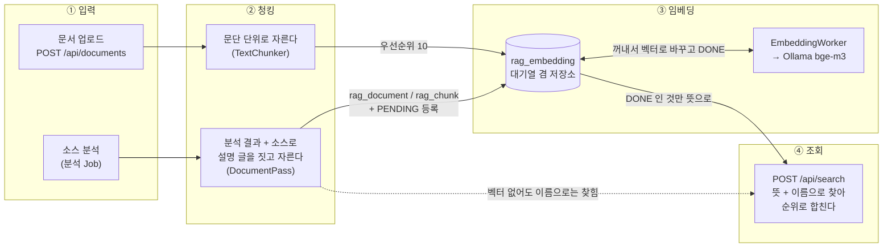
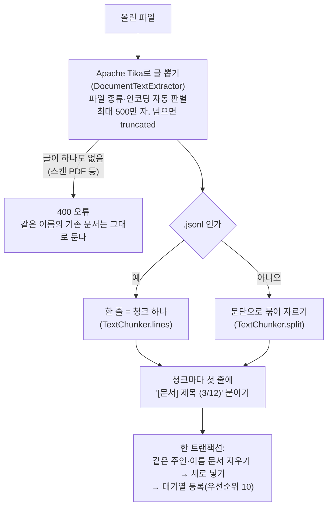
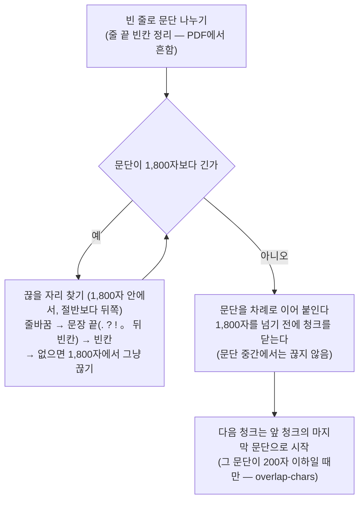
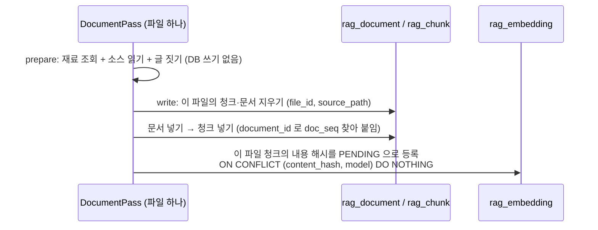
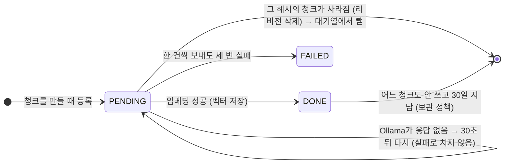
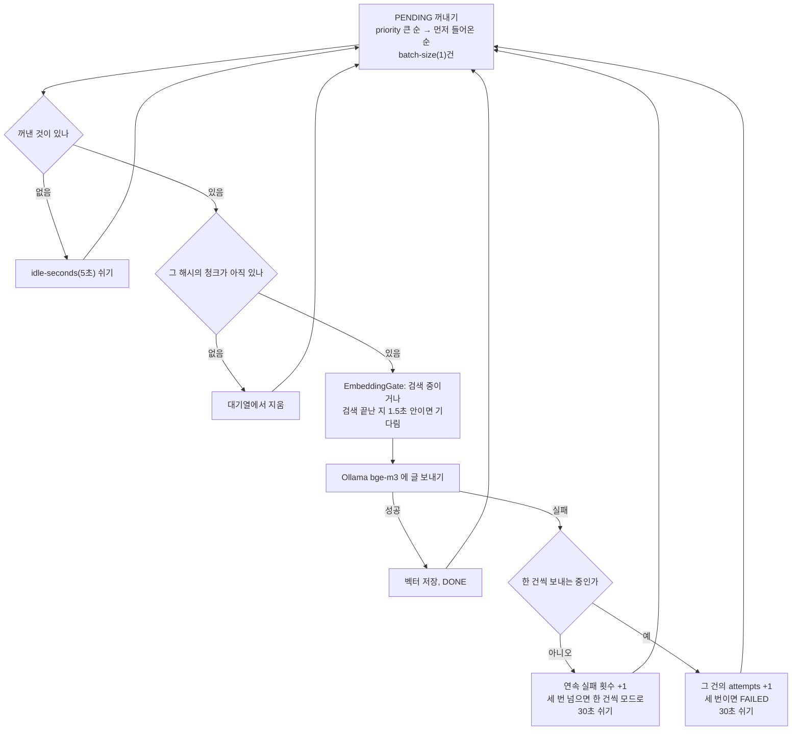
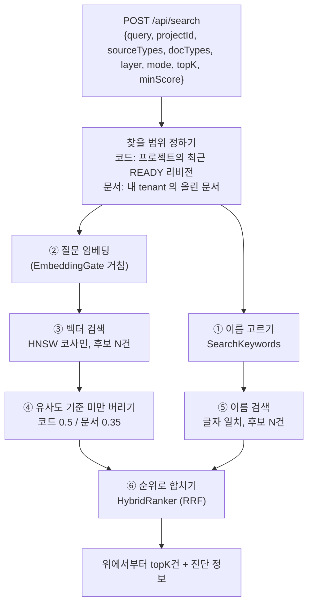

# dstone-knowledge RAG — 조각을 만들고, 벡터로 바꾸고, 찾기까지

[11.dstone-knowledge.md](11.dstone-knowledge.md)의 RAG 부분만 떼어 자세히 적은 문서다. 0.10절(검색)과 0.11절(임베딩)을 그림 한 장으로 봤다면, 여기서는 그 안쪽을 코드 기준으로 따라간다.

## 목차

- [0. 한 장으로 보기](#0-한-장으로-보기)
- [1. 입력: 무엇이 들어오나](#1-입력-무엇이-들어오나)
- [2. 청킹: 검색할 조각 만들기](#2-청킹-검색할-조각-만들기)
- [3. 임베딩: 조각을 벡터로 바꾸기](#3-임베딩-조각을-벡터로-바꾸기)
- [4. 조회: 질문으로 조각 찾기](#4-조회-질문으로-조각-찾기)
- [5. 화면: Knowledge > 검색 · 문서](#5-화면-knowledge--검색--문서)
- [6. 사례로 따라가기: "analysis_reference 테이블이 사용된 소스"](#6-사례로-따라가기-analysis_reference-테이블이-사용된-소스)
- [7. 한계](#7-한계)
- [8. 설정, 테이블, 코드 지도](#8-설정-테이블-코드-지도)

---

## 0. 한 장으로 보기

### 0.1 먼저 짚을 점: 여기는 "찾기"까지만 한다

RAG는 **찾기(Retrieval)** 와 **답 쓰기(Generation)** 로 나뉜다. dstone-knowledge는 찾기만 한다. 질문을 받으면 가까운 조각(청크)을 순위대로 돌려줄 뿐이고, 그 조각으로 답을 쓰는 일은 dstone-ai-engine의 Agent(`KnowledgeTool`, RAG)가 한다.

그래서 Knowledge 검색 화면에 나오는 것은 LLM이 쓴 답이 아니라 **찾은 조각의 목록**이다.

### 0.2 네 단계 사이클



| 단계 | 누가 | 언제 | 결과 |
|---|---|---|---|
| ① 입력 | 분석 Job / 업로드 API | 분석을 돌릴 때 / 파일을 올릴 때 | 분석 결과(`analysis_*`), 올린 파일의 글 |
| ② 청킹 | `DocumentPass`(pass09) / `UploadDocumentService` | 분석의 마지막 단계 / 업로드 요청 안에서 | `rag_document`, `rag_chunk`, 대기열 행(PENDING) |
| ③ 임베딩 | `EmbeddingWorker`(서버 안 상주 스레드) | 대기열에 무언가 있으면 언제든 | `rag_embedding.embedding`(숫자 1,024개), DONE |
| ④ 조회 | `SearchService` | 검색 요청마다 | 순위가 매겨진 청크 목록 |

②와 ③을 떼어 놓은 것이 핵심이다. 청킹은 금방 끝나지만 임베딩은 이 환경(GPU 없는 CPU)에서 청크 한 건에 0.5~4초가 걸린다. 그래서 분석 Job은 청크를 만들어 대기열에 올리기만 하고 끝나고, 임베딩은 뒤에서 따로 돈다. **Job이 `DONE`이어도 뜻으로 찾기는 아직 덜 될 수 있다.** 이름으로 찾기는 그 사이에도 된다.

### 0.3 용어

| 용어 | 뜻 |
|---|---|
| 문서(`rag_document`) | 검색 대상 하나. 메소드 하나, SQL 하나, 올린 PDF 하나 같은 단위 |
| 청크(`rag_chunk`) | 문서를 자른 조각. **검색 결과로 돌려주는 단위**다. 짧은 문서는 청크가 하나다 |
| 임베딩 | 글을 숫자 1,024개(벡터)로 바꾼 것. 뜻이 가까운 글은 벡터도 가깝다 |
| 내용 해시 | 청크 글의 SHA-256. 임베딩을 찾는 열쇠다 |
| 유사도(score) | 질문 벡터와 청크 벡터의 코사인 유사도. 0~1, 클수록 가깝다 |
| 이름 점수(keywordScore) | 질문에서 고른 이름이 청크의 제목·본문에 글자 그대로 있는 정도 |
| tenant | 올린 문서의 주인(API 키의 호출자). 다른 주인의 문서는 보이지 않는다 |

---

## 1. 입력: 무엇이 들어오나

입구는 두 개다. 들어온 뒤에는 같은 테이블에 담겨 같은 검색으로 찾힌다.

| | 소스 분석(CODE) | 문서 업로드(DOCUMENT) |
|---|---|---|
| 입구 | `POST /api/projects/{id}/analyses` → 분석 Job | `POST /api/documents` (multipart) |
| 재료 | `analysis_*` 테이블(분석 결과) + 소스 파일 | PDF, Word, PowerPoint, Excel, HTML, 텍스트, JSONL |
| 묶는 단위 | 리비전(`revision_id`) | 주인(`tenant`) + 문서 이름(`sourceId`) |
| 다시 넣으면 | 그 파일의 문서를 지우고 새로 넣는다 | 같은 주인·같은 이름이면 바꿔 넣는다 |
| 임베딩 우선순위 | 0 | 10 (먼저 처리) |
| `rag_document.source_type` | `CODE` | `DOCUMENT` |

### 1.1 소스 분석에서 오는 것

분석 Job은 9단계로 돈다(11번 문서 0.4절). RAG 재료를 만드는 것은 마지막 **DOCUMENT 단계**(`analysis.pass09.document.DocumentPass`, `order()` 600)다. 이 단계는 Java를 다시 파싱하지 않는다. 앞 단계들이 DB에 써 둔 사실을 파일 하나씩 읽고, 줄 번호로 소스를 잘라 붙인다.

파일 하나에 대해 읽어 오는 재료(`RagDao.select...ByFile`):

| 재료 | 어디서 왔나 | 글에서 쓰이는 곳 |
|---|---|---|
| 타입, 필드, 메소드, 애노테이션 | DECLARE | 타입 문서의 목록, 메소드 문서의 머리말 |
| 상속·구현·주입 관계 | RESOLVE | 타입 문서의 "상속 / 구현 / 주입받는 것" |
| 호출하는 것, 호출받는 곳(최대 10) | RESOLVE / LINK | 메소드 문서의 "호출하는 것 / 호출받는 곳" |
| 진입점(URL, 거래 ID, main, 스케줄) | SEMANTIC | "진입점" |
| 실행하는 SQL, 여는 화면 | SEMANTIC | "실행하는 SQL [UPDATE, 테이블 …]", "여는 화면" |
| SQL statement, 읽고 쓰는 테이블, 실행하는 메소드 | RESOURCE / SEMANTIC | SQL 문서 전체 |
| 화면 링크(여는 메소드, 요청하는 주소, include) | SEMANTIC | 화면 문서 |

증분 분석이어도 DOCUMENT는 리비전 전체를 다시 만든다. 그래도 임베딩은 바뀐 청크만 새로 한다(3.4절).

### 1.2 문서 업로드에서 오는 것



- **문서 이름(`sourceId`)이 열쇠다.** 비워 두면 파일 이름을 쓴다. 같은 주인이 같은 이름으로 다시 올리면 앞의 것을 바꿔 넣는다(`replaced: true`).
- **망가진 파일은 기존 문서를 지우지 않는다.** 글을 뽑지 못하면 지우기 전에 400으로 끝낸다. 지우기와 넣기는 한 트랜잭션이라, 넣다가 실패해도 앞의 것이 남는다.
- **주인(tenant)** 은 API 키의 호출자다. 인증을 꺼 두면 null이고, 그때는 모든 문서가 한곳에 모인다.
- 프로젝트에 붙여 올릴 수 있다(`projectId`). 붙이면 그 프로젝트를 고르고 "올린 문서"를 함께 찾을 때 나온다.
- 리비전이 없다. 분석을 다시 돌려도 올린 문서는 그대로다.

---

## 2. 청킹: 검색할 조각 만들기

### 2.1 왜 소스만 넣지 않나

"주문 취소는 어디서 처리하나"라는 질문과 아래 소스는 글자로는 거의 닮지 않았다.

```java
public void cancel(String no) { orderDAO.updateStatus(no, "C"); ... }
```

그런데 이 메소드가 `POST /order/cancel.do`를 처리하고, 서비스 계층이고, `ORDER` 테이블을 고치는 SQL을 실행한다는 사실을 글로 적어 두면 질문과 가까워진다. 이런 사실은 그 메소드 안에 적혀 있지 않다. 다른 파일까지 봐야 알 수 있고, 그것을 분석이 해 둔 것이다.

그래서 코드 청크는 **"분석으로 알아낸 사실(한글 머리말)" + "소스"** 로 짓는다. 이 모듈의 RAG 품질은 대부분 여기서 정해진다.

### 2.2 문서 종류 여섯 가지

| doc_type | 하나당 | 짓는 곳 | 담는 것 | 소스를 넣나 |
|---|---|---|---|---|
| `FILE` | Java 파일 | `CodeDocumentBuilder` | 경로, 패키지, 모듈, 줄 수, 선언된 타입, import(일부) | 아니오 |
| `TYPE` | 클래스·인터페이스·enum | `CodeDocumentBuilder` | 계층, 설명(주석), 상속·구현·주입, 애노테이션, 진입점, 필드·메소드 목록 | 아니오 |
| `METHOD` | 메소드·생성자 | `CodeDocumentBuilder` | 반환, 계층, 설명, 진입점, 애노테이션, 호출 관계, 실행 SQL·여는 화면 | **예** |
| `MAPPER` | SQL statement | `ResourceDocumentBuilder` | 매퍼 종류, 파라미터, 결과, 읽는/쓰는 테이블, 실행하는 메소드 | **예(SQL)** |
| `VIEW` | JSP, WebSquare, Nexacro 화면 | `ResourceDocumentBuilder` | 제목, 화면명, 여는 메소드, 요청 주소, include 관계 | 예(앞부분) |
| `UPLOAD` | 올린 문서 | `UploadDocumentService` | 뽑은 글 | — |

**만들지 않는 것**
- 단순 접근자: 이름이 get/set/is로 시작하고, 세 줄 이하이고, 같은 타입에 그 이름의 필드가 있는 메소드(`skip-accessors: true`). VO가 많은 프로젝트에서 임베딩 양이 몇 배로 늘고 검색 결과만 흐려지기 때문이다. 타입 문서의 메소드 목록에는 들어간다. 필드까지 확인하는 이유는 `DBUtil.getConnection()`처럼 짧아도 일을 하는 메소드를 살리기 위해서다.
- 익명 클래스, Lombok이 만든 타입처럼 소스에 선언이 없는 것.
- 파싱에 실패한 Java 파일(재료가 없다).
- statement가 없는 XML(설정 XML 등).

### 2.3 청크는 실제로 이렇게 생겼다

**METHOD** (머리말 + 소스)
```
[메소드] net.dstone.knowledge.api.controller.ResourceController#getTableUsage(long,String)
반환: Map<String,Object>
계층: CONTROLLER
파일: java/net/dstone/knowledge/api/controller/ResourceController.java (줄 36-39)
설명: 테이블 하나를 건드리는 SQL과 그 SQL을 실행하는 메소드
진입점: GET /api/revisions/{revisionId}/tables/{table}
애노테이션: @GetMapping{"value": "/tables/{table}"}
호출하는 것: ResourceService#getTableUsage(long,String)
소스:
	@GetMapping("/tables/{table}")
	public Map<String, Object> getTableUsage(...) {
		return resourceService.getTableUsage(revisionId, table);
	}
```

**MAPPER** (머리말 + SQL)
```
[SQL] net.dstone.knowledge.api.dao.RelationDao.updateReference (UPDATE)
파일: resources/sqlmap/analysis/RelationDao.xml (줄 22-27)
매퍼 종류: MyBatis
파라미터: java.util.Map
쓰는 테이블: ANALYSIS_REFERENCE(고치기)
실행하는 메소드: RelationDao#replaceRelationsInBatch(long,List,List)
SQL:
UPDATE analysis_reference
SET status = #{status}
, fail_reason = #{failReason}
WHERE reference_id = #{referenceId}
```

**UPLOAD**
```
[문서] 운영 매뉴얼 (3/12)
3. 장애 대응
배치가 실패하면 먼저 dstone-batchadmin 의 실행 이력에서 ...
```

머리말의 첫 줄(`[메소드] …`, `[SQL] …`, `[문서] …`)은 "이 조각이 무엇인지"를 알려 준다. 청크 하나만 떼어 LLM에 넘겨도 출처를 알 수 있게 하려는 것이다.

`rag_chunk.metadata_json`에도 구조화된 정보를 같이 둔다. 검색 필터와 화면 표시에 쓴다.

| doc_type | metadata_json |
|---|---|
| METHOD | `docType`, `fqn`, `signature`, `layer`, `endpoints` |
| TYPE | `docType`, `fqn`, `layer` |
| FILE | `docType`, `path` |
| MAPPER | `docType`, `statement`, `statementType`, `reads`, `writes` |
| VIEW | `docType`, `path`, `layer: VIEW` |
| UPLOAD | `docType`, `sourceId`, `fileName`, `contentType`, `chars`, `truncated` |

### 2.4 자르는 규칙

기준 길이는 `dstone.knowledge.rag.chunk-max-chars`(1,800자)다.

| 무엇을 | 어떻게 | 뒤 조각의 머리 |
|---|---|---|
| METHOD | **소스만** 줄 단위로 1,800자씩 나눈다. 줄 중간에서는 끊지 않는다 | 첫 조각에만 머리말 전체. 뒤 조각은 `[메소드] … (이어서 2/3)` + 그 조각의 줄 범위 |
| FILE / TYPE / MAPPER | 글 전체를 줄 단위로 3,600자(×2)씩 나눈다. 한 줄이 그보다 길면(메소드 수백 개짜리 목록 등) 글자 수로 자른다 | 첫 줄을 다시 붙이고 `(이어서)` |
| VIEW | 빈 줄과 들여쓰기를 빼고 3,600자씩 나누되 **최대 2조각**만 남긴다. JSP는 대부분 HTML이라 길게 담아도 도움이 적다 | 첫 줄 + `(이어서)` |
| UPLOAD | 아래 그림 | `[문서] 제목 (n/전체)` |

**올린 문서를 자르는 법(`TextChunker.split`)**



겹치기를 하는 이유는 경계에 걸친 내용(예: 소제목만 앞 청크에 있고 본문은 뒤 청크에 있는 경우)이 양쪽 어디에서도 찾히게 하려는 것이다.

### 2.5 저장: 파일 단위로 지우고 다시 넣는다



- **멱등**: 같은 파일을 다시 처리하면 지우고 다시 넣으므로 결과가 같다.
- **문서 ID(`document_id`)는 리비전이 바뀌어도 같은 대상이면 같은 값**이다. 리비전 비교와 ai-engine 쪽 출처 표시에 쓴다.

| doc_type | document_id |
|---|---|
| FILE | `FILE:` + sha256(프로젝트 \| 경로) |
| TYPE | `TYPE:` + 심볼 ID |
| METHOD | `METHOD:` + 메소드 ID |
| MAPPER | `SQL:` + sha256(프로젝트 \| 경로 \| statement 이름) |
| VIEW | `VIEW:` + sha256(프로젝트 \| 경로) |
| UPLOAD | 문서 이름(`sourceId`) |

- **내용 해시(`content_hash`)** 는 청크 글 전체의 SHA-256이다. 머리말까지 포함하므로 소스가 같아도 호출 관계가 바뀌면 해시가 바뀌고, 다시 임베딩된다.

---

## 3. 임베딩: 조각을 벡터로 바꾸기

### 3.1 테이블이 곧 대기열이다

`rag_embedding`은 벡터 저장소이면서 할 일 목록이다. 기본 키는 `(content_hash, model)`이다.



| 컬럼 | 뜻 |
|---|---|
| `status` | PENDING / DONE / FAILED |
| `embedding` | `vector(1024)`. bge-m3의 출력 차원. 모델을 바꾸면 컬럼과 인덱스를 다시 만들어야 한다 |
| `priority` | 큰 것부터 꺼낸다. 코드 0, 올린 문서 10 |
| `attempts`, `last_error` | 실패 횟수와 마지막 오류 |

### 3.2 EmbeddingWorker가 도는 방식

서버가 뜨면 `embedding-worker` 데몬 스레드 하나가 시작되고 아래를 끝없이 반복한다(`dstone.knowledge.rag.embedding.enabled: true`일 때).



- 청크 글은 대기열이 아니라 **같은 해시를 가진 청크 아무거나 하나**에서 읽는다. 해시가 같으면 글도 같기 때문이다.
- 테이블 자체가 대기열이라, 서버가 죽었다 살아나도 남은 것부터 이어서 한다.
- 서버가 한 대라는 전제다. 두 대를 띄우면 같은 것을 두 번 임베딩할 수 있다(결과가 틀리지는 않는다).

### 3.3 검색이 임베딩에 밀리지 않게: EmbeddingGate

Ollama는 요청을 **하나씩 차례로** 처리한다. Worker가 긴 청크 묶음을 보내 놓은 사이에 검색이 질문 한 줄(혼자면 0.1초)을 보내면, 그 묶음이 끝날 때까지 기다린다. 실제로 대기열 2,400건이 도는 동안 검색이 60초를 넘겨 ai-engine의 RAG가 시간 초과로 실패한 적이 있다(2026-10-06).

규칙은 두 가지다.
1. 검색이 질문을 임베딩하는 동안, 그리고 끝난 뒤 1.5초 동안은 Worker가 새 묶음을 보내지 않는다(Agent는 검색을 연달아 하는 일이 많다).
2. 이미 보낸 묶음은 멈출 수 없으니 묶음을 작게 둔다(`batch-size: 1`). CPU에서는 묶어 보내도 건당 약 4초로 같아서 손해가 없다. GPU 서버라면 8~32로 올린다.

**대화형 요청에서 `EmbeddingModel`을 부르는 새 코드도 반드시 이 문을 거쳐야 한다.**

### 3.4 다시 임베딩하지 않는 장치

| 상황 | 일어나는 일 |
|---|---|
| 같은 소스를 다시 분석 | 청크 해시가 같으므로 `ON CONFLICT DO NOTHING`. 임베딩 0건 |
| 메소드 하나를 고치고 증분 분석 | 글이 바뀐 청크만 해시가 바뀌고, 그것만 새로 임베딩한다. 고친 메소드, 그 메소드를 "호출하는 것 / 호출받는 곳"으로 적은 메소드, 그리고 머리말의 줄 범위(`파일: … (줄 n-m)`)가 밀린 같은 파일의 메소드가 여기에 든다 |
| 리비전을 지움 | 청크가 사라진다. PENDING이던 해시는 Worker가 꺼낼 때 지운다. DONE은 30일 동안 남겨 두었다가(`orphan-embedding-days`) 어느 청크도 쓰지 않으면 보관 정책(`RetentionService`)이 지운다. 곧바로 다시 분석하면 그대로 다시 쓴다 |
| 같은 문서를 다른 이름으로 올림 | 청크 해시가 같으면 임베딩을 공유한다. 우선순위는 둘 중 큰 값 |

### 3.5 진행 상황 보기

| 무엇 | 어디 |
|---|---|
| 리비전 하나의 문서·청크 수, 임베딩 진행 | `GET /api/revisions/{id}/rag` |
| 대기열 전체(남은 건수, 최근 속도, 예상 남은 시간, 프로젝트별 대기) | `GET /api/system/embedding`, Knowledge 첫 화면의 "임베딩 현황" 패널(10초마다 갱신) |
| 검색 응답의 `embedding` | 이 리비전에서 DONE/PENDING이 몇 건인지 |

예상 남은 시간은 건수가 아니라 **글자 수**로 계산한다. 임베딩 시간은 길이에 비례하기 때문이다(500자 ≈ 0.6초, 3,500자 ≈ 4초).

---

## 4. 조회: 질문으로 조각 찾기

### 4.1 전체 흐름



후보 수 N은 질문에 이름이 있으면 `max(30, topK × 3)`(최대 150), 없으면 `topK`다. 합치기 전에 넉넉히 뽑아야, 한쪽에서만 아래에 있던 것이 올라올 수 있다.

### 4.2 찾을 범위

| 요청 | 찾는 곳 |
|---|---|
| `projectId`(또는 `revisionId`)만 | 그 리비전의 코드 청크 |
| `projectId` + `sourceTypes: [CODE, DOCUMENT]` | 코드 청크 + 그 프로젝트에 붙여 올린 내 문서 |
| 프로젝트 없음 | 내 문서 전부(`sourceTypes` 기본값이 DOCUMENT) |
| `docTypes` | `rag_document.doc_type`으로 거름 |
| `layer` | `metadata_json->>'layer'`로 거름(CONTROLLER, SERVICE, REPOSITORY …) |

`revisionId`를 주지 않으면 그 프로젝트에서 분석이 끝난(`READY`) 가장 최근 리비전을 쓴다.

### 4.3 ① 이름 고르기 (`SearchKeywords.extract`)

질문에서 "이름처럼 생긴 글자"만 고른다.

| 질문 | 고른 이름 |
|---|---|
| `BoardDAO.deleteBoard 는 어디서 부르나` | `BoardDAO`, `deleteBoard` |
| `TB_BOARD 를 고치는 곳` | `TB_BOARD` |
| `/board/list.do 요청을 받는 곳` | `/board/list.do` |
| `analysis_reference 테이블이 사용된 소스를 찾아줘.` | `analysis_reference` |
| `주문 취소는 어디서 처리하나` | (없음 → 벡터만) |

- 영문, 숫자, `_`, `$`, `.`, `/`, `#`로 이어진 덩어리를 고른다.
- `.`과 `#`에서 나눈다. 단, `/`가 들어 있으면 주소나 경로로 보고 통째로 쓴다.
- 3자 미만이거나 영문자가 없으면 버린다. 최대 8개까지 고른다.
- **한글 낱말은 고르지 않는다.** 조사가 붙어 글자 그대로 맞는 일이 드물고, 뜻으로 찾는 일은 벡터가 더 잘한다.
- 이름이 하나도 없으면 `mode: HYBRID`로 요청해도 실제로는 VECTOR로 돈다(응답의 `mode`).

### 4.4 ②~④ 뜻으로 찾기

```sql
SET LOCAL hnsw.iterative_scan = relaxed_order;   -- 리비전 조건 때문에 결과가 모자라지 않게(pgvector 0.8+)
SELECT 1 - (e.embedding <=> :질문벡터) AS score, ...
  FROM rag_embedding e JOIN rag_chunk c ... JOIN rag_document d ...
 WHERE e.model = 'bge-m3:latest' AND e.status = 'DONE' AND (범위 조건)
 ORDER BY e.embedding <=> :질문벡터
 LIMIT :N
```

- 인덱스는 `idx_rag_embedding_hnsw`(HNSW, `vector_cosine_ops`)다.
- `iterative_scan`이 없으면 다른 리비전의 청크가 가까운 자리를 다 차지했을 때 결과가 모자라게 나온다. `SET LOCAL`이라 트랜잭션 안에서 부른다.
- **유사도 기준(④)**: 벡터 검색은 어떤 질문에도 "가장 가까운 것"을 내놓는다. 그래서 기준보다 낮은 결과는 버린다. bge-m3 실측(2026-11-12)에서 상관없는 질문의 1등은 0.34~0.47, 맞는 질문의 1등은 0.51~0.72였다. 그래서 코드는 0.5, 올린 문서는 0.35다(사람이 쓴 글은 맞는 것도 0.5를 못 넘는 경우가 흔하다). 요청에 `minScore`를 주면 둘 다 그 값으로 바뀐다(0이면 거르지 않음).
- 거르는 일은 SQL이 아니라 Java에서 한다. SQL에서 거르면 상관없는 질문일 때 HNSW가 인덱스 전체를 훑는다.
- 버린 건수와 그중 가장 높았던 유사도는 응답의 `belowMinScore`, `bestBelowMinScore`로 돌려준다. 화면은 이것으로 "질문과 가까운 내용이 없습니다"를 보여 준다.
- 임베딩 서버가 내려가 있으면: 이름이 있으면 이름으로만 찾고 `warning`을 붙인다. 이름이 없으면 503이다.

### 4.5 ⑤ 이름으로 찾기

이름 하나마다 점수를 매겨 더한다.

| 어디에 있나 | 점수 | 예 (`deleteBoard`) |
|---|---|---|
| 제목에 **한 낱말로**(앞뒤가 영문·숫자·`_`가 아님) | 3 | `BoardDAO#deleteBoard(String)` |
| 제목 안에 일부로 | 2 | `BoardDAO#deleteBoardAll()` |
| 본문에만 | 1 | 본문에 "호출하는 것: BoardDAO#deleteBoard" |

- 정렬은 이름 점수가 높은 순이다. 점수가 같으면 질문과 뜻이 가까운 순으로 세운다. 그래서 `SQL`처럼 어디에나 있는 낱말이 섞여도 결과가 엉뚱해지지 않는다.
- 임베딩이 안 된 청크도 나온다(유사도가 비어 있다).
- 이름으로 맞은 결과에는 유사도 기준을 적용하지 않는다. 글자 그대로 맞았기 때문이다.
- 본문 검색은 `strpos`로 리비전의 청크를 훑는다(청크 1만 건에 0.17초). 청크가 수십만 건이 되기 전에 `pg_trgm` 인덱스를 붙여야 한다.

### 4.6 ⑥ 순위로 합치기 (`HybridRanker`, RRF)

유사도(0~1)와 이름 점수(1~수십)는 단위가 달라 그대로 더할 수 없다. 그래서 **몇 번째로 나왔는지만** 쓴다.

```
각 목록에서 n등이면  1 / (60 + n) 점
이름 점수가 3 이상(제목에 한 낱말로 맞음)이면 이름 쪽 점수를 2배로
두 목록의 점수를 더해 큰 순으로 topK건
```

| 경우 | 점수 |
|---|---|
| 벡터 1등 + 이름 1등(제목 일치) | 1/61 + 2×1/61 = 0.0492 |
| 벡터 1등 + 이름 1등(본문만) | 1/61 + 1/61 = 0.0328 |
| 벡터 1등만 | 1/61 = 0.0164 |
| 이름 1등만(제목 일치) | 2×1/61 = 0.0328 |
| 이름 6등만(본문만) | 1/66 = 0.0152 |

- 60은 이 방식에서 흔히 쓰는 값이다. 순위 차이가 점수에 너무 크게 반영되지 않게 눌러 준다.
- 양쪽에 다 나온 것이 한쪽에만 나온 것보다 위로 간다.
- 점수가 같으면 벡터 쪽에서 먼저 들어온 것이 앞에 남는다.
- 결과마다 `matched`(VECTOR / KEYWORD / 둘 다)와 `rankScore`가 붙는다.

### 4.7 응답

```json
{
  "query": "...", "revisionId": 115, "mode": "HYBRID", "keywords": ["analysis_reference"],
  "model": "bge-m3:latest",
  "minScore": {"code": 0.5, "document": 0.35}, "belowMinScore": 0, "bestBelowMinScore": null,
  "embedding": [{"status": "DONE", "chunks": 2222}],
  "count": 10,
  "hits": [{
    "score": 0.6267, "keywordScore": 1, "matched": ["VECTOR", "KEYWORD"], "rankScore": 0.03132,
    "chunkId": 636503, "sourceType": "CODE", "docType": "MAPPER",
    "documentId": "SQL:eed1…", "title": "net.dstone.knowledge.api.dao.RelationDao.updateReference",
    "refKind": "SQL", "refId": "S68066",
    "path": "resources/sqlmap/analysis/RelationDao.xml", "lineStart": 22, "lineEnd": 27, "chunkNo": 0,
    "metadata": "{\"writes\": [\"ANALYSIS_REFERENCE(고치기)\"], ...}",
    "content": "[SQL] ..."
  }]
}
```

`refKind`/`refId`로 원래 분석 대상(메소드 ID, statement 노드 ID 등)을 되짚을 수 있다. 영향도 분석이나 노드 맵으로 넘어갈 때 쓴다.

---

## 5. 화면: Knowledge > 검색 · 문서

- JSP: `dstone-boot/src/main/webapp/WEB-INF/views/knowledge/search/search.jsp`
- JS: `dstone-boot/src/main/webapp/knowledge/assets/js/search.js`
- 브라우저는 knowledge를 직접 부르지 않는다. dstone-boot의 `/knowledge/api/call.do`(업로드는 `/knowledge/api/upload.do`) 프록시를 거친다(`KnowledgeProxyController`).

### 5.1 검색 영역

| 입력 | 요청에 들어가는 것 |
|---|---|
| 프로젝트 | `projectId`. 비우면 "올린 문서에서만" (`sourceTypes: [DOCUMENT]`) |
| 찾을 내용 | `query` |
| 방법 | `mode`: 뜻 + 이름(HYBRID, 기본) / 뜻만(VECTOR) / 이름만(KEYWORD) |
| 건수 | `topK`(기본 10, 최대 50) |
| 찾을 곳 | 코드(기본 체크) / 올린 문서 → `sourceTypes` |
| 종류 | 메소드 / 타입 / SQL / 화면 / 파일 → `docTypes`. 하나도 안 고르면 전부. 올린 문서를 같이 찾으면 `UPLOAD`를 자동으로 더한다 |

결과 위 한 줄: `건수 · 방법 · 고른 이름 · …`, 경고가 있으면 앞에 붙는다.
결과마다: 번호, 종류 배지, 제목, `경로:줄`, `나온 곳 VECTOR+KEYWORD`, `유사도`, `이름 점수`, (메소드면) `methodId`, 그리고 접힌 본문(누르면 펼침).

### 5.2 문서 영역

| 기능 | API |
|---|---|
| 올리기(파일, 문서 이름, 제목, "선택한 프로젝트에 붙이기") | `POST /api/documents` |
| 목록(문서 이름, 제목, 프로젝트, 청크 수, 임베딩 끝난 수, 올린 시각) | `GET /api/documents?size=200` |
| 삭제 | `DELETE /api/documents?sourceId=…` |

올린 직후에는 "임베딩 끝남"이 0일 수 있다. 우선순위가 높아서 보통 금방 채워지고, 그 전에도 이름으로는 찾힌다.

---

## 6. 사례로 따라가기: "analysis_reference 테이블이 사용된 소스"

2026-11-12, 프로젝트 `dstone-knowledge`(리비전 115, 청크 2,222개 모두 임베딩 완료)에서 화면 기본값으로 물은 결과다.

**정답**: `analysis_reference`를 쓰는 SQL은 18개다. 매퍼 XML에서 직접 세어도, 분석 결과 API `GET /api/revisions/115/tables/analysis_reference`로 봐도 같다(C 1, R 15, U 2).

**나온 10건**

| 순위 | 결과 | 나온 곳 | 맞나 |
|---|---|---|---|
| 1 | `RelationDao.updateReference` (UPDATE) | 둘 다 | O |
| 2 | `CarryDao.resetReferencesToResolve` (UPDATE) | 둘 다 | O |
| 3 | `DeclarationDao.insertReference` (INSERT) | 둘 다 | O |
| 4 | `ReferenceRow` (이 테이블의 행 모델) | 둘 다 | O |
| 5 | `CarryDao.carryResolvePasses` (읽기) | 둘 다 | O |
| 6~10 | `SqlTableExtractor.TableUse` 생성자 2개, `MapperLinker.extractTables`, `ResourceController.getTableUsage`, `CarryDao.analyzeTable` | 벡터만 | X ("테이블"이라는 뜻만 비슷) |

**단계별로 보면**

| 단계 | 일어난 일 |
|---|---|
| ① 이름 고르기 | `analysis_reference` 하나. "테이블", "소스"는 한글이라 버려짐 |
| ③ 벡터 | 후보 30건. 실제 사용처보다 **테이블을 다루는 일반 코드**가 더 가까웠다(`TableUse` 생성자 0.6448 > `updateReference` 0.6267) |
| ④ 기준 | 모두 0.5 이상이라 버린 것 없음 |
| ⑤ 이름 | 39건이 맞았다(SQL 18개 + 그 SQL을 실행하는 DAO 메소드 등). 후보 30건을 가져왔다. 테이블 이름은 제목이 아니라 **본문에만** 있어서 모두 1점이다. 2배를 받은 것은 없다 |
| ⑥ 합치기 | 양쪽에 다 걸린 5건이 1~5위. 6~10위는 벡터 1~5등(1/61~1/65 = 0.0164~0.0154)이 차지했다. 이름에만 걸린 것 가운데 가장 높은 것이 이름 6등(1/66 = 0.0152)이라 **간발의 차로 밀렸다** |

**결론**: 분석은 18개를 다 알고 있고 이름 검색도 18개를 다 찾았다. 그런데 "본문에만 이름이 있는 결과"를 "뜻만 비슷한 결과"와 같은 무게로 합치는 바람에 13개가 잘렸다. 그리고 topK 10으로는 어차피 18개를 다 보여 줄 수 없다.

"~을 쓰는 곳을 **모두**"처럼 빠짐없이 나열해야 하는 질문은 상위 N개를 고르는 검색과 맞지 않는다. 이런 질문은 테이블 사용처(`/tables/{table}`), 영향도 분석, 노드 맵 같은 그래프 조회가 답한다.

---

## 7. 한계

| 한계 | 왜 | 지금 할 수 있는 것 |
|---|---|---|
| 나열형 질문("모두")에 약하다 | 검색은 상위 topK만 돌려준다 | `GET /api/revisions/{id}/tables/{table}`, 영향도 API, 노드 맵 |
| 본문에서 맞은 이름은 가중치가 없다 | 2배는 제목 일치에만 준다. MAPPER의 `reads`/`writes`에 정확히 맞아도 1점이다 | `mode: KEYWORD`로 이름만 찾기, `docTypes: [MAPPER]`로 좁히기 |
| 한글 질의어는 이름 검색에 안 쓰인다 | `SearchKeywords`가 ASCII 이름만 고른다 | 한글 테이블명·화면명은 청크 머리말에 들어가 있으므로 벡터로는 찾힌다 |
| 유사도 기준은 "상관없는 것"만 거른다 | 0.5는 상관없는 질문의 1등(0.34~0.47) 기준이다. "비슷하지만 틀린 것"(0.6대)은 통과한다 | `minScore`를 올려 보기 |
| 임베딩 전에는 뜻으로 못 찾는다 | 임베딩이 분석과 따로 돈다 | 이름으로 찾기, `GET /api/system/embedding`으로 남은 시간 확인 |
| 스캔 PDF는 못 읽는다 | Tika는 OCR을 하지 않는다 | 글자가 있는 파일로 올리기 |
| 임베딩 모델을 바꾸면 기준값과 컬럼을 다시 맞춰야 한다 | 차원(1024)과 유사도 분포가 모델마다 다르다 | `rag_embedding` 컬럼·인덱스 재생성, `min-score` 재측정 |

---

## 8. 설정, 테이블, 코드 지도

### 8.1 설정 (`dstone-knowledge/conf/application.yml`, `dstone.knowledge.rag.*`)

| 키 | 값 | 뜻 |
|---|---|---|
| `skip-accessors` | true | 단순 접근자의 메소드 문서를 만들지 않음 |
| `chunk-max-chars` | 1800 | 청크 하나에 담는 소스(또는 글)의 최대 글자 수 |
| `search.min-score.code` / `.document` | 0.5 / 0.35 | 뜻으로 찾은 결과를 남길 최소 유사도 |
| `upload.max-chars` | 5000000 | 올린 문서에서 읽는 최대 글자 수 |
| `upload.overlap-chars` | 200 | 앞 청크의 마지막 문단을 다음 청크에 다시 넣을 때의 최대 길이(0이면 겹치지 않음) |
| `upload.embedding-priority` | 10 | 올린 문서의 임베딩 우선순위(코드 0) |
| `embedding.enabled` | true | 서버가 대기열을 알아서 비울지. 시험 인스턴스는 false |
| `embedding.batch-size` | 1 | 한 번에 보내는 청크 수(CPU 1, GPU 8~32) |
| `embedding.dimensions` | 1024 | 벡터 차원. `rag_embedding.embedding` 컬럼과 같아야 함 |
| `embedding.idle-seconds` | 5 | 대기열이 비었을 때 쉬는 시간 |

`rag.*` 밖에 있는 관련 설정:

| 키 | 값 | 뜻 |
|---|---|---|
| `dstone.knowledge.retention.orphan-embedding-days` | 30 | 어느 청크도 안 쓰는 임베딩을 지우기까지의 날수(0이면 지우지 않음) |
| `spring.ai.ollama.base-url` / `spring.ai.ollama.embedding.model` | `http://localhost:11434` / `bge-m3:latest` | 임베딩 서버와 모델 |

### 8.2 테이블

| 테이블 | 열쇠 | 주요 인덱스 |
|---|---|---|
| `rag_document` | `doc_seq` | `(revision_id, doc_type)`, `(revision_id, ref_id)`, `(tenant, source_type)`, `document_id`, `(revision_id, source_path)` |
| `rag_chunk` | `chunk_id` | `doc_seq`, `content_hash`, `(revision_id, chunk_type)`, `file_id` |
| `rag_embedding` | `(content_hash, model)` | HNSW(`embedding vector_cosine_ops`), 미완료 부분 인덱스 `(status, created_at) WHERE status <> 'DONE'` |

DDL: `dstone-knowledge/src/main/resources/schema/02-create-table-postgresql-dstone-knowledge.sql` 7장. `rag_*`는 원본이 아니라서 `analysis_*`에서 언제든 다시 만들 수 있다(`rerunFrom: "DOCUMENT"`).

### 8.3 코드 지도 (`net.dstone.knowledge`)

| 단계 | 클래스 | 하는 일 |
|---|---|---|
| ① 업로드 | `api.controller.DocumentController`, `api.service.UploadDocumentService` | 올리기·목록·삭제 |
| ① 업로드 | `rag.DocumentTextExtractor` | Tika로 글 뽑기 |
| ② 청킹 | `analysis.pass09.document.DocumentPass` | 파일마다 재료 조회 → 글 짓기 → 저장 → 대기열 등록 |
| ② 청킹 | `analysis.pass09.document.CodeDocumentBuilder` | FILE / TYPE / METHOD 글과 청크 |
| ② 청킹 | `analysis.pass09.document.ResourceDocumentBuilder` | MAPPER / VIEW 글과 청크 |
| ② 청킹 | `analysis.pass09.document.TextChunker` | 올린 문서를 문단 단위로 자르기 |
| ③ 임베딩 | `rag.EmbeddingWorker` | 대기열 비우기 |
| ③ 임베딩 | `rag.EmbeddingGate` | 검색이 임베딩에 밀리지 않게 하기 |
| ③ 임베딩 | `api.service.EmbeddingStatusService` | 대기열 현황, 예상 남은 시간 |
| ③ 임베딩 | `api.service.RetentionService` | 안 쓰는 임베딩 정리 |
| ④ 조회 | `api.controller.SearchController`, `api.service.SearchService` | 검색 요청 처리 |
| ④ 조회 | `rag.SearchKeywords` | 질문에서 이름 고르기 |
| ④ 조회 | `rag.HybridRanker` | 순위로 합치기(RRF) |
| 공통 | `rag.RagSettings` | 설정값 읽기 |
| 공통 | `api.dao.RagDao`, `sqlmap/analysis/RagDao.xml` | 모든 RAG SQL (`searchChunks`, `searchChunksByKeyword`, `enqueueEmbeddingsByFile`, `selectPendingEmbeddings` …) |

### 8.4 API

| API | 용도 |
|---|---|
| `POST /api/search` | 검색 |
| `GET /api/revisions/{id}/rag` | 리비전의 문서·청크 수와 임베딩 진행 |
| `GET /api/system/embedding` | 대기열 전체 현황 |
| `POST /api/documents` / `GET` / `DELETE` | 일반 문서 올리기 / 목록 / 삭제 |
| `GET /api/revisions/{id}/tables/{table}` | 테이블 하나를 쓰는 SQL과 그 SQL을 실행하는 메소드(나열형 질문용) |
| `POST /api/projects/{id}/analyses` + `{rerunFrom: "DOCUMENT"}` | 청크만 다시 만들기(문서 규칙을 바꾼 뒤) |
