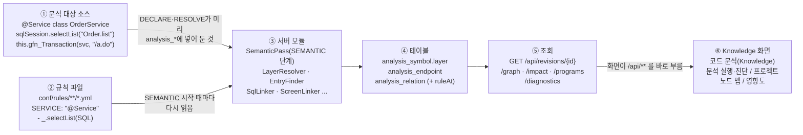
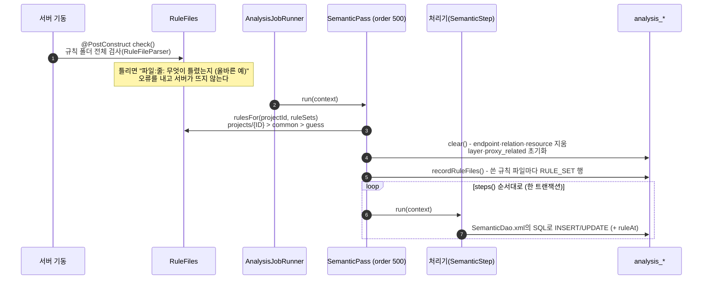
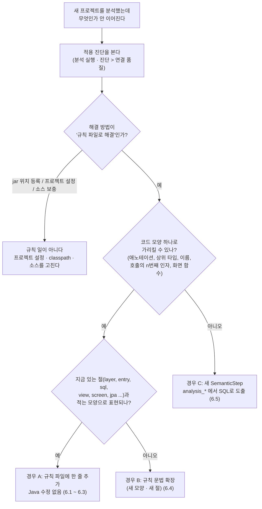

# dstone-knowledge 규칙(conf/rules) 길잡이 — 코드 한 줄이 화면에 닿기까지

`dstone-knowledge/conf/rules`의 규칙 하나가 **어떤 소스를 보고 → 어느 서버 모듈이 처리해 → 어느 테이블에 무슨 모양으로 남고 → 어떤 쿼리로 읽혀 → Knowledge 화면 어디에 나타나는지**를 규칙마다 끝까지 따라간다. 마지막 장(6장)은 **규칙을 새로 넣어야 할 때 무엇을 어떤 순서로 하는지** 적은 작업 길잡이다.

- 규칙 문법 레퍼런스(모든 키와 오류 메시지)는 [11.dstone-knowledge.md 3장](11.dstone-knowledge.md#3-규칙rule)에 있다. 이 문서는 그 규칙들이 **실제로 어떻게 흘러가는지**에 집중한다.
- 문서를 만들 때 [Repomix](https://github.com/yamadashy/repomix)로 아래 범위를 한 파일(68개 파일, 약 20만 토큰)로 묶어 읽었다. 코드를 고친 뒤 문서를 다시 맞출 때도 같은 명령을 쓰면 된다.

```bash
cd dstone-knowledge
npx repomix@latest --style markdown -o /tmp/repomix-rules.md \
  --include "conf/rules/**,src/main/java/net/dstone/knowledge/analysis/pass08/semantic/**,src/main/java/net/dstone/knowledge/api/**/Rule*.java,src/main/resources/sqlmap/analysis/RuleDao.xml,src/main/resources/sqlmap/analysis/SemanticDao.xml"
```

- 저장 형태 샘플은 2026-11-17 로컬 DB(`dstone_knowledge`)에서 실제로 뽑은 행이다. 리비전 번호는 그때 것이다: `236` testApp(JSP + Spring), `235` testReactApp(React), `225` anybiz_prd, `224` H-Energy(Nexacro), `209` HI-Japan(WebSquare + JEF 프레임워크), `229` dstone-knowledge 자신.

## 목차

- [1. 한 장으로 보기](#1-한-장으로-보기)
- [2. 규칙 폴더와 우선순위](#2-규칙-폴더와-우선순위)
- [3. 모든 규칙이 함께 지나는 길 (서버 쪽)](#3-모든-규칙이-함께-지나는-길-서버-쪽)
- [4. 규칙별 루트 요약표](#4-규칙별-루트-요약표)
- [5. 규칙별 상세 루트](#5-규칙별-상세-루트)
- [6. 규칙 추가 길잡이 (가장 중요)](#6-규칙-추가-길잡이-가장-중요)
- [7. 코드 지도와 관련 문서](#7-코드-지도와-관련-문서)

---

## 1. 한 장으로 보기



꼭 기억할 세 가지:

1. **규칙은 Java를 다시 읽지 않는다.** DECLARE·RESOLVE 단계가 이미 `analysis_annotation`, `analysis_reference`, `analysis_relation` 같은 테이블에 코드 조각을 넣어 두었고, 규칙은 그 행들을 **SQL로 골라** 뜻을 붙인다.
2. **규칙 결과에는 근거가 남는다.** 만든 행마다 `ruleAt`(예: `common/spring.yml:7`)이 붙는다. "이 클래스는 왜 SERVICE지?"라는 질문에 파일과 줄 번호로 답할 수 있다.
3. **규칙을 고치면 SEMANTIC부터 다시 돌린다.** 서버 재기동은 필요 없다. SEMANTIC이 시작할 때마다 규칙 폴더를 새로 읽는다.

---

## 2. 규칙 폴더와 우선순위

```text
dstone-knowledge/conf/rules/
├─ projects/{프로젝트ID}/   ① 그 프로젝트만의 관례. 가장 먼저 본다      (Tier.PROJECT)
│   ├─ anybiz_prd/frontend.yml   JSP + jQuery/Kendo 화면의 주소 자리
│   ├─ h-energy/frontend.yml     Nexacro 거래 함수(gfn_Transaction ...)
│   ├─ hi-japan/backend.yml      JEF 프레임워크 상위 타입 계층, new QueryProperty(SQL)
│   ├─ hi-japan/frontend.yml     WebSquare 거래 ID 호출, 화면 열기, 메뉴 목록
│   └─ testapp/frontend.yml      JSP + Kendo 화면의 주소 자리
├─ common/                  ② 모든 프로젝트 공통                         (Tier.COMMON)
│   ├─ java.yml     Runnable·Thread·TimerTask·Callable → THREAD 진입점
│   ├─ jpa.yml      @Entity·@Table·@Query·Spring Data 저장소
│   ├─ mybatis.yml  sqlSession.selectList("이름") 류
│   ├─ servlet.yml  HttpServlet·Filter 상속 계층
│   ├─ spa.yml      Vue/React의 axios·fetch 주소와 baseURL
│   └─ spring.yml   스테레오타입 계층, @XxxMapping 주소, @Scheduled, 리스너, 주입, 프록시, ModelAndView
└─ guess/default.yml        ③ 짐작. 다른 규칙이 못 정한 것만 채운다     (Tier.GUESS)
```

- 한 클래스에 규칙 여럿이 맞으면 **① → ② → ③** 순서로 먼저 맞은 것이 이긴다. 같은 폴더 안에서는 **애노테이션(HIGH) → 상속(MEDIUM) → 이름(LOW)** 순서다.
- `projects/hi-japan/`은 프로젝트 ID `HI-Japan`에 저절로 쓰인다(대소문자 무시). 같은 프레임워크를 쓰는 다른 프로젝트는 프로젝트 등록 때 `"ruleSets": "hi-japan"`으로 빌려 쓴다.
- 파일 이름은 마음대로 지어도 된다. 규칙 이름은 경로(`projects/hi-japan/frontend`)다.

---

## 3. 모든 규칙이 함께 지나는 길 (서버 쪽)

규칙 종류와 상관없이 모든 규칙은 아래 길을 똑같이 지난다.



### 3.1 처리기 실행 순서와 규칙 절

`SemanticPass.steps()`에 적힌 순서 그대로다. 순서가 결과를 바꾸므로 함부로 바꾸지 않는다.

| # | 처리기 | 읽는 규칙 절 | 하는 일 | 순서가 중요한 까닭 |
|---|---|---|---|---|
| 1 | `ServletEntries` | (규칙 없음) | `web.xml`, `@WebServlet` → `SERVLET` 진입점 | |
| 2 | `StrutsEntries` | (규칙 없음) | Struts 액션 → `HTTP` 진입점, 액션 클래스 → `CONTROLLER` | 규칙보다 확실해서 먼저 |
| 3 | `LayerResolver` | `layer:` | 클래스 계층 | 진입점보다 먼저(상위 클래스의 주소를 물려받는 컨트롤러를 알아보려고) |
| 4 | `EntryFinder` | `entry:` | 진입점 | 화면 연결보다 먼저(화면 글자와 견줄 주소가 있어야 한다) |
| 5 | `WiringMarker` | `inject:` `proxy:` | 주입 관계, 프록시 메소드 | |
| 5.5 | `DbCatalogStep` | (규칙 없음) | 등록한 DB에서 테이블·컬럼 정의 | SQL 연결보다 먼저 |
| 6 | `JpaQueryReader` | `jpa:` | JPA 쿼리 → statement | MapperLinker보다 먼저 |
| 7 | `MapperLinker` | (규칙 없음) | 매퍼 인터페이스 방식 연결, 매퍼 SQL → 테이블 | SQL 관계를 지우고 다시 만든다 |
| 8 | `SqlLinker` | `sql:` | 호출 인자 → statement | MapperLinker 다음 |
| 9 | `JavaSqlLinker` | `jpa: > jpql` | Java 문자열 SQL·JPA → 메소드·테이블 | SqlLinker 다음 |
| 10 | `ViewLinker` | `view:` | 메소드 → JSP | 진입점이 다 만들어진 뒤 |
| 11 | `JspLinker` | `screen: > url` | JSP → 메소드, JSP → JSP | |
| 12 | `ScreenLinker` | `screen: > call·field·open·url` | WebSquare·Nexacro 화면 → 메소드·화면 | |
| 12.5 | `SpaLinker` | `screen: > url·base` | Vue·React 화면 → 메소드(import 따라가기) | |
| 13 | `ScreenMenuReader` | `screen: > menu` | 메뉴 목록에서 화면명 | 화면 파일 제목이 먼저 |
| 14~17 | 이름 사전 처리기 4개 | (규칙 없음) | 테이블·컬럼·메소드·화면 한글명 | 위가 다 끝난 뒤 |

### 3.2 화면까지 가는 길

화면은 `dstone-knowledge`가 직접 내려주고(`static/knowledge/**`), 브라우저는 같은 서버의 API를 바로 부른다(2026-11-18까지는 dstone-boot 프록시를 거쳤다).

```text
브라우저(knowledge/assets/js/*.js)
  └─ K.call("GET", "/api/revisions/236")
       └─ GET /api/revisions/236   ← dstone-knowledge(같은 서버, 4081)
```

규칙 결과를 보여 주는 화면은 모두 메뉴 **코드 분석(Knowledge)** 아래에 있다.

| 화면 | 주소 | 규칙 결과가 보이는 곳 |
|---|---|---|
| 분석 실행 · 진단 | `/knowledge/index.html` | 연결 품질 탭의 **적용 진단**, 분석 내용 탭의 **진입점**·**계층**·관계 표, 분석 시작의 **이 단계부터 다시** |
| 프로젝트 | `/knowledge/project/project.html` | 현행 구조(계층 띠, 진입점 종류), **프로그램 목록**, **테이블 · CRUD**, 전환 제외 후보 |
| 노드 맵 / 관계 트리 | `/knowledge/graph/graph.html` | 열 배치(화면 → 컨트롤러 → 서비스 → DAO → SQL → 테이블), 계층 칩, 선 종류, 노드 상세의 "계층", "처리하는 진입점" |
| 영향도 | `/knowledge/impact/impact.html` | 다시 테스트할 곳(진입점 · 화면), 근거 길(chain), 신뢰도 |

---

## 4. 규칙별 루트 요약표

한 줄이 규칙 하나다. 자세한 것은 5장의 같은 번호를 본다.

| 5장 | 규칙(절) | 적용 대상 소스 | 처리기 | 테이블(결과) | 조회 API | 화면에서 |
|---|---|---|---|---|---|---|
| [5.1](#51-layer-계층) | `layer:` | `@Service class X`, `extends a.Base`, `class XxxDao` | `LayerResolver` | `analysis_symbol.layer` | `GET /revisions/{id}` `semantic.layers` | 계층 표, 노드 맵 열, 계층 띠 |
| [5.2](#52-entry-http-주소) | `entry: HTTP` | `@RequestMapping` + `@GetMapping("/list")` | `EntryFinder` → `HttpEndpointBuilder` | `analysis_endpoint`(HTTP) | `/endpoints`, `/programs`, `/impact` | 진입점 표, 프로그램 목록, 영향도 |
| [5.3](#53-entry-scheduled--listener) | `entry: SCHEDULED·LISTENER` | `@Scheduled(cron=...)`, `@KafkaListener(topics=...)` | `EntryFinder` | `analysis_endpoint` | 같다 | 같다 |
| [5.4](#54-entry-thread-commonjavayml) | `entry: THREAD` | `class T implements Runnable { run() }` | `EntryFinder` | `analysis_endpoint`(THREAD) | 같다 | 같다, 미사용에서 빠짐 |
| [5.5](#55-entry-설정-xml-진입점) | `entry: {file, xml}` | `<service id="A" class="B" method="c"/>` | `XmlEndpointReader` | `analysis_endpoint` | 같다 | 같다 |
| [5.6](#56-inject-주입) | `inject:` | `@Autowired private OrderDao dao;` | `WiringMarker` | `analysis_relation`(INJECTS) | `/graph?relations=INJECTS` | 노드 맵(고를 때만) |
| [5.7](#57-proxy-프록시) | `proxy:` | `@Transactional public void save()` | `WiringMarker` | `analysis_method.proxy_related` | 규칙 시험 적용 비교 | (화면 표시 없음) |
| [5.8](#58-sql-호출-인자로-sql-잇기) | `sql:` | `sqlSession.selectList("Order.list")`, `new QueryProperty("A.b")` | `SqlLinker` | `analysis_relation`(EXECUTES_SQL) | `/graph`, `/impact`, `/programs/tables` | 노드 맵 SQL 열, 영향도, CRUD |
| [5.9](#59-jpa-jpa와-spring-data) | `jpa:` | `@Entity`, `@Query`, `findByStatus()` | `JpaQueryReader`, `JavaSqlLinker` | `analysis_mapper`(JPA) + EXECUTES_SQL·READS/WRITES_TABLE | 같다 | 같다 |
| [5.10](#510-view-메소드--jsp) | `view:` | `new ModelAndView("order/list")` | `ViewLinker` | `analysis_relation`(RENDERS) | `/graph`, `/impact` | 영향도 "끝나고 여는 화면" |
| [5.11](#511-screen-call--field-거래-id-호출) | `screen: call·field` | `doRequestAjax("JCST0200M01S")` | `ScreenLinker` | `analysis_endpoint`(TRANSACTION) + `analysis_relation`(REQUESTS) | `/impact`, `/programs` | 영향도 화면 열, 프로그램 목록 화면 칸 |
| [5.12](#512-screen-url-jsp--websquare--nexacro-화면의-주소-자리) | `screen: url` | `{ url: "/a.ajax" }`, `gfn_Transaction(svc, strUrl)` | `JspLinker`, `ScreenLinker` | `analysis_relation`(REQUESTS) | 같다 | 같다 |
| [5.13](#513-screen-url--base-vue--react) | `screen: url·base` (spa) | `axios.get('/api/x')`, `fetch(API_BASE + p)` | `SpaLinker` | `analysis_relation`(REQUESTS, INCLUDES) | 같다 | 같다 |
| [5.14](#514-screen-open-화면-id로-다른-화면-열기) | `screen: open` | `fnOpenPage("JIMC1000G")` | `ScreenLinker` | `analysis_relation`(INCLUDES) | `/graph` | 노드 맵 화면→화면 선 |
| [5.15](#515-screen-menu-메뉴-목록의-화면명) | `screen: menu` | `{'MENU_NM':'…','SRC_PATH':'/ui/a.xml'}` | `ScreenMenuReader` | `analysis_resource`(SCREEN_NAME) | 화면명이 나오는 모든 API | 화면 이름 표시 |

---

## 5. 규칙별 상세 루트

각 절은 같은 여섯 칸으로 적는다.

> **① 적용 대상 소스** → **② 적용되는 규칙** → **③ 서버 모듈** → **④ 테이블(저장 형태 샘플)** → **⑤ 조회 쿼리** → **⑥ Knowledge 화면에서**

### 5.1 `layer:` 계층

**한마디로**: 이 클래스는 컨트롤러인가, 서비스인가, DAO인가?

**① 적용 대상 소스**

```java
@Service                                         // ← 애노테이션 모양 (HIGH)
public class MemberService { ... }

public class OrderDAO extends JdbcDAO { ... }    // ← 상속 모양 (MEDIUM). HI-Japan의 JEF 프레임워크

public class LoginUtil { ... }                   // ← 이름 모양 (LOW). guess 규칙
```

**② 적용되는 규칙**

```yaml
# common/spring.yml
layer:
  CONTROLLER: ["@Controller", "@RestController", "@ControllerAdvice", "@RestControllerAdvice"]   # 6줄
  SERVICE: "@Service"                                                                           # 7줄
# projects/hi-japan/backend.yml
layer:
  REPOSITORY: [extends jef.application.dao.jdbc.JdbcDAO, extends jef.application.dao.jdbc.helper.JdbcRowGetter]   # 10줄
# guess/default.yml
layer:
  COMPONENT: "@Component"                        # 7줄
  UTIL: [name *Util, name *Utils, name *Utility, name *Helper]   # 15줄
```

- 쓸 수 있는 계층은 12개뿐이다: `CONTROLLER` `SERVICE` `REPOSITORY` `MODEL` `VIEW` `CONFIG` `WEB_FILTER` `UTIL` `EXCEPTION` `BATCH` `COMPONENT` `ASPECT`.

**③ 서버 모듈**

```text
SemanticPass.steps() #3
 └─ LayerResolver.run()
     ├─ SemanticDao.updateJspLayer()            JSP에서 만든 타입은 규칙과 상관없이 VIEW
     └─ ProjectRules.layers()                   PROJECT > COMMON > GUESS, 같은 단계면 애노테이션 > 상속 > 이름 순으로 정렬
         └─ 규칙 하나마다 SemanticDao.updateLayerByRule(revisionId, rule)
              → SemanticDao.xml <update id="updateLayerByRule">
                 WHERE layer IS NULL  ← 앞선 규칙이 정한 계층은 다시 바꾸지 않는다(그래서 순서 = 우선순위)
                 by=ANNOTATION: analysis_annotation(target_kind='TYPE', annotation_name=값)
                 by=EXTENDS   : analysis_relation(EXTENDS/IMPLEMENTS)의 to_external 또는 상위 타입 fqn = 값
                 by=NAME      : simple_name ~ 글롭을 바꾼 정규식
```

**④ 테이블 — `analysis_symbol` (UPDATE)**

| 칼럼 | 값 |
|---|---|
| `layer` | 계층 이름 |
| `layer_confidence` | `HIGH`(애노테이션) / `MEDIUM`(상속) / `LOW`(이름) |
| `properties_json.layerRuleAt` | 정한 규칙의 파일:줄 |
| `properties_json.layerBy` | 맞은 모양 그대로 |

```text
-- 리비전 236(testApp)
simple_name                  | layer     | layer_confidence | layerRuleAt          | layerBy
aopAdapter                   | ASPECT    | HIGH             | common/spring.yml:11 | @Aspect
CustomAuthenticationProvider | COMPONENT | HIGH             | guess/default.yml:7  | @Component

-- 리비전 209(HI-Japan): 규칙 하나가 몇 클래스를 정했나
layerRuleAt                       | layer      | conf   | layerBy                                              | count
projects/hi-japan/backend.yml:8   | CONTROLLER | MEDIUM | extends jef.application.services.AbstractMainService | 251
projects/hi-japan/backend.yml:9   | SERVICE    | MEDIUM | extends jef.application.services.AbstractSubService  | 268
projects/hi-japan/backend.yml:10  | REPOSITORY | MEDIUM | extends jef.application.dao.jdbc.JdbcDAO             | 304
```

**⑤ 조회 쿼리**

- API `GET /api/revisions/{id}` → `RevisionService` → `SemanticDao.selectLayerSummary`

```sql
SELECT COALESCE(layer, '(없음)') AS "layer", COALESCE(layer_confidence, '') AS "confidence", COUNT(*) AS "count"
  FROM analysis_symbol
 WHERE revision_id = #{revisionId} AND kind <> 'ANONYMOUS'
 GROUP BY layer, layer_confidence
```

- 손으로 확인할 때: "어느 규칙이 몇 개를 정했나"

```sql
SELECT properties_json->>'layerRuleAt' AS rule_at, layer, layer_confidence, COUNT(*)
  FROM analysis_symbol WHERE revision_id = 236 GROUP BY 1, 2, 3 ORDER BY 1;
```

**⑥ Knowledge 화면에서**

- **분석 실행 · 진단 > 분석 내용 탭 > "계층"** 표: 계층 · 근거(신뢰도) · 클래스 수.
- **분석 실행 · 진단 > 연결 품질 탭 > 적용 진단 > "계층을 모르는 클래스"**: 많으면 해결 방법이 `규칙 파일로 해결`로 나온다(`DiagnosticService`, solution=`RULE`).
- **노드 맵**: 클래스가 어느 열(화면 / 컨트롤러 / 서비스 / DAO / 모델 / 그 밖)에 서는지가 계층으로 정해진다. "그 밖" 열에 몰려 있으면 계층 규칙이 모자란 것이다. 노드를 누르면 상세에 "계층 (확실/짐작)"이 나온다.
- **프로젝트 > 현행 구조**: 계층 띠(컨트롤러 n · 서비스 n …), 파일 구성의 서버 코드 종류.
- **관계 트리 · 영향도**: `MODEL` 계층 메소드를 기본으로 뺀다. 영향도 결과의 계층 칸.
- 계층은 **호출 관계를 만들거나 따라가는 데는 쓰지 않는다.** 계층이 틀려도 영향도의 길 자체는 그대로다.

---

### 5.2 `entry:` HTTP 주소

**한마디로**: 밖에서 이 프로그램으로 들어오는 주소(진입점)는 어디고, 어느 메소드가 받는가?

**① 적용 대상 소스**

```java
@Controller
@RequestMapping("/comm")                         // ← class: 주소 앞부분
public class CommController {
    @RequestMapping("/deleteAuthNum.ajax")       // ← ANY: method 를 안 적었으면 ALL
    public String deleteAuthNum() { ... }
    @GetMapping("/list")                         // ← GET
    public String list() { ... }
}
```

**② 적용되는 규칙** (`common/spring.yml`)

```yaml
entry:
  HTTP:
    class: "@RequestMapping(value|path = URL)"                 # 16줄
    ANY: "@RequestMapping(value|path = URL, method = VERB)"    # 17줄
    GET: "@GetMapping(value|path = URL)"                       # 18줄
    POST: "@PostMapping(value|path = URL)"                     # 19줄
```

**③ 서버 모듈**

```text
SemanticPass.steps() #4
 └─ EntryFinder.run()
     ├─ HttpEndpointBuilder        ProjectRules.httpEntries()
     │    SemanticDao.selectHttpMappingAnnotations()   규칙의 애노테이션이 붙은 타입·메소드
     │    클래스 주소 + 메소드 주소를 합친다. 상수로 적은 주소는 계산(ConstantEvaluator)
     │    상위 클래스의 주소 메소드도 Spring처럼 물려받는다(그래서 계층이 먼저 정해져 있어야 한다)
     │    SemanticDao.insertEndpoint()
     ├─ insertMainEndpoints()      규칙 없이: public static void main → MAIN
     └─ insertJspEndpoints()       규칙 없이: WEB-INF 밖 JSP → JSP
```

**④ 테이블 — `analysis_endpoint` (INSERT)**

```text
-- 리비전 236
endpoint_type | http_method | path                     | properties_json
HTTP          | ALL         | /comm/deleteAuthNum.ajax | {"ruleAt": "common/spring.yml:17", "annotation": "RequestMapping"}
```

`symbol_id`, `method_id`(처리 메소드), `file_id`, `line_start`도 함께 들어간다. 주소를 계산하지 못했으면 `properties_json.unresolvedPath`에 적힌 글이 남는다.

**⑤ 조회 쿼리**

- 요약 `GET /api/revisions/{id}` → `SemanticDao.selectEndpointSummary` (`endpoint_type`별 `COUNT(*)`)
- 목록 `GET /api/revisions/{id}/endpoints?endpointType=HTTP&path=…` → `SemanticDao.selectEndpointList`

```sql
SELECT e.endpoint_type, e.http_method, e.path, s.fqn AS "type", s.layer, m.signature, e.properties_json::text, f.path AS "file"
  FROM analysis_endpoint e
  JOIN analysis_file f ON f.file_id = e.file_id
  LEFT JOIN analysis_symbol s ON s.revision_id = e.revision_id AND s.symbol_id = e.symbol_id
  LEFT JOIN analysis_method m ON m.revision_id = e.revision_id AND m.method_id = e.method_id
 WHERE e.revision_id = #{revisionId} [AND e.endpoint_type = …] [AND e.path LIKE …]
```

- 프로그램 목록 `GET /api/revisions/{id}/programs` → `ProgramService`: 진입점 하나 = 프로그램 하나. 진입점 메소드에서 `CALLS` → `EXECUTES_SQL` → `READS/WRITES_TABLE`을 따라가 테이블 CRUD를 모은다.
- 영향도 `GET /api/revisions/{id}/impact` → `ImpactService`: 대상에서 부르는 쪽으로 거슬러 올라가 닿는 진입점을 모은다.

**⑥ Knowledge 화면에서**

- **분석 실행 · 진단 > 분석 내용 > "진입점"** 표(종류별 건수). 웹 프로그램인데 HTTP가 0이면 주소 규칙이 맞지 않는 것이다.
- **적용 진단 > "진입점"**, **"처리 메소드를 모르는 진입점"**(둘 다 solution=`RULE`).
- **프로젝트 > 프로그램 목록**: 진입점 한 줄이 프로그램 한 줄이다. **테이블 · CRUD**도 이것에서 출발한다.
- **영향도 > 다시 테스트할 곳**: `GET /comm/list` 같은 주소와 종류(주소 / 스케줄 / 리스너 / 거래 ID …)가 나온다.
- **노드 맵** 노드 상세의 **"처리하는 진입점 · n개"**.
- **전환 제외 후보(미사용)**: 진입점 메소드는 아무도 부르지 않아도 "미사용"으로 세지 않는다(`UnusedDao.xml`의 `NOT EXISTS analysis_endpoint`).

---

### 5.3 `entry:` SCHEDULED · LISTENER

**① 적용 대상 소스**

```java
@Scheduled(cron = "0 30 08 * * *")  public void dailyJob() { ... }
@EventListener                      public void onReady(ApplicationReadyEvent e) { ... }
@KafkaListener(topics = "order")    public void onOrder(String msg) { ... }
```

**② 적용되는 규칙** (`common/spring.yml`)

```yaml
entry:
  SCHEDULED: "@Scheduled(cron|fixedRate|fixedDelay|fixedRateString|fixedDelayString = KEY)"   # 24줄
  LISTENER:
    - "@KafkaListener(topics|queues|destination|value = KEY)"                                # 27줄
    - "@EventListener(topics|queues|destination|value = KEY)"                                # 32줄
```

`KEY` 자리 값이 진입점의 주소 칸(`path`)에 들어간다. 진입점 종류 이름(`SCHEDULED`, `LISTENER`)은 영문 대문자와 `_`로 20자 안에서 새로 지어도 된다.

**③ 서버 모듈**: `EntryFinder.run()` → `ProjectRules.annotationEntries()` → 규칙마다 `SemanticDao.insertAnnotationEntries` (메소드에 붙은 `analysis_annotation`을 골라 한 번에 INSERT).

**④ 테이블 — `analysis_endpoint`**

```text
-- 리비전 225(anybiz_prd)
endpoint_type | path          | properties_json
SCHEDULED     | 0 30 08 * * * | {"cron": "0 30 08 * * *", "ruleAt": "common/spring.yml:24", "annotation": "Scheduled"}
-- 리비전 229(dstone-knowledge)
LISTENER      | (없음)        | {"ruleAt": "common/spring.yml:32", "annotation": "EventListener"}   -- onReady(ApplicationReadyEvent)
```

`properties_json`에는 애노테이션 속성 전체(`attributes_json`)가 합쳐져 들어간다.

**⑤ 조회 쿼리 · ⑥ 화면**: 5.2와 같다. 영향도 표에 종류가 **스케줄 / 리스너**로 나온다(`impact.js`의 `ENDPOINT_LABELS`).

---

### 5.4 `entry:` THREAD (`common/java.yml`)

**① 적용 대상 소스**

```java
public class EmbeddingWorker implements Runnable {
    public void run() { ... }      // 아무도 run()을 직접 부르지 않는다 → 죽은 코드처럼 보인다
}
```

**② 적용되는 규칙**

```yaml
entry:
  THREAD:
    - java.lang.Runnable#run()              # 9줄. "Runnable을 바로 구현한 클래스의 run()"
    - java.util.concurrent.Callable#call()
```

**③ 서버 모듈**: `EntryFinder` → `ProjectRules.extendsEntries()` → `SemanticDao.insertExtendsEntries` (`EXTENDS`/`IMPLEMENTS` 관계의 상위 타입이 규칙 타입과 같고, 메소드 이름·인자 수가 맞는 메소드).

**④ 테이블**

```text
-- 리비전 229
endpoint_type | path | properties_json                                         | 메소드
THREAD        |      | {"super": "java.lang.Runnable", "ruleAt": "common/java.yml:9"} | run()
```

**⑤ ⑥**: 5.2와 같다. 특히 **전환 제외 후보**에서 `run()`이 "미사용"으로 잘못 잡히지 않게 막는 것이 이 규칙의 주된 쓸모다. 람다로 적은 `Runnable`, 다른 인터페이스를 거쳐 구현한 경우는 아직 못 잡는다.

---

### 5.5 `entry:` 설정 XML 진입점

지금 `conf/rules`에는 이 모양을 쓰는 파일이 없다. 서비스 ID와 클래스·메소드를 XML에 적는 사내 프레임워크를 만났을 때 쓴다.

```yaml
entry:
  TRANSACTION:
    - file: 'config/service-.*\.xml$'                            # 읽을 파일 경로 정규식
      xml: '<service id="KEY" class="CLASS" method="METHOD"/>'   # 요소와 속성
      path: "{KEY}.do"                                            # 주소 틀(생략하면 {KEY})
      verb: POST
```

처리기는 `EntryFinder` → `XmlEndpointReader`, 결과는 `analysis_endpoint`(`ruleAt` 포함)다. 조회와 화면은 5.2와 같다.

---

### 5.6 `inject:` 주입

**① 적용 대상 소스**

```java
public class BaseService {
    @Autowired private LogsDAO logsDAO;       // ← BaseService ─INJECTS→ LogsDAO
}
```

**② 적용되는 규칙**: `common/spring.yml` 36줄 `inject: ["@Autowired", "@Inject", "@Resource"]`

**③ 서버 모듈**: `WiringMarker.run()` → `SemanticDao.insertInjects` — 규칙 애노테이션이 붙은 **필드**의 타입을 RESOLVE가 만든 `USES_TYPE` 관계에서 가져와 관계를 만든다. 생성자 주입, setter 주입은 아직 다루지 않는다.

**④ 테이블 — `analysis_relation`** (`relation_type = 'INJECTS'`)

```text
-- 리비전 236
from(TYPE)               | to(TYPE)                  | confidence | properties_json
kr.co.gnx.base.BaseService | kr.co.gnx.logs.LogsDAO  | HIGH       | {"field": "logsDAO", "ruleAt": "common/spring.yml:36", "annotation": "Autowired"}
```

**⑤ 조회 쿼리**: `GET /api/revisions/{id}/graph?relations=…,INJECTS` → `GraphService`(`MAP_RELATIONS`에는 있지만 `DEFAULT_MAP_RELATIONS`에는 없다).

**⑥ Knowledge 화면에서**: **노드 맵**에서 선 종류로 주입을 고를 때만 보인다. 호출 관계는 RESOLVE가 필드 타입으로 이미 풀어 두었으므로, 주입 규칙이 없어도 영향도는 끊기지 않는다.

---

### 5.7 `proxy:` 프록시

**① 적용 대상 소스**: `@Transactional public void save()` 또는 클래스에 붙은 `@Transactional`.

**② 적용되는 규칙**: `common/spring.yml` 39줄 `proxy: ["@Transactional", "@Async", "@Cacheable", …]`

**③ 서버 모듈**: `WiringMarker.run()` → `SemanticDao.markProxyRelated` (메소드나 그 클래스에 규칙 애노테이션이 있으면 표시).

**④ 테이블**: `analysis_method.proxy_related = TRUE` (UPDATE).

**⑤ 조회 쿼리**: 규칙 시험 적용(`RuleDao.xml`이 `PROXY_RELATED` 항목으로 전후를 견준다). RAG용 메소드 조회(`RagDao.xml`)에도 칼럼이 실린다.

**⑥ Knowledge 화면에서**: 지금은 따로 보여 주는 화면이 없다. 분석 결과에만 남는다.

---

### 5.8 `sql:` 호출 인자로 SQL 잇기

**한마디로**: 이 메소드는 어떤 SQL statement를 실행하나? (메소드 ─EXECUTES_SQL→ SQL)

**① 적용 대상 소스**

```java
// MyBatis / iBATIS (common/mybatis.yml)
sqlSession.selectList("Login.selectLoginList", vo);
// HI-Japan JEF 프레임워크 (projects/hi-japan/backend.yml)
QueryProperty qp = new QueryProperty("JADC1013D.selectIbnrM");
executeVOQuery(qp, ...);
```

**② 적용되는 규칙**

```yaml
# common/mybatis.yml
sql:
  - _.selectList(SQL)        # 8줄. _ = 아무 객체
  - _.insert(SQL)            # 13줄
# projects/hi-japan/backend.yml
sql:
  - new QueryProperty(SQL)   # 16줄. 생성자 호출
# 다른 모양(지금 파일에는 없음)
#  - com.acme.fw.BaseDao#executeList(_, SQL)       BaseDao(하위 포함)의 둘째 인자
#  - { call: _.execute(SQL), name: "Order.{SQL}", skip: '^tmp_' }
```

**③ 서버 모듈**

```text
SemanticPass.steps() #8 (MapperLinker 다음)
 └─ SqlLinker.run()                          ProjectRules.sqlCalls()
     1) 호출 고르기    analysis_reference(ref_kind CALL/CREATE, 이름 일치, 받는 타입 일치)
     2) 인자 글자 꺼내기  첫 인자 arg_text, 둘째부터 args_json  ← 소스에 큰따옴표 글자가 없으면 여기서 끝
     3) 값 계산        ConstantEvaluator("글", a + b, 상수, return 한 줄 메소드)
     4) 틀 입히기      name: "앞{SQL}뒤", skip 정규식
     5) 이름처럼 생겼나 영문·숫자·_·.·- 300자 이내
     6) statement 찾기 StatementIndex (analysis_mapper의 namespace.statement_id)
     7) ResourceDao.insertRelation → EXECUTES_SQL (찾으면 HIGH, 이름에 . 이 있는데 없으면 UNRESOLVED)
     끝나면 analysis_mapper.method_id 를 채운다
```

**④ 테이블 — `analysis_relation`** (`relation_type = 'EXECUTES_SQL'`, `to_kind = 'SQL'`)

```text
-- 리비전 236
to_id  | to_external | confidence | resolution_status | properties_json
S97348 |             | HIGH       | RESOLVED          | {"via": "STATEMENT_NAME", "ruleAt": "common/mybatis.yml:8", "statement": "Login.selectLoginList"}
-- 리비전 209 (규칙 하나로 1,642건 HIGH, 27건 UNRESOLVED)
S…     |             | HIGH       | RESOLVED          | {"via": "STATEMENT_NAME", "ruleAt": "projects/hi-japan/backend.yml:16", "statement": "JADC1013D.selectIbnrM"}
```

`UNRESOLVED`면 `to_id`가 비고 `to_external`에 이름만 남는다(매퍼 파일이 분석 대상에 없거나 이름이 틀림).

**⑤ 조회 쿼리**

- 손으로 확인: 규칙 줄마다 몇 건이 이어졌나

```sql
SELECT properties_json->>'ruleAt' AS rule_at, confidence, COUNT(*)
  FROM analysis_relation
 WHERE revision_id = 236 AND relation_type = 'EXECUTES_SQL'
 GROUP BY 1, 2 ORDER BY 1;
```

- 노드 맵 `GET /revisions/{id}/graph` (`GraphDao.xml`, 기본 선 종류에 포함), 영향도 `GET /revisions/{id}/impact?table=TB_ORDER`(테이블 ← SQL ← 메소드 ← … ← 진입점), CRUD `GET /revisions/{id}/programs/tables`.

**⑥ Knowledge 화면에서**

- **노드 맵**: DAO 열 → SQL 매퍼 열 → 테이블 열로 선이 이어진다.
- **영향도**: 테이블이나 컬럼에서 출발하는 영향도는 이 관계가 있어야 위로 올라간다. 이 관계가 없으면 "테이블을 고치면 어느 화면이 영향받나"에 답할 수 없다.
- **프로젝트 > 테이블 · CRUD / 프로그램 목록**의 C·R·U·D.
- **적용 진단 > "이름은 아는데 없는 SQL"**: `UNRESOLVED` 건수. 메시지가 `name: '앞{SQL}뒤'` 틀을 권하면 규칙으로 고칠 수 있다.
- **분석 내용 > 관계 표**: `EXECUTES_SQL`의 신뢰도별 건수.

---

### 5.9 `jpa:` JPA와 Spring Data

**① 적용 대상 소스**

```java
@Entity @Table(name = "TB_ORDER") public class Order { ... }
public interface OrderRepository extends JpaRepository<Order, Long> {
    @Query("select o from Order o where o.status = :s") List<Order> findOpen(String s);
    List<Order> findByStatus(String status);          // 이름으로 만드는 쿼리(DERIVED)
}
em.createNamedQuery("Order.findAll");                 // sql: 규칙으로 잇는다
```

**② 적용되는 규칙** (`common/jpa.yml`)

```yaml
jpa:
  entity: "@Entity"
  table: "@Table"
  naming: SNAKE_CASE                       # @Table 이 없으면 OrderItem → ORDER_ITEM
  query: "@Query(value = JPQL, nativeQuery = NATIVE)"
  namedQuery:
    - "@NamedQuery(name = NAME, query = JPQL) in @NamedQueries"
  repository: [Repository, CrudRepository, JpaRepository, ...]
  jpql: _.createQuery(JPQL)
sql:
  - _.createNamedQuery(SQL)
```

**③ 서버 모듈**

```text
#6  JpaQueryReader   @Query·@NamedQuery·DERIVED → analysis_mapper(mapper_type='JPA'), 이을 메소드를 properties_json에 적어 둔다
#8  SqlLinker        em.createNamedQuery("Order.findAll") → EXECUTES_SQL (sql: 규칙)
#9  JavaSqlLinker    statement → 메소드(EXECUTES_SQL), JPQL 엔티티 → 테이블(READS_TABLE / WRITES_TABLE)
                     JpaEntities: @Table로 적었으면 HIGH, naming으로 지었으면 MEDIUM · HEURISTIC
```

**④ 테이블**: `analysis_mapper`(`mapper_type = 'JPA'`, `properties_json.ruleAt` = `common/jpa.yml:줄`), `analysis_relation`(`EXECUTES_SQL`, `READS_TABLE`, `WRITES_TABLE`).

> 2026-11-17 로컬 DB에는 JPA를 쓰는 분석 프로젝트가 없어 `mapper_type = 'JPA'` 행이 0건이다. 모양은 아래 예시와 같다(구조 설명용).
>
> ```text
> mapper_type | namespace                 | statement_id | statement_type | properties_json
> JPA         | com.acme.OrderRepository  | findOpen     | SELECT         | {"jpql": true, "ruleAt": "common/jpa.yml:12", ...}
> ```

**⑤ ⑥**: 5.8과 같다. 이어지기만 하면 MyBatis와 똑같이 노드 맵 · 영향도 · CRUD에 나온다. 적용 진단에서 JPQL 엔티티를 못 찾으면 SOURCE(엔티티가 분석 대상에 없음) 또는 RULE(애노테이션 이름이 규칙과 다름)로 안내한다.

---

### 5.10 `view:` 메소드 → JSP

**① 적용 대상 소스**

```java
public ModelAndView commoncode() {
    return new ModelAndView("system/commoncode/commoncode");   // → .../system/commoncode/commoncode.jsp
}
mav.setViewName("redirect:/login");                            // skip 정규식에 걸려 화면이 아니다
```

**② 적용되는 규칙** (`common/spring.yml` 44~46줄)

```yaml
view:
  - call: [new ModelAndView(VIEW), _.setViewName(VIEW)]
    file: "{VIEW}.jsp"
    skip: '^(redirect|forward):'
```

**③ 서버 모듈**: `ViewLinker.run()` → `SemanticDao.insertViewArgumentRelations` — `VIEW` 자리가 따옴표 글자 하나이고, 틀을 채운 경로로 **끝나는** JSP가 정확히 하나일 때만 잇는다(뷰 리졸버 prefix가 무엇이든 맞도록).

**④ 테이블 — `analysis_relation`** (`relation_type = 'RENDERS'`, `to_kind = 'FILE'`)

```text
-- 리비전 236
to_kind | to_id   | properties_json
FILE    | F298150 | {"view": "system/commoncode/commoncode", "ruleAt": "common/spring.yml:44"}
```

**⑤ 조회**: `/graph`, `/impact`(`CallGraphService`가 고른 노드가 화면일 때 첫 걸음에만 `RENDERS`를 따라간다).

**⑥ Knowledge 화면에서**: **영향도**의 화면 칸에 "끝나고 여는 화면"(`SCREEN_VIA.RENDERS`)으로 나온다. **노드 맵**에서 컨트롤러 → 화면 선. Struts의 `forward`는 규칙 없이 `StrutsEntries`가 같은 `RENDERS`를 만든다.

---

### 5.11 `screen: call · field` 거래 ID 호출

**한마디로**: 화면이 주소 대신 **거래 ID**로 서버를 부를 때, 그 ID를 받는 Java 메소드를 찾는다.

**① 적용 대상 소스** (HI-Japan WebSquare 화면 `was/ui/jc/JCIQ0400G.xml`)

```javascript
HiJS.svr.doRequestAjax("JCIQ0400M01S", param, callback);   // → performJCIQ0400M01S 메소드
comLib.gfnCallService("JIAC0000M02I", ...);                 // → performJIAC0000M02I
```
```html
<input type='hidden' name='tranId' value='JCAR0100M06S'/>  <!-- 출력 폼. field 규칙 -->
```

**② 적용되는 규칙** (`projects/hi-japan/frontend.yml`)

```yaml
screen:
  - call: doRequestAjax(ID)      # 9줄. 함수 이름 앞의 마디(HiJS.svr.)는 적지 않아도 맞는다
    to: perform{ID}
  - call: gfnCallService(ID)     # 11줄
    to: perform{ID}
  - field: tranId                # 16줄
    to: perform{ID}
```

ID와 메소드 이름이 글자 그대로 같지 않으면 `id: { match, replace, case, map }`으로 다듬는다(11.dstone-knowledge.md 3.10절).

**③ 서버 모듈**

```text
SemanticPass.steps() #12
 └─ ScreenLinker.run()
     1) 거래 진입점 만들기   SemanticDao.insertCallRuleEndpoints
          이름이 틀(perform{ID})에 맞는 public 메소드 → analysis_endpoint(TRANSACTION, path = ID)
     2) 화면 파일 읽기       ScreenScript가 따옴표 글자로 적힌 ID만 꺼낸다(변수는 계산하지 않는다)
     3) 화면 ─REQUESTS→ 메소드
          메소드 1개 HIGH / 여럿 LOW / 없음 UNRESOLVED(to_external = performXXX)
          화면이 부르는 공통 스크립트(.js) 함수 안의 호출은 via = COMMON_SCRIPT, MEDIUM
```

**④ 테이블**

`analysis_endpoint` (TRANSACTION)

```text
-- 리비전 209
endpoint_type | path         | properties_json
TRANSACTION   | JIMC1400M05D | {"rule": "perform{id}", "ruleAt": "projects/hi-japan/frontend.yml:9", "function": "doRequestAjax"}
```

`analysis_relation` (REQUESTS, `from_kind = 'FILE'` 화면 → `to_kind = 'METHOD'`)

```text
-- 리비전 209
from_id | 화면 파일                 | 줄  | confidence  | to_external         | properties_json
F277265 | was/ui/jc/JCIQ0400G.xml   | 157 | HIGH        |                     | {"via": "CALL_RULE", "path": "JCIQ0400M01S", "ruleAt": "projects/hi-japan/frontend.yml:9", "function": "doRequestAjax"}
F277283 | was/ui/jc/JCAR0100G.xml   | 839 | HIGH        |                     | {"via": "CALL_RULE", "path": "JCAR0100M06S", "field": "tranId", "ruleAt": "projects/hi-japan/frontend.yml:16"}
F277396 | was/ui/jr/JRAD1004G.xml   | 370 | UNRESOLVED  | performJRAD1040M01S | {"via": "CALL_RULE", "path": "JRAD1040M01S", "ruleAt": "projects/hi-japan/frontend.yml:9", "function": "doRequestAjax"}
```

**⑤ 조회 쿼리**

```sql
-- 규칙 줄별 · 연결 방법별 · 신뢰도별 건수 (리비전 209: 9줄 HIGH 678, COMMON_SCRIPT MEDIUM 394 ...)
SELECT properties_json->>'via' AS via, properties_json->>'ruleAt' AS rule_at, confidence, COUNT(*)
  FROM analysis_relation
 WHERE revision_id = 209 AND relation_type = 'REQUESTS'
 GROUP BY 1, 2, 3 ORDER BY 1, 2;
```

API는 `/impact`(화면은 진입점 위 한 걸음), `/programs`(진입점마다 요청하는 화면), `/graph`, `/diagnostics`.

**⑥ Knowledge 화면에서**

- **영향도**: 테이블에서 거슬러 올라가 거래 진입점(종류 "거래 ID")에 닿고, 그 진입점을 요청하는 화면까지 나온다. 화면 옆 "주소 요청"이 `REQUESTS`다.
- **프로젝트 > 프로그램 목록**: 거래 진입점마다 화면 칸이 채워진다.
- **노드 맵**: 화면 열 → 컨트롤러 열 선.
- **적용 진단**: "서버와 이어지지 않은 화면", "화면이 부르는데 메소드가 없는 거래"(UNRESOLVED 건수). 둘 다 solution=`RULE`.

---

### 5.12 `screen: url` JSP · WebSquare · Nexacro 화면의 주소 자리

**한마디로**: 화면 코드가 서버 **주소**를 적는 "자리"를 알려 준다. 그 자리의 주소가 진입점 주소와 똑같으면 잇는다.

**① 적용 대상 소스**

```javascript
// testApp JSP + Kendo (commoncode.jsp 141줄)
read: { url: "/commoncode/getCommonCodeGroup.ajax?..." }
// H-Energy Nexacro (SLPD015M.xfdl 485줄)
var strUrl = "/demo/selectGdsCode.do";
this.gfn_Transaction(strSvc, strUrl, ...);
// HI-Japan 출력 폼
"<form id='pform' action='/hi-japan/reporting.do' method='POST'>"
```

**② 적용되는 규칙**

```yaml
# projects/testapp/frontend.yml
screen:
  - url: "url: URL"                      # 6줄. 객체 속성 모양(PROP)
  - url: '<form action="URL">'           # 13줄. HTML 태그 속성 모양(ATTR)
# projects/h-energy/frontend.yml
screen:
  - url: this.gfn_Transaction(_, URL)    # 7줄. 함수 인자 모양(CALL)
# projects/hi-japan/frontend.yml
screen:
  - url: '<form action="URL">'           # 21줄
    context: /hi-japan                   # 주소 앞의 컨텍스트 경로를 떼고 맞춘다
```

**③ 서버 모듈**

```text
#11 JspLinker (JSP)    / #12 ScreenLinker (WebSquare · Nexacro)
 └─ ScreenUrls.find()   파일 하나에서 규칙 자리의 값을 꺼낸다(순수 클래스)
      받는 값: 따옴표 글자, 또는 같은 함수(없으면 파일)에서 글자를 딱 한 번 대입한 변수
      떼는 것: ?query, #…, ${ctx}, <%= … %>, svc::, context
 └─ SemanticDao.selectEndpointRoutes()  진입점 주소와 똑같고 처리 메소드가 하나면 HIGH
 └─ insertRelation()  화면 ─REQUESTS→ 메소드 (via = URL_RULE)
규칙이 없을 때도: 화면에 /a.do 글자가 있으면 via = PATH_TEXT, MEDIUM 으로 잇는다(규칙은 이것을 HIGH로 올려 준다)
```

**④ 테이블 — `analysis_relation`** (REQUESTS)

```text
-- 리비전 236 (testApp)
화면 파일                                                     | 줄  | conf | properties_json
src/main/webapp/WEB-INF/views/system/commoncode/commoncode.jsp | 141 | HIGH | {"via": "URL_RULE", "path": "/commoncode/getCommonCodeGroup.ajax", "rule": "url: URL", "ruleAt": "projects/testapp/frontend.yml:6"}
-- 리비전 224 (H-Energy)
src/main/hen/demo/SLPD015M.xfdl                                | 485 | HIGH | {"via": "URL_RULE", "path": "/demo/selectGdsCode.do", "rule": "this.gfn_Transaction(_, URL)", "ruleAt": "projects/h-energy/frontend.yml:7", "variable": "strUrl"}
```

같은 리비전의 연결 방법별 건수를 보면 규칙의 효과가 드러난다. H-Energy(224)는 `URL_RULE HIGH` 1,083건, 규칙 없이 글자로만 이은 `PATH_TEXT MEDIUM` 35건이다.

**⑤ 조회 쿼리 · ⑥ 화면**: 5.11과 같다. 영향도에서 규칙으로 이은 화면은 HIGH, 글자로만 이은 화면은 MEDIUM으로 표시된다.

---

### 5.13 `screen: url · base` Vue · React

**① 적용 대상 소스** (testReactApp)

```typescript
// frontend/src/services/http.ts
const http = axios.create({ baseURL: '/api' });          // base 규칙
// frontend/src/services/boardService.ts
export const boardService = { updateBoard: (seq, b) => http.put(`/sample/boards/${seq}`, b) };
// frontend/src/pages/sample/BoardFormPage.tsx
import { boardService } from '../../services/boardService';   // 화면은 import 한 함수를 부른다
// frontend/src/pages/sys/LoginHistPage.tsx 29줄
fetch('/api/sys/login-hists')
```

**② 적용되는 규칙** (`common/spa.yml`)

```yaml
screen:
  - { url: axios.get(URL), verb: GET }      # 9줄. 받는 객체(axios. http. apiClient.)는 보지 않는다
  - { url: axios.put(URL), verb: PUT }      # 11줄
  - url: fetch(URL)                         # 15줄. 메소드는 둘째 인자의 method 로 읽는다
  - base: "baseURL: URL"                    # 17줄. 조건식이면 글자 후보가 모두 같을 때만(아래 참고)
  - base: fetch(URL)                        # 19줄. fetch(API_BASE + path)의 API_BASE
```

**③ 서버 모듈**

```text
#12.5 SpaLinker.run()
 ├─ SpaModules     import 를 따라간다(상대 경로, tsconfig/jsconfig paths, @/ ~/ 기본값)
 ├─ ScreenUrls     규칙 자리의 주소. 템플릿 `${seq}` 와 + 는 {} 마디로 둔다 → /sample/boards/{}
 ├─ SpaEndpoints   경로 변수({seq}), HTTP 메소드, baseURL 을 붙여 진입점과 맞춘다
 └─ insertRelation()
      화면에 바로 적힌 호출  via = URL_RULE, 진입점 1개면 HIGH
      import 를 따라간 호출  via = IMPORT, 1개여도 MEDIUM, 여럿이면 LOW
      못 찾음               UNRESOLVED (to_external = "GET /sample/boards")
      화면 → 컴포넌트 import  INCLUDES (via = IMPORT, HIGH)
```

**④ 테이블 — `analysis_relation`** (REQUESTS)

```text
-- 리비전 235 (testReactApp)
화면 파일                                    | conf   | properties_json
frontend/src/pages/sys/LoginHistPage.tsx     | HIGH   | {"via": "URL_RULE", "path": "/api/sys/login-hists", "rule": "fetch(URL)", "ruleAt": "common/spa.yml:15"}
frontend/src/pages/sample/BoardFormPage.tsx  | MEDIUM | {"via": "IMPORT", "base": "/api", "path": "/api/sample/boards/{}", "rule": "axios.put(URL)", "verb": "PUT",
                                             |        |  "ruleAt": "common/spa.yml:11", "script": "frontend/src/services/boardService.ts",
                                             |        |  "function": "boardService.updateBoard", "baseRuleAt": "common/spa.yml:19"}
```

baseURL 을 조건식으로 적은 프로젝트도 있다(hl-hr-project `frontend/src/services/api.js`).

```js
baseURL: import.meta.env.VITE_API_BASE_URL ?? (import.meta.env.DEV ? 'http://localhost:8080/api' : '/api'),
```

`ScreenUrls.agreedBase()`가 식 안의 따옴표 글자(`http://localhost:8080/api`, `/api`)를 다듬어 **모두 `/api`로 같을 때만** baseURL 로 쓴다. 값 자리에는 따옴표 글자와 환경 변수만 올 수 있고, 후보가 다르면 버린다. 이은 행에는 `"baseFrom": "CONDITIONAL"`이 붙는다. 이 처리가 없던 2026-11-17 이전에는 hl-hr-project의 화면 → 진입점 73건이 모두 `UNRESOLVED`였고, 지금은 73건 모두 `MEDIUM`으로 이어진다.

**⑤ ⑥**: 5.11과 같다. 영향도의 근거 길에 "어느 스크립트의 어느 함수를 거쳤는지"(`script`, `function`)가 남는다. 프로젝트마다 다른 래퍼(`request({ url })`)는 `projects/{ID}/`에 `url:` 줄을 더 적는다.

---

### 5.14 `screen: open` 화면 ID로 다른 화면 열기

**① 적용 대상 소스**: `parent.scwin.fnOpenPage("JCIQ0400G", ...)` (HI-Japan)

**② 적용되는 규칙** (`projects/hi-japan/frontend.yml` 26줄)

```yaml
screen:
  - open: fnOpenPage(ID)
    to: "{ID}.xml"
```

**③ 서버 모듈**: `ScreenLinker` — 틀을 채운 경로(`JCIQ0400G.xml`)로 **끝나는** 화면이 하나일 때만 `INCLUDES`(화면 → 화면, via = `OPEN_RULE`)를 만든다.

**④ 테이블**

```text
-- 리비전 209
from_id | to_kind | to_id   | conf | properties_json
F277269 | FILE    | F277265 | HIGH | {"via": "OPEN_RULE", "path": "JCIQ0400G", "ruleAt": "projects/hi-japan/frontend.yml:26", "function": "fnOpenPage"}
```

**⑤ ⑥**: `/graph`의 화면 → 화면 선(노드 맵에서 `INCLUDES`를 고를 때). 미사용 분석에서 "아무도 열지 않는 화면"을 가를 때 이 선이 들어오는 참조가 된다.

---

### 5.15 `screen: menu` 메뉴 목록의 화면명

**① 적용 대상 소스** (`was/ui/main.xml` 634줄)

```javascript
{'MENU_NM':'申込設計対象の選択', ... ,'SRC_PATH':'/ui/ji/JICC0000G.xml'}
```

**② 적용되는 규칙** (`projects/hi-japan/frontend.yml` 31줄): `- menu: { name: MENU_NM, path: SRC_PATH }`

**③ 서버 모듈**: `ScreenMenuReader`(#13) — 경로 키가 든 JSP·XML만 읽어 메뉴 항목을 찾는다(`ScreenMenu`). 화면 파일 자체에 제목(`<title>`, `titletext`)이 있으면 그것이 먼저다.

**④ 테이블 — `analysis_resource`** (`resource_type = 'SCREEN_NAME'`)

```text
-- 리비전 209
name                | value               | properties_json
/ui/ji/JICC0000G.xml | 申込設計対象の選択 | {"via": "MENU", "ruleAt": "projects/hi-japan/frontend.yml:31", "menuFile": "was/ui/main.xml", "menuLine": 634, "menuPath": "/ui/ji/JICC0000G.xml"}
```

**⑤ ⑥**: 화면명을 보여 주는 모든 곳(영향도 화면 칸 옆 이름, 노드 맵 노드 이름, 프로그램 목록, 미사용 목록 `menuKnown`)에 쓰인다.

---

## 6. 규칙 추가 길잡이 (가장 중요)

### 6.0 먼저 어느 경우인지 가린다



대부분은 **경우 A**다. Java를 고치지 않고 YAML 한두 줄로 끝난다. 경우 B·C는 분석기 개발이다(적용 진단에서 `분석기 개발 필요`로 나오는 것).

### 6.1 경우 A: 규칙 한 줄 추가 — 작업 순서

| 단계 | 할 일 | 어디서 | 끝났다는 표시 |
|---|---|---|---|
| 1 | **진단 보기** | 화면: 분석 실행 · 진단 > 연결 품질 > 적용 진단 / API: `GET /api/revisions/{id}/diagnostics` | `규칙 파일로 해결` 항목과 보기 행(어느 파일 어느 줄)을 안다 |
| 2 | **실제 코드 모양 확인** | 진단의 보기 행이 가리키는 소스를 연다 | 관례가 "어떤 모양"인지 한 문장으로 말할 수 있다 |
| 3 | **후보 받기** | `GET /api/revisions/{id}/rules/candidates` | 붙여 넣을 조각(`suggestion`)을 받는다. 계층·진입점 종류는 짐작이니 꼭 고친다 |
| 4 | **어느 파일에 둘지 정하기** | 6.2 표 | 보통 `projects/{프로젝트ID소문자}/backend.yml` 또는 `frontend.yml` |
| 5 | **시험 적용** | `POST /api/revisions/{id}/rules/trial` | 응답 `summary`의 전 · 후 · 새로 생긴 수 · 없어진 수가 기대와 같다. **DB는 되돌려진다** |
| 6 | **파일로 저장** | `dstone-knowledge/conf/rules/projects/{ID}/*.yml` | 서버 재기동 필요 없음 |
| 7 | **SEMANTIC부터 다시 분석** | 화면: 분석 실행 · 진단 > 분석 > 리비전 라벨 = 그 리비전, **이 단계부터 다시 = SEMANTIC** / API: `POST /api/projects/{ID}/analyses` | SEMANTIC, DOCUMENT만 다시 돈다 |
| 8 | **결과 확인** | 6.6의 확인 SQL, `GET /api/revisions/{id}/rules`의 `upToDate: true` | `ruleAt`이 새 줄을 가리키는 행이 생겼다 |
| 9 | **화면 확인** | 5장 ⑥칸의 화면 | 노드 맵 선, 영향도 화면 칸, 진단 건수가 바뀌었다 |
| 10 | **문서 · 커밋** | 6.7 체크리스트 | |

API 호출 예(dstone-knowledge에 바로, 포트 4081):

```bash
REV=209
# 3) 후보
curl -s localhost:4081/api/revisions/$REV/rules/candidates | jq '.summary, .callArguments[0], .annotations[0], .superTypes[0], .screenRules[0]'

# 5) 시험 적용: 저장하지 않고 전후 차이만 본다
curl -s -X POST localhost:4081/api/revisions/$REV/rules/trial \
  -H 'Content-Type: application/json' \
  -d '{"path": "projects/hi-japan/backend.yml",
       "rules": "layer:\n  SERVICE: extends jef.application.services.AbstractSubService\nsql:\n  - new QueryProperty(SQL)\n"}' | jq '.summary'

# 7) SEMANTIC부터 다시
curl -s -X POST localhost:4081/api/projects/HI-Japan/analyses \
  -H 'Content-Type: application/json' \
  -d '{"revisionLabel": "<그 리비전 라벨>", "rerunFrom": "SEMANTIC"}'

# 8) 지금 규칙과 분석 때 쓴 규칙이 같은가
curl -s localhost:4081/api/revisions/$REV/rules | jq '.upToDate'
```

`X-API-Key` 인증을 켰다면(`dstone.knowledge.security.auth.enabled`) 헤더를 붙인다. 화면과 같은 브라우저 세션(로그인을 켠 환경)에서 부르면 키 없이도 된다.

### 6.2 상황별 레시피 — "이럴 땐 이 절에 이렇게"

| 이런 상황이면 | 적는 곳 | 적는 모양 | 결과 확인 |
|---|---|---|---|
| 사내 프레임워크 상위 클래스를 상속하면 서비스다 | `projects/{ID}/backend.yml` `layer:` | `SERVICE: extends com.acme.fw.BaseService` (전체 이름, **바로 위** 상위 타입) | `analysis_symbol.properties_json->>'layerRuleAt'` |
| 사내 애노테이션 `@BizService`가 서비스다 | `layer:` | `SERVICE: "@BizService"` (따옴표 필수) | 같다 |
| 사내 DAO가 SQL 이름을 둘째 인자로 받는다 | `sql:` | `- com.acme.fw.BaseDao#executeList(_, SQL)` (한 줄에 하나, `[ ]` 안에 쓰지 않는다) | `EXECUTES_SQL` 의 `ruleAt` |
| SQL 이름 앞에 네임스페이스를 붙여 부른다 | `sql:` | `- { call: _.execute(SQL), name: "Order.{SQL}" }` | `UNRESOLVED`가 줄어든다 |
| SQL 이름을 객체에 담아 넘긴다 | `sql:` | `- new QueryProperty(SQL)` | |
| 사내 배치 상위 타입의 `execute()`가 입구다 | `entry:` | `BATCH_JOB: com.acme.batch.BaseJob#execute(...)` | `analysis_endpoint.endpoint_type = 'BATCH_JOB'` |
| 사내 스케줄 애노테이션 | `entry:` | `SCHEDULED: "@AcmeSchedule(cron = KEY)"` | |
| 화면 공통 함수가 거래 ID로 서버를 부른다 | `projects/{ID}/frontend.yml` `screen:` | `- { call: callSvc(ID), to: "do{ID}" }` | `TRANSACTION` 진입점 + `REQUESTS`(`CALL_RULE`) |
| 거래 ID와 메소드 이름 모양이 다르다 | `screen:` + `id:` | `id: { match: '^SVC_(.*)$', replace: 'svc_$1', case: LOWER }` 또는 `id: { map: tx-map.csv }` | |
| 화면 공통 함수의 n번째 인자가 주소다 | `screen:` | `- url: this.gfn_Transaction(_, URL)` | `REQUESTS`(`URL_RULE`, HIGH) |
| 설정 객체 속성에 주소를 적는다 | `screen:` | `- url: "readUrl: URL"` | |
| 주소 앞에 컨텍스트 경로를 글자로 붙인다 | `screen:` | `- { url: '<form action="URL">', context: /myapp }` | |
| SPA가 사내 래퍼 `request({ url })`를 쓴다 | `screen:` | `- url: "url: URL"` 또는 `- { url: api.get(URL), verb: GET }` | `REQUESTS`(`URL_RULE`/`IMPORT`) |
| 화면 ID로 팝업을 연다 | `screen:` | `- { open: openPopup(ID), to: "{ID}.xml" }` | `INCLUDES`(`OPEN_RULE`) |
| 화면명이 메뉴 목록에만 있다 | `screen:` | `- menu: { name: MENU_NM, path: SRC_PATH }` | `SCREEN_NAME`(`via: MENU`) |
| 다른 프로젝트와 프레임워크가 같다 | 프로젝트 등록 정보 | `"ruleSets": "hi-japan"` (폴더) 또는 `"hi-japan/backend"` (파일) | `RULE_SET` 행에 그 파일이 보인다 |

**어느 폴더에 둘까?**

- 그 프로젝트(또는 같은 프레임워크 가족)만의 관례 → `projects/{ID}/`. 대부분 여기다.
- 공개 프레임워크(Spring, MyBatis, JPA, 서블릿, axios)의 관례이고 **모든 프로젝트에서 맞아야 하는 것** → `common/`. 다른 프로젝트 결과가 바뀌므로 6.7의 회귀 확인을 꼭 한다.
- 이름 끝말처럼 틀릴 수도 있는 짐작 → `guess/`. 다른 규칙을 덮어쓰지 않는다.

### 6.3 적을 때 지킬 것 (자주 틀리는 곳)

1. **코드 모양 그대로 적는다.** "이런 뜻일 것이다"가 아니라 소스에 보이는 글자(`@BizService`, `extends 전체.이름`, `함수(_, URL)`)를 적는다.
2. `@`로 시작하는 값은 **반드시 따옴표**로 감싼다. 아니면 YAML 문법 오류로 서버가 뜨지 않는다.
3. 호출 모양에 쉼표가 있으면(`#execute(_, SQL)`) `[a, b]` 안에 넣지 말고 **한 줄에 하나씩 `-`**로 적는다.
4. 값 자리(`URL` `KEY` `SQL` `VIEW` `ID` `CLASS` `METHOD` `VERB`)는 절마다 쓸 수 있는 것이 정해져 있다. `sql:`에는 `SQL`, `screen: call`에는 `ID`가 꼭 있어야 한다.
5. **이름은 계산하고 추측하지 않는다.** 규칙은 따옴표 글자(또는 한 번만 대입한 변수, 상수)만 읽는다. 변수로 조립한 주소·ID는 규칙을 적어도 이어지지 않는다. 그건 규칙이 아니라 분석 한계다.
6. `extends`는 **바로 위** 상위 타입만 맞는다. 손자 클래스까지 잡으려면 중간 타입도 적는다.
7. 규칙 파일에 **설명 주석**을 단다. 위에 "이 규칙이 잡는 코드 한 줄"을 예로 적어 두면 다음 사람이 바로 이해한다(기존 파일들처럼).
8. 파일 맨 위 `description:`은 `RULE_SET` 행과 규칙 목록 API에 그대로 나온다. 한 줄로 무엇을 적은 파일인지 쓴다.

틀리면 서버 기동 · 시험 적용(400) · 분석(SEMANTIC 실패) 어디서나 `파일:줄: 무엇이 틀렸는지 (올바른 예)` 모양 오류가 난다. 메시지별 해결은 [11.dstone-knowledge.md 3.15절](11.dstone-knowledge.md#315-검사-오류와-자주-하는-실수).

### 6.4 경우 B: 규칙 문법을 넓혀야 할 때 (Java 개발)

지금 있는 절과 모양으로 표현이 안 될 때다. 예: "호출의 인자가 아니라 **반환값의 필드**에 SQL 이름이 있다", "새 종류의 관계를 만들어야 한다".

**B-1. 기존 절에 새 모양(옵션 키)을 더할 때** — 예: `sql:`에 새 키 추가

| # | 파일 | 할 일 |
|---|---|---|
| 1 | `analysis/pass08/semantic/rule/RuleFileParser.java` | 그 절의 읽기 메소드에 새 키를 받는다. 틀린 값이면 `RuleException`에 **줄 번호와 올바른 예**를 넣는다 |
| 2 | `rule/Rule.java` (또는 `screen/ScreenScript.CallRule`, `ScreenUrls.Rule` …) | 규칙 객체에 필드를 더한다(만든 뒤 바뀌지 않게 `final`) |
| 3 | 처리기(`SqlLinker` 등)와 `resources/sqlmap/analysis/SemanticDao.xml` | 새 값을 쓰는 로직·SQL. 결과 `properties_json`에 `ruleAt`을 꼭 남긴다 |
| 4 | `src/test/.../semantic/rule/RuleFileParserTest.java` | 바른 예와 틀린 예(오류 메시지) 테스트 |
| 5 | `conf/rules/README.md`, `docs/11` 3장, **이 문서** 4·5장 | 적는 법과 루트 |

**B-2. 새 절을 만들 때** — 예: `batch:` 같은 완전히 새 관례

| # | 파일 | 할 일 |
|---|---|---|
| 1 | `rule/RuleFileParser.java` | `SECTIONS` 목록(67~76줄)에 절 이름 추가, `parse()`의 `if ("…".equals(key))` 분기와 읽기 메소드 추가 |
| 2 | `rule/Rule.java` | 새 `Rule` 하위 클래스(파일 · 줄 · `tier` · 원문 `text`는 부모가 갖는다) |
| 3 | `rule/RuleFile.java` | 그 규칙 목록 필드, `ruleCount()`에 더하기 |
| 4 | `rule/ProjectRules.java` | `batches()` 같은 꺼내기 메소드. 우선순위(`Tier`) 순서로 정렬 |
| 5 | 새 처리기 `analysis/pass08/semantic/<영역>/XxxLinker.java` | `@Component` + `SemanticStep` 구현. 해당 사항 없는 프로젝트에선 조용히 끝나고, 루프에서 `context.checkCancelled()`. `sqlSessionCommon`만 쓴다 |
| 6 | `SemanticPass.java` | 필드 `@Autowired` 추가, `steps()` 배열의 **알맞은 자리**에 넣고 표(주석)의 순서·까닭을 맞춘다 |
| 7 | `resources/sqlmap/analysis/SemanticDao.xml` (+ `api/dao/SemanticDao.java`) | INSERT/UPDATE SQL. `analysis_*`에서 SQL로 도출하고 Java를 다시 파싱하지 않는다. 새 관계 종류·자원 종류면 SEMANTIC 시작 때 지우는 `SemanticDao.clear()`(`deleteInjects`·`deleteViewRelations` 같은 DELETE, `deleteWebResources`의 `resource_type` 목록)에도 넣어야 **다시 돌려도 결과가 같다** |
| 8 | 조회 쪽 | 새 관계를 노드 맵에 보이려면 `GraphService.MAP_RELATIONS`, 영향도가 따라가야 하면 `CallGraphService`/`ImpactService`, 진단이 필요하면 `DiagnosticService.check(… "RULE" …)`, 후보 제안이 필요하면 `RuleService` |
| 9 | 화면 | 새 관계 이름·연결 방법(`via`)의 한글 풀이: `knowledge-terms.js`(`RELATION_TYPE` 등), `impact.js`(`SCREEN_VIA`, `ENDPOINT_LABELS`) |
| 10 | 시험 적용 비교 | `RuleDao.xml`은 진입점 · 계층 · 프록시 · `analysis_relation` 전체를 전후로 견준다. 결과를 이 넷 밖(`analysis_resource`, `analysis_mapper` 등)에만 남긴다면 비교 항목을 더해야 trial이 차이를 보여 준다 |
| 11 | 테스트 · 문서 | `RuleFileParserTest`, 처리기 단위 테스트, `conf/rules/README.md`, `docs/11` 2-8절·3장, 이 문서 |

새 진입점 **종류**만 필요하면 B가 아니다. `entry:` 아래에 새 키(`BATCH_JOB:` 등, 영문 대문자와 `_` 20자 이내)를 적으면 된다. 다만 영향도 화면에 한글 이름을 붙이려면 `impact.js`의 `ENDPOINT_LABELS`에 한 줄 더한다.

### 6.5 경우 C: 규칙으로 안 되는 것 (새 SemanticStep)

여러 테이블을 엮어야 판단할 수 있는 것(예: "이 클래스의 메소드 이름 + 설정 XML의 값 + 상위 타입을 함께 봐야 진입점인지 안다")은 규칙으로 적지 않는다. 6.4 B-2의 5~11단계만 한다. 이때도 지킬 것:

- Java를 다시 파싱하지 않는다. DECLARE·RESOLVE가 넣어 둔 `analysis_annotation`, `analysis_reference`, `analysis_relation`, `analysis_resource`에서 SQL로 도출한다.
- 이름은 따옴표 리터럴만 인정한다. 짐작해서 잇지 않는다. 확실하지 않으면 `confidence`를 낮추거나 `UNRESOLVED`로 사실만 남긴다.
- SEMANTIC은 한 트랜잭션이다. 실패하면 지운 것까지 되돌아간다.
- Pass를 바꾸면 **증분 분석과 전체 분석 결과가 같아야 한다**(`.claude/docs/knowledge-search-incremental.md`의 비교 절차).

### 6.6 확인 SQL 모음

규칙을 넣은 뒤 리비전 번호(`:rev`)만 바꿔 돌린다.

```sql
-- 이 리비전에 어떤 규칙 파일이 쓰였나(파일 해시 · 규칙 수)
SELECT name, value AS hash, properties_json->>'tier' AS tier, properties_json->>'rules' AS rules
  FROM analysis_resource WHERE revision_id = :rev AND resource_type = 'RULE_SET' ORDER BY 1;

-- 계층: 규칙 줄마다 몇 클래스
SELECT properties_json->>'layerRuleAt', layer, layer_confidence, COUNT(*)
  FROM analysis_symbol WHERE revision_id = :rev GROUP BY 1, 2, 3 ORDER BY 1;

-- 진입점: 규칙 줄마다 몇 개
SELECT endpoint_type, properties_json->>'ruleAt', COUNT(*)
  FROM analysis_endpoint WHERE revision_id = :rev GROUP BY 1, 2 ORDER BY 1, 2;

-- 관계: 규칙 줄 · 연결 방법 · 신뢰도별 (INJECTS, EXECUTES_SQL, RENDERS, REQUESTS, INCLUDES)
SELECT relation_type, properties_json->>'via', properties_json->>'ruleAt', confidence, COUNT(*)
  FROM analysis_relation
 WHERE revision_id = :rev AND properties_json ? 'ruleAt'
 GROUP BY 1, 2, 3, 4 ORDER BY 1, 3;

-- 아직 못 이은 것: 이름만 남은 SQL · 거래
SELECT relation_type, to_external, COUNT(*)
  FROM analysis_relation
 WHERE revision_id = :rev AND confidence = 'UNRESOLVED' AND relation_type IN ('EXECUTES_SQL', 'REQUESTS')
 GROUP BY 1, 2 ORDER BY 3 DESC LIMIT 30;
```

### 6.7 마무리 체크리스트

- [ ] 시험 적용 결과의 "없어진 수"가 0이거나, 없어진 것이 일부러 바꾼 것인지 확인했다.
- [ ] `common/`이나 `guess/`를 고쳤다면 **다른 프로젝트**(testApp, H-Energy, anybiz_prd, HI-Japan, testReactApp)도 시험 적용으로 전후를 봤다.
- [ ] `rerunFrom: "SEMANTIC"`으로 다시 돌렸고 `GET /api/revisions/{id}/rules`가 `upToDate: true`다.
- [ ] 적용 진단의 `규칙 파일로 해결` 건수가 줄었다.
- [ ] 화면(노드 맵 · 영향도 · 프로그램 목록)에서 기대한 선과 행이 보인다.
- [ ] 규칙 파일에 코드 예를 단 주석과 `description:`이 있다.
- [ ] 문서: 새 프로젝트 규칙이면 이 문서 2장 폴더 그림에 한 줄, 새 모양·새 절이면 `conf/rules/README.md` · `docs/11` 3장 · 이 문서 4·5·6장.
- [ ] 커밋 메시지에 어느 프로젝트의 어떤 관례인지 적었다(예: `feat(knowledge): H-Energy 거래 함수 bfn_trExec 규칙`).

---

## 7. 코드 지도와 관련 문서

| 하는 일 | 위치 (`dstone-knowledge/src/main/`) |
|---|---|
| 규칙 폴더 읽기 · 기동 검사 · 프로젝트별 규칙 고르기 | `java/.../analysis/pass08/semantic/rule/RuleFiles.java` |
| YAML → 규칙 객체, 오류 메시지 | `rule/RuleFileParser.java`, `rule/CodePattern.java`, `rule/RuleException.java` |
| 규칙 한 줄(파일 · 줄 · 단계 · 원문) | `rule/Rule.java`, `rule/Tier.java`, `rule/RuleFile.java` |
| 프로젝트에 쓸 규칙 묶음과 정렬 | `rule/ProjectRules.java` |
| SEMANTIC 실행 틀, 처리기 순서 | `semantic/SemanticPass.java`, `semantic/SemanticStep.java` |
| 절별 처리기 | `layer/LayerResolver`, `entry/EntryFinder`·`HttpEndpointBuilder`·`XmlEndpointReader`, `wiring/WiringMarker`, `sql/SqlLinker`·`JpaQueryReader`·`JavaSqlLinker`, `view/ViewLinker`, `screen/JspLinker`·`ScreenLinker`·`SpaLinker`·`ScreenMenuReader`·`ScreenUrls`·`IdTransform` |
| 처리기가 쓰는 SQL | `resources/sqlmap/analysis/SemanticDao.xml` |
| 규칙 API(목록 · 비교 · 시험 적용 · 후보) | `java/.../api/controller/RuleController.java`, `api/service/RuleService.java`, `resources/sqlmap/analysis/RuleDao.xml` |
| 적용 진단 | `api/service/DiagnosticService.java`, `resources/sqlmap/analysis/DiagnosticDao.xml` |
| 결과 조회 | `api/service/RevisionService`(요약 · 진입점), `GraphService`(노드 맵), `ImpactService`·`CallGraphService`(영향도), `ProgramService`(프로그램 목록 · CRUD), `UnusedService`(미사용) |
| 테이블 정의 | `resources/schema/02-create-table-postgresql-dstone-knowledge.sql` |
| 화면 | `dstone-knowledge/src/main/resources/static/knowledge/**`, `static/knowledge/assets/js/{project,graph,graph-common,tree,impact,project-home,knowledge-terms}.js` |

관련 문서:

- [11.dstone-knowledge.md](11.dstone-knowledge.md) — 모듈 전체. 2-8절(SEMANTIC 단계), **3장(규칙 레퍼런스)**, 4장(화면과 조회)
- [11.dstone-knowledge-rag.md](11.dstone-knowledge-rag.md) — RAG
- [`dstone-knowledge/conf/rules/README.md`](../dstone-knowledge/conf/rules/README.md) — 규칙 폴더 안의 짧은 안내
