# dstone-knowledge

## 목차

- [0. 먼저 읽기: 그림으로 이해하는 dstone-knowledge](#0-먼저-읽기-그림으로-이해하는-dstone-knowledge) ← 처음이면 여기부터
- [1. 개요](#1-개요)
- [2. 설계 원칙](#2-설계-원칙)
- [3. 모듈 구성](#3-모듈-구성)
- [4. 분석 파이프라인](#4-분석-파이프라인)
- [5. DB 스키마](#5-db-스키마)
- [6. 설정](#6-설정)
- [7. 빌드와 실행](#7-빌드와-실행)
- [8. API](#8-api)
- [9. 검증 표본](#9-검증-표본)
- [10. 구축 단계와 현재 상태](#10-구축-단계와-현재-상태)

## 0. 먼저 읽기: 그림으로 이해하는 dstone-knowledge

이 절은 **이 모듈을 처음 보는 사람**을 위한 안내다. 1절부터는 "무엇을 어떻게 만들었는지"를 빠짐없이 적은 기록이라 처음부터 읽기에는 빽빽하다. 여기서 전체 그림을 먼저 잡고, 궁금한 부분만 뒤의 절에서 찾아 읽으면 된다.

> 이 절의 숫자와 예시는 `cms4_prd`(운영 서버에서 받아 온 실제 Spring MVC + MyBatis 웹앱, 저장소 밖 `/app/sampleApps/cms4_prd`)를 2026-11-08에 지금 코드로 분석한 리비전 95와 그 소스에서 가져왔다. 0.5절 ⑨의 문서 모양과 0.9절의 조회 결과도 서버가 돌려준 그대로다. 0.10절의 점수 계산 예만 설명을 위해 손으로 꾸민 것이다. 저장소 안의 작은 표본(`struts-app` 등)과 그 기대 값은 9절에 있다.

### 0.1 한 문장으로

**소스 코드를 읽어서 "누가 누구를 부르고, 어느 주소가 어느 테이블까지 닿는지"를 DB에 지도로 그려 두고, 그 지도를 물어볼 수 있게 해 주는 서버다.**

사람이 하던 일과 견주면 이렇다.

| 궁금한 것 | 예전에 하던 방법 | 이 모듈로 |
|---|---|---|
| `TBSY_LOGIN_HIST` 테이블을 고치면 어느 화면이 영향을 받나 | 매퍼 XML에서 테이블 이름 검색 → SQL 이름으로 DAO 검색 → DAO를 부르는 곳 검색 → … 손으로 거슬러 올라감 | `GET /impact?table=TBSY_LOGIN_HIST` 한 번 |
| `/logs/getLoginHistList.ajax`를 부르면 무슨 일이 일어나나 | 애노테이션으로 클래스 찾기 → 소스 열어서 부모 클래스까지 따라 읽기 | 진입점의 메소드에서 `/callees?depth=4` |
| "로그인 기록을 조회하는 코드"가 어디 있나 | 짐작 가는 낱말로 `grep` | `POST /api/search` (뜻으로 찾는다) |
| 지난번 배포와 무엇이 달라졌나 | `git diff`를 줄 단위로 읽기 | `GET /diff` (메소드·주소·SQL·테이블 단위로) |

핵심은 두 가지다.

1. **추측하지 않고 계산한다.** LLM에게 소스를 던져 주고 "누가 부르는 것 같니"라고 묻지 않는다. 컴파일러처럼 이름을 풀어서 정한다. 확실하지 않은 것은 지우지 않고 "얼마나 확실한지"(신뢰도)를 붙여 남긴다.
2. **분석 결과가 먼저고, 검색은 그 결과로 만든다.** 소스를 잘라 벡터 DB에 넣는 흔한 RAG와 순서가 반대다. 분석으로 알아낸 사실("이 메소드는 `/logs/getLoginHistList.ajax`를 처리하고 `TBSY_LOGIN_HIST`를 읽는다")을 글로 적어서 그 글을 검색한다.

### 0.2 전체 그림

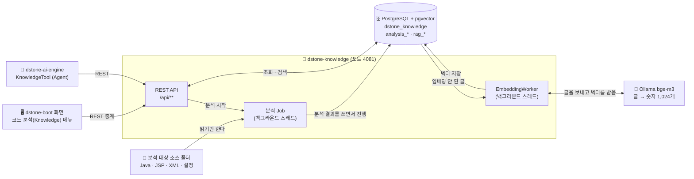

- **들어가는 것**: 서버가 읽을 수 있는 소스 폴더 하나(`localPath`). 소스를 고치지 않고, 대상 프로젝트를 빌드하지도 않는다.
- **나오는 것**: 전부 PostgreSQL의 행이다. 메모리에 들고 있는 결과물은 없다. 그래서 서버를 껐다 켜도 결과가 그대로다.
- **쓰는 쪽**: 사람은 `dstone-boot` 화면으로, LLM(Agent)은 `dstone-ai-engine`의 Tool로 쓴다. 둘 다 결국 같은 REST API를 부른다.
- **이 모듈은 LLM(채팅 모델)을 쓰지 않는다.** 쓰는 AI는 "글을 숫자로 바꿔 주는" 임베딩 모델 하나뿐이다. 답을 문장으로 만드는 일은 `dstone-ai-engine`이 한다.

### 0.3 낱말 10개

뒤의 절을 읽을 때 계속 나오는 낱말이다. 이것만 알면 나머지는 따라 읽을 수 있다.

| 낱말 | 뜻 | 견주자면 |
|---|---|---|
| **프로젝트** | 분석할 대상 하나. 이름(`projectId`)과 소스 폴더 경로 | 책 한 권 |
| **리비전** | 어느 시점의 소스를 분석한 **결과 한 벌**. 분석할 때마다 새로 생긴다 | 그 책의 "몇 판" |
| **Job** | 분석을 한 번 돌리는 실행. 리비전 하나에 여러 번 돌 수 있다(이어 하기, 다시 돌리기) | 인쇄 작업 한 번 |
| **단계(패스)** | Job이 순서대로 하는 일 9가지(SCAN, DECLARE, …) | 공장의 공정 |
| **심볼** | 소스에 선언된 것. 타입(클래스), 메소드, 필드 | 명부에 올린 이름 |
| **참조 → 관계** | 참조는 "`dao.delete(x)`라고 적혀 있다"는 **글자**. 관계는 "그것은 `OrderDAO#delete(String)`이다"라고 **풀린 결과** | 전화번호부에 적힌 이름 → 실제로 연결된 번호 |
| **신뢰도** | 관계가 얼마나 확실한지. `HIGH`(컴파일러처럼 풀었다) / `MEDIUM`(타입은 알고 이름으로 골랐다) / `LOW`(이름만 보고 짐작했다) | 증언의 확실한 정도 |
| **진입점** | 밖에서 이 프로그램으로 들어오는 입구. HTTP 주소, 서블릿, `main()`, 스케줄, JSP | 건물의 출입문 |
| **계층** | 타입의 역할. `CONTROLLER` / `SERVICE` / `REPOSITORY` / `MODEL` … | 부서 |
| **문서 · 청크 · 임베딩** | 문서는 분석 결과를 글로 적은 것, 청크는 그 글을 검색 단위로 자른 조각, 임베딩은 청크를 숫자(벡터)로 바꾼 것 | 안내 책자 · 책자의 한 쪽 · 그 쪽의 색인 번호 |

프로젝트·리비전·Job은 이렇게 들어 있다.

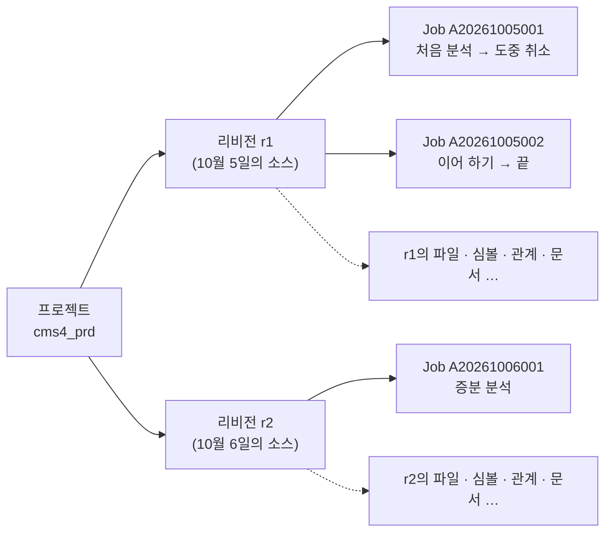

**분석 결과의 모든 행에는 `revision_id`가 붙는다.** 리비전은 서로 섞이지 않는 "전체 한 벌"이라서 r1을 지워도 r2는 온전하고, r1과 r2를 비교할 수도 있다.

### 0.4 분석 공정 9단계

분석 시작을 한 번 누르면 아래 9단계가 순서대로 돈다. 괄호 안의 숫자는 코드의 실행 순서 값(`order()`)이다.

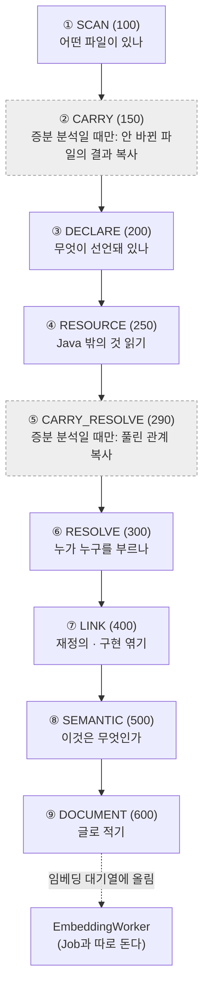

| 단계 | 견주자면 | 읽는 것 | 만드는 것(테이블) | 담당 클래스 |
|---|---|---|---|---|
| ① SCAN | **재고 조사**. 창고에 무엇이 있는지 목록부터 | 폴더의 모든 파일 | 파일 목록 `analysis_file` | `analysis.pass01.scan.ScanPass` |
| ② CARRY | 지난번 장부에서 **안 바뀐 것 베껴 오기** | 앞 리비전의 행 | 선언·자원의 복사본 | `analysis.pass02.carry.CarryPass` |
| ③ DECLARE | **명부 만들기**. 누가 있는지만 적는다 | Java 파일(과 JSP 안의 Java) 하나씩 | 심볼 `analysis_symbol` / `_method` / `_field` / `_annotation`, 참조 `analysis_reference` | `analysis.pass03.declare.DeclarePass` |
| ④ RESOURCE | **부속 서류 정리**. SQL, 설정, 빌드 파일 | XML · properties · YAML 하나씩 | `analysis_mapper` / `_config` / `_resource` | `analysis.pass04.resource.ResourcePass` |
| ⑤ CARRY_RESOLVE | 지난번의 **연결 결과 베껴 오기**(베껴도 되는 것만) | 앞 리비전의 관계 | 관계의 복사본 | `analysis.pass05.carryresolve.CarryResolvePass` |
| ⑥ RESOLVE | **전화 연결**. 명부의 이름을 실제 상대와 잇는다 | Java 파일 하나씩(다시 파싱) | 관계 `analysis_relation` | `analysis.pass06.resolve.ResolvePass` |
| ⑦ LINK | **족보 정리**. 재정의와 인터페이스 구현 | DB만(SQL) | `OVERRIDES` 등의 관계, 품질 지표 `analysis_metric` | `analysis.pass07.link.LinkPass` |
| ⑧ SEMANTIC | **간판 달기**. "여기는 출입문", "여기는 영업부" | DB + 규칙 파일 `conf/rules` + `web.xml` · Struts 설정 · JSP 글자 | 진입점 `analysis_endpoint`, 계층, SQL·테이블·화면 관계 | `analysis.pass08.semantic.SemanticPass` + 규칙 절마다 하나인 처리기(`LayerResolver`, `EntryFinder` …) |
| ⑨ DOCUMENT | **안내 책자 쓰기**. 지도를 글로 풀어 적는다 | DB + 소스의 해당 줄 | `rag_document` / `rag_chunk`, 대기열 `rag_embedding` | `analysis.pass09.document.DocumentPass` |

**왜 DECLARE와 RESOLVE를 나눴나.** `getLogsDAO().selectLoginHistList(vo)`가 누구의 `selectLoginHistList`인지 알려면 `getLogsDAO()`가 무엇을 돌려주는지(`BaseService`), 그 타입 `LogsDAO`가 어떤 클래스인지 알아야 하는데, 그것은 다른 파일에 있다. 그래서 먼저 모든 파일의 "누가 있는지"를 DB에 다 넣고(③), 그 다음에 "누구를 가리키는지"를 DB에 물어 가며 푼다(⑥). 이렇게 하면 프로젝트 전체를 메모리에 올릴 필요가 없다. 파일 3만 개짜리 프로젝트도 힙 1GB로 돈다.

### 0.5 예제 하나로 끝까지 따라가기

`cms4_prd`는 운영 서버에서 받아 온 실제 Spring MVC + MyBatis 웹 애플리케이션이다(펼친 WAR, 저장소 밖 `/app/sampleApps/cms4_prd`). Java 232개, JSP 200개, MyBatis 매퍼 42개, jar 113개로 작지 않지만, 분석 한 번이 1분 36초면 끝난다(임베딩 제외). 여기서는 그 가운데 **"로그인 기록 조회" 기능 하나**를 처음부터 끝까지 따라간다.

**분석 대상의 소스(이 기능에 관련된 것만 줄여서)**

```
cms4_prd/                                        파일 2,244개 (이미지·CSS·jar 포함)
├── WEB-INF/web.xml                              DispatcherServlet 등 서블릿 7개, 필터 9개
├── WEB-INF/classes/spring/context-*.xml         Spring 빈·component-scan·MyBatis 설정
├── WEB-INF/classes/sqlmap/mapper/system/logs-mapper.xml
│                                                namespace="logs": selectLoginHistList → selectLoginHistListSql 조각
│                                                (FROM tbsy_login_hist LEFT OUTER JOIN tbin_empmst …)
├── WEB-INF/classes/kr/co/gnx/
│   ├── base/BaseController.java                 @Autowired LogsService logsService;  getLogsService()
│   ├── base/BaseService.java                    @Autowired LogsDAO logsDAO;  getLogsDAO()
│   ├── base/BaseDAO.java                        logsMapper = "logs.";  getLogsmapper() { return logsMapper; }
│   └── logs/
│       ├── LogsController.java                  @RequestMapping("/logs/loginHist.go")          → new ModelAndView("/logs/loginHist")
│       │                                        @RequestMapping("/logs/getLoginHistList.ajax") → getLogsService().getLoginHistList(vo)
│       ├── LogsService.java                     getLogsDAO().selectLoginHistList(vo)
│       └── LogsDAO.java                         getSqlSession().selectList(getLogsmapper() + "selectLoginHistList", vo)
├── WEB-INF/views/logs/loginHist.jsp             $.ajax({ url : "/logs/getLoginHistList.ajax?…" })
└── WEB-INF/lib/*.jar                            113개 (Spring, MyBatis, json-lib …)
```

이 기능의 사실은 **다섯 군데에 흩어져 있다.** 화면은 JSP에, 주소는 컨트롤러의 애노테이션에, 처리 코드는 컨트롤러·서비스·DAO 세 클래스와 그 공통 부모(`Base…`)에, SQL은 매퍼 XML에 있다. 게다가 DAO는 SQL 이름을 글자 그대로 적지 않고 부모 클래스의 메소드(`getLogsmapper()`)를 불러 만든다. 어느 하나만 봐서는 "로그인 기록 화면이 어느 테이블을 읽는지" 알 수 없다. 9단계가 이것을 차례로 잇는다.

아래에서 단계마다 **📥 저장되는 곳**에 그 단계가 쓰는 테이블과 `cms4_prd` 전체에서 생기는 행 수를 적었다(2026-11-08에 지금 코드로 분석한 리비전 95에서 센 값. 테이블 전체 모양은 0.13절).

단계와 상관없이 분석 한 번마다 쌓이는 관리용 행이 있다.

| 테이블 | 언제 | `cms4_prd` |
|---|---|---|
| `analysis_project` | 프로젝트를 등록할 때 한 번(`POST /api/projects`). 경로, `classpath`, `ruleSets` | 1 |
| `analysis_revision` | 분석을 시작할 때 한 벌. 이 아래 모든 행이 이 `revision_id`를 단다 | 1 |
| `analysis_job` | 분석 실행 기록(`analysisId`, 상태, 시작·끝 시각) | 1 |
| `analysis_revision_pass` | 단계마다 한 행(`READY` → `RUNNING` → `DONE`). 증분 분석에만 도는 CARRY·CARRY_RESOLVE도 행은 남는다 | 9 |
| `analysis_file_pass` | 파일 단위 단계에서 파일마다 한 행. 죽었다 다시 시작해도 끝난 파일은 건너뛰는 근거다 | 1,421 |
| `analysis_error` | 단계가 남긴 오류·경고(인코딩을 모름, 파싱 실패 등) | 0 |

**① SCAN** — 파일 2,244개 가운데 분석할 1,331개의 목록이 생긴다. 이미지, CSS, jar, 소스맵(`.map`)은 목록에 넣지 않는다(jar는 ⑥에서 따로 쓴다).

| 이 기능의 파일 | 언어 | 용도(`file_type`) | 어떻게 알았나 |
|---|---|---|---|
| `WEB-INF/classes/kr/co/gnx/logs/LogsDAO.java` 외 Java 232개 | `JAVA` | `SOURCE` | 확장자. 소스 루트는 `WEB-INF/classes`다. 폴더 경로 끝 `kr/co/gnx/logs`가 `package kr.co.gnx.logs`와 같으므로 그 앞까지를 소스 루트로 본다 |
| `WEB-INF/views/logs/loginHist.jsp` 외 JSP 200개 | `JSP` | `JSP` | 확장자 |
| `WEB-INF/classes/sqlmap/mapper/system/logs-mapper.xml` 외 42개 | `XML` | `MYBATIS_MAPPER` | 맨 위 요소가 `<mapper>` |
| `WEB-INF/classes/spring/context-common.xml` 외 6개 | `XML` | `SPRING_XML` | 맨 위 요소가 `<beans>` |
| `WEB-INF/web.xml` | `XML` | `WEB_XML` | 맨 위 요소가 `<web-app>` |
| `resources/**/*.js` 836개 | `SCRIPT` | `SCRIPT` | 확장자. 내용은 ⑧에서 필요할 때만 읽는다 |

파일마다 인코딩과 내용 해시(SHA-256)도 같이 적는다. 해시는 나중에 증분 분석이 "이 파일이 바뀌었나"를 가리는 열쇠다.

> 📥 **저장되는 곳**: `analysis_file` 1,331행(Java 232, JSP 200, 스크립트 836, XML 62, properties 1. 경로, 언어, `file_type`, 인코딩, `checksum`, 줄 수). 이 단계는 이 테이블 하나만 쓴다. 파일 단위 단계가 아니어서 `analysis_file_pass` 행은 없다.

**③ DECLARE** — `LogsDAO.java` 한 파일에서 이런 행이 생긴다. 다른 파일은 보지 않는다.

| 종류 | 생기는 행 |
|---|---|
| 타입 | `kr.co.gnx.logs.LogsDAO` (`CLASS`, 상위 타입 `BaseDAO`는 이름만 적어 둔다) |
| 메소드 | `selectLoginHistList(LoginHistVO)` 등 7개 + 만들어 넣은 기본 생성자 `<init>()`(소스에 생성자가 없어서, `is_synthetic`) |
| 필드 | `logger` |
| 애노테이션 | `@Repository(value = "LogsDAO")` |
| 참조(아직 누구인지 모름) 46개 | `selectLoginHistList` 안에만 7개 — 호출 `selectList`(대상 식 `getSqlSession()`, 인자 2개), 호출 `getSqlSession()`, 호출 `getLogsmapper()`(앞에 `객체.`가 없음), 타입 사용 `LoginHistVO`, `List`, `Map`, `String` |

`getSqlSession()`과 `getLogsmapper()`는 이 파일에 없는 메소드다(부모 `BaseDAO`에 있다). 이 단계는 그것을 모른 채 "이런 이름을 부른다"만 적는다. JSP는 `<% %>`(Java 코드)가 있는 12개만 Java 소스로 바꿔서 똑같이 처리한다(4.10절). `loginHist.jsp`는 Java 코드가 없어서 건너뛴다.

> 📥 **저장되는 곳**(Java 232개 + JSP 200개 전체 기준)
>
> | 테이블 | 담는 것 | 행 |
> |---|---|---|
> | `analysis_symbol` | 타입(클래스 239, 익명 클래스 9, enum 6, 인터페이스 2). 계층(`layer`)은 아직 비어 있다 | 256 |
> | `analysis_method` | 메소드. 소스에 적힌 5,797개 + 만들어 넣은 기본 생성자 230개(`is_synthetic`) | 6,027 |
> | `analysis_field` | 필드와 초기값(`BaseDAO.logsMapper = "logs."` 같은 것. ⑧에서 쓴다) | 2,076 |
> | `analysis_annotation` | 타입·메소드·필드에 붙은 애노테이션(`@Controller`, `@RequestMapping`, `@Autowired` …) | 1,574 |
> | `analysis_reference` | 아직 누구인지 모르는 참조(호출, 타입 사용, 객체 생성, 상속 …). 상태는 모두 `PENDING` | 39,480 |
> | `analysis_file` | 파싱 결과(`parse_status`, `language_level`)를 고쳐 쓴다 | (432행 갱신) |
> | `analysis_file_pass` | `DECLARE` 파일별 진행 | 432 |
>
> 파일 하나를 읽고 이 행들을 쓴 뒤 AST는 버린다. 프로젝트 전체를 메모리에 올리지 않는 이유다(2절).

**④ RESOURCE** — `logs-mapper.xml`에서 statement 10개(`SELECT` 4, `INSERT` 3, 조각 3)가 `analysis_mapper`에 들어간다. 이 기능이 쓰는 것은 둘이다.

| 이름 | 종류 | 저장되는 SQL(태그를 벗겨 한 글로 편 것) |
|---|---|---|
| `logs.selectLoginHistListSql` | 조각(`SQL_FRAGMENT`) | `@@include(Comm.OrgTree)@@ SELECT tb1.mb_id, tb1.seq, tb1.emp_cd, tb2.emp_nm, … FROM tbsy_login_hist tb1 LEFT OUTER JOIN tbin_empmst tb2 … LEFT OUTER JOIN org_cte tb3 … WHERE …` |
| `logs.selectLoginHistList` | `SELECT` | `@@include(Comm.PagingStart)@@ @@include(selectLoginHistListSql)@@ @@include(Comm.PagingEnd)@@` |

`<include refid>`는 이 단계에서 펼치지 않고 `@@include(…)@@` 표시만 남긴다. 다른 매퍼 파일(`Comm.PagingStart` 등)에 있는 조각일 수 있어서, 모든 매퍼를 읽은 뒤 ⑧에서 채운다. `<if>` 같은 조건 태그는 벗기고 안의 글을 전부 남긴다. 이 단계는 **읽어서 저장만** 한다.

> 📥 **저장되는 곳**
>
> | 테이블 | 담는 것 | 행 |
> |---|---|---|
> | `analysis_mapper` | statement 이름, 종류, 펼친 SQL, 매퍼 종류. `SELECT` 367, `INSERT` 107, `UPDATE` 86, `DELETE` 99, 조각 129 | 788 |
> | `analysis_config` | `.properties`·`.yml`의 키와 값(비밀값은 `****`) | 5 |
> | `analysis_resource` | Spring XML의 빈 37, `component-scan` 3, 빌드 파일의 의존성 52 | 92 |
> | `analysis_file_pass` | `RESOURCE` 파일별 진행(XML·properties) | 63 |
>
> 증분 분석이라면 이 앞(②)과 뒤(⑤)에 CARRY·CARRY_RESOLVE가 돌아, 바뀌지 않은 파일의 위 행들과 ⑥의 관계를 앞 리비전에서 복사한다(0.12절). 이번처럼 전체 분석이면 아무것도 하지 않는다.

**⑥ RESOLVE** — 이제 모든 파일의 선언이 DB에 있으므로 참조를 푼다. `LogsController#getLoginHistList`와 그 아래에서 이렇게 풀린다.

| 소스에 적힌 것 | 풀린 결과 | 신뢰도 |
|---|---|---|
| `getLogsService()` (`LogsController.java:67`) | `CALLS` → `BaseController#getLogsService()` (부모 클래스에서 물려받은 메소드) | `HIGH` |
| `getLogsService().getLoginHistList(loginHistVO)` | `CALLS` → `LogsService#getLoginHistList(LoginHistVO)` (앞 호출의 반환 타입 `LogsService`로 찾음) | `HIGH` |
| `getLogsDAO().selectLoginHistList(loginHistVO)` (`LogsService.java:57`) | `CALLS` → `LogsDAO#selectLoginHistList(LoginHistVO)` | `HIGH` |
| `getLogsmapper()` (`LogsDAO.java:46`) | `CALLS` → `BaseDAO#getLogsmapper()` | `HIGH` |
| `getSqlSession().selectList(…)` | `CALLS` → `org.mybatis.spring.SqlSessionTemplate.selectList(java.lang.String, java.lang.Object)` (프로젝트 밖, jar로 확인) | `HIGH` |
| `JSONObject.fromObject(…)` (`LogsController.java:59`) | `CALLS` → `net.sf.json.JSONObject.fromObject(java.lang.Object)` (프로젝트 밖, jar로 확인) | `HIGH` |

이 프로젝트는 `WEB-INF/lib`에 jar 113개가 있어서 프로젝트 **밖**의 호출도 컴파일러처럼 풀린다(따로 설정하지 않아도 프로젝트 폴더 안의 jar를 쓴다). 그래서 호출 19,349건 가운데 99.90%가 풀렸고, 이름으로 짐작한 것은 1건뿐이다. jar가 없으면 밖으로 나가는 호출은 "타입과 이름만" 남는다(`MEDIUM`, 0.8절).

> 📥 **저장되는 곳**
>
> | 테이블 | 담는 것 | 행 |
> |---|---|---|
> | `analysis_relation` | 풀린 관계. `CALLS` 20,001, `USES_TYPE` 14,948, `ACCESSES_FIELD` 2,074, `CREATES` 2,025, `THROWS` 806, `EXTENDS` 191, `IMPLEMENTS` 20 | 40,065 |
> | `analysis_reference` | 참조의 상태를 고쳐 쓴다. `EXTERNAL` 21,456, `RESOLVED` 17,937, `IGNORED` 65, `UNRESOLVED` 21(이유는 `fail_reason`), `HEURISTIC` 1 | (39,480행 갱신) |
> | `analysis_file_pass` | `RESOLVE` 파일별 진행 | 432 |
>
> 프로젝트 밖으로 나가는 관계는 `to_id` 없이 `to_external`에 이름(`org.mybatis.spring.SqlSessionTemplate.selectList(…)`)을 둔다.

**⑦ LINK** — 재정의(`OVERRIDES`) 68건을 엮는다. 이 프로젝트의 서비스와 DAO는 인터페이스 없이 클래스로 바로 만들어져 있어서 "인터페이스 메소드를 부르는 호출 → 구현 메소드"(`CALLS_POSSIBLE_IMPLEMENTATION`)는 생기지 않는다. 인터페이스를 쓰는 프로젝트라면 여기서 `OrderService.findOrders` → `OrderServiceImpl.findOrders`가 이어진다(`legacy-app`).

> 📥 **저장되는 곳**: `analysis_relation`에 `OVERRIDES` 68행, `analysis_metric`에 품질 지표 7개(`callResolutionRate` 99.90, `callHeuristicRate` 0.01, `callUnresolvedRate` 0.10, `callCount` 19,349, `relationCount` 40,133, `parseSuccessRate` 100, `typeResolutionRate` 100). 지표는 리비전이 아니라 실행(`analysis_id`)에 붙는다. 이 단계는 파일을 읽지 않고 SQL로만 돈다.

**⑧ SEMANTIC** — 흩어져 있던 다섯 군데가 여기서 하나로 이어진다.

| 처리기 | 이 기능에서 한 일 | 프로젝트 전체 |
|---|---|---|
| `EntryFinder`, `LayerResolver`, `WiringMarker` | `@RequestMapping("/logs/getLoginHistList.ajax")` → `HTTP` 진입점. `@Controller`/`@Service`/`@Repository` → `LogsController` `CONTROLLER`, `LogsService` `SERVICE`, `LogsDAO` `REPOSITORY`(`HIGH`, 규칙 `common/spring.yml`) | `HTTP` 694, `SCHEDULED` 2, `INJECTS` 108, 계층 `HIGH` 143 |
| `ServletEntries` | — | `web.xml` → `SERVLET` 진입점 7, 필터 9·리스너 4는 `analysis_resource` |
| `EntryFinder` | — | `main()` 2, `WEB-INF` 밖 JSP 2 |
| `MapperLinker`, `SqlLinker` | `getLogsmapper() + "selectLoginHistList"`를 계산한다(규칙 `common/mybatis.yml`의 `_.selectList(SQL)`). `getLogsmapper()`는 `return logsMapper;` 한 줄이고 `logsMapper`는 상수 `"logs."`이므로 `logs.selectLoginHistList` → `EXECUTES_SQL`(`HIGH`). 조각을 채운 SQL에서 테이블을 뽑아 `READS_TABLE` → `TBSY_LOGIN_HIST`, `TBIN_EMPMST`, `TBIN_SCD`(`Comm.OrgTree` 조각의 `WITH org_cte`가 읽는다) | `EXECUTES_SQL` 740(그중 19건은 이름만 알고 statement가 없다), `READS_TABLE` 1,163, `WRITES_TABLE` 305, 테이블 167개 |
| `JspLinker` | `new ModelAndView("/logs/loginHist")` → `logs/loginHist.jsp` `RENDERS`(`HIGH`). `loginHist.jsp:92`의 `"/logs/getLoginHistList.ajax?…"` 글자가 진입점 주소와 같음 → `REQUESTS`(`MEDIUM`) | `RENDERS` 178, `REQUESTS` 825(화면 소스에 적힌 주소 글자 685 + `<script src>`로 불러온 스크립트 140), `INCLUDES` 186, 화면 계층 `VIEW` 12, 화면명 16 |
| `LayerResolver`(상속 · 이름 규칙) | — | 상위 타입으로 `MEDIUM` 1, 이름 끝말로 `LOW` 58(`…VO` → `MODEL` 46 등) |
| `MethodTitlePlugin`, `SourceNamePlugin` | 메소드 위 주석 첫 줄 → 기능명 "로그인 기록 리스트 조회" | 기능명 1,818, 소스에서 찾은 컬럼 한글명 551 |

`selectLoginHistList`의 SQL은 Oracle 문법과 `${page}` 같은 치환 변수가 섞여 SQL 파서가 읽지 못했다. 그래서 `FROM`/`JOIN` 뒤의 이름을 정규식으로 찾았고(`via = PATTERN`), 신뢰도는 `MEDIUM`이다. 프로젝트 전체에서도 `READS_TABLE`의 절반(582건)이 이 경우다.

> 📥 **저장되는 곳**
>
> | 테이블 | 담는 것 | 행 |
> |---|---|---|
> | `analysis_endpoint` | 진입점. `HTTP` 694, `SERVLET` 7, `JSP` 2, `MAIN` 2, `SCHEDULED` 2 | 707 |
> | `analysis_relation` | 프레임워크를 알아야 잇는 관계. `READS_TABLE` 1,163, `REQUESTS` 825, `EXECUTES_SQL` 740, `WRITES_TABLE` 305, `INCLUDES` 186, `RENDERS` 178, `INJECTS` 108 | +3,505 (모두 43,638) |
> | `analysis_symbol` | 계층(`layer`, `layer_confidence`)을 고쳐 쓴다. 256개 가운데 214개에 붙었다 | (214행 갱신) |
> | `analysis_method` | 프록시가 끼어드는 메소드(`proxy_related`)를 고쳐 쓴다(이 프로젝트는 해당 애노테이션이 없다) | (0행) |
> | `analysis_resource` | 기능명 `METHOD_TITLE` 1,818, 소스에서 찾은 컬럼 한글명 `SOURCE_NAME` 551, 화면명 `SCREEN_NAME` 16, `web.xml`의 `FILTER_MAPPING` 9·`SERVLET_MAPPING` 7·`LISTENER` 4, 쓴 규칙 묶음 `RULE_SET` 7, 플러그인 상태 `SEMANTIC_STATUS` 3 | +2,415 |
>
> SEMANTIC은 시작할 때 자기가 전에 만든 행을 지우고, 한 트랜잭션 안에서 다시 만든다. 그래서 규칙을 고친 뒤 `rerunFrom: SEMANTIC`으로 다시 돌려도 결과가 겹치지 않는다(4.7절).

**분석이 끝난 뒤 DB에 그려진 지도**(이 기능 부분만. 이 그림이 이 모듈이 만드는 것의 전부다)

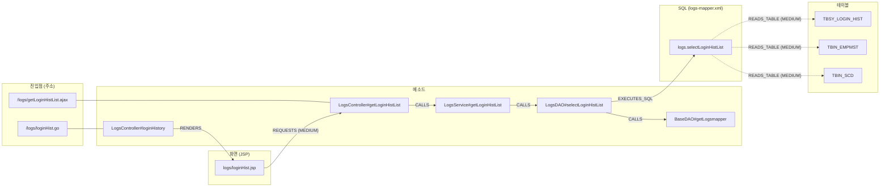

- 화살표 하나가 `analysis_relation`의 한 행이다(주소와 메소드를 잇는 선만 `analysis_endpoint`의 행이다). 점선은 `MEDIUM`이다.
- 실제로는 컨트롤러가 `BaseController#getLogsService()`, `BaseVO#setPage()` 같은 부모 클래스의 메소드도 부른다. 그림에서는 줄였다.
- **화살표를 따라 오른쪽으로 가면** "이 주소를 부르면 무슨 일이 일어나나"(`/callees`)이고, **거슬러 왼쪽으로 가면** "이 테이블을 고치면 어디가 영향받나"(`/impact`)다. 조회 API는 전부 이 그림 위를 걷는 일이다.
- `TBSY_LOGIN_HIST`에서 거슬러 올라가면 이 기능 말고도 로그인 처리(`LoginDAO`)까지 닿는다. 메소드 16개(DAO 6, 서비스 6, 컨트롤러 4), 진입점 4개(`/logs/getLoginHistList.ajax`, `/login/getLoginList.ajax` 등), 화면 2개(`logs/loginHist.jsp`, `system/userAccountManage/userAccountManage.jsp`)다.

**⑨ DOCUMENT** — 위 지도를 글로 풀어 적는다. 문서 3,625건이 생긴다(`METHOD` 2,299, `MAPPER` 659, `TYPE` 235, `FILE` 232, `VIEW` 200). 메소드 문서 하나는 이런 모양이다(서버가 만든 그대로).

```text
[메소드] kr.co.gnx.logs.LogsDAO#selectLoginHistList(LoginHistVO)
반환: List<Map<String,String>>
계층: REPOSITORY
파일: WEB-INF/classes/kr/co/gnx/logs/LogsDAO.java (줄 45-47)
설명: 로그인 기록 리스트 조회
호출하는 것: BaseDAO#getLogsmapper(), BaseDAO#getSqlSession()
밖으로 나가는 호출: org.mybatis.spring.SqlSessionTemplate.selectList(java.lang.String, java.lang.Object)
실행하는 SQL: logs.selectLoginHistList [SELECT, 테이블 TBIN_EMPMST(R), TBIN_SCD(R), TBSY_LOGIN_HIST(R)]
호출받는 곳: LogsService#getLoginHistList(LoginHistVO)
소스:
	public List<Map<String, String>> selectLoginHistList(LoginHistVO loginHistVO) {
		return getSqlSession().selectList(getLogsmapper() + "selectLoginHistList", loginHistVO);
	}
```

**소스 세 줄에는 `TBSY_LOGIN_HIST`라는 글자도, SQL의 전체 이름도, 누가 부르는지도 적혀 있지 않다.** 그것은 다른 파일(`BaseDAO.java`, `logs-mapper.xml`, `LogsService.java`)에 있고, 분석이 이어 줬기 때문에 여기에 적을 수 있다. 그래서 "로그인 기록을 조회하는 코드"라고 물어도 이 문서가 걸린다.

> 📥 **저장되는 곳**
>
> | 테이블 | 담는 것 | 행 |
> |---|---|---|
> | `rag_document` | 문서 한 건(종류, 제목, 원본 경로, 메타데이터) | 3,625 |
> | `rag_chunk` | 문서를 검색 단위로 자른 조각과 그 내용 해시. 긴 문서는 여러 조각이 된다 | 4,000 |
> | `rag_embedding` | 조각의 벡터. `(content_hash, model)`이 키라 리비전이 바뀌어도 내용이 같으면 다시 계산하지 않는다. 이 단계는 처음 보는 해시만 `PENDING`으로 줄 세우고, 벡터는 서버의 백그라운드 스레드(`EmbeddingWorker`)가 채운다. 이번에는 앞 리비전(65)과 내용이 같은 조각이 대부분이라 새로 계산한 것이 5개뿐이었다 | (새 해시만) |
> | `analysis_file_pass` | `DOCUMENT` 파일별 진행 | 494 |
>
> `rag_*`는 `analysis_*`에서 언제든 다시 만들 수 있다. 원본은 `analysis_*`뿐이다.

**단계별 저장 테이블 한눈에 보기**(`cms4_prd`, 리비전 95)

| 단계 | 새로 쓰는 테이블(행) | 고쳐 쓰는 테이블 |
|---|---|---|
| ① SCAN | `analysis_file`(1,331) | — |
| ② CARRY | 증분 분석일 때만: ③·④의 테이블에 앞 리비전 행을 복사 | `analysis_file.carried_from_file_id` |
| ③ DECLARE | `analysis_symbol`(256), `analysis_method`(6,027), `analysis_field`(2,076), `analysis_annotation`(1,574), `analysis_reference`(39,480) | `analysis_file`(파싱 결과) |
| ④ RESOURCE | `analysis_mapper`(788), `analysis_config`(5), `analysis_resource`(92) | — |
| ⑤ CARRY_RESOLVE | 증분 분석일 때만: 앞 리비전의 `analysis_relation` 복사 | — |
| ⑥ RESOLVE | `analysis_relation`(40,065) | `analysis_reference.status` |
| ⑦ LINK | `analysis_relation`(68), `analysis_metric`(7) | — |
| ⑧ SEMANTIC | `analysis_endpoint`(707), `analysis_relation`(3,505), `analysis_resource`(2,415) | `analysis_symbol.layer`, `analysis_method.proxy_related` |
| ⑨ DOCUMENT | `rag_document`(3,625), `rag_chunk`(4,000), `rag_embedding`(새 해시만, `PENDING`) | — |
| 모든 단계 | `analysis_revision_pass`(9), `analysis_file_pass`(1,421), `analysis_error`(0) | — |

저장소 안의 작은 표본(`struts-app`은 파일 11개짜리 Struts 1 + iBATIS 게시판)으로 같은 흐름을 몇 초 만에 볼 수도 있다. 표본과 기대 값은 9절에 있다.

### 0.6 Job은 어떻게 도나

분석은 오래 걸릴 수 있어서 요청을 받으면 바로 돌려보내고 뒤에서 돈다.

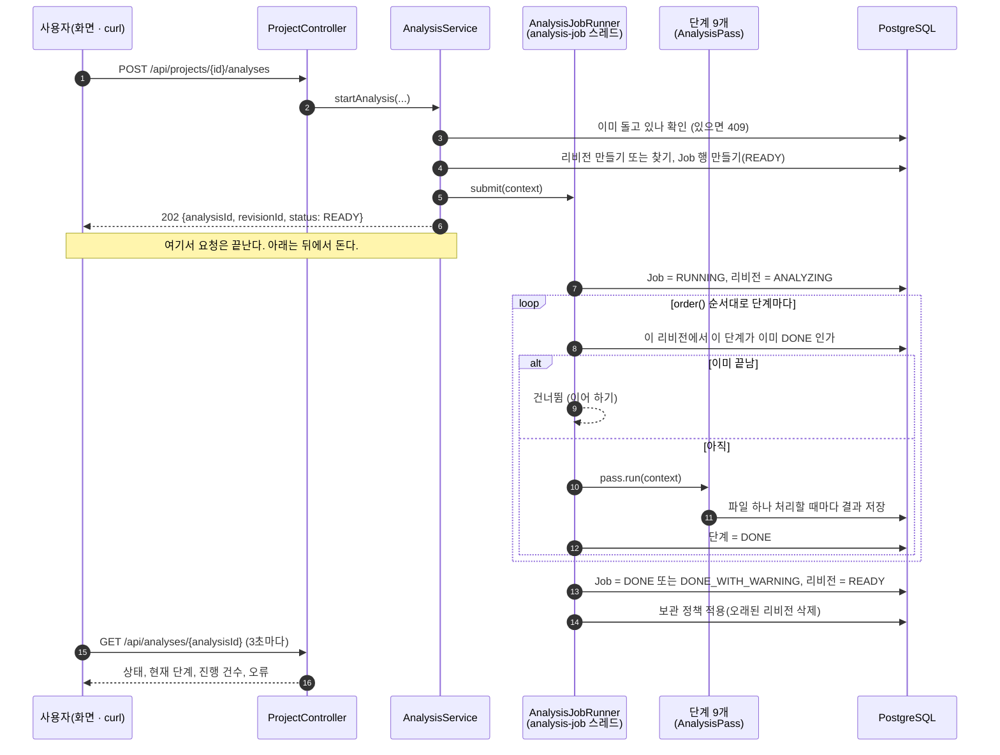

Job과 리비전의 상태는 이렇게 바뀐다.

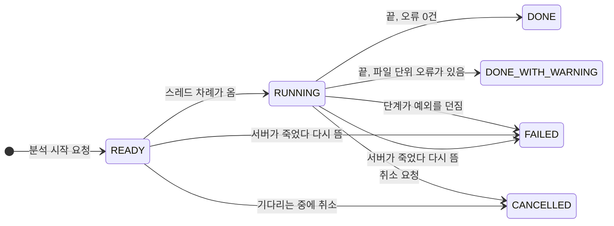

| Job이 끝난 모양 | 리비전 상태 | 그 다음에 할 수 있는 것 |
|---|---|---|
| `DONE` / `DONE_WITH_WARNING` | `READY` | 조회, 검색, 증분 분석의 기준으로 쓰기 |
| `CANCELLED` | `CREATED` | 같은 리비전 라벨(`revisionLabel`)로 다시 시작하면 멈춘 단계부터 이어서 한다 |
| `FAILED` | `FAILED` | 원인을 고친 뒤 같은 리비전 라벨로 다시 시작하면 이어서 한다 |

- `DONE_WITH_WARNING`은 실패가 아니다. "파일 몇 개는 못 읽었지만 나머지는 다 했다"는 뜻이다. 못 읽은 파일은 `analysis_error`에 남는다.
- **이어 하기가 되는 이유**: 진행 상태를 두 군데에 적어 두기 때문이다. 단계가 끝났는지는 `analysis_revision_pass`, 파일 하나하나는 `analysis_file_pass`. 다시 시작하면 끝난 단계를 건너뛰고, 끝나지 않은 단계에서는 끝난 파일을 건너뛴다.
- 동시에 도는 Job은 2개까지다(`job.max-concurrent`). 넘치면 `READY`로 기다리고, 기다리는 것이 100개를 넘으면 503이다. 한 프로젝트에는 한 번에 하나만 돈다.

### 0.7 파일 하나는 어떻게 처리되나

DECLARE, RESOURCE, RESOLVE, DOCUMENT는 "파일을 하나씩 처리하는 단계"라서 같은 실행기(`analysis.job.FilePassRunner`)를 쓴다. 단계마다 다른 것은 `FileHandler`의 `prepare`와 `write` 두 메소드뿐이다.

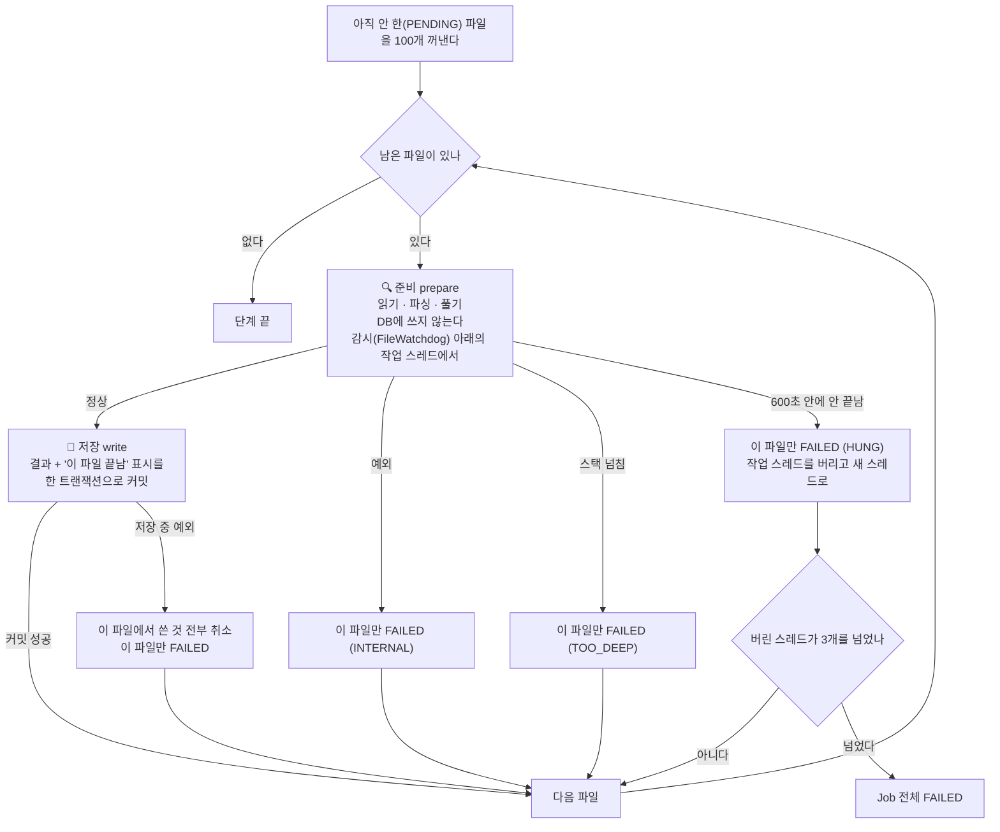

이 그림에서 기억할 것은 둘이다.

- **파일 하나가 잘못돼도 분석은 계속 간다.** 깨진 소스, 지나치게 깊은 식, 끝나지 않는 파싱 모두 "그 파일만 실패"로 끝난다. 숨기지 않고 `analysis_error`에 남긴다.
- **오래 걸리는 일(준비)과 DB에 쓰는 일(저장)을 갈라 놓았다.** 준비가 멈춰도 DB 연결이나 트랜잭션을 붙든 채 남지 않고, 저장은 "결과와 끝남 표시"가 함께 들어가거나 함께 취소되므로 반쯤 저장된 파일이 생기지 않는다.

### 0.8 호출 하나는 어떻게 풀리나 (RESOLVE)

`something.doIt(a, b)`라는 글자 하나를 놓고 `analysis.pass06.resolve.ReferenceResolver`가 내리는 판단이다. 위에서 풀리면 아래로 내려가지 않는다.

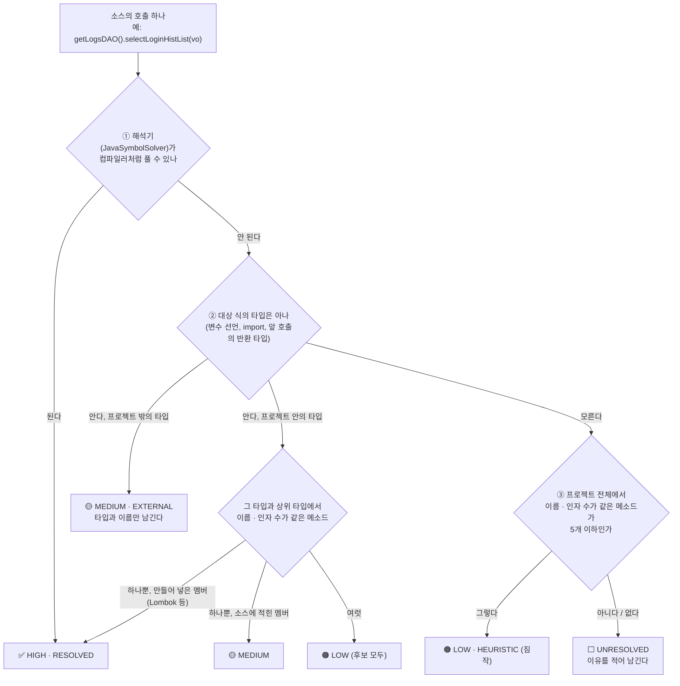

| 신뢰도 | 뜻 | 실제로 맞는 비율(jar 없이 돌린 `dstone-batchadmin`, 10.2절) | 어떻게 쓰나 |
|---|---|---|---|
| `HIGH` | 컴파일러와 같은 방식으로 풀었다 | 46 / 46 | 그대로 믿는다 |
| `MEDIUM` | 타입은 알고, 메소드는 이름으로 골랐다 | 170 / 170 | 믿어도 된다 |
| `LOW` | 이름만 보고 짐작했다 | 11 / 27 | 참고로만 본다. 절반 넘게 틀린다 |

**대상 프로젝트의 라이브러리 jar가 있으면 ①에서 대부분 끝난다.** jar가 없으면 ②·③으로 내려가는 것이 늘어난다. 그래서 프로젝트 폴더 안에 `WEB-INF/lib`가 있거나, 프로젝트 등록 때 `classpath`를 주면 결과가 훨씬 좋아진다.

### 0.9 계층을 넘는 호출은 어떻게 이어지나 (화면 → 컨트롤러 → 서비스 → DAO → SQL → 테이블)

먼저 결론부터 말하면 **계층마다 따로 도는 분석 로직은 없다.** "컨트롤러 분석기", "서비스 분석기" 같은 것이 없다. 분석기는 계층 대신 **경계의 종류**를 본다. 화면과 서버 사이, Java 메소드끼리, 인터페이스와 구현체 사이, Java와 SQL 사이, SQL과 테이블 사이처럼 성격이 다른 경계마다 관계를 만드는 담당이 따로 있다. 이렇게 만든 관계를 조회할 때 한 줄로 이어 걷는다.

```mermaid
flowchart LR
    SCR["화면<br/>JSP · WebSquare · Nexacro"]
    CTL["컨트롤러 메소드<br/>(진입점)"]
    SVC["서비스 메소드"]
    IMPL["서비스 구현체 메소드"]
    DAO["DAO 메소드"]
    SQL["SQL statement<br/>(매퍼 XML)"]
    TBL["테이블"]

    SCR -->|"REQUESTS<br/>⑧ SEMANTIC"| CTL
    CTL -->|"CALLS<br/>③ DECLARE → ⑥ RESOLVE"| SVC
    SVC -.->|"CALLS_POSSIBLE_IMPLEMENTATION<br/>⑦ LINK"| IMPL
    IMPL -->|"CALLS<br/>⑥ RESOLVE"| DAO
    DAO -->|"EXECUTES_SQL<br/>⑧ SEMANTIC"| SQL
    SQL -->|"READS_TABLE / WRITES_TABLE<br/>⑧ SEMANTIC"| TBL
    CTL -->|"RENDERS<br/>⑧ SEMANTIC"| SCR
```

- 화살표마다 **만드는 단계가 다르다.** 화살표 위의 번호가 0.4절 분석 공정의 몇 번째 단계인지를 가리킨다.
- 가운데 `CALLS`는 계층을 가리지 않는다. 컨트롤러가 서비스를 부르든, 서비스가 DAO를 부르든, 유틸이 유틸을 부르든 모두 같은 규칙(0.8절)으로 푼다.
- 그림 속 "컨트롤러", "서비스", "DAO"라는 이름은 나중에 따로 붙이는 이름표다. 이름표가 틀리거나 비어 있어도 화살표는 그대로 이어진다.

#### 경계별로 누가, 무엇을 보고 잇나

| 경계 | 소스에 적힌 모습(예) | 생기는 관계 | 누가 잇나 | 무엇을 근거로 |
|---|---|---|---|---|
| 화면 → 서버 | `url : "/logs/getLoginHistList.ajax"`, `doRequestAjax("JCST0200M01S", …)` | `REQUESTS` | `JspLinker`, `ScreenLinker` | 화면 안의 글자가 진입점 주소와 같은가, 거래 ID 규칙에 맞는 메소드가 있는가 |
| 주소 → 처리 메소드 | `@RequestMapping("/order/list")`, `struts-config.xml`, `web.xml` | 진입점(`analysis_endpoint`) | `EntryFinder`, `StrutsEntries`, `ServletEntries` | 애노테이션과 설정 파일 |
| 메소드 → 메소드 (컨트롤러 → 서비스 → DAO) | `orderService.cancel(orderId)` | `CALLS` | DECLARE가 적고 RESOLVE가 푼다 | 소스의 호출과 타입 정보 |
| 인터페이스 → 구현체 | `OrderService.cancel` → `OrderServiceImpl.cancel` | `CALLS_POSSIBLE_IMPLEMENTATION` | `LinkPass` (SQL만 씀) | 상속·구현 관계 |
| DAO → SQL | `selectList(getLogsmapper() + "selectLoginHistList", …)`, `new QueryProperty("OrderD.selectOrderList")` | `EXECUTES_SQL` | `SqlLinker` | 규칙(`sql:`)이 정한 자리의 인자를 계산한 statement 이름 |
| SQL → 테이블 | `SELECT … FROM tbsy_login_hist LEFT OUTER JOIN tbin_empmst …` | `READS_TABLE`, `WRITES_TABLE` | `MapperLinker` (`SqlTableExtractor`) | SQL 파싱 |
| 메소드 → 화면 | `new ModelAndView("/logs/loginHist")`, Struts `forward` | `RENDERS` | `ViewLinker`, `StrutsEntries` | 뷰 이름으로 끝나는 JSP가 하나뿐인가 |
| 화면 → 화면 | `<jsp:include>`, `<w2:wframe src>`, 팝업 열기 | `INCLUDES` | `JspLinker`, `ScreenLinker` | 경로 끝이 맞는 화면 |

표의 "무엇을 근거로" 가운데 프레임워크마다 다른 것(진입점 애노테이션, SQL 이름을 받는 메소드와 몇 번째 인자인지, 거래 ID 함수, 계층을 정하는 상위 타입과 이름)은 코드가 아니라 규칙 파일 `conf/rules/*.yml`에 있다. 새 환경에서 처음 보는 관례는 규칙 파일만 더하면 이어진다(4.7.1절).

아래에서 하나씩 쉽게 풀어 본다.

**① 화면 → 서버 (`REQUESTS`)**

화면은 서버 코드를 직접 부르지 않는다. 주소나 거래 ID를 보낼 뿐이다. 그래서 "화면이 보내는 값"과 "서버가 받는 값"을 맞춰 보는 식으로 잇는다.

- **JSP**: 화면 안에서 `/path`처럼 생긴 글자를 모두 모은다. 그 가운데 진입점 주소와 **정확히 같은 것만** 남긴다(`MEDIUM`). `logs/loginHist.jsp`의 `"/logs/getLoginHistList.ajax?…"`는 `?` 앞까지가 `/logs/getLoginHistList.ajax` 진입점과 같으니 `LogsController#getLoginHistList`로 이어진다. 화면이 `<script src>`로 불러온 프로젝트 안의 `.js`에 적힌 주소도 같은 방법으로 잇는다(`via = SCRIPT_SRC`).
- **WebSquare / Nexacro**: 방법이 셋 더 있다.
  - 경로 글자 맞추기: JSP와 같다. `svc::order/list.do`처럼 앞에 붙은 접두어는 떼고 맞춘다.
  - **call rule**: 화면이 URL 대신 거래 ID로 서버를 부르는 프로젝트를 위한 규칙이다. 설정에 `doRequestAjax=perform{id}`라고 적어 두면 `doRequestAjax("JCST0200M01S")`가 `performJCST0200M01S` 메소드로 이어진다. 이름이 맞는 메소드가 하나면 `HIGH`, 2~5개면 각각 `LOW`이고, 하나도 없으면 `UNRESOLVED`로 남긴다.
  - field rule과 공통 스크립트: hidden 필드(`tranId`)에 적힌 거래 ID나, 공통 `.js` 함수 안에서 부르는 거래 ID도 같은 방식으로 잇는다.
- 어느 방법이든 **따옴표로 적힌 값만 믿는다.** `doRequestAjax(tranId)`처럼 변수로 넘기면 개수만 세고 잇지 않는다. 짐작으로 이은 선은 영향도 분석을 틀리게 만들기 때문이다.

**② 주소 → 처리 메소드 (진입점)**

"어떤 주소가 어느 메소드에서 처리되나"를 정하는 일이다. 프레임워크마다 적는 곳이 달라서 처리기가 하나씩 맡는다.

| 처리기 | 읽는 곳 | 예 |
|---|---|---|
| `EntryFinder` | 애노테이션(규칙 `entry:`) | 클래스의 `@RequestMapping("/order")` + 메소드의 `@GetMapping("/list")` → `/order/list`. `cms4_prd`는 메소드에만 적는다: `@RequestMapping("/logs/getLoginHistList.ajax")` → `LogsController#getLoginHistList` |
| `StrutsEntries` | `struts-config.xml`, `struts.xml` | `/board/list` + `*.do` → `/board/list.do` → `BoardListAction#execute` (`struts-app` 표본) |
| `ServletEntries` | `web.xml` | `<servlet-mapping>` → 서블릿 클래스 |
| `ScreenLinker` | call rule | `perform{id}` 모양의 public 메소드 → `TRANSACTION` 진입점 (주소 자리에 거래 ID) |

진입점이 정해져야 ①의 화면 글자와 맞춰 볼 대상이 생긴다. 그래서 화면 연결은 진입점을 만든 다음에 한다(`SemanticPass.steps()`의 순서가 그렇게 짜여 있다).

**③ 컨트롤러 → 서비스 → DAO (`CALLS`)**

가장 많은 관계가 여기서 나온다. 두 단계에 걸쳐 만든다.

1. **DECLARE**: 파일 하나만 읽고 "여기서 `orderService.cancel`을 인자 1개로 부른다"는 사실만 적는다. 이때는 `orderService`가 무슨 타입인지 모른다. 다른 파일을 보지 않기 때문이다.
2. **RESOLVE**: 모든 파일의 선언이 DB에 들어간 뒤, 적어 둔 호출을 하나씩 푼다. `orderService` 필드의 타입이 `OrderService`라는 것을 알아내고 그 타입에서 `cancel(1개)`를 찾는다. 푸는 순서와 신뢰도는 0.8절 그림 그대로다.

여기에는 계층이라는 개념이 없다. 컨트롤러 → 서비스든 서비스 → DAO든 같은 코드가 같은 규칙으로 푼다. `@Autowired`로 받았든, 생성자로 받았든, `new`로 만들었든 상관없다. **필드나 변수의 타입만 알면 풀린다.**

**④ 인터페이스 → 구현체 (`CALLS_POSSIBLE_IMPLEMENTATION`)**

Spring 프로젝트의 컨트롤러는 보통 구현체가 아니라 인터페이스를 부른다.

```java
@Autowired OrderService orderService;      // 인터페이스
...
orderService.cancel(orderId);              // ③에서는 OrderService#cancel 까지만 이어진다
```

`OrderService#cancel`에는 몸통이 없으니 여기서 길이 끊긴다. LINK 단계가 이 끊긴 곳을 메운다. "몸통 없는 메소드(인터페이스·abstract)를 부르는 호출"을 찾아 그것을 구현한 `OrderServiceImpl#cancel`로 선을 하나 더 긋는다(`MEDIUM`). 실행 시점에 어느 구현체가 들어올지는 소스만으로 알 수 없으므로 이름에 "POSSIBLE(그럴 수 있는)"이 붙는다.

몸통이 있는 일반 메소드는 일부러 넓히지 않는다. 그렇게 했더니 `BaseVO.setMb_id()` 호출 1,553건이 그 클래스를 상속한 모든 하위 클래스로 퍼져 쓸모없는 선이 27,715개 생겼다(`anybiz_prd`).

**⑤ DAO → SQL (`EXECUTES_SQL`)**

Java는 SQL을 이름으로 부른다. 그 이름이 무엇인지 **계산할 수 있을 때만** 잇는다.

| DAO 소스 | 계산 결과 | 잇나 |
|---|---|---|
| `delete("Order.deleteOrder", id)` | `Order.deleteOrder` | 잇는다 |
| `selectList(getLogsmapper() + "selectLoginHistList", vo)` (`cms4_prd`. `getLogsmapper()`는 부모 `BaseDAO`의 `return logsMapper;`, `logsMapper = "logs."`) | `return` 한 줄짜리 메소드와 상수 필드 값을 읽어 `logs.selectLoginHistList` | 잇는다 |
| `selectOne("countOrder")` | 네임스페이스 없는 id. 그 id의 statement가 하나뿐 | 잇는다 |
| `queryForList(sqlId, vo)` (`sqlId`는 매개변수) | 값을 모른다 | 잇지 않는다 |

`analysis.pass08.semantic.ConstantEvaluator`가 계산을 맡는다. 문자열 리터럴, `+`, 그 타입과 상위 타입의 상수 필드, `return` 한 줄짜리 메소드까지 계산한다. 모르는 조각이 하나라도 섞이면 전체를 모르는 것으로 본다. 이름은 알았는데 그런 statement가 없으면 `UNRESOLVED`로 이름만 남긴다.

**⑥ SQL → 테이블 (`READS_TABLE`, `WRITES_TABLE`)**

RESOURCE 단계가 매퍼 XML에서 꺼내 둔 SQL을 JSQLParser로 읽어 테이블을 뽑는다. `SELECT`는 `READS_TABLE`, `INSERT`/`UPDATE`/`DELETE`는 `WRITES_TABLE`이고, 무엇을 했는지는 `crud`(C/U/D)에 적는다. 파서가 실패하면 `FROM`/`JOIN`/`INTO`/`UPDATE` 뒤의 낱말을 정규식으로 찾아 대신 쓴다(`MEDIUM`).

#### 계층 이름표는 따로 붙는다

"이 클래스는 컨트롤러다"라는 이름표(`analysis_symbol.layer`)는 위 연결과 **상관없이** SEMANTIC 단계의 `LayerResolver`가 붙인다. 앞에서 정한 값은 뒤에서 덮어쓰지 않으므로 먼저 보는 근거가 이긴다. 보는 순서는 이렇다.

| 차례 | 근거 | 예 | 신뢰도 |
|---|---|---|---|
| 0 | 규칙 없이 확실한 것 | JSP에서 만든 타입 → `VIEW`, `struts-config.xml`의 액션 클래스 → `CONTROLLER`(`StrutsEntries`) | `HIGH` |
| 1 | 프로젝트 규칙(`conf/rules/projects/{프로젝트}/`) | `CONTROLLER: extends jef.application.services.AbstractMainService` | 모양에 따라 |
| 2 | 공통 규칙(`conf/rules/common/`) | `"@Controller"`, `"@Service"`, `extends javax.servlet.http.HttpServlet` | 모양에 따라 |
| 3 | 짐작 규칙(`conf/rules/guess/`) | `"@Component"`, `name *DAO`, `name *VO` | 모양에 따라 |

같은 차례(같은 폴더) 안에서는 애노테이션(`HIGH`) → 상속(`MEDIUM`) → 이름(`LOW`) 순서로 본다. 어느 규칙 때문에 정해졌는지는 `analysis_symbol.properties_json`의 `layerRuleAt`(파일:줄)과 `layerBy`(적힌 모양)에 남는다. 애노테이션도 없고 이름 규칙도 없는 레거시 프로젝트(클래스 이름이 `…M`/`…S`/`…D`로 끝나는 식)는 상위 타입을 프로젝트 규칙에 적어 주면 된다(4.7.1절).

이름표는 화면 표시, 노드 맵의 열 배치(화면 → 컨트롤러 → 서비스 → DAO → SQL → 테이블), 검색의 `layer` 조건, RAG 문서의 "계층:" 줄에 쓰인다. **호출 관계를 만들거나 따라갈 때는 쓰지 않는다.** 그래서 이름표가 비어 있는 클래스도 호출 사슬에서 빠지지 않는다.

#### 조회할 때 이어 걷는다

관계는 모두 한 테이블(`analysis_relation`)에 같은 모양으로 들어 있다. 조회 API는 정해진 관계 종류만 골라 SQL 재귀 쿼리(`WITH RECURSIVE`)로 한 칸씩 따라간다. 계층별 쿼리가 따로 있는 것이 아니라 **따라갈 관계 종류 목록**만 다르다.

| 질문 | API | 따라가는 관계 |
|---|---|---|
| 이 메소드는 무엇을 부르나 (아래로) | `/callees` | `CALLS`, `CALLS_POSSIBLE_IMPLEMENTATION`, `EXECUTES_SQL`, `READS_TABLE`, `WRITES_TABLE`, `RENDERS` |
| 이 메소드를 누가 부르나 (위로) | `/callers` | `CALLS`, `CALLS_POSSIBLE_IMPLEMENTATION`, `REQUESTS` |
| 이 테이블·메소드를 고치면 어디가 영향받나 | `/impact` (4.11절) | `CALLS`, `CALLS_POSSIBLE_IMPLEMENTATION`, `REQUESTS` |

`/callees`가 `EXECUTES_SQL`까지 따라가기 때문에 DAO 메소드 다음 칸이 SQL이 되고, 그다음 칸이 테이블이 된다. `/callers`는 `REQUESTS`까지 따라가기 때문에 컨트롤러 메소드 다음 칸이 화면이 된다. 같은 걷기 하나로 Java 밖까지 넘어가는 셈이다.

`cms4_prd`의 `/logs/getLoginHistList.ajax` 처리 메소드(`LogsController#getLoginHistList`)에서 `/callees`를 깊이 4로 부르면 26줄이 나온다. 부모 클래스의 getter·setter(`BaseVO#setPage` 등)를 빼고 줄이면 이렇다.

```text
깊이 1  LogsController#getLoginHistList ─CALLS→        BaseController#getLogsService, LogsService#getLoginHistList
깊이 2  LogsService#getLoginHistList    ─CALLS→        BaseService#getLogsDAO, LogsDAO#selectLoginHistList
깊이 3  LogsDAO#selectLoginHistList     ─CALLS→        BaseDAO#getLogsmapper, BaseDAO#getSqlSession
깊이 3  LogsDAO#selectLoginHistList     ─EXECUTES_SQL→ logs.selectLoginHistList
깊이 4  logs.selectLoginHistList        ─READS_TABLE→  TBSY_LOGIN_HIST, TBIN_EMPMST, TBIN_SCD (MEDIUM)
```

걷기에는 안전장치가 있다.

- **깊이 제한**: `/callees`, `/callers`는 최대 5칸(`/impact`는 최대 10칸)까지만 간다.
- **순환 호출**: `a → b → a`처럼 서로 부르는 메소드가 있어도 끝난다. 이미 담은 행은 다시 담지 않고(`UNION`), 같은 선이 여러 깊이에서 나오면 가장 얕은 것 하나만 남긴다.
- **프로젝트 밖**: JDK나 라이브러리로 나가는 호출은 거기서 멈춘다. 그 안까지는 소스가 없어서 따라갈 수 없다.

#### 사슬이 끊기는 곳

연결은 "계산할 수 있는 것만 잇는다"가 원칙이다. 그래서 아래 경우에는 선이 없거나 약하게 남는다.

| 상황 | 결과 |
|---|---|
| 거래 ID나 SQL 이름을 변수로 넘긴다 (`doRequestAjax(id)`, `queryForList(sqlId)`) | 잇지 않는다 |
| 리플렉션, 문자열로 조립한 주소 | 잇지 않는다 |
| Java 문자열 SQL에 파라미터나 메소드 반환값으로 받은 조각이 낀다 | 그 자리는 `?`로 남는다. 테이블 이름 자리면 그 테이블은 잇지 않는다 |
| Struts `DispatchAction` (요청 파라미터로 메소드를 고른다) | 진입점이 클래스까지만 이어진다 |
| `return "order/list";`로 뷰를 고르는 컨트롤러, Tiles | `RENDERS`를 만들지 않는다 |
| 대상 프로젝트의 jar가 없어서 이름으로만 고른 호출 | `LOW`로 남는다. 참고로만 본다(0.8절) |
| 인터페이스 구현체가 여럿 | 구현체마다 `CALLS_POSSIBLE_IMPLEMENTATION`이 하나씩 생긴다. 실제로 어느 것이 불리는지는 모른다 |

끊긴 곳은 숨기지 않는다. `UNRESOLVED` 관계로 남기고 이유를 적으므로, 결과가 비어 있으면 그 행을 먼저 보면 된다. 단계별 상세 규칙은 4.5절(RESOLVE), 4.6절(LINK), 4.7절(SEMANTIC), 4.10절(SQL·화면)에 있다.

### 0.10 검색은 어떻게 되나

검색은 두 가지 방법으로 따로 찾은 뒤 **순위로** 합친다.

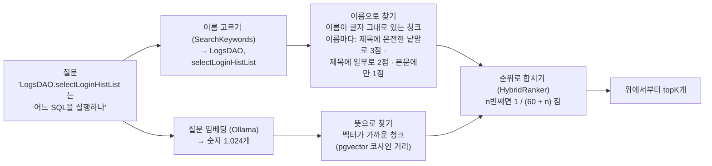

| | 뜻으로 찾기(벡터) | 이름으로 찾기 |
|---|---|---|
| 잘하는 질문 | "로그인 기록을 조회하는 코드" (글자가 달라도 뜻이 가까우면 찾는다) | `LogsDAO.selectLoginHistList`, `TBSY_LOGIN_HIST`, `/logs/getLoginHistList.ajax` (정확한 이름) |
| 못하는 질문 | 정확한 이름을 맨 위로 올리기 | 한글 낱말, 이름이 없는 질문 |
| 임베딩이 필요한가 | 필요하다 | 필요 없다. 임베딩 전에도, Ollama가 내려가 있어도 된다 |

**합치는 계산 예.** 세 청크가 두 목록에서 이렇게 나왔다고 하자.

이름 점수는 질문에서 골라낸 이름마다 매겨 더한다. 제목에 다른 글자와 붙지 않은 온전한 낱말로 있으면 3점, 제목 안에 일부로 들어 있으면 2점, 본문에만 있으면 1점이다.

| 청크 | 벡터 순위 | 이름 순위(이름 점수) | 합친 점수 |
|---|---|---|---|
| A `LogsDAO#selectLoginHistList(LoginHistVO)` | 2 | 1 (제목에 두 이름 다 → 6점) | 1/62 + **2** × 1/61 = 0.0489 |
| B `logs.selectLoginHistList` (SQL) | 1 | 2 (제목에 `selectLoginHistList` → 3점 이상) | 1/61 + **2** × 1/62 = 0.0487 |
| C 뜻만 비슷한 다른 메소드 | 3 | 없음 | 1/63 = 0.0159 |

- 점수 자체(유사도 0.8, 이름 점수 6)는 더하지 않는다. 단위가 달라서다. "몇 번째였나"만 쓴다.
- 이름 점수가 3 이상이면(제목에 이름이 온전한 낱말로 있으면) 이름 순위로 받는 점수를 두 배로 친다. 그래서 A가 맨 위로 온다.
- 양쪽에 다 나온 것(A, B)이 한쪽에만 나온 것(C)보다 훨씬 위다.

### 0.11 임베딩은 분석과 따로 돈다

글을 벡터로 바꾸는 일은 이 환경(CPU)에서 청크 하나에 0.5초쯤 걸려서 제일 느리다. 그래서 분석 Job에 넣지 않고 따로 뺐다.

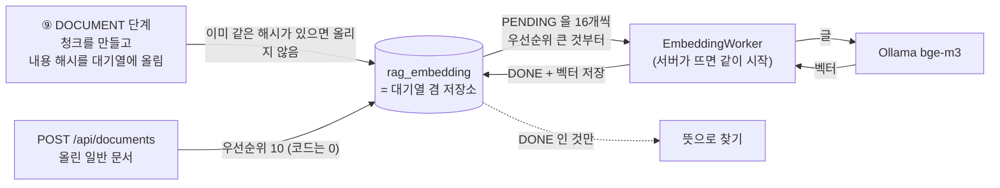

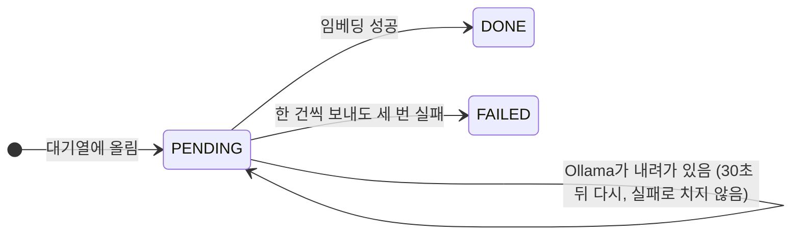

- **열쇠가 `(내용 해시, 모델)`이다.** 같은 글은 리비전이 달라도, 분석을 다시 돌려도 한 번만 임베딩한다. 소스를 조금 고쳐 다시 분석하면 바뀐 청크만 새로 임베딩된다.
- **Job이 `DONE`이어도 임베딩은 아직일 수 있다.** 진행 상황은 `GET /api/revisions/{id}/rag`로 본다. 그동안에도 이름으로 찾는 검색은 된다.
- 임베딩은 사람이 따로 시작시키지 않는다. 테이블이 곧 대기열이라 서버가 죽었다 살아나도 남은 것부터 이어서 한다.

### 0.12 증분 분석 한 장

소스를 조금 고쳤을 때 전체를 다시 하지 않는 방법이다. **결과물(리비전)은 전체 분석과 똑같고, 만드는 길만 짧다.**

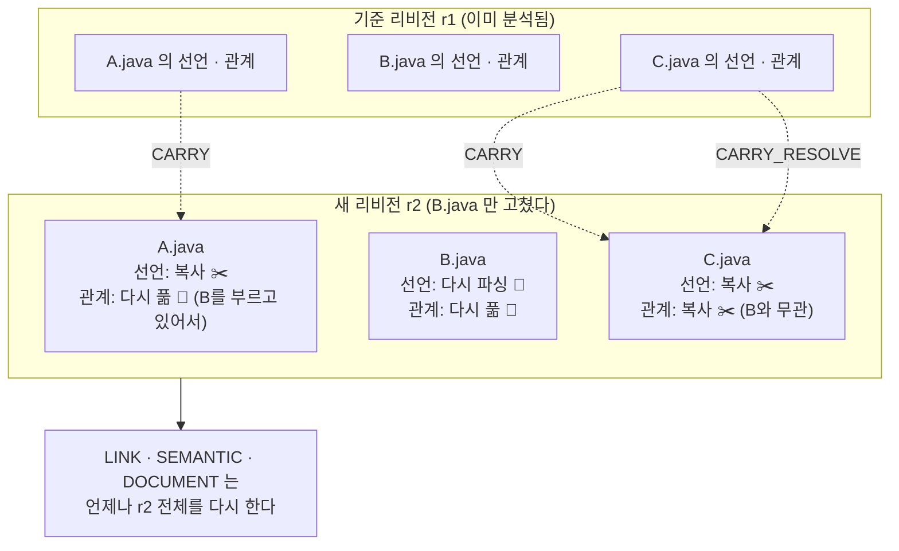

| 무엇 | 언제 복사하나 | 이유 |
|---|---|---|
| 선언(타입·메소드·필드·참조), SQL statement, 설정 | 파일의 경로·내용 해시·분류가 기준 리비전과 같으면 | 파일 하나만 보면 정해지는 결과다 |
| 풀린 관계 | 파일이 같고, **그 파일이 가리키던 대상도 바뀌지 않았으면** | A가 그대로여도 A가 부르는 B가 바뀌면 다시 풀어야 한다 |
| 재정의, 진입점, SQL·테이블·화면 관계, 문서 | 복사하지 않는다 | 리비전 전체를 봐야 정해진다. SQL로만 도는 단계라 다시 해도 빠르다 |

헷갈리면 다시 푼다. 다시 푼다고 결과가 틀려지지는 않고 시간만 더 든다(4.14절).

### 0.13 DB 지도

테이블 21개를 "무엇을 담는가"로 묶으면 다섯 덩어리다. 선은 논리적인 연결이다(행이 많은 테이블에는 실제 FK를 걸지 않았다. 5절).

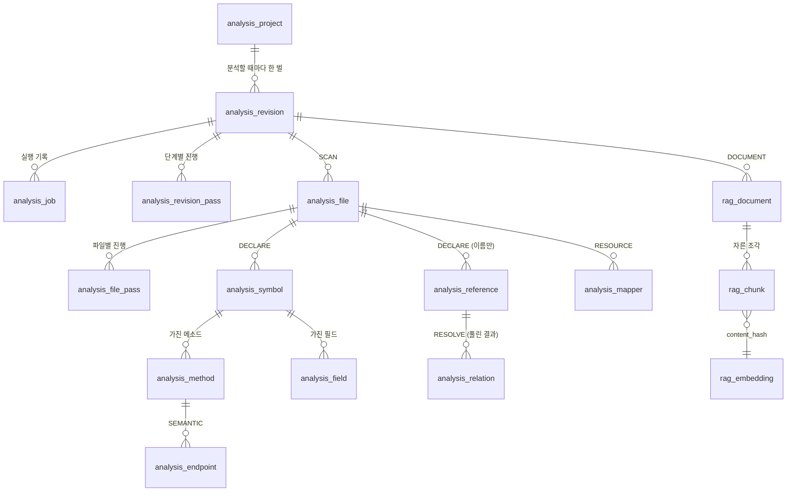

| 덩어리 | 테이블 | 한 줄 설명 |
|---|---|---|
| 🗂️ 관리 | `analysis_project`, `analysis_revision`, `analysis_job`, `analysis_revision_pass`, `analysis_file_pass` | 무엇을 언제 어디까지 분석했나 |
| 📄 재료 | `analysis_file`, `analysis_symbol`, `analysis_method`, `analysis_field`, `analysis_annotation`, `analysis_reference` | 소스에 **적혀 있는** 것 |
| 🔗 지도 | `analysis_relation`, `analysis_endpoint`, `analysis_mapper`, `analysis_config`, `analysis_resource` | 분석이 **이어 준** 것 |
| 🩺 품질 | `analysis_error`, `analysis_metric` | 못 한 것과 얼마나 잘했나 |
| 🔎 검색 | `rag_document`, `rag_chunk`, `rag_embedding` | 지도를 글로 적은 것과 그 벡터 |

`kg_node` / `kg_edge`는 테이블이 아니라 위의 것을 그래프 모양(점과 선)으로 보여 주는 VIEW다.

**하나만 고른다면 `analysis_relation`이다.** 0.5절 그림의 화살표가 전부 이 테이블의 행이다. 한 행은 `(어디서 from_id) ─ (무슨 관계 relation_type) → (어디로 to_id 또는 to_external)` + 신뢰도 + 근거가 된 파일과 줄이다.

### 0.14 코드 지도

"이 일은 어느 클래스가 하나"를 찾을 때 쓴다. 패키지 하나가 일 하나다.

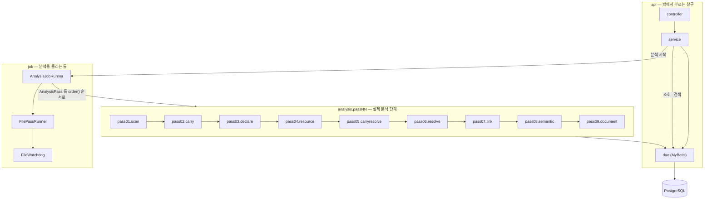

| 궁금한 것 | 열어 볼 클래스 |
|---|---|
| 화면과 중계(`dstone-boot`) | `WEB-INF/views/knowledge/index.jsp`, `knowledge/assets/js/project.js` · `knowledge-common.js`, `knowledge.controller.KnowledgeProxyController` → `knowledge.service.KnowledgeProxyService`(4.1절) |
| 분석 시작 요청이 어떻게 처리되나 | `api.controller.ProjectController` → `api.service.AnalysisService#startAnalysis` |
| 증분 분석(바뀌지 않은 파일 옮기기) | `analysis.pass02.carry.CarryPass`, `analysis.pass05.carryresolve.CarryResolvePass`, `sqlmap/analysis/CarryDao.xml`(`markCarriedFiles`, `carryFilePasses`, `copyRows`, `carryResolvePasses`, `resetReferencesToResolve`), 기준 리비전 고르기 `AnalysisService#findBaseRevision`(4.14절) |
| 단계를 순서대로 돌리는 곳 | `analysis.job.AnalysisJobRunner#runJob` |
| 파일을 하나씩 처리하고 실패를 막는 곳 | `analysis.job.FilePassRunner#handleFile`, `analysis.job.FileWatchdog` |
| 파일 종류와 인코딩을 알아내는 곳 | `analysis.pass01.scan.FileClassifier`, `analysis.common.EncodingDetector` |
| Java 소스에서 선언과 참조를 뽑는 곳 | `analysis.pass03.declare.DeclarationCollector` (Lombok은 `analysis.pass03.declare.LombokExpander`) |
| JSP를 Java로 바꾸는 곳 | `analysis.pass03.declare.JspToJava` |
| 호출이 누구를 가리키는지 정하는 규칙 | `analysis.pass06.resolve.ReferenceResolver` |
| 메모리를 묶어 두는 타입 해석기 | `analysis.pass06.resolve.DbTypeSolver`, `analysis.common.BoundedCache` |
| 매퍼 XML을 읽는 곳 / SQL에서 테이블을 뽑는 곳 | `analysis.pass04.resource.MapperXmlReader` / `analysis.common.SqlTableExtractor` |
| 진입점과 계층을 정하는 규칙 | `conf/rules/{projects,common,guess}/**/*.yml`(프레임워크 관례, 4.7.1절)을 `analysis.pass08.semantic.rule.RuleFiles`가 읽고, 규칙 절마다 하나인 처리기(`LayerResolver`, `EntryFinder`, `SqlLinker` …)가 적용한다 |
| `getLogsmapper() + "selectLoginHistList"`를 계산하는 곳 | `analysis.pass08.semantic.ConstantEvaluator` |
| 검색용 글을 짓는 곳 | `analysis.pass09.document.CodeDocumentBuilder`, `analysis.pass09.document.ResourceDocumentBuilder` |
| 임베딩 대기열을 비우는 곳 | `rag.EmbeddingWorker` |
| 검색 / 순위 합치기 | `api.service.SearchService`, `rag.HybridRanker`, `rag.SearchKeywords` |
| 영향도 / 호출 그래프 / 리비전 비교 | `api.service.ImpactService` / `CallGraphService` / `DiffService` |
| 노드 맵(그림으로 보는 호출 구조) | `api.service.GraphService`, `sqlmap/analysis/GraphDao.xml` |
| 실제 SQL | `src/main/resources/sqlmap/analysis/*Dao.xml` (조회의 대부분은 Java가 아니라 여기에 있다) |

새 기능을 붙이는 자리도 정해져 있다. **새 분석 단계**는 `AnalysisPass`를 구현한 빈을, **새 프레임워크 관례**는 먼저 규칙 파일에 적고, 규칙으로 안 되는 것만 `SemanticStep`을 구현한 빈을 만들어 `SemanticPass.steps()`의 알맞은 자리에 넣는다.

### 0.15 직접 해 보기

서버와 DB가 떠 있으면(7절) 아래 순서로 0.5절의 내용을 눈으로 확인할 수 있다. Ollama가 없어도 ④까지는 된다.

```bash
B=http://localhost:4081/api

# ① 프로젝트 등록 (소스 폴더를 알려 준다. 폴더 안의 WEB-INF/lib/*.jar 는 따로 적지 않아도 쓴다)
curl -X POST $B/projects -H 'Content-Type: application/json' \
     -d '{"projectId":"cms4_prd","localPath":"/app/sampleApps/cms4_prd"}'

# ② 분석 시작 → 응답의 analysisId, revisionId 를 적어 둔다
curl -X POST $B/projects/cms4_prd/analyses -H 'Content-Type: application/json' -d '{}'

# ③ 끝났는지 보기 (status 가 DONE 이면 끝. 이 프로젝트는 2분이 안 걸린다)
curl $B/analyses/{analysisId}

# ④ 지도 걸어 보기 ({rev} 는 ②의 revisionId)
curl "$B/revisions/{rev}/endpoints?type=HTTP"                    # 주소 694개와 처리 메소드
curl "$B/revisions/{rev}/methods/{methodId}/callees?depth=4"     # /logs/getLoginHistList.ajax 의 메소드에서 테이블까지
curl "$B/revisions/{rev}/tables/TBSY_LOGIN_HIST"                 # 이 테이블을 건드리는 SQL 과 메소드
curl "$B/revisions/{rev}/impact?table=TBSY_LOGIN_HIST"           # 고치면 닿는 메소드 16, 진입점 4, 화면 2

# ⑤ 검색 (임베딩이 끝나야 뜻으로 찾힌다. 진행 상황: GET $B/revisions/{rev}/rag)
curl -X POST $B/search -H 'Content-Type: application/json' \
     -d '{"projectId":"cms4_prd","query":"로그인 기록 조회 화면","topK":3}'
     # → 1위 VIEW logs/loginHist.jsp
```

`cms4_prd`는 저장소 밖에 있는 소스다. 없는 환경이라면 저장소 안의 `struts-app` 표본(`dstone-knowledge/src/test/resources/samples/struts-app`, 몇 초면 끝난다)으로 같은 순서를 따라 하면 된다. 기대 값은 그 폴더의 `README.md`에 있다.

화면으로 보려면 `dstone-boot`의 "코드 분석(Knowledge)" 메뉴다(4.17절). 같은 API를 화면이 대신 불러 준다.

### 0.16 자주 헷갈리는 것

| 질문 | 답 |
|---|---|
| LLM이 코드를 읽고 분석하는 것 아닌가 | 아니다. 분석은 전부 정해진 규칙(파서와 SQL)으로 한다. 이 모듈에는 채팅 모델이 없다. 같은 소스를 넣으면 언제나 같은 결과가 나온다 |
| 벡터 DB에 소스를 넣는 RAG와 무엇이 다른가 | 소스를 그대로 자르지 않는다. 분석으로 알아낸 사실(주소, 부르는 곳, 테이블)을 글로 적어 그것을 넣는다. 그리고 검색 말고도 호출 관계·영향도를 정확히 조회할 수 있다 |
| 대상 프로젝트를 빌드해야 하나 | 아니다. 소스 폴더만 있으면 된다. 라이브러리 jar가 있으면 더 정확해질 뿐이다 |
| Spring 프로젝트만 되나 | 아니다. ①~⑦은 프레임워크를 모른다. ⑧의 규칙 파일과 처리기가 Spring, 서블릿, Struts, MyBatis/iBATIS, JSP를 각각 맡고, 맞는 것이 없어도 호출 관계까지는 정상으로 나온다 |
| 분석이 끝났는데 검색이 안 된다 | 임베딩이 아직 돌고 있거나 Ollama가 내려가 있다. `GET /api/revisions/{id}/rag`를 본다. 질문에 클래스·메소드 이름을 넣으면 임베딩 없이도 찾힌다 |
| 결과에 `LOW`가 붙어 있다 | 이름만 보고 짐작한 것이다. 절반은 틀린다고 보고 참고로만 쓴다. 대상 프로젝트의 jar를 `classpath`로 주면 줄어든다 |
| 영향도 결과가 "전부"인가 | 아니다. 저장된 관계만 따라간다. 리플렉션, 문자열로 조립한 주소, 파라미터로 받은 SQL 조각은 잇지 못한다(4.10절과 4.11절의 "아직 다루지 않는 것"). Java 코드 안에 문자열로 적은 SQL은 2026-11-09부터 잇는다 |
| 리비전이 계속 쌓이지 않나 | 프로젝트마다 분석이 끝난 리비전을 최근 5개만 남기고 자동으로 지운다(4.16절) |
| 분석 도중 서버가 죽으면 | 다시 띄우고 같은 리비전 라벨로 분석을 시작하면 끝난 단계와 끝난 파일을 건너뛰고 이어서 한다 |

여기까지가 전체 그림이다. 더 깊이 들어갈 때는 이렇게 찾아간다: 단계별 규칙은 4절, 테이블은 5절, 설정은 6절, API는 8절, 실제로 돌려 본 숫자와 남은 한계는 10절.

## 1. 개요

Java 애플리케이션을 정적 분석해서 **구조와 관계를 먼저 구조화된 데이터로 만들고**, 그 결과를 Knowledge Graph와 RAG 청크 양쪽으로 내보내는 모듈이다. 소스를 잘게 잘라 벡터 DB에 넣는 방식이 아니다.

- 대상: Spring / Spring Boot 애플리케이션과 **구버전 일반 Java 프로그램**(Java 1.4~7 문법, 애노테이션 이전 방식의 XML 설정, 서블릿, 직접 JDBC, JSP).
- 포트 4081, 실행 JAR, 루트 패키지 `net.dstone.knowledge`.
- 저장소: PostgreSQL + pgvector (`dstone_knowledge` DB).
- 배포: VM 스타일(`bin/*.sh`). 분석 대상의 소스 디렉터리, git, 대상 프로젝트의 `mvn`을 직접 써야 하기 때문이다.
- 원 설계서: `docs/temp/Java_Application_Knowledge_Graph_RAG_Analysis_Platform_설계서_v1.0.docx`. 이 문서는 그 설계서를 이 저장소에 맞게 조정한 결과와 현재 상태를 적는다.

### 다른 모듈과의 관계

이 모듈이 완성되면 아래 두 기능을 흡수하고, 원래 자리의 코드는 제거한다(10절의 M9).

| 흡수 대상 | 지금 위치 | 흡수 후 |
|---|---|---|
| 문서 임베딩 / RAG 검색 | (끝남, 2026-10-06) `dstone-ai-engine`에 있던 `EmbedService`, `EmbedController`, `RagController`는 없앴고 `RagRetrievalChain`은 이 모듈의 검색 API를 부른다 | `dstone-knowledge`가 문서 수집, 임베딩, 검색을 맡는다. `dstone-ai-engine`은 Tool과 `ragEnabled`에서 이 모듈의 REST API를 호출한다 |
| Java 소스 분석기 | `dstone-boot`의 `AppAnalyzer`와 `analyzer` 패키지 | `dstone-knowledge`의 분석 결과로 대체한다 |

LLM 채팅은 이 모듈이 하지 않는다. 질의 분류와 답변 생성은 `dstone-ai-engine`의 Agent가 맡고, 이 모듈은 결정론적인 분석 결과와 검색 결과만 돌려준다. Agent가 이 모듈을 부르는 길은 `dstone-ai-engine`의 `tools.knowledge.KnowledgeTool`이다(4.13절).

## 2. 설계 원칙

1. **분석 모델이 먼저, RAG는 그 다음.** RAG 문서는 분석 결과에서 파생되고 언제든 다시 만들 수 있다.
2. **LLM이 호출 관계를 추측하지 않는다.** 컴파일러처럼 심볼을 해석해서 결정한다.
3. **불확실한 것은 지우지 않고 정도를 남긴다.** 모든 관계에 `confidence`(HIGH/MEDIUM/LOW/UNRESOLVED)와 `resolution_status`가 있다. 분석에 실패한 파일과 못 푼 심볼도 숨기지 않는다.
4. **분석은 DB에 쓰면서 진행한다.** 큰 프로젝트의 AST나 후보 객체를 메모리에 다 올리면 OutOfMemoryError가 난다. 파일 하나를 처리하면 바로 DB에 쓰고 메모리에서 버린다. 필요한 힙 크기가 프로젝트 크기와 상관없이 일정해야 한다.
5. **코어는 프레임워크를 모른다.** 스캔, AST, 심볼, 호출 그래프는 순수 Java만으로 끝난다. Spring은 여러 규칙 파일 가운데 하나(`common/spring.yml`)다. 맞는 규칙이 하나도 없는 프로젝트도 그래프와 RAG까지 정상 생성된다.
6. **컴파일하면 생기는 멤버도 심볼이다.** Lombok이 만드는 getter/setter 등은 소스에 없지만, 선언 패스에서 `is_synthetic=true`인 정식 메소드로 넣는다. 그래야 호출 관계가 일반 메소드와 같은 경로로 풀린다. delombok은 줄 번호가 바뀌어 원본 추적이 깨지므로 쓰지 않는다.
7. **임베딩은 내용 해시로 한 번만.** 임베딩의 키는 `(내용 해시, 모델)`이다. 같은 내용은 리비전이 달라도, 분석을 다시 돌려도 다시 임베딩하지 않는다. 임베딩은 분석 Job과 분리된 대기열이고 중간에 죽어도 이어서 한다.
8. **리비전은 1급 개념.** 분석 행에는 모두 `revision_id`가 붙는다. 심볼 ID는 리비전과 무관하게 같은 대상이면 같은 값이라서 두 리비전을 바로 비교할 수 있다. 리비전마다 전체 스냅샷을 저장하고, 오래된 리비전은 보관 정책으로 지운다.

## 3. 모듈 구성

```
dstone-knowledge/
├── bin/                 startApp.sh / stopApp.sh / statusApp.sh, startApp.bat / stopApp.bat (dstone-boot/bin 과 같은 모양)
├── conf/                env*.properties, application.yml, log4j2.xml
├── Jenkinsfile
└── src/
    ├── main/java/net/dstone/knowledge/
    │   ├── DstoneKnowledgeApplication.java
    │   ├── common/config/     Config, ConfigDatasource, ConfigMapper, ConfigTransaction, ConfigJob
    │   ├── common/biz/        BaseDao
    │   ├── common/exception/  ApiException, ApiExceptionHandler
    │   ├── common/security/   API 키 필터, 호출자(tenant)
    │   ├── common/util/       ErrorText, JsonText, HashText, SafeXml
    │   ├── api/               controller, service, dao
    │   ├── analysis/          분석 파이프라인(2026-11-09 패키지 정리). 단계 패키지의 번호는 실행 순서다(실제 순서는 각 Pass 의 order())
    │   │   ├── job/                     분석 Job 실행기와 단계(패스) 규약
    │   │   ├── common/                  여러 단계가 같이 쓰는 도구(인코딩 감지, LRU 캐시, SQL → 테이블)
    │   │   ├── pass01/scan/             SCAN 단계
    │   │   ├── pass02/carry/            CARRY 단계(증분 분석: 바뀌지 않은 파일의 선언과 자원을 옮긴다)
    │   │   ├── pass03/declare/          DECLARE 단계 (declare/model: 저장용 행 클래스)
    │   │   ├── pass04/resource/         RESOURCE 단계 (SQL 매퍼, 설정, 빌드 파일, Spring XML 읽기)
    │   │   ├── pass05/carryresolve/     CARRY_RESOLVE 단계(증분 분석: 풀린 관계를 옮긴다)
    │   │   ├── pass06/resolve/          RESOLVE 단계, DB 색인 기반 타입 해석기, 클래스패스 탐색 (resolve/model: 저장용 행 클래스)
    │   │   ├── pass07/link/             LINK 단계
    │   │   ├── pass08/semantic/         SEMANTIC 단계와 처리기(rule / layer / entry / wiring / sql / view / screen / dictionary)
    │   │   └── pass09/document/         DOCUMENT 단계(RAG 문서 짓기)
    │   └── rag/               임베딩 작업, 검색 도우미, 일반 문서 읽기 (rag/model: 저장용 행 클래스)
    ├── main/resources/
    │   ├── schema/            01-init-…sql (롤/DB/확장), 02-create-table-…sql (테이블/VIEW)
    │   └── sqlmap/            MyBatis 매퍼 (*Dao.xml)
    ├── test/java/             단위 테스트 (DB/Spring 없이 도는 것만)
    └── test/resources/samples/              검증 표본 (legacy-app, lombok-app, cycle-app, struts-app, websquare-app, nexacro-app, jpa-app)
```

| 패키지 | 내용 |
|---|---|
| `analysis.job` | `AnalysisJobRunner`(단계를 순서대로 실행, 끝난 단계는 건너뜀), `AnalysisPass`(단계 인터페이스), `AnalysisJobContext`(Job이 도는 동안 단계들이 함께 보는 정보와 취소 표시), `AnalysisJobReporter`(진행 건수와 오류 기록), `AnalysisJobRecovery`(기동할 때 끝나지 못한 Job 정리), `FilePassRunner` + `FileHandler` + `FileResult`(파일을 하나씩 처리하는 단계의 공통 실행기), `FileWatchdog`(끝나지 않는 파일 처리를 버리는 감시자) |
| `analysis.common` | 여러 단계가 같이 쓰는 도구: `EncodingDetector`(파일별 인코딩 감지), `BoundedCache`(크기가 정해진 LRU 캐시), `SqlTableExtractor`(SQL에서 테이블 뽑기) |
| `analysis.pass01.scan` | `ScanPass`(SCAN 단계), `FileClassifier`(언어와 용도 분류), `ScannedFile` |
| `analysis.pass02.carry` | `CarryPass`(CARRY 단계: 같은 파일의 선언과 자원을 옮긴다). SQL만 쓴다(`CarryDao`) |
| `analysis.pass03.declare` | `DeclarePass`(DECLARE 단계), `JavaSourceParser`(파싱과 문법 수준 탐지), `DeclarationCollector`(AST에서 선언과 참조 수집), `LombokExpander`(Lombok이 만드는 멤버), `JspToJava`(JSP 안의 Java 코드를 Java 소스로 바꾸기), `JavaSqlCollector`(Java 문자열 SQL) |
| `analysis.pass04.resource` | `ResourcePass`(RESOURCE 단계), `MapperXmlReader`(MyBatis / iBATIS 매퍼), `ResourceReaders`(`.properties`, YAML, `pom.xml`, `build.gradle`, Spring XML), `DdlReader` |
| `analysis.pass05.carryresolve` | `CarryResolvePass`(CARRY_RESOLVE 단계: 풀린 관계를 옮겨도 되는 파일을 가려 옮긴다) |
| `analysis.pass06.resolve` | `ResolvePass`(RESOLVE 단계), `ReferenceResolver`(참조 하나하나를 푸는 규칙), `DbTypeSolver`(프로젝트의 타입을 DB 색인으로 찾는 JavaSymbolSolver용 해석기), `ClasspathResolver`(분석 대상의 라이브러리 jar 찾기) |
| `analysis.pass07.link` | `LinkPass`(LINK 단계: 재정의, 가능한 구현, 품질 지표) |
| `analysis.pass08.semantic` | `SemanticPass`(SEMANTIC 단계, 처리기 순서 `steps()`), `SemanticStep`(처리기 인터페이스), `ConstantEvaluator`(문자열 상수 따라가기), `AnnotationValues`. 하위 패키지는 규칙 파일의 절과 짝이다: `rule`(규칙 파일 읽기 `RuleFiles` · `RuleFileParser` · 패턴 글자 `CodePattern`, 규칙 모델 `Rule` · `RuleFile` · `ProjectRules` · `Tier`), `layer`(`LayerResolver` ← `layer:`), `entry`(`EntryFinder` ← `entry:` + `HttpEndpointBuilder` · `XmlEndpointReader`, 규칙 없는 `ServletEntries` + `WebXmlReader`, `StrutsEntries` + `StrutsConfigReader`), `wiring`(`WiringMarker` ← `inject:` `proxy:`), `sql`(`JpaQueryReader` ← `jpa:`, `MapperLinker`, `SqlLinker` ← `sql:`, `JavaSqlLinker`, `StatementIndex`, `JpaEntities`, `JpqlTableExtractor`), `view`(`ViewLinker` ← `view:`), `screen`(`JspLinker`, `ScreenLinker` ← `screen:` + `ScreenScript` · `ScriptFunctions` · `ScriptSources` · `IdTransform`, `ScreenMenuReader` + `ScreenMenu`, `ScreenTitle`), `dictionary`(사전 · 한글명: `MethodTitlePlugin`, `SourceNamePlugin`, `ScreenDictionaryPlugin`, `TableDictionaryPlugin`과 사전 파일 · DB 코멘트 읽기) |
| `analysis.pass09.document` | `DocumentPass`(DOCUMENT 단계), `CodeDocumentBuilder`(Java의 분석 결과와 소스로 문서 짓기), `ResourceDocumentBuilder`(SQL statement와 화면의 문서 짓기), `TextChunker`(일반 문서를 청크로 자르기) |
| `rag` | 분석 단계가 아닌 RAG 서비스: `EmbeddingWorker`(임베딩 대기열을 비우는 백그라운드 작업), `EmbeddingGate`, `RagSettings`(RAG 설정 값), `SearchKeywords`(질문에서 이름 고르기)와 `HybridRanker`(두 검색 결과를 순위로 합치기), `DocumentTextExtractor`(올린 파일에서 글 뽑기, Tika) |
| `api` | `ProjectController` / `AnalysisController` / `RevisionController` / `ResourceController` / `GraphController` / `SearchController` / `DocumentController`와 각 Service(`ProjectService`, `AnalysisService`, `RevisionService`, `SymbolService`, `CallGraphService`, `ImpactService`, `GraphService`, `DiffService`, `RetentionService`, `ResourceService`, `SearchService`, `UploadDocumentService`), 그리고 MyBatis Dao |
| `common.security` | `ApiKeyAuthFilter`(`X-API-Key` 헤더 확인), `CallerContext`(이 요청의 호출자 이름) |
| `common.util` | `ErrorText`(예외를 글로), `HashText`(글의 해시), `JsonText`(한 줄짜리 JSON. 공용 `ConvertUtil`은 여러 줄로 풀어 써서 행마다 넣기에 맞지 않는다), `SafeXml`(분석 대상의 XML을 밖의 DTD를 가져오지 않고 읽기) |

이 모듈의 코드는 Lombok을 쓰지 않는다(getter/setter를 직접 쓴다). 분석 대상의 Lombok 애노테이션을 읽는 것과는 별개다. Java 주석의 설명은 `<pre>`로 감싼다.

### DB 접근

- DataSource는 `dataSourceCommon` 하나다(`spring.datasource.common.hikari.*`).
- MyBatis 세션이 두 개다.
  - `sqlSessionCommon`: 일반 조회와 단건 변경.
  - `sqlSessionBatch`: 대량 저장용(`ExecutorType.BATCH`). 같은 SQL을 모아 한 번에 보낸다. 트랜잭션 안에서만 쓴다.
- 트랜잭션은 다른 모듈처럼 Service 메소드 이름에 AOP로 걸지 않는다. 분석은 몇 시간씩 돌 수 있어서, "파일 N개마다 커밋"처럼 코드에서 범위를 정하도록 `txTemplateCommon`(`TransactionTemplate`)을 쓴다.

## 4. 분석 파이프라인

전체 AST를 들고 있지 않고, 파일 단위로 여러 번 지나간다.

| 패스 (순서) | 하는 일 | 메모리에 남는 것 |
|---|---|---|
| SCAN (100) | 파일 수집, 인코딩 감지, 체크섬 계산 → `analysis_file` | 없음 |
| CARRY (150) | 증분 분석일 때만: 앞 리비전과 내용이 같은 파일의 DECLARE / RESOURCE 결과를 복사한다(4.14절). 전체 분석이면 아무것도 하지 않는다 | 없음 |
| DECLARE (200) | 파일 1개 파싱 → 타입/메소드/필드/애노테이션 저장(Lombok 생성 멤버 포함). 호출과 참조는 아직 누구인지 모르는 채로 `analysis_reference`에 저장. AST 폐기. JSP도 그 안의 Java 코드를 Java 소스로 바꿔 같은 길로 보낸다 | 현재 파일 하나 |
| RESOURCE (250) | Java가 아닌 파일 1개 읽기 → SQL 매퍼의 statement(`analysis_mapper`), 설정 값(`analysis_config`), 의존성과 Spring 빈(`analysis_resource`). 읽어서 저장만 한다(4.10절) | 현재 파일 하나 |
| CARRY_RESOLVE (290) | 증분 분석일 때만: 풀린 관계를 옮겨도 되는 파일을 가려 그 관계를 복사한다(4.14절) | 없음 |
| RESOLVE (300) | 파일 1개 다시 파싱 → 타입 조회는 DB 심볼 색인에 질의 → `analysis_relation` 저장, 참조 상태 갱신 | 현재 파일 + 크기 제한 캐시 |
| LINK (400, 집합 연산) | 재정의(OVERRIDES), 인터페이스 구현 후보, 품질 지표를 SQL로 계산. 계층 분류는 여기서 하지 않고 SEMANTIC이 한다 | 없음 |
| SEMANTIC (500) | 의미 분석 처리기(계층, 진입점, 주입, SQL, 화면, 사전). 진입점과 계층을 정하고, 메소드 → SQL → 테이블, 메소드 ↔ 화면을 잇는다 | 주소·statement 이름의 색인(진입점 수, statement 수만큼) |
| DOCUMENT (600) | 파일 단위로 분석 결과와 소스를 엮어 RAG 문서와 청크 생성(Java, SQL 매퍼, JSP), 임베딩 대기열 등록 | 현재 파일 하나 |

- 괄호 안의 숫자는 각 단계의 `order()` 값이고, 작은 것부터 돈다.
- 진행 상태는 두 군데에 남는다. 단계 전체가 끝났는지는 `analysis_revision_pass`, 파일 하나하나는 `analysis_file_pass`. 죽어도 이어서 하고, 증분 분석도 같은 구조를 쓴다.
- JavaSymbolSolver의 기본 소스 해석기는 파싱한 파일을 계속 캐시해서 큰 프로젝트에서 메모리가 터진다. 그래서 DB의 심볼 색인을 조회하는 자체 타입 해석기(`DbTypeSolver`)를 대신 쓴다.

### 4.1 Job 실행 방식

#### 분석 요청이 지나는 길

`dstone-boot` → 코드 분석(Knowledge) → **프로젝트 · 분석** 화면에서 [분석 시작]을 누르면 이렇게 흘러간다. 0.6절 그림의 앞뒤를 화면과 중계까지 넓혀 본 것이다.

```
[브라우저]                         [dstone-boot :7081]                  [dstone-knowledge :4081]
project.js                         KnowledgeProxyController              ProjectController
 startAnalysis() ──POST────────▶   /knowledge/api/call.do  ──POST───▶   /api/projects/{id}/analyses
   K.call()                         KnowledgeProxyService                  AnalysisService.startAnalysis()
                                    (경로 검사, X-API-Key)                   ├ 리비전 만들기 / 이어 하기
                                                                            ├ analysis_job INSERT (READY)
                                                                            └ AnalysisJobRunner.submit()  ──▶ 백그라운드 스레드
   ◀──────────── 202 {analysisId, revisionId ...} ◀───────────────────────
 watchJob()  ──3초마다 GET /api/analyses/{analysisId}──────────────────▶  AnalysisService.getAnalysis()
```

**① 화면**(`dstone-boot/src/main/webapp/WEB-INF/views/knowledge/index.jsp`, `knowledge/assets/js/project.js`). 프로젝트를 고르면 분석 패널이 열린다.

| 입력 | 뜻 | 요청 본문 키 |
|---|---|---|
| 리비전 라벨 | 비우면 서버가 지금 시각으로 짓는다. **이미 있는 라벨이면 그 리비전을 이어서 분석**한다 | `revisionLabel` |
| 이 단계부터 다시 | SCAN ~ DOCUMENT. 이어 하기에서만 쓴다 | `rerunFrom` |
| 바뀐 파일만 다시 분석 | 증분 분석(4.14절). 새 리비전에서만 쓴다 | `incremental` |

빈 칸은 본문에 넣지 않는다. 아무것도 적지 않으면 `{}`(새 리비전, 전체 분석)가 간다. 시작하면 `watchJob()`이 3초마다 `GET /api/analyses/{analysisId}`를 불러, 상태가 `READY`/`RUNNING`이 아니게 될 때까지 Job 배지 · 지금 단계 · 단계별 표 · 앞쪽 오류 20건을 그린다. [취소]는 `POST /api/analyses/{id}/cancel`이다.

**② 중계**(`dstone-boot`의 `knowledge.controller.KnowledgeProxyController` → `knowledge.service.KnowledgeProxyService`). 브라우저는 이 모듈을 직접 부르지 않는다. 모든 호출이 `POST /knowledge/api/call.do`(`{method, path, query, body}`) 하나로 모이고, 로그인한 사용자만 쓸 수 있다. 중계는 `GET`/`POST`/`DELETE`만, `/api/`로 시작하고 `..` `//` `?` `#` `\`가 없는 경로만 넘긴다(아니면 400). 기준 주소는 `interface.knowledge.base-url`(없으면 503), `interface.knowledge.api-key`가 있으면 `X-API-Key`를 붙인다. 상태 코드와 본문을 손대지 않고 돌려주고(읽기 제한 120초, 응답 32MB), 연결에 실패하면 502와 `{status, message}`를 돌려준다. 예외를 던지지 않는 까닭은 `dstone-boot`의 공통 예외 처리가 상태 코드를 200으로 바꾸기 때문이다(4.17절).

**③ 시작 API**(`api.controller.ProjectController` → `api.service.AnalysisService.startAnalysis()`). 202로 곧바로 돌아온다. "돌고 있는 Job이 있나" 확인과 Job 등록 사이에 다른 요청이 끼지 못하게 메소드 전체가 `synchronized`다.

| 순서 | 하는 일 | 실패하면 |
|---|---|---|
| 1 | 프로젝트를 읽고 `localPath`가 실제 폴더인지 본다 | 400 |
| 2 | 같은 프로젝트에 `READY`/`RUNNING` Job이 있는지 본다 | 409 |
| 3 | 라벨을 정한다. 없으면 `yyyyMMdd-HHmmss`. 200자를 넘으면 거절 | 400 |
| 4 | 같은 라벨의 리비전이 있으면 **이어 하기**(`resumed=true`), 없으면 새 리비전. 이어 하기에 `incremental`을 주면 거절 | 400 |
| 5 | 새 리비전이고 증분이면 기준 리비전을 정해 `parent_revision_id`에 적는다. 없거나 분석기 버전이 다르면 전체 분석으로 돌리고 `note`에 까닭을 남긴다(4.14절) | — |
| 6 | `rerunFrom`이 있으면(이어 하기일 때만) 그 단계와 뒤 단계의 "끝남" 표시를 지운다 | 400 |
| 7 | Job ID를 짓는다: `A` + 날짜 + 그날의 일련번호 3자리(`A20261109011`) | — |
| 8 | `analysis_job`을 넣는다(`READY`) | — |
| 9 | `AnalysisJobRunner.submit()`. 대기열이 꽉 찼으면 Job을 `FAILED`로 바꾸고 503 | 503 |
| 10 | `{analysisId, projectId, revisionId, revisionLabel, resumed, incremental, baseRevisionId, note, rerunPasses, status}`를 돌려준다 | — |

**④ 끝난 뒤.** 마지막 단계가 끝나면 Job은 `DONE`(파일 단위 오류가 하나라도 있으면 `DONE_WITH_WARNING`), 리비전은 `READY`가 되어 다음 증분 분석의 기준이 될 수 있다. 이어서 `RetentionService.applyQuietly()`가 보관 개수를 넘는 옛 리비전을 지운다(4.16절). 화면의 리비전 표 [요약]은 `GET /api/revisions/{id}`와 `/rag`로 카드와 "한눈에 보기"를 그린다. 증분 리비전이면 옮겨 온 파일 수도 함께 온다. 임베딩은 `EmbeddingWorker`가 뒤에서 계속하지만, 이름 검색 · 호출 관계 · 영향도는 바로 쓸 수 있다.

#### 단계를 돌리는 방식

- 분석은 REST로 시작하고 백그라운드 스레드에서 돈다(`analysisJobExecutor`, 동시 실행 수 `dstone.knowledge.job.max-concurrent`). 넘치면 `READY`로 기다린다. 기다리는 Job이 100개를 넘으면 받지 않고 503이다.
- `AnalysisJobRunner`는 `AnalysisPass`를 구현한 빈을 모두 모아 `order()` 순서로 돌린다. 새 단계를 추가할 때는 이 인터페이스를 구현한 빈만 만들면 된다.
- **이어 하기**: 이 리비전에서 이미 `DONE`인 단계는 건너뛴다. 같은 리비전 라벨로 분석을 다시 시작하면 끝나지 않은 단계부터 한다. 죽은 분석이나 취소한 분석을 이어 갈 때, 그리고 나중에 단계가 추가된 뒤 나머지만 돌릴 때 같은 방법을 쓴다.
- **이 단계부터 다시**: 분석 시작 요청에 `rerunFrom`(단계 이름)을 주면, 이미 분석한 리비전에서 그 단계와 뒤의 단계를 처음부터 다시 돌린다. 문서 짓는 규칙을 고친 뒤 `DOCUMENT`만, 의미 분석 규칙을 고친 뒤 `SEMANTIC`부터 다시 하는 식으로 쓴다. 앞 단계의 결과는 그대로 두고, 다시 도는 단계가 자기 결과를 덮어쓴다(모든 단계는 다시 돌려도 되게 만든다).
- **한 프로젝트에 분석은 하나만.** 이미 돌고 있으면 409.
- **취소**: 요청하면 돌고 있는 단계가 다음 확인 지점(`context.checkCancelled()`)에서 멈춘다. 그때까지 저장한 결과는 지우지 않는다.
- **서버가 죽었을 때**: 다음 기동 때 `READY`/`RUNNING`으로 남은 Job을 `FAILED`로 바꾼다. 서버가 한 대만 뜬다는 전제다.
- 분석 스레드에서는 SQL 로그를 끈다(`log4j2.xml`의 `SUPPRESS_SQL_LOG` 필터). 저장 SQL이 수만 건이라 로그를 덮기 때문이다.
- 대량 저장용 세션(`sqlSessionBatch`)으로 묶은 트랜잭션 안에서는 일반 세션(`sqlSessionCommon`)을 쓰면 안 된다(MyBatis 오류). 그래서 진행 기록과 오류 기록은 트랜잭션이 끝난 뒤에 한다. 트랜잭션 안에서 쓰는 Dao 메소드는 이름이 `...InBatch`로 끝난다.

파일을 하나씩 처리하는 단계(DECLARE, RESOURCE, RESOLVE, DOCUMENT)는 `FilePassRunner`를 쓴다.

1. 처리할 파일마다 `analysis_file_pass` 행을 만든다. 이미 있는 행은 그대로 둔다.
2. `PENDING`인 파일을 100개씩 꺼내 하나씩 처리한다.
3. 파일 하나는 두 걸음이다.
   - **준비(`prepare`)**: 파일을 읽고, 파싱하고, 풀어 보는 "오래 걸릴 수 있는" 부분. DB에 쓰지 않는다. 감시 아래의 작업 스레드에서 돈다.
   - **저장(`write`)**: 준비한 결과와 "이 파일 끝남" 표시를 **한 트랜잭션**으로 커밋한다.

그래서 죽어도 끝난 파일은 끝난 채로 남고, 다시 시작하면 남은 파일만 처리한다. 단계는 `FileHandler<T>`를 구현하고, 결과를 `FileResult`(`done` / `doneWithWarning` / `failed` / `skipped`)로 돌려준다. 준비에서 예외가 나면 그 파일만 `FAILED`가 되고, 저장에서 예외가 나면 그 파일에서 쓴 것이 모두 취소되고 `FAILED`가 된다. 어느 경우든 분석은 다음 파일로 계속한다.

오래 걸리는 부분을 트랜잭션 밖으로 뺀 이유는, 그 부분이 끝나지 않을 때 DB 연결이나 트랜잭션을 붙든 채로 남지 않게 하려는 것이다(4.9절).

### 4.2 SCAN 단계

프로젝트 폴더를 걸어가면서 파일을 하나씩 읽고, `commit-size`개가 모이면 DB에 쓰고 비운다. 파일 목록 전체를 메모리에 올리지 않는다.

| 알아내는 것 | 방법 |
|---|---|
| 언어 | 확장자. `JAVA` / `JSP`(jsp, jspf, jspx, tag) / `XML` / `YAML` / `PROPERTIES` / `GRADLE` / `SQL`(sql, ddl) / `SCRIPT`(js, xjs. 화면 공통 스크립트, 2026-10-29). 그 밖의 파일(이미지, class, jar …)은 목록에 넣지 않는다 |
| 용도(`file_type`) | Java는 `SOURCE`. XML은 맨 위 요소로 가린다: `MYBATIS_MAPPER` / `MYBATIS_CONFIG` / `IBATIS_MAPPER` / `IBATIS_CONFIG` / `SPRING_XML` / `WEB_XML` / `STRUTS_CONFIG` / `TILES` / `LOG_CONFIG` / `BUILD` / `XML`(그 밖). 리치클라이언트 화면도 XML이라 여기서 가린다: `WEBSQUARE`(맨 위가 `<html>`이고 WebSquare 네임스페이스 `http://www.inswave.com/websquare`가 적힌 것), `NEXACRO`(`.xfdl`, 맨 위 `<FDL>`), `NEXACRO_APP`(`.xadl`, 맨 위 `<ADL>`). JEF 계열 프레임워크의 쿼리 파일은 `QUERY_XML`(맨 위가 `<document>`이고 안에 `id`와 `<statement>`가 있는 것). `.xfdl` / `.xadl`은 확장자만 다른 XML이므로 언어는 `XML`이다. `.sql`은 `CREATE TABLE`이나 `COMMENT ON`이 있으면 `DDL`, 없으면 `SQL_SCRIPT`(읽지 않음). `.js`/`.xjs`는 `SCRIPT`(SEMANTIC의 `ScreenLinker`만 읽는다) |
| 인코딩 | 파일마다 따로. BOM → 영문뿐이면 `US-ASCII` → `UTF-8` → 파일 안에 적힌 인코딩(XML `encoding`, JSP `pageEncoding`/`charset`) → 프로젝트의 `sourceEncoding` → `EUC-KR` → `MS949`. 전부 실패하면 `ISO-8859-1`로 읽고 `ENCODING` 오류를 남긴다 |
| 해시 / 크기 / 줄 수 | 해시는 내용의 SHA-256이다. 크기와 줄 수는 읽으면서 센다 |
| 패키지 | `package` 선언을 정규식으로 찾는다(주석은 먼저 지운다). DECLARE 단계가 파싱하면서 다시 확인한다 |
| 소스 루트 | 파일이 놓인 폴더 경로의 끝부분이 패키지 경로(`kr/co/gnx/logs`)와 같으면, 그 끝부분을 뺀 앞쪽 폴더다. 폴더 이름을 미리 정해 두지 않으므로 `WEB-INF/src`, `WEB-INF/classes` 같은 구조도 찾는다. 안 맞으면 NULL |
| 모듈 | 프로젝트 루트 아래에서 `pom.xml` / `build.gradle(.kts)`가 있는 가장 가까운 폴더 |

- `exclude-dirs`에 있는 이름의 폴더는 들어가지 않는다. `classes`는 일부러 뺐다. 운영 서버에서 받아 온 웹앱은 `WEB-INF/classes`에 소스가 같이 들어 있기도 하다.
- `max-file-bytes`보다 큰 파일은 목록에는 넣되(해시만 계산) `parse_status=SKIPPED`로 두고 분석하지 않는다.
- 못 읽은 파일은 `analysis_error`에 남기고 계속한다.
- 중간에 죽으면 다음에는 처음부터 다시 훑는다. 이미 들어간 경로는 덮어쓰므로 중복되지 않는다.
- **리비전마다 `file_id`를 새로 매긴다.** 같은 파일이라도 리비전 105에서는 247685번, 106에서는 247697번이다. 타입 · 메소드 · 필드 ID는 리비전이 달라도 같다(4.14절).

### 4.3 DECLARE 단계

Java 파일을 하나씩 파싱해서 "무엇이 선언돼 있는지"를 DB에 넣는다. 다른 파일은 보지 않는다. 그래서 파일을 어떤 순서로 처리해도 결과가 같고, 메모리에는 지금 처리 중인 파일 하나만 올라간다.

**문법 수준 탐지.** 최신 문법부터 시도하고 실패하면 낮춘다: `21` → `8` → `1.4`. 프로젝트에 `javaVersion`을 지정했으면 그것을 맨 먼저 시도한다. 성공한 수준이 `analysis_file.language_level`에 남는다. 예전 소스는 지금의 예약어(`enum`, `assert`, `_`)를 변수 이름으로 쓰기도 해서, 최신 문법으로만 읽으면 그런 파일이 통째로 실패한다.

**저장하는 선언**

| 대상 | 내용 |
|---|---|
| 타입 | `CLASS` / `INTERFACE` / `ENUM` / `RECORD` / `ANNOTATION` / `ANONYMOUS`. 중첩 타입은 `Outer.Inner`, 익명 클래스는 `Outer$1`, 지역 클래스는 `Outer$1Local`(`properties_json`에 `local`) |
| 메소드 / 생성자 | 생성자의 이름은 `<init>`. 시그니처는 `이름(파라미터 타입들)`이고 타입은 **소스에 적힌 그대로**(제네릭만 뺌). 예: `findOrders(String)`, `find(java.util.Map,String...)` |
| 필드 | enum 상수(그 enum의 `public static final` 필드)와 record 구성 요소 포함. 초기값을 적은 식을 500자까지 남긴다 |
| 애노테이션 | 타입 / 메소드 / 필드 / 파라미터. 전체 이름은 그 파일의 import로 알 수 있을 때만 채운다. 속성은 JSON(문자열은 따옴표를 벗기고 배열은 목록). 파라미터에 붙은 것은 `target_id`가 메소드 ID이고 `$parameter`에 파라미터 이름 |

**만들어 넣는 멤버**(`is_synthetic = true`, 줄 번호는 근거가 된 필드나 애노테이션의 줄)

| `synthetic_origin` | 언제 |
|---|---|
| `DEFAULT_CONSTRUCTOR` | 생성자를 하나도 적지 않은 클래스 |
| `RECORD_ACCESSOR`, `RECORD_CONSTRUCTOR` | record의 구성 요소 조회 메소드와 전체를 받는 생성자 |
| `LOMBOK_GETTER`, `LOMBOK_SETTER` | `@Getter` / `@Setter`(타입, 필드). `AccessLevel`을 읽고 `NONE`이면 만들지 않는다. boolean 필드 `isActive` → `isActive()` / `setActive(...)` |
| `LOMBOK_DATA`, `LOMBOK_VALUE` | `@Data` / `@Value`의 getter, setter, 생성자, `toString` / `equals` / `hashCode` / `canEqual` |
| `LOMBOK_NO_ARGS_CONSTRUCTOR`, `LOMBOK_ALL_ARGS_CONSTRUCTOR`, `LOMBOK_REQUIRED_ARGS_CONSTRUCTOR` | 각 생성자 애노테이션 |
| `LOMBOK_BUILDER` | `@Builder`: static `builder()`, 중첩 클래스 `XxxBuilder`(`properties_json`에 `synthetic`)와 그 메소드 |
| `LOMBOK_TO_STRING`, `LOMBOK_EQUALS_AND_HASH_CODE` | `@ToString`, `@EqualsAndHashCode` |
| `LOMBOK_LOG` (필드) | `@Slf4j`, `@XSlf4j`, `@Log4j`, `@Log4j2`, `@Log`, `@CommonsLog`, `@JBossLog`의 `log` 필드 |

- 소스에 같은 이름·같은 파라미터 수의 메소드를 직접 적어 두었으면 만들지 않는다(Lombok도 그렇게 한다).
- Lombok인지는 애노테이션의 전체 이름이 `lombok.`으로 시작하는지로 판단한다(`import lombok.*;`도 알아본다).
- 아직 다루지 않는 것: `@SuperBuilder`, `@With`, `@Delegate`, `@Accessors(fluent/chain)`, 메소드에 붙인 `@Builder`.

**저장하는 참조**(`analysis_reference`, 상태 `PENDING`). 이 단계에서는 이름만 적어 두고, 누구를 가리키는지는 RESOLVE 단계가 푼다.

| `ref_kind` | 내용 |
|---|---|
| `CALL` | 메소드 호출. `name`, `scope_text`(호출 대상 식), `arg_count`. `this(...)` / `super(...)`는 `name`이 `<init>` |
| `METHOD_REF` | `Foo::bar` |
| `CREATE` | `new Foo(...)` |
| `FIELD_ACCESS` | `a.b` |
| `TYPE_USE` | 타입 사용(필드/파라미터/반환/지역 변수 타입, 형 변환, 타입 인자). 한 멤버 안에서 같은 타입은 한 번만 적는다 |
| `EXTENDS`, `IMPLEMENTS`, `THROWS` | 상속, 구현, throws |
| `ANONYMOUS_SUPER` | 익명 클래스가 상속/구현하는 타입. 클래스인지 인터페이스인지는 아직 모른다 |

- 참조가 "어디서 나가는지"(`from_id`)는 그것이 적힌 멤버다. 익명 클래스와 지역 클래스 안의 호출은 바깥 메소드가 아니라 그 클래스의 메소드에서 나간다. 람다 안의 호출은 바깥 메소드에서 나간다. 초기화 블록 안의 것은 타입에서 나간다.
- 위치(`line_start`, `column_start`)는 호출과 필드 접근의 경우 식 전체가 아니라 **이름의 위치**다. `a.get().get()`처럼 이어진 호출은 식의 시작 위치가 같아서, 이름의 위치라야 RESOLVE가 같은 호출을 다시 찾을 수 있다.

**Java 문자열 SQL**(2026-11-09, 분석기 1.2, `analysis.pass03.declare.JavaSqlCollector`). 메소드를 파싱한 김에 그 본문에 문자열로 적은 SQL을 찾아 SQL 매퍼와 같은 테이블(`analysis_mapper`)에 `mapper_type = JAVA`로 넣는다. 그러면 SQL 매퍼처럼 테이블 관계, 메소드 문서의 "실행하는 SQL", 테이블 사용처, 영향도가 이어진다(관계는 SEMANTIC의 `JavaSqlLinker`이 잇는다, 4.7절).

| 따라가는 것 | 예 |
|---|---|
| 문자열을 이어 붙인 식, 텍스트 블록 | `"SELECT A " + "FROM T"` |
| 지역 변수에 담고 덧붙이기 | `String sql = "…"; sql += " WHERE …";` |
| `StringBuilder` / `StringBuffer`의 `append` 사슬과 `toString()` | `sb.append("UPDATE T ").append("SET …")` |
| 같은 클래스(와 바깥 클래스)의 `final` 필드 상수 | `SELECT_SQL`, `this.X`, `OrderDao.X` |

- **SQL로 보는 글**: `SELECT … FROM`, `INSERT INTO`, `UPDATE … SET`, `DELETE FROM`, `MERGE INTO`, `WITH … AS (`로 시작하는 것. `"Select an item from the list"` 같은 안내 문구는 `SELECT`와 `FROM` 사이에 기호 없는 낱말이 둘 이상이라 거른다.
- **모르는 값은 `?`로 둔다.** 파라미터, 다른 클래스의 상수, 메소드가 돌려주는 값은 계산하지 않고 `?`를 넣고 `properties_json.dynamic`을 붙인다. 테이블 이름 자리가 `?`이면 그 테이블은 찾지 못한다. `if`에 따라 덧붙이는 조각은 모두 붙인다(어느 갈래로 가든 건드릴 수 있는 테이블을 다 보이려는 것이다).
- **어디서 나타나나**: 메소드 · 생성자의 인자로 넘길 때(`properties_json.call` = 받은 메소드 이름, 예: `prepareStatement`, `queryForList`, `createQuery`), `return`할 때(`call = return`), 어디에도 넘기지 않은 SQL 지역 변수(메소드 끝). 한 메소드에서 같은 글은 한 번만 남긴다.
- **이름**: 네임스페이스는 타입의 전체 이름, statement id는 메소드 이름(같은 메소드에 둘째 SQL이 있으면 `이름#2`). SQL을 담은 상수는 상수마다 행 하나(statement id = 필드 이름, `properties_json.fieldId`)이고, 같은 클래스에서 그 상수를 그대로 넘긴 메소드는 `properties_json.methods`에 적는다(새 행을 만들지 않는다).
- 익명 클래스와 지역 클래스의 SQL은 그 클래스의 메소드 것이다. 람다 안은 바깥 메소드의 것이다. JSP 스크립틀릿도 같은 길로 읽는다.
- 파일 하나만 보고 정해지는 결과라 증분 분석은 DECLARE 결과와 함께 옮긴다(`CarryPass`의 DECLARE 테이블에 `analysis_mapper`가 있다. Java 파일에는 RESOURCE 단계가 없다).

**실패와 중복**

| 경우 | 처리 |
|---|---|
| 어느 문법 수준으로도 파싱 실패 | `parse_status = FAILED`, `PARSE_ERROR` 오류. 최신 문법으로 읽었을 때의 오류 내용을 남긴다 |
| 한 파일 안에 같은 타입/메소드/필드가 두 번 | 뒤의 것을 버리고 `DUPLICATE_DECLARATION` 오류 |
| 같은 소스 루트의 다른 파일에 같은 이름의 타입 | 파일 이름이 클래스 이름과 같은 쪽(`Order.java`의 `Order`)을 남기고 다른 쪽(`Order_1.java`의 `Order`)은 `parse_status = SKIPPED`, `DUPLICATE_TYPE` 오류. 처리 순서와 상관없이 같은 결과다 |
| 프로젝트의 `rootPackages` 밖 | 읽지 않고 `SKIPPED` |

### 4.4 타입 해석기

호출 하나가 누구를 가리키는지 풀려면 관련된 타입의 선언(AST)이 필요하다. JavaSymbolSolver에 기본으로 들어 있는 소스 해석기(`JavaParserTypeSolver`)는 한 번 파싱한 파일을 끝까지 들고 있어서, 큰 프로젝트에서는 전체 AST가 메모리에 쌓인다. 그래서 `DbTypeSolver`로 바꿨다.

1. "이 이름의 타입이 어느 파일에 있나"는 DB(`analysis_symbol`)에 묻는다. DECLARE 단계가 이미 넣어 두었다.
2. 그 파일 하나만 파싱한다(DECLARE가 성공한 문법 수준으로).
3. 파싱한 AST는 정해진 개수까지만 들고 있고, 넘치면 오래 안 쓴 것부터 버린다(`BoundedCache`).
4. "프로젝트에 없는 이름"도 기억해 둔다. 해석기는 `java.lang.String` 같은 이름도 수없이 물어보기 때문이다.

**이 해석기만으로는 메모리가 묶이지 않는다.** JavaSymbolSolver의 다른 두 곳에도 크기 제한 없는 캐시가 있어서 같이 다뤄야 한다.

| 곳 | 문제 | 처리 |
|---|---|---|
| `CombinedTypeSolver` | 찾은 타입을 이름별로 끝없이 캐시한다. 타입 선언이 AST를 붙들고 있어서 버린 파일이 메모리에 남는다 | 만들 때 캐시를 끈다(`NoCache.create()`) |
| `JavaParserFacade` | 풀어 본 노드를 캐시한다 | 파일 하나를 끝낼 때마다 `JavaParserFacade.clearInstances()` |

해석기를 엮는 순서는 `DbTypeSolver`(프로젝트) → `ReflectionTypeSolver`(JDK) → `JarTypeSolver`(라이브러리)다.

- JDK 해석기에는 `java.`, `javax.`, `jdk.`, `org.w3c.dom.`, `org.xml.sax.`, `org.ietf.jgss.`로 시작하는 이름만 통과시킨다(`ResolvePass.JdkClassFilter`). 거르지 않으면 분석 대상이 쓰는 `org.springframework…`를 분석기 자신이 싣고 있는 버전의 클래스로 풀어 버린다. JavaSymbolSolver의 "JDK만" 옵션은 `java.`와 `javax.`만 통과시켜 `org.w3c.dom.Node` 같은 JDK 타입을 못 찾는다.
- 같은 이름의 타입이 여러 소스 루트에 있으면 지금은 파일 번호가 작은 것 하나만 돌려준다(10.3절).

### 4.5 RESOLVE 단계

DECLARE가 이름만 적어 둔 참조가 누구를 가리키는지 풀어서 `analysis_relation`에 넣는다. **대상 프로젝트를 빌드하지 않는다.** 라이브러리 jar는 있으면 쓰고 없으면 없는 대로 간다.

**클래스패스**(`ClasspathResolver`)

| 곳 | 내용 |
|---|---|
| 프로젝트 폴더 안의 jar | `WEB-INF/lib`, `target/…/WEB-INF/lib` 등. 적지 않아도 자동으로 찾는다 |
| 프로젝트의 `classpath` | jar 파일이나 jar가 든 폴더를 쉼표 / 줄바꿈 / 경로 구분자(리눅스 `:`, 윈도우 `;`)로 이어 적는다. `mvn dependency:build-classpath`의 출력을 그대로 넣어도 된다 |

jar는 1,000개까지만 쓴다. 클래스 폴더(`target/classes`)는 아직 받지 않는다.

**푸는 순서.** 위에서 풀리면 아래로 내려가지 않는다(`ReferenceResolver`).

| 순서 | 방법 | 결과 |
|---|---|---|
| 1 | 해석기(JavaSymbolSolver)로 푼다. 컴파일러와 같은 방식이다 | `HIGH` / `RESOLVED` |
| 2 | 해석기가 못 풀면 "어느 타입의 멤버인지"만 알아내서, 그 타입과 상위 타입(프로젝트 안)에서 이름과 인자 수로 찾는다 | 하나뿐이고 만들어 넣은 멤버(Lombok 등)면 `HIGH` / `RESOLVED`, 하나뿐이고 소스에 적힌 멤버면 `MEDIUM`, 여럿이면 모두 `LOW` |
| 3 | 타입이 프로젝트 밖이면 타입과 이름만 남긴다. 예: `javax.servlet.http.HttpServletRequest.getParameter` | `MEDIUM`, 참조 상태 `EXTERNAL` |
| 4 | 타입도 모르면 프로젝트 전체에서 이름과 인자 수가 같은 메소드를 찾는다. 다른 파일의 private 메소드는 부를 수 없으므로 후보에서 뺀다(2026-11-08). 후보가 5개 이하일 때만 잇는다 | `LOW` / `HEURISTIC` |
| 5 | 그래도 안 되면 못 푼 것으로 남기고 이유를 적는다 | 참조 상태 `UNRESOLVED` |

"어느 타입의 멤버인지"는 이렇게 알아낸다.

- 해석기에 대상 식의 타입을 묻는다.
- 변수 이름이면 소스에서 그 변수의 선언(지역 변수 → 파라미터 → 필드)을 찾아 적힌 타입을 읽고, import로 전체 이름을 만든다. jar가 없는 타입의 변수도 이렇게 풀린다(`HttpServletRequest request`).
- 소스에 선언이 없는 변수면 만들어 넣은 필드를 찾는다(Lombok `@Slf4j`의 `log`).
- 메소드 호출에 이어 붙인 호출이면 앞 호출의 반환 타입(DECLARE가 적어 둔 것)을 따라간다. `Member.builder().name("x").build()`가 이렇게 풀린다.
- 앞 호출의 반환 타입이 프로젝트 밖의 타입이면, 그 메소드가 있는 파일의 import로 전체 이름을 만들어 3번(타입과 이름만 남김)으로 보낸다. import가 없고 `java.lang`에 있는 타입(`String`)이면 `java.lang.String`으로 본다(2026-11-08). 예를 들어 `EncUtil.getEncryptor().decrypt(encStr)`에서 `getEncryptor()`가 jar에만 있는 jasypt 타입을 돌려주면, 프로젝트 안의 아무 `decrypt(String)`에나 `LOW`로 잇지 않고 `org.jasypt.encryption.pbe.StandardPBEStringEncryptor.decrypt`(`MEDIUM`, `via = SCOPE_TYPE`)로 남긴다. 예전에는 이 경우 타입을 몰라 4번으로 내려갔다. 이 규칙이 생기기 전에 만든 리비전은 RESOLVE부터 다시 돌아야 반영되므로, 새 리비전으로 분석한다.
- 대상을 적지 않은 호출(`foo()`)은 감싸고 있는 타입들에서 찾는다. 거기에 없으면 프로젝트 밖의 상위 타입에서 물려받은 것으로 보고, 프로젝트 전체에서 짐작하지 않는다.

타입 이름(상속, 타입 사용, 객체 생성)은 해석기 → import → 같은 패키지 → 프로젝트 안에 하나뿐인 단순 이름 순이다. import로 알아낸 것은 `MEDIUM`, 단순 이름으로 짐작한 것은 `LOW`다.

**만들어지는 관계**

| 참조 | 관계 | 비고 |
|---|---|---|
| `CALL`, `METHOD_REF` | `CALLS` | 대상이 프로젝트 밖이면 `to_kind = EXTERNAL_METHOD`, `to_external`에 이름 |
| `CREATE` | `CREATES`(타입) + `CALLS`(생성자) | 생성자를 적지 않은 클래스는 만들어 넣은 기본 생성자로 잇는다 |
| `FIELD_ACCESS` | `ACCESSES_FIELD` | `java.util.Collections`처럼 패키지부터 적은 타입 이름이면 `USES_TYPE`, 패키지 이름의 일부나 배열의 `length`면 `IGNORED` |
| `TYPE_USE`, `EXTENDS`, `IMPLEMENTS`, `THROWS` | `USES_TYPE`, `EXTENDS`, `IMPLEMENTS`, `THROWS` | 타입 파라미터(`T`)는 `IGNORED` |
| `ANONYMOUS_SUPER` | 대상이 인터페이스면 `IMPLEMENTS`, 아니면 `EXTENDS` | `properties_json`에 `anonymous` |

- 해석기가 찾은 선언을 DB의 메소드 ID로 바꿀 때는 이름이 아니라 **위치**(그 선언이 있는 파일 + 줄 + 이름 + 파라미터 수)로 찾는다. 익명 클래스나 지역 클래스의 메소드는 타입 이름으로 가리킬 수 없기 때문이다.
- 참조 상태(`analysis_reference.status`): `RESOLVED` / `EXTERNAL`(프로젝트 밖) / `HEURISTIC`(짐작) / `UNRESOLVED` / `IGNORED`(풀 대상이 아님).
- 어떤 방법으로 찾았는지는 관계의 `properties_json.via`에 남는다: `SYNTHETIC_MEMBER`, `OWNER_TYPE`, `SCOPE_TYPE`, `NAME`, `IMPORT`, `QUALIFIED_NAME`, `COMPILER_GENERATED`.
- 참조를 푸는 일은 준비 걸음(트랜잭션 밖)에서 하고, 풀린 관계를 넣는 일만 저장 걸음(트랜잭션 안)에서 한다. 그래서 심볼 색인을 조회하는 `SymbolDao`는 일반 세션을 쓴다.

### 4.6 LINK 단계

이미 풀린 관계를 SQL로 엮는다. 파일을 읽지 않는다. 이 단계가 만든 관계를 지우고 새로 만들기 때문에 다시 돌려도 결과가 같다.

| 관계 | 내용 |
|---|---|
| `OVERRIDES` | 하위 타입의 메소드 → 상위 타입(프로젝트 안)의 같은 메소드. `EXTENDS` / `IMPLEMENTS`를 끝까지 따라 올라간다. 시그니처가 같으면 `HIGH`, 이름과 파라미터 수만 같으면 `MEDIUM`(상위 타입에 시그니처까지 같은 메소드가 따로 있으면 그쪽만 잇는다) |
| `CALLS_POSSIBLE_IMPLEMENTATION` | 몸통 없는 메소드(인터페이스 / abstract)를 부르는 호출 → 그것을 구현한 메소드. `MEDIUM`. `properties_json.declared`에 소스에 적힌 대상 |

- 몸통이 **있는** 메소드를 하위 타입이 재정의한 경우는 "가능한 구현"으로 잇지 않는다. `anybiz_prd`에서 `BaseVO.setMb_id()`를 부르는 호출 1,553건이 그것을 재정의한 7개 클래스 전부로 퍼져 27,715건의 잡음이 됐다. 필요하면 `OVERRIDES`를 따라가면 된다.
- 품질 지표(`analysis_metric`): `parseSuccessRate`, `callCount`, `callResolutionRate`(`RESOLVED` + `EXTERNAL`), `callHeuristicRate`, `callUnresolvedRate`, `typeResolutionRate`, `relationCount`.

### 4.7 SEMANTIC 단계

코드의 구조(타입, 메소드, 호출)에 "이것이 무엇인가"라는 뜻을 붙인다. 진입점과 계층을 알아낸다.

- **처리기 구조(2026-11-10).** 규칙 파일의 절마다 처리기가 하나씩 있고(`layer:` → `LayerResolver`, `entry:` → `EntryFinder` …), 규칙이 필요 없는 표준 형식(`web.xml`, Struts 설정, JSP, 매퍼 인터페이스)을 읽는 처리기가 따로 있다. 모두 `SemanticStep`을 구현하고, 도는 순서는 `SemanticPass.steps()` 목록 한 곳에 까닭과 함께 적혀 있다(숫자 `order()`는 없다). 맞는 규칙이 하나도 없는 프로젝트도 분석은 정상으로 끝난다(`lombok-app`, `cycle-app`은 진입점 0건).
- **관례는 규칙 파일에 있다.** 어떤 애노테이션이 진입점인지, 어떤 호출의 몇 번째 인자가 SQL 이름인지, 어떤 상위 타입이면 서비스인지 같은 프레임워크 관례는 `conf/rules`에 **코드 모양 그대로** 적는다(`layer: { SERVICE: "@Service" }`, `sql: [ _.selectList(SQL) ]`). 처리기는 "어떻게 잇는가"만 알고 "무엇을 보고 잇는가"는 규칙에서 읽는다(4.7.1~4.7.8절).
- **결과마다 근거가 남는다.** 규칙으로 만든 진입점·관계·JPA statement·메뉴 화면명에는 `properties_json.ruleAt`(규칙 파일:줄), 계층에는 `analysis_symbol.properties_json`의 `layerRuleAt`·`layerBy`가 남는다.
- **Java 파일을 다시 파싱하지 않는다.** DECLARE가 넣어 둔 애노테이션과 RESOLVE가 만든 관계를 SQL로 엮는다. 파일을 읽는 것은 `web.xml`, Struts 설정, JSP(주소와 끼워 넣기를 찾으려고 글자로만 읽는다)와, 상수를 따라갈 때 여는 Java 파일의 몇 줄뿐이다. `anybiz_prd`에서 Spring·서블릿·이름 규칙은 1초 안에, 매퍼 1,905건과 JSP 538개를 잇는 데까지 43초가 걸린다.
- **한 트랜잭션.** 시작할 때 전에 만든 것(진입점, 계층, `INJECTS`, `web.xml` 항목, 화면·SQL 관계)을 지우고 새로 만든다. 다시 돌려도 결과가 같다.

"차례"는 묶음 번호다. 숫자가 작은 묶음부터 돌고, 같은 묶음 안에서는 표에 적힌 순서대로 돈다. 계층(2)이 진입점(3)보다 먼저인 까닭은 상위 클래스의 주소를 물려받을 컨트롤러를 계층으로 알아보기 때문이고, 화면(5)이 진입점 뒤인 까닭은 화면이 요청하는 주소를 다 만들어진 진입점과 맞춰 봐야 하기 때문이다.

| 차례 | 처리기 | 규칙 절 | 하는 일 |
|---|---|---|---|
| 1 | `entry.ServletEntries` | — | `web.xml`의 `servlet-mapping` → `SERVLET` 진입점. `filter-mapping`, `listener` → `analysis_resource`. `@WebServlet` → `SERVLET` 진입점 |
| 1 | `entry.StrutsEntries` | — | Struts 설정(`struts-config.xml` / `struts.xml`)의 액션 → `HTTP` 진입점(`properties_json.framework` = `STRUTS1` / `STRUTS2`), 액션 클래스 → `CONTROLLER`(`HIGH`, `layerBy: struts-config`), forward / result → `RENDERS`(4.10절) |
| 2 | `layer.LayerResolver` | `layer:` | JSP에서 만든 타입 → `VIEW`. 그다음 프로젝트 → 공통 → 짐작 규칙 순서, 같은 폴더 안에서는 애노테이션(`HIGH`) → 상속(`MEDIUM`) → 이름(`LOW`) 순서로 빈 계층을 채운다 |
| 3 | `entry.EntryFinder` | `entry:` | HTTP(`HttpEndpointBuilder`: 상수 주소 계산, 상위 클래스 · 인터페이스의 주소 물려받기), 애노테이션 진입점(`@Scheduled` → `SCHEDULED`, 리스너 → `LISTENER`), 설정 XML(`XmlEndpointReader`), `main()` → `MAIN`, `WEB-INF` 밖 JSP → `JSP`, 상위 타입(`Runnable#run()` → `THREAD`) |
| 3 | `wiring.WiringMarker` | `inject:` `proxy:` | `@Autowired` 등 필드 → `INJECTS`, `@Transactional` 등 → `proxy_related` |
| 4 | `sql.JpaQueryReader` | `jpa:` | `@Query`(JPQL, `nativeQuery = true`면 SQL), `@NamedQuery` / `@NamedNativeQuery`(`@NamedQueries` 안의 것도), Spring Data 메소드 이름 쿼리(`DERIVED`) → statement(`mapper_type = JPA`) |
| 4 | `sql.MapperLinker` | — | SQL 관계를 지우고 다시 만든다: 매퍼 인터페이스 방식의 `EXECUTES_SQL`, statement → 테이블(`READS_TABLE` / `WRITES_TABLE`). MyBatis와 iBATIS를 같이 다룬다(4.10절) |
| 4 | `sql.SqlLinker` | `sql:` | 호출 인자로 넘긴 이름 → `EXECUTES_SQL`(계산할 수 있는 이름만). 같은 자리 · 대상 타입 · 틀의 규칙끼리 묶어 한 번에 찾는다. 끝나면 statement마다 부르는 메소드(`analysis_mapper.method_id`) |
| 4 | `sql.JavaSqlLinker` | `jpa.jpql` | Java 문자열 SQL(`JAVA`)과 JPA 쿼리를 메소드와 테이블에 잇는다(`via`: `JAVA_STRING` / `JAVA_CONSTANT` / `JPA_QUERY` / `NAMED_QUERY` / `DERIVED_QUERY`). JPQL은 `JpqlTableExtractor` + `JpaEntities` |
| 5 | `view.ViewLinker` | `view:` | 메소드 → 여는 JSP(`RENDERS`) |
| 5 | `screen.JspLinker` | — | JSP → 요청하는 주소의 메소드(`REQUESTS`, 화면 글자와 `<script src>`로 불러온 스크립트), 끼워 넣는 화면(`INCLUDES`), 화면명 |
| 5 | `screen.ScreenLinker` | `screen:` call/field/open | 리치클라이언트 화면(WebSquare, Nexacro / X-Platform) → 메소드(`REQUESTS`), 화면(`INCLUDES`), 거래 ID로 불리는 메소드 → `TRANSACTION` 진입점(4.10절) |
| 5 | `screen.ScreenMenuReader` | `screen:` menu | 메뉴 목록 → 화면명(`SCREEN_NAME`) |
| 6 | `dictionary.*` | — | 메소드 기능명, 소스 · 사전 파일의 화면 · 테이블 · 컬럼 한글명 |

**진입점**(`analysis_endpoint`)

| 종류 | `path` | 비고 |
|---|---|---|
| `HTTP` | 클래스의 `@RequestMapping` 주소 + 메소드의 주소. Struts는 설정의 액션 주소 | 주소나 HTTP 메소드를 여러 개 적으면 조합마다 한 행. HTTP 메소드를 적지 않으면 `ALL`. Struts에서 온 것은 `properties_json.framework`로 구분한다. 주소를 계산하는 규칙은 표 아래에 따로 적었다 |
| `SERVLET` | `url-pattern` | 처리 메소드(`doGet` → `GET` …)마다 한 행. 서블릿 클래스가 프로젝트 밖이면(`DispatcherServlet` 등) 메소드 없이 남기고 `properties_json.external` |
| `SCHEDULED` | `cron` 또는 `fixedRate` / `fixedDelay` | `properties_json`은 `annotation` + 애노테이션 속성(규칙 파일로 옮기며 `LISTENER`와 같은 모양이 됐다) |
| `LISTENER` | `topics` / `queues` / `destination` | |
| `MAIN`, `THREAD` | 없음 | `THREAD`는 익명 클래스로 적은 `Runnable`도 잡힌다 |
| `JSP` | 웹 루트 아래의 경로 | `WEB-INF` 아래의 JSP는 밖에서 바로 열 수 없으므로 뺀다. Java 코드가 있는 JSP는 실행 메소드(`_jspService`)가 붙어서, 진입점에서 호출을 따라갈 수 있다 |

**HTTP 진입점의 주소 계산**

- **클래스 주소 + 메소드 주소**: 클래스 주소가 `/*`로 끝나면 Spring처럼 `/*`를 떼고 잇는다(`/sample/user/*` + `/listUser.do` → `/sample/user/listUser.do`, 2026-11-08). `/**`는 그대로 둔다.
- **상수로 적은 주소**(2026-11-09): `Urls.ORDER`, `BASE + "/list"`, 중첩 클래스 `Urls.Admin.ROOT`처럼 적었으면 상수를 따라가 계산한다. 계산하지 못하면(static import 한 상수, 다른 jar의 상수) 적힌 글을 그대로 주소로 두고 `properties_json.unresolvedPath`를 남긴다.
- **클래스 주소가 없을 때**: 인터페이스 → 상위 클래스 차례로 올라가서 처음 만나는 클래스 주소를 쓴다.
- **상위 타입의 주소 메소드 물려받기**: 상위 클래스나 인터페이스에 적힌 주소 메소드는 그것을 물려받은 하위 컨트롤러의 진입점이 된다. 하위 컨트롤러로 치는 클래스는 abstract가 아니면서, 클래스 주소나 주소 메소드가 있거나 애노테이션 규칙으로 계층이 `CONTROLLER`가 된 클래스다.
  - 처리 클래스는 하위 컨트롤러다. 처리 메소드는 하위 컨트롤러 쪽에서 가장 가까운 재정의이고, 재정의가 없으면 상위 타입의 메소드다. `properties_json.inheritedFrom`에 상위 타입을 적는다.
  - 하위 컨트롤러가 재정의하면서 자기 주소를 따로 붙였으면 물려받지 않는다.
  - abstract 클래스나 인터페이스 자신의 진입점은, 물려받은 컨트롤러가 하나도 없을 때만 남긴다.

**계층**(`analysis_symbol.layer`). 신뢰도는 근거의 모양에 따라 다르다: 애노테이션 `HIGH`, 상속 `MEDIUM`, 이름 `LOW`. 아래 이름 규칙은 `conf/rules/guess/default.yml`의 기본값이다. 어느 규칙 때문인지는 `properties_json`의 `layerRuleAt`·`layerBy`에 남는다.

| 계층 | 이름 규칙(끝말) |
|---|---|
| `CONTROLLER` | `Controller`, `Action`, `Servlet` |
| `SERVICE` | `Service`, `ServiceImpl`, `Manager`, `Facade`, `Biz` (+`Impl`) |
| `REPOSITORY` | `DAO`, `Dao`, `Repository`, `Mapper` (+`Impl`) |
| `MODEL` | `VO`, `Vo`, `DTO`, `Dto`, `Entity`, `Bean`, `Model`, `Form` |
| `CONFIG`, `WEB_FILTER`, `UTIL`, `EXCEPTION` | `Config` / `Filter`, `Interceptor` / `Util`, `Helper` / `Exception`, `Error` |
| `BATCH` | 이름 어디에든 `Batch`, 또는 끝말 `Job`, `Scheduler`, `Tasklet` |
| `ASPECT`, `COMPONENT` | 애노테이션으로만 |

아직 다루지 않는 것:

- 애노테이션을 단순 이름으로 알아본다(`Service`). 같은 이름의 다른 애노테이션을 쓰는 프로젝트에서는 틀릴 수 있다.
- static import 한 상수나 다른 jar의 상수로 적은 주소: 계산하지 못해 상수 이름이 주소에 남는다(`unresolvedPath`, 적용 진단의 `unresolvedPaths`).
- 생성자 주입과 setter 주입.
- Spring Data 저장소가 물려받은 기본 메소드(`save`, `findById`, `deleteById` …)를 부르는 곳: 호출이 jar의 `CrudRepository`로 풀려 어느 엔티티의 것인지 남지 않아 테이블과 잇지 않는다.
- 처리 메소드를 상위 클래스에서 물려받은 서블릿: 메소드 없이 타입만 남긴다.
- 람다로 적은 `Runnable`, 프로젝트 안의 다른 타입을 거쳐 구현한 `Runnable`.
- Spring XML에 적은 빈은 읽어서 저장만 한다(4.10절). 빈 사이의 주입(`property ref`)을 `INJECTS` 관계로 잇지는 않는다.

#### 4.7.1 규칙 파일이 왜 필요한가

##### 같은 기능, 다른 코드

"주문 목록을 조회한다"는 같은 기능을 두 회사가 이렇게 만들었다.

**A사 (Spring + MyBatis)**

```java
@Controller
@RequestMapping("/order")
public class OrderController {
    @GetMapping("/list")
    public String list(Model model) { … }
}

@Repository
public class OrderDao {
    public List<OrderVO> list() { return sqlSession.selectList("Order.selectList"); }
}
```

**B사 (자체 프레임워크)**

```java
public class OrderAct extends com.acme.fw.BaseAction { public void list(Ctx ctx) { … } }

public class OrderStore extends com.acme.fw.BaseDao {
    public List<OrderVO> list(Ctx ctx) { return executeList(ctx, "Order.selectList", null); }
}
```

```xml
<!-- config/service-order.xml : 거래 ID와 처리 메소드의 짝 -->
<service id="ORD001" class="com.acme.order.OrderAct" method="list"/>
```

사람은 둘 다 "컨트롤러가 요청을 받고 DAO가 `Order.selectList` SQL을 실행한다"고 읽는다. 하지만 이것은 Java 문법이 정한 사실이 아니라 **약속**이다. `@GetMapping`이 주소라는 것은 Spring의 약속이고, `BaseAction`을 상속하면 컨트롤러라는 것과 `executeList`의 **두 번째** 인자가 SQL 이름이라는 것은 B사의 약속이다. 이런 약속을 분석기 코드에 박아 두면 새 회사를 만날 때마다 분석기를 고쳐야 한다.

##### 약속은 파일에, 코드 모양 그대로 적는다

B사 프로젝트를 분석하려면 Java를 고치지 않고 아래 파일 하나를 더한다. **찾고 싶은 코드를 생긴 그대로 적고, 그 옆에 뜻을 적는 것**이 전부다.

```yaml
# conf/rules/projects/acme-order/backend.yml
layer:
  CONTROLLER: extends com.acme.fw.BaseAction         # 이걸 상속하면 컨트롤러
  REPOSITORY: extends com.acme.fw.BaseDao            # 이걸 상속하면 DAO
sql:
  - com.acme.fw.BaseDao#executeList(_, SQL)          # executeList 의 둘째 인자가 SQL 이름
entry:
  TRANSACTION:
    - file: 'config/service-.*\.xml$'
      xml: '<service id="KEY" class="CLASS" method="METHOD"/>'   # XML 도 생긴 그대로
```

A사의 약속(Spring, MyBatis)도 똑같이 파일(`common/spring.yml`, `common/mybatis.yml`)에 들어 있다. Spring을 쓰지 않는 프로젝트에서는 맞는 코드가 없으니 아무 일도 하지 않는다.

##### 무엇이 코드에 남고, 무엇이 파일로 갔나

| 어디에 | 기준 | 예 |
|---|---|---|
| **Java 코드** | Java라면, 또는 표준 형식이라면 누구나 같은 것 | `main()`, JSP 파일, `web.xml`, `struts-config.xml`, MyBatis 매퍼 인터페이스, 호출 해석, SQL 파싱, Java 문자열 SQL, 주소 상수 계산, 상위 클래스의 주소 물려받기 |
| **규칙 파일** | 이 프레임워크(회사)를 쓰면 이렇다 | `@GetMapping`은 주소, `@Service`는 서비스, `selectList("x")`의 첫 인자는 SQL 이름, `AbstractMainService`를 상속하면 컨트롤러, 화면의 `doRequestAjax("거래ID")`는 서버 호출 |

##### 꼭 기억할 네 가지

1. **폴더가 우선순위다.** `projects/{프로젝트}/` → `common/` → `guess/` 순서로 먼저 맞은 규칙이 이긴다(4.7.5절).
2. **규칙은 SEMANTIC 단계에서만 쓴다.** 고친 뒤에는 서버를 다시 띄우지 않고 `rerunFrom: "SEMANTIC"`으로 그 단계만 다시 돌린다.
3. **짐작하지 않는다.** 규칙이 "둘째 인자가 SQL 이름"이라고 알려 줘도 그 인자가 따옴표 글자나 상수로 계산되지 않으면 잇지 않는다(4.7.4절).
4. **결과마다 근거가 남는다.** 어느 파일 몇 번째 줄 때문에 그렇게 됐는지 `ruleAt`으로 볼 수 있다(4.7.6절).

#### 4.7.2 규칙 파일의 절 = 묻는 질문 = 처리기

절 이름과 처리기가 1:1이다. `sql:`을 고쳤는데 결과가 이상하면 `SqlLinker`를 보면 된다.

| 절 | 무엇을 보나 | 무엇이 생기나 | 처리기 |
|---|---|---|---|
| `layer:` | 타입의 애노테이션(`"@X"`), 바로 위 상위 타입(`extends`), 단순 이름(`name` 글롭) | 계층 `HIGH` / `MEDIUM` / `LOW`, `layerRuleAt`·`layerBy` | `LayerResolver` |
| `entry:` → `HTTP:` 아래 `class`, `GET` … `ANY` | 클래스·메소드의 주소 애노테이션 | `HTTP` 진입점(클래스 주소 + 메소드 주소) | `EntryFinder` + `HttpEndpointBuilder` |
| `entry:` → `종류: "@X(a = KEY)"` | 메소드의 애노테이션 | 그 종류의 진입점, KEY 자리 값이 `path` | `EntryFinder` |
| `entry:` → `종류: T#m()` | 바로 위 상위 타입 + 메소드 이름(글롭 가능)과 인자 수 | 진입점(`properties_json.super`) | `EntryFinder` |
| `entry:` → `종류:` 아래 `{ file, xml }` | 경로 정규식에 맞는 XML의 요소와 KEY·CLASS·METHOD 속성 | 진입점(`via = XML_RULE`, 클래스를 못 찾으면 `unresolvedClass`) | `EntryFinder` + `XmlEndpointReader` |
| `inject:` | 필드의 애노테이션 | `INJECTS` 관계 | `WiringMarker` |
| `proxy:` | 메소드 또는 그 클래스의 애노테이션 | `proxy_related = true` | `WiringMarker` |
| `sql:` | 메소드·생성자 호출의 SQL 자리 인자 | `EXECUTES_SQL`(이름은 알았는데 statement가 없으면 `UNRESOLVED`) | `SqlLinker` |
| `view:` | 호출의 VIEW 자리 따옴표 글자 | `RENDERS`(경로로 끝나는 JSP가 하나일 때) | `ViewLinker` |
| `screen:` call / field | 화면 함수의 ID 자리 글자, 폼 필드 값(ID 다듬기 뒤) | `REQUESTS`(`via = CALL_RULE`), `TRANSACTION` 진입점 | `ScreenLinker` |
| `screen:` open | 화면을 여는 함수의 ID 자리 글자 | `INCLUDES`(`via = OPEN_RULE`) | `ScreenLinker` |
| `screen:` menu | 메뉴 목록의 이름 키와 경로 키 | 화면명(`SCREEN_NAME`, via `MENU`) | `ScreenMenuReader` |
| `jpa:` entity / table / naming | 엔티티 · 테이블 애노테이션, 없을 때 이름 짓는 법 | JPQL의 엔티티 → 테이블. 관례로 지은 이름은 `MEDIUM`, `tableFrom = NAMING` | `JpaQueryReader`, `JavaSqlLinker` |
| `jpa:` query / namedQuery / repository | 쿼리 애노테이션, Spring Data 저장소 | statement(`mapper_type = JPA`) | `JpaQueryReader` |
| `jpa:` jpql | Java 문자열을 받은 메소드 이름 | 그 글을 JPQL로 읽는다 | `JavaSqlLinker` |

알아 둘 것:

- **계층은 먼저 본 규칙이 이긴다.** 순서는 `LayerResolver` 한 곳에 있다(4.7.5절).
- **상위 타입은 "바로 위" 하나만 본다.** 프로젝트 안의 중간 클래스를 거친다면 그 중간 클래스를 적는다.
- **애노테이션은 단순 이름**, **상위 타입과 `타입#`은 전체 이름**으로 적는다. 애노테이션을 단순 이름으로 적는 까닭은 `import a.b.*;` 같은 와일드카드 import로 쓴 애노테이션은 전체 이름을 알 수 없기 때문이다.
- **이름은 계산할 수 있을 때만 잇는다.** `sql:`은 따옴표 글자, `+`, 상수, 한 줄짜리 `return` 메소드까지, `view:`와 `screen:`은 따옴표 글자 하나만 쓴다.

#### 4.7.3 따라 해 보기: B사 프로젝트에 규칙 붙이기

4.7.1절의 B사 프로젝트를 `acme-order`라는 ID로 등록해 처음 분석했다고 하자. 숫자는 흐름을 보여 주는 **예시**다.

##### 규칙 없이 분석하면

공통 규칙과 짐작 규칙만 쓰인다. B사 코드에는 Spring 애노테이션도 `sqlSession` 호출도 없으니 거의 비어 있다.

| 클래스 / 메소드 | 계층 | 진입점 | SQL |
|---|---|---|---|
| `OrderAct` | (없음) | (없음) | — |
| `OrderStore` | (없음) | — | `list()` → (선 없음) |
| `OrderBiz` | `SERVICE (LOW)` — 이름 끝 `Biz`로 짐작 | — | — |

`OrderAct.list()`는 아무도 부르지 않는 메소드라 죽은 코드처럼 보이고, 영향도 분석도 여기서 출발하지 못한다.

##### 무엇이 비었는지 묻는다: 적용 진단

Knowledge 화면 [프로젝트·분석] → 리비전 요약의 **적용 진단**(`GET /api/revisions/{id}/diagnostics`)이 해결 방법과 함께 알려 준다.

```text
계층을 모르는 클래스   RULE   클래스 120개 가운데 48개는 계층을 정하지 못했습니다 … layer 규칙(extends 상위타입, "@애노테이션")을 더합니다
적용한 규칙            NONE   이 프로젝트 전용 규칙 폴더가 없습니다. conf/rules/projects/acme-order/ 아래에 적습니다
```

##### 무엇을 적을지 묻는다: 후보

`GET /api/revisions/{id}/rules/candidates`가 규칙이 아직 모르는 흔적을 모아 **붙여 넣을 조각**까지 만들어 준다.

```json
"superTypes": [{
  "superType": "com.acme.fw.BaseDao", "types": 31, "unlayered": 31,
  "suggestion": "layer:\n  <계층을 고르세요>: extends com.acme.fw.BaseDao\n"
}],
"callArguments": [{
  "kind": "CALL", "name": "executeList", "argIndex": 1, "receiverType": "com.acme.fw.BaseDao",
  "suggestion": "sql:\n  - com.acme.fw.BaseDao#executeList(_, SQL)   # …\n"
}]
```

계층과 진입점 종류는 분석기가 짐작할 수 없어서 비워 둔다. 사람이 채운다.

##### 규칙을 적는다

이 프로젝트에만 쓰는 약속이므로 `projects/acme-order/`에 둔다. 폴더 이름이 프로젝트 ID와 같으면(대소문자 무시) 저절로 쓰인다.

```yaml
# conf/rules/projects/acme-order/backend.yml
description: ACME 자체 프레임워크의 계층, SQL 호출, 거래 설정 XML

layer:
  CONTROLLER: extends com.acme.fw.BaseAction
  SERVICE: extends com.acme.fw.BaseBiz
  REPOSITORY: extends com.acme.fw.BaseDao

sql:
  # executeList(ctx, "Order.selectList", vo) — SQL 이름은 두 번째 인자. BaseDao 쪽 호출만 본다
  - com.acme.fw.BaseDao#executeList(_, SQL)
  - com.acme.fw.BaseDao#executeOne(_, SQL)
  - com.acme.fw.BaseDao#executeUpdate(_, SQL)

entry:
  # <service id="ORD001" class="com.acme.order.OrderAct" method="list"/>
  TRANSACTION:
    - file: 'config/service-.*\.xml$'
      xml: '<service id="KEY" class="CLASS" method="METHOD"/>'
```

##### 저장하기 전에 시험해 본다

파일 내용과 저장할 경로를 보내면 SEMANTIC을 실제로 돌려 본 뒤 **모두 되돌린다.** DB에 남는 것은 없다.

```bash
curl -X POST localhost:4081/api/revisions/{id}/rules/trial -H 'Content-Type: application/json' \
  -d '{"path": "projects/acme-order/backend.yml", "rules": "layer:\n  CONTROLLER: extends com.acme.fw.BaseAction\n ..."}'
```

응답의 `summary`에서 늘고 준 것을 확인한다.

```text
LAYER       CONTROLLER(MEDIUM)     before 0   after 22
LAYER       SERVICE(LOW)           before 19  after 0     ← 이름으로 짐작하던 것이
LAYER       SERVICE(MEDIUM)        before 0   after 19    ← 상위 타입 근거로 바뀌었다(프로젝트 규칙이 짐작보다 먼저)
RELATION    EXECUTES_SQL(HIGH)     before 0   after 87
ENDPOINT    TRANSACTION            before 0   after 64
```

##### 저장하고 SEMANTIC만 다시 돌린다

```json
POST /api/projects/acme-order/analyses
{ "revisionLabel": "<같은 리비전 이름>", "rerunFrom": "SEMANTIC" }
```

##### 결과

| 클래스 / 메소드 | 계층 (근거) | 진입점 | SQL |
|---|---|---|---|
| `OrderAct` | `CONTROLLER (MEDIUM)` ← `projects/acme-order/backend.yml:5` | `list()` = `TRANSACTION ORD001` | — |
| `OrderStore` | `REPOSITORY (MEDIUM)` ← `…backend.yml:7` | — | `list()` → `Order.selectList` |
| `OrderBiz` | `SERVICE (MEDIUM)` ← `…backend.yml:6` | — | — |

이제 "`ORD001` 거래 → `OrderAct.list` → … → `Order.selectList` → `TB_ORDER` 테이블"로 이어지는 선을 따라 영향도를 볼 수 있다.

#### 4.7.4 절마다 예제

##### 패턴 글자

규칙은 거의 다 아래 글자 모양으로 적는다. 패턴 안의 영문 대문자 낱말(`URL`, `KEY`, `SQL`, `VIEW`, `ID` …)은 **자리**다. "실제 코드에서 이 위치에 온 값을 꺼내라"는 뜻이다. 예를 들어 `_.selectList(SQL)`은 `selectList` 호출의 첫 인자를 SQL 이름으로 꺼낸다.

| 적는 법 | 뜻 | 쓰는 절 |
|---|---|---|
| `"@Service"` | 애노테이션(단순 이름). `@`로 시작하므로 **따옴표로 감싼다** | layer, entry, inject, proxy, jpa |
| `"@GetMapping(value\|path = URL)"` | 애노테이션과 값을 꺼낼 속성. 여럿이면 `\|`로 잇고 앞의 것부터 본다 | entry, jpa |
| `"@Scheduled(KEY)"` | 자리만 적으면 `value` 속성(Java 의 기본 속성) | entry |
| `extends a.b.Base` | 이 타입을 **바로** 상속(구현)한 클래스. 전체 이름 | layer |
| `name *Dao` | 클래스 단순 이름. `*`는 아무 글자, `?`는 한 글자 | layer |
| `_.selectList(SQL)` | 아무 객체의 `selectList` 호출 | sql, view, jpa.jpql |
| `a.b.BaseDao#execute(_, SQL)` | `BaseDao`(하위 타입 포함)의 `execute` 호출. `_`는 보지 않는 인자 | sql, view |
| `new QueryProperty(SQL)` | 생성자 호출(소스에 적힌 대로, 보통 단순 이름) | sql, view |
| `java.lang.Runnable#run()` | `Runnable`을 바로 구현한 클래스의 `run()`. `()`는 인자 0개, `(_, _)`는 2개, `(...)`는 보지 않음, 이름은 `perform*`처럼 글롭도 된다 | entry |
| `doRequestAjax(ID)`, `fnOpenPage(_, ID)` | 화면 스크립트의 함수 호출. 앞의 마디(`HiJS.svr.`)는 적지 않아도 맞는다 | screen |
| `'<service id="KEY" class="CLASS"/>'` | XML 요소와 값을 꺼낼 속성 | entry |

절마다 쓸 수 있는 자리가 정해져 있고, 잘못 적으면 서버가 쓸 수 있는 자리를 알려 준다.

> **YAML 주의**: `[a, b]` 안에 쉼표가 든 호출(`#execute(_, SQL)`)을 적으면 YAML 이 쉼표에서 나눈다. 그런 것은 한 줄에 하나씩 `-`로 적는다. 서버도 "괄호가 닫히지 않았습니다"로 알려 준다.

##### `layer:` 계층

```yaml
layer:
  CONTROLLER: ["@Controller", "@RestController"]          # 애노테이션 → HIGH
  REPOSITORY: [extends jef.application.dao.jdbc.JdbcDAO]   # 바로 위 상위 타입 → MEDIUM
  SERVICE: [name *Service, name *ServiceImpl]              # 이름(짐작) → LOW
```

- 쓸 수 있는 계층: `CONTROLLER, SERVICE, REPOSITORY, MODEL, VIEW, CONFIG, WEB_FILTER, UTIL, EXCEPTION, BATCH, COMPONENT, ASPECT`
- 값은 하나(`SERVICE: "@Service"`)도, 목록도 된다.
- 상위 타입은 jar가 없어도 된다. import로 전체 이름을 알면 맞는다. 여러 단계 거슬러 올라가지는 않는다.
- 어느 규칙이 이기는지는 4.7.5절.

##### `entry:` 입구(진입점)

`entry:` 바로 아래 키가 진입점 종류다(`HTTP`, `SCHEDULED`, `TRANSACTION` …). 영문 대문자와 `_`로 20자 이내에서 새 종류를 만들어도 된다(`BATCH_JOB`). 이 종류 이름이 `analysis_endpoint.endpoint_type`에 그대로 들어간다. 종류 아래에 무엇을 적느냐에 따라 아래 ①~④ 네 가지 모양이 있다.

```yaml
entry:            # 절 이름
  HTTP:           # 1단계 키 = 진입점 종류
    GET: "…"      # 2단계 키 = HTTP 종류에서만 쓰는 하위 키(클래스 주소 또는 HTTP 메소드)
  SCHEDULED: "…"  # 종류 바로 옆에 패턴을 적는 모양
```

**① HTTP — 클래스 주소 + 메소드 주소** (`common/spring.yml`)

```yaml
entry:
  HTTP:
    class: "@RequestMapping(value|path = URL)"                # 클래스에 붙은 주소가 앞에 붙는다
    ANY: "@RequestMapping(value|path = URL, method = VERB)"   # HTTP 메소드는 method 속성. 비었으면 ALL
    GET: "@GetMapping(value|path = URL)"
    POST: "@PostMapping(value|path = URL)"
```

```java
@RestController @RequestMapping("/order")
class OrderController { @GetMapping("/list") List<Order> list() { … } }      // → GET /order/list
```

- `HTTP:` 아래 키는 `class`, `GET`, `POST`, `PUT`, `DELETE`, `PATCH`, `HEAD`, `OPTIONS`, `ANY`다. `class`는 클래스에 붙은 주소, 나머지는 그 HTTP 메소드의 주소 애노테이션이다. `ANY`는 HTTP 메소드를 애노테이션의 `method` 속성(`VERB` 자리)에서 읽는다.
- 클래스 주소가 `/*`로 끝나면 떼고 잇는다(`/sample/user/*` + `/list.do` → `/sample/user/list.do`). Spring과 같다.
- 주소를 상수로 적었으면 상수를 따라가 계산한다(`@RequestMapping(Urls.ORDER)`). 못 하면 `properties_json.unresolvedPath`에 남는다.
- 상위 클래스·인터페이스의 주소 메소드는 그것을 물려받은 하위 컨트롤러의 진입점이 된다. 하위 컨트롤러로 치는 것은 abstract가 아닌 클래스이면서, 클래스 주소나 주소 메소드가 있거나 `layer:`의 애노테이션 규칙(`"@Controller"` 같은 것)으로 `CONTROLLER`가 된 클래스다. 그래서 주소가 하나도 없는 사내 컨트롤러 애노테이션을 쓰면 `layer:`에도 그 애노테이션을 적어야 물려받는다(자세한 규칙은 4.7절 "HTTP 진입점의 주소 계산").

**② 애노테이션이 붙은 메소드**

```yaml
entry:
  SCHEDULED: "@Scheduled(cron|fixedRate|fixedDelay = KEY)"     # KEY 자리 값이 진입점의 path 열에 들어간다
  LISTENER: ["@KafkaListener(topics = KEY)", "@RabbitListener(queues = KEY)"]
  BATCH_JOB: "@MyJob"                                          # KEY 없이 적으면 path 는 비어 있다
```

**③ 상위 타입의 메소드**

```yaml
entry:
  THREAD: [java.lang.Runnable#run(), java.util.concurrent.Callable#call()]
  TRANSACTION:
    - jef.application.services.AbstractMainService#perform*(...)    # perform 으로 시작하는 메소드 모두
```

호출 그래프만 보면 `run()`을 부르는 곳이 없어 죽은 코드처럼 보이는데, 이 규칙으로 입구임을 알려 준다. 람다로 적은 `Runnable`은 잡히지 않는다.

**④ 자체 프레임워크의 설정 XML**

```yaml
entry:
  TRANSACTION:
    - file: 'config/service-.*\.xml$'                         # 파일 경로(Java 정규식, find)
      xml: '<service id="KEY" class="CLASS" method="METHOD"/>'
  HTTP:
    - file: 'WEB-INF/actions\.xml$'
      xml: '<action url="KEY" method="METHOD"/>'                # CLASS 는 바깥 <controller class="…"> 에서 찾는다
      path: "{KEY}.do"                                          # 주소 앞뒤에 붙일 글자
      verb: POST                                                # HTTP 일 때. 없으면 ALL
```

- `CLASS`·`METHOD` 속성이 그 요소에 없으면 바깥 요소에서 찾는다.
- 클래스는 전체 이름이 같거나, 단순 이름이면 그 이름의 클래스가 하나일 때만 잇는다. 못 찾으면 `unresolvedClass`.
- 주소가 `${…}`처럼 실행할 때 정해지는 값이면 건너뛴다.

##### `inject:` `proxy:` 주입과 프록시

```yaml
inject: ["@Autowired", "@Inject", "@Resource"]     # 필드 → INJECTS 관계(필드를 가진 타입 → 필드의 타입)
proxy: ["@Transactional", "@Async"]                # 메소드나 그 클래스에 붙으면 proxy_related = true
```

생성자 주입과 setter 주입은 아직 다루지 않는다.

##### `sql:` 호출 인자로 SQL 잇기

| 파일 | 소스 | 규칙 | 결과 |
|---|---|---|---|
| `common/mybatis.yml` | `sqlSession.selectList("Order.list", vo)` | `_.selectList(SQL)` | 메소드 → statement `Order.list` |
| `projects/hi-japan/backend.yml` | `new QueryProperty("OrderD.selectOrderList")` | `new QueryProperty(SQL)` | 메소드 → `OrderD.selectOrderList` |
| `common/jpa.yml` | `em.createNamedQuery("Order.findAll")` | `_.createNamedQuery(SQL)` | 메소드 → `@NamedQuery` statement |

```yaml
sql:
  - com.acme.fw.BaseDao#execute(_, SQL)             # 둘째 인자, BaseDao(하위 타입 포함) 쪽 호출만
  - call: _.execute(SQL)
    name: "Order.{SQL}"                             # 계산한 값 앞뒤에 글자를 붙인다
    skip: '^tmp\.'                                  # 이 정규식에 맞는 값은 버린다
  - call: [_.query(SQL), _.queryOne(SQL)]           # 같은 name/skip 을 여러 호출에
```

###### 어떤 값을 "안다"고 보나

| 소스 | 잇나 | 까닭 |
|---|---|---|
| `selectList("Order.list")` | 잇는다 | 따옴표 글자 |
| `selectList(NS + "list")` (`NS`는 그 클래스나 상위 타입의 상수) | 잇는다 | 상수와 `+`는 계산한다 |
| `selectList(ns() + "list")` (`ns()`는 `return "Order.";` 한 줄) | 잇는다 | `return` 한 줄짜리 메소드까지 따라간다 |
| `selectList(prefix + "list")` (`prefix`는 지역 변수나 매개변수) | 잇지 않는다 | 실행해 봐야 아는 값이라 짐작하지 않는다 |
| `list.insert("abc def")` | 잇지 않는다 | SQL 이름처럼 생기지 않았다(영문자·숫자·`_`·`.`·`-`만) |

- 이름에 점이 있는데 그런 statement가 없으면 `UNRESOLVED` `EXECUTES_SQL`로 **이름만** 남긴다(적용 진단의 "이름은 아는데 없는 SQL").
- 점이 없으면 namespace 없이 id만 넘기는 방식(iBATIS 기본)으로 보고, 그 id의 statement가 **하나뿐일 때만** 잇는다.
- 같은 이름이 여러 파일에 있으면 부르는 Java 파일과 같은 소스 루트의 것을 고른다.

###### `타입#메소드`로 좁히기

`insert`, `update` 같은 흔한 이름은 다른 객체의 호출도 걸린다. 대부분 걸러지지만 불안하면 `_.` 대신 `타입#`으로 적는다. 아래 셋 가운데 하나면 맞는다.

```java
class OrderStore extends com.acme.fw.BaseDao {
    void a() { baseDao.executeList(ctx, "X.a"); }   // ① RESOLVE 가 BaseDao(또는 하위 타입)의 메소드로 풀었다
    void b() { executeList(ctx, "X.b"); }           // ③ 대상 없이(this·super 포함) 불렀고, OrderStore 가 BaseDao 의 하위 타입이다
}
// ② 프로젝트 밖(jar) 메소드 com.acme.fw.BaseDao.executeList(...) 로 풀린 호출도 맞는다
```

둘째 인자부터는 DECLARE가 분석기 1.1부터 남기는 `args_json`을 쓴다. 그 전에 분석한 리비전은 DECLARE부터 다시 돌려야 맞는다.

##### `view:` 호출 인자로 JSP 잇기 (`common/spring.yml`)

```yaml
view:
  - call: [new ModelAndView(VIEW), _.setViewName(VIEW)]
    file: "{VIEW}.jsp"                 # 기본값이라 생략해도 된다
    skip: '^(redirect|forward):'
```

```java
return new ModelAndView("order/list");      // → …/order/list.jsp RENDERS
return new ModelAndView("redirect:/main");  // skip 에 걸린다
```

`VIEW` 자리는 따옴표 글자 하나만 본다. 틀을 채운 경로로 끝나는 JSP가 **하나뿐일 때만** 잇는다. `return "order/list";`처럼 뷰 이름을 돌려주는 방식과 Tiles는 아직 다루지 않는다.

##### `screen:` 리치클라이언트 화면 (WebSquare, Nexacro)

화면 스크립트가 서버를 주소가 아니라 **거래 ID**로 부르는 프로젝트를 위한 규칙이다. HI-Japan 화면의 실제 규칙(`projects/hi-japan/frontend.yml`):

| 규칙 | 화면 소스 | 결과 |
|---|---|---|
| `{ call: doRequestAjax(ID), to: "perform{ID}" }` | `HiJS.svr.doRequestAjax("JCST0200M01S", …)` | 화면 → `performJCST0200M01S` `REQUESTS` |
| `{ field: tranId, to: "perform{ID}" }` | `<input type='hidden' name='tranId' value='JIMC1000M03S'/>` | 화면 → `performJIMC1000M03S` `REQUESTS` |
| `{ open: fnOpenPage(ID), to: "{ID}.xml" }` | `parent.scwin.fnOpenPage("JIMC1000G", …)` | 화면 → `JIMC1000G.xml` `INCLUDES` |
| `{ menu: { name: MENU_NM, path: SRC_PATH } }` | `{'MENU_NM':'履行期間管理', …, 'SRC_PATH':'/ui/jc/JCIQ0700G.xml'}` | 그 화면의 이름(`SCREEN_NAME`, 화면 파일에 제목이 없을 때) |

- 서버 메소드는 그 이름의 메소드가 있을 때만, 화면은 그 경로로 끝나는 화면이 **하나뿐일 때만** 잇는다.
- `call` 규칙의 메소드 이름 틀에 고정 글자가 3자 이상 있으면(`perform{ID}`) 그 틀에 맞는 공개 메소드를 모두 `TRANSACTION` 진입점으로 올린다. 프레임워크가 ID만으로 찾아 부르기 때문이다.

###### ID 자리가 첫 번째가 아닐 때

```yaml
screen:
  - { open: fnOpenPage(ID), to: "{ID}.xml" }        # fnOpenPage("JIMC1000G", …)
  - { open: fnOpenPage(_, ID), to: "{ID}.xml" }     # fnOpenPage(param, "JIMC1000G", …)
```

- 같은 함수에 자리가 다른 규칙을 함께 둘 수 있다.
- 인자는 짝이 맞는 닫는 괄호까지 나눈다. 문자열 속 쉼표, 중첩 괄호, 주석 속 쉼표는 나누는 곳으로 보지 않는다.
- 그 자리의 인자가 **따옴표 글자 하나일 때만** ID로 쓴다. 변수면 건너뛰고 함수별로 센다. 다른 자리에 따옴표 글자가 있었으면 후보 API(`screenRules`)가 `open: fnOpenPage(_, ID)` 같은 규칙을 제안한다.

###### ID 다듬기 (`id:`)

적은 순서와 상관없이 **항상 match → case → map 순서로** 다듬은 뒤 `{ID}`에 넣는다.

| 순서 | 키 | 하는 일 | 맞지 않으면 |
|---|---|---|---|
| 1 | `match` + `replace` | ID **전체**가 정규식에 맞으면 `$1`, `$2`로 바꾼다 | 이 규칙으로 잇지 않는다 |
| 2 | `case` | `UPPER` / `LOWER` / `UPPER_FIRST` / `LOWER_FIRST` | — |
| 3 | `map` | 대응표에서 찾아 바꾼다(이 규칙 파일이 있는 폴더 기준) | 표에 없는 ID는 잇지 않는다 |

```yaml
screen:
  # callService("SVC_ORDER_LIST") → svc_order_list 메소드
  - call: callService(ID)
    to: "{ID}"
    id: { match: '^SVC_(.*)$', replace: 'svc_$1', case: LOWER }
  # callTx("ORD001") → 대응표가 알려 주는 메소드
  - call: callTx(ID)
    to: "{ID}"
    id: { map: tx-map.csv }
```

```text
# conf/rules/projects/acme-order/tx-map.csv  — 한 줄에 "ID,값" ("=" 이나 탭도 된다), # 은 주석
ORD001,OrderAct.list
ORD002,com.acme.order.OrderAct.save
ORD003,cancelOrder
```

- 값이 `클래스.메소드`면 그 클래스(전체 이름이 같거나 그 이름으로 끝나는 것)의 메소드에만 잇는다.
- 대응표가 있는 `call` 규칙은 표의 ID 하나하나를 `TRANSACTION` 진입점으로 올린다(메소드가 하나로 정해질 때만).
- 대응표는 규칙 폴더 밖을 가리킬 수 없다. 대응표를 고치면 그 규칙 파일의 해시도 바뀐다.
- 대응표가 없는 규칙에서는 점이 든 값(`order.list`)을 메소드 이름으로 보지 않는다.

##### `jpa:` JPA와 Spring Data (`common/jpa.yml`)

핵심은 **엔티티 이름 → 테이블 이름**을 알아내 JPQL의 엔티티 이름을 테이블로 바꾸는 것이다.

```yaml
jpa:
  entity: "@Entity"                     # name 속성 = 엔티티 이름(없으면 클래스 이름)
  table: "@Table"                       # name 속성 = 테이블 이름
  naming: SNAKE_CASE                    # @Table 이 없을 때: SNAKE_CASE(OrderItem → ORDER_ITEM) | AS_IS
  query: "@Query(value = JPQL, nativeQuery = NATIVE)"           # NATIVE 가 true 면 SQL
  namedQuery:
    - "@NamedQuery(name = NAME, query = JPQL) in @NamedQueries"   # in 뒤는 여럿을 묶는 애노테이션
    - "@NamedNativeQuery(name = NAME, query = SQL) in @NamedNativeQueries"   # SQL 자리면 언제나 SQL
  repository: [Repository, CrudRepository, JpaRepository]     # 이걸 상속한 인터페이스 = Spring Data 저장소
  jpql: _.createQuery(JPQL)                                   # 이 메소드에 넘긴 Java 문자열은 JPQL
sql:
  - _.createNamedQuery(SQL)                                   # 이름 있는 쿼리 부르기
```

| 소스 | 결과 |
|---|---|
| `@Entity @Table(name="TB_ORDER") class Order` | 엔티티 `Order` → 테이블 `TB_ORDER` |
| `@Entity class OrderItem` (`@Table` 없음) | → `ORDER_ITEM` (`SNAKE_CASE`, `MEDIUM`) |
| `@Query("select o from Order o …") List<Order> findActive()` | statement(`JPA`, `JPQL`) + `EXECUTES_SQL` + `READS_TABLE TB_ORDER` |
| `interface OrderRepository extends JpaRepository<Order, Long> { List<Order> findByName(…); }` | `findByName`이 `TB_ORDER`를 읽는다. `delete…`는 쓴다 |
| `em.createQuery("select c from Customer c")` | JPQL로 읽어 테이블로 바꾼다 |

JPA statement는 SEMANTIC이 돌 때마다 새로 만들어 `mapper_id`가 매번 바뀐다. 시험 적용에서 JPA 쪽 관계가 "같은 수만큼 없어지고 생긴" 것으로 보이면 내용은 그대로다.

##### 규칙 없이 코드가 하는 일

- **Java 문자열 SQL**: 메소드 안에서 `"SELECT …" + …`, `sql += …`, `sb.append(…)`, 같은 클래스의 상수로 만든 글이 SQL처럼 생겼으면 statement(`mapper_type = JAVA`)가 되고 테이블과 이어진다.
- **주소 상수**와 **상위 타입 주소 물려받기**: 4.7.4절 `entry:`의 ①.
- `main()`, 주소로 열 수 있는 JSP, `web.xml`·`@WebServlet`, `struts-config.xml`, MyBatis 매퍼 인터페이스 방식(namespace = 인터페이스 이름).

#### 4.7.5 우선순위와 적용 범위: 폴더가 정한다

##### 폴더와 이름

```text
conf/rules/
├─ projects/
│  └─ hi-japan/
│     ├─ backend.yml     → projects/hi-japan/backend   (프로젝트 HI-Japan 에만)
│     └─ frontend.yml    → projects/hi-japan/frontend
├─ common/
│  ├─ java.yml           → common/java                 (모든 프로젝트)
│  ├─ servlet.yml, spring.yml, jpa.yml, mybatis.yml
├─ guess/
│  └─ default.yml        → guess/default               (모든 프로젝트, 가장 약함)
└─ README.md             (YAML 이 아니라 건너뛴다)
```

- 규칙 이름은 경로에서 확장자를 뺀 것이다. 파일 이름은 마음대로 지어도 된다.
- 이 세 폴더 밖(규칙 폴더 바로 아래 등)에 `.yml`을 두면 서버가 뜨지 않는다. 어디에 둘지 알려 준다.
- `order`, `autoApply`, `name` 같은 값은 없다. 옛 형식의 키를 적으면 새 형식에서 어떻게 적는지 알려 준다.

##### 어느 파일을 쓰나

| 파일 | `HI-Japan` | `HI-Japan-batch` (`ruleSets: hi-japan`) | `hen` |
|---|---|---|---|
| `common/*`, `guess/*` | 쓴다 | 쓴다 | 쓴다 |
| `projects/hi-japan/*` | 쓴다 (자기 폴더) | 쓴다 (빌려 쓰기) | **안 쓴다** |

- 프로젝트 폴더 이름과 프로젝트 ID는 대소문자를 가리지 않고 맞춘다(`hi-japan` → `HI-Japan`).
- 같은 프레임워크를 쓰는 다른 프로젝트는 등록할 때 `ruleSets`에 폴더 이름(`hi-japan`)이나 파일(`hi-japan/backend`)을 적어 빌려 쓴다. 표본 `websquare-app`도 이렇게 쓴다. 없는 이름을 적으면 등록을 거절하고 있는 폴더를 알려 준다.

```json
POST /api/projects
{ "projectId": "HI-Japan-batch", "localPath": "/app/HI-Japan/batch", "ruleSets": "hi-japan" }
```

##### 계층: 먼저 본 규칙이 이긴다

계층은 한 번 정하면 뒤의 규칙이 바꾸지 않는다. 보는 순서는 **한 곳**(`LayerResolver`)에서 이렇게 정한다.

```text
0) 규칙 없이 확실한 것   JSP 에서 만든 타입 → VIEW, struts-config.xml 의 Action → CONTROLLER
1) projects/{프로젝트}   애노테이션 → 상속 → 이름
2) common/               애노테이션 → 상속 → 이름
3) guess/                애노테이션 → 상속 → 이름
   (같은 폴더 · 같은 모양 안에서는 파일 이름 순, 한 파일 안에서는 적힌 순서)
```

| 소스 | 결과 | 까닭 |
|---|---|---|
| `@Service class OrderService` | `SERVICE (HIGH)` ← `common/spring.yml` | 공통 규칙의 애노테이션 |
| `class OrderBiz extends BaseBiz` (`projects/acme/…`에 `SERVICE: extends …BaseBiz`) | `SERVICE (MEDIUM)` | 프로젝트 규칙이 `guess`의 `name *Biz`보다 먼저다 |
| `@Component class OrderAct extends BaseAction` (`projects/acme/…`에 `CONTROLLER: extends …BaseAction`) | `CONTROLLER (MEDIUM)` | 프로젝트 규칙이 `guess`의 `"@Component"`보다 먼저다 |
| `@Component class X extends HttpServlet` | `CONTROLLER (MEDIUM)` ← `common/servlet.yml` | 공통 규칙이 짐작보다 먼저다 |
| `@Service class S extends AbstractMainService` (HI-Japan) | `CONTROLLER (MEDIUM)` | 프로젝트 규칙이 공통 규칙보다 먼저다 |

신뢰도(HIGH/MEDIUM/LOW)는 폴더가 아니라 규칙의 **모양**이 정한다. 애노테이션은 HIGH, 상속은 MEDIUM, 이름은 LOW다.

##### 계층 말고는 순서가 결과를 바꾸지 않는다

- 진입점: 같은 애노테이션으로 진입점을 만드는 규칙이 둘이면 진입점이 두 번 생긴다. 그래서 규칙 파일을 읽을 때 오류로 막고, 두 규칙이 적힌 곳(파일:줄)을 알려 준다.
- `inject:` `proxy:` `jpa.entity` 같은 목록: 겹치는 것은 하나만 남긴다(근거는 먼저 나온 파일의 것).
- `jpa.naming`: 여러 파일에 있으면 먼저 오는 파일의 것을 쓴다. 아무도 적지 않으면 `SNAKE_CASE`.
- `sql:`: 한 호출에 규칙 여럿이 맞아도 한 번만 잇는다.

#### 4.7.6 결과에 남는 근거와 규칙 기록

##### 결과마다 남는 근거 (`ruleAt`)

규칙으로 만든 결과에는 그 규칙의 **파일과 줄 번호**가 남는다.

| 결과 | 어디에 |
|---|---|
| 진입점(HTTP, 애노테이션, 상위 타입, 설정 XML, 거래) | `analysis_endpoint.properties_json.ruleAt` |
| `INJECTS`, `EXECUTES_SQL`, `RENDERS`, `REQUESTS`, `INCLUDES` | `analysis_relation.properties_json.ruleAt` |
| JPA statement | `analysis_mapper.properties_json.ruleAt` |
| 메뉴로 찾은 화면명 | `analysis_resource`(`SCREEN_NAME`)`.properties_json.ruleAt` |
| 계층 | `analysis_symbol.properties_json`의 `layerRuleAt`(파일:줄)과 `layerBy`(적힌 모양: `@Service`, `extends …`, `name *Dao`, `struts-config`, `JSP`) |

```sql
-- 이 클래스는 왜 CONTROLLER 인가?
SELECT fqn, layer, layer_confidence, properties_json->>'layerRuleAt', properties_json->>'layerBy'
  FROM analysis_symbol WHERE revision_id = 62 AND fqn = 'hi.jm.agent.service.JMAT0105M';
--  → CONTROLLER | MEDIUM | projects/hi-japan/backend.yml:8 | extends jef.application.services.AbstractMainService
```

`proxy_related`는 참/거짓 칸이라 근거를 남기지 않는다.

##### 리비전마다 남는 기록 (`RULE_SET`)

분석할 때 쓴 규칙 파일은 `analysis_resource`에 `RULE_SET` 행으로 남는다: `name`(`common/spring`), `location`(`common/spring.yml`), `value`(내용 해시 앞 12자, 대응표 포함), `properties_json`(`tier`, `rules`, `description`).

`GET /api/revisions/{id}/rules`가 이 기록과 지금 파일을 해시로 견준다.

| `status` | 뜻 |
|---|---|
| `SAME` | 분석할 때와 같다 |
| `CHANGED` | 파일(또는 대응표) 내용이 바뀌었다 |
| `REMOVED` | 그때는 썼는데 지금은 안 쓴다 |
| `ADDED` | 지금은 쓰는데 그때는 없었다 |

하나라도 `SAME`이 아니면 `upToDate: false`다. 2026-11-10 형식이 바뀌면서 규칙 이름이 모두 바뀌었으므로(`spring` → `common/spring`) 그 전에 분석한 리비전은 `REMOVED`/`ADDED`로 보인다. SEMANTIC부터 다시 돌리면 맞춰진다.

#### 4.7.7 새 관례를 규칙으로 만드는 순서와 자주 만나는 오류

```text
 처음 분석 ─▶ ① 적용 진단 ─▶ ② 후보 보기 ─▶ ③ 시험 적용 ─▶ ④ 파일로 저장 ─▶ ⑤ SEMANTIC 다시 돌리기
```

| API | 하는 일 |
|---|---|
| `GET /api/revisions/{id}/diagnostics` | 적용 진단. 무엇을 규칙으로 풀지(`RULE`) 알려 준다 |
| `GET /api/revisions/{id}/rules/candidates?limit=20` | 규칙이 모르는 관례의 흔적과 붙여 넣을 조각 |
| `POST /api/revisions/{id}/rules/trial?samples=30` | 시험 적용 후 되돌리기. 본문 `{"path": "projects/x/backend.yml", "rules": "…"}` |
| `GET /api/rules` | 폴더의 규칙 파일 목록(이름, 우선순위 구분 `tier`, 프로젝트 폴더, 파일, 해시, 규칙 수) |
| `GET /api/revisions/{id}/rules` | 분석 때 쓴 파일과 지금 파일 비교(4.7.6절) |

##### ② 후보

| 키 | 무엇 | 제안 모양 |
|---|---|---|
| `callArguments` | 따옴표 글자를 인자로 받는 호출 가운데 그 글자가 이 프로젝트의 SQL 이름이나 JSP 이름과 같은 것. 몇 번째 인자인지, RESOLVE가 가장 많이 푼 대상 타입도 함께 | `sql: - 타입#메소드(_, SQL)` |
| `annotations` | 규칙이 모르는 애노테이션 가운데 많이 붙은 것 | `layer: <계층>: "@X"` 또는 `entry: HANDLER: "@X"` |
| `superTypes` | 규칙이 모르는 상위 타입 가운데 계층이 없거나 LOW인 하위 타입이 많은 것 | `layer: <계층>: extends a.b.X` |
| `screenRules` | 화면 규칙이 보는 자리가 글자가 아니어서 건너뛴 호출 가운데, 다른 자리에 따옴표 글자가 있던 것 | `screen: - open: fnOpenPage(_, ID)` |

계층과 진입점 종류는 짐작이라 **꼭 사람이 고친다.** Lombok·테스트·JSON 애노테이션처럼 뜻이 도구에 있는 것은 후보에서 뺀다.

##### ③ 시험 적용

규칙 파일 글과 저장할 경로를 보내면 SEMANTIC을 **한 트랜잭션 안에서 실제로 돌려 보고** 전후를 비교한 뒤 **모두 되돌린다.**

- `path`의 파일이 이미 있으면 시험하는 동안 그 파일 대신 쓴다. 우선순위는 폴더(`projects/` · `common/` · `guess/`)가 정하므로, `path`를 어디로 주느냐가 시험할 규칙의 우선순위도 정한다.
- 시험하는 파일은 다른 프로젝트 폴더에 있어도 이번 시험에는 쓴다.
- 본문 없이 부르면 지금 파일 그대로 돌린다. "파일을 고쳤는데 다시 돌리면 무엇이 바뀌나"를 볼 때 쓴다.
- 그 프로젝트에 분석이 돌고 있으면 409다. 시험은 서버 전체에서 한 번에 하나만 돈다.

##### ④ 저장, ⑤ 반영

- 여러 프로젝트가 쓰는 관례 → `conf/rules/common/<이름>.yml` (짐작에 가까우면 `guess/`)
- 한 프로젝트의 관례 → `conf/rules/projects/<프로젝트ID>/<이름>.yml`

반영은 서버를 다시 띄우지 않고 SEMANTIC부터 다시 돌린다.

##### 작업할 때 지킬 것

1. 후보(`rules/candidates`)를 보고, 실제 소스에서 몇 개를 열어 "몇 번째 인자인지", "바로 위 상위 타입인지", "따옴표 글자로 넘기는지"를 확인한다.
2. 저장하기 전에 시험 적용으로 `summary`·`added`·`removed`를 본다. 줄어든 것이 있으면 새 규칙이 기존 규칙보다 먼저 계층을 정했거나 진입점을 바꾼 것이다. 바뀐 클래스의 `layerRuleAt`으로 어느 규칙이 이겼는지 본다.
3. 실행 중인 서버가 읽는 폴더(`${APP_CONF_DIR}/rules` 또는 `dstone.knowledge.semantic.rules-dir`)에 저장하고 `rerunFrom=SEMANTIC`으로 반영한 뒤 `GET /api/revisions/{id}/rules`가 `upToDate: true`인지 확인한다.
4. 규칙 파일을 커밋한다. 검증 표본에 넣었다면 그 표본의 README 기대 값에 적는다.

##### 자주 만나는 오류

| 증상 | 원인 | 해결 |
|---|---|---|
| 서버가 뜨지 않고 `의미 분석 규칙 파일이 잘못 적혀 있습니다. <파일> N번째 줄: …` | 모르는 키, 없는 계층, 틀린 패턴·정규식, YAML 문법 | 메시지의 파일과 줄을 고친다. 메시지에 올바른 예가 있다 |
| `YAML 문법이 맞지 않습니다 (@ 로 시작하는 값은 따옴표로 감쌉니다…)` | `SERVICE: @Service` | `SERVICE: "@Service"` |
| `괄호가 닫히지 않았습니다…` | `[a#run(_, SQL)]`처럼 `[ ]` 안에 쉼표가 든 호출 | 한 줄에 하나씩 `-`로 적거나 따옴표로 감싼다 |
| `옛 형식의 키입니다. …` | `layers`, `callArguments`, `order` 같은 1판 키 | 메시지가 알려 주는 새 키로 바꾼다 |
| `규칙 파일은 common/, guess/, projects/{프로젝트ID}/ 아래에 둡니다` | 규칙 폴더 바로 아래에 `.yml`을 뒀다 | 세 폴더 가운데 하나로 옮긴다 |
| `진입점 규칙 HTTP/GetMapping 이(가) … 에도 있습니다` | 같은 애노테이션을 두 파일에 적었다 | 한쪽에만 둔다 |
| 프로젝트 등록에서 `빌려 쓸 규칙 X 이(가) 없습니다` | `ruleSets` 오타 | `conf/rules/projects` 아래 폴더 이름을 적는다 |
| 규칙을 고쳤는데 결과가 그대로다 | SEMANTIC을 다시 돌리지 않았다 | `rerunFrom: "SEMANTIC"`. `GET /api/revisions/{id}/rules`의 `upToDate`로 확인 |
| 내 규칙의 계층이 안 붙는다 | 앞선 규칙이 이미 정했다 | 그 클래스의 `layerRuleAt`을 보고(4.7.6절), 4.7.5절의 순서를 확인한다. 이겨야 하면 `projects/`에 둔다 |
| 규칙에 맞는 호출인데 선이 안 생긴다 | 인자가 지역 변수·매개변수라 계산되지 않는다 | 의도된 동작이다(짐작하지 않는다, 4.7.4절) |
| 둘째 인자 규칙이 옛 리비전에서 안 맞는다 | 분석기 1.1 전에 분석해 `args_json`이 비어 있다 | DECLARE부터 다시 분석한다 |

틀린 규칙을 모른 채 분석하면 결과가 조용히 비어 버린다. 그래서 서버가 뜰 때 일부러 크게 실패시킨다. 서버가 뜬 뒤 파일을 잘못 고치면 그 분석만 실패하고 서버는 그대로 돈다.

##### 규칙을 쓸까, 코드를 고칠까

| 이런 경우 | 어떻게 |
|---|---|
| 애노테이션, 상위 타입, 클래스 이름, "몇 번째 인자가 SQL·화면·거래 ID인가", "거래 ID를 어떻게 바꾸면 메소드 이름인가"(정규식 · 대소문자 · 대응표), "어느 설정 XML의 어느 요소가 진입점인가"로 설명되는 관례 | **규칙 파일**에 적는다(4.7.4절의 예제) |
| 규칙 절에 맞는 자리가 없지만 이미 저장된 `analysis_*` 행으로 알아낼 수 있는 관례 | 새 `SemanticStep` 빈을 만들어 `SemanticPass.steps()`에 넣는다. Java를 다시 파싱하지 않고 SQL로 도출한다 |
| 언어나 표준 형식 자체의 규칙(`main()`, `web.xml`, JSP, JavaScript 문법 등) | 코드. 예: 2026-11-08 Nexacro의 `pForm = nexacro.Form.prototype` 별칭은 JavaScript 문법이라 `ScriptFunctions`를 고쳤다(4.10절) |
| 값이 변수로만 넘어가거나 실행할 때 조립되는 관례 | 잇지 않는다. 짐작으로 이은 선은 영향도 분석을 틀리게 만든다 |

#### 4.7.8 규칙 백엔드 들여다보기

규칙 파일을 쓰기만 할 사람은 건너뛰어도 된다.

##### 흐름

```text
 conf/rules/**/*.yml
      │ ① 서버가 뜰 때       RuleFiles.check()       모든 파일 검사. 틀리면 서버가 뜨지 않는다
      │ ② 프로젝트 등록 때   checkBorrowNames()      ruleSets 에 적은 폴더가 있는지
      │ ③ SEMANTIC 시작      rulesFor()              다시 읽기 → 고르기 → ProjectRules 로 합치기
      ▼
 RuleFileParser   YAML 노드를 줄 번호와 함께 읽고, 패턴 글자는 CodePattern 이 해석 → RuleFile(Rule 목록)
      ▼
 ProjectRules     우선순위(projects → common → guess) 순서로 이어 붙이고, 절마다 꺼내 준다
      ▼
 SemanticPass     처리기를 정해진 순서로 돌린다(4.7절 첫머리의 표). 처리기는 결과에 rule.at() 을 ruleAt 으로 남긴다
```

- 규칙 폴더: `dstone.knowledge.semantic.rules-dir`, 없으면 `APP_CONF_DIR/rules`, 그것도 없으면 `conf/rules`.
- 예전 `application.yml`의 `dstone.knowledge.semantic.screen.*` / `layer.super-types` 키는 더 이상 읽지 않는다(남아 있으면 경고만 남긴다).

##### 규칙 모델 (`analysis.pass08.semantic.rule`)

| 클래스 | 하는 일 |
|---|---|
| `Tier` | 우선순위 구분 `PROJECT` / `COMMON` / `GUESS`(폴더 `projects/` · `common/` · `guess/`와 짝) |
| `CodePattern` | `"@X(a\|b = URL)"`, `extends X`, `name *X`, `T#m(_, SQL)`, `new T(SQL)`, `f(ID)`, `<e a="KEY"/>`를 읽는 순수 클래스 |
| `Rule` | 규칙 한 줄. 모두 `file`, `line`, `tier`, `text`, `at()`을 가진다. 하위 클래스: `Layer`, `HttpEntry`/`HttpAnnotation`, `AnnotationEntry`, `ExtendsEntry`, `XmlEntry`, `Mark`(inject/proxy/jpa 애노테이션), `CallArgument`(sql/view), `JpaQuery`. 화면 규칙은 `ScreenScript.CallRule`, `ScreenMenu.Rule`이 `at`을 가진다 |
| `RuleFile` | 파일 하나: 이름, 경로, `tier`, 프로젝트 폴더, 해시, 절마다 규칙 목록 |
| `RuleFileParser` | YAML 하나 → `RuleFile`. 엄격하다(모르는 키, 옛 키, 틀린 모양은 파일:줄과 올바른 예를 담아 `RuleException`) |
| `ProjectRules` | 한 프로젝트가 쓰는 파일들. `layers()`는 4.7.5절 순서로 정렬해 돌려준다. 진입점 애노테이션이 겹치면 막는다 |
| `RuleFiles` | Spring 빈. 폴더 읽기, 서버 기동 검사, 프로젝트별 고르기, 빌려 쓰기 이름 확인 |

##### 처리기와 실행 순서 (`SemanticPass.steps()`)

처리기 목록과 차례는 4.7절 첫머리의 표에 있다. 순서는 `SemanticPass.steps()` 한 곳에 까닭과 함께 적혀 있고, 숫자 `order()`는 없다.

까닭이 있는 순서:

- Struts는 계층보다 먼저다. 설정 파일이 알려 준 Action은 어떤 규칙보다 확실하다.
- 계층은 진입점보다 먼저다. `HttpEndpointBuilder`가 상위 클래스 주소를 물려받을 컨트롤러를 "애노테이션 규칙으로 CONTROLLER가 된 클래스"(`layerBy`가 `@`로 시작)로 알아본다.
- `MapperLinker`가 SQL 관계를 지우므로 `SqlLinker`·`JavaSqlLinker`가 그 뒤다.
- 화면은 진입점이 다 만들어진 뒤라야 화면이 요청하는 주소를 진입점과 맞춰 본다.

새 처리기를 더하려면 `SemanticStep`을 구현한 빈을 만들고 `SemanticPass.steps()`의 알맞은 자리에 넣는다. 결과에는 규칙의 `at()`을 `ruleAt`으로 남긴다.

##### SQL과 DAO

| 쿼리(`SemanticDao.xml`) | 규칙 |
|---|---|
| `updateLayerByRule` | `Rule.Layer` 하나. `by`가 ANNOTATION/EXTENDS/NAME 에 따라 조건이 다르다. `layer IS NULL`인 타입만 |
| `insertAnnotationEntries` | `Rule.AnnotationEntry` 하나 |
| `insertExtendsEntries` | 같은 종류·메소드·인자 수인 `Rule.ExtendsEntry` 묶음(`VALUES`로 상위 타입과 `ruleAt`) |
| `insertInjects` | `inject:` 전부(`VALUES`로 애노테이션과 `ruleAt`) |
| `insertViewArgumentRelations` | `view:` 규칙 하나 |
| `ResourceDao.xml` `selectMapperCallPage` | `sql:` 규칙 묶음 하나. `ruleReferenceFilter`·`receiverTypesCte`·`ruleArgText` 조각을 같이 쓴다 |

#### 4.7.9 지원 범위와 적용 진단

**솔루션으로 쓸 때의 약속**: 아래 "지원하는 것"에 드는 애플리케이션은 **Java 소스를 고치지 않고** 분석한다. 프로젝트마다 다른 호출 관례는 `conf/rules/projects/{프로젝트ID}/`의 규칙 파일로 맞춘다. "지원하지 않는 것"은 규칙으로 풀 수 없고 분석기를 개발해야 한다.

| 영역 | 지원하는 것(설정 없이) | 규칙 파일로 맞추는 것 | 지원하지 않는 것(개발 필요) |
|---|---|---|---|
| 언어 | Java(파서가 아는 버전), JSP(스크립틀릿 포함) | — | Kotlin, Groovy, Scala, TypeScript, 그 밖의 언어 |
| 웹 진입점 | Spring `@RequestMapping` 계열(주소 상수 `Urls.X` · `BASE + "/x"`, 상위 클래스 · 인터페이스의 클래스 주소와 주소 메소드 포함, 2026-11-09), `web.xml` 서블릿·필터, `@WebServlet`, Struts 1·2 설정, `main()`, 스레드 | 사내 애노테이션(`entry:`의 `HTTP` / `"@X(KEY)"`), 상위 타입(`T#m()`), **설정 XML에 적은 주소 → 클래스·메소드(`entry:`의 `{ file, xml }`)** | static import 한 상수 · 다른 jar의 상수로 적은 주소(상수 이름이 남는다), Struts DispatchAction처럼 요청 파라미터로 메소드를 고르는 방식(타입만 남는다), 코드로 등록하는 라우팅(`registry.add("/x", handler)`) |
| SQL | MyBatis 매퍼(인터페이스·문자열), iBATIS sqlMap, JEF 쿼리 XML, `SqlSession` / `SqlMapClient` 호출, **Java 소스에 문자열로 적은 SQL**(이어 붙이기, `StringBuilder`, 같은 클래스 상수, 다른 클래스 상수는 필드 접근으로), **JPA**(`@Query`, `@NamedQuery`, `createQuery` / `createNativeQuery` / `createNamedQuery`, Spring Data 메소드 이름 쿼리, 엔티티 → 테이블) (2026-11-09) | SQL 이름을 받는 사내 메소드·생성자(`sql:`의 `T#m(_, SQL)`, `new T(SQL)`, `name:` 틀), 사내 JPA 애노테이션 · 테이블 이름 짓는 법(`jpa:`) | 위에 없는 쿼리 파일 형식(properties에 쿼리를 두는 방식 등), 파라미터로 받은 SQL 조각(그 자리는 `?`, 테이블이면 찾지 못한다), Criteria API · QueryDSL처럼 코드로 짓는 쿼리, Spring Data 저장소가 물려받은 기본 메소드(`save`, `findById` …)를 부르는 곳 |
| 화면 | JSP(폼·AJAX·링크 주소), WebSquare(`.xml`), Nexacro(`.xfdl`/`.xadl`, `transaction` 주소), 공통 스크립트의 주소 | 거래 ID로 부르는 공통 함수(`screen:`의 `call` / `field`), ID 다듬기(`id: { match, case, map }`), 화면 ID로 여는 함수(`open`), 메뉴 목록(`menu`) | Vue·React 등 SPA 화면, MiPlatform 등 위에 없는 리치클라이언트, 화면 ID를 변수·실행 시 조립으로 넘기는 호출 |
| 계층 | Spring 스테레오타입, `HttpServlet`/`Filter`, 이름 끝말(LOW) | 애노테이션·상위 타입·이름 규칙(`layer:`) | 여러 단계를 거친 상속만으로 정해지는 계층(바로 위 상위 타입만 본다) |
| 호출 해석 | 프로젝트 소스와 jar로 정적 해석(람다 안의 호출은 바깥 메소드의 호출로 적는다) | jar 위치(`classpath`)는 규칙이 아니라 프로젝트 설정 | 리플렉션, 문자열로 고르는 빈(`getBean("x")`), 람다로 적은 `Runnable`의 스레드 진입점 |

**적용 진단**(`GET /api/revisions/{id}/diagnostics`, 화면: 리비전 요약의 "적용 진단", 2026-11-09): 처음 분석한 뒤 무엇부터 할지 정하는 표다. `DiagnosticService`가 분석 결과를 읽어 항목마다 수준(`good` / `info` / `warn` / `bad`)과 **해결 방법**을 붙인다. 해결 방법은 `RULE`(규칙 파일), `CLASSPATH`(jar 위치), `SETTING`(Java 버전·인코딩), `SOURCE`(빠진 소스·매퍼 보충), `DEVELOP`(지원 범위 밖), `NONE` 가운데 하나다.

| 항목(`key`) | 보는 것 | 해결 방법 |
|---|---|---|
| `calls` | 호출 해석률(`callResolutionRate`) | 95% 미만이면 `CLASSPATH`("풀지 못한 참조 살펴보기"로 원인 확인) |
| `parse` | Java 파일을 다 읽었는지 | `SETTING` |
| `unsupportedFiles` | 프로젝트 폴더의 `.kt` `.groovy` `.scala` `.ts` `.tsx` `.jsx` `.vue` `.py` `.cs` `.go` `.mrd` 파일 수(지금 폴더를 훑는다. `node_modules`, `target` 등은 건너뛴다) | `DEVELOP` |
| `endpoints` | 진입점 종류별 수. 0이면 `bad` | `RULE` |
| `endpointsWithoutMethod` | 처리 메소드를 정하지 못한 진입점(JSP·서블릿 제외)과 그 까닭(`unresolvedClass` 등) | `RULE`(대개), 일부 `SOURCE` / `DEVELOP` |
| `unresolvedPaths` | 주소를 상수로 적었는데 값을 계산하지 못한 HTTP 진입점(식별 · 개수 · 위치) | `SOURCE`(상수가 있는 소스를 더한다), static import는 `DEVELOP` |
| `screens` | 서버를 하나도 부르지 않는 화면 수(40%를 넘으면 `warn`) | `RULE`(`screen:`의 `call`, ID 다듬기) |
| `unresolvedRequests` | 화면 규칙으로 이름을 만들었는데 그 메소드가 없는 거래 | `RULE`(ID 다듬기, 대응표) |
| `unresolvedSql` | 이름은 아는데 매퍼에 없는 SQL | `SOURCE`(매퍼 보충) 또는 `RULE`(`sql:`의 `name:` 틀) |
| `unknownXml` | 종류를 모르는 XML(파일 이름별) | `RULE`(`entry:`의 `{ file, xml }` 후보) |
| `javaSql` | Java 문자열 SQL과 JPA 쿼리 수, 모르는 부분(`?`)이 든 것, 테이블을 하나도 찾지 못한 것의 보기 | — (테이블 이름이 변수면 풀 수 없다. 엔티티가 없으면 `SOURCE`, 애노테이션 이름이 다르면 `RULE`) |
| `layers` | 계층을 정하지 못한 클래스(30%를 넘으면 `warn`)와 패키지 | `RULE`(`layer:`) |
| `rules` | 이 리비전에 쓴 규칙 파일, 프로젝트 전용 폴더(`conf/rules/projects/{프로젝트ID}`)가 있는지 | — |

예: 2026-11-09 `hen`(리비전 97)에서는 jar 문제를 해결한 뒤 `SOURCE` 1(매퍼에 없는 SQL 45건), `DEVELOP` 1(`.py` 1개), `RULE` 1(서버를 부르지 않는 화면 335/742, 대부분 프레임·팝업)이 나왔다.

### 4.8 DOCUMENT 단계, 임베딩, 검색

분석 결과를 RAG 문서로 만들고, 임베딩해서, 뜻과 이름으로 찾을 수 있게 한다. **수작업 단계가 없다.** 분석 시작 한 번이면 문서 생성까지 이어서 돌고, 임베딩은 서버가 뒤에서 알아서 한다.

```
분석 Job ─ … ─ DOCUMENT 단계 ──(청크의 내용 해시를 대기열에 올림)──▶ rag_embedding (PENDING)
                                                                        │
                                              EmbeddingWorker(서버 안의 백그라운드 스레드)가 꺼내서
                                              임베딩 모델(Ollama bge-m3)에 보내고 벡터를 저장 (DONE)
                                                                        │
                                                POST /api/search ──▶ 뜻으로 찾기(벡터) + 이름으로 찾기
```

**문서**(`CodeDocumentBuilder`, `ResourceDocumentBuilder`). Java 파일 하나에서 세 가지를, SQL 매퍼에서는 statement마다 하나를, JSP에서는 파일마다 하나를 만든다. 파싱하지 않고, DB의 분석 결과와 줄 번호로 잘라 온 소스를 엮는다.

| 문서 | 단위 | 담는 것 |
|---|---|---|
| `FILE` | 파일 | 경로, 패키지, 선언된 타입(계층), import |
| `TYPE` | 타입 | 계층, 설명(주석), 상속 / 구현 / 주입받는 것, 애노테이션, 진입점, 필드와 메소드 목록. 소스는 넣지 않는다 |
| `METHOD` | 메소드 | 계층, 설명(주석), **진입점 주소**, 애노테이션, **호출하는 것**, **실행될 수 있는 구현**, 밖으로 나가는 호출, **실행하는 SQL**(이름, 종류, 건드리는 테이블), **여는 화면**, **호출받는 곳**(이 메소드의 주소를 요청하는 화면 포함), 그리고 소스 |
| `MAPPER` | SQL statement | 이름(`네임스페이스.id`)과 종류, 파라미터 / 결과 타입, **읽는 테이블**, **쓰는 테이블**(넣기 / 고치기 / 지우기), **실행하는 메소드**, 그리고 SQL. 조각(`<sql>`)은 문서를 만들지 않는다 |
| `VIEW` | 화면 파일 | 제목(`<title>`, Nexacro는 `titletext`), **이 화면을 여는 메소드**, **이 화면이 요청하는 주소와 그것을 처리하는 메소드**, 끼워 넣는 화면 / 이 화면을 끼워 넣는 화면, 화면 안의 Java 코드가 호출하는 것, 그리고 JSP 소스의 앞부분 |

- 메소드 문서에 소스만 넣지 않고 분석 결과를 글로 풀어 넣는다. "주문 취소는 어디서 처리하나" 같은 질문은 소스 글자와 닮지 않았지만, 그 메소드가 어느 주소를 처리하고 무엇을 부르는지를 적어 두면 가까워진다. 이 사실들은 그 메소드의 소스에는 적혀 있지 않은 것들이다.
- **단순 접근자는 메소드 문서를 만들지 않는다**(`rag.skip-accessors`). 세 가지가 다 맞는 메소드다: 이름이 `get` / `set` / `is`로 시작하고, 세 줄을 넘지 않고, **같은 타입에 그 이름의 필드가 있다**(`getName` → `name`). 타입 문서의 메소드 목록에는 들어간다. `anybiz_prd`는 메소드 14,762개 중 5,375개가 문서가 됐다. 필드까지 보는 이유는 `DBUtil.getConnection()`처럼 짧지만 일을 하는 메소드 때문이다. 처음에는 이름과 길이만 봤는데, 그런 메소드가 문서 없이 빠져서 "DB 커넥션을 얻는 코드"로 찾을 수 없었다.
- 만들어 넣은 멤버(Lombok 등)와 익명 클래스 자체는 문서를 만들지 않는다. 타입 문서의 목록에 `(자동 생성)`으로 적힌다.
- 설명은 선언 바로 위의 주석에서 가져온다(`@param` 같은 태그 줄과 HTML 태그는 뺀다). EUC-KR 소스의 한글 주석도 그대로 들어간다.
- 긴 메소드는 `rag.chunk-max-chars`(기본 1,800자)에 맞춰 줄 단위로 나눈다. 첫 조각에만 사실 전체를 붙이고, 뒤 조각에는 "누구의 몇 번째 조각인지"만 붙인다. 조각마다 원본의 줄 범위가 남는다.
- 이름으로 짐작한 계층은 `(이름으로 추정)`, 짐작으로 이은 호출은 `(추정)`이라고 글에 적는다.
- SQL과 화면의 문서도 같은 생각으로 짓는다. "회원 테이블을 고치는 SQL", "글쓰기 화면에서 저장을 누르면 어디로 가나" 같은 질문은 SQL이나 JSP의 글자와 닮지 않았으므로, 테이블·메소드·주소와의 연결을 한글로 먼저 적는다.
- 화면 문서는 청크를 둘까지만 만든다. JSP는 대부분 HTML이라 길게 담아도 검색에 보탬이 적고 임베딩 시간만 늘어난다. 소스는 들여쓰기와 빈 줄을 빼고 붙인다.
- 설정 파일(`.properties`, YAML), 빌드 파일, Spring XML은 문서를 만들지 않는다. 값은 API로 조회한다(8절).

**임베딩**(`EmbeddingWorker`)

- 키가 `(내용 해시, 모델)`이다. 같은 내용은 리비전이 달라도, 분석을 다시 돌려도 한 번만 임베딩한다. 메소드가 바뀌지 않았어도 그것을 부르는 곳이 늘면 글이 달라지므로 다시 임베딩된다.
- `rag_embedding` 테이블이 곧 대기열이다. 서버가 뜨면 작업 스레드가 같이 시작해서 `PENDING`을 `batch-size`개씩 꺼내 임베딩한다. 서버가 죽었다 살아나도 남은 것부터 이어서 한다.
- **임베딩 서버가 내려가 있으면** 아무것도 실패로 치지 않고 30초마다 다시 시도한다. 서버가 뜨면 이어서 처리된다.
- 한꺼번에 보낸 것이 세 번 연달아 실패하면 한 건씩 보내 문제가 되는 것을 가려낸다. 한 건으로 보내도 실패하는 것만 실패 횟수가 올라가고, 세 번이면 `FAILED`로 두고 더 시도하지 않는다.
- 리비전을 지우면 문서와 청크는 지워지지만 임베딩은 남는다(같은 내용을 다시 분석할 때 재사용). 청크가 하나도 남지 않은 대기 항목은 작업 스레드가 지운다.
- **우선순위**(`rag_embedding.priority`)가 큰 것부터 처리한다. 코드는 0, 올린 일반 문서는 10이다. 사람이 올린 문서 한 건이 큰 프로젝트의 청크 수만 건 뒤에서 몇 시간씩 기다리지 않게 하려는 것이다.
- 분석 Job과 분리돼 있다. Job이 `DONE`이어도 임베딩은 진행 중일 수 있다. 진행 상황은 `GET /api/revisions/{id}/rag`로 본다.
- Spring AI는 임베딩 모델 호출에만 쓴다(`EmbeddingModel`). 벡터의 저장과 검색 SQL은 MyBatis로 쓴다(`PgVectorStore`를 쓰지 않는다). 이 서버가 한 대만 뜬다는 전제다.

**검색**(`SearchService`). 두 가지 방법으로 찾아 순위로 합친다(하이브리드 검색). 답을 지어내지 않는다. 찾은 조각으로 답을 만드는 일은 부르는 쪽(`dstone-ai-engine`의 Agent)이 한다.

| 방법 | 찾는 것 | 잘하는 질문 |
|---|---|---|
| 뜻으로 찾기(벡터) | 질문을 같은 모델로 임베딩해서 코사인 거리가 가까운 청크 | "주문 취소는 어디서 처리하나"처럼 글자가 달라도 뜻이 가까운 것 |
| 이름으로 찾기 | 질문에 들어 있는 이름이 글자 그대로 있는 청크 | `OrderService.cancel`, `TB_ORDER`, `/order/list.do`처럼 정확한 이름 |

- **이름 고르기**(`SearchKeywords`). 질문에서 영문 이름처럼 생긴 글자만 고른다(3자 이상, 최대 8개). `BoardDAO.deleteBoard`는 점과 `#`에서 나누고, `/board/list.do` 같은 주소와 경로는 통째로 쓴다. 한글 낱말은 고르지 않는다. 조사가 붙어 글자가 그대로 맞는 일이 드물고, 뜻으로 찾는 일은 벡터가 더 잘한다. 질문에 이름이 없으면 뜻으로만 찾는다.
- **이름 점수**. 이름 하나마다 매겨 더한다: 문서 제목(타입 / 메소드 / statement 이름, 경로)에 다른 글자와 붙지 않은 온전한 낱말로 있으면 3, 제목 안에 일부로 들어 있으면 2, 본문에만 있으면 1. 점수가 같은 것끼리는 질문과 뜻이 가까운 순이다. 그래서 `SQL`처럼 어디에나 있는 낱말이 섞여도 결과가 엉뚱해지지 않는다.
- **순위로 합치기**(`HybridRanker`, Reciprocal Rank Fusion). 두 검색의 점수는 단위가 달라 그대로 더할 수 없으므로 "몇 번째로 나왔는지"만 쓴다. 각 목록에서 n번째면 1 / (60 + n)점이고 두 목록의 점수를 더한다. 양쪽에서 다 위에 나온 것이 맨 위로 온다.
- **이름 점수가 3 이상인 것(제목에 이름이 온전한 낱말로 있는 것)은 이름 목록에서 받는 순위 점수를 두 배로 친다.** `NewCandidateService.CandidateDupChk`라고 물었는데 바로 그 메소드가 뜻만 비슷한 다른 메소드 아래에 나오면 안 되기 때문이다. 임베딩이 아직 안 됐거나, 큰 프로젝트라 벡터 검색의 후보에 들지 못했을 때 이 차이가 드러난다.
- **임베딩 전에도, 임베딩 서버가 내려가 있어도 이름으로는 찾힌다.** 이름 검색은 벡터가 없어도 되기 때문이다. 임베딩 서버를 부르지 못했을 때 질문에 이름이 있으면 이름으로만 찾고 응답의 `warning`에 알린다. 이름이 없으면 503이다.
- 응답의 각 행에는 어느 검색에서 나왔는지(`matched`: `VECTOR` / `KEYWORD`), 유사도(`score`), 이름 점수(`keywordScore`), 합친 점수(`rankScore`)가 있다. `mode`로 한쪽만 쓸 수 있다(`VECTOR` / `KEYWORD`).
- 리비전을 걸러서 찾는다. `projectId`만 주면 분석이 끝난 가장 최근 리비전에서 찾는다.
- 여러 리비전의 벡터가 한 인덱스에 섞여 있으므로, 가까운 것 몇 개만 보고 끝내면 다른 리비전의 것이 자리를 차지해 결과가 모자랄 수 있다. 그래서 조건에 맞는 것이 모일 때까지 인덱스를 계속 훑게 한다(`SET LOCAL hnsw.iterative_scan = relaxed_order`, pgvector 0.8 이상).
- 임베딩이 덜 끝난 리비전은 끝난 청크에서만 뜻으로 찾는다. 응답의 `embedding`에 진행 상황이 같이 나온다.
- 이름 검색은 색인 없이 그 리비전의 청크를 훑는다(`strpos`). `anybiz_prd`(청크 약 1만 건)에서 0.2초다. 청크가 수십만 건이 되면 `pg_trgm` 색인을 붙여야 한다.

**검색은 백그라운드 임베딩에 밀리지 않아야 한다**(2026-10-06). 임베딩 서버(Ollama)는 요청을 하나씩 차례로 처리한다. 그래서 `EmbeddingWorker`가 대기열을 비우는 동안에는 검색의 "질문 한 줄 임베딩"(혼자면 0.1초)이 Worker가 보낸 묶음이 끝날 때까지 기다린다. 이 환경은 GPU 없이 CPU로 돌려서(`size_vram: 0`) 3,500자 청크 하나에 약 4초가 걸린다.

| 잰 것 (bge-m3, CPU, 3,500자 청크) | 값 |
|---|---|
| 질문 한 줄 임베딩 (서버가 한가할 때) | 0.1초 |
| 16건 한 묶음 / 4건 한 묶음 | 66.8초 / 16.5초 (건당 약 4초로 같다. CPU에서는 묶어 보내도 빨라지지 않는다) |
| 대기열 2,400건이 도는 동안의 검색 — 고치기 전 | 59초 ~ 100초 이상. `dstone-ai-engine`의 RAG가 60초 대기 시간을 넘겨 Workflow가 실패했다 |
| 같은 상황의 검색 — 고친 뒤 | 0.9 ~ 1.9초 (8번) |

고친 것은 둘이다.

- **`rag.EmbeddingGate`**: 검색이 질문을 임베딩하는 동안, 그리고 끝난 뒤 1.5초 동안은 Worker가 새 묶음을 보내지 않는다(Agent는 검색을 연달아 하는 일이 많다). `SearchService`가 임베딩 앞뒤로 `searchStarted()` / `searchFinished()`를 부르고, Worker가 묶음을 보내기 전에 `awaitOpen()`으로 기다린다.
- **`dstone.knowledge.rag.embedding.batch-size`를 16에서 1로**: 이미 보낸 묶음은 멈출 수 없으므로, 검색이 기다리는 시간의 상한은 묶음 하나의 시간이다. GPU가 있는 서버에서는 묶어 보내는 쪽이 빠르니 8 ~ 32로 올린다.

검색이 잦으면 대기열은 그만큼 천천히 줄어든다(검색 8번을 섞은 1분 동안 11건). 임베딩 자체를 빠르게 하려면 GPU가 필요하다.

**임베딩 현황 보기**(2026-10-06). 대기열 전체가 얼마나 밀렸는지는 `GET /api/system/embedding`(`EmbeddingStatusService`)과 `dstone-boot`의 "프로젝트 · 분석" 화면 맨 위 "임베딩 현황"에서 본다(`knowledge/assets/js/embedding.js`, 10초마다 갱신). 리비전별 진행(`/api/revisions/{id}/rag`)과 달리 프로젝트와 리비전을 통틀어 센다.

- 남은 시간은 **건수가 아니라 글자 수로** 어림한다. 임베딩 한 건의 시간이 길이에 비례해서(500자 0.6초, 3,500자 4초) 건수로 나누면 크게 틀린다. 최근 10분에 끝난 글자 수로 속도를 내고, 남은 글자 수를 나눈다. 30초 이상, 3건 이상 처리했을 때만 어림한다(아니면 `null`, 화면에는 "알 수 없음").
- 검색이 끼어들면 그동안 임베딩이 양보하므로 실제로는 어림보다 더 걸린다.
- 가리키는 청크가 없어진 대기 항목(`orphans`. 리비전이 지워진 것)은 남은 일로 치지 않는다. Worker가 만나면 임베딩하지 않고 대기열에서 뺀다.
- 상태: `DONE` 밀린 것 없음 / `WORKING` 최근에 처리한 것이 있음 / `WAITING` 작업은 도는데 최근 10분에 처리한 것이 없음(방금 띄웠거나, 임베딩 서버가 내려가 있거나, 검색에 양보 중) / `STOPPED` 작업이 돌고 있지 않음(`rag.embedding.enabled=false`).

### 4.9 순환과 멈춤에 대한 방어

순환이 있는 코드나 병적인 소스 때문에 분석이 끝나지 않거나 Job 전체가 죽는 일을 막는 장치들이다. `cycle-app` 표본(9절)이 이것을 확인한다.

| 함정 | 어디서 | 방어 |
|---|---|---|
| 재귀 호출, 서로를 부르는 메소드(`a → b → c → a`) | 호출 그래프 조회 | 따라가는 깊이가 `depth`로 묶여 있고(최대 5), `UNION`이 같은 행을 다시 넣지 않아 행 수가 "관계 수 × depth"를 넘지 못한다. 같은 호출이 여러 깊이로 나오면 가장 얕은 것 하나만 돌려준다. RESOLVE 자체는 호출을 따라가지 않으므로(호출 하나를 관계 하나로 적을 뿐) 순환의 영향을 받지 않는다 |
| 순환 상속(`A extends B`, `B extends A`. 컴파일은 안 되지만 소스에는 있을 수 있다) | LINK의 상위 타입 찾기 | 20단계까지만 올라가고 `UNION`으로 중복을 막는다. 자기 자신이 상위 타입으로 나오는 행은 뺀다 |
| 같은 순환 상속 | RESOLVE의 해석기 | JavaSymbolSolver가 스택 넘침(`StackOverflowError`)으로 실패한다. 참조 하나마다 잡아서 그 참조만 다음 방법(타입의 멤버 → 이름 짐작)으로 넘기거나 못 푼 것으로 남긴다 |
| 지나치게 깊게 중첩된 식(문자열 수천 개를 `+`로 이은 것 등) | DECLARE / RESOLVE | AST를 따라 내려가다 스택이 넘친다. 파일 하나의 실패(`TOO_DEEP`)로 막는다. 막지 않으면 Job 전체가 죽고, 다시 시작해도 같은 파일에서 또 죽어 영원히 넘어가지 못한다 |
| 해석기가 특정 파일에서 지나치게 오래 걸림 | RESOLVE | 파일 하나에 부드러운 시간 제한(`resolve.file-timeout-seconds`, 기본 120초). 참조와 참조 사이에서 스스로 확인하고, 넘기면 그때까지 푼 것만 저장하고 남은 참조는 "시간 초과"로 남긴다(`RESOLVE_TIMEOUT` 오류) |
| 라이브러리 호출 한 번이 끝나지 않음(무한 반복) | DECLARE / RESOLVE | 감시자(`FileWatchdog`). 준비 걸음이 `job.file-hard-timeout-seconds`(기본 600초) 안에 끝나지 않으면 그 파일을 `FAILED`(오류 종류 `HUNG`)로 남기고, 작업 스레드를 버린 뒤 새 스레드로 다음 파일을 계속한다 |
| 참조가 수천 개인 파일을 푸는 도중의 취소 | RESOLVE | 참조 하나를 풀 때마다 취소 요청을 확인한다 |
| 폴더의 순환(심볼릭 링크) | SCAN | 심볼릭 링크를 따라가지 않는다 |

**감시자가 하는 일과 한계**

- Java에서는 돌고 있는 스레드를 밖에서 강제로 끝낼 수 없다. 멈추라는 신호(interrupt)는 보내지만 무한 반복에 빠진 코드는 그 신호를 보지 않는다. 그래서 "멈춘다"가 아니라 "버리고 넘어간다"다. 버려진 스레드는 서버를 내릴 때까지 CPU를 쓰며 남을 수 있다.
- 버린 횟수가 `job.max-stuck-files`(기본 3)를 넘으면 Job을 실패시킨다. 버려진 스레드가 쌓여 서버가 느려지는 것을 막기 위해서다. 건너뛴 파일은 `FAILED`로 남아 있으므로, 서버를 다시 띄우고 같은 리비전으로 시작하면 그 다음 파일부터 이어서 한다.
- 버려진 스레드는 쓰던 객체를 계속 만질 수 있다. 그래서 건너뛴 뒤에는 해석 도구 한 벌(타입 해석기, 참조 해석기, 캐시)을 통째로 새로 만든다(`FileHandler.reset`).
- 준비 걸음은 DB에 쓰지 않고 트랜잭션도 열지 않으므로, 버려진 스레드가 DB 연결이나 잠금을 붙들고 남지 않는다.
- 스레드를 버리지 않고 끝내려면 분석을 별도 프로세스에서 돌려야 한다. 지금은 그렇게까지 하지 않았다.

### 4.10 Java 밖의 자원: SQL 매퍼, 화면, 설정 (M5)

Java만 보면 "이 요청이 어느 테이블을 고치는지", "이 화면에서 저장을 누르면 어디로 가는지"를 알 수 없다. SQL은 XML에, 화면은 JSP에, 주소는(Struts라면) 설정 파일에 있기 때문이다. 이것들을 읽어서 Java의 호출 관계에 이어 붙인다.

```
화면(JSP 등) ─REQUESTS→ 메소드(컨트롤러) ─CALLS→ … ─CALLS→ 메소드(DAO) ─EXECUTES_SQL→ SQL ─READS_TABLE / WRITES_TABLE→ 테이블
     ▲                    │
     └──────RENDERS───────┘        화면 ─INCLUDES→ 화면
```

일을 두 단계로 나눴다. **읽기는 RESOURCE 단계**(파일 하나씩, 저장만), **잇기는 SEMANTIC 단계의 처리기**(모든 파일을 읽은 뒤)이다. SQL 조각(`<include>`)이 다른 파일에 있을 수 있고, 메소드와 SQL을 이으려면 양쪽이 다 DB에 있어야 해서다.

**RESOURCE 단계**(`ResourcePass`, 순서 250). SCAN이 분류해 둔 파일 종류에 따라 읽는다. 읽지 못한 파일(깨진 XML 등)은 그 파일만 실패로 남기고 계속한다.

| 파일 | 읽는 것 | 저장 |
|---|---|---|
| MyBatis 매퍼(`<mapper>`), iBATIS 매퍼(`<sqlMap>`) | statement(`select` / `insert` / `update` / `delete` / `statement` / `procedure`)와 조각(`sql`) | `analysis_mapper` |
| 쿼리 XML(`<document>`, JEF 계열) | `id`가 있고 안에 `<statement>`가 있는 항목(`query` / `combo` / `delete` …). 네임스페이스는 파일 이름 | `analysis_mapper`(`mapper_type = QUERY_XML`) |
| `.properties`, YAML | 키와 값. YAML의 중첩된 키는 점으로 잇는다(`spring.datasource.url`) | `analysis_config` |
| `pom.xml`, `build.gradle` | 의존성(`groupId:artifactId` = 버전) | `analysis_resource`(`DEPENDENCY`) |
| Spring 설정 XML | 빈 정의와 속성, 컴포넌트 스캔 범위, import | `analysis_resource`(`SPRING_BEAN`, `COMPONENT_SCAN`, `SPRING_IMPORT`) |
| DDL 파일(`.sql`) | 테이블 / 컬럼과 그 설명. `CREATE TABLE`의 컬럼 정의와 MySQL `COMMENT '…'`, 테이블 옵션 `COMMENT [=] '…'`, Oracle / PostgreSQL `COMMENT ON TABLE / COLUMN … IS '…'`(`DdlReader`). 정식 COMMENT가 없으면 일반 주석의 한글명도 읽는다: `CREATE TABLE` 줄 끝이나 바로 윗줄(빈 줄 없이)의 주석 → 테이블, 컬럼 정의 줄 끝의 주석이나 주석만 있는 바로 윗줄 → 그 컬럼(한글이 있는 것만) | `analysis_resource`(`DDL_TABLE` name = 테이블, `DDL_COLUMN` name = 테이블.컬럼, value = 설명, properties = `{table, column, dataType, ordinal, commentKind}`. 일반 주석에서 읽었으면 `commentKind = NOTE`) |

- **SQL은 "글 하나"로 편다**(`MapperXmlReader`). 조건 태그(`if`, `choose`, `foreach`, `isNotEmpty`, `dynamic` …)는 벗기고 안의 글을 모두 남긴다. 실제로는 그중 일부만 실행되지만, 어느 테이블을 건드리는지 보는 데는 전부 있는 편이 낫다. `where` / `set` 태그와 `prefix` / `open` / `prepend`는 글자로 바꿔 붙이고, `selectKey`는 뺀다. `include`는 표시만 남겼다가 SEMANTIC에서 채운다. SQL의 주석은 그대로 둔다(무엇을 하는 SQL인지 적어 둔 경우가 많아 문서에 쓴다).
- **쿼리 XML**(`MapperXmlReader.readQueryXml`)은 MyBatis / iBATIS가 아닌 프레임워크(JEF 계열)가 SQL을 적는 파일이다: `<document><query id="selectOrderList"><statement><![CDATA[ … ]]></statement></query></document>`. 매퍼와 다른 점이 넷이다. (1) 네임스페이스가 파일 안에 없고 **파일 이름**이다(`OrderD.xml` → Java에서 `"OrderD.selectOrderList"`). (2) 감싸는 태그 이름(`query`, `combo`, `delete`)은 SQL의 종류가 아니라서, 종류는 **맨 앞 주석을 건너뛴 SQL의 첫 단어**로 정한다. (3) 조건에 따라 붙는 부분을 태그가 아니라 Velocity 지시문(`#if(…)` / `#elseif(…)` / `#else` / `#end`)으로 적는다. 매퍼의 조건 태그와 똑같이 지시문만 떼고 안의 SQL은 모두 남긴다(조건의 괄호가 겹치거나 따옴표 안에 괄호가 있어도 맞게 뗀다). (4) `include`가 없다.
- **비밀 값은 저장하지 않는다.** 키에 `password`, `secret`, `token`, `api-key` 같은 글자가 있으면 값 대신 `****`를 넣는다(`value_type = MASKED`). Spring XML의 빈 속성도 같다. 분석 결과는 검색되고 다른 곳으로 전달되는 데이터라서, 분석 대상의 비밀 값이 섞여 들어가면 안 된다.
- **밖에 접속하지 않는다**(`SafeXml`). 오래된 XML은 맨 위에 인터넷의 DTD 주소를 적어 두는데, 그대로 파싱하면 그 주소로 접속하려다 멈춘다. 밖의 DTD와 엔티티는 빈 내용으로 대신한다. YAML은 `SafeConstructor`로 읽어, 파일에 적힌 대로 아무 Java 객체나 만들지 못하게 한다.
- `web.xml`과 Struts 설정은 여기서 읽지 않는다. 진입점을 만드는 처리기(`ServletEntries`, `StrutsEntries`)가 직접 읽는다.

**메소드 → SQL**(인터페이스 방식은 `MapperLinker`, 문자열 방식은 `SqlLinker`). 두 가지 방식을 다 잇는다.

| 방식 | 모양 | 잇는 법 |
|---|---|---|
| 인터페이스 | 매퍼의 `namespace`가 인터페이스의 전체 이름, statement `id`가 메소드 이름 | 이름이 같으면 짝이다(SQL 한 번으로 끝난다) |
| 문자열 | `sqlSession.selectList("Order.selectList", vo)`, `getSqlMapClientTemplate().queryForList("selectList")` | 호출의 첫 인자가 statement의 이름이다. 어떤 메소드인지는 규칙 `common/mybatis.yml`(`sql: [ _.selectList(SQL), … ]`)에 있다 |
| 문자열을 객체에 담음 | `new QueryProperty("OrderD.selectOrderList")` → `executeVOQuery(qp, …)` (JEF 계열) | 생성자의 첫 인자가 statement의 이름이다. 그 객체를 만든 메소드가 SQL을 실행하는 것으로 본다. 이런 생성자는 규칙에 `new QueryProperty(SQL)`처럼 적는다(`projects/hi-japan/backend.yml`) |
| 다른 자리의 인자, 대상 타입으로 좁히기 | `dao.execute(param, "Order.list")` | 규칙에 `{ call: com.fw.BaseDao#execute(_, SQL), name: "Order.{SQL}" }`처럼 적는다(4.7.4절) |

- 문자열 방식은 **첫 인자를 계산해야 한다.** 실제 프로젝트는 `getSqlSession().selectList(getOrderMapper() + "selectOrderList", vo)`처럼 적고, `getOrderMapper()`는 상위 클래스에서 `private static final String orderMapper = "Order.";`를 돌려준다. 그래서 DECLARE가 호출의 첫 인자를 소스에 적힌 그대로 담아 두고(`analysis_reference.arg_text`, 따옴표가 들어 있을 때만), `ConstantEvaluator`가 그것을 문자열로 계산한다: 문자열 그대로, `+`로 이은 것, 자기 타입과 상위 타입의 필드 초기값, 파라미터 없는 메소드가 `return` 하는 식(`return`이 하나일 때만).
- **짐작하지 않는다.** 식의 한 부분이라도 모르면(지역 변수, 파라미터) 전체를 모르는 것으로 한다. 계산한 이름이 SQL 이름처럼 생기지 않았으면(`list.insert(...)`처럼 이름만 같은 호출) 버린다.
- 이름은 알았는데 그런 statement가 없으면 지우지 않고 `UNRESOLVED`로 남긴다(`to_external`에 이름). 매퍼 파일이 분석 대상에 없거나 이름이 틀린 것이라 그 자체가 쓸모 있는 사실이다.
- 네임스페이스 없이 `id`만 넘기는 방식(iBATIS의 기본)은 그 `id`의 statement가 하나뿐일 때만 잇는다.
- **같은 이름이 여러 파일에 있으면 부르는 Java와 같은 소스 루트의 것을 고른다.** 펼친 WAR에는 같은 SQL 파일이 `WEB-INF/src`(소스)와 `WEB-INF/classes`(예전에 빌드된 것)에 둘 다 있고 내용이 다르기도 하다(`HI-Japan`: 55개 파일이 그렇고 전부 `src` 쪽이 새것이다). 분석하는 Java가 `src`의 것이므로 짝이 맞는 것은 `src`의 SQL이다. 소스 루트로 하나를 고를 수 없으면 전처럼 뒤에 읽은 것으로 한다.

**SQL → 테이블**(`SqlTableExtractor`). statement의 SQL에 `include` 조각을 채운 뒤 테이블과 읽기 / 쓰기 종류를 뽑는다. `properties_json.crud`가 `C`(넣기) / `R`(읽기) / `U`(고치기) / `D`(지우기)다.

- 먼저 SQL 파서(JSQLParser 4.7)로 읽는다(`HIGH`). 못 읽으면 `FROM` / `JOIN` / `INTO` / `UPDATE` 뒤의 이름을 정규식으로 찾는다(`MEDIUM`, `properties_json.via = PATTERN`).
- 파서에 넣기 전에 다듬는다: 주석을 떼고, `#{…}` / `#…#`는 `?`로, `${…}` / `$…$`(SQL 글자 자체를 끼워 넣는 자리)는 이름 하나로 바꾼다. 조건 조각을 전부 이어 붙여서 생긴 `WHERE AND …`, `( OR …`, 조건이 하나도 없어 남은 `WHERE ORDER BY`도 고친다.
- `WITH` 절의 임시 이름, `DUAL`, `${…}`로 실행할 때 정해지는 테이블 이름은 테이블로 세지 않는다. 테이블 이름은 대문자로 맞추고 스키마는 뗀다(`common.util.TableName.bare`). `DPHJSDBA.JZ_EMP_INFO`와 `JZ_EMP_INFO`는 같은 테이블 하나가 된다. DDL과 사전 파일도 스키마를 떼고 읽으므로 이름이 서로 맞는다. 테이블 사용처·영향 분석·노드 상세 API에 스키마를 붙여 물어도 뗀 이름으로 찾는다. 2026-10-25 전에 분석한 리비전은 `rerunFrom: SEMANTIC`으로 다시 돌려야 합쳐진다.
- **SQL 주석의 한글명**도 테이블 관계에 남긴다: `properties_json.columnComments`(`{컬럼: 한글명}`)와 `tableComment`. 한글이 들어 있는 주석만 본다.
  - **테이블 한글명**: 주석 바로 앞이 `FROM / JOIN / INTO / UPDATE 테이블 [별칭]`인 경우다. `FROM`을 앞줄에 적었거나 쉼표로 늘어놓은 두 번째 이후 테이블처럼, 같은 줄 앞이 `[,] 테이블 [별칭]`뿐이어도 그 자리가 `FROM` / `JOIN` / `INTO` / `UPDATE` 절 안이면 테이블 한글명으로 본다. 절은 SQL을 앞에서부터 읽으며 괄호 깊이마다 기억하므로(`ClauseTracker`) 서브쿼리 안의 `FROM` 목록도 알아보고, 조회 목록의 `식 별칭 /* … */`은 테이블로 잡지 않는다. 스키마를 붙인 테이블(`DPHJSDBA.JZ_EMP_INFO e /* 사원정보 */`)은 스키마를 뗀 이름(`JZ_EMP_INFO`)에 붙인다.
  - **컬럼 한글명**: 주석 앞이 `[별칭.]컬럼`(그 앞이 줄의 처음 / 쉼표 / 괄호 / `SELECT`)이거나 `[별칭.]컬럼 = 파라미터`(`#{…}`, `#…#`, `?`, 현재 시각)인 경우다. 주석 끝에 붙여 적은 타입(`VARCHAR(20)`, `bigint(20)` …)은 뗀다. 컬럼이 어느 테이블의 것인지는 별칭이 가리키는 테이블이 하나일 때, 별칭이 없으면 그 SQL에서 그 컬럼을 쓴 테이블이 하나일 때만 정한다.
  - **넣지 않는 주석**: `식 AS 별칭 /* … */`(별칭 설명), `status = '01' /* 접수 */`(값의 뜻), `ON a.x = b.x /* … */`(조인 조건). 정규식으로 찾은 SQL에서는 테이블 한글명만 읽는다.
  - 확인: `testApp`의 매퍼 statement 110개에서 컬럼 한글명 164개(테이블 14개)와 테이블 한글명 7개가 나왔다. 2026-10-24에 앞줄의 `FROM`, 쉼표 조인, 스키마 붙은 이름을 더한 뒤 HI-Japan(`rerunFrom: SEMANTIC`)에서 테이블 한글명이 붙은 테이블이 231개 중 36개에서 58개로 늘었다.
- **파서로 읽은 SQL에서는 쓰인 컬럼도 모아** 테이블 관계마다 `properties_json.columns`(대문자, 이름 순)에 남긴다. DB 정의가 아니라 SQL에 적힌 컬럼이고, 어느 테이블의 것인지 확실할 때만 넣는다.
  - 넣는 것: `A.COL`은 별칭 `A`가 가리키는 테이블(안쪽 FROM부터 바깥으로 찾는다), 별칭 없는 `COL`은 그 FROM에 테이블이 하나뿐일 때만, `INSERT`의 컬럼 목록과 `UPDATE`의 `SET` 왼쪽은 대상 테이블.
  - 넣지 않는 것: 서브쿼리 별칭으로 적힌 것, SELECT 목록에서 붙인 별칭, `SYSDATE`/`ROWNUM` 같은 값, `${…}` 자리. 정규식으로 찾은 관계에는 `columns` 키 자체가 없다(= 컬럼을 못 읽음).
  - 노드 맵의 노드 상세가 이것을 테이블별로 모아 보여 준다(4.18절).
  - 확인: `testApp`에서 DDL(`db/schema.sql`)이 있는 테이블 17개를 대조했더니 뽑은 컬럼 199개 중 DDL에 없는 것이 19개였다. 모두 두 테이블(`tbin_scd`, `tbin_empmst`)의 것이었고, 두 곳 다 DDL 쪽이 컬럼을 줄여 적은 것이었다(매퍼는 실제로 그 컬럼을 읽는다).
- **파서는 "빠른 모드"로만, 같은 스레드에서 부른다.** JSQLParser는 빠른 모드로 못 읽으면 복잡한 파싱 모드로 다시 시도하는데, 그 모드는 어떤 SQL에서 끝없이 오래 걸린다. 라이브러리의 시간 제한 기능은 파싱을 다른 스레드에 맡기고 기다리기만 그만두는 것이라, 그 스레드는 계속 CPU를 쓴다. 처음에 그렇게 돌렸더니 `anybiz_prd`에서 그런 스레드가 수십 개 쌓여 SEMANTIC 단계가 7분 가까이 걸렸다. 괄호가 12겹보다 깊거나 2만 자를 넘는 SQL은 파서에 넣지 않고 바로 정규식으로 찾는다.

**JSP 화면**(`JspToJava`, `JspLinker`)

- **JSP 안의 Java 코드는 Java로 바꿔서 푼다.** `<% %>`는 `_jspService()` 메소드의 몸통으로, `<%= %>`는 `out.print(…)`로, `<%! %>`는 클래스의 멤버로, `<%@ page import %>`는 import로, `<jsp:useBean>`은 변수 선언으로 바꾼다. 그 결과를 일반 Java 파일과 똑같이 DECLARE와 RESOLVE에 보내므로, 화면이 부르는 메소드가 다른 호출 관계와 같은 방식으로 저장된다. JSP용 분석기를 따로 두지 않았다.
- **줄 번호를 원본과 맞춘다.** 버리는 글(HTML, EL, 태그)도 줄바꿈만은 남겨서, 바꾼 소스의 N번째 줄이 JSP의 N번째 줄이다. 분석 결과의 위치가 원본 JSP를 가리킨다. 타입 이름은 경로로 만든다(`order/list.jsp` → `jsp.order.list_jsp`).
- Java 코드가 없는 JSP(EL과 태그만 쓴 화면)는 바꿀 것이 없어 DECLARE에서 건너뛴다. 아래의 화면 관계는 Java 코드와 상관없이 모든 JSP에 대해 만든다.
- **여는 화면**(`RENDERS`, `HIGH`): `new ModelAndView("order/list")`와 `setViewName("order/list")`의 이름 뒤에 `.jsp`를 붙인 경로로 끝나는 JSP가 정확히 하나일 때 잇는다. 뷰 리졸버의 prefix가 무엇이든 맞도록 "끝이 같은지"로 본다. `redirect:` / `forward:`는 화면이 아니라서 뺀다.
- **요청하는 주소**(`REQUESTS`, `MEDIUM`): 주소가 적히는 모양(`action="…"`, `url: '…'`, `location.href = …`, `${ctx}/…`)을 하나하나 따지지 않는다. JSP 안에서 `/`로 시작하는 경로처럼 생긴 글자를 전부 찾아, 이 프로젝트의 진입점 주소와 정확히 같을 때만 잇는다. 진입점과 같지 않은 글자는 버려지므로 잘못 잇는 일이 적다.
- **불러온 스크립트에 적힌 주소**(`REQUESTS`, `MEDIUM`, `properties_json.via = SCRIPT_SRC`, `script` = 스크립트 경로, 2026-11-08): 화면이 주소를 JSP에 적지 않고 `<script src>`로 불러온 `.js`에 적는 경우다. 예: `dstone-boot`의 `knowledge/impact/impact.jsp`에는 `<script src="<%=…%>/knowledge/assets/js/knowledge-common.js">`만 있고, `/knowledge/api/call.do`는 그 스크립트의 `fetch(contextPath + "/knowledge/api/call.do", …)`에 있다.
  - `src` 값에서 실행할 때 붙는 앞부분(`<%= %>`, `${ }`, `<c:url value=…/>`)과 `?파라미터`를 떼고, 글자로 적힌 뒷부분만 쓴다(`analysis.pass08.semantic.screen.ScriptSources`).
  - 그 경로로 끝나는 `SCRIPT` 파일이 하나일 때만 읽는다. 주석 밖의 주소 글자 가운데 진입점과 같은 것을 잇고, 줄 번호는 화면에서 그 스크립트를 불러온 줄이다.
  - 빼는 것: 다른 서버의 파일(`http://`, `//cdn…`), 이름 한가운데가 실행할 때 정해지는 경로(`${ctx}/js/${name}.js`), 화면 글자에서 이미 이은 메소드.
  - 한계: 스크립트에 주소가 적혀 있다는 것만 보므로 화면이 그 함수를 실제로 부르는지는 모른다. 불러온 스크립트가 또 불러오는 스크립트는 따라가지 않는다(한 단계만).
- **끼워 넣기**(`INCLUDES`, `HIGH`): `<jsp:include page>`와 `<%@ include file %>`. 경로가 가리키는 JSP가 하나로 정해질 때만 잇는다.

**리치클라이언트 화면**(`ScreenScript`, `ScreenLinker`). WebSquare, Nexacro, X-Platform 화면이다.

- **JSP와 다른 점.** 서버가 화면을 열어 주지 않는다. 화면이 혼자 떠서 데이터만 주고받으므로 `RENDERS`가 없고, 화면과 Java를 잇는 것은 "화면이 무엇을 부르나"(`REQUESTS`) 하나뿐이다. 화면 안에 Java 코드가 없으므로 DECLARE / RESOLVE도 거치지 않는다(`JspToJava`를 쓰지 않는다).
- **화면 알아보기는 SCAN이 한다**(4.2절). 화면 파일의 `file_type`이 `WEBSQUARE` / `NEXACRO`다. 언어는 `XML`이라, 화면으로 다뤄야 하는 곳(노드 맵의 화면 노드, 화면 문서)은 "`language = 'JSP'` 또는 `file_type`이 화면"으로 가린다.
- **부르는 메소드**(`REQUESTS`)는 두 길로 찾는다.
  - **주소**(`via = PATH_TEXT`): JSP와 같은 방법이다. 화면 안에서 `/`로 시작하는 경로처럼 생긴 글자가 진입점 주소와 같으면 잇는다(`MEDIUM`). WebSquare의 `<xf:submission action="…">`과 `$p.ajax`의 주소, Nexacro의 `transaction("id", "svc::order/list.do", …)`이 여기에 걸린다. 서비스 접두어(`svc::`)는 떼고 앞에 `/`를 붙여 맞춘다. 앞에 컨텍스트 경로를 글자로 붙여 쓴 주소(`/hi-japan/reporting.do`)는 첫 마디를 떼고 한 번 더 맞춰 본다(`LOW`).
  - **거래 호출**(`via = CALL_RULE`): 화면이 주소가 아니라 **거래 ID**로 서버를 부르는 프로젝트가 있다. 공통 함수 하나가 모든 요청을 받아, 서버 쪽 프레임워크가 "ID → 메소드 이름" 규칙으로 메소드를 고른다. 이 규칙은 프로젝트마다 다르므로 규칙 파일의 `screen:`에 적는다(`conf/rules/projects/hi-japan/frontend.yml`, 4.7.4절). `{ call: doRequestAjax(ID), to: "perform{ID}" }`는 "화면의 `…doRequestAjax("JCST0200M01S", …)`는 이름이 `performJCST0200M01S`인 메소드를 부른다"는 뜻이다. 그 이름의 메소드가 프로젝트에 하나면 `HIGH`, 여럿(5개 이하)이면 어느 것인지 몰라 모두 `LOW`로 잇는다. 없으면 짐작하지 않고 `UNRESOLVED`로 남긴다(찾던 이름은 `to_external`). `properties_json.path`에는 주소 대신 거래 ID를 둔다. 공통 함수가 여럿이면 규칙도 함수마다 적는다. HI-Japan 화면은 `HiJS.svr.doRequestAjax`와 `comLib.gfnCallService`를 함께 쓴다.
- **거래 ID로 불리는 메소드는 진입점이다**(`endpoint_type = TRANSACTION`, `path` = 거래 ID). 규칙의 이름 틀에 맞는 공개 메소드 전부를 올린다. 화면에서 실제로 불리는지는 따지지 않는다(프레임워크가 ID만으로 찾아 부르므로 불릴 수 있는 것 전부가 입구다). 조건이 둘 있다: 이 프로젝트의 화면이 그 규칙의 함수를 실제로 쓸 것(설정에 다른 프로젝트의 규칙이 함께 있어도 엉뚱한 메소드가 입구가 되지 않게), 틀에 고정된 글자가 3자 이상일 것(`{id}`뿐인 틀은 모든 메소드가 맞는다).
- **계산되는 것만 잇는다.** 첫 인자가 따옴표로 싼 글자일 때만 본다. 변수로 넘긴 ID는 세기만 하고 잇지 않는다(로그의 "ID를 글자로 적지 않은 호출"). 주석(`//`, `/* */`, `<!-- -->`) 안의 호출과 주소는 뺀다. 지워 둔 옛 호출이 지금도 불리는 것처럼 보이면 안 되기 때문이다.
- **화면 안의 화면**(`INCLUDES`, `HIGH`): 따옴표 안에 적힌 화면 파일(WebSquare는 `.xml`, Nexacro는 `.xfdl`)이 이 프로젝트의 화면 하나로 정해질 때 잇는다. `<w2:wframe src>`로 끼워 넣는 것과 팝업으로 띄우는 것을 구분하지 않는다. 적힌 경로는 웹 주소라서 "그 경로로 끝나는 화면"을 찾고, 없으면 앞 마디(컨텍스트 경로)를 하나 떼고 다시 찾는다. 뒤의 `?파라미터`와 앞의 서비스 접두어(`Base::`)는 뗀다.
- **폼 필드로 보내는 거래**(`REQUESTS`, `properties_json.via = CALL_RULE`, `field` = 필드 이름, 2026-10-27): 화면이 폼을 만들어 거래 ID를 숨은 필드에 담아 보내는 경우다. 예: HI-Japan의 출력 버튼은 `<input type='hidden' name='tranId', value='JIMC1000M03S'/>`를 넣은 폼을 `/reporting_ji.do` 같은 주소로 보내고, 서버(`JZCI0102C`)가 `tranId` 값으로 `perform…` 메소드를 고른다.
  - 규칙 파일의 `screen:`에 필드 이름과 메소드 이름 틀을 적는다(`projects/hi-japan/frontend.yml`의 `{ field: tranId, to: "perform{ID}" }`).
  - 태그 안에서 `name` 뒤에 `value`가 오고 그 값이 따옴표로 적힌 글자일 때만 잇는다. 값을 변수로 이어 붙인 것은 세기만 하고, 주석 안의 것은 뺀다.
  - 이은 뒤의 처리(메소드가 하나면 `HIGH`, 거래 진입점 만들기)는 거래 호출 규칙과 같다.
  - 확인: 2026-10-27 HI-Japan `ui`에서 글자로 적힌 필드가 31건(블록 주석 안의 1건 제외), 변수로 넘긴 것이 2건이었다(`JIMC1000G.xml` → `JIMC0800M03S`, `JIMC1000M03S`).
- **화면 ID로 여는 화면**(`INCLUDES`, `HIGH`, `properties_json.via = OPEN_RULE`, 2026-10-27): 경로 대신 화면 ID로 다른 화면을 여는 프로젝트를 위한 **화면 열기 규칙**이다. 규칙 파일의 `screen:`에 함수와 화면 경로 틀을 적는다. 예: `projects/hi-japan/frontend.yml`의 `{ open: fnOpenPage(ID), to: "{ID}.xml" }`은 화면의 `parent.scwin.fnOpenPage("JIMC1000G", …)`를 `JIMC1000G.xml`로 끝나는 화면과 잇는다(`properties_json.path` = 화면 ID, `function` = 함수 이름).
  - 거래 호출 규칙과 같은 방식으로 읽는다(`ScreenScript.findCalls`). 규칙이 보는 자리(`ID`를 적은 인자, 4.7.4절)의 인자가 따옴표로 적힌 호출만 보고, 주석 안과 함수를 정의하는 곳은 뺀다.
  - 그 경로로 끝나는 화면이 하나일 때만 잇고, 자기 자신을 여는 호출은 잇지 않는다.
  - 주의: 규칙은 "화면 ID = 파일 이름"을 전제로 한다. HI-Japan의 `fnOpenPage`는 실제로는 메뉴 목록(`ui/main.xml`)의 `PAGE_ID`로 화면을 찾는데, 비어 있지 않은 `PAGE_ID` 161개 가운데 160개가 파일 이름과 같다. 다른 하나(`JZCO0101G` → `JZCO0100G.xml`)는 지금 `fnOpenPage`로 여는 곳이 없지만, 생기면 `JZCO0101G.xml`로 잘못 잇는다.
  - 확인: 2026-10-27 HI-Japan `ui`에서 `fnOpenPage` 호출 138건 가운데 화면 ID를 변수로 넘긴 것 3건, 자기 자신을 여는 것 1건, 화면을 못 찾은 것 0건이었고, 서로 다른 화면 → 화면이 113개 생긴다(`JIMC0900G.xml:172` → `JIMC1000G.xml`). 이 규칙보다 먼저 분석한 리비전은 `rerunFrom: SEMANTIC`으로 다시 돌려야 나온다.
- **공통 함수가 여는 화면과 요청**(`INCLUDES` / `REQUESTS`, `MEDIUM`, `properties_json.via = COMMON_SCRIPT`, 2026-10-29): 화면이 다른 화면을 열거나 서버를 부르는 일을 공통 스크립트의 함수에 맡기는 경우다. 예: HI-Japan `JMAT0202G.xml`은 `comLib.gfnOpenPopupEmp(joParam)`만 부르고, 실제로 `/ui/jz/JZCO0102P.xml`을 여는 글자는 `js/wq/com_lib.js`의 그 함수 본문에 있다.
  - **준비**: SCAN이 `.js`/`.xjs`를 언어·파일 종류 `SCRIPT`로 목록에 올린다(내용은 읽지 않는다). `ScreenLinker`가 화면을 처리하기 전에 공통 스크립트를 모두 읽어 "공통 함수 → 여는 화면 · 부르는 거래 · 적힌 주소" 표를 만든다. 함수 정의와 호출은 `analysis.pass08.semantic.screen.ScriptFunctions`가 찾는다.
  - **함수 정의로 보는 모양**:
    - `comLib.gfnX = function(…) {…}` — 점이 있는 이름은 어느 깊이에 있든 본다.
    - `var gfnX = function`, `function gfnX(` — 점 없는 이름은 파일 맨 바깥의 것만 본다(함수 안의 지역 함수는 잡음이다).
    - prototype에 붙인 함수(2026-11-08): 화면에서 `this.`로 부르므로 이름을 `this.함수`로 바꿔 둔다. `nexacro.Form.prototype.gfnX = function`과, 파일 맨 바깥의 별칭 `var pForm = nexacro.Form.prototype;`에 붙인 `pForm.gfnX = function`이 `this.gfnX`가 된다. 함수 안에서 만든 별칭(라이브러리가 즉시 실행 함수 안에서 쓰는 `_pGrid` 등)은 보지 않는다.
    - 객체 글자 안의 `success: function`은 보지 않는다. 함수 본문의 끝은 문자열·주석·정규식 글자 안의 중괄호를 빼고 세며, 끝을 못 찾은 함수는 버린다.
  - **본문에서 찾는 것**: 화면 경로(화면 안의 화면, 화면 열기 규칙과 같은 방법. 주석 안은 뺀다), 글자로 적힌 **거래 호출**(거래 호출 규칙. ID를 변수로 받아 넘기는 감싸기 함수는 세지 않는다), **진입점 주소**(`/order/detail.do`. 그대로 또는 첫 마디를 떼면 진입점과 같은 것). 본문이 다른 공통 함수를 부르면 그 함수의 결과도 합친다(`gfnOneResultSearchEmp` → `gfnOpenPopupEmp` → `JZCO0102P`).
  - **화면의 호출과 맞추기**: 이름의 뒤쪽이 같아야 맞는다(`window.comLib.gfnX`는 `comLib.gfnX`와 맞고 `otherLib.gfnX`는 아니다. 점 없는 이름은 앞에 아무것도 붙지 않은 호출만). 같은 이름이 여러 곳에 정의돼 있으면 쓰지 않고, 화면이 같은 이름의 함수를 스스로 정의하면 그 화면에서는 잇지 않는다.
  - **결과**: 화면 → 화면은 `INCLUDES`, 화면 → 거래 · 주소는 `REQUESTS`다. 함수 안에서 조건에 따라 열 수도 있으므로 거래는 메소드가 하나여도 `MEDIUM`이고, 주소는 화면에 직접 적힌 주소와 같은 `MEDIUM`/`LOW`다. `properties_json`에는 함수 이름(화면 → 화면은 `function`, 요청은 `commonFunction`)과 `script`(스크립트 경로)를 남기고, 줄 번호는 화면에서 그 함수를 부른 줄이다.
  - **반영**: `.js`가 앞 리비전 목록에 없었다면 새 리비전으로 분석해야 나온다(`rerunFrom: SEMANTIC`으로는 안 된다). 이미 목록에 있으면 `rerunFrom: SEMANTIC`으로 된다.
  - 확인: 2026-10-29 HI-Japan 리비전 56(증분 분석, 2분 34초)에서 스크립트 34개 가운데 화면을 열거나 거래를 부르는 함수 21개를 찾았다(여러 곳에 정의돼 뺀 이름 10개는 모두 jQuery 내부 함수). 공통 함수를 거친 화면 → 화면이 154건, 요청이 394건(모두 거래 호출)이다. 같은 날 `websquare-app` 표본(리비전 57)에서 README 기대 값대로 나왔다: `JMAT0202G` → 화면 `JMAT0119P`, `JZCO0102P`, `JZCO0104P`, 거래 `performJMAT0116M01L`(`gfnOneResultSearchAgnt`), `performJZCO0102P01S`, `performJZCO0104P01S`, `performJZCT0108M01S`(`gfnGetCmnsCds`). `com_lib.js`의 `gfnOpenPopupAgnt`는 `JMAT0116P`를 여는 줄을 주석으로 지우고 `JMAT0119P`를 열므로 `JMAT0116P`는 잇지 않는다. 외부 라이브러리 `js/xml2json.js`는 Latin-1 글자가 있어 SCAN 인코딩 경고 1건이 남는다(ISO-8859-1로 읽는다).
  - 확인: 2026-11-08 `hen`(Nexacro)은 공통 라이브러리가 `pForm.gfn_x = function`으로 정의하고 화면은 `this.gfn_x(…)`로 불러 이름이 맞지 않았다. prototype 별칭을 알아보게 고친 뒤 주소를 가진 공통 함수가 2개에서 7개로 늘고, `gfn_comnMultiComboLoad`(`/hsy/sc/selectCommInitList.do`) 266화면, `gfn_getSvrDate` 33, `gfn_comnSingleComboLoad` 31, `gfn_singleFileDownload` 2가 새로 이어졌다.
- **주석 구간은 파일을 한 번 훑어 표시해 둔다.** 찾은 것마다 앞쪽을 거슬러 훑었더니 2.3MB짜리 화면 하나 때문에 SEMANTIC이 2분쯤 걸렸다.
- 화면 문서(`VIEW`)는 JSP와 같은 틀로 만든다. "화면 종류"(WebSquare / Nexacro) 한 줄이 더 들어가고, "이 화면이 요청하는 주소"에 거래 ID와 처리 메소드가 나온다.

아직 다루지 않는 것:

- 변수나 조립한 글자로 넘기는 거래 ID / 주소.
- Nexacro의 서비스 접두어가 실제로 가리키는 주소(`typedefinition`의 `<Service>`). MiPlatform(화면이 일반 `.xml`).

**Struts**(`StrutsConfigReader`, `StrutsEntries`). Struts는 주소와 클래스의 연결을 애노테이션이 아니라 설정 파일에 적는다.

| | Struts 1 (`struts-config.xml`) | Struts 2 (`struts.xml`) |
|---|---|---|
| 주소 | 액션의 `path`에, `web.xml`에서 `ActionServlet`에 걸어 둔 모양을 입힌다(`*.do` → `/order/list.do`, `/do/*` → `/do/order/list`). 매핑을 못 찾으면 `*.do`로 본다 | 패키지의 `namespace` + 액션의 `name` + 확장자(`struts.action.extension`, 없으면 `action`) |
| 처리 메소드 | 액션 클래스의 `execute`(옛 버전은 `perform`) | 액션의 `method`, 없으면 `execute` |
| 끝나고 가는 화면 | `forward`의 `path`가 JSP면 `RENDERS` | `result`의 글이 JSP면 `RENDERS` |

**호출 그래프 조회가 여기까지 이어진다.** 피호출자 조회(`/callees`)는 `EXECUTES_SQL`, `READS_TABLE` / `WRITES_TABLE`, `RENDERS`를 따라가고, 호출자 조회(`/callers`)는 `REQUESTS`를 포함한다. 그래서 진입점의 메소드에서 깊이를 늘려 조회하면 테이블까지, DAO 메소드에서 거슬러 올라가면 화면까지 나온다. 그래프 VIEW(`kg_node`)에는 SQL statement(`node_type = SQL`, ID는 `S` + `mapper_id`)와 파일(`FILE`, ID는 `F` + `file_id`)이 노드로 들어 있다. 테이블은 노드가 아니라 관계의 `to_external`에 이름으로 남는다.

아직 다루지 않는 것:

- **SQL**: MyBatis `@Select` 같은 애노테이션에 적은 SQL, Java 문자열 SQL 가운데 파라미터나 메소드 반환값으로 받은 조각(`?`로 남는다. Java 문자열 SQL 자체는 2026-11-09부터 잇는다, 4.3절), 테이블 이름이 실행할 때 정해지는 SQL(`${tableName}`), 컬럼 단위의 읽기 / 쓰기, 프로시저 안에서 건드리는 테이블.
- **statement 이름**: 지역 변수나 파라미터로 넘어온 이름, 조건에 따라 달라지는 이름.
- **화면 주소**: JavaScript에서 조립하는 주소(`'/order/' + type + '.do'`), JSP에 컨텍스트 경로를 글자로 붙여 쓴 주소(`/myapp/order/list.do`. 리치클라이언트 화면은 첫 마디를 떼고 한 번 더 맞춰 본다), `<script src>`로 불러온 스크립트가 다시 불러오는 스크립트 안의 주소(한 단계만 따라간다).
- **뷰 이름**: 컨트롤러 메소드가 `return "order/list";`로 돌려주는 방식, Tiles 정의 이름, `jsonView` 같은 빈 이름.
- **Struts**: 요청 파라미터로 메소드를 고르는 방식(`DispatchAction`)에서 어느 메소드가 불리는지(타입까지만 잇는다), 클래스 없이 화면으로 바로 넘기는 액션과 화면의 연결, Struts 2의 이름 패턴(`name="*_*"`)과 애노테이션으로 적은 액션.
- **설정**: 설정 값을 읽는 코드와의 연결(`@Value("${…}")`), Spring XML 빈 사이의 주입 관계.

### 4.11 영향도 분석 (M6)

"이것을 고치면 어디까지 닿는가"를 한 번의 조회로 돌려준다(`ImpactService`, `GET /api/revisions/{id}/impact`). M5까지는 테이블에서 메소드를 찾고, 그 메소드마다 호출자를 조회해서, 사람이나 Agent가 직접 모아야 했다.

```
대상을 직접 건드리는 메소드(거리 0) ─ 부르는 쪽으로 거슬러 올라감 ─▶ 닿는 메소드 ─▶ 진입점(주소, 스케줄, main)
                                                                         └────▶ 화면(JSP)
```

| 대상 | 출발점(거리 0) |
|---|---|
| `table` | 그 테이블을 읽거나 쓰는 SQL을 실행하는 메소드. `access=READ` / `WRITE`로 한쪽만 볼 수 있다 |
| `statement` | 그 SQL statement를 실행하는 메소드 |
| `type` | 그 타입의 모든 메소드 |
| `methodId` | 그 메소드 |

- 따라가는 관계는 `CALLS`, `CALLS_POSSIBLE_IMPLEMENTATION`(인터페이스를 통해 부르는 호출. `includePossible=false`로 끌 수 있다), `REQUESTS`(화면이 그 주소를 요청)다. 깊이는 기본 5, 최대 10이다.
- **결과마다 신뢰도가 붙는다.** 대상에서 거기까지 가는 길에서 가장 약한 관계의 신뢰도다. 길이 여럿이면 가장 믿을 만한 길의 값이다. `HIGH`는 확실한 관계만 따라온 것, `MEDIUM`은 덜 확실한 관계가 낀 것(타입만 알고 메소드를 이름으로 고른 호출, 화면 안의 주소 글자, 정규식으로 찾은 테이블), `LOW`는 이름만 보고 짐작한 관계가 낀 것이라 참고로만 본다.
- **화면은 세 가지 길로 닿는다**(`via`): `REQUESTS`(화면이, 닿는 메소드가 처리하는 주소를 요청한다), `CALLS`(화면 안의 Java 코드가 직접 부른다), `RENDERS`(닿는 메소드가 끝나고 이 화면을 연다. 화면에 보이는 내용이 달라질 수 있다).
- 메소드 없이 타입까지만 이어진 진입점(Struts의 `DispatchAction`처럼 어느 메소드가 불리는지 모르는 것)은 그 타입의 메소드가 하나라도 닿으면 넣되 `LOW`로 표시한다(`matchedBy = TYPE`).
- 순환 호출이 있어도 끝난다. 깊이로 묶여 있고, 같은 (노드, 깊이, 신뢰도)는 다시 넣지 않는다.
- 저장된 관계만 따라간다. 분석이 잇지 못한 호출(리플렉션, 문자열로 조립한 주소, 파라미터로 받은 SQL 조각)은 여기에도 나오지 않는다. 결과가 "전부"라는 보장은 없다.
- 끼워 넣는 화면(`INCLUDES`)은 따라가지 않는다. 공통 헤더가 닿으면 그것을 끼워 넣는 모든 화면이 따라 나와 결과가 쓸모없어지기 때문이다.

### 4.12 일반 문서 올리기와 호출자 인증 (M6)

설계서, 운영 매뉴얼, 회의록 같은 일반 문서를 올려 코드와 같은 검색으로 찾는다(`UploadDocumentService`, `/api/documents`). `dstone-ai-engine`의 문서 임베딩 기능을 옮겨 온 것이다.

```
POST /api/documents ─▶ 글 뽑기(Tika) ─▶ 청크로 자르기 ─▶ rag_document / rag_chunk 저장, 임베딩 대기열(우선순위 10) ─▶ 바로 응답
                                                                                          └─▶ EmbeddingWorker 가 뒤에서 임베딩
```

- **코드 문서와 같은 테이블에 들어간다.** `rag_document.source_type = DOCUMENT`, `doc_type = UPLOAD`이고 리비전이 없다. 분석과 상관없이 올리고 지운다. `projectId`를 주면 그 프로젝트에 붙는다.
- **문서 이름(`sourceId`)이 열쇠다.** 같은 호출자가 같은 이름으로 다시 올리면 앞의 것을 바꿔 넣는다. 이름을 주지 않으면 파일 이름이다.
- **글 뽑기**(`DocumentTextExtractor`). Tika 하나로 PDF, Word, PowerPoint, Excel, HTML, 텍스트를 읽는다. 파일 종류와 텍스트 인코딩은 Tika가 알아낸다. 읽는 글자 수에 상한이 있고(`rag.upload.max-chars`), 넘으면 거기까지만 쓰고 응답의 `truncated`로 알린다.
- **글을 한 글자도 뽑지 못하면 400이고, 이미 올린 문서는 그대로 둔다.** 스캔한 PDF처럼 글자가 그림으로만 들어 있으면 읽지 못한다(OCR은 하지 않는다). 잘못 올린 파일 때문에 멀쩡하던 문서가 사라지면 안 된다.
- **청크로 자르기**(`TextChunker`). 빈 줄로 문단을 나누고, 문단을 이어 붙이다가 `rag.chunk-max-chars`를 넘기 전에 끊는다. 문단 하나가 그보다 길면 줄바꿈 → 문장 끝 → 빈칸 순으로 끊을 자리를 찾는다. 다음 청크는 앞 청크의 마지막 문단으로 시작한다(그 문단이 `rag.upload.overlap-chars`보다 짧을 때만). 경계에 걸친 내용이 양쪽에서 다 찾히게 하려는 것이다. 청크의 첫 줄에는 `[문서] 제목 (n/N)`을 적는다.
- `.jsonl` 파일은 한 줄을 청크 하나로 본다. "한 줄 = 한 건"인 파일이라 나누거나 합치면 건의 경계가 깨진다.
- **올리면 바로 돌아오고**, 임베딩은 뒤에서 코드보다 먼저 처리된다. 임베딩이 끝나기 전에도 이름으로는 찾힌다. 진행 상황은 `GET /api/documents`의 `chunks` / `embedded`로 본다.
- 문서를 지워도 임베딩은 남는다(키가 내용 해시라, 같은 내용을 다시 올리면 그대로 다시 쓴다).

**호출자 인증과 격리**(`ApiKeyAuthFilter`, `CallerContext`)

- `dstone.knowledge.security.auth.enabled=true`면 `/api/**` 요청에 `X-API-Key` 헤더가 있어야 한다(`/api/system/health` 제외). 키가 없거나 틀리면 401이다. `dstone-ai-engine`의 같은 이름 필터와 같은 방식이고, Spring Security는 쓰지 않는다.
- 키마다 호출자(`caller`) 이름이 붙는다. **올린 일반 문서는 올린 호출자에게만 보인다**(`rag_document.tenant`). 다른 호출자의 문서는 목록에도 검색에도 나오지 않고, 같은 이름이어도 지워지지 않는다.
- 인증을 꺼 두면(기본값) 호출자가 없다. 올린 문서는 `tenant`가 비어 있는 채로 한곳에 모이고, 누구나 본다.
- **코드 분석 결과는 호출자별로 나누지 않는다.** 키가 있는 호출자는 모든 프로젝트를 본다. 프로젝트별 권한이 필요해지면 그때 넣는다.

### 4.13 `dstone-ai-engine`에서 쓰기 (M6)

Agent(LLM)가 이 모듈에 물어보는 길은 `dstone-ai-engine`의 `tools.knowledge.KnowledgeTool`이다. 이 모듈의 REST API를 부르고, 결과를 LLM이 읽기 쉬운 짧은 글로 바꿔 준다.

| Tool | 부르는 API | 쓰임 |
|---|---|---|
| `knowledgeListProjects` | `/api/projects` | 프로젝트 ID를 모를 때 |
| `knowledgeSearch` | `/api/search` | 어디를 봐야 할지 모를 때. 결과에 `methodId`가 같이 나온다 |
| `knowledgeFindMethods` | `/methods` | 이름으로 `methodId` 얻기 |
| `knowledgeCallers` / `knowledgeCallees` | `/methods/{id}/callers`, `/callees` | 누가 부르나 / 무엇을 부르나(SQL, 테이블, 화면까지) |
| `knowledgeTableUsage` | `/tables/{table}` | 테이블을 건드리는 SQL과 메소드 |
| `knowledgeImpact` | `/impact` | 이것을 고치면 닿는 진입점, 화면, 메소드 |

- 모든 Tool은 프로젝트 ID를 받고, 그 프로젝트에서 분석이 끝난 가장 최근 리비전을 쓴다.
- 설정은 `dstone-ai-engine/conf/application.yml`의 `dstone.ai.tool.knowledge.base-url`(환경별 주소는 `env-*.properties`의 `KNOWLEDGE_HOST` / `KNOWLEDGE_PORT`), `api-key`(이 모듈이 인증을 켰을 때만), `timeout-seconds`다. 주소가 비어 있으면 모든 호출이 실패 문구로 끝난다.
- 이 모듈이 인증을 켜 두었으면 올린 문서는 그 키의 호출자 것만 보인다. `dstone-ai-engine`을 부른 쪽이 누구인지와는 상관없다.
- 결과는 Tool에서 줄인다(검색 본문 1,500자, 목록 60줄). Tool 결과는 대화에 쌓여 매번 다시 보내지기 때문이다.
- 쓰는 예는 `agents/sample/sample-knowledge-agent.md`이다. `{projectId, question}`을 받아 Tool을 골라 쓰고, 결과에 없는 것을 지어내지 않도록 prompt에 적어 두었다. Tool 설명과 Agent는 [09.dstone-ai-engine.md](09.dstone-ai-engine.md)에도 있다.

### 4.14 증분 분석 (M7)

소스가 조금 바뀔 때마다 전체를 다시 분석하지 않는다. **바뀌지 않은 파일의 결과는 앞 리비전에서 옮겨 오고, 바뀐 파일과 그 영향을 받는 파일만 다시 분석한다.** 분석 시작 요청에 `incremental: true`를 준다.

리비전이 "그 시점의 전체 모습"을 담는다는 원칙은 그대로다. 증분 분석은 그 전체를 만드는 길을 줄일 뿐이고, 만들어진 리비전은 전체 분석으로 만든 것과 똑같다(아래 "확인한 것"). 옮겨 온 결과는 복사본이라, 기준이었던 리비전을 지워도 온전하다.

```
SCAN ─▶ CARRY ─▶ DECLARE / RESOURCE ─▶ CARRY_RESOLVE ─▶ RESOLVE ─▶ LINK ─▶ SEMANTIC ─▶ DOCUMENT
전체를    같은 파일의    바뀐 파일만         관계를 옮겨도 되는     남은 파일만   ──── 언제나 리비전 전체를 다시 ────
훑는다    결과를 복사    처리한다            파일을 가려 복사       푼다
```

#### 리비전에서 바뀌는 값과 그대로인 값

리비전 하나만 읽으면 그때의 프로젝트를 빠짐없이 볼 수 있다(0.3절, 2절 8번). 증분 분석도 앞 리비전의 행을 **가리키지 않고 복사**하므로 이 약속을 깨지 않는다. 그래서 리비전 비교(4.15절)는 두 리비전을 통째로 읽어 견주면 되고, 보관 정책(4.16절)은 증분 분석의 기준 리비전도 지울 수 있다.

복사하는 방법은 리비전마다 달라지는 값과 그대로인 값을 나눠 보면 보인다.

| 값 | 리비전이 바뀌면 | 까닭 |
|---|---|---|
| `revision_id` | 바뀐다 | 리비전의 번호 |
| `file_id` | **바뀐다** | SCAN이 리비전마다 파일 행을 새로 만든다 |
| 타입 · 메소드 · 필드 ID | **그대로** | 프로젝트 · 소스 루트 · FQN · 시그니처로 지은 해시라 리비전 번호가 들어가지 않는다 |
| SQL statement ID(`'S' \|\| mapper_id`) | 바뀐다 | 자동 번호 |

그래서 복사할 때는 `revision_id`와 `file_id`만 새 값으로 바꾸고 나머지는 그대로 옮기면 된다. 복사한 메소드와 새로 파싱한 메소드가 같은 ID를 쓰므로 뒤 단계에서 둘이 섞여도 서로를 찾는다.

#### 리비전을 만드는 세 가지 길

| 길 | 요청 | 결과 리비전 | CARRY / CARRY_RESOLVE |
|---|---|---|---|
| ① 새 리비전, 전체 분석 | `{}` 또는 `{revisionLabel: "새 라벨"}` | 새 행. `parent_revision_id = NULL` | 아무것도 안 함 |
| ② 새 리비전, 증분 분석 | `{incremental: true}` (또는 `baseRevisionId: 105`) | 새 행. `parent_revision_id = 기준 리비전` | 일한다 |
| ③ 이어 하기 / 다시 하기 | `{revisionLabel: "있는 라벨"}` (+ `rerunFrom`) | **같은 행**을 다시 쓴다 | 그 리비전이 증분으로 만들어졌으면 다시 일한다(`parent_revision_id`를 다시 읽는다) |

- ③은 죽은 분석을 이어 가거나, 규칙 파일만 고친 뒤 `rerunFrom=SEMANTIC`으로 뒷부분만 다시 돌릴 때 쓴다. DONE으로 남은 단계는 건너뛴다.
- ③에 `incremental`을 주면 400이다. 증분 여부는 리비전을 처음 만들 때 정해진다.

#### 기준 리비전 고르기와, 전체 분석으로 바뀌는 경우

`AnalysisService.findBaseRevision()`

1. `baseRevisionId`를 줬으면 그 리비전. 이 프로젝트의 것이 아니거나 READY가 아니면 400.
2. 안 줬으면 이 프로젝트에서 **분석이 끝난(READY) 가장 최근 리비전**.

기준 리비전을 찾았어도 다음이면 **전체 분석으로 바꾼다**(응답 `incremental: false`, `note`에 까닭).

| 경우 | note |
|---|---|
| READY 리비전이 하나도 없다 | "기준으로 쓸 분석이 끝난 리비전이 없어 전체 분석으로 돌립니다." |
| 기준 리비전의 `analyzer_version`이 지금 설정(`dstone.knowledge.analyzer-version`)과 다르다 | "기준 리비전의 분석기 버전(1.1)이 지금(1.2)과 달라 전체 분석으로 돌립니다." |
| 분석 도중 기준 리비전이 지워졌다 | (CARRY가 `baseRevisionOf()`에서 null을 받고 아무것도 안 한다 → 결과적으로 전체 분석) |

분석기 버전은 "옛 결과를 그대로 옮기면 안 될 만큼 분석 규칙이 바뀌었을 때" 올린다. 2026-11-09에 DECLARE가 Java 문자열 SQL을 남기게 되면서 1.2로 올렸다. 그래서 1.1 리비전을 기준으로는 증분 분석을 하지 않는다.

#### 리비전이 이어지는 모양

같은 파일 `sql/OrderSql.java`가 리비전 셋에서 어떻게 적히는지 보면 이렇다. 파일 행은 리비전마다 새로 생기므로 `file_id`가 셋 다 다르다.

| 리비전 | `parent_revision_id` | 분석 | 이 리비전의 `OrderSql.java` 행 | `carried_from_file_id` |
|---|---|---|---|---|
| #104 | (없음) | 전체 | 파일 행 ⓐ | (없음) — 처음부터 분석 |
| #105 | 104 | 증분 | 파일 행 ⓑ. 내용이 ⓐ와 같다 | ⓐ — 결과를 ⓐ에서 복사해 왔다 |
| #106 | 105 | 증분 | 파일 행 ⓒ. 주석을 더해 내용이 바뀌었다 | (없음) — 새로 DECLARE / RESOLVE 한다 |

- 리비전 사이의 연결은 `analysis_revision.parent_revision_id` 하나뿐이다.
- 파일 사이의 연결은 `analysis_file.carried_from_file_id`이다. "이 파일의 결과를 앞 리비전의 어느 파일에서 옮겨 왔나"를 적은 **기록**이고, 행을 읽을 때 이 값을 따라가지는 않는다. 결과는 이미 복사돼 있기 때문이다.
- 증분의 증분도 된다(104 → 105 → 106). 106은 104를 몰라도 된다.

#### CARRY 단계 (order 150) — 바뀌지 않은 파일의 선언과 자원 옮기기

**한 줄로**: 앞 리비전과 내용이 똑같은 파일은 다시 파싱하지 않고, 앞 리비전의 결과를 이번 리비전으로 복사해 둔다. 그러면 DECLARE와 RESOURCE는 바뀐 파일만 처리한다.

**왜 SCAN 바로 뒤인가**: "같은 파일인가"를 알려면 새 리비전의 파일 목록과 `checksum`이 있어야 하고(SCAN이 만든다), DECLARE가 돌기 전에 "이 파일은 끝났음" 표시를 넣어 둬야 DECLARE가 건너뛴다.

**하는 일**(`CarryPass.run()`, 트랜잭션 하나, SQL은 `sqlmap/analysis/CarryDao.xml`)

| 순서 | SQL id | 하는 일 |
|---|---|---|
| 0 | `clearCarriedFrom` | 이 리비전 파일들의 `carried_from_file_id`를 먼저 비운다(이 단계를 다시 돌릴 때를 위해) |
| 1 | `markCarriedFiles` | 새 리비전의 파일마다, 기준 리비전에서 **경로 · checksum · 언어 · 파일 종류 · 모듈 · 인코딩**이 모두 같은 파일을 찾아 `carried_from_file_id`에 그 파일 번호를 적는다 |
| 2 | `carryFilePasses` | 짝이 있는 파일 가운데, 기준 리비전에서 DECLARE · RESOURCE가 **DONE**이었던 것만 `analysis_file_pass`에 `DONE, carried = TRUE`로 넣는다 |
| 3 | `copyRows` × 6 | DECLARE 테이블(`analysis_symbol`, `analysis_method`, `analysis_field`, `analysis_annotation`, `analysis_reference`, `analysis_mapper`)의 행을 복사한다. 복사 직전에 `deleteCarriedRows`로 그 파일들에 이미 있던 행을 지운다 |
| 4 | `carryFileParsed` | DECLARE가 파일 행에 남기는 값(파싱 결과, 문법 수준, 패키지, 소스 루트)도 옮긴다 |
| 5 | `copyRows` × 3 | RESOURCE 테이블(`analysis_mapper`, `analysis_config`, `analysis_resource`)을 같은 방법으로 복사한다 |
| 6 | `analyzeTable` | 트랜잭션이 끝난 뒤 복사한 테이블마다 `ANALYZE`로 통계를 새로 낸다 |

조건마다 까닭이 있다.

- **분류까지 같아야 같은 파일**: 내용이 같아도 위 폴더에 빌드 파일이 생기면 모듈이 바뀌고, 인코딩 판정이 바뀌면 한글 주석이 달리 읽힌다. 분석 결과가 달라질 수 있는 것은 모두 비교한다.
- **DONE이었던 것만 옮긴다**: 앞에서 FAILED나 SKIPPED였던 파일은 이번에는 성공할 수 있어서 다시 처리한다. 다시 해도 오래 걸리지 않는다.
- **어떤 행을 옮기나**: `analysis_file_pass`에 그 단계가 `carried = TRUE`로 적힌 파일의 행뿐이다. `analysis_mapper`는 DECLARE(Java 파일의 Java SQL)와 RESOURCE(XML 매퍼) 양쪽에서 옮기는데, 한 파일에 두 단계가 함께 있는 경우는 없어서(Java 파일에는 RESOURCE가 없고 XML 파일에는 DECLARE가 없다) 두 번 들어가지 않는다.
- **컬럼 목록은 DB에서 읽는다**(`selectCopyColumns`, `information_schema`): 테이블에 컬럼을 더해도 이 SQL을 고칠 필요가 없고, 그 컬럼만 조용히 빠지는 일도 없다. 자동 번호(`nextval`) 컬럼은 빼고 새로 매기게 한다.
- **`ANALYZE`를 꼭 돌린다**: 이것을 빼면 DB가 "이 리비전에는 행이 거의 없다"고 잘못 알고 나쁜 실행 계획을 골라, LINK의 SQL이 1초에서 2분 넘게 늘어난 일이 있었다.

**결과**: DECLARE와 RESOURCE의 `FilePassRunner`는 이미 DONE인 파일을 건너뛰므로 새로 생겼거나 고친 파일만 읽는다. 지워진 파일은 새 SCAN 목록에 없으니 아무것도 복사되지 않고 저절로 빠진다.

**여기서 옮기지 않는 것**

- **관계(`analysis_relation`)**: 내 파일이 그대로여도, 내가 부르는 쪽 파일이 바뀌면 호출이 가리키는 대상이 달라질 수 있다. 바뀐 파일의 선언이 다 들어온 뒤에야 판단할 수 있으므로 CARRY_RESOLVE가 따로 한다.
- **LINK · SEMANTIC · DOCUMENT의 결과**: 이 단계들은 증분이어도 언제나 리비전 전체를 보고 새로 만든다. 예를 들어 JPA 쿼리 statement(`mapper_type = JPA`)는 Java 파일의 행이라 CARRY가 함께 복사하지만, SEMANTIC의 `JpaQueryReader`가 시작할 때 지우고 다시 만든다.

#### CARRY_RESOLVE 단계 (order 290) — 옮겨도 되는 "풀린 관계"만 옮기기

**한 줄로**: 바뀌지 않은 파일의 호출 · 상속 같은 관계를, 다시 풀 필요가 없는 파일만 골라 앞 리비전에서 복사한다. 골라지지 않은 파일은 RESOLVE가 다시 푼다.

**왜 따로 있나**: 선언은 파일 하나만 보면 정해지지만, `orderSql.COUNT_ALL`이 어느 필드인지, `orderService.find()`가 어느 메소드인지는 **다른 파일**에 달려 있다. A.java가 그대로여도 A가 부르는 B.java가 바뀌었으면 A의 호출은 다시 풀어야 한다. 그래서 바뀐 파일의 선언이 다 들어온 뒤(DECLARE · RESOURCE 뒤), RESOLVE 바로 앞에서 돈다.

**하는 일**(`CarryResolvePass.run()`, 트랜잭션 하나)

| 순서 | SQL id | 하는 일 |
|---|---|---|
| 1 | `carryResolvePasses` | 다시 풀지 않아도 되는 파일에 `RESOLVE = DONE, carried = TRUE`를 넣는다(아래 판정) |
| 2 | `copyRows(analysis_relation, RESOLVE, 빼는 종류)` | 그 파일들의 관계를 복사한다. LINK와 SEMANTIC이 만드는 9종(`OVERRIDES`, `CALLS_POSSIBLE_IMPLEMENTATION`, `INJECTS`, `EXECUTES_SQL`, `READS_TABLE`, `WRITES_TABLE`, `RENDERS`, `REQUESTS`, `INCLUDES`)은 뺀다 |
| 3 | `resetReferencesToResolve` | 다시 풀 파일의 참조를 `PENDING`으로 되돌린다. 복사해 온 참조에는 앞 리비전에서 푼 상태(RESOLVED 등)가 적혀 있기 때문이다 |
| 4 | `analyzeTable` | `analysis_relation`, `analysis_reference`, `analysis_file_pass`의 통계를 새로 낸다 |

**다시 풀어야 하는 파일 고르기**(`carryResolvePasses`의 WITH 절을 차례로 풀면)

```
touched_file   이번에 "건드려진" 파일
               - NEW: 새 리비전에서 carried_from 이 없는 파일(새로 생겼거나 고친 파일)
               - OLD: 기준 리비전에서 새 리비전으로 옮겨지지 못한 파일(고쳤거나 지운 파일의 옛 모습)
touched_id     그 파일들에 선언된 타입 · 메소드 · 필드의 ID (옛 모습 + 새 모습)
touched_name   새 모습(NEW)에 선언된 타입 · 메소드 · 필드의 "이름"
affected       다시 풀 파일 (기준 리비전 기준)
               ① 관계가 touched_id 를 가리키던 파일
                  → 가리키던 것의 시그니처가 바뀌었거나 없어졌을 수 있다
               ② 확실히 풀지 못한 참조(EXTERNAL / HEURISTIC / UNRESOLVED)의 이름이 touched_name 과 같은 파일
                  → 그때는 밖의 것으로 봤지만 이번에는 새로 생긴 선언으로 풀릴 수 있다
결과           DECLARE 를 옮겨 왔고(carried), 기준 리비전에서 RESOLVE 가 DONE 이었고, affected 가 아닌 파일만
               "RESOLVE 끝남(옮겨 옴)"
```

- **조심스러운 쪽으로 기울어 있다.** 헷갈리면 다시 푼다. 다시 푼다고 결과가 틀려지지는 않고 시간만 조금 더 든다.

#### 예제로 따라가기 — `jpa-app` 리비전 105 → 106

표본 `dstone-knowledge/src/test/resources/samples/jpa-app`(Java 파일 12개)으로 실제로 돌린 결과다(2026-11-09). 리비전 105를 기준으로 증분 분석해 106을 만들었고, 그사이 두 파일을 바꿨다.

- `web/Urls.java`: 105에서 붙였던 주석 한 줄을 지움
- `sql/OrderSql.java`: 끝에 주석 한 줄을 더함

요청과 응답:

```json
POST /api/projects/jpa-app/analyses   {"incremental": true, "baseRevisionId": 105}

{"analysisId":"A20261109011","projectId":"jpa-app","revisionId":106,"revisionLabel":"20261109-144013",
 "resumed":false,"incremental":true,"baseRevisionId":105,"status":"READY"}
```

##### ① `analysis_revision` — 리비전이 줄로 이어진다

| revision_id | revision_label | parent_revision_id | status | analyzer_version |
|---|---|---|---|---|
| 104 | 20261109-142638 | (없음) | READY | 1.2 |
| 105 | 20261109-143948 | 104 | READY | 1.2 |
| 106 | 20261109-144013 | 105 | READY | 1.2 |

##### ② `analysis_file` — CARRY의 `markCarriedFiles`가 짝을 적는다

106의 파일 행과, 같은 경로의 105 파일을 나란히 놓았다(경로 앞의 `src/main/java/com/shop/`는 뺐다).

| 106 file_id | 경로 | 106 checksum | **carried_from_file_id** | 105 file_id | 105 checksum |
|---|---|---|---|---|---|
| 247689 | dao/OrderJdbcDao.java | 3e3640c2 | **247677** | 247677 | 3e3640c2 |
| 247699 | entity/Customer.java | 015e623e | **247687** | 247687 | 015e623e |
| 247700 | entity/Order.java | 7c9cdb9c | **247688** | 247688 | 7c9cdb9c |
| 247698 | entity/OrderItem.java | 9eb62050 | **247686** | 247686 | 9eb62050 |
| 247696 | repository/OrderRepository.java | c670afa2 | **247684** | 247684 | c670afa2 |
| 247697 | sql/OrderSql.java | **a9bab364** | **(없음)** | 247685 | 70a78af7 |
| 247694 | web/AdminApi.java | d7d814b2 | **247682** | 247682 | d7d814b2 |
| 247692 | web/AdminController.java | 8feb1669 | **247680** | 247680 | 8feb1669 |
| 247693 | web/BaseCrudController.java | 625c8fae | **247681** | 247681 | 625c8fae |
| 247690 | web/ItemController.java | b3130bec | **247678** | 247678 | b3130bec |
| 247691 | web/OrderController.java | bdfbc963 | **247679** | 247679 | bdfbc963 |
| 247695 | web/Urls.java | **587eac68** | **(없음)** | 247683 | fa538949 |

- `file_id`는 리비전마다 다른 번호다(247677 → 247689).
- checksum이 다른 두 파일만 `carried_from_file_id`가 비어 있다. 이 둘이 "바뀐 파일"이다.

##### ③ `analysis_file_pass` — 어느 단계를 옮겨 왔고 어느 단계를 실제로 돌렸나

| 경로 | DECLARE | RESOLVE | DOCUMENT |
|---|---|---|---|
| dao/OrderJdbcDao.java | DONE **(carried)** | DONE | DONE |
| entity/Customer.java | DONE **(carried)** | DONE **(carried)** | DONE |
| entity/Order.java | DONE **(carried)** | DONE **(carried)** | DONE |
| … (나머지 7개 같음) | DONE **(carried)** | DONE **(carried)** | DONE |
| sql/OrderSql.java | DONE | DONE | DONE |
| web/Urls.java | DONE | DONE | DONE |

- 10개 파일의 DECLARE는 CARRY가 옮겨 왔다. 고친 두 파일만 DECLARE가 실제로 파싱했다.
- **`OrderJdbcDao.java`는 내용이 그대로인데 RESOLVE가 옮겨지지 않았다.** 까닭은 ⑤에 있다.
- DOCUMENT는 증분이어도 언제나 다시 돈다(옮겨 온 표시가 없다).

API로도 같은 요약을 볼 수 있다(`GET /api/revisions/106`의 `incremental`).

```json
{"baseRevisionId": 105,
 "files":  {"files": 12, "unchangedFiles": 10, "changedFiles": 2, "addedFiles": 0, "removedFiles": 0},
 "passes": [{"pass": "DECLARE", "carriedFiles": 10, "analyzedFiles": 2},
            {"pass": "RESOLVE", "carriedFiles": 9,  "analyzedFiles": 3}]}
```

##### ④ 복사한 행은 ID가 그대로다 — `analysis_method`

같은 메소드 `OrderJdbcDao.countAll()`의 105 행과 106 행이다.

| revision_id | file_id | method_id | signature |
|---|---|---|---|
| 105 | 247677 | 5aa05d97393a… | countAll() |
| 106 | **247689** | **5aa05d97393a…** | countAll() |

`file_id`만 새 파일 번호로 바뀌었고 `method_id`는 그대로다. 그래서 106에서 새로 푼 관계든 복사한 관계든 같은 메소드를 가리킨다.

파일 하나의 테이블별 행 수도 그대로다(`repository/OrderRepository.java`).

| 테이블 | 105 | 106 | 누가 채웠나(106) |
|---|---|---|---|
| analysis_symbol | 1 | 1 | CARRY 복사 |
| analysis_method | 7 | 7 | CARRY 복사 |
| analysis_annotation | 5 | 5 | CARRY 복사 |
| analysis_reference | 19 | 19 | CARRY 복사 |
| analysis_mapper | 6 | 6 | CARRY가 복사한 뒤 SEMANTIC(`JpaQueryReader`)가 지우고 다시 만든 JPA 쿼리 |
| analysis_relation | 33 | 33 | 아래 표 |

106에서 이 파일의 관계 33건이 어디서 왔는지 보면, CARRY_RESOLVE가 옮기는 것과 옮기지 않는 것이 나뉜다.

| relation_type | 건수 | 어디서 |
|---|---|---|
| USES_TYPE | 18 | CARRY_RESOLVE가 105에서 복사 |
| EXTENDS | 1 | CARRY_RESOLVE가 105에서 복사 |
| EXECUTES_SQL | 6 | SEMANTIC이 새로 만듦(복사 대상에서 뺀다) |
| READS_TABLE | 6 | SEMANTIC이 새로 만듦 |
| WRITES_TABLE | 2 | SEMANTIC이 새로 만듦 |

##### ⑤ CARRY_RESOLVE가 `OrderJdbcDao.java`를 다시 풀게 한 까닭

기준 리비전 105에 이런 관계가 있었다.

| revision_id | 출발 파일 | relation_type | to_id | 가리키는 필드 | confidence |
|---|---|---|---|---|---|
| 105 | OrderJdbcDao.java | ACCESSES_FIELD | 47d24b8c5668… | `OrderSql.COUNT_ALL` | HIGH |

`OrderSql.java`는 바뀐 파일이므로 그 안의 필드 ID(`47d24b8c5668…`)는 `touched_id`에 든다. 이 ID를 가리키던 `OrderJdbcDao.java`는 `affected`(①번 규칙)가 되어 RESOLVE를 옮겨 오지 않는다. 실제로는 주석 한 줄만 바뀌었지만, 분석기는 그것까지 알 수 없으니 조심스럽게 다시 푼다.

이 파일의 참조 38건은 `resetReferencesToResolve`가 PENDING으로 되돌렸고, RESOLVE가 다시 풀었다. 다시 푼 결과는 105와 같다.

| revision_id | file_id | ref_kind | name | scope_text | 줄 | status |
|---|---|---|---|---|---|---|
| 105 | 247677 | FIELD_ACCESS | COUNT_ALL | OrderSql | 42 | RESOLVED |
| 105 | 247677 | CALL | queryForObject | jdbcTemplate | 42 | EXTERNAL |
| 106 | 247689 | FIELD_ACCESS | COUNT_ALL | OrderSql | 42 | RESOLVED |
| 106 | 247689 | CALL | queryForObject | jdbcTemplate | 42 | EXTERNAL |

반대로 `Urls.java`도 바뀌었지만, 컨트롤러들은 `Urls` 상수를 애노테이션 안에서만 쓴다(`@RequestMapping(Urls.ORDER)`). 애노테이션 속성은 참조나 관계가 아니라서 Urls를 가리키는 관계가 없고, 컨트롤러는 다시 풀 대상이 되지 않았다. 주소 상수는 SEMANTIC이 매번 새로 계산하므로 문제가 없다.

##### ⑥ 바뀐 파일의 Java 문자열 SQL — DECLARE가 다시 만든다

`OrderSql.java`의 상수 SQL 두 개다. 106에서는 CARRY가 아니라 DECLARE가 새로 만든 행이라 `file_id`는 새 파일 번호이고 필드 ID는 그대로다.

| revision_id | file_id | mapper_type | statement | properties_json |
|---|---|---|---|---|
| 105 | 247685 | JAVA | com.shop.sql.OrderSql.CLOSE_OLD | `{"fieldId": "9a930118…"}` |
| 105 | 247685 | JAVA | com.shop.sql.OrderSql.COUNT_ALL | `{"fieldId": "47d24b8c…"}` |
| 106 | 247697 | JAVA | com.shop.sql.OrderSql.CLOSE_OLD | `{"fieldId": "9a930118…"}` |
| 106 | 247697 | JAVA | com.shop.sql.OrderSql.COUNT_ALL | `{"fieldId": "47d24b8c…"}` |

##### ⑦ `analysis_revision_pass`와 로그 — 단계별로 걸린 시간

| 단계 | 104(전체 분석) | 106(증분 분석) |
|---|---|---|
| SCAN | 0.07초 | 0.07초 |
| CARRY | 0.00초(할 일 없음) | **7.6초** |
| DECLARE | 0.23초 | 0.25초 |
| RESOURCE | 0.04초 | 0.04초 |
| CARRY_RESOLVE | 0.00초(할 일 없음) | **9.7초** |
| RESOLVE | 0.33초 | 4.5초 |
| LINK · SEMANTIC · DOCUMENT | 0.5초 | 1.1초 |

```
CARRY: 기준 리비전 105과 같은 파일 10개, 옮겨 온 단계 10건, 옮긴 행 179건. analysisId=A20261109011
CARRY_RESOLVE: 관계를 옮겨 온 파일 9개(관계 41건), 다시 풀 참조 38건. analysisId=A20261109011
```

이렇게 작은 표본에서는 **증분 분석이 오히려 느리다.** CARRY와 CARRY_RESOLVE의 `ANALYZE`가 이 리비전만이 아니라 DB에 쌓인 모든 리비전의 테이블 전체를 대상으로 하기 때문이다. 같은 날 따로 재 보니 `ANALYZE analysis_relation`(약 212만 행) 2.1초, `analysis_reference` 2.6초, `analysis_method` 5.2초가 걸렸다. 파일 수와 상관없이 드는 고정 비용이다. RESOLVE가 0.33초에서 4.5초로 늘어난 까닭은 따로 확인하지 않았다(다시 푼 파일은 3개뿐이다). 증분 분석은 큰 프로젝트에서 이득이 난다(아래 "확인한 것").

##### ⑧ 결과가 전체 분석과 같은가

증분 분석의 약속은 **"전체 분석과 결과가 같다"**는 것이다. 같은 날 리비전 98(전체)과 99(98 기준 증분, `OrderJdbcDao.java` 한 파일만 고침)를 견줬을 때, statement · 테이블 관계 · 메소드 연결 · 진입점의 해시가 모두 같았다. 더 큰 비교는 아래 "확인한 것"에 있다.

#### 정리: 증분 분석에서 단계별로 무엇이 일어나나

| 단계 | 바뀌지 않은 파일 | 바뀐 · 새 파일 | 지운 파일 |
|---|---|---|---|
| SCAN | 새 `file_id`로 다시 등록 | 새 `file_id`로 등록 | 목록에 없다 |
| CARRY | 선언 · 자원 복사, DECLARE/RESOURCE "끝남" | 아무것도 안 함 | 아무것도 안 함(그래서 빠진다) |
| DECLARE / RESOURCE | 건너뜀 | 파싱해서 넣음 | — |
| CARRY_RESOLVE | 다시 풀 필요가 없으면 관계 복사 + RESOLVE "끝남". 있으면 참조를 PENDING으로 | 아무것도 안 함 | 그 선언을 가리키던 파일을 다시 풀게 한다 |
| RESOLVE | 표시가 없는 것만 다시 푼다 | 푼다 | — |
| LINK · SEMANTIC · DOCUMENT | 리비전 전체를 다시 만든다 | 같음 | — |

#### 조심할 점

- **jar가 바뀐 것은 모른다.** 호출이 밖의 어느 타입으로 풀리는지가 달라질 수 있으므로, 분석 대상의 라이브러리를 바꿨으면 증분 분석을 고르지 말고 전체 분석을 돌린다.
- **분석기 버전이 다르면 저절로 전체 분석**이다. 버전을 올린 직후의 첫 분석은 느리다.
- **이어 하기와는 다르다.** 이어 하기는 같은 리비전을 다시 쓰고, 증분 분석은 새 리비전을 만든다.
- **기준 리비전을 지워도 된다.** 결과가 복사돼 있으므로 106은 105가 없어도 온전하다. `carried_from_file_id`는 "어디서 왔는지" 기록일 뿐이다. 다만 보관 정책은 돌고 있는 증분 분석의 기준 리비전은 지우지 않는다.
- **실패하면 처음부터.** CARRY와 CARRY_RESOLVE는 각각 트랜잭션 하나라, 도중에 죽으면 그 단계에서 복사한 것이 모두 되돌아가고 다시 시작하면 처음부터 복사한다.

#### 확인한 것

- 큰 프로젝트에서 이득이 난다. `anybiz_prd` 사본에서 전체 분석 215초가 증분 분석 80~102초로 줄었다(RESOLVE 131초 → 2.5~27초). 남는 시간은 SEMANTIC(약 35초, 대부분 SQL 파싱)과 DOCUMENT(약 30초)다.
- 같은 소스를 한 번은 증분으로, 한 번은 전체로 분석해 `analysis_*` 13개 테이블과 청크 해시를 ID 대신 경로 · 이름으로 견줘 두 차례 모두 0행이 달랐다(`anybiz_prd` 사본에서 DAO 메소드 이름 바꾸기, 널리 쓰는 VO 지우기, 클래스 더하기, JSP · 매퍼 고치기, 되돌리기. 둘째 차례는 증분 리비전을 기준으로). 단계를 고칠 때마다 이 비교를 다시 한다(`.claude/docs/knowledge-search-incremental.md`의 비교 절차).
- 얼마나 옮겨 왔는지는 `GET /api/revisions/{id}`의 `incremental`에 나온다(같은 / 바뀐 / 새로 생긴 / 없어진 파일 수, 단계별로 옮겨 온 파일과 실제로 처리한 파일 수).

### 4.15 리비전 비교 (M7)

두 리비전 사이에 무엇이 달라졌는지를 **분석 결과의 말로** 돌려준다(`DiffService`, `GET /api/revisions/{id}/diff`). 소스의 줄 단위 차이(git diff)가 아니다.

| 종류 | 보는 것 | 같은 것인지 가리는 열쇠 |
|---|---|---|
| `FILE` | 생김 / 없어짐 / 내용이 바뀜 | 경로. 바뀜은 `checksum` |
| `TYPE` | 생김 / 없어짐 | 타입 ID |
| `METHOD` | 생김 / 없어짐 / 반환 타입이나 제한자가 바뀜 | 메소드 ID. 만들어 넣은 멤버(Lombok 등)는 뺀다 |
| `ENDPOINT` | 생김 / 없어짐 | 종류 + HTTP 메소드 + 주소 + 처리 메소드 |
| `STATEMENT` | 생김 / 없어짐 / SQL이 바뀜 | 파일 경로 + 네임스페이스 + id + 조각인지 |
| `TABLE_USE` | 어느 statement가 어느 테이블을 읽거나 쓰게 됐는지 / 더는 안 쓰는지 | statement + 테이블 + 읽기·쓰기 종류 |
| `CALL` | 프로젝트 안의 메소드 → 메소드 호출이 생김 / 없어짐 | 부르는 메소드 ID + 불리는 메소드 ID |

- 타입과 메소드의 ID는 리비전이 달라도 같은 선언이면 같은 값이라(설계 원칙 8) 그대로 열쇠가 된다. 파일 번호와 statement 번호는 리비전마다 새로 매겨지므로 경로와 이름을 쓴다.
- 메소드의 **몸통만 바뀐 것**은 `METHOD`에 나오지 않는다(몸통의 해시를 저장하지 않는다). `FILE`의 "바뀜"과, 그 결과로 달라진 `CALL` / `TABLE_USE`로 본다.
- 주소나 처리 메소드가 바뀐 진입점은 "없어짐 + 생김"으로 나온다. 메소드 이름을 바꾼 것도 같다.
- 기준 리비전(`base`)을 주지 않으면 증분 분석의 기준 리비전, 그것도 없으면 같은 프로젝트의 바로 앞 리비전이다. 다른 프로젝트의 리비전과는 비교할 수 없다(ID에 프로젝트가 들어 있다).
- 건수(`summary`)는 언제나 전체고, 목록은 종류마다 `limit`건까지다(기본 200).
- `STATEMENT`의 열쇠에 "조각인지"가 들어 있는 이유: 실제 매퍼에 `<select id="x">`와 `<sql id="x">`가 같은 id를 쓰는 경우가 있었다. id만 보면 둘이 서로 짝지어져 바뀌지 않은 것이 "바뀜"으로 나온다.

### 4.16 보관 정책 (M7)

리비전은 전체 모습을 통째로 담으므로 분석할 때마다 그만큼 행이 늘어난다. 그래서 프로젝트마다 최근 몇 개만 남긴다(`RetentionService`).

- **남기는 것**: 분석이 끝난(`READY`) 리비전 가운데 최근 `retention.max-revisions`개(기본 5, 0이면 지우지 않는다).
- **지우지 않는 것**: 분석이 돌고 있는 리비전, 지금 돌고 있는 증분 분석이 기준으로 삼고 있는 리비전.
- **건드리지 않는 것**: 끝나지 않은 리비전(실패, 취소). 같은 리비전 라벨로 다시 시작해 이어 갈 수 있으므로, 지울지는 사람이 정한다.
- **쓰이지 않는 임베딩**: 어느 청크도 가리키지 않게 된 임베딩을, 만든 지 `retention.orphan-embedding-days`일(기본 30)이 지나면 지운다. 리비전을 지워도 임베딩은 남기는데(같은 내용을 다시 분석할 때 다시 쓴다), 그것이 끝없이 쌓이지 않게 한다.
- 분석이 성공으로 끝날 때마다 그 프로젝트에 적용된다. 정리하다 실패해도 분석 결과에는 영향이 없다(로그만 남긴다). `POST /api/projects/{id}/retention?keep=`으로 직접 부를 수도 있다.

### 4.17 화면 (M8)

이 모듈에는 화면이 없다(REST만). 화면은 `dstone-boot`에 있고, `dstone-boot`가 이 모듈의 API를 대신 불러 준다. `dstone-ai-engine`의 화면을 `dstone-boot`에 둔 것과 같은 방식이다.

```
브라우저 ─▶ dstone-boot (로그인, 화면 JSP + JS) ─ /knowledge/api/call.do ─▶ dstone-knowledge /api/**
```

| 화면 | 주소(`defaultLink.do?defaultLink=`) | 할 수 있는 것 |
|---|---|---|
| 프로젝트 · 분석 | `knowledge/index` | 프로젝트 등록 / 수정, 분석 시작(라벨, 증분 분석, 이 단계부터 다시), **임베딩 현황**(대기열 전체: 진행률, 남은 건수, 최근 속도, 예상 남은 시간, 작업 상태, 프로젝트별 남은 양. 10초마다 갱신), 진행 상황(3초마다 갱신)과 취소, 리비전 목록 / 삭제, 보관 정책 적용, **리비전 요약**(품질 지표, 관계의 종류·신뢰도, 풀지 못한 참조의 이유, 진입점, 계층, 증분 분석의 옮겨 온 양, 임베딩 진행 …), **적용 진단**(요약 맨 위. 항목마다 규칙 / jar / 설정 / 소스 / 개발 가운데 무엇으로 풀지와 보기), **풀지 못한 참조 살펴보기**(요약의 단추로 연다. 못 푼 것 / 짐작으로 이은 것을 원인(못 찾은 기호) · 파일 · 이름별로 묶어 세고, 줄을 누르면 그 조건으로 좁혀 파일 · 줄 번호 목록을 보여 준다) |
| 검색 · 문서 | `knowledge/search/search` | 검색(방법, 찾을 곳, 종류, 건수. 결과마다 어느 검색에서 나왔는지와 점수), 일반 문서 올리기 / 목록 / 삭제 |
| 영향도 · 호출 관계 | `knowledge/impact/impact` | 영향도 분석(테이블 / SQL / 타입 / 메소드 → 진입점, 화면, 메소드), 메소드 찾기 → 부르는 쪽 / 불리는 쪽 / 영향도, 테이블 찾기 → 영향도 |
| 노드 맵 | `knowledge/graph/graph` | 호출 구조를 그림으로: 전체 맵, 노드를 누르면 이어진 것만 강조, 메소드 단위 관계 트리 팝업, 노드 상세(4.18절) |
| 리비전 비교 | `knowledge/diff/diff` | 두 리비전의 차이(요약 표와 종류별 목록) |
| 사용 안내 | `knowledge/guide/guide` | 이 메뉴로 무엇을 할 수 있는지, 처음부터 따라 하는 순서, 말뜻(리비전, 증분 분석, 신뢰도, 임베딩 …), 화면별 쓰는 법과 결과 읽는 법, 잘 안 될 때 |

- **쓰는 법은 화면 안에 있다.** 각 화면 위쪽의 "이렇게 씁니다"(눌러서 펴는 설명과, 누르면 입력 칸이 채워지는 예시 단추)와 "사용 안내" 화면이다. 사용 안내에는 이 메뉴가 하는 일(예전 방식과 견준 표, 흐름도), 처음부터 따라 하기, `struts-app`으로 하는 예제 따라 하기(누를 것과 나와야 하는 결과), 말뜻, 화면별 쓰는 법, 리비전 요약의 모든 항목 설명, 잘 안 될 때가 있다. 화면을 고치면 이 설명도 같이 고친다. 예시는 `struts-app` 표본 기준이라, 그 프로젝트가 분석돼 있어야 그대로 눌러 볼 수 있다.
- **리비전 요약의 설명은 한 파일에서 나온다**(`knowledge/assets/js/knowledge-terms.js`). 표마다 무엇을 보여 주는지, 열의 뜻, 영문 값(단계, 관계 종류, 신뢰도, 참조 상태, 진입점 종류, 계층 …)의 뜻, 품질 지표의 계산식, 읽는 법을 담은 사전이다. 요약 화면은 이것으로 영문 값 옆에 뜻을 붙이고 표마다 "이 표 읽는 법"을 보여 주며, 사용 안내 화면은 같은 사전을 통째로 펼쳐 보여 준다. **이 모듈의 요약 API나 지표 계산(`RelationDao.xml`의 `insertMetrics`)을 바꾸면 이 파일도 같이 고친다.**
- 요약 맨 위의 "한눈에 보기"는 숫자를 말로 풀어 준 판정이다(`project.js`의 `verdictBox`): 호출이 풀린 비율(95% 이상 좋음, 80% 이상 주의, 그 아래 나쁨. 대략의 눈금이다), Java 파일을 다 읽었는지, 진입점을 찾았는지, 메소드와 SQL이 이어졌는지, 임베딩 진행률. `struts-app`은 jar 없이 넣은 표본이라 첫 줄이 "57.69%, 나쁨"으로 나온다. 사용 안내에 그 이유를 적어 두었다.
- 화면 형식은 분석툴 메뉴와 같다(청록색 헤더 바, 가운데 정렬 화면 제목, `#main > .container > section`, 링크 목록 푸터). 화면 폭만 다르다: 분석툴은 1200px 고정이고, 여기와 AI 화면은 `ai/assets/css/main.css`의 `.ai-body .container`가 정한다(화면의 96%, 최대 1600px). 표가 많아서 좁으면 잘린다.
- 들어가는 곳: `dstone-boot` 왼쪽 메뉴의 "코드 분석(Knowledge)", AI 화면 위쪽 메뉴의 같은 이름. 나가는 곳: 위쪽 메뉴 맨 앞의 "← Dstone 홈"(`dstone-boot`의 첫 화면 `/views/main`)과 맨 뒤의 "AI 화면으로".
- **브라우저가 이 모듈을 직접 부르지 않는다.** 이 모듈은 사용자 로그인이 없는 내부 서버라, 로그인한 사용자만 쓰게 하려면 `dstone-boot`가 앞에 서야 한다. 주소와 API 키도 브라우저에 내려가지 않는다.
- **API마다 중계 메소드를 두지 않았다.** 화면이 쓰는 API가 많아서 `dstone-boot`의 `knowledge.service.KnowledgeProxyService`가 `{method, path, query, body}`를 받아 그대로 넘긴다. 대신 넘길 수 있는 범위를 좁혔다: 이 모듈의 `/api/` 아래 경로만, `GET` / `POST` / `DELETE`만. 응답은 상태 코드와 본문을 손대지 않고 돌려주므로 이 모듈의 오류 메시지(`{status, message}`)가 화면에 그대로 보인다.
- 문서 올리기만 따로 있다(`/knowledge/api/upload.do`). `dstone-boot`는 Spring의 멀티파트 처리를 꺼 두고 자체 `RequestUtil`로 파일을 받기 때문에, 받은 파일을 이 모듈로 넘긴 뒤 지운다.
- 설정은 `dstone-boot/conf/application.yml`의 `interface.knowledge.base-url`(`http://${KNOWLEDGE_HOST}:${KNOWLEDGE_PORT}`, 환경별 값은 `env-*.properties`)과 `interface.knowledge.api-key`(이 모듈이 호출자 인증을 켰을 때만)다.
- 화면 파일: `dstone-boot`의 `webapp/WEB-INF/views/knowledge/**.jsp`, `webapp/knowledge/assets/js/*.js`(`knowledge-common.js`가 공통 도우미), `webapp/knowledge/assets/css/knowledge.css`. CSS는 세 겹이다: 바탕(색·글꼴 변수, 왼쪽 메뉴, 구역 카드, 조건 표, 단추, 입력 칸, 목록 표, 상태 딱지)은 `ai/assets/css/console.css`, AI 화면 부품은 `ai/assets/css/main.css`, 이 화면에만 쓰는 것은 `knowledge.css`. `common/head.jsp`가 이 순서로 읽는다(2026-10-20부터 분석툴 테마는 쓰지 않는다). 색은 `console.css`의 `:root` 변수만 쓴다. 왼쪽 메뉴는 AI 화면과 같은 파일 `WEB-INF/views/console/sidebar.jsp`를 `section=knowledge`로 쓴다(코드 분석 메뉴만 보이고, 맨 위에 dstone-boot로 돌아가는 링크가 있다). 화면 맨 위는 `section.cs-page-head`(묶음 이름 + 제목 + 설명)다. 입력 칸은 흩어 놓지 않고 **조건 표**(`table.ai-form`: 이름 칸 `th` + 입력 칸 `td`, 한 줄에 한 쌍에서 세 쌍, `colgroup`의 `ai-form-name` 열이 이름 칸 폭)에 넣고, 실행 단추는 표 아래 오른쪽의 `div.ai-form-actions`에 둔다. AI 화면도 같이 쓴다. 화면 스크립트는 요소 id만 보므로 칸의 위치는 바꿔도 된다.
- 리비전 요약에 표를 더하려면 `knowledge-terms.js`의 `SECTIONS`에 항목(응답에서 꺼낼 경로, 제목, 열과 값의 뜻, 읽는 법)을 더한다. 사전에 없는 응답 항목은 화면에 나오지 않는다.
- 화면 접근 권한은 AI 화면과 같다: 화면 자체는 열리지만, 데이터를 부르는 `/knowledge/api/*.do`와 정적 파일은 로그인해야 한다. 역할별로 나누지는 않았다(로그인한 사용자는 리비전 삭제까지 할 수 있다).

### 4.18 노드 맵

호출 구조를 그림으로 본다(`GraphService`, `dstone-boot`의 `knowledge/graph/graph` 화면). 새로 분석하거나 저장하는 것은 없다. 이미 있는 관계(`analysis_relation`)를 노드와 선 모양으로 읽어 줄 뿐이다.

**전체 맵은 메소드가 아니라 묶음 단위로 그린다.** `anybiz_prd`는 메소드가 15,275개라 그대로는 그릴 수도 읽을 수도 없다. 그래서 서버가 네 종류의 노드로 묶는다.

| 노드 | 무엇을 묶나 | ID |
|---|---|---|
| `TYPE` | 클래스 하나. 안쪽 클래스와 익명 클래스는 가장 바깥 클래스에 합친다 | `symbol_id` |
| `JSP` | 화면 파일 하나. 그 안의 Java 코드(스크립틀릿)도 여기에 합친다 | `F` + `file_id` |
| `MAPPER` | SQL 매퍼 파일 하나. 그 안의 statement를 모두 합친다 | `M` + `file_id` |
| `TABLE` | 테이블 하나 | `T:` + 이름 |

선은 메소드끼리의 관계를 노드끼리의 관계로 합친 것이다(`count` = 합쳐진 관계 수, `confidence` = 그 가운데 가장 확실한 값). 같은 노드 안의 관계와 프로젝트 밖으로 나가는 관계는 뺀다. 기본으로 그리는 관계는 호출 흐름(`CALLS`, `CALLS_POSSIBLE_IMPLEMENTATION`, `EXECUTES_SQL`, `READS_TABLE`, `WRITES_TABLE`, `RENDERS`, `REQUESTS`)이고, `relations`로 `EXTENDS` / `IMPLEMENTS` / `INJECTS` / `INCLUDES`를 더할 수 있다. `anybiz_prd`는 노드 1,434개, 선 4,658개, 응답 약 1MB, 1.3초다.

화면은 이것을 한 번 받아서 나머지를 브라우저에서 한다.

- **처음 보여 주는 크기**: 계층별 배치는 한 열에 놓을 줄 수를 그림 칸 모양(가로·세로 비율)에 맞춰 고른다(`graph.js` `bestRows`). 줄 수를 하나씩 바꿔 보며 칸에 맞췄을 때 배율이 가장 큰 값을 쓴다. 그래도 맵 전체를 넣으면 0.8배보다 작아질 때는 0.8배로 맵의 왼쪽 위(화면 계층 쪽)부터 보여 주고, 전체는 [화면에 맞추기]로 본다(`startView`). 묶음을 펼치거나 접어서 다시 그릴 때는 그 묶음을 화면 가운데에 둔다(`focusOn`). 이것이 없으면 오른쪽 묶음을 펼쳤을 때 왼쪽 위로 돌아가서 펼친 노드가 하나도 보이지 않았다(HI-Japan `biz/ja` 55개 중 0개 → 34개). 2026-10-26 HI-Japan(1920×1080, 노드 174개)에서 처음 배율이 0.39(글자 약 4px, 칸 아래 절반이 빔)였는데, 배치를 맞춘 뒤 0.49가 되었고 처음 보여 줄 때는 0.8이다. 그리는 해상도(`pixelRatio`)를 2배로 올리는 것도 시험했지만, 배율 100% 화면에서는 오히려 글자가 흐려져서 되돌렸다.
- **묶음으로 접기**: 노드가 250개를 넘으면 패키지(폴더)별 묶음 노드로 접어서 시작한다(`anybiz_prd`: 241개). 묶음을 두 번 누르거나 이름으로 찾으면 그 묶음만 펼친다. 서버에는 묶음이라는 개념이 없고, 노드의 `group`(패키지 / 폴더)만 준다.
- **"클래스.메소드"로 찾기**: 이름으로 찾기에 맞는 노드가 없고 글자가 `클래스.메소드`(또는 `클래스#메소드`) 모양이면, 마지막 `.`/`#` 앞을 클래스(화면 포함) 이름으로 찾고 그 클래스마다 노드 상세(`/graph/node`)의 메소드 목록에서 이름에 뒷부분이 들어간 메소드를 모은다(이름이 같은 것이 먼저, 클래스는 앞의 20개까지). 고르면 그 클래스로 간 뒤 메소드의 관계 트리를 연다. 화면에서만 하는 일이라 서버 API는 그대로다. `com.sample.BoardDAO`처럼 패키지가 붙은 이름은 노드 이름에 그대로 맞으므로 지금처럼 클래스를 찾는다. 관계 트리에서 고른 것을 부르는 곳이 하나도 없으면, 깊이를 늘려도 화면이 나오지 않는다고 안내 문구에 덧붙인다(HI-Japan `JICT0012D.selectJiCrgPolhldrPremRtWedg`는 실제로 아무도 부르지 않고, 서비스는 이름이 비슷한 `...WedgAll`을 부른다).
- **배치**: 기본은 계층별이다. 화면 → 컨트롤러 → 서비스 → DAO → SQL 매퍼 → 테이블 → 그 밖 → 모델 순으로 세로 줄을 주고 왼쪽에서 오른쪽으로 놓는다(직접 계산한 좌표). "자유" 배치는 Cytoscape의 `cose`인데 노드 수의 제곱만큼 느려져서 400개까지만 허용한다(244개에 4초).
- **모델(VO) 계층은 처음에 끈다.** getter / setter 호출이 그림을 덮는다(`BaseVO` 하나로 들어오는 선이 245개).
- **노드를 누르면** 이어진 노드와 선만 남기고 나머지를 흐리게 한다. 부르는 쪽은 파란 테, 불리는 쪽은 주황 테다. 범위는 "끝까지 / 바로 옆 / 두 걸음"에서 고른다. 큰 프로젝트는 공통 클래스(`CommUtil`, `BaseService`)를 거쳐 거의 전부가 이어지므로 "바로 옆"으로 시작한다.

**클래스끼리의 선을 따라가는 것은 정확한 호출 경로가 아니다.** `A`의 메소드 하나가 `B.x()`를 부르고 `B.y()`가 `C`를 부르면 그림에는 `A → B → C`로 보이지만, 실제로 `A`에서 `C`까지 가는 길은 없다. 그래서 정확한 길은 **관계 트리**로 따로 본다(`GET .../graph/neighborhood`). 고른 노드에서 메소드 단위로 양쪽을 따라간다.

- 부르는 쪽(`up`): `CALLS`(+ 가능한 구현), `EXECUTES_SQL`, `READS_TABLE` / `WRITES_TABLE`, `REQUESTS`를 거슬러 올라간다. 테이블에서 시작하면 SQL → DAO 메소드 → … → 화면까지 간다.
- 불리는 쪽(`down`): `CALLS`(+ 가능한 구현), `EXECUTES_SQL`, 테이블, `RENDERS`를 따라 내려간다.
- **화면이 끼는 관계는 첫 걸음에만 따라간다.** 고른 노드가 화면일 때만 올라갈 때 `RENDERS`(이 화면을 여는 메소드), 내려갈 때 `REQUESTS`(이 화면이 요청하는 주소)를 본다. 중간에 만난 화면에서 또 따라가면 호출이 아니라 화면 이동을 따라가게 되어 앱 전체가 딸려 나온다.
- 모델 계층의 메소드로는 가지 않는다(`includeModel=true`로 켠다). 고른 노드 자신이 모델이면 그것은 숨기지 않는다.
- 묶음 노드(클래스 / 화면 / 매퍼 파일)에서 시작하면 그 안의 메소드와 statement 전부가 출발점이다. 메소드 ID나 `S` + 매퍼 ID를 주면 그것 하나에서 시작한다.
- 깊이는 방향마다 기본 3, 최대 10이고, 한 방향에 선 3,000개까지 돌려준다(`truncated`). `BaseService`처럼 어디서나 쓰는 클래스는 이 한도에 걸린다. 그럴 때는 메소드 하나를 고른다.
- 노드의 `level`이 가로 자리다: 0 = 고른 것, 음수 = 부르는 쪽, 양수 = 불리는 쪽. 순환 호출이 있어도 끝난다(깊이 제한 + `UNION`, 4.9절과 같은 방식).
- **계층 보이기 / 숨기기**(2026-10-25): 팝업의 "보일 계층" 칩(화면 / 컨트롤러 / 서비스 / DAO / SQL 매퍼 / 테이블 / 그 밖, 옆 숫자는 이 트리에 있는 노드 수)으로 계층을 끄고 켠다. 화면에서만 하는 일이라 서버를 다시 부르지 않는다(`graph.js` `renderTreeTiers`/`treeEdges`). 끈 계층의 노드는 빼고 자리를 다시 잡으며, 숨긴 노드를 거쳐 이어지는 길은 보이는 노드끼리 점선 하나로 잇는다(색은 마지막 한 걸음의 관계 종류). 예: DAO와 SQL 매퍼를 끄면 서비스 ┄> 테이블. 고른 노드(가운데)는 그 계층을 꺼도 남는다. 끈 계층은 팝업을 닫았다 다시 열어도 유지된다. 모델(VO)은 이 칩이 아니라 "모델(VO) 호출도"로 서버에서 가려 받는다.
  - 확인: 2026-10-25 HI-Japan `JMCT0101S#updateJniaCsvFile`(노드 60, 선 81)에서 DAO를 끄면 노드 35 · 선 53(점선 22), SQL 매퍼까지 끄면 노드 13 · 선 12(점선 8)였고 끊긴 선은 없었다.
- **화면호출관계**(2026-10-27, 2026-10-28에 [호출화면]에서 바꿈): "보일 계층"의 [화면] 앞에 있는 [화면호출관계] 칩이다(처음에는 꺼짐). 켜면 트리에 나온 화면마다 화면 호출(`INCLUDES`: 끼워 넣기, 팝업, `Div url`, 화면 ID로 열기)로 이어진 다른 화면을 양쪽으로 그린다.
  - **놓는 자리**: 그 화면을 부르는 화면은 한 칸 왼쪽, 그 화면이 부르는 화면은 한 칸 오른쪽이다. 부르는 화면은 "부르는 쪽 깊이"만큼 위로, 불리는 화면은 "불리는 쪽 깊이"만큼 아래로 따라간다(0이면 그 방향은 가져오지 않는다).
  - **출발점은 트리에 원래 있던 화면뿐이다.** 새로 들어온 화면에서 반대쪽으로 다시 가면 화면 이동을 따라가게 되어 앱 전체가 딸려 나온다. 공통 머리글처럼 모든 화면이 끼워 넣는 화면은 부르는 화면이 아주 많으므로 꺼 두는 것이 기본이다.
  - **받는 방식**: 화면은 늘 `includeScreenLinks=true`로 받아 두고 칩으로만 끄고 켠다. 그래서 꺼 둔 채로도 칩 옆에 개수가 나온다. 서버는 트리에 없던 화면에만 `screenLink`(`CALLER` = 부르는 화면, `CALLEE` = 불리는 화면)를 붙이고(`GraphService.collectScreenLinks`, `GraphDao.xml` `selectCallerScreenEdges`/`selectCalleeScreenEdges`, 방향마다 3,000선 한도), 화면은 그런 노드를 `SCREEN_LINK` 계층으로 그린다. 이미 트리에 있던 화면끼리의 `INCLUDES` 선도 이 칩을 켰을 때만 그린다.
  - 확인: 2026-10-27 HI-Japan 리비전 55에서 화면 `ui/jr/JRIW1008P.xml`(위 3, 아래 1)은 노드 2개 → 10개(바로 부르는 화면 7개, 그 위 `ui/main.xml`), `JRDL1001G`·`JRCD2004P`가 요청하는 메소드(위 3)는 노드 3개 → 29개였다. 2026-10-28 같은 리비전에서 화면 `ui/ji/JIAC0000G.xml`(위 3, 아래 1)은 노드 6개 → 45개(부르는 화면 27개, 불리는 화면 12개. 이 화면이 부르는 화면 13개 가운데 하나는 이 화면을 부르기도 해서 왼쪽에 남는다), 아래 2이면 불리는 화면이 30개였다. 칩 화면 자체는 브라우저로 확인하지 않았다.
- **전체 화면**(2026-10-25): 팝업 위쪽 [전체 화면] 버튼을 누르면 같은 팝업이 브라우저 화면 전체로 커진다. 새 창을 열지 않으므로 그린 트리, 고른 노드, 끈 계층이 그대로 남는다. Esc를 한 번 누르면 원래 크기로 돌아오고, 한 번 더 누르면 팝업이 닫힌다. 다음에 열 때도 마지막 크기를 그대로 쓴다(`graph.js` `setTreeFullscreen`, CSS `.kn-graph-modal.kn-full`).

**전체 화면**(2026-10-24): [전체 화면] 단추를 누르면 노드 맵 영역(`#kn-graph-workspace`)이 브라우저 화면 전체를 덮는다(`graph.js` `setFullscreen`, CSS `kn-full`). Workflow 디자이너의 [전체 화면]과 같은 방식이다. 새 창을 만들지 않고 같은 영역을 키우므로 그리던 그림, 고른 노드, 펼친 묶음이 그대로 이어진다. 전체 화면에서는 [조건 숨기기]로 조건표를 접어 그림 칸을 더 넓힐 수 있다. Esc는 관계 트리 팝업이 열려 있으면 팝업을 먼저 닫고, 입력 칸 안에서는 무시하며, 그 밖에서는 전체 화면을 끝낸다. Cytoscape는 창 크기만 지켜보므로 칸 크기가 바뀔 때 `cy.resize()`와 `fit`을 직접 부른다. 860px보다 좁은 화면에서는 그림 아래에 상세 칸을 쌓는다(전에는 폭 380px인 상세 칸이 그림 칸을 0으로 밀어냈다). 2026-10-24에 헤드리스 Chromium으로 1440px / 390px에서 확인했다.

**화면명**(2026-10-25). 화면(JSP·WebSquare·Nexacro) 노드의 상세에는 `screenName`, 찾은 방법 `screenNameVia`(`TITLE`/`TITLETEXT`/`MENU`/`DICT`), 찾은 곳 `screenNameWhere`(파일:줄), 사전의 한글명을 썼을 때 원래 이름 `screenNameOriginal`이 들어 있다. SEMANTIC 단계가 찾아 `analysis_resource`에 `SCREEN_NAME`(`name` = 화면 경로, `value` = 화면명, `properties_json.via`, `file_id` = 화면 파일)으로 남긴다. 찾는 순서는 이렇다. 1·2는 SEMANTIC 단계가 저장하고, 3은 상세를 열 때 읽는다.

1. 화면 파일의 `<title>`(JSP·WebSquare, `TITLE`), 다음은 Nexacro / X-Platform `<Form>`의 `titletext`(`TITLETEXT`). `JspLinker`·`ScreenLinker`가 화면을 읽을 때 순수 클래스 `analysis.pass08.semantic.screen.ScreenTitle`로 찾는다. `${…}`·`#{…}`·`<%= %>`·태그가 섞인 제목과 `<!-- -->` 안의 것은 쓰지 않는다.
2. 그래도 없으면 소스에 적힌 **메뉴 목록**의 메뉴 이름(`MENU`). `ScreenMenuReader`가 JSP·XML 파일 가운데 경로 키가 들어 있는 것만 읽고, 순수 클래스 `analysis.pass08.semantic.screen.ScreenMenu`가 메뉴 항목을 뽑는다. 규칙은 규칙 파일의 `screen:` 메뉴 항목(`projects/hi-japan/frontend.yml`의 `{ menu: { name: MENU_NM, path: SRC_PATH } }`, 화면명 키와 화면 경로 키)이다. 한 메뉴 항목은 경로 키를 감싼 가장 가까운 `{ }` 또는 XML 태그 하나이고, 그 안에 두 키가 함께 있어야 한다. `'키':'값'`·`"키": "값"`·`키: '값'`·`키="값"` 모양을 읽는다. 경로가 빈 상위 메뉴와 주석 안의 항목은 뺀다. 메뉴의 경로는 "그 경로로 끝나는 화면"으로 찾고(`ScreenLinker.findScreen`, 앞 마디를 하나 떼고 한 번 더), 화면이 하나로 정해질 때만 쓴다. 1에서 이미 화면명이 생긴 화면은 건드리지 않고, 한 화면이 메뉴 여러 곳에 있으면 먼저 나온 이름을 쓴다. `properties_json`에 `menuFile`·`menuLine`·`menuPath`를 남긴다. 메뉴를 DB에만 두는 프로젝트는 소스에 목록이 없어서 채울 수 없다.

3. 1·2에서 찾은 이름에 한글이 없으면(HI-Japan은 메뉴가 일본어다) **화면 사전 파일**의 한글명(`DICT`). SEMANTIC 단계의 `analysis.pass08.semantic.dictionary.ScreenDictionaryPlugin`이 사전을 한 번 읽어(`analysis.pass08.semantic.dictionary.ScreenDictionaryReader`) 화면마다 찾은 한글명을 `analysis_resource` `DICT_SCREEN_NAME`(file_id = 화면 파일, `properties_json.where` = 사전파일:줄)으로 남기고, 화면 상세는 그 행만 읽는다. 사전을 고쳤으면 `rerunFrom: SEMANTIC`으로 다시 분석해야 바뀐다. 화면 검색 문서(VIEW)에도 "화면명:" 줄로 들어간다(사전의 한글명이 먼저, 그다음 메뉴 이름. 제목과 같은 것은 뺀다). 설정은 `dstone.knowledge.dictionary.screen-file.{projectId}`(쉼표로 여럿, 상대 경로는 `localPath` 기준)이고, HI-Japan은 `../docs/01.analysis/01.as-is/E.기능/00-1.화면목록.csv`다. 머리글로 열을 찾는다: 화면명(`화면한글명`·`화면명`·`한글명`·`메뉴명`·`프로그램명`·`SCREEN_NAME`, `화면명(한글)`도 화면명), 화면 파일(`파일`·`파일경로`·`화면파일`·`화면경로`·`경로`·`SRC_PATH`·`PATH`·`FILE`), 화면 ID(`화면ID`·`화면코드`·`프로그램ID`·`PAGE_ID`·`SCREEN_ID`). 파일 경로가 한쪽이 다른 쪽으로 끝나면 같은 화면으로 보고, 없으면 화면 ID = 화면 파일 이름(확장자 뺀 것)으로 찾는다. 한글이 없는 이름은 건너뛴다. 사전의 한글명을 쓰면 원래 이름은 `screenNameOriginal`로 주고, 화면은 "원어명" 줄로 보여 준다.

오른쪽 상세와 관계 트리 팝업의 상세 모두 맨 위에 "화면명" 줄로 보여 준다. 출처 표시(`title`/`titletext`/`메뉴`/`사전`)에 마우스를 올리면 찾은 파일과 줄이 나오고, 없으면 "화면명 없음"이라고 적는다. 이 기능보다 먼저 분석한 리비전은 `rerunFrom: SEMANTIC`으로 다시 돌려야 나온다. 확인(2026-10-25): `struts-app` `board/list.jsp` → 게시글 목록(`TITLE`), `nexacro-app` `OrderDetail.xfdl` → 주문 상세(`TITLETEXT`), HI-Japan은 `ui/main.xml`의 메뉴 항목 157개(주석 안의 4개 제외) 중 155개 화면이 메뉴 이름으로 채워졌다(`JCIQ0700G.xml` → 履行期間管理, `ui/main.xml:793`). 나머지 2개는 메뉴에 적힌 화면 파일이 실제로 없다. 메뉴 이름이 일본어라 화면 사전을 붙인 뒤에는 WebSquare 화면 315개(메뉴에 없는 팝업 포함)가 모두 사전의 한글명으로 나온다(`JCIQ0700G.xml` → 이행기한 관리, 원어명 履行期間管理). JSP 12개 가운데 7개는 `<title>`(영문)이 그대로 나오고 5개는 화면명이 없다. VIEW 문서의 `제목:` 줄도 `ScreenTitle`을 써서 Nexacro의 `titletext`도 들어간다(메뉴 이름은 문서에 넣지 않는다).

**노드 상세**(`GET .../graph/node`)는 종류에 따라 위치, 계층, 처리하는 진입점, 메소드 목록(클래스), statement 목록(매퍼 파일), 테이블을 건드리는 SQL(테이블)을 주고, 테이블이면 `TableDictionaryService`가 만든 한글명과 컬럼도 준다:

- `koreanName` / `koreanNameSource` / `koreanNameWhere`: 테이블 한글명, 그 출처, 가져온 곳(파일:줄, 필드, SQL 건수). **출처의 우선순위는 `DB` → `DDL`(정식 COMMENT) → `DDL_NOTE`(DDL의 일반 주석) → `SQL`(주석) → `SOURCE`(Java 소스) → `DICT`(사전 파일)**이다.
  - `DB`: 대상 DB의 테이블 / 컬럼 코멘트. 프로젝트마다 `dstone.knowledge.dictionary.db.{프로젝트ID}.{url, username, password, schema}`를 적었을 때만 읽는다(`DbCommentReader`). 대부분의 프로젝트는 DB 접속 정보가 없으므로 선택 사항이다. 분석 결과에 저장하지 않고, 상세를 열 때 그 테이블 하나를 JDBC 표준 메타데이터(`getTables` / `getColumns`의 `REMARKS`)로 읽는다(읽기 전용, 접속 10초 / 응답 30초 제한, 10분 캐시, 실패는 1분 캐시). 코멘트는 소스가 아니라 운영 DB의 것이라 리비전과 상관이 없기 때문이다. 드라이버는 MySQL / MariaDB, PostgreSQL, Oracle이 들어 있다(MySQL은 `useInformationSchema`, Oracle은 `remarksReporting`을 켜서 접속한다).
  - `DDL` / `DDL_NOTE`: RESOURCE 단계가 DDL 파일에서 읽어 둔 `DDL_TABLE` / `DDL_COLUMN`(4.10절). 정식 COMMENT를 모두 채운 뒤에 일반 주석으로 빈 곳을 채운다(`COMMENT ON`이 다른 파일에 있어도 정식 COMMENT가 이긴다).
  - `SQL`: SEMANTIC 단계가 테이블 관계에 남긴 SQL 주석. 한 컬럼에 다른 글이 달렸으면 가장 많이 쓰인 것.
  - `SOURCE`: SEMANTIC 단계의 `SourceNamePlugin`이 Java 소스에서 찾아 `analysis_resource`에 남긴 것. JPA 엔티티(`@Table` 클래스 → `SOURCE_TABLE_NAME`, 그 필드(`@Column(name)`이 있으면 그 이름, `@Transient` 제외) → `SOURCE_NAME` `via = ENTITY`)가 먼저이고, 다음은 이름이 이 리비전의 컬럼(SQL에서 쓰인 것, DDL에 있는 것)과 같은 필드(`mb_nm` / `mbNm` → `MB_NM`, `via = NAME`)다. 이름만 같은 필드는 어느 테이블의 것인지 모르므로 가장 많은 필드가 쓴 글을 고르고, 화면에서는 점선 표시로 덜 확실하다고 알린다. 설명은 애노테이션(`@ApiModelProperty`, `@Schema(description)`, `@Comment`, 클래스는 `@ApiModel`도) → 선언 줄 끝의 주석(`; /* 회사명 VARCHAR(100) */`, `; // 회사명`) → 바로 위의 Javadoc / 블록 주석 순서로 찾는다. 바로 위의 `//` 주석은 쓰지 않는다(`// 회원사 정보`처럼 필드 여럿을 묶는 제목인 경우가 많다). 필드 주석은 DECLARE가 저장하지 않으므로 그 줄만 소스 파일에서 읽는다. 소스는 한글명만 채우고 컬럼 목록을 늘리지 않는다(엔티티 필드는 예외).
  - `DICT`: 프로젝트 담당자가 정리한 테이블 목록 / 컬럼 사전(CSV). 프로젝트마다 `dstone.knowledge.dictionary.file.{프로젝트ID}`에 경로를 적었을 때만 읽는다(`DictionaryFileReader`, 쉼표로 여러 개, 상대 경로는 프로젝트의 `localPath` 기준). 첫 줄이 머리글이고 머리글 이름으로 열을 찾는다: 테이블(`테이블ID` / `테이블영문명` / `물리테이블명` / `TABLE_ID` / `TABLE_NAME` / `TABLE` / `테이블` / `테이블명` 중 앞에 있는 것), 테이블 한글명(`테이블한글명` / `테이블논리명` / `논리테이블명` / `TABLE_COMMENT` / `테이블명`, 컬럼 열이 없는 파일이면 `한글명` / `논리명`도), 컬럼(`컬럼ID` / `컬럼영문명` / `물리컬럼명` / `COLUMN_ID` / `COLUMN_NAME` / `COLUMN` / `컬럼` / `컬럼명`), 컬럼 한글명(`컬럼한글명` / `컬럼논리명` / `논리컬럼명` / `COLUMN_COMMENT` / `컬럼설명` / `컬럼명` / `한글명` / `논리명` / `설명`). 머리글은 대소문자, 띄어쓰기, 밑줄, 끝의 괄호 설명(`컬럼설명(SQL주석)`)을 보지 않는다. 이름이 영문 식별자가 아닌 행과 한글이 없는 한글명은 건너뛰고, 스키마가 붙은 테이블은 스키마를 떼고 찾는다. UTF-8(BOM 가능)로 읽고 안 맞으면 MS949로 읽는다. SEMANTIC 단계의 `analysis.pass08.semantic.dictionary.TableDictionaryPlugin`이 사전 전체를 `analysis_resource` `DICT_TABLE_NAME`(name = 테이블) / `DICT_COLUMN_NAME`(name = 테이블, location = 컬럼)으로 옮겨 두고, 테이블 상세는 그 행을 읽는다. 사전 파일은 프로젝트 소스 밖에 있을 수 있어서 이 행들의 `file_id`는 비어 있다(그래서 `analysis_resource.file_id`의 NOT NULL을 풀었다). 사전을 고쳤으면 `rerunFrom: SEMANTIC`으로 다시 분석해야 바뀐다. 사람(또는 LLM)이 약어를 보고 짐작해 붙인 이름이 섞여 있을 수 있어서 맨 뒤에 둔다. 화면의 출처 표시는 "사전"이다. 2026-10-24에 HI-Japan(`D-01_테이블목록.csv`, `D-01_테이블컬럼사전.csv`)으로 확인했다: 테이블 231개 중 SQL 주석 58, 사전 167, 없음 6(이관용 `HJSMIG.*`, `DEMO_USER` 등 사전에 없는 것). 그 전에는 SQL 주석 36개뿐이었다.
- `columns`: `{column, koreanName, koreanNameSource, koreanNameWhere, dataType, statementCount, crud}`. 세 곳을 합친 목록이다. 순서는 DB에 정의된 순서, 없으면 DDL에 적힌 순서이고, 정의에 없이 SQL에만 나온 컬럼은 그 뒤에 이름 순으로 붙는다. `DICT`와 `SOURCE`는 한글명만 채우고 컬럼을 늘리지 않는다. `statementCount` / `crud`는 SQL에서 쓰인 정도(위 SQL → 테이블)다.
- `columnCoverage`(`{statements, unread}`): 컬럼을 못 읽은 SQL 수. 컬럼을 모으기 전에 분석한 리비전은 전부 `unread`이며 `rerunFrom: SEMANTIC`으로 다시 돌리면 채워진다.
- `dictionary`(`{db, dbMessage, ddlFiles, file, fileMessage, files}`): 한글명을 찾아본 곳. `db`는 `NOT_CONFIGURED` / `OK` / `NOT_FOUND` / `FAILED`, `file`(사전 파일)은 `NOT_CONFIGURED` / `OK` / `FAILED`(읽지 못한 파일이 있다. 까닭은 `fileMessage`, 읽은 파일의 것은 그래도 쓴다), `files`는 설정에 적은 경로.

클래스의 메소드 목록(`methods`)에는 메소드마다 **기능명**(`title`)이 붙는다. 메소드 바로 위 주석에서 태그(`@…`) 앞의 첫 줄을 쓰고, 그 줄이 없거나 쓸 수 없는 글이면 `@Description` 값을 쓴다(`common.util.MethodTitle`). 양식만 남은 자리 채움 글(`(Be sure to write a brief description)`, `(non-Javadoc)`처럼 괄호로 감싸고 한글이 없는 글), 저작권 문구, 주석으로 막아 둔 코드, `]` 같은 기호, `result` 같은 소문자 한 단어는 버린다. 기본 생성자나 Lombok처럼 소스에 없는 메소드에는 붙이지 않는다. SEMANTIC 단계의 `analysis.pass08.semantic.dictionary.MethodTitlePlugin`이 소스 파일을 하나씩 읽어 `analysis_resource` `METHOD_TITLE`(name = method_id)로 남기고, 상세는 그 행을 읽는다. 파일의 SHA-256이 SCAN 때 적어 둔 `analysis_file.checksum`과 다르면 줄 번호가 어긋날 수 있으므로 그 파일은 읽지 않고 까닭을 `METHOD_TITLE_SKIP`으로 남기며, 상세는 그것을 `methodTitleNote`에 적는다. 메소드 노드의 상세도 그 메소드의 `title`(못 읽었으면 까닭은 `titleNote`)을 준다. 화면은 오른쪽 상세의 메소드 목록에서 시그니처 옆에 기능명을 굵게 보여 주고 제목 줄에 "기능명 N개"를 적는다. 관계 트리 팝업에서 메소드 노드를 누르면 노드 이름 바로 아래, [이 노드를 가운데로 다시 그리기] 버튼 위에 "기능명" 칸을 따로 보여 준다(없으면 "없음"과 그 까닭).

> 확인: 2026-10-26 HI-Japan 리비전 55에서 기능명이 붙은 메소드는 CONTROLLER 584/709(82%), SERVICE 958/1,154(83%), REPOSITORY 1,287/1,964(66%), UTIL 230/285(81%)였다(`JCPR0110S.getBenefit` → 출력장표발행). 한글이 없는 것은 일본어 기능명과 실제 영어 주석(`Checks if a String is empty ("") or null.`)뿐이었다.

**분석 결과에 저장하는 값**(2026-11-06). 화면 사전 한글명, 테이블 / 컬럼 사전 한글명, 메소드 기능명은 원래 상세를 열 때마다 디스크에서 읽었다. 그래서 프로젝트 `localPath`가 없는 인스턴스(예: 같은 DB를 쓰는 Windows 쪽 인스턴스)에서 열거나, 분석 뒤에 소스나 사전 파일이 바뀌면 값이 사라졌다. 지금은 셋 다 SEMANTIC 단계에서 저장하므로 리비전만 보면 같은 값이 나온다. 상세를 열 때 바깥에서 읽는 것은 대상 DB 코멘트(`DbCommentReader`)뿐이다. 이것은 리비전이 아니라 지금 돌고 있는 DB의 것이기 때문이다. 플러그인마다 `analysis_resource` `SEMANTIC_STATUS` 행(name = `METHOD_TITLE` / `SCREEN_DICTIONARY` / `TABLE_DICTIONARY`, value = `OK` / `NOT_CONFIGURED` / `FAILED`)을 남긴다. 이 행이 없는 리비전은 이 기능을 넣기 전에 분석한 것이라, 상세에 "SEMANTIC 부터 다시 분석하면(rerunFrom: SEMANTIC) 나옵니다"라고 적는다(테이블 사전은 `dictionary.file = NOT_STORED`). SEMANTIC은 늘 리비전 전체를 다시 만들기 때문에 증분 분석과 전체 분석의 결과가 같다. 2026-11-06에 시험 프로젝트(Java 1, JSP 2, 매퍼 1, 사전 CSV 2)로 전체 분석, `rerunFrom: SEMANTIC`, 소스 하나를 고친 뒤의 증분 / 전체 분석을 돌려 새 행 11개가 같은 것을 확인했다.

**테이블 상세 화면.** 화면은 테이블명(한글명과 출처), 물리명, 그 아래 컬럼 표(컬럼명 / 컬럼한글명 / 타입 / SQL)를 보여 준다. 출처 표시에 마우스를 올리면 가져온 곳이 나온다. SQL 주석의 한글명은 SEMANTIC, DDL은 SCAN부터 다시 분석해야(`.sql`이 처음 스캔되므로 새 리비전) 나온다.

> 확인: 2026-10-24에 `testApp`을 새로 분석하니 `TBSY_MEMBER`의 테이블명이 DDL 일반 주석 `[SY] 회원사(테넌트/회사) 마스터`(`db/schema.sql:14`)로 나왔고(SQL 주석보다 앞선다), SQL 주석이 없는 `TBIN_SCD`는 컬럼 16개 중 10개가 소스(VO 필드 주석)로 채워졌다. `SourceNamePlugin`은 후보 필드 175개에서 140건을 남겼다. 2026-10-24에 `analyzeDB`의 `TB_SYS`로 DB 코멘트(테이블 1 + 컬럼 19, 타입 포함)를, `dstone-boot`의 `02-create-table-mysql-dstone-analyze.sql`(테이블 9, 컬럼 100, 설명 모두)로 DDL 읽기를 확인했다.

**설명 문서와 [소스 보기] / [SQL 보기].** 클래스 / 메소드 / SQL / 화면은 DOCUMENT 단계가 만들어 둔 **설명 문서**(`rag_document`. 검색에 쓰는 것과 같은 글)를 그대로 싣는다. 설명을 새로 지어내지 않는다. DOCUMENT 단계가 돌지 않은 리비전이나 문서를 만들지 않는 단순 getter / setter는 `document`가 `null`이다. 응답에서는 문서를 둘로 나눈다(`api.service.DocumentSections`). `document`는 소스·SQL 앞까지의 설명이고, `code`(`{kind: SOURCE | SQL, text}`)는 `소스:` / `SQL:` 줄 뒤의 본문이다. 조각이 여럿이면 둘째 조각부터 붙은 `(이어서)` 머리말을 떼고 잇는다. 화면은 설명 제목 옆에 [소스 보기] / [SQL 보기] 버튼을 두고, 누르면 본문을 팝업(`#kn-code-modal`, 관계 트리 팝업 위에도 뜬다, [복사] 버튼, Esc로 닫힘)으로 보여 준다. 화면(JSP·WebSquare·Nexacro)은 [소스 보기] 버튼을 꺼 둔다(2026-11-06). 화면 문서는 검색용이라 빈 줄과 들여쓰기를 빼고 앞부분(청크 2개)만 담아서, 팝업에 띄우면 전체 소스처럼 보이기 때문이다. 버튼에 마우스를 올리면 그 까닭이 나온다.

**SQL 정리**(`common.util.SqlFormatter`). SQL은 `code.formatted`에 줄바꿈과 들여쓰기를 넣은 것도 담는다. 절(`SELECT`/`FROM`/`WHERE`/`GROUP BY`/`ORDER BY` …)은 혼자 한 줄, 내용은 4칸 들여 쓰고, 쉼표와 `WHERE`/`HAVING`/`ON`의 `AND`·`OR`는 줄 앞에 둔다(`BETWEEN … AND …`는 그대로). 서브쿼리는 4칸 더, `JOIN`은 `FROM` 내용 칸, `ON`은 그 아래 4칸, `CASE`는 `WHEN`/`ELSE`를 한 줄씩, `INSERT` 컬럼 목록과 `VALUES` 목록은 한 줄에 하나씩, 그 밖의 괄호(함수, `IN` 목록, `OVER (…)`)는 한 줄에 둔다. 주석은 원래 줄 끝이면 줄 끝, 혼자 한 줄이면 혼자 둔다. 공백과 줄바꿈만 바꾸고(대소문자, 문자열, 파라미터는 그대로) 공백을 뺀 글자가 원문과 다르게 되면 원문을 돌려준다. 팝업은 정리한 것을 먼저 보여 주고 [원문 보기]로 바꿔 볼 수 있다.

**구문 강조.** 팝업의 본문에는 구문 강조(색)를 입힌다(2026-10-26). highlight.js 11.11.1(BSD-3-Clause)을 Cytoscape처럼 `dstone-boot` `webapp/knowledge/assets/lib/`(`highlight.min.js`, `highlight-github.min.css`, `highlight.LICENSE.txt`)에 넣어 두고 노드 맵 화면만 불러온다(CDN 없음). 언어는 SQL이면 `sql`, 소스면 파일 확장자로 고른다(`.java` → `java`, `.jsp`/`.xml`/`.xfdl`/`.xadl`/`.html` → `xml`, `.js` → `javascript`). 모르는 확장자와 30만 자가 넘는 글은 색 없이 보여 준다. 글자는 바꾸지 않으므로 [복사]는 그대로 원문을 복사한다.

> 확인: 2026-10-25 HI-Japan·websquare-app 등의 SQL 2,091개에 돌려 모두 정리됐고(원문으로 돌아간 것 0), 가장 긴 것이 46ms였다. 2026-10-25 HI-Japan에서 41조각 메소드(1,296줄)는 원본 파일과, 21조각 SQL은 `analysis_mapper.sql_body`와 글자까지 같았다.

전체 맵의 응답은 크다(`anybiz_prd` 약 1MB). `dstone-boot`의 중계(`KnowledgeProxyService`)는 WebClient의 기본 한도(256KB)로는 이것을 받지 못해서 한도를 32MB로 늘렸다. 그 전에는 큰 프로젝트만 502(`Exceeded limit on max bytes to buffer`)가 났다.

그림은 Cytoscape.js 3.34.3으로 그린다. 폐쇄망에서도 돌도록 CDN이 아니라 `dstone-boot`의 `webapp/knowledge/assets/lib/cytoscape.min.js`에 넣어 두었다(MIT, 같은 폴더에 라이선스). 화면 스크립트는 `knowledge/assets/js/graph.js`다.


## 5. DB 스키마

스키마는 `src/main/resources/schema/02-create-table-postgresql-dstone-knowledge.sql` 한 파일이다. 테이블 21개와 VIEW 2개가 있고, 테이블·컬럼 코멘트는 같은 파일 맨 끝 9절에 있다. 모든 문장이 `IF NOT EXISTS` / `OR REPLACE` / `COMMENT ON`이라 여러 번 실행해도 된다. 컬럼을 더하면 9절에도 코멘트를 적는다. 나중에 더한 컬럼(`classpath`, `rule_sets`, `arg_text`, `args_json`, `carried_from_file_id`, `carried`, `analysis_mapper.properties_json`, `rag_embedding.priority`)은 이미 만든 DB에도 생기도록 `ALTER TABLE … ADD COLUMN IF NOT EXISTS`로 넣는다.

이 장은 테이블마다 "무엇을 담는지", "어느 단계가 채우는지", "컬럼이 무슨 뜻인지"를 예와 함께 적는다. 단계(SCAN, DECLARE …)의 흐름은 0절과 4절에 있다.

### 5.1 한눈에 보기

| 구분 | 테이블 | 담는 것 | 채우는 단계 |
|---|---|---|---|
| 프로젝트 | `analysis_project` | 분석 대상 프로젝트 | 화면·API로 등록 |
| | `analysis_revision` | 어느 시점 소스의 분석 결과 한 벌 | 분석 요청 |
| | `analysis_job` | 분석 실행 1건 | 분석 요청 |
| | `analysis_revision_pass` | 리비전별·단계별 진행 상태 | 모든 단계 |
| 파일 | `analysis_file` | 스캔한 파일 | SCAN (CARRY가 출처 표시) |
| | `analysis_file_pass` | 파일별·단계별 진행 상태 | 모든 파일 단위 단계 |
| 심볼 | `analysis_symbol` | 타입(클래스 등) | DECLARE (계층은 SEMANTIC) |
| | `analysis_method` | 메소드·생성자 | DECLARE |
| | `analysis_field` | 필드 | DECLARE |
| | `analysis_annotation` | 애노테이션이 붙은 자리 | DECLARE |
| 관계 | `analysis_reference` | 아직 대상을 모르는 참조 | DECLARE가 쓰고 RESOLVE가 상태를 바꾼다 |
| | `analysis_relation` | 대상을 찾은 관계 = 그래프의 간선 | RESOLVE, LINK, SEMANTIC |
| 의미 | `analysis_endpoint` | 진입점(URL, main, 스케줄 …) | SEMANTIC |
| | `analysis_config` | 설정 키·값 | RESOURCE |
| | `analysis_mapper` | SQL statement | RESOURCE(XML), DECLARE(Java 문자열), SEMANTIC(JPA) |
| | `analysis_resource` | 그 밖의 항목(bean, 의존 jar, 사전, DDL …) | RESOURCE, SEMANTIC |
| 품질 | `analysis_error` | 분석 중 생긴 오류 | 모든 단계 |
| | `analysis_metric` | 품질 지표 | 분석 끝 |
| RAG | `rag_document` | 검색용 논리 문서 | DOCUMENT, 문서 업로드 |
| | `rag_chunk` | 문서를 자른 조각 | DOCUMENT, 문서 업로드 |
| | `rag_embedding` | 조각의 임베딩 벡터(겸 대기열) | 임베딩 워커 |
| 그래프 | `kg_node`, `kg_edge` (VIEW) | `analysis_*`를 노드·간선 모양으로 | 저장하지 않음 |

### 5.2 먼저 알아 둘 것

- **리비전 = 결과 한 벌.** 분석으로 생기는 행에는 모두 `revision_id`가 붙는다. 리비전 하나만 보면 그 시점의 소스 전체 결과가 다 있다(증분 분석이라도 바뀌지 않은 파일의 결과를 복사해 온다).
- **ID는 두 가지다.**
  - *안정 ID*: `symbol_id`, `method_id`, `field_id`. SHA-1 해시라 리비전이 달라도 같은 대상이면 같은 값이다. 타입 = `프로젝트 | 소스 루트 | T | 전체 이름`, 메소드 = `… | M | 타입 전체 이름#시그니처`, 필드 = `… | F | 타입 전체 이름#필드 이름`. 소스 루트를 넣은 이유는 한 프로젝트에 같은 이름의 클래스가 여러 벌 있는 경우(모듈마다 복사한 클래스, main과 test)가 실제로 있어서다. 시그니처의 타입은 소스에 적힌 그대로다(`String`이지 `java.lang.String`이 아니다). 전체 이름으로 바꾸려면 다른 파일을 봐야 하고, 그러면 ID가 분석 순서에 따라 달라질 수 있기 때문이다.
  - *일련번호*: `file_id`, `reference_id`, `relation_id`, `mapper_id` 같은 BIGSERIAL. 리비전마다 새로 매기므로 리비전끼리 비교할 때 쓰면 안 된다.
- **관계의 양 끝은 심볼만이 아니다.** SQL statement는 `'S' || mapper_id`, 파일(JSP 등)은 `'F' || file_id`로 가리킨다. 테이블처럼 프로젝트 안에 선언이 없는 것은 ID 없이 이름(`to_external`)으로 남긴다.
- **위치 컬럼**: 대부분의 테이블에 `file_id`, `line_start`, `line_end`가 있다. "이 행은 이 파일 몇 번째 줄에서 나왔다"는 근거다.
- **`properties_json` / `metadata_json`**: 컬럼으로 따로 둘 만큼 흔하지 않은 덧붙임 정보다. 테이블마다 쓰는 키는 아래 각 표에 적었다.
- **행이 많은 테이블에는 FK를 걸지 않았다.** 대량 저장과 리비전 단위 삭제가 느려지기 때문이다. 정합성은 `revision_id`로 묶어 코드에서 지킨다.
- **원천은 `analysis_*`뿐이다.** `kg_*`는 VIEW이고 `rag_*`는 `analysis_*`만 있으면 언제든 다시 만들 수 있다.

### 5.3 프로젝트 / 리비전 / Job

#### analysis_project — 분석 대상 프로젝트

프로젝트 하나 = 1행. 화면 [프로젝트·분석]에서 등록한다.

| 컬럼 | 뜻 | 예 |
|---|---|---|
| `project_id` | 사용자가 정하는 키. 프로젝트 전용 규칙 폴더 `conf/rules/projects/{project_id}/`의 이름도 이것이다(대소문자 무시) | `hen` |
| `project_name` | 화면에 보이는 이름 | `HEN 운영` |
| `repository`, `branch` | git 저장소 URL과 브랜치. 없으면 NULL | |
| `local_path` | 소스가 있는 로컬 폴더. 분석은 이 폴더를 읽는다 | `/app/src/hen` |
| `root_packages` | 분석할 루트 패키지(쉼표 구분). 이 밖의 Java 코드는 분석하지 않는다. 비우면 전부 | `com.hen,kr.co.hen` |
| `java_version` | 소스 문법 수준. 적어 두면 그것을 먼저 시도하고, 실패하거나 NULL이면 21 → 8 → 1.4 순서로 파싱해 본다 | `1.4`, `8` |
| `source_encoding` | 소스 인코딩. NULL이면 파일마다 자동 감지 | `EUC-KR` |
| `classpath` | 호출 대상을 풀 때 쓰는 라이브러리 jar(또는 jar 폴더) 목록. 쉼표·줄바꿈·`:`·`;`로 구분하고 `mvn dependency:build-classpath` 출력을 그대로 넣어도 된다. 프로젝트 폴더 안의 jar(`WEB-INF/lib` 등)는 적지 않아도 찾는다. 많이 채울수록 호출 해석률이 오른다 | |
| `rule_sets` | 빌려 쓸 다른 프로젝트의 규칙(`conf/rules/projects` 아래 폴더 이름이나 폴더/파일, 4.7.5절). `common/`, `guess/`, 자기 프로젝트 폴더는 적지 않아도 쓴다 | `hi-japan` |
| `description`, `created_at`, `updated_at` | 설명과 등록·수정 시각 | |

#### analysis_revision — 분석 결과 한 벌

분석을 요청할 때마다 1행이 생긴다. 이 행의 `revision_id`가 이후 모든 결과 행에 붙는다.

| 컬럼 | 뜻 | 예 |
|---|---|---|
| `revision_id` | 일련번호 | `106` |
| `project_id` | 어느 프로젝트의 리비전인지 | `jpa-app` |
| `revision_label` | 커밋 해시나 사용자가 붙인 이름. 프로젝트 안에서 겹치지 않는다 | `20261109-1530` |
| `branch` | 브랜치 | |
| `parent_revision_id` | 증분 분석의 기준이 된 앞 리비전. 전체 분석이면 NULL | `105` |
| `status` | `CREATED` → `ANALYZING` → `READY`(완료) 또는 `FAILED` | |
| `analyzer_version` | 분석한 분석기 버전(`conf/application.yml`). 기준 리비전과 버전이 다르면 증분을 하지 않고 전체 분석한다 | `1.2` |
| `created_at` | 생성 시각 | |

#### analysis_job — 분석 실행 1건

같은 리비전을 다시 돌리면(취소 후 재시작, `rerunFrom`) Job은 새로 생기고 리비전은 그대로다.

| 컬럼 | 뜻 | 예 |
|---|---|---|
| `analysis_id` | `A` + 날짜 + 순번 | `A20261109003` |
| `project_id`, `revision_id` | 무엇을 분석하는지 | |
| `job_type` | `ANALYZE`(분석) / `RAG_BUILD`(RAG만 다시 만들기) | |
| `status` | `READY` / `RUNNING` / `DONE` / `DONE_WITH_WARNING`(끝났지만 오류 행이 있음) / `FAILED` / `CANCELLED` | |
| `current_pass` | 지금 돌고 있는 단계. 화면 진행 막대가 읽는다 | `RESOLVE` |
| `options_json` | 실행 옵션 | |
| `total_files`, `done_files` | 진행률 | `12`, `12` |
| `error_message` | 실패 사유 | |
| `started_at`, `ended_at`, `created_at` | 시각 | |
| `heartbeat_at` | 살아 있다는 표시. 오래 안 바뀌면 서버가 죽은 Job으로 보고 정리한다 | |

#### analysis_revision_pass — 리비전별·단계별 진행 상태

리비전 하나에 단계 수(9개)만큼 행이 있다. Job이 죽거나 취소된 뒤 같은 리비전으로 다시 시작하면 `DONE`인 단계는 건너뛴다.

| 컬럼 | 뜻 | 예 |
|---|---|---|
| `revision_id`, `pass` | 어느 리비전의 어느 단계인지. `pass`는 `SCAN` / `CARRY` / `DECLARE` / `RESOURCE` / `CARRY_RESOLVE` / `RESOLVE` / `LINK` / `SEMANTIC` / `DOCUMENT` | `106`, `DECLARE` |
| `status` | `PENDING` / `RUNNING` / `DONE` / `FAILED` / `CANCELLED` | |
| `analysis_id` | 마지막으로 이 단계를 돌린 Job | |
| `total_count`, `done_count` | 이 단계가 처리할 건수와 처리한 건수(모르면 0) | `12`, `12` |
| `started_at`, `ended_at` | 단계별 소요 시간을 여기서 본다 | |

### 5.4 파일과 진행 상태

#### analysis_file — 스캔한 파일

SCAN이 `local_path` 아래를 돌며 분석할 파일마다 1행을 만든다. `file_id`는 리비전마다 새로 매긴다(같은 파일도 리비전이 다르면 `file_id`가 다르다).

| 컬럼 | 뜻 | 예 |
|---|---|---|
| `file_id`, `revision_id` | 일련번호, 리비전 | |
| `module` | 멀티모듈일 때 모듈 이름 | `hen-web` |
| `path` | 프로젝트 루트 기준 상대 경로. 리비전 안에서 겹치지 않는다 | `src/main/java/com/shop/dao/OrderJdbcDao.java` |
| `source_root` | 이 파일이 속한 소스 루트. 심볼 ID에 들어간다 | `src/main/java` |
| `language` | `JAVA` / `XML` / `YAML` / `PROPERTIES` / `JSP` / `SQL` / `SCRIPT` | |
| `file_type` | 파일의 용도. `SOURCE`(Java), `MYBATIS_MAPPER`, `IBATIS_MAPPER`, `QUERY_XML`, `SPRING_XML`, `WEB_XML`, `STRUTS_CONFIG`, `CONFIG`, `BUILD`(pom 등), `JSP`, `WEBSQUARE`, `NEXACRO`, `DDL`, `SQL_SCRIPT` … | |
| `package_name` | Java 패키지 | `com.shop.dao` |
| `encoding` | 실제로 읽을 때 쓴 인코딩 | `UTF-8` |
| `language_level` | 실제로 파싱에 성공한 Java 문법 수준 | `21`, `1.4` |
| `checksum` | 내용의 SHA-256. 증분 분석에서 "바뀐 파일"을 가리는 기준이다 | |
| `size_bytes`, `line_count` | 크기, 줄 수 | |
| `parse_status` | `PENDING` / `OK` / `FAILED` / `SKIPPED` | |
| `parse_error` | 파싱 실패 사유 | |
| `carried_from_file_id` | 증분 분석에서 이 파일의 결과를 복사해 온 **앞 리비전의 `file_id`**. 새 파일이거나 내용이 바뀐 파일이면 NULL. 앞 리비전이 지워져도 값은 남는다("어디서 왔는지"의 기록일 뿐이다) | `247687` |
| `created_at` | 등록 시각 | |

#### analysis_file_pass — 파일별·단계별 진행 상태

"이 단계에서 아직 안 한 파일 N개"를 여기서 꺼낸다. 그래서 분석 중 서버가 죽어도 남은 파일부터 이어서 한다.

| 컬럼 | 뜻 | 예 |
|---|---|---|
| `file_id`, `pass`, `revision_id` | 어느 파일의 어느 단계인지. 파일 단위로 도는 단계(`DECLARE` / `RESOURCE` / `RESOLVE` / `DOCUMENT`)만 행이 있다 | |
| `status` | `PENDING` / `DONE` / `FAILED` / `SKIPPED` | |
| `error_message` | 실패 사유 | |
| `carried` | `true`면 이 단계를 실제로 돌리지 않고 앞 리비전의 결과를 복사해 왔다는 뜻(CARRY, CARRY_RESOLVE가 표시) | |
| `updated_at` | 마지막 상태 변경 시각 | |

### 5.5 심볼 (타입 / 메소드 / 필드 / 애노테이션)

DECLARE가 Java 파일 하나를 파싱하면서 그 파일 안에 선언된 것을 적는다. 이 시점에는 다른 파일을 보지 않는다.

#### analysis_symbol — 타입

클래스, 인터페이스, enum, record, 애노테이션 선언, 익명 클래스 하나 = 1행.

| 컬럼 | 뜻 | 예 |
|---|---|---|
| `revision_id`, `symbol_id` | 리비전 + 안정 ID(5.2절) | |
| `kind` | `CLASS` / `INTERFACE` / `ENUM` / `RECORD` / `ANNOTATION` / `ANONYMOUS`(익명 클래스) | |
| `fqn` | 패키지를 포함한 전체 이름. 중첩 타입은 `.`, 익명 클래스는 `바깥타입$번호` | `com.shop.web.OrderController`, `com.shop.Util$1` |
| `simple_name` | 단순 이름 | `OrderController` |
| `package_name` | 패키지 | |
| `outer_symbol_id` | 중첩·익명 타입이면 바깥 타입의 ID | |
| `visibility` | `public` / `protected` / `package` / `private` | |
| `is_abstract`, `is_final`, `is_static` | 수식어. `is_static`은 중첩 타입에만 의미가 있다 | |
| `layer` | 계층. `CONTROLLER` / `SERVICE` / `REPOSITORY` / `MODEL` / `CONFIG` / `COMPONENT` / `UTIL` / `VIEW` / `BATCH` / `ASPECT` / `WEB_FILTER` / `EXCEPTION`. SEMANTIC이 채운다 | |
| `layer_confidence` | 계층을 정한 근거의 모양. 애노테이션이면 `HIGH`, 상위 타입이면 `MEDIUM`, 이름(`…Service`)으로 짐작했으면 `LOW`. 근거가 된 규칙은 `properties_json`의 `layerRuleAt`·`layerBy` | |
| `properties_json` | 덧붙임 정보. 계층의 근거(`layerRuleAt`, `layerBy`), 지역 클래스 표시(`local`) 등 | |
| `file_id`, `line_start`, `line_end` | 선언 위치 | |

#### analysis_method — 메소드 / 생성자

| 컬럼 | 뜻 | 예 |
|---|---|---|
| `revision_id`, `method_id` | 리비전 + 안정 ID | |
| `owner_symbol_id` | 이 메소드를 가진 타입 | |
| `name` | 이름. 생성자는 클래스 이름 | `cancelOrder` |
| `signature` | `이름(파라미터 타입들)`. 타입은 소스에 적힌 그대로 | `cancelOrder(Long)` |
| `return_type` | 반환 타입. 생성자는 NULL | `void` |
| `param_count`, `parameters_json` | 파라미터 수와 목록 `[{name, type}]` | `[{"name":"id","type":"Long"}]` |
| `visibility`, `is_static`, `is_abstract` | 수식어. 인터페이스의 몸통 없는 메소드는 `is_abstract = true` | |
| `is_constructor` | 생성자인지 | |
| `is_synthetic` | 소스에는 없지만 컴파일하면 생기는 멤버인지. 이것도 정식 메소드로 넣어야 `vo.getName()` 같은 호출을 풀 수 있다 | |
| `synthetic_origin` | 생긴 근거. `LOMBOK_GETTER`, `LOMBOK_SETTER`, `LOMBOK_DATA`, `LOMBOK_BUILDER`, `LOMBOK_*_CONSTRUCTOR`, `DEFAULT_CONSTRUCTOR`, `RECORD_ACCESSOR`, `RECORD_CONSTRUCTOR` … | |
| `proxy_related` | Spring 프록시가 끼어들 수 있는 메소드인지(`@Transactional` 등) | |
| `properties_json` | 덧붙임 정보 | |
| `file_id`, `line_start`, `line_end` | 위치. 합성 멤버는 근거가 된 필드·애노테이션의 줄 | |

#### analysis_field — 필드

| 컬럼 | 뜻 | 예 |
|---|---|---|
| `revision_id`, `field_id`, `owner_symbol_id` | 리비전, 안정 ID, 가진 타입 | |
| `name`, `type` | 이름과 소스에 적힌 타입 | `orderService`, `OrderService` |
| `visibility`, `is_static`, `is_final` | 수식어 | |
| `is_synthetic`, `synthetic_origin` | 소스에 없이 생기는 필드(예: Lombok `@Slf4j`의 `log`) | |
| `initializer_summary` | 초기값 요약. 상수(`static final String URL = "/order"`)를 따라갈 때 쓴다 | `"/order"` |
| `file_id`, `line_start`, `line_end` | 위치 | |

#### analysis_annotation — 애노테이션이 붙은 자리

애노테이션 하나가 붙은 자리 = 1행. 같은 `@Transactional`이라도 붙은 메소드마다 행이 따로 있다.

| 컬럼 | 뜻 | 예 |
|---|---|---|
| `annotation_id`, `revision_id` | 일련번호, 리비전 | |
| `target_kind`, `target_id` | 어디에 붙었는지. `TYPE`(→`symbol_id`) / `METHOD`(→`method_id`) / `FIELD`(→`field_id`) / `PARAMETER`(→ 그 메소드의 `method_id`) | |
| `annotation_name` | 소스에 적힌 단순 이름 | `RequestMapping` |
| `annotation_fqn` | 풀렸으면 전체 이름 | `org.springframework.web.bind.annotation.RequestMapping` |
| `attributes_json` | 속성 값. 이름 없이 적은 값은 `value`, 파라미터 애노테이션은 `$parameter`에 파라미터 이름 | `{"value":"/api/getInspolList.api"}` |
| `file_id`, `line_start` | 위치 | |

### 5.6 참조와 관계

호출 관계는 두 번에 나눠 만든다. DECLARE는 파일 하나만 보므로 `orderService.cancel(id)`가 **어느 클래스의** `cancel`인지 모른다. 그래서 이름과 위치만 `analysis_reference`에 적어 둔다. 모든 파일의 선언이 DB에 들어간 뒤 RESOLVE가 이 참조를 하나씩 풀어 `analysis_relation`에 관계로 쓴다.

#### analysis_reference — 아직 대상을 모르는 참조

| 컬럼 | 뜻 | 예 |
|---|---|---|
| `reference_id`, `revision_id`, `file_id` | 일련번호, 리비전, 파일 | |
| `from_kind`, `from_id` | **참조가 들어 있는 쪽**. 아래 설명 참고 | `METHOD`, (메소드 ID) |
| `ref_kind` | 참조 종류. `CALL`(메소드 호출), `CREATE`(`new`), `FIELD_ACCESS`(필드 읽기·쓰기), `TYPE_USE`(타입을 씀: 변수·파라미터·제네릭 인자 등), `THROWS`, `EXTENDS`, `IMPLEMENTS`, `ANONYMOUS_SUPER`(익명 클래스가 상속·구현하는 것), `METHOD_REF`(`Foo::bar`) | `CALL` |
| `name` | 가리키는 메소드·타입·필드의 이름 | `queryForList` |
| `scope_text` | 호출 앞에 붙은 식을 적힌 그대로 | `jdbcTemplate`, `this.dao` |
| `arg_count` | 인자 개수. 오버로드 중 하나를 고를 때 쓴다 | `3` |
| `arg_text` | 첫 인자를 소스에 적힌 그대로(따옴표 문자열이 들어 있을 때만). `sqlSession.selectList("order.findAll", vo)`의 `"order.findAll"`처럼 문자열로 다른 것을 가리키는 호출을 풀 때 쓴다(4.10절) | `"order.findAll"` |
| `args_json` | 둘째 인자부터 따옴표 문자열이 든 인자를 자리에 맞춰 담은 JSON 배열. 첫 칸과 따옴표 없는 인자는 `null`. 규칙의 SQL 자리가 둘째 인자 이후일 때(`T#execute(_, SQL)`) 읽는다(분석기 1.1부터) | `[null, "\"Order.list\""]` |
| `line_start`, `column_start` | 위치. RESOLVE가 같은 AST 노드를 다시 찾는 키다 | |
| `status` | 풀린 결과. `PENDING`(아직), `RESOLVED`(프로젝트 안 대상을 찾음), `EXTERNAL`(프로젝트 밖 라이브러리·JDK), `HEURISTIC`(정확히 못 풀어 짐작), `UNRESOLVED`(못 풂), `IGNORED`(풀 필요 없음) | `EXTERNAL` |
| `fail_reason` | 못 푼 이유 | |

**`from_kind`의 세 값**

- `METHOD`: 메소드·생성자의 본문과 시그니처 안의 참조. 대부분이 이것이다.
- `FIELD`: 필드 선언의 타입과 초기값 식 안의 참조. 예: `private Map<String, Order> cache = new HashMap<>();`의 `Map`, `Order`, `HashMap`.
- `TYPE`: 메소드나 필드가 아니라 **타입(클래스·인터페이스·enum·record·익명 클래스)에 직접 걸린 참조**다. `from_id`는 그 타입의 `symbol_id`다. 세 군데서 나온다.

  | 위치 | `ref_kind` | 예 |
  |---|---|---|
  | 클래스 선언부의 상속·구현 | `EXTENDS`, `IMPLEMENTS` | `class OrderService extends BaseService implements Auditable` |
  | 그 상속·구현 타입의 제네릭 인자 | `TYPE_USE` | `implements Comparator<Order>`의 `Order` |
  | 익명 클래스가 상속·구현하는 것 | `ANONYMOUS_SUPER` | `new Runnable() { … }`의 `Runnable`. `from_id`는 익명 클래스(`Outer$1`)의 ID |
  | 초기화 블록 `{ … }`, `static { … }` 안 | `CALL`, `CREATE`, `FIELD_ACCESS`, `TYPE_USE` | `static { CACHE.put("A", load()); }`의 `load()` |

  초기화 블록은 메소드가 아니어서 붙일 `method_id`가 없다. 그래서 그 안의 참조는 블록을 가진 타입에서 나가는 것으로 적는다.

#### analysis_relation — 관계 = 그래프의 간선

모든 관계 종류가 이 한 테이블에 들어간다. "A가 B를 ○○한다"를 `from` → `relation_type` → `to`로 적는다.

| 컬럼 | 뜻 | 예 |
|---|---|---|
| `relation_id`, `revision_id` | 일련번호, 리비전 | |
| `from_kind`, `from_id` | 출발점. `TYPE` / `METHOD` / `FIELD` / `SQL`(`S`+mapper_id) / `FILE`(`F`+file_id) | `METHOD` |
| `relation_type` | 관계 종류. 아래 표 참고 | `CALLS` |
| `to_kind` | 도착점 종류. 프로젝트 안이면 `TYPE` / `METHOD` / `FIELD` / `SQL` / `FILE`, 밖이면 `EXTERNAL_TYPE` / `EXTERNAL_METHOD` / `EXTERNAL_FIELD`, DB 테이블이면 `TABLE` | `EXTERNAL_METHOD` |
| `to_id` | 프로젝트 안 도착점의 ID. 밖이거나 테이블이면 NULL | |
| `to_external` | 프로젝트 밖 대상이나 테이블의 이름 | `java.util.List.add(E)`, `TB_ORDER` |
| `confidence` | 확실성. `HIGH`(타입까지 확인), `MEDIUM`(타입만 알거나 상수를 따라가 찾음), `LOW`(이름으로 짐작), `UNRESOLVED`. 불확실한 것도 지우지 않고 정도를 남긴다 | |
| `resolution_status` | `RESOLVED` / `HEURISTIC` / `UNRESOLVED` / `DYNAMIC`(리플렉션 등) | |
| `properties_json` | 이 관계를 **어떻게 찾았는지**와 덧붙임 정보. 대표 키: `via`(찾은 방법: `SCOPE_TYPE` 호출 대상 식의 타입, `OWNER_TYPE`, `IMPORT`, `NAME` 이름 짐작, `SYNTHETIC_MEMBER`, `STATEMENT_NAME` statement 이름 문자열, `JAVA_STRING`/`JAVA_CONSTANT` Java 문자열 SQL, `JPA_QUERY`/`NAMED_QUERY`/`DERIVED_QUERY` JPA, `PATTERN` SQL에서 뽑은 테이블, `PATH_TEXT`/`CALL_RULE`/`COMMON_SCRIPT` 화면 호출 …), `crud`·`columns`(테이블 관계에서 쓰는 CRUD와 컬럼), `statement`, `path`, `call`, `candidates`(짐작한 후보 수) | `{"via":"JAVA_STRING","call":"queryForList"}` |
| `file_id`, `line_start`, `line_end` | 근거가 된 소스 위치. SQL로 계산한 관계는 NULL일 수 있다 | |

관계 종류(`from` → `to`)와 만드는 단계:

| `relation_type` | 뜻 | 방향 | 단계 | 증분 분석에서 |
|---|---|---|---|---|
| `CALLS` | 호출한다 | METHOD/FIELD/TYPE → METHOD | RESOLVE | CARRY_RESOLVE가 옮긴다 |
| `CREATES` | `new`로 만든다 | → TYPE | RESOLVE | CARRY_RESOLVE가 옮긴다 |
| `ACCESSES_FIELD` | 필드를 읽거나 쓴다 | → FIELD | RESOLVE | CARRY_RESOLVE가 옮긴다 |
| `USES_TYPE` | 타입을 쓴다(변수, 파라미터, 반환 타입 …) | → TYPE | RESOLVE | CARRY_RESOLVE가 옮긴다 |
| `THROWS` | 예외를 던진다고 선언한다 | METHOD → TYPE | RESOLVE | CARRY_RESOLVE가 옮긴다 |
| `EXTENDS`, `IMPLEMENTS` | 상속한다, 구현한다 | TYPE → TYPE | RESOLVE | CARRY_RESOLVE가 옮긴다 |
| `OVERRIDES` | 상위 타입의 메소드를 재정의한다 | METHOD → METHOD | LINK | 매번 새로 |
| `CALLS_POSSIBLE_IMPLEMENTATION` | 인터페이스 호출이 실제로 갈 수 있는 구현 메소드 | METHOD → METHOD | LINK | 매번 새로 |
| `INJECTS` | 의존성 주입(`@Autowired` 필드 등)으로 받는다 | TYPE → TYPE | SEMANTIC | 매번 새로 |
| `EXECUTES_SQL` | SQL statement를 실행한다 | METHOD → SQL | SEMANTIC | 매번 새로 |
| `READS_TABLE`, `WRITES_TABLE` | 테이블을 읽는다, 쓴다 | SQL → TABLE | SEMANTIC | 매번 새로 |
| `RENDERS` | 화면(JSP 등)을 돌려준다 | METHOD → FILE | SEMANTIC | 매번 새로 |
| `REQUESTS` | 화면이 서버 URL·거래를 부른다 | FILE → METHOD | SEMANTIC | 매번 새로 |
| `INCLUDES` | 화면이 다른 화면·공통 스크립트를 포함한다 | FILE → FILE | SEMANTIC | 매번 새로 |

**노드 ID.** 타입 · 메소드 · 필드는 40자 SHA-1(리비전이 달라도 같다), SQL statement는 `S`+`mapper_id`, 파일(JSP · 화면)은 `F`+`file_id`다. 앞 글자 덕분에 서로 겹치지 않는다. 테이블은 노드가 없고 `to_external`에 이름만 둔다. `kg_node` VIEW는 이 다섯을 모은 것이고 `kg_edge` VIEW는 `analysis_relation` 그대로다(5.10절).

**다시 돌려도 관계가 두 번 생기지 않는 까닭**

| 만든 단계 | 지우는 범위 |
|---|---|
| RESOLVE | 파일 단위: 그 파일의 관계를 지우고(`DELETE … WHERE file_id = ?`) 다시 넣는다(`RelationDao.replaceRelationsInBatch`) |
| CARRY_RESOLVE | 파일 단위: 옮길 파일의 관계를 먼저 지우고(`deleteCarriedRows`) 복사한다 |
| LINK | 리비전 단위: `OVERRIDES`, `CALLS_POSSIBLE_IMPLEMENTATION` 전부 |
| SEMANTIC | 리비전 단위: `SemanticDao.clear()`(`INJECTS`, 화면 관계, 진입점, 계층 등), `MapperLinker`가 시작할 때 SQL 관계 전부, `JpaQueryReader`가 JPA statement 전부 |

`rerunFrom=RESOLVE`를 주면 RESOLVE · LINK · SEMANTIC · DOCUMENT의 상태가 지워져 이 차례로 다시 만들어진다.

### 5.7 의미 분석 결과

#### analysis_endpoint — 진입점

밖에서 이 프로그램으로 들어오는 입구다. HTTP만 담지 않는 이유는 구버전 일반 Java 프로그램(main, 스레드)도 다뤄야 하기 때문이다.

| 컬럼 | 뜻 | 예 |
|---|---|---|
| `endpoint_id`, `revision_id` | 일련번호, 리비전 | |
| `endpoint_type` | `HTTP`(Spring·Struts 매핑), `SERVLET`(web.xml·`@WebServlet`), `JSP`, `MAIN`(`main` 메소드), `SCHEDULED`(`@Scheduled`), `LISTENER`(Kafka·Rabbit 리스너 등), `THREAD`, `TRANSACTION`(거래 ID로 부르는 서비스) | `HTTP` |
| `http_method` | `GET` / `POST` …. 정하지 않았으면 NULL | |
| `path` | URL 패턴. `TRANSACTION`은 거래 ID. URL이 없는 종류는 NULL | `/order/list.do` |
| `symbol_id`, `method_id` | 처리하는 타입과 메소드 | |
| `properties_json` | 덧붙임 정보. `annotation`(근거 애노테이션), `ruleAt`(근거가 된 규칙 파일:줄), `rule`·`function`(거래 호출 규칙의 메소드 이름 틀과 함수), `inheritedFrom`(상위 클래스의 핸들러를 물려받음), `unresolvedPath`(상수 경로를 계산하지 못함), `framework`(Struts 등), `cron`·`fixedDelay`, `topics`·`queues`, `servletName`·`servletClass` | `{"annotation":"GetMapping"}` |
| `file_id`, `line_start` | 위치 | |

#### analysis_config — 설정 값

`application.yml`, `*.properties`의 키 하나 = 1행.

| 컬럼 | 뜻 | 예 |
|---|---|---|
| `config_id`, `revision_id` | 일련번호, 리비전 | |
| `key_path` | 점으로 이은 키 | `spring.datasource.url` |
| `value` | 값. 비밀로 보이는 값(비밀번호, 키 …)은 `****`로 가린다 | |
| `value_type` | `STRING` / `NUMBER` / `BOOLEAN` / `NULL` / `MASKED`(가린 비밀값) | |
| `placeholder` | 값 안의 동적 변수 참조 | `${DB_HOST}` |
| `file_id`, `line_start` | 위치 | |

#### analysis_mapper — SQL statement

SQL 하나 = 1행. 출처가 세 가지다.

| `mapper_type` | 출처 | 채우는 단계 |
|---|---|---|
| `MYBATIS` / `IBATIS` / `QUERY_XML` | XML 매퍼 파일의 statement | RESOURCE |
| `JAVA` | Java 소스에 문자열로 적은 SQL(`StringBuilder` 이어 붙이기·상수 포함, 모르는 부분은 `?`) | DECLARE |
| `JPA` | `@Query`, `@NamedQuery`, `createQuery(…)`, Spring Data 메소드 이름 | SEMANTIC(`JpaQueryReader`) |

`JAVA`와 `JPA` 행은 Java 파일에 있어서, 그 파일이 노드 맵에서 SQL 매퍼 노드로도 보인다.

| 컬럼 | 뜻 | 예 |
|---|---|---|
| `mapper_id`, `revision_id` | 일련번호, 리비전. 관계에서는 `'S' || mapper_id`로 가리킨다 | |
| `mapper_type` | 위 표 | |
| `namespace`, `statement_id` | 매퍼 네임스페이스와 statement 이름. Java 코드가 `"namespace.statement_id"` 문자열로 부른다 | `order`, `findAll` |
| `statement_type` | `SELECT` / `INSERT` / `UPDATE` / `DELETE` / `OTHER` / `SQL_FRAGMENT`(`<sql>` 조각. 그래프 노드에서는 뺀다) | |
| `parameter_type`, `result_type` | XML에 적힌 파라미터·결과 타입 | |
| `sql_body` | SQL 본문 | |
| `method_id` | 짝이 되는 Java 메소드. 실행하는 메소드가 **하나로 정해질 때만** 채운다. 정확한 연결은 `EXECUTES_SQL` 관계로 본다 | |
| `properties_json` | `JAVA`·`JPA` 행의 덧붙임 정보. `methodId`·`fieldId`(어느 메소드·상수의 SQL인지), `call`(무엇에 넘겼는지), `language`(`JPQL` / `SQL` / `DERIVED`), `entity`, `annotation`, `dynamic`(일부를 계산하지 못함) | `{"call":"createQuery","language":"JPQL"}` |
| `file_id`, `line_start`, `line_end` | 위치 | |

#### analysis_resource — 그 밖의 항목

전용 테이블을 둘 만큼 크지 않은 것들을 `resource_type`으로 나눠 담는다.

| 컬럼 | 뜻 | 예 |
|---|---|---|
| `resource_id`, `revision_id` | 일련번호, 리비전 | |
| `resource_type` | 종류(아래 표) | `SPRING_BEAN` |
| `name` | 항목 이름. 종류마다 다르다(bean 클래스, 테이블 이름, 메소드 ID …) | |
| `location` | 파일 안의 위치(XPath 비슷한 경로) | |
| `value` | 값. 종류마다 다르다(한글명, 상태 …) | |
| `properties_json` | 종류별 덧붙임 정보 | |
| `file_id`, `line_start` | 위치. 소스 밖(테이블 사전 CSV 등)에서 온 행은 `file_id`가 NULL | |

| `resource_type` | 담는 것 |
|---|---|
| `SPRING_BEAN`, `SPRING_IMPORT`, `COMPONENT_SCAN` | Spring XML의 bean 정의, import, component-scan |
| `SERVLET_MAPPING`, `FILTER_MAPPING`, `LISTENER` | web.xml의 서블릿·필터 매핑, 리스너 |
| `DEPENDENCY` | 빌드 파일(pom 등)의 의존 라이브러리 |
| `DDL_TABLE`, `DDL_COLUMN` | `.sql` DDL에서 읽은 테이블·컬럼(주석, 타입) |
| `DICT_TABLE_NAME`, `DICT_COLUMN_NAME`, `DICT_SCREEN_NAME` | 프로젝트 밖 사전 CSV에서 읽은 테이블·컬럼·화면 한글명 |
| `SOURCE_TABLE_NAME`, `SOURCE_NAME` | 소스(SQL 주석, VO 필드 주석)에서 찾은 테이블·컬럼 한글명 |
| `SCREEN_NAME` | 화면 한글명(메뉴 파일, 화면 title) |
| `METHOD_TITLE` | 메소드 주석의 첫 줄(설명 제목) |
| `RULE_SET` | 이 리비전에 쓴 규칙 묶음 |
| `SEMANTIC_STATUS` | 의미 분석 부가 기능의 상태(예: 테이블 사전 `NOT_CONFIGURED`) |

### 5.8 품질

#### analysis_error — 분석 오류

실패한 파일과 못 푼 것을 숨기지 않고 여기에 남긴다. 오류 행이 있으면 Job은 `DONE_WITH_WARNING`으로 끝난다.

| 컬럼 | 뜻 | 예 |
|---|---|---|
| `error_id` | 일련번호 | |
| `analysis_id`, `revision_id` | 어느 Job·리비전에서 났는지 | |
| `file_id`, `pass` | 어느 파일·단계에서 났는지(파일과 상관없으면 `file_id`는 NULL) | `RESOLVE` |
| `error_type` | `PARSE_ERROR`, `ENCODING`, `CLASSPATH`, `RESOLVE_TIMEOUT`(한 참조를 푸는 데 너무 오래 걸림), `TOO_DEEP`(식이 너무 깊음) … | |
| `message`, `detail` | 메시지와 자세한 내용 | |
| `line_start`, `created_at` | 줄, 시각 | |

#### analysis_metric — 품질 지표

Job 하나에 지표마다 1행. 비율은 백분율(0~100)이다.

| `metric_name` | 뜻 |
|---|---|
| `parseSuccessRate` | 파싱에 성공한 Java 파일 비율 |
| `typeResolutionRate` | 타입 참조를 푼 비율 |
| `callCount` | 호출 참조 수 |
| `callResolutionRate`, `callHeuristicRate`, `callUnresolvedRate` | 호출 중 정확히 푼 것, 짐작한 것, 못 푼 것의 비율 |
| `relationCount` | 만든 관계 수 |

### 5.9 RAG

#### rag_document — 검색용 논리 문서

코드에서 만든 문서(`source_type = CODE`)와 사용자가 올린 일반 문서(`DOCUMENT`)를 같이 담는다.

| 컬럼 | 뜻 | 예 |
|---|---|---|
| `doc_seq` | 일련번호 | |
| `document_id` | 리비전이 달라도 같은 대상이면 같은 값. `METHOD:메소드ID`, `TYPE:심볼ID`, `FILE:경로해시`, `SQL:경로와statement해시`, `VIEW:경로해시`, 올린 문서는 문서 이름(`sourceId`) | |
| `source_type` | `CODE` / `DOCUMENT` | |
| `tenant` | 호출자별 격리 키. 올린 문서만 쓴다(다른 호출자의 문서가 검색에 섞이지 않게) | |
| `project_id`, `revision_id` | 코드 문서일 때만 | |
| `doc_type` | `FILE` / `TYPE` / `METHOD` / `MAPPER`(SQL) / `VIEW`(화면) / `UPLOAD`(올린 문서) | |
| `ref_kind`, `ref_id` | 문서의 근거가 된 대상(`TYPE` / `METHOD` / `FILE` / `SQL` / `DOCUMENT`)과 그 ID | |
| `title`, `source_path` | 제목, 원본 경로 | |
| `metadata_json` | 검색 결과에 같이 보여 줄 정보. `layer`, `fqn`, `signature`, `statement`, `statementType`, `path`, `endpoints`, `reads`·`writes`(읽고 쓰는 테이블) … | |
| `content_hash`, `created_at` | 내용 해시, 생성 시각 | |

#### rag_chunk — 문서 조각

검색 결과로 돌려주는 단위다. 긴 문서는 여러 조각으로 나뉜다.

| 컬럼 | 뜻 | 예 |
|---|---|---|
| `chunk_id`, `doc_seq` | 일련번호, 소속 문서 | |
| `revision_id`, `tenant` | 문서와 같다 | |
| `chunk_no` | 문서 안의 순번(0부터). 둘째 조각부터 `(이어서)` 머리말이 붙는다 | |
| `chunk_type` | 문서의 `doc_type`과 같다 | `METHOD` |
| `content` | 조각 본문(설명 + 소스·SQL) | |
| `content_hash` | 본문의 SHA-256. 임베딩을 찾는 키다 | |
| `char_count` | 글자 수 | |
| `metadata_json` | 문서의 것과 같은 키 | |
| `file_id`, `line_start`, `line_end` | 원본 위치 | |

#### rag_embedding — 임베딩(겸 대기열)

키가 `(content_hash, model)`이다. 같은 내용은 리비전이 달라도, 분석을 다시 돌려도 한 번만 임베딩한다. 임베딩이 가장 오래 걸리는 작업이라서다.

| 컬럼 | 뜻 | 예 |
|---|---|---|
| `content_hash`, `model` | 키. 모델명·차원은 `RagSettings`로 읽는다 | `bge-m3:latest` |
| `dimensions` | 벡터 차원 | `1024` |
| `status` | `PENDING`(대기) → `DONE` 또는 `FAILED`. `PENDING`인 행이 곧 임베딩 대기열이다 | |
| `attempts`, `last_error` | 시도 횟수, 마지막 실패 사유 | |
| `embedding` | `vector(1024)`. 임베딩 전에는 NULL. 차원이 다른 모델로 바꾸려면 컬럼과 HNSW 인덱스를 다시 만들어야 한다 | |
| `priority` | 큰 것부터 처리한다. 코드 0, 올린 문서 10(사람이 올린 문서 한 건이 큰 프로젝트의 청크 수만 건 뒤에서 기다리지 않게) | |
| `created_at`, `embedded_at` | 대기열에 들어온 시각, 임베딩한 시각 | |

### 5.10 그래프 VIEW (kg_node, kg_edge)

설계서에는 `kg_node`/`kg_edge`가 테이블로 있지만, 같은 내용을 두 군데 저장하면 어긋난다. 그래서 `analysis_*` 위에 VIEW로 얹었다. Neo4j로 옮길 때는 이 VIEW를 내보내면 된다. `kg_node`는 노드 종류를 더하면서 컬럼 타입이 넓어져, 스키마 SQL이 지우고 다시 만든다(`CREATE OR REPLACE`는 컬럼 타입이 바뀌면 실패한다).

**kg_node** — 노드

| 컬럼 | 뜻 |
|---|---|
| `project_id`, `revision_id` | 프로젝트, 리비전 |
| `node_id` | 심볼 ID, `'S' || mapper_id`(SQL), `'F' || file_id`(파일) |
| `node_type` | `TYPE` / `METHOD` / `FIELD` / `SQL` / `FILE` |
| `sub_type` | 타입은 `kind`, 메소드는 `METHOD` / `CONSTRUCTOR`, SQL은 `statement_type`(`SQL_FRAGMENT`는 뺀다), 파일은 `language` |
| `name`, `fqn` | 이름과 전체 이름. 메소드는 `타입fqn#시그니처`, SQL은 `namespace.statement_id`, 파일은 경로 |
| `properties_json`, `file_id`, `line_start`, `line_end` | 원본 행의 것 |

**kg_edge** — 간선

`analysis_relation`에 `project_id`를 붙이고 이름만 바꾼 것이다. `edge_id` = `relation_id`, `from_node_id` = `from_id`, `edge_type` = `relation_type`, `to_node_id` = `to_id`. 나머지(`to_external`, `confidence`, `resolution_status`, `properties_json`, `file_id`, `line_start`, `line_end`)는 그대로다.

## 6. 설정

`conf/application.yml`

| 키 | 값 | 설명 |
|---|---|---|
| `server.port` | 4081 | |
| `spring.autoconfigure.exclude` | Spring Security 자동설정 5종 | `dstone-common`이 Security를 클래스패스에 올려 두므로 빼 준다. 호출자 인증은 아래 `dstone.knowledge.security.auth`의 API 키 필터로 한다 |
| `spring.servlet.multipart.max-file-size` / `max-request-size` | 50MB / 55MB | 올리는 일반 문서 한 건의 최대 크기. 넘으면 413 |
| `spring.datasource.common.hikari.*` | `jdbc:log4jdbc:postgresql://${DB_HOST}:${DB_PORT}/dstone_knowledge` | 비밀번호는 `ENC(...)` |
| `spring.ai.model.embedding` / `spring.ai.model.chat` | `ollama` / `none` | 임베딩 모델만 쓴다. 채팅 모델은 쓰지 않는다 |
| `spring.ai.ollama.base-url`, `spring.ai.ollama.embedding.model` | `http://localhost:11434`, `bge-m3:latest` | 임베딩 서버와 모델. `dstone-ai-engine`과 같은 것을 쓴다. 모델을 바꾸면 차원이 달라질 수 있다(아래 `dimensions`) |
| `spring.http.clients.connect-timeout` / `read-timeout` | 5s / 300s | 임베딩 서버가 응답하지 않을 때 끝없이 기다리지 않게 한다 |
| `dstone.knowledge.analyzer-version` | `1.2` | 분석 결과와 RAG 메타데이터에 같이 남긴다. 분석 규칙이 바뀌어 예전 결과와 섞어 보면 안 될 때 올린다. 1.1(2026-11-07): DECLARE가 둘째 인자부터의 글자(`analysis_reference.args_json`)도 남긴다. 1.2(2026-11-09): DECLARE가 Java 문자열 SQL(`analysis_mapper`의 `JAVA` 행)을 남긴다 |
| `dstone.knowledge.job.max-concurrent` | 2 | 동시에 도는 분석 Job 수 |
| `dstone.knowledge.job.file-hard-timeout-seconds` | 600 | 파일 하나의 처리가 이 시간 안에 끝나지 않으면 건너뛴다(`HUNG`). `resolve.file-timeout-seconds`보다 넉넉히 커야 한다 |
| `dstone.knowledge.job.max-stuck-files` | 3 | 그렇게 건너뛴 파일이 이 개수를 넘으면 Job을 실패시킨다 |
| `dstone.knowledge.scan.exclude-dirs` | `.git,.svn,.hg,node_modules,target,build,.gradle,.idea,.settings,.metadata` | 훑지 않을 폴더 이름 |
| `dstone.knowledge.scan.max-file-bytes` | 5242880 | 이보다 큰 파일은 분석하지 않는다 |
| `dstone.knowledge.scan.commit-size` | 200 | 파일 몇 개마다 DB에 쓰고 커밋할지 |
| `dstone.knowledge.semantic.rules-dir` | (비움 → `${APP_CONF_DIR}/rules`) | 의미 분석 규칙 파일 폴더(4.7.1절). 그 아래 `projects/`, `common/`, `guess/`. 옛 키 `semantic.screen.*`, `semantic.layer.super-types`는 더 이상 읽지 않는다(`conf/rules/projects/hi-japan/`으로 옮겼다. 남아 있으면 경고만 남긴다) |
| `dstone.knowledge.resolve.file-timeout-seconds` | 120 | RESOLVE 때 파일 하나에 쓸 수 있는 시간. 넘기면 남은 참조는 "시간 초과"로 남긴다 |
| `dstone.knowledge.resolve.unit-cache-size` | 100 | RESOLVE 때 메모리에 들고 있을 "파싱한 파일" 수. 크게 하면 빨라지고 메모리를 더 쓴다. 결과는 달라지지 않는다 |
| `dstone.knowledge.rag.skip-accessors` | true | 단순 접근자(이름, 길이, 같은 이름의 필드가 다 맞는 것)의 메소드 문서를 만들지 않는다 |
| `dstone.knowledge.rag.chunk-max-chars` | 1800 | 청크 하나에 담는 글의 최대 글자 수(코드와 올린 문서 공통) |
| `dstone.knowledge.rag.upload.max-chars` | 5000000 | 올린 문서 하나에서 읽는 최대 글자 수. 넘는 부분은 버리고 `truncated`로 알린다 |
| `dstone.knowledge.rag.upload.overlap-chars` | 200 | 청크 경계에서 앞 청크의 마지막 문단을 다음 청크에 다시 넣을 때, 그 문단의 최대 글자 수. 0이면 겹치지 않는다 |
| `dstone.knowledge.rag.upload.embedding-priority` | 10 | 올린 문서의 임베딩 우선순위. 코드(0)보다 커야 먼저 처리된다 |
| `dstone.knowledge.rag.embedding.enabled` | true | 임베딩 대기열을 서버가 알아서 비울지 |
| `dstone.knowledge.rag.embedding.batch-size` | 1 | 임베딩 모델에 한 번에 보내는 청크 수. CPU에서는 묶어도 빨라지지 않고 검색만 오래 기다리게 해서 1로 둔다. GPU 서버라면 8~32(4.8절) |
| `dstone.knowledge.rag.embedding.dimensions` | 1024 | 벡터의 차원. `rag_embedding.embedding` 컬럼(`vector(1024)`)과 같아야 한다 |
| `dstone.knowledge.rag.embedding.idle-seconds` | 5 | 대기열이 비었을 때 다시 볼 때까지 쉬는 시간 |
| `dstone.knowledge.dictionary.db.{프로젝트ID}.url` / `.username` / `.password` / `.schema` | (없음) | 테이블 / 컬럼 한글명을 읽을 대상 DB(선택). 없으면 DB에 접속하지 않고 DDL, SQL 주석의 한글명만 쓴다. 비밀번호는 `ENC(...)`. 4.18절 |
| `dstone.knowledge.dictionary.file.{프로젝트ID}` | (없음) | 테이블 / 컬럼 한글명 사전 파일(CSV, 선택). 쉼표로 여러 개, 상대 경로는 프로젝트의 `localPath` 기준. 한글명 순서의 맨 뒤(`DICT`). 분석할 때(SEMANTIC) 저장하므로 파일을 고쳤으면 `rerunFrom: SEMANTIC`. 4.18절 |
| `dstone.knowledge.retention.max-revisions` | 5 | 프로젝트마다 남길 "분석이 끝난 리비전"의 수. 넘는 것은 오래된 것부터 지운다. 0이면 지우지 않는다 |
| `dstone.knowledge.retention.orphan-embedding-days` | 30 | 어느 청크도 가리키지 않는 임베딩을, 만든 지 며칠이 지나면 지울지. 0이면 지우지 않는다 |
| `dstone.knowledge.security.auth.enabled` | false | true면 `/api/**`에 `X-API-Key` 헤더가 있어야 한다(`/api/system/health` 제외) |
| `dstone.knowledge.security.auth.keys` | (없음) | `[{key, caller}]`. 키 값은 `ENC(...)`로 적는다. `caller`는 올린 문서를 나누는 이름(tenant)이라 반드시 적는다 |

`conf/env*.properties`: `APP_HOME`, `APP_NAME`, `APP_CONF_DIR`, `DB_HOST`, `DB_PORT`. 프로파일은 기본(Windows PC) / `wsl` / `vm`.

## 7. 빌드와 실행

```bash
# 빌드 (dstone-common 먼저)
cd /app/dstone && mvn -pl dstone-common,dstone-knowledge -am -DskipTests clean install

# 단위 테스트 (DB 없이 돈다)
cd /app/dstone && mvn -pl dstone-knowledge test

# 임베딩 서버(Ollama)가 떠 있어야 임베딩과 검색이 된다. 없어도 분석은 끝까지 가고, 청크는 대기열에서 기다린다.
#   기동: /opt/ollama/ollama-start.sh   확인: curl http://localhost:11434/api/tags   (docs/software/14.ollama.md)

# DB 준비 (최초 1회): docs/software/05.postgresql.md 6.1절

# 기동 / 상태 / 중지 (기본 프로파일 wsl)
sh dstone-knowledge/bin/startApp.sh
sh dstone-knowledge/bin/statusApp.sh
sh dstone-knowledge/bin/stopApp.sh
```

로그는 `conf/log4j2.xml` 설정대로 `${APP_HOME}/LOGS/dstone-knowledge/execution/execution.log`에만 남는다(스크립트가 화면 출력을 버린다. 예전의 `logs/dstone-knowledge.out`은 더 만들지 않는다). Windows에서는 `bin\startApp.bat` / `stopApp.bat`(프로파일 `local`)을 쓴다.

> 스키마 SQL이 바뀌면 `02-create-table-…sql`을 다시 실행한다(여러 번 실행해도 된다). 테이블이 모자라면 `/api/system/health`가 `SCHEMA_NOT_READY`다.
>
> `pom.xml`에 `maven-surefire-plugin` 버전(3.5.2)을 적어 두었다. 적지 않으면 Maven 기본값(2.17)이 잡혀 JUnit 5 테스트를 돌리지 못한다.
>
> `spring-boot-starter-test`에는 `spring-boot-starter-logging` 제외가 걸려 있다. 이 제외를 지우면 logback이 실행 jar에 딸려 들어와 `log4j-slf4j2-impl cannot be present with log4j-to-slf4j`로 기동이 깨진다.

## 8. API

| 메소드 | 경로 | 설명 |
|---|---|---|
| GET | `/api/system/health` | 상태 확인. `UP`(200) / `SCHEMA_NOT_READY`(503, DB는 붙었지만 테이블이 모자람) / `DB_DOWN`(503) |
| POST | `/api/projects` | 프로젝트 등록(같은 `projectId`면 수정). `{projectId, localPath, projectName?, rootPackages?, javaVersion?, sourceEncoding?, classpath?, ruleSets?, description?}`. `ruleSets`는 더 쓸 규칙 묶음 이름(쉼표로 잇거나 목록, `conf/rules`에 없으면 400, 4.7.5절) |
| GET | `/api/projects`, `/api/projects/{projectId}` | 프로젝트 목록 / 한 건 |
| POST | `/api/projects/{projectId}/analyses` | 분석 시작(202). `{revisionLabel?, rerunFrom?, incremental?, baseRevisionId?}`. 라벨이 없으면 지금 시각으로 새 리비전, 이미 있는 라벨이면 그 리비전을 이어서 분석(끝난 단계는 건너뜀). `rerunFrom`(단계 이름, 예: `DOCUMENT`)을 주면 그 리비전에서 그 단계와 뒤의 단계를 다시 돌린다. `incremental: true`면 새 리비전을 증분 분석으로 만든다(기준은 `baseRevisionId`, 없으면 분석이 끝난 가장 최근 리비전. 4.14절) |
| POST | `/api/projects/{projectId}/retention` | 보관 정책을 지금 적용. `keep`(남길 리비전 수. 없으면 설정 값). 지운 리비전과 건너뛴 리비전, 지운 임베딩 수를 돌려준다(4.16절) |
| GET | `/api/projects/{projectId}/revisions` | 리비전 목록 |
| GET | `/api/analyses/{analysisId}` | Job 상태: 상태, 현재 단계, 진행 건수, 단계별 진행 상태, 오류 수와 앞쪽 20건 |
| POST | `/api/analyses/{analysisId}/cancel` | 취소 요청 |
| GET | `/api/revisions/{revisionId}` | 리비전 상태(증분 분석이었으면 `incremental`: 기준 리비전, 같은 / 바뀐 / 새로 생긴 / 없어진 파일 수, 단계별로 옮겨 온 파일 수), 단계별 진행 상태, Job 목록, 파일 요약(종류별 / 인코딩별 / Java 소스 루트별), 선언 요약(문법 수준별 파일 수, 타입 / 멤버 / 만들어 넣은 멤버 / 참조 수), 관계 요약(종류·신뢰도별 수, 못 푼 이유, 품질 지표), 의미 요약(진입점 종류별 수, 계층별 수, RESOURCE 단계가 읽은 자원의 종류별 수) |
| GET | `/api/revisions/{revisionId}/files` | 파일 목록. `language`, `fileType`, `encoding`(일치), `path`(포함), `page`, `size`(최대 500) |
| GET | `/api/revisions/{revisionId}/symbols` | 타입 목록. `kind`(일치), `layer`(일치), `name`(전체 이름에 포함), `page`, `size` |
| GET | `/api/revisions/{revisionId}/symbols/{symbolId}` | 타입 하나: 메소드, 필드, 애노테이션, 나가는 참조 |
| GET | `/api/revisions/{revisionId}/endpoints` | 진입점 목록. `type`(`HTTP` / `SERVLET` / `MAIN` / `SCHEDULED` / `LISTENER` / `THREAD` / `JSP` / `TRANSACTION`, 규칙 파일로 만든 새 종류도 된다), `path`(주소에 포함), `page`, `size` |
| GET | `/api/revisions/{revisionId}/diagnostics` | 적용 진단(4.7.9절). `summary`(해결 방법별 살펴볼 항목 수), `checks`(`key`, `title`, `level`, `solution`, `count`, `total`, `message`, `samples`) |
| GET | `/api/revisions/{revisionId}/unresolved/groups` | 풀지 못한 참조를 묶어 센다. `byCause`(못 찾은 기호별. 해석기가 남긴 `Unsolved symbol … : 기호`의 기호, 없으면 이유의 첫 문장. 같은 원인의 md5 인 `causeKey`도 같이 온다), `byFile`(파일별), `byName`(부르려던 이름별). `status`(`UNRESOLVED` 기본 / `HEURISTIC` / `IGNORED`), `refKind`(비우면 모든 종류), `cause` · `causeKey` · `name` · `fileId`(일치), `path`(포함), `limit`(기본 30). 같은 기호가 많이 나오면 그 타입이 든 jar 가 빠진 것이다 |
| GET | `/api/revisions/{revisionId}/unresolved` | 풀지 못한 참조 한 건씩: 파일 · 줄, 종류, 호출식(`scopeText`.`name`), 들어 있는 메소드, 원인, 이유. 조건은 `/unresolved/groups`와 같고 `page`, `size`(최대 500) |
| GET | `/api/revisions/{revisionId}/methods` | 메소드 찾기. `owner`(타입 전체 이름에 포함), `name`(메소드 이름 일치), `page`, `size` |
| GET | `/api/revisions/{revisionId}/methods/{methodId}/callers` | 이 메소드를 부르는 쪽. `depth`(기본 1, 최대 5), `includePossible`(기본 true: "가능한 구현"으로 이어진 호출 포함). 이 메소드의 주소를 요청하는 화면(`REQUESTS`)도 나온다 |
| GET | `/api/revisions/{revisionId}/methods/{methodId}/callees` | 이 메소드가 부르는 쪽. `depth`, `includePossible`, `includeExternal`(기본 false: 프로젝트 밖으로 나가는 호출 제외). 실행하는 SQL(`EXECUTES_SQL`), 그 SQL이 건드리는 테이블(`READS_TABLE` / `WRITES_TABLE`), 여는 화면(`RENDERS`)까지 이어서 나온다 |
| GET | `/api/revisions/{revisionId}/tables` | 테이블 목록과 읽기 / 넣기 / 고치기 / 지우기 statement 수. `name`(이름에 포함), `page`, `size` |
| GET | `/api/revisions/{revisionId}/tables/{table}` | 테이블 하나를 건드리는 SQL statement와 그것을 실행하는 메소드. "이 테이블을 고치는 기능은 무엇인가"의 출발점 |
| GET | `/api/revisions/{revisionId}/mappers` | SQL statement 목록: 종류, 파일과 줄, 건드리는 테이블, 실행하는 메소드 수. `namespace`, `id`(포함), `page`, `size` |
| GET | `/api/revisions/{revisionId}/configs` | 설정 값 목록. `key`(포함), `page`, `size`. 비밀로 보이는 값은 `****` |
| GET | `/api/revisions/{revisionId}/resources` | 그 밖의 항목. `type`(`SPRING_BEAN` / `COMPONENT_SCAN` / `SPRING_IMPORT` / `DEPENDENCY` / `SERVLET_MAPPING` / `FILTER_MAPPING` / `LISTENER`), `name`(포함), `page`, `size` |
| GET | `/api/system/embedding` | 임베딩 대기열 전체의 현황(리비전과 상관없이). `state`(`DONE` / `WORKING` / `WAITING` / `STOPPED`), `totals`(`done` / `pending` / `failed` / `orphans` / `pendingChars` / `percent`), `recent`(최근 10분에 끝난 건수 / 글자 수 / 분당 속도), `etaSeconds`(남은 글자 수 ÷ 최근 속도. 속도를 알 수 없으면 `null`), `worker`(`running` / `embeddedSinceStart` / `lastError` / `batchSize`), `pendingByProject` |
| GET | `/api/revisions/{revisionId}/rag` | RAG 상태: 문서 / 청크 수, 임베딩 진행 상황(`DONE` / `PENDING` / `FAILED`), 임베딩 작업의 상태 |
| GET | `/api/revisions/{revisionId}/diff` | 리비전 비교. `base`(기준 리비전. 없으면 증분 분석의 기준, 그것도 없으면 바로 앞 리비전), `kinds`(`FILE,TYPE,METHOD,ENDPOINT,STATEMENT,TABLE_USE,CALL` 가운데. 없으면 전부), `limit`(종류마다 최대 건수. 기본 200, 최대 2000, 0이면 건수만). 4.15절 |
| GET | `/api/revisions/{revisionId}/impact` | 영향도 분석. 대상은 `table` / `statement` / `type` / `methodId` 가운데 하나. `access`(`ALL` / `READ` / `WRITE`, 테이블일 때), `depth`(기본 5, 최대 10), `includePossible`(기본 true). 닿는 진입점, 화면, 메소드를 신뢰도와 함께 돌려준다(4.11절) |
| GET | `/api/revisions/{revisionId}/graph` | 노드 맵의 전체 맵. 클래스 / 화면 / 매퍼 파일 / 테이블 노드와 그 사이의 합쳐진 선. `relations`(쉼표로. 없으면 호출 흐름 7가지. `EXTENDS` / `IMPLEMENTS` / `INJECTS` / `INCLUDES`를 더할 수 있다). 노드 20,000개, 선 100,000개까지(`truncated`). 4.18절 |
| GET | `/api/revisions/{revisionId}/graph/neighborhood` | 노드 하나의 관계 트리(메소드 단위). `id`(전체 맵의 노드 id, 메소드 ID, `S` + 매퍼 ID), `up` / `down`(기본 3, 최대 10, 0이면 그 방향은 보지 않음), `includePossible`(기본 true), `includeModel`(기본 false), `includeScreenLinks`(기본 false. 트리에 나온 화면을 부르는 화면과 그 화면이 부르는 화면도 담는다. 그렇게만 들어온 노드는 `screenLink`가 `CALLER` / `CALLEE`). 노드의 `level`이 자리(0 = 고른 것) |
| GET | `/api/revisions/{revisionId}/graph/node` | 노드 하나의 상세. `id`. 위치, 계층, 화면명(`screenName`, 화면만), 진입점, 메소드 목록(클래스는 메소드마다 기능명 `title`, 메소드 노드는 자기 `title`) / statement 목록, 테이블 사용과 컬럼(`columns`, `columnCoverage`), 설명 문서(`document`) |
| POST | `/api/search` | 검색(뜻 + 이름). `{query, projectId?, revisionId?, sourceTypes?, docTypes?, layer?, mode?, topK?}`. `sourceTypes`는 `CODE` / `DOCUMENT`(없으면 프로젝트를 줬을 때 `CODE`, 안 줬을 때 `DOCUMENT`). 코드에서 찾으려면 `projectId`나 `revisionId`가 필요하다. `docTypes`는 `METHOD` / `TYPE` / `FILE` / `MAPPER`(SQL) / `VIEW`(화면) / `UPLOAD`(올린 문서), `mode`는 `HYBRID`(기본) / `VECTOR` / `KEYWORD`, `topK`는 기본 10(최대 50). 임베딩 서버가 내려가 있을 때 질문에 이름이 있으면 이름으로만 찾고(`warning`), 없으면 503 |
| POST | `/api/documents` | 일반 문서 올리기(`multipart/form-data`). `file`(필수), `sourceId?`(문서 이름. 없으면 파일 이름. 같은 이름이면 바꿔 넣음), `title?`, `projectId?`. 글을 뽑지 못하면 400 |
| GET | `/api/documents` | 올린 문서 목록(호출자의 것만). 문서마다 청크 수(`chunks`)와 임베딩이 끝난 수(`embedded`). `projectId`, `page`, `size` |
| DELETE | `/api/documents?sourceId=` | 올린 문서 지우기. 없으면 404 |
| GET | `/api/rules` | 규칙 폴더(`conf/rules`)의 규칙 파일: 이름, 설명, 우선순위 구분(`tier`), 프로젝트 폴더, 파일, 해시, 규칙 수(4.7.5절) |
| GET | `/api/revisions/{revisionId}/rules` | 그 리비전을 분석할 때 쓴 규칙 묶음과 지금 파일의 비교. 묶음마다 `SAME` / `CHANGED` / `REMOVED` / `ADDED`, 전체 `upToDate` |
| POST | `/api/revisions/{revisionId}/rules/trial` | 규칙 시험 적용. `{path?: "projects/x/backend.yml", rules?: "<규칙 파일 YAML>"}`(그 경로의 파일이 있으면 그 대신 쓴다), `samples`(보기 수, 기본 30). SEMANTIC을 한 트랜잭션 안에서 돌려 보고 바뀐 묶음(`summary`: 전, 후, 새로 생긴 수, 없어진 수)과 보기(`added`, `removed`)를 돌려준 뒤 되돌린다. 규칙이 틀리면 400, 그 프로젝트에 분석이 돌고 있거나 SEMANTIC 앞 단계가 끝나지 않았으면 409 |
| GET | `/api/revisions/{revisionId}/rules/candidates` | 규칙이 아직 모르는 관례의 후보: `callArguments`(SQL·JSP 이름과 같은 글자를 받는 호출, 제안은 `sql:`/`view:` 모양), `annotations`, `superTypes`, `screenRules`(화면 규칙의 다른 인자 자리), 요약(`summary`). 후보마다 규칙 조각 `suggestion`. `limit`(기본 20, 최대 100) |
| DELETE | `/api/revisions/{revisionId}` | 리비전과 딸린 결과를 모두 삭제. 분석이 돌고 있으면 409. 임베딩(`rag_embedding`)은 남긴다 |

- 진입점에서 무엇이 실행되는지는 진입점의 `methodId`로 피호출자(`/callees`)를 조회하면 된다. `depth`를 늘리면 SQL과 테이블까지 나온다.
- 테이블에서 거슬러 올라갈 때는 `/impact?table=…` 한 번이면 진입점과 화면까지 나온다. 한 단계씩 보려면 `/tables/{table}`로 그 테이블을 건드리는 메소드를 찾고, 그 `methodId`로 호출자(`/callers`)를 조회한다.
- 구현 메소드(`OrderServiceImpl.findOrders`)의 호출자를 볼 때는 `includePossible`을 켜 둬야 인터페이스(`OrderService`)를 통해 부르는 쪽이 나온다.
- 호출 그래프 조회는 한 번에 2,000행까지 돌려준다(`truncated`).
- 소스는 이 서버가 직접 읽을 수 있는 로컬 폴더(`localPath`)여야 한다. git에서 받아 오는 기능은 아직 없다(10.3절).
- 오류 응답은 `{status, message}`. 400(입력 오류), 401(인증을 켰는데 API 키가 없거나 틀림), 404(없음. 없는 주소를 불러도 404다), 409(이미 돌고 있음 / 이미 끝남), 413(올린 파일이 너무 큼), 503(DB나 스키마가 준비되지 않음 / 임베딩 서버를 부르지 못했는데 질문에 이름도 없음 / 기다리는 분석이 너무 많음).
- 영향도 분석은 종류(진입점 / 화면 / 메소드)마다 2,000행까지 돌려준다(`truncated`).
- 호출자 인증은 기본값이 꺼짐이다. `dstone.knowledge.security.auth.enabled=true`로 켜면 `/api/**`에 `X-API-Key` 헤더가 있어야 한다(`/api/system/health` 제외. 4.12절, 6절).

```bash
B=http://localhost:4081/api
curl -X POST $B/projects -H 'Content-Type: application/json' \
     -d '{"projectId":"anybiz_prd","localPath":"/app/sampleApps/anybiz_prd"}'
curl -X POST $B/projects/anybiz_prd/analyses -H 'Content-Type: application/json' -d '{"revisionLabel":"r1"}'
curl $B/analyses/A20261005002
curl $B/revisions/2
```

검색 응답의 `hits`는 점수(`score`, 1에 가까울수록 가깝다), 문서 종류, 제목, 파일과 줄 범위, 글(`content`)을 담는다.

```bash
curl -X POST $B/search -H 'Content-Type: application/json' \
     -d '{"projectId":"dstone-batchadmin","query":"CRON 스케줄로 잡을 자동 실행","topK":5}'
```

## 9. 검증 표본

| 표본 | 위치 | 용도 |
|---|---|---|
| 이 저장소의 `dstone-batchadmin` | `/app/dstone/dstone-batchadmin` | Spring 애플리케이션. 규모가 작고 Controller → Service → Dao + MyBatis 구조가 전형적이라 결과를 손으로 대조하기 쉽다 |
| 이 저장소의 `dstone-boot` | `/app/dstone/dstone-boot` | Lombok(`@Getter`, `@Builder`, `@RequiredArgsConstructor` …)과 record를 쓰는 Spring 애플리케이션. 만들어 넣는 멤버를 확인한다 |
| `legacy-app` | `dstone-knowledge/src/test/resources/samples/legacy-app` | 구버전 일반 Java. EUC-KR, `WEB-INF/src` 소스 루트, 빌드 파일 없음, Java 1.4 문법(`enum`을 변수 이름으로 사용), raw 타입, 서블릿 + `web.xml`, 직접 JDBC, `main()`, JSP 스크립틀릿. 기대 값은 그 폴더의 `README.md`에 있다 |
| `lombok-app` | `dstone-knowledge/src/test/resources/samples/lombok-app` | Lombok이 만드는 멤버(getter, setter, 빌더 체인, `log`)를 **부르는** 코드. Lombok jar 없이 풀려야 한다. 기대 값은 그 폴더의 `README.md` |
| `cycle-app` | `dstone-knowledge/src/test/resources/samples/cycle-app` | 순환과 병적인 소스: 재귀 호출, 서로를 부르는 메소드, 순환 상속(일부러 컴파일되지 않음), 문자열 6,000개를 `+`로 이은 식. 분석이 멈추거나 죽지 않아야 한다. 기대 값은 그 폴더의 `README.md` |
| `struts-app` | `dstone-knowledge/src/test/resources/samples/struts-app` | Struts 1 + iBATIS + JSP. 주소가 `struts-config.xml`에, SQL이 `sqlMap`에 있고 DAO가 SQL을 이름(문자열)으로 부른다. 화면 → 액션 → DAO → SQL → 테이블이 이어지는지 본다. 실제 앱 두 개에는 Struts와 iBATIS가 없어서 만들었다. 기대 값은 그 폴더의 `README.md` |
| `websquare-app` | `dstone-knowledge/src/test/resources/samples/websquare-app` | WebSquare 화면. 주소(`submission`)로 부르는 것과 거래 ID로 부르는 것, 서버에 없는 거래, 변수로 넘긴 ID, 주석 안의 호출, 컨텍스트 경로가 붙은 주소, 화면 안의 화면. SQL은 JEF 계열의 쿼리 XML에 있고 DAO가 `new QueryProperty("…")`로 부른다. 화면 → 메소드 → SQL → 테이블이 한 줄로 이어진다. 기대 값은 그 폴더의 `README.md` |
| `jpa-app` | `dstone-knowledge/src/test/resources/samples/jpa-app` | JPA 엔티티 · 저장소(`@Query`, `@NamedQuery`, 메소드 이름 쿼리), `EntityManager`의 JPQL · 네이티브 SQL, `JdbcTemplate`에 넘긴 Java 문자열 SQL(`StringBuilder`, 상수), 주소 상수와 상위 클래스 · 인터페이스의 `@RequestMapping`. 빌드 파일과 jar가 없다. 기대 값은 그 폴더의 `README.md`(2026-11-09) |
| `nexacro-app` | `dstone-knowledge/src/test/resources/samples/nexacro-app` | Nexacro / X-Platform 화면(`.xfdl`). 서비스 접두어가 붙은 주소(`svc::order/list.do`)와 화면 안의 화면. **실제 Nexacro 소스로는 확인하지 못했다** |
| `HI-Japan` | `/app/HI-Japan/was` (저장소 밖) | 실제 WebSquare 프로젝트(펼친 WAR). 화면 317개가 표준 `submission` 없이 공통 함수에 거래 ID를 넘겨 서버를 부르고, SQL은 자체 프레임워크(JEF)의 `<document><query>` XML에 있다 |
| `anybiz_prd`, `cms4_prd` | `/app/sampleApps/` (저장소 밖) | 운영 서버에서 받아 온 실제 Spring MVC 웹앱(펼친 WAR). 소스가 `WEB-INF/classes`에 `.class`와 같이 있고 `WEB-INF/lib`에 jar가 있다. JSP와 MyBatis 매퍼가 많아 M3·M5 검증에도 쓴다 |

`legacy-app`의 소스는 일부러 EUC-KR로 저장했다. 편집기로 열 때 인코딩을 바꿔 저장하지 않도록 주의한다.

## 10. 구축 단계와 현재 상태

### 10.1 전체 계획

M0부터 M9까지 마일스톤 10개로 나눴다. 이 절의 "마일스톤"은 만드는 순서이고, 분석 공정의 "단계(패스)"와는 다른 말이다. M4까지가 "코드를 분석해서 그래프와 벡터 검색까지 되는" 최소 제품(MVP)이다.

| 마일스톤 | 내용 | 상태 |
|---|---|---|
| **M0** | 모듈 골격, 스키마, 검증 표본 | 완료 (2026-10-04) |
| **M1** | SCAN + DECLARE 패스: 인코딩 감지, 문법 수준, 소스 루트 탐지, 타입/메소드/필드/애노테이션, Lombok 생성 멤버, DB 기반 타입 해석기 시험 구현 | 완료 (2026-10-05) |
| **M2** | RESOLVE 패스 + 집합 연산: 호출 그래프, confidence, 구현 후보, 품질 지표, 호출자/피호출자 API | 완료 (2026-10-05) |
| **M3** | 의미 분석 플러그인: Spring 애노테이션, 일반 Java 진입점(`main`, 서블릿, `web.xml`, `Runnable`), 이름 규칙 계층 분류 | 완료 (2026-10-05) |
| **M4** | 코드 RAG: FILE/TYPE/METHOD 문서와 청크, 임베딩 대기열, 벡터 검색 → MVP | 완료 (2026-10-05) |
| **M5** | 리소스: MyBatis, 설정, 빌드 파일, Spring XML → iBATIS → Struts, JSP → Java 호출, SQL 테이블 CRUD | 완료 (2026-10-05) |
| **M6** | 일반 문서 수집(Tika, tenant), 하이브리드 검색, 영향도 분석, `dstone-ai-engine` Tool 연동 | 완료 (2026-10-05) |
| **M7** | 증분 분석, 리비전 비교, 보관 정책 | 완료 (2026-10-05) |
| **M8** | 품질·리포트 화면 | 완료 (2026-10-05). `dstone-boot`에 둠 |
| **M9** | 이관: 기능 대조 후 `dstone-ai-engine` 임베딩과 `dstone-boot` 분석기 제거 | `dstone-ai-engine` 쪽 완료 (2026-10-06). `dstone-boot` 분석기는 예정 |

마일스톤별로 만든 분석 단계(패스, 4절)와 주로 채워지는 테이블(5절):

| 마일스톤 | 패스 | 주로 채워지는 테이블 |
|---|---|---|
| M1 | SCAN, DECLARE | `analysis_project`/`revision`/`job`, `analysis_file`, `analysis_file_pass`, `analysis_symbol`/`method`/`field`/`annotation`, `analysis_reference`, `analysis_error` |
| M2 | RESOLVE, 집합 연산 | `analysis_relation`, `analysis_reference`(상태 갱신), `analysis_metric` |
| M3 | SEMANTIC | `analysis_endpoint` |
| M4 | DOCUMENT | `rag_document`, `rag_chunk`, `rag_embedding` |
| M5 | RESOURCE, SEMANTIC(매퍼·화면·Struts 플러그인), DOCUMENT(SQL·화면 문서) | `analysis_mapper`, `analysis_config`, `analysis_resource`, `analysis_relation`(SQL·테이블·화면 관계) |
| M6 | 없음(분석 단계가 아니라 올리기 API) | `rag_document` / `rag_chunk`(`source_type=DOCUMENT`), `rag_embedding.priority` |
| M7 | CARRY, CARRY_RESOLVE(증분 분석일 때만 일한다) | 새 테이블 없음. `analysis_file.carried_from_file_id`, `analysis_file_pass.carried` |

모든 단계에서 지켜야 하는 규칙은 2절의 설계 원칙이다. 특히 "프로젝트 전체를 메모리에 올리지 않는다", "코어는 프레임워크를 모른다", "`analysis_*`만이 원천이다" 세 가지는 마일스톤이 바뀌어도 그대로다.

### 10.2 현재 상태 (2026-10-07 기준)

**M0 ~ M8이 끝났다.** 소스를 훑고(SCAN), 선언을 넣고(DECLARE), Java 밖의 자원을 읽고(RESOURCE), 호출·상속·타입 사용이 누구를 가리키는지 풀어 관계로 저장하고(RESOLVE), 재정의와 구현 후보를 엮고(LINK), 진입점과 계층을 알아내고 메소드·SQL·테이블·화면을 잇고(SEMANTIC), 그 결과를 문서로 만들어(DOCUMENT) 임베딩한다. 분석 시작 한 번으로 여기까지 이어진다. 그 위에서 뜻과 이름으로 찾고, 화면에서 테이블까지 따라가고, 고치면 닿는 곳을 한 번에 조회하고, 일반 문서를 올려 같이 찾을 수 있다. `dstone-ai-engine`의 Agent가 Tool로 이 모든 것을 쓴다. 소스가 조금 바뀌면 바뀐 만큼만 다시 분석하고(증분 분석), 두 리비전의 차이를 조회하고, 오래된 리비전은 알아서 정리된다.

M0에서 만든 것:

| 항목 | 내용 |
|---|---|
| 모듈 | `dstone-knowledge/pom.xml`, 루트 `pom.xml` 모듈 등록, `DstoneKnowledgeApplication` |
| 설정 클래스 | `Config`, `ConfigDatasource`(`dataSourceCommon`), `ConfigMapper`(`sqlSessionCommon` + `sqlSessionBatch`), `ConfigTransaction`(`txTemplateCommon`), `BaseDao` |
| 설정 파일 | `conf/application.yml`, `env.properties` / `env-wsl.properties` / `env-vm.properties`, `log4j2.xml` |
| 스키마 | `schema/01-init-…sql`(롤/DB/확장), `schema/02-create-table-…sql`(M0 당시 테이블 20개, VIEW 2개) |
| API | `SystemController` + `SystemDao`: `GET /api/system/health` |
| 운영 | `bin/startApp.sh` / `stopApp.sh` / `statusApp.sh`, `Jenkinsfile` |
| 검증 표본 | `src/test/resources/samples/legacy-app`(EUC-KR, Java 1.4 문법)와 기대 값 `README.md` |
| 문서 | 이 문서, `CLAUDE.md`, `software/05.postgresql.md` 6.1절 |

M0에서 확인한 것: 스키마 SQL 두 파일 실행(두 번 실행해도 오류 없음), 테이블 20개와 VIEW 2개 생성, 앱 기동과 `/api/system/health`의 `UP` / `DB_DOWN` 응답, `bin/*.sh` 기동·상태·중지. 처음 검증은 임시 PostgreSQL 클러스터(pgvector 0.8.1)에서 했다.

로컬 PostgreSQL 준비도 끝났다(2026-10-05): `dstone_knowledge` 롤/DB, pgvector 0.8.1, 테이블 20개와 VIEW 2개. 저장소의 `conf/application.yml`(`ENC(...)` 비밀번호) 그대로 앱을 띄워 `/api/system/health`가 `UP`, `tableCount`까지 확인했다. 만드는 순서와 주의할 점은 [software/05.postgresql.md 6.1절](software/05.postgresql.md#61-dstone-knowledge-용-db).

M1에서 지금까지 만든 것(2026-10-05):

| 항목 | 내용 |
|---|---|
| Job 실행 뼈대 | 프로젝트 등록 → 리비전 → Job, 백그라운드 실행, 단계별 진행 기록, 이어 하기, 취소, 기동 시 정리(4.1절) |
| SCAN 단계 | 파일 수집, 종류 분류, 인코딩 감지, 해시, 패키지와 소스 루트, 모듈(4.2절) |
| 스키마 | `analysis_revision_pass` 추가(테이블 21개) |
| API | 프로젝트 / 분석 / 리비전(8절) |
| 파일 단위 실행기 | `FilePassRunner`: 파일별 진행 기록과 이어 하기(4.1절) |
| DECLARE 단계 | 문법 수준 탐지, 선언과 참조 수집, Lombok/record/기본 생성자 멤버 만들기, 중복 처리(4.3절) |
| 타입 해석기 | `DbTypeSolver`(4.4절) |
| 테스트 | `ScannerTest` 4건, `DeclarationTest` 6건, `BoundedCacheTest` 1건 |

SCAN 실행 결과:

| 대상 | 파일 | Java | JSP | MyBatis 매퍼 | 인코딩 | Java 소스 루트 | 오류 |
|---|---|---|---|---|---|---|---|
| `legacy-app` | 9 | 7 | 1 | 0 | 전부 EUC-KR | `WEB-INF/src` | 0 |
| `anybiz_prd` | 1,142 | 489 | 538 | 92 | UTF-8 1,051 / US-ASCII 89 / EUC-KR 2 | `WEB-INF/classes` | 0 |
| `cms4_prd` | 495 | 232 | 200 | 42 | UTF-8 446 / US-ASCII 49 | `WEB-INF/classes` | 0 |

- `legacy-app`은 README의 기대 값(Java 파일 7)과 같고, 두 실제 앱은 `find`로 센 값(Java 489 / 232, JSP 538 / 200)과 같다.
- 규모 시험: 파일 51,144개(Java 31,933개, 약 1.1GB)인 폴더를 기본 힙으로 43초에 훑었고 오류가 없었다.
- 이어 하기 시험: 끝난 리비전 재실행(SCAN 건너뜀), 취소 후 재시작, 분석 도중 `kill -9` 후 재기동(Job이 `FAILED`로 정리됨) → 재시작. 모두 파일 수가 중복 없이 같았다.

DECLARE 실행 결과(2026-10-05):

| 대상 | Java 파일 | 파싱 성공 | 타입(이름 있는 것 / 익명) | 메소드 | 생성자 | 만들어 넣은 메소드 | 필드 | 애노테이션 | 참조 | 걸린 시간 |
|---|---|---|---|---|---|---|---|---|---|---|
| `legacy-app` | 7 | 7 | 8 / 1 | 20 | 2 | 5 | 8 | 0 | 134 | 0.2초 |
| `anybiz_prd` | 489 | 489 | 497 / 23 | 14,732 | 30 | 472 | 5,456 | 3,080 | 107,306 | 10.7초 |
| `cms4_prd` | 232 | 232 | 235 / 9 | 5,767 | 17 | 218 | 2,076 | 1,574 | 38,957 | 3.6초 |
| `dstone-batchadmin` | 44 | 44 | 44 / 4 | 303 | 4 | 39 | 122 | 249 | 2,303 | 0.5초 |
| `dstone-boot` | 183 | 183 | 208 / 14 | 1,425 | 9 | 262 | 730 | 812 | 19,128 | 2.9초 |

- `legacy-app`: README의 기대 값과 같다(이름 있는 타입 8, 익명 1, 메소드 19 + 익명 타입의 메소드 1, 소스에 적힌 생성자 2, 필드 8, 상속/구현 4). `OrderServiceImpl.java`만 문법 수준 `1.4`로 읽혔고 나머지는 `21`이다.
- **`.class` 파일 수와 대조**: 컴파일하면 타입 하나에 `.class` 하나가 생긴다(람다 제외). `anybiz_prd` 520 = 497 + 23, `dstone-batchadmin` 48 = 44 + 4, `dstone-boot` 222 = 208 + 14(Lombok 빌더 클래스 1개 포함)로 세 프로젝트 모두 일치했다.
- `dstone-boot`의 Lombok: `KakaoLoginVo`(`@AllArgsConstructor @Builder @Getter`)에 생성자, `builder()`, getter 2개가 생기고 중첩 타입 `KakaoLoginVoBuilder`가 생겼다.
- 규모 시험: Java 31,952개인 폴더를 `-Xmx1024m`로 약 9분에 처리했고 메모리 오류가 없었다. 타입 33,021 / 메소드 1,073,736 / 필드 514,951 / 애노테이션 517,680 / 참조 4,735,031행.
  - 파싱 실패 32개(0.1%)는 모두 원본이 깨진 소스였다(역컴파일 잔해, `new ArrayList<int>()`, 한 파일에 같은 내용이 여러 번 붙은 것).
  - 한 파일 안의 중복 7건, 다른 파일과의 타입 중복 1건(`TPLP0106M.java`와 `TPLP0106M_1.java`)이 오류로 남았다.
- 이어 하기 시험: DECLARE 도중 취소(861개에서 멈춤) → 재시작, 도중 `kill -9`(4,047개 완료 상태) → 재기동 → 재시작. 끝난 파일을 다시 하지 않고 남은 파일만 처리해 31,952개로 끝났다.

M2에서 만든 것(2026-10-05):

| 항목 | 내용 |
|---|---|
| RESOLVE 단계 | 클래스패스 탐색, 참조 해석(해석기 → 타입의 멤버 → 이름 짐작), 관계 저장(4.5절) |
| LINK 단계 | `OVERRIDES`, `CALLS_POSSIBLE_IMPLEMENTATION`, 품질 지표(4.6절) |
| API | 메소드 찾기, 호출자 / 피호출자(8절). 프로젝트에 `classpath` 추가 |
| 스키마 | `analysis_project.classpath` 추가 |
| 표본 | `lombok-app`, `cycle-app` |
| 순환과 멈춤 방어 | 파일별 스택 넘침 처리, 파일별 시간 제한, 감시자(`FileWatchdog`), 호출 그래프 조회의 깊이 제한(4.9절) |
| 테스트 | `ClasspathResolverTest` 2건, `JdkClassFilterTest` 1건, `FileWatchdogTest` 2건(전체 16건) |

M1 끝에 만든 타입 해석기 시험(`TypeSolverTrial`, `/trials/type-solver`)은 RESOLVE 단계로 바뀌면서 없앴다.

RESOLVE / LINK 실행 결과. 호출(`CALL` 참조) 기준이다.

| 대상 | jar | 호출 | 프로젝트 안 | 프로젝트 밖 | 짐작 | 못 풂 | 관계 | 재정의 | 가능한 구현 | RESOLVE 시간 |
|---|---|---|---|---|---|---|---|---|---|---|
| `anybiz_prd` | 106 (폴더 안) | 58,398 | 65.8% | 34.2% | 0.0% | 0.03% | 108,738 | 282 | 0 | 51초 |
| `cms4_prd` | 113 (폴더 안) | 19,009 | 63.2% | 36.7% | 0.0% | 0.09% | 39,614 | 68 | 0 | 15초 |
| `dstone-boot` | 316 (classpath) | 11,884 | 9.0% | 90.8% | 0.0% | 0.15% | 18,588 | 132 | 19 | 25초 |
| `dstone-batchadmin` | 216 (폴더 안) | 930 | 25.8% | 74.2% | 0.0% | 0.00% | 2,267 | 2 | 2 | 5초 |
| `legacy-app` | 0 | 49 | 30.6% | 63.3% | 4.1% | 2.04% | 141 | 2 | 2 | 0.2초 |
| `lombok-app` | 0 | 13 | 84.6% | 15.4% | 0.0% | 0.00% | 29 | 1 | 1 | 0.3초 |

- `legacy-app`: README가 기대한 관계가 만들어졌다. `OrderServiceImpl` → `OrderService`(IMPLEMENTS), `OrderServlet.doGet`의 `findOrders` 호출 → 가능한 구현 `OrderServiceImpl.findOrders`. jar가 없는 `HttpServlet` 상속은 import로 풀렸고(`MEDIUM`), `request.getParameter(...)`는 `javax.servlet.http.HttpServletRequest.getParameter`로 남았다. 못 푼 1건은 jar 없는 타입에 이어 붙인 호출(`request.getRequestDispatcher(...).forward(...)`)이다.
- `lombok-app`: 호출 13건이 전부 README 기대대로 풀렸다. 빌더 체인(`Member.builder().id(id).name(name).build()`), `setActive(true)`, `isActive()`, `log.info(...)` 포함.
- `dstone-batchadmin`은 `target/…/WEB-INF/lib`에 jar가 있어서 따로 지정하지 않아도 전부 풀렸다. `dstone-boot`는 `mvn dependency:build-classpath`의 출력을 `classpath`로 넣었다.
- 두 실제 앱의 "가능한 구현"이 0인 것은 인터페이스를 거의 쓰지 않는 구조(Controller가 Service 클래스를 직접 부름)이기 때문이다.

**jar가 전혀 없을 때.** `dstone-batchadmin`의 소스만 복사해(jar 0개) 돌리고, jar가 있을 때의 결과를 정답으로 놓고 대조했다.

| | 결과 |
|---|---|
| 호출 930건 | 풀림 48.9%, 짐작 22.2%, 못 풂 28.9%(대부분 프로젝트 밖의 상위 타입에서 물려받은 메소드) |
| 프로젝트 안의 호출 쌍(정답 234) | 227쌍(97%)을 찾음 |
| 신뢰도별 정확도 | `HIGH` 46건 중 46건 정답, `MEDIUM` 170건 중 170건 정답, `LOW` 27건 중 11건 정답 |

jar가 없어도 프로젝트 안의 호출 관계는 거의 다 남고, 붙은 신뢰도가 실제 정확도를 반영한다. `LOW`는 절반 넘게 틀리므로 참고용으로만 써야 한다.

- `cycle-app`: README 기대대로다. 순환 상속과 재귀가 있어도 1초 안에 끝났고, 깊게 중첩된 `Deep.java` 하나만 `TOO_DEEP`으로 실패했다(Job은 `DONE_WITH_WARNING`). `a → b → c → a` 순환에서 `a()`의 호출자를 depth 5로 조회하면 4건이 0.02초에 나온다. `anybiz_prd`에서 가장 많이 불리는 메소드(`BaseDAO.getSqlSession()`)의 호출자 depth 5 조회는 1초였다(2,000행에서 잘림).
- 감시자 시험: `job.file-hard-timeout-seconds`를 1초로 낮춰 `anybiz_prd`를 돌렸다. 1초 넘게 걸린 8개 파일만 `HUNG`으로 건너뛰고 나머지 481개를 처리해 `DONE_WITH_WARNING`으로 끝났다. `max-stuck-files`를 2로 두면 3번째에서 Job이 이유를 적고 `FAILED`가 됐고, 설정을 되돌려 다시 시작하니 남은 486개만 처리했다. 정상 설정으로 다시 돌린 결과는 감시자를 넣기 전과 관계 수까지 같았다. 실제로 끝나지 않는 호출은 지금까지의 실행에서 나온 적이 없어서, 이 시험은 "오래 걸리는 파일"로 대신한 것이다.
- 시간 제한 시험: 제한을 0초로 두면 모든 파일이 즉시 시간 초과가 되어, 남은 참조가 "시간 초과"로 남고 Job은 `DONE_WITH_WARNING`으로 끝났다.
- 이어 하기 시험: `anybiz_prd`의 RESOLVE를 도중에 취소(187개 완료)한 뒤 다시 시작해 끝냈고, 관계 수가 취소 없이 돌린 것과 같았다(108,738).
- 아직 확인하지 않은 것: 파일 수만 개 규모의 RESOLVE. DECLARE는 31,952개로 확인했지만 RESOLVE는 489개가 가장 큰 실행이다. 파일당 걸리는 시간으로 보면 3만 개에 한 시간쯤 걸릴 것으로 예상한다.

M3에서 만든 것(2026-10-05):

| 항목 | 내용 |
|---|---|
| SEMANTIC 단계 | 플러그인 4개: Spring, 서블릿(`web.xml` 포함), 일반 Java, 이름 규칙(4.7절) |
| API | 진입점 목록. 타입 목록에 `layer` 조건. 리비전 요약에 의미 요약 |
| 테스트 | `WebXmlReaderTest` 3건(전체 19건) |

SEMANTIC 실행 결과:

| 대상 | HTTP | 서블릿 | 스케줄 | 리스너 | main | 스레드 | JSP | 주입 | 시간 |
|---|---|---|---|---|---|---|---|---|---|
| `anybiz_prd` | 1,679 | 7 | 26 | 0 | 1 | 0 | 2 | 233 | 0.95초 |
| `cms4_prd` | 694 | 7 | 2 | 0 | 2 | 0 | 2 | 108 | 0.37초 |
| `dstone-boot` | 56 | 0 | 2 | 6 | 6 | 0 | 0 | 61 | 0.25초 |
| `dstone-batchadmin` | 33 | 0 | 0 | 0 | 1 | 0 | 0 | 27 | 0.05초 |
| `legacy-app` | 0 | 2 | 0 | 0 | 1 | 1 | 1 | 0 | 0.12초 |
| `lombok-app`, `cycle-app` | 0 | 0 | 0 | 0 | 0 | 0 | 0 | 0 | 0.04초 |

- `legacy-app`: README가 기대한 진입점 4종이 모두 나왔다. 서블릿 `/order.do`(`doGet` → GET, `doPost` → POST, `web.xml`에서), `OrderBatchMain.main`, `Worker.run`(`Runnable`), `/order/list.jsp`. 계층도 기대대로다: `OrderServlet`은 `HttpServlet` 상속으로 `CONTROLLER`(`MEDIUM`), 나머지는 이름으로 `SERVICE` / `REPOSITORY` / `MODEL` / `UTIL` / `BATCH`(`LOW`).
- `anybiz_prd`: `@RequestMapping` 계열이 붙은 메소드 1,667개에서 HTTP 진입점 1,679개가 나왔다(주소를 둘 적은 메소드가 펼쳐진 것). 클래스의 `/api`와 메소드의 주소가 이어 붙었다(`POST /api/auth/sign-in`). `web.xml`의 `DispatcherServlet` 매핑 5개(`*.do`, `*.go`, `*.pop`, `*.ajax`, `/`)와 프로젝트 밖 서블릿 2개가 `SERVLET` 진입점으로, 필터 매핑과 리스너 12건이 `analysis_resource`로 들어갔다.
- `anybiz_prd`의 계층: 타입 497개 중 460개가 정해졌다. 애노테이션으로 304개(`CONTROLLER` 98, `SERVICE` 94, `REPOSITORY` 93 …), 이름으로 155개(대부분 `MODEL` 137), 상속으로 1개.
- 스레드 진입점이 실제 앱에서 0인 것은 `Runnable`을 람다로 적었거나 쓰지 않아서다(4.7절의 "아직 다루지 않는 것").

M4에서 만든 것(2026-10-05):

| 항목 | 내용 |
|---|---|
| DOCUMENT 단계 | FILE / TYPE / METHOD 문서와 청크, 임베딩 대기열 등록(4.8절) |
| 임베딩 작업 | 서버 안의 백그라운드 스레드. Ollama `bge-m3`(1,024차원), Spring AI는 모델 호출에만 사용 |
| 검색 | `POST /api/search`, `GET /api/revisions/{id}/rag` |
| 스키마 | 인덱스 2개 추가(`idx_rag_document_path`, `idx_rag_chunk_file`). 테이블은 그대로 |
| 테스트 | `CodeDocumentBuilderTest` 6건(전체 25건) |

DOCUMENT 실행 결과:

| 대상 | 메소드(소스에 적힌 것) | 메소드 문서 | 타입 문서 | 청크 | 평균 글자 | 시간 |
|---|---|---|---|---|---|---|
| `anybiz_prd` | 14,762 | 5,135 | 497 | 6,738 | 1,166 | 17초 |
| `cms4_prd` | 5,784 | 2,155 | 235 | 2,776 | 1,123 | 7초 |
| `dstone-boot` | 1,434 | 651 | 207 | 1,314 | 1,081 | 5초 |
| `dstone-batchadmin` | 307 | 176 | 44 | 268 | 832 | 1.4초 |
| `legacy-app` | 22 | 15 | 8 | 30 | 468 | 0.3초 |

- **임베딩 속도**: 이 PC(CPU, GPU 없음)에서 분당 약 96청크다. `dstone-batchadmin` 3분, `anybiz_prd` 70분쯤 걸린다. 문서 생성은 몇 초에 끝나므로 Job은 금방 `DONE`이 되고, 임베딩은 그 뒤에 따로 진행된다.
- **수작업 없이 이어지는지**: `legacy-app`을 분석 시작 한 번으로 돌려 문서 30건이 만들어지고, 아무 조작 없이 30건 모두 임베딩된 뒤 검색되는 것을 확인했다.
- **임베딩 서버를 도중에 내렸다 올리기**: 내려간 동안 실패로 처리된 것이 없었고(실패 횟수 0), 다시 올리자 이어서 처리됐다. 내려간 동안의 검색은 503으로 이유를 알려 줬다.

검색 확인. 한국어 질문에 대해 가장 위에 나온 결과다.

| 대상 | 질문 | 1위 |
|---|---|---|
| `dstone-batchadmin` | 배치 잡을 시작시키는 곳 | `BatchJobService#startJob(Long)` (2위 `BatchJobController#startJob`) |
| `dstone-batchadmin` | CRON 스케줄로 잡을 자동 실행 | `JobScheduleManager#scheduleJob(BatchJobVo)` |
| `dstone-batchadmin` | 배치 서버별로 데이터소스를 바꿔 주는 코드 | `BatchServerDataSourceRegistry` (2, 3위 `RoutingDataSourceContextHolder`, `RoutingDataSource`) |
| `dstone-batchadmin` | 로그인 처리 | `CustomSecurityController#loginProcess` |
| `dstone-batchadmin` | REST로 원격 배치 서버를 호출 (`TYPE`만) | `BatchRestClient` |
| `legacy-app` | 주문 취소는 어디서 처리하나 | `OrderServlet#doPost`(취소를 부르는 곳), 2·3위 `cancelOrder` |
| `legacy-app` | /order.do 요청을 받는 곳 | `OrderServlet` |
| `legacy-app` | 배치 프로그램의 시작점 | `OrderBatchMain#main(String[])` |

- 잘 맞지 않은 것도 있다. `legacy-app`에서 "주문 금액 합계를 계산"은 `totalAmount`가 아니라 그것을 부르는 `Worker#run`이, "DB 커넥션을 얻는 코드"는 `DBUtil#getConnection`이 아니라 그것을 부르는 DAO 메소드가 먼저 나왔다. 메소드 문서에 "호출하는 것"을 적어 두었기 때문에 부르는 쪽도 가깝게 잡힌다. 벡터 검색만으로는 이름이 정확히 맞는 것을 위로 올리지 못한다. 이름·키워드 검색을 섞는 일(하이브리드 검색)은 M6다.

M5에서 만든 것(2026-10-05):

| 항목 | 내용 |
|---|---|
| RESOURCE 단계 | `ResourcePass`(250): MyBatis / iBATIS 매퍼, `.properties` / YAML, `pom.xml` / `build.gradle`, Spring 설정 XML(4.10절) |
| 의미 분석 플러그인 | `MyBatisPlugin`(메소드 → SQL → 테이블), `JspLinker`(여는 화면, 요청하는 주소, 끼워 넣기), `StrutsEntries`(Struts 1·2 진입점과 화면) |
| JSP | `JspToJava`: JSP 안의 Java 코드를 줄 번호를 맞춘 Java로 바꿔 DECLARE / RESOLVE에 그대로 보낸다 |
| DOCUMENT 단계 | 메소드 문서에 "실행하는 SQL / 여는 화면" 줄 추가, SQL statement마다 `MAPPER` 문서, JSP마다 `VIEW` 문서 |
| API | `/tables`, `/tables/{table}`, `/mappers`, `/resources` 등(8절). 호출 그래프 조회가 SQL·테이블·화면까지 이어진다 |
| 스키마 | `analysis_reference.arg_text` 추가, 테이블 21개 |
| 검증 표본 | `struts-app`(Struts 1 + iBATIS + JSP)과 기대 값 `README.md` |
| 테스트 | `MapperXmlReaderTest`, `ResourceReadersTest`, `SqlTableExtractorTest`, `StrutsConfigReaderTest`, `JspToJavaTest`, `ResourceDocumentBuilderTest` 33건(전체 58건) |

M5 실행 결과:

| 대상 | 매퍼 파일 | statement(조각 제외) | 메소드 → SQL | 못 찾은 이름 | 테이블 | JSP | 여는 화면 | 요청 주소 | 끼워 넣기 |
|---|---|---|---|---|---|---|---|---|---|
| `anybiz_prd` | 92 | 1,905 | 1,967 | 13 | 315 | 538 | 463 | 1,677 | 538 |
| `cms4_prd` | 42 | 659 | 721 | 19 | 169 | 200 | 178 | 685 | 186 |
| `struts-app` | 1 | 4 | 4 | 0 | 2 | 3 | 2 | 2 | 2 |

- **`struts-app`**: README의 기대 값과 모두 맞았다. `/board/list.do`의 처리 메소드에서 피호출자를 깊이 3으로 조회하면 여는 화면, 실행하는 SQL, 읽는 테이블까지 나온다.
- **SQL → 테이블**: `anybiz_prd`는 statement 1,853개에서 테이블이 나왔고, 그중 1,323개(71%)는 SQL 파서로, 530개는 정규식으로 찾았다. `cms4_prd`는 649개 중 509개(78%)가 파서다. 정규식으로 넘어간 것 가운데 절반쯤(`anybiz_prd` 278건)은 JSQLParser 내부 오류(`Index -1 out of bounds`) 한 가지다.
- **여는 화면이 적어 보이는 이유**: `anybiz_prd`의 뷰 이름 참조 1,405건 중 463건만 이어졌는데, 빠진 것은 이을 화면이 없는 것들이다. 920건은 `"jsonView"`(JSP가 아니라 JSON을 돌려주는 뷰 빈), 22건은 그 이름의 JSP가 실제로 없고, 10건은 변수를 이어 붙인 이름, 25건은 뷰 이름 없이 만든 `ModelAndView`, 1건은 `redirect:`다. `cms4_prd`도 문자열 이름 180건 중 178건이 이어졌다(`jsonView` 462건 제외).
- **JSP 안의 Java**: Java 코드가 있는 JSP는 `anybiz_prd` 20개, `cms4_prd` 12개뿐이었다(나머지는 EL과 태그만 쓴다). 여기서 나온 호출 관계가 각각 404건, 338건이다.
- **그 밖의 자원**: `anybiz_prd`에서 Spring 빈 42개, 컴포넌트 스캔 3개, 의존성 56개, 설정 키 23개. 비밀 값은 `****`로 저장됐다.
- **문서와 시간**: `anybiz_prd`는 문서 8,605건(`MAPPER` 1,905, `VIEW` 518 포함), 청크 9,796건이다. `cms4_prd`는 문서 3,506건, 청크 3,891건.
- **검색**: `struts-app`에서 "게시글을 삭제하는 SQL" → `MAPPER` `Board.deleteBoard`, "게시글 목록 화면" → `VIEW` `board/list.jsp`, "게시글 저장 요청을 받는 곳" → `BoardSaveAction`.
- **도중에 고친 것**: JSQLParser의 시간 제한 기능으로 파싱했더니 버려진 파싱 스레드가 쌓여 `anybiz_prd`의 SEMANTIC 단계가 7분 가까이 걸렸다. 빠른 모드로만, 같은 스레드에서 부르도록 바꿨다(4.10절).

M6에서 만든 것(2026-10-05):

| 항목 | 내용 |
|---|---|
| 하이브리드 검색 | 뜻(벡터) + 이름 검색을 순위로 합친다. `SearchKeywords`, `HybridRanker`, `mode` / `sourceTypes` 파라미터(4.8절) |
| 영향도 분석 | `ImpactService`, `GET /api/revisions/{id}/impact`(4.11절) |
| 일반 문서 | `DocumentController` / `UploadDocumentService`, Tika로 글 뽑기, `TextChunker`, 임베딩 우선순위(4.12절) |
| 호출자 인증 | `ApiKeyAuthFilter`, `CallerContext`. 올린 문서를 호출자별로 나눈다 |
| 이 단계부터 다시 | 분석 시작의 `rerunFrom`(4.1절) |
| 접근자 규칙 | 같은 이름의 필드가 있을 때만 접근자로 본다(4.8절) |
| `dstone-ai-engine` | `tools.knowledge.KnowledgeTool`(Tool 7개), `agents/sample/sample-knowledge-agent.md`(4.13절) |
| 스키마 | `rag_embedding.priority` 추가. 테이블 수는 그대로(21개) |
| 의존성 | `spring-ai-tika-document-reader`(Tika), `commons-io` 2.20.0으로 올림 |
| 테스트 | `SearchKeywordsTest` 8건, `HybridRankerTest` 5건, `TextChunkerTest` 7건, `CodeDocumentBuilderTest` 1건 추가(전체 79건) |

검색 확인. M4에서 잘 맞지 않던 두 질문이 바로잡혔다.

| 대상 | 질문 | M4(벡터만) 1위 | 지금 1위 |
|---|---|---|---|
| `legacy-app` | totalAmount 계산 | `Worker#run`(부르는 쪽) | `OrderServiceImpl#totalAmount(Vector)` |
| `legacy-app` | DB 커넥션을 얻는 코드 | DAO 메소드(부르는 쪽) | `DBUtil#getConnection()` |
| `legacy-app` | DBUtil.getConnection | | `DBUtil#getConnection()` |
| `struts-app` | /board/save.do 요청을 받는 곳 | | `BoardSaveAction`, 2위 `BoardSaveAction#execute` |
| `anybiz_prd` | NewCandidateService.CandidateDupChk | | `NewCandidateService#CandidateDupChk`(임베딩 전인데도 이름으로 찾힘) |

- 둘째 줄은 검색 방식이 아니라 문서가 없어서 못 찾던 것이다. `getConnection()`이 "짧은 `get…` 메소드"라 접근자로 걸러져 있었다. 규칙을 고친 뒤 메소드 문서가 `anybiz_prd` 5,156 → 5,375건, `cms4_prd` 2,168 → 2,299건, `dstone-boot` 651 → 692건으로 늘었다.
- 이름 검색 SQL은 `anybiz_prd`에서 0.17초다. 검색이 느릴 때는 질문 임베딩이 원인이다. 임베딩 대기열이 도는 동안에는 질문 하나를 임베딩하는 데 2~19초가 걸렸다(같은 Ollama 서버에서 차례를 기다린다).

영향도 분석 확인:

| 대상 | 직접 건드리는 메소드 | 닿는 메소드 | 진입점 | 화면 | 시간 |
|---|---|---|---|---|---|
| `struts-app` 테이블 `TB_BOARD` | 4 | 7 | 3 (`HIGH` 2, `LOW` 1) | 3 | 0.03초 |
| `anybiz_prd` 테이블 `TBCN_CONTRACT`(쓰기만) | 19 | 55 | 18 (`HIGH` 17, `MEDIUM` 1) | 14 | 0.27초 |
| `anybiz_prd` 테이블 `TBCN_CONTRACT`(전부) | 114 | 312 | 96 (`HIGH` 51, `MEDIUM` 45) | 65 | 0.99초 |

- `struts-app`의 `LOW` 한 건은 `/board/admin.do`(`DispatchAction`)다. 어느 메소드가 불리는지 몰라 타입까지만 이어진 진입점이 기대대로 `LOW`로 나왔다.

일반 문서와 인증 확인:

- Word 설계서(이 모듈의 원 설계서, 14,699자)를 올려 청크 10개가 됐고, 코드 청크 1만 5천 건이 대기 중인데도 45초 안에 임베딩이 끝나 검색됐다(우선순위).
- "배송이 시작된 주문은 취소할 수 있나" → 올린 텍스트 문서가 유사도 0.72로 1위. `TB_REFUND`처럼 이름으로도 찾힌다. `projectId`를 주면 그 프로젝트에 붙인 문서만, `sourceTypes`에 둘 다 주면 코드와 문서가 한 목록으로 나온다.
- 빈 파일(400), 없는 프로젝트(404), 파일 없는 요청(400), 같은 이름으로 다시 올리기(`replaced: true`), 지우기와 다시 지우기(404).
- 인증을 켠 서버를 따로 띄워 확인: 키 없음 / 틀린 키 → 401. 호출자 A가 올린 문서는 B의 목록과 검색에 나오지 않고, B가 같은 이름으로 지우려 하면 404, 인증을 끈 서버에서도 보이지 않는다.

`dstone-ai-engine` 연동 확인(실제 LLM 호출, `sample-knowledge-agent`):

- "TB_BOARD 테이블을 고치면 어떤 화면과 주소가 영향을 받나?" → `knowledgeImpact` 한 번으로 진입점 3개와 화면 3개를 신뢰도와 함께 답했고, `LOW`인 `/board/admin.do`는 확실하지 않다고 밝혔다(12초).
- "주문 취소는 어디서 처리하고, 그때 어느 테이블을 건드리나?"(`legacy-app`) → 검색 → 테이블 조회 → 피호출자 조회 순으로 스스로 불러 `OrderServlet#doPost` → `OrderServiceImpl#cancelOrder` → `OrderDAO#delete` 흐름을 답했다. 테이블 조회는 비어 있었고(Java 코드 안의 SQL은 테이블과 잇지 않는다), Agent는 소스에 적힌 `DELETE FROM TB_ORDER`를 근거로 답하면서 그 사정도 같이 적었다.

M7에서 만든 것(2026-10-05):

| 항목 | 내용 |
|---|---|
| 증분 분석 | `analysis.pass02.carry.CarryPass`(150), `CarryResolvePass`(290), `CarryDao`. 분석 시작의 `incremental` / `baseRevisionId`(4.14절) |
| 리비전 비교 | `DiffService`, `GET /api/revisions/{id}/diff`(4.15절) |
| 보관 정책 | `RetentionService`, 분석이 끝날 때 자동 적용, `POST /api/projects/{id}/retention`(4.16절) |
| 스키마 | `analysis_file.carried_from_file_id`, `analysis_file_pass.carried` 추가. `analysis_revision.parent_revision_id`를 쓰기 시작 |

증분 분석 확인. `anybiz_prd`의 사본(파일 1,142개: Java 489, JSP 538, 매퍼 92 …)을 고쳐 가며, **같은 소스를 증분으로 분석한 리비전과 전체로 분석한 리비전을 테이블 단위로 견줬다.** 리비전마다 달라지는 번호(파일 번호 등)는 경로와 이름으로 바꿔서 비교했다.

| 고친 것 | 다시 선언한 파일 | 다시 푼 파일 | 증분 | 전체 | 결과 차이 |
|---|---|---|---|---|---|
| DAO 메소드 이름 바꿈(부르는 쪽은 그대로), 서비스에 줄 추가, 여러 곳에서 쓰는 VO 삭제, 새 클래스 추가, JSP에 줄 추가 | 4 / 509 | 27 / 509 | 102초 | 215초 | 13개 테이블 모두 0행 |
| 이름 되돌림, VO 복구, 새 클래스 삭제, 매퍼 수정(증분 리비전을 기준으로 한 번 더) | 2 / 509 | 13 / 509 | (LINK가 123초 걸림. 아래) | 210초 | 13개 테이블 모두 0행 |
| 매퍼의 테이블 이름 하나 | 0 / 509 (매퍼 1개만 다시 읽음) | 0 / 509 | 80초 | | |

- 견준 테이블: 파일, 파일별 단계 상태, 타입, 메소드, 필드, 애노테이션, 참조(107,976건), 관계(119,892건), 진입점, 설정, SQL statement, 자원, 검색 문서의 청크(내용 해시). 한 행도 다르지 않았다.
- 다시 푼 파일이 고친 파일보다 많은 것은 4.14절의 두 규칙 때문이다(고친 파일을 가리키던 파일, 새로 풀릴 수 있는 참조가 있는 파일). 어느 규칙으로 몇 개가 걸렸는지는 따로 세지 않았다.
- 단계별 시간(첫 줄): RESOLVE 131초 → 27초, DECLARE 20초 → 2.5초. 줄지 않는 것은 언제나 전체를 다시 하는 SEMANTIC(약 35초)과 DOCUMENT(약 30초)라서, 지금은 이 둘이 증분 분석 시간의 대부분이다.
- 둘째 줄의 LINK 123초는 많은 행을 복사한 직후 DB 통계가 낡아서 생긴 일이다. 복사 뒤에 `ANALYZE`를 넣은 뒤(셋째 줄) LINK는 0.7초였다.

리비전 비교 확인: 첫 줄의 변경에서 파일 5(생김 1, 없어짐 1, 바뀜 3), 타입 2, 메소드 11(이름 바꾼 것이 "없어짐 + 생김"으로), 호출 19(지운 VO를 향하던 호출이 없어지고, 이름이 같은 다른 VO로 짐작된 호출이 생김)가 나왔다. 셋째 줄에서는 `TBCN_BYENHWAN_RATE`를 읽던 statement 2개가 `TB_INC_TEST`를 읽게 된 것이 `TABLE_USE`로 나왔다. 증분 리비전과 전체 리비전을 비교하면 모든 종류가 0이다. 조회는 1초쯤 걸렸다.

보관 정책 확인: 여섯 번째 리비전이 끝나자 가장 오래된 리비전이 자동으로 지워졌다. `keep=2`로 직접 부르면 최근 둘만 남는다.

M8에서 만든 것(2026-10-05):

| 항목 | 내용 |
|---|---|
| 화면 4개 | 프로젝트 · 분석(리비전 요약 포함), 검색 · 문서, 영향도 · 호출 관계, 리비전 비교(4.17절). `dstone-boot`에 있다 |
| 중계 | `dstone-boot`의 `knowledge.controller.KnowledgeProxyController`, `knowledge.service.KnowledgeProxyService` |
| 설정 | `dstone-boot`의 `interface.knowledge.base-url` / `api-key`, `env-*.properties`의 `KNOWLEDGE_HOST` / `KNOWLEDGE_PORT`, `k8s/configmap.yaml` |
| 메뉴 | 왼쪽 메뉴와 AI 화면 메뉴에 "코드 분석(Knowledge)" |

M8에서 확인한 것. `dstone-boot`를 로컬로 띄우고(7081) 시험용 계정으로 로그인해서 봤다. 이 환경에 브라우저가 없어서, 화면의 스크립트를 jsdom(Node에서 도는 가짜 브라우저)으로 실제 서버에 붙여 돌렸다. **사람 눈으로 화면 배치와 모양을 본 것은 아니다.**

- 프로젝트 · 분석: 상태 `UP`, 프로젝트 8개 목록, 프로젝트를 골라 리비전 목록, 요약(카드 5개와 표 15개), `DOCUMENT`부터 다시 돌리는 분석 시작과 진행 상황 표시.
- 검색 · 문서: "BoardDAO.deleteBoard 는 어느 SQL을 실행하나" → 1위 `BoardDAO#deleteBoard(String)`, 2위 `Board.deleteBoard`. 결과에 나온 곳(`VECTOR+KEYWORD`), 유사도, 이름 점수가 보인다. 문서 올리기 / 목록 / 삭제는 중계 API로 확인.
- 영향도 · 호출 관계: `tb_board` → 진입점 3, 화면 3, 메소드 7. 메소드 찾기 → 불리는 쪽(SQL, 테이블까지). 테이블 찾기 → 이름을 눌러 영향도.
- 리비전 비교: 메소드 이름 하나와 SQL의 테이블 하나를 바꾼 두 리비전에서 파일 2, 메소드 2(없어짐 + 생김), statement 1, 테이블 사용 2, 호출 1.
- 중계의 제한: `/api/` 밖의 경로(`/actuator/env`), `..`이 든 경로, `PUT`은 400. 로그인하지 않으면 중계 API는 로그인 화면으로 넘어간다. 이 모듈의 404 / 400은 상태 코드와 메시지 그대로 화면에 온다.

노드 맵(2026-10-06). M8의 화면에 하나를 더한 것이다(4.18절).

| 항목 | 내용 |
|---|---|
| API | `GraphController`: `/graph`(전체 맵), `/graph/neighborhood`(관계 트리), `/graph/node`(상세). `GraphService`, `GraphDao.xml` |
| 화면 | `dstone-boot`의 `knowledge/graph/graph`(위쪽 메뉴 "노드 맵"), `graph.js`, Cytoscape.js |
| 단위 테스트 | `GraphNodeIdTest`(노드 ID 읽기) |

노드 맵에서 확인한 것:

- `struts-app` 전체 맵: 노드 11개(클래스 5, 화면 3, 매퍼 1, 테이블 2), 합쳐진 선의 `count` 합이 표본 README의 기대 값과 같다(`EXECUTES_SQL` 4, `READS_TABLE` 3, `WRITES_TABLE` 2, `RENDERS` 2, `REQUESTS` 2).
- 관계 트리: `BoardDAO` → 왼쪽으로 액션 3개와 화면 2개, 오른쪽으로 SQL 4개와 테이블 2개. 테이블 `TB_USER`에서 올라가면 SQL → `BoardDAO#selectBoardList` → `BoardListAction#execute` → `common/header.jsp` 한 줄.
- `anybiz_prd`: 전체 맵 1.3초, 관계 트리는 보통 클래스가 0.1 ~ 1초(노드 100 ~ 200개), `BaseService` / `BaseVO`는 3,000개 한도에 걸린다(0.5초).
- 화면은 헤드리스 Chromium으로 실제로 그려서 봤다(`dstone-boot`를 로컬로 띄우고 로그인한 뒤). 노드 누르기와 강조, 범위 바꾸기, 계층 켜고 끄기, 묶음 펼치기 / 접기, 이름으로 찾기, 트리 팝업과 그 안의 상세, "이 노드를 가운데로 다시 그리기"까지 마우스로 눌러 확인했다. 사람이 직접 써 본 것은 아니다.

리치클라이언트 화면(2026-10-07). M5의 화면 분석이 JSP만 다루던 것을 WebSquare, Nexacro / X-Platform으로 넓혔다(4.10절).

| 항목 | 내용 |
|---|---|
| SCAN | `FileClassifier`: `WEBSQUARE`, `NEXACRO`, `NEXACRO_APP`. `.xfdl` / `.xadl`을 분석 대상(XML)에 넣음 |
| 의미 분석 플러그인 | `ScreenLinker`(510) + `ScreenScript`. 규칙 `screens.calls`(당시 설정 `dstone.knowledge.semantic.screen.call-rules`, 지금 `conf/rules/hi-japan/frontend.yml`) |
| 문서 | `DocumentPass`가 리치클라이언트 화면도 `VIEW` 문서로 만든다 |
| 노드 맵 | `GraphDao.xml`의 화면 노드가 JSP + 리치클라이언트 화면(`isScreen`). 노드 종류는 그대로 `JSP`(= 화면), 어느 것인지는 `subType` |
| 화면(`dstone-boot`) | `knowledge-terms.js`의 낱말 설명(파일 종류, `REQUESTS`, `VIEW`) |
| 검증 표본 | `websquare-app`, `nexacro-app`과 기대 값 `README.md` |
| 단위 테스트 | `ScreenScriptTest`, `ScannerTest`(파일 분류) |

실제 WebSquare 프로젝트 `HI-Japan`(Java 1,869개, 화면 317개)에서 확인한 것. 고치기 전(같은 소스)과 비교했다.

| | 고치기 전 | 고친 뒤 |
|---|---|---|
| 화면으로 알아본 파일 | JSP 10 (WebSquare 화면 317개는 "그 밖의 XML") | JSP 10 + WebSquare 317 |
| `REQUESTS` | 1 (JSP) | 717: 거래 호출 680(`HIGH`) + 못 찾음 2(`UNRESOLVED`) + 주소 34(`MEDIUM` 8, `LOW` 26) + 기존 JSP 1 |
| 화면 → 화면(`INCLUDES`) | 0 | 399 |
| 화면 문서(`VIEW`) | 10 | 327 |
| SEMANTIC 시간 | 1.6초 | 9초 |

- 이 프로젝트는 표준 `<xf:submission>`을 하나도 쓰지 않는다. 화면이 `HiJS.svr.doRequestAjax("거래ID", …)`로 부르고, 서버 쪽 프레임워크(JEF)가 `perform<거래ID>` 메소드를 실행한다. 그래서 규칙 `doRequestAjax=perform{id}` 하나로 이었다.
- **따로 센 값과 같다.** 화면 파일에서 주석이 아닌 줄의 `doRequestAjax("…")`를 grep으로 세면 (화면, 거래 ID) 쌍이 682개다. 이은 것 680 + 못 찾은 것 2와 같다. 못 찾은 2건(`JIMC0800M06L`, `JRAD1040M01S`)은 소스에 정말로 그 메소드가 없다. ID를 변수로 넘긴 호출 4건은 잇지 않았다.
- 주소로 이은 34건은 모두 리포트 / 로그인 주소다(`/hi-japan/reporting.do` → `JZCI0102C#doReportService` 등). 잘못 이은 것은 없었다.
- 화면 317개 가운데 273개가 메소드 하나 이상과 이어졌다. 나머지는 서버를 부르지 않는 화면(공통 틀, 안내 팝업)이다.
- 영향 분석: 서비스 클래스 `JCRC0120S`에서 올라가면 화면 12개가 나온다(전에는 0개). 화면 `JCST0200G.xml`에서 내려가면 `JCST0200M#performJCST0200M01S` → `JCST0210S#getJcBeneOsList` → `JCST0210D#selectJcBeneOsList`까지 간다.
- 전체 맵 1.2초(1.3MB). 화면 노드 327개.
- 기존 표본 `struts-app`의 전체 맵은 그대로다(노드 11개).

쿼리 XML(같은 날). `HI-Japan`의 SQL은 MyBatis / iBATIS가 아니라 JEF 계열 프레임워크의 `<document><query><statement>` XML에 있고 DAO가 `new QueryProperty("JCAR0100D.selectJcMajorActdOsList")`로 부른다. 이 형식을 읽는 곳이 없어 화면에서 DAO 메소드까지만 가고 테이블까지는 못 갔다. 읽고 잇게 했다(4.10절).

| 항목 | 내용 |
|---|---|
| SCAN | `FileClassifier`: `QUERY_XML` |
| RESOURCE | `MapperXmlReader.readQueryXml`(Velocity 지시문 떼기, 파일 이름 = 네임스페이스) |
| 의미 분석 | `MyBatisPlugin`: 이름을 객체에 담는 생성자(`NAME_HOLDERS` = `QueryProperty`)도 SQL 호출로 본다. 같은 이름이 여러 파일에 있으면 부르는 쪽과 같은 소스 루트의 것을 고른다 |
| 검증 표본 | `websquare-app`에 DAO와 쿼리 XML을 넣어 화면 → 테이블까지 한 줄로 확인 |
| 단위 테스트 | `MapperXmlReaderTest`(쿼리 XML), `ScannerTest`(파일 분류) |

`HI-Japan`에서 확인한 것:

| | 전 | 후 |
|---|---|---|
| SQL 파일로 알아본 것 | 0 (331개가 "그 밖의 XML") | 쿼리 XML 331 |
| SQL statement | 0 | 2,128 (이름으로는 1,670. `src`와 `classes`에 겹친 것이 있다). `SELECT` 1,237 / `UPDATE` 379 / `INSERT` 267 / `DELETE` 243 / 빈 것 2 |
| `EXECUTES_SQL` | 0 | 1,642(`HIGH`) + 못 찾음 27(`UNRESOLVED`) |
| `READS_TABLE` / `WRITES_TABLE` | 0 / 0 | 3,700 / 889. 테이블 232개 |
| 검색 문서 `MAPPER` | 0 | 2,128 |
| SEMANTIC 시간 | 9초 | 19초 |

- **Java 쪽 호출 수와 맞는다.** 인자가 글자로 적힌 `new QueryProperty("…")`가 1,669건이고, 이은 것 1,642 + 못 찾은 것 27이 그 수다. 못 찾은 이름은 쿼리 파일에 정말 없다(예: `JADB2010D.insertDpsClossts`는 `JADB2010D.xml`에 없고 다른 파일 `JABC1010D.xml`에 있다). 변수로 넘긴 5건은 잇지 않았다.
- **SQL 파서가 statement 열에 아홉을 읽었다**(파서 1,943, 정규식 183). 테이블이 하나도 안 나온 statement는 본문이 빈 2건뿐이다.
- **따로 센 값과 같다.** 테이블 `JC_OUTSTDNG`를 쓰는 쿼리 파일을 grep으로 찾으면 9개이고, 분석 결과의 네임스페이스 9개와 똑같다.
- **화면에서 테이블까지 한 줄.** 화면 `JCST0200G.xml` → `JCST0200M#performJCST0200M01S` → `JCST0210S#getJcBeneOsList` → `JCST0210D#selectJcBeneOsList` → SQL → 테이블 `JA_TOTAL_CLOS_S`, `JZ_CMNS_DET`.
- **테이블에서 화면까지.** 테이블 `JC_OUTSTDNG`의 영향 분석: 출발 메소드 18, 닿는 메소드 92, 화면 15개(전에는 "쓰는 곳 없음").
- 겹친 이름 가운데 `src`에 있는 474건은 전부 `src`의 SQL로 이어졌다(고치기 전에는 34건만).
- 전체 맵 0.9초(1.6MB).

계층 규칙과 거래 진입점(같은 날). `HI-Japan`은 애노테이션이 없고 클래스 이름 끝이 `…M` / `…S` / `…D`라 계층이 비어 있었고, 거래 ID로 불리는 메소드가 진입점이 아니라 영향 분석의 "진입점"이 0이었다.

- **계층은 이름 끝 글자가 아니라 상위 타입으로 정했다**(`ConfiguredLayerPlugin`, 당시 설정 `layer.super-types`, 지금 `conf/rules/hi-japan/backend.yml`). 한 글자 끝말은 아무 클래스에나 맞지만, 이 프로젝트의 클래스는 역할마다 정해진 프레임워크 클래스를 상속한다: `AbstractMainService`(화면의 요청을 처음 받는 곳 → `CONTROLLER`), `AbstractSubService`(→ `SERVICE`), `JdbcDAO`와 행을 VO로 옮기는 `JdbcRowGetter`(→ `REPOSITORY`), `BusinessVO`(→ `MODEL`).
- **진입점**은 `ScreenLinker`이 규칙의 이름 틀로 만든다(4.10절).

| | 전 | 후 |
|---|---|---|
| 계층이 없는 클래스 | 1,233 / 1,871 | 24 (공통 도구, 인터셉터 등) |
| 계층 | `MODEL` 615(이름) 외 거의 없음 | `REPOSITORY` 691, `MODEL` 615, `SERVICE` 268, `CONTROLLER` 253 … |
| 진입점 | `HTTP` 10, `SERVLET` 6, `JSP` 10, `MAIN` 3 | + `TRANSACTION` 644 |
| 테이블 `JC_OUTSTDNG`의 영향 분석 | 진입점 0, 계층 "정하지 못함" 92 | 진입점 24(거래 ID), 메소드 `CONTROLLER` 24 / `SERVICE` 49 / `REPOSITORY` 19, 화면 15 |

- `perform…` 메소드 644개가 모두 `AbstractMainService`를 상속한 클래스 240개에 있다. 진입점 644개가 그 수다.
- 메소드 문서에 "진입점: 거래 ID JCST0200M01S", "계층: CONTROLLER"가 들어가서 거래 ID로 검색된다.
- 노드 맵의 노드가 계층을 갖게 되어 화면 → 컨트롤러 → 서비스 → DAO → SQL 매퍼 → 테이블 열로 나뉜다(브라우저로 보지는 않았다. API가 돌려주는 `layer` 값으로 확인).

**규칙 파일로 옮기기(2026-11-07).** 플러그인에 박혀 있던 프레임워크 관례(애노테이션 목록, SQL 이름을 받는 메소드, `QueryProperty`, 서블릿 상위 타입, 이름 규칙, `ModelAndView`/`setViewName`, `Runnable` 계열)와 `application.yml`의 규칙 키를 `conf/rules/*.yml` 7개로 옮겼다(4.7.1절). 새 환경의 관례는 이제 코드 대신 규칙 파일에 적는다.

- **옮기기 전후의 결과가 같다.** 옮기기 전의 jar로 12개 리비전(`struts-app`, `legacy-app`, `cycle-app`, `lombok-app`, `websquare-app`, `nexacro-app`, `dstone-boot`, `dstone-batchadmin`, `HI-Japan-batch`, `HI-Japan`, `cms4_prd`, `anybiz_prd`)을 `rerunFrom=SEMANTIC`으로 돌리고, SEMANTIC이 만드는 것(진입점, 계층, `proxy_related`, `INJECTS`/`RENDERS`/`REQUESTS`/`INCLUDES`/`EXECUTES_SQL`/`READS_TABLE`/`WRITES_TABLE`, `analysis_resource`, `analysis_mapper.method_id`)을 행 ID를 뺀 값으로 정렬해 떠 두었다. 새 jar로 다시 돌려 견주니 65,247행이 같았다. 다른 것은 둘뿐이다. 하나는 새로 남기는 `RULE_SET` 행(리비전마다 7개)이고, 다른 하나는 `SCHEDULED` 진입점의 `properties_json`에 `annotation` 키가 더해진 것이다(`LISTENER`와 같은 규칙으로 만들게 되어서, 39행).
- **둘째 인자와 대상 타입.** 작은 표본(`BaseDao.execute(param, sqlId)`를 상속한 DAO, 같은 이름의 메소드를 가진 다른 클래스)으로 시험했다. 규칙 `{ target: SQL, methods: [execute], argIndex: 1, receiverTypes: [com.fw.BaseDao] }`가 `NS + "list"`(상수 계산), `"count"`(유일한 id), `"Order.gone"`(`UNRESOLVED`)을 잇고, 다른 클래스의 `execute(null, "Order.list")`는 거른다. `receiverTypes`를 빼면 그것도 이어진다. 변수로 넘긴 이름은 잇지 않는다. 같은 표본의 후보 API는 `execute`의 `argIndex: 1`, 대상 타입 `com.fw.BaseDao`, 애노테이션 `TxHandler`, 상위 타입 `com.fw.BaseBiz`(하위 3개, 계층 없음)를 내놓았다.
- **후보 찾기 속도.** 처음 만든 쿼리가 statement 이름 목록을 글자마다 다시 훑어 `HI-Japan`에서 58초가 걸렸다. 목록을 한 번만 만들어 해시 조인으로 바꾸니 2.4초(`anybiz_prd` 27초 → 3.4초)다. `String.equals("orderList")`처럼 우연히 이름이 같은 글자를 쓰는 호출은 대상 타입이 `java.`로 시작하면 빼고, 맞는 것이 2건 이상이면서 글자로 넘긴 호출의 30% 이상일 때만 후보로 둔다.
- 분석기 버전을 1.1로 올렸다(DECLARE가 `args_json`을 남김). 1.0 리비전은 증분 분석의 기준으로 쓰지 않으므로, 다음 분석은 전체 분석으로 돈다.

**주소 상수 · 상위 클래스 주소, JPA, Java 문자열 SQL(2026-11-09).** 지원 범위(4.7.9절)에서 "개발 필요"로 두었던 세 가지를 Java 소스를 고치지 않고 분석한다.

- **주소**: `HTTP` 진입점을 SQL 한 줄 대신 `HttpEndpointBuilder`(Java)로 계산한다. 예전 결과와 같은지 기존 리비전 9개(`hen` 97, `HI-Japan` 62, `HI-Japan-batch` 63, `websquare-app` 57, `struts-app` 29, `cms4_prd` 95, `nexacro-app` 46, `anybiz_prd` 66, `dstone-boot` 94)에 시험 적용해 봤다. 진입점은 모두 하나도 달라지지 않았다. `anybiz_prd`의 `REQUESTS` 30건 추가는 11-08 커밋(`<script src>`)보다 먼저 분석된 리비전이라서이고, `dstone-boot`의 6건은 그 뒤 고친 JSP의 줄 번호 차이다.
- **표본 `jpa-app`**(9절): 진입점 8개(물려받은 것 6, 상수 주소 10곳 계산, static import 1곳 `unresolvedPath`), statement 16개(Java 문자열 SQL 7, JPA 9). 테이블과 메소드 연결이 `README.md`의 기대 값과 모두 같다. 증분 분석(파일 하나를 고친 뒤)과 전체 분석의 statement · 테이블 관계 · 메소드 연결 · 진입점이 같다.
- **`legacy-app`**: 상수 `SELECT_SQL`(TB_ORDER 읽기)과 지역 변수로 조립한 `DELETE`(TB_ORDER 지우기)가 `OrderDAO`의 메소드와 이어졌다(전에는 테이블과 잇지 않았다).
- 분석기 버전을 1.2로 올렸다(DECLARE가 Java 문자열 SQL을 남김). 1.1 리비전은 증분 분석의 기준으로 쓰지 않으므로, 다음 분석은 전체 분석으로 돈다.
- 새 공통 규칙 묶음 `jpa`(250)가 생겨 예전 리비전의 규칙 상태는 `upToDate: false`(`ADDED`)로 보인다.

**규칙 형식 2판과 처리기 정리(2026-11-10).** 규칙 파일이 분석기 내부 구조(키 22개, `order`, `autoApply`)를 따라 나뉘어 있어 읽고 쓰기 어려웠다. 그래서 형식과 백엔드를 함께 바꿨다(4.7절).

- **형식**: 찾을 코드를 생긴 그대로 적는다(`"@Service"`, `extends a.b.Base`, `name *Dao`, `_.selectList(SQL)`, `a.b.Dao#execute(_, SQL)`, `new QueryProperty(SQL)`, `f(_, ID)`, `<service id="KEY"/>`). 절은 묻는 질문이다(`layer`, `entry`, `inject`, `proxy`, `sql`, `view`, `screen`, `jpa`). 오류는 파일과 줄 번호, 올바른 예를 알려 준다.
- **우선순위는 폴더**: `projects/{프로젝트}/` > `common/` > `guess/`, 같은 단계는 애노테이션 > 상속 > 이름. `order`·`autoApply`·`name`을 없앴다.
- **백엔드**: 절마다 처리기 하나(`LayerResolver`, `EntryFinder`, `WiringMarker`, `SqlLinker`, `ViewLinker`, `ScreenLinker` …), 실행 순서는 `SemanticPass.steps()` 목록 한 곳. 계층은 세 플러그인에 흩어져 있던 것을 `LayerResolver` 하나로 모았다. 규칙 모델은 평평한 목록 22개(`RuleSet`)에서 줄 번호를 아는 `Rule` 객체로 바꿨다.
- **근거**: 규칙으로 만든 결과에 `ruleAt`(파일:줄), 계층에 `layerRuleAt`·`layerBy`를 남긴다. 진입점 3,213건, `EXECUTES_SQL`(이름 방식) 6,172건, `INJECTS` 957건, `RENDERS` 463건, 거래 `REQUESTS` 769건 모두에 근거가 붙었다(리비전 62, 102, 103, 106).
- **전후 비교**: 바꾸기 전 HEAD를 따로 빌드한 jar(4181)와 새 jar(4281)로 리비전 15개(`lombok-app` 15, `cycle-app` 21, `dstone-batchadmin` 23, `struts-app` 29, `nexacro-app` 46, `websquare-app` 57, `HI-Japan` 62, `HI-Japan-batch` 63, `dstone-knowledge` 67, `dstone-boot` 94, `legacy-app` 100, `cms4_prd` 101, `hen` 102, `anybiz_prd` 103, `jpa-app` 106)를 `rerunFrom=SEMANTIC`으로 돌리고, 진입점·계층·`proxy_related`·SEMANTIC 관계 7종·`analysis_resource`·`analysis_mapper`를 행 ID와 근거 키를 뺀 글자로 떠서 견줬다. 86,450행 가운데 다른 것은 2행이다. `cms4_prd`·`anybiz_prd`의 `@Component class JwtAuthenticationFilter implements javax.servlet.Filter`가 `COMPONENT (HIGH)`에서 `WEB_FILTER (MEDIUM)`이 됐다. 공통 규칙(`common/servlet.yml`)이 짐작 규칙(`guess/default.yml`의 `@Component`)보다 먼저라서이며, 의도한 변화다. HI-Japan(프로젝트 규칙이 공통 규칙보다 먼저가 됨)은 하나도 달라지지 않았다. `testApp`(58)은 소스 경로가 Windows 쪽이라 돌리지 못했다.
- 규칙 이름이 모두 바뀌어(`spring` → `common/spring`) 그 전에 분석한 리비전은 `GET /api/revisions/{id}/rules`에서 `REMOVED`/`ADDED`로 보인다. SEMANTIC부터 다시 돌리면 맞춰진다. 단위 테스트 195개 통과.

### 10.3 남은 일

M2에서 남긴 한계. 필요해지면 고친다.

1. 같은 이름의 타입이 여러 소스 루트에 있으면 `DbTypeSolver`가 파일 번호가 작은 것 하나만 돌려준다. 호출한 쪽과 같은 모듈/소스 루트를 먼저 보도록 고쳐야 멀티모듈 프로젝트에서 정확해진다.
2. 클래스패스에 클래스 폴더(`target/classes`)를 넣을 수 없다. jar만 된다.
3. 메소드 참조(`Foo::bar`)는 해석기를 쓰지 않고 이름으로만 찾는다.
4. 리플렉션(`Class.forName`, `Method.invoke`)으로 부르는 호출은 관계가 생기지 않는다. `resolution_status = DYNAMIC`으로 표시하는 일은 하지 않았다.
5. 대규모 RESOLVE는 확인하지 않았다(10.2절).
6. 끝나지 않는 파일 처리는 스레드를 "버리는" 방식이라 CPU를 쓰며 남는다(4.9절). 완전히 끝내려면 분석을 별도 프로세스에서 돌려야 한다.

M4에서 남긴 한계:

- 임베딩이 CPU로 분당 약 96청크라, 큰 프로젝트는 분석이 끝나고도 한참 뒤에야 전부 검색된다. GPU가 있는 임베딩 서버나 OpenAI 임베딩으로 바꾸면 빨라진다(Spring AI의 `EmbeddingModel`만 쓰므로 의존성과 설정만 바꾸면 된다. 차원이 다르면 컬럼과 인덱스를 다시 만들어야 한다).

M5에서 남긴 한계. 다루지 않는 모양의 전체 목록은 4.10절 끝에 있다.

- SQL statement 열에 두셋은(`anybiz_prd` 29%, `cms4_prd` 22%) SQL 파서가 못 읽어 정규식으로 테이블을 찾는다(`MEDIUM`). `anybiz_prd` 530건 중 278건이 JSQLParser 내부 오류 한 가지인데, 어떤 SQL 모양이 원인인지는 끝까지 보지 않았다. 정규식 결과는 읽기 / 쓰기 구분이 덜 정확하다.
- 뷰 이름을 `return "order/list";`로 돌려주는 컨트롤러와 Tiles는 화면과 잇지 못한다. 올려 둔 두 앱은 `ModelAndView`만 써서 드러나지 않았다.
- 화면 → 주소(`REQUESTS`)는 글자가 진입점 주소와 같은지만 본다(`MEDIUM`). JavaScript에서 조립하는 주소는 빠진다. `.js` 파일 안의 주소는 2026-11-08부터 `<script src>`로 불러온 스크립트까지(한 단계) 잇는다(4.10절).
- Struts 2(`struts.xml`)는 단위 테스트(`StrutsConfigReaderTest`)로만 확인했다. 실제 프로젝트나 표본으로 끝까지 돌려 보지 않았다.
- 문서가 늘어 임베딩이 더 오래 걸린다. `anybiz_prd`가 청크 6,738 → 9,796건이라 CPU로 100분쯤이다.

M6에서 남긴 한계:

- 이름 검색은 영문 이름과 주소만 쓴다. 한글 낱말이 글자 그대로 맞는 것(업무 용어)은 뜻으로 찾는 쪽에만 기댄다.
- 이름 검색에 색인이 없다. 청크가 수십만 건이 되면 `pg_trgm` 색인이 필요하다.
- ~~검색이 임베딩 대기열과 같은 임베딩 서버를 써서, 큰 프로젝트를 임베딩하는 동안 질문 하나에 수 초에서 십수 초가 걸린다.~~ 2026-10-06에 풀었다. 작업 스레드가 검색에 차례를 양보한다(`EmbeddingGate`, 4.8절).
- ~~영향도 분석은 Java 코드 안에 문자열로 적은 SQL(JDBC 직접 사용)을 테이블과 잇지 못한다.~~ 2026-11-09에 풀었다(Java 문자열 SQL, 4.3절). 이제 `legacy-app` 같은 프로그램도 테이블에서 출발할 수 있다.
- 코드 분석 결과는 호출자별로 나누지 않는다. 키가 있으면 모든 프로젝트를 본다.
- 스캔한 PDF는 읽지 못한다(OCR 없음). 올린 문서의 원본 파일은 보관하지 않는다(뽑은 글만 저장).
- 올리기는 요청 안에서 글을 뽑는다. 아주 큰 파일은 응답이 늦다.
- `dstone-ai-engine`의 Pod 설정(`k8s/configmap.yaml`)에는 Tool 설정이 없다. kind에 올릴 때 `dstone.ai.tool.knowledge`와 `KNOWLEDGE_HOST`를 넣어야 한다. 이번 확인은 `bin/startApp.sh`로 띄운 로컬 프로세스에서 했다.
- `dstone-ai-engine`의 문서 임베딩 / RAG는 2026-10-06에 이 모듈을 부르도록 바뀌었다(아래 "M9 가운데 끝난 것").

M7에서 남긴 한계:

- 증분 분석에서도 SEMANTIC과 DOCUMENT는 리비전 전체를 다시 한다. `anybiz_prd` 크기에서 합쳐 1분쯤이라 작은 변경에서는 이 둘이 시간의 대부분이다. SEMANTIC은 SQL 파싱(statement 약 1,900개)이 대부분이라, 바뀌지 않은 statement의 테이블 결과를 옮겨 오면 줄일 수 있다.
- SCAN은 언제나 전체 파일의 체크섬을 다시 계산한다(`anybiz_prd` 1초). 수만 파일에서는 파일 크기와 수정 시각으로 먼저 거르는 편이 낫다.
- 분석 대상의 라이브러리(jar)가 바뀐 것은 증분 분석이 알아채지 못한다. 그럴 때는 전체 분석을 돌려야 한다.
- 증분 분석은 한 프로젝트(약 500 Java 파일)에서만 전체 분석과 견줘 봤다. 멀티모듈 프로젝트와 수만 파일 규모는 확인하지 않았다.
- 리비전 비교는 메소드의 몸통만 바뀐 것을 메소드 단위로 짚지 못한다(파일 단위로만 안다).
- 소스는 여전히 서버가 읽을 수 있는 로컬 폴더여야 한다. git에서 받아 오기(저장소 주소와 커밋으로 리비전 만들기)는 하지 않았다. 지금은 Jenkins 같은 바깥 도구가 소스를 받아 놓고 분석 시작 API를 부르는 방식을 전제로 한다.

노드 맵에서 남긴 한계:

- 전체 맵의 강조는 클래스끼리의 선을 따라가므로 실제로는 이어지지 않는 길도 켜진다. 정확한 길은 관계 트리로 본다.
- 묶음은 패키지 한 단계뿐이다(상위 패키지로 다시 묶지 않는다). 수만 파일 규모는 그려 보지 않았다.
- ~~SQL을 Java 문자열로 쓰는 코드(순수 JDBC, `legacy-app`)는 테이블 관계가 없어서 테이블 노드가 나오지 않는다.~~ 2026-11-09에 풀었다. Java 문자열 SQL도 테이블과 이어진다(4.3절).

M8에서 남긴 한계:

- 노드 맵을 뺀 화면은 실제 브라우저로 보지 못했다. 동작(스크립트)은 확인했지만 배치와 모양은 사람이 한 번 봐야 한다.
- 역할별 권한이 없다. 로그인한 사용자는 누구나 분석을 시작하고 리비전을 지울 수 있다.
- 리비전 요약은 숫자를 표로 보여 줄 뿐이다. 추이(리비전이 바뀌며 품질 지표가 어떻게 변했는지)나 그래프는 없다.
- `dstone-boot`를 kind에 올렸을 때의 연결(`KNOWLEDGE_HOST=172.18.0.1`)은 확인하지 않았다. kind가 내려가 있어 로컬 프로세스로만 봤다.

리치클라이언트 화면(2026-10-07)에서 남긴 한계:

- **Nexacro / X-Platform은 손으로 만든 표본(`nexacro-app`)으로만 확인했다.** 실제 소스가 없었다. 실무 프로젝트는 `transaction`을 공통 함수로 감싸는 경우가 많아, 실제 소스를 보고 규칙을 정해야 한다.
- WebSquare의 표준 방식(`<xf:submission action>`, `$p.ajax`)도 표본으로만 확인했다. `HI-Japan`은 거래 ID 방식만 쓴다.
- ~~거래 ID 규칙은 서버 전체 설정이라 서로 다른 프로젝트가 같은 함수 이름에 다른 규칙을 쓰면 나눌 수 없다.~~ 지금은 프로젝트별 규칙 파일(`conf/rules/projects/{프로젝트ID}/`의 `screen:`)에 적으므로 프로젝트마다 다르게 둘 수 있다(4.7.5절).
- 공통 스크립트(`.js`, `.xjs`)는 화면을 열거나 거래 ID·주소로 서버를 부르는 함수만 본다(2026-10-29). 공통 함수를 거치지 않고 스크립트가 스스로 부르는 것(화면이 부르지 않는 함수)은 잇지 않는다. 변수로 넘긴 거래 ID / 주소는 잇지 않는다.
- 화면 쪽(`dstone-boot`)은 낱말 설명만 바꿨다. 브라우저로 다시 보지는 않았다.
- 계층 규칙은 바로 위의 상위 타입만 본다. 프로젝트 안의 중간 클래스를 한 번 더 거쳐 상속하는 경우는 그 중간 클래스를 규칙에 따로 적어야 한다.
- 거래 진입점은 이름 틀에 맞는 공개 메소드 전부다. 서버 쪽 설정(`ServiceFor…Config.xml`의 거래 ID → 클래스 표)은 읽지 않는다. `HI-Japan`에서는 그 표에 없는 거래가 더 많고(화면이 쓰는 525개 중 354개) 이름 규칙만으로 다 맞았다.
- 쿼리 XML의 Velocity 변수(`$name`)가 지시문 밖에서 SQL 글자로 쓰이는 경우는 따로 다루지 않는다(`HI-Japan`에는 거의 없었다). 그런 SQL은 파서가 못 읽으면 정규식으로 찾는다.
- ~~이름을 객체에 담는 클래스는 코드의 상수(`NAME_HOLDERS`)다.~~ 지금은 규칙 파일의 `sql:`에 `new QueryProperty(SQL)`처럼 적는다(`projects/hi-japan/backend.yml`, 4.7.4절).

M9 가운데 끝난 것(2026-10-06): `dstone-ai-engine`의 RAG.

| 예전(`dstone-ai-engine` 자체) | 지금(이 모듈을 부름) |
|---|---|
| 문서 적재: Tika + 토큰 단위 조각 + 자체 pgvector(`vector_store`) | 이 모듈의 `POST /api/documents`에 직접 올린다(코드 분석 화면). 글자 뽑기 / 조각 / 임베딩 / 저장 모두 이 모듈(4.12절) |
| 삭제 / 목록 | 이 모듈의 `DELETE` / `GET /api/documents`를 직접 쓴다(코드 분석 화면) |
| 검색: 벡터 유사도만 | `POST /api/search`(`sourceTypes: DOCUMENT`). 뜻 + 이름. 유사도 기준은 `dstone-ai-engine`이 받아 온 뒤 적용 |
| Agent의 `ragEnabled`(검색 결과를 프롬프트에 자동으로 끼워 넣기) | 그대로 있다. 검색하는 부분만 이 모듈을 부르는 것으로 바꿨다. 그래서 "`ragEnabled`에 해당하는 것이 없다"는 걱정은 없어졌다 |
| `searchDocuments` Tool | 그대로 있다 |
| `/api/ai/embed/*`(문서 올리기 / 삭제 / 목록), `/api/ai/rag/search`(검색 미리보기) | 없앴다. 부르는 곳이 없어졌고, 같은 일을 이 모듈의 API와 코드 분석 화면이 한다 |
| caller(tenant)별 격리: 조각의 metadata로 필터 | 없앴다. 올린 문서는 `dstone-ai-engine`을 쓰는 모든 호출자가 같이 본다(이 모듈이 보는 호출자는 `dstone-ai-engine` 하나뿐이라서). 앱마다 따로 보게 하려면 이 모듈에서 설계해야 한다 |
| 임베딩 모델 / pgvector / Tika 의존성 | `dstone-ai-engine`에서 제거(쓰지 않던 Lombok, 테스트컨테이너 의존성도 같이) |

이 모듈 쪽에서 바뀐 것은 검색 결과에 `documentId`(올린 문서는 `sourceId`)를 더한 것 하나다. `dstone-ai-engine`이 그것을 찾은 조각의 출처로 싣는다.
달라진 점: 올린 직후에는 임베딩이 끝날 때까지 뜻으로 찾히지 않는다(예전에는 적재가 끝나면 바로 찾혔다).

같이 없앤 것(2026-10-06, 사용자 확인 후):

| 무엇 | 어디 |
|---|---|
| "문서 임베딩 관리" 화면과 그 소스(`DocumentController` / `DocumentService` / `DocumentDao` / `DocumentVo` / `IngestResult`, JSP, JS, 매퍼) | `dstone-boot`. 문서는 이제 "코드 분석(Knowledge) > 검색 · 문서"에서 올린다. 채팅의 체크박스는 "올린 문서 검색(RAG)"으로 이름만 바꿔 그대로 둔다 |
| `TB_AI_DOCUMENT` 테이블(업로드 이력 3건), `TB_AI_SQLCONVERT` 테이블(예전 "SQL 변환" 화면의 이력 64건. 스키마 파일에도 소스에도 없던 것) | `dstone-boot`의 `sampleDB`(MySQL) |
| `vector_store` 테이블(문서 1건, 조각 24개. 옮기지 않았다) | `dstone_ai` DB(PostgreSQL) |
| 확장 `vector` / `uuid-ossp` / `hstore`, 그리고 `dstone-knowledge` 스키마를 이 DB에 잘못 돌려서 생긴 것으로 보이는 빈 테이블 8개(`analysis_*` 5개, `rag_*` 3개) | `dstone_ai` DB. 이제 이 DB에는 `AI_WORKFLOW_EXECUTION*` 두 테이블만 있다 |

`dstone-ai-engine`의 `/api/ai/embed/*`, `/api/ai/rag/search`와 문서 이름 앞에 호출자를 붙이던 규칙(`RagSourceId`)도 같은 날 없앴다. 문서를 올리는 길이 이 모듈 하나가 되어, "엔진으로 올린 문서와 화면으로 올린 문서의 이름 규칙이 달라 인증을 켜면 서로 안 보인다"는 문제도 같이 없어졌다.

M9의 남은 일: `dstone-boot`의 소스 분석기를 이 모듈로 대체하고 원래 자리의 코드를 걷어낸다. 시작할 때 알아 둘 것:

- **지우는 일이라 되돌리기 어렵다.** 먼저 기능을 하나씩 대조해서 빠지는 것이 없는지 표로 만들고, 사용자가 확인한 뒤에 걷어낸다.
- `dstone-boot` 쪽: `AppAnalyzer`와 `analyzer` 패키지, `analyzeDB`, 분석 결과 화면(`ReportController`). 그 화면이 보여 주던 것을 4.17절의 화면이 다 보여 주는지 대조한다.
- 올린 문서의 원본 파일과 "누가 올렸는지"를 이 모듈은 보관하지 않는다(`dstone-boot`의 "문서 임베딩 관리" 화면이 남기던 업로드 이력은 2026-10-06에 화면, `TB_AI_DOCUMENT` 테이블과 함께 없앴다).
