# dstone-knowledge

## 목차

- [0. 먼저 읽기: 그림으로 이해하는 dstone-knowledge](#0-먼저-읽기-그림으로-이해하는-dstone-knowledge) ← 처음이면 여기부터
- [1. 개요](#1-개요)
- [2. 설계 원칙](#2-설계-원칙)
- [3. 모듈 구성](#3-모듈-구성)
- [4. 분석 파이프라인](#4-분석-파이프라인)
- [5. DB 스키마](#5-db-스키마)
- [6. 설정](#6-설정)
- [7. 빌드와 실행](#7-빌드와-실행)
- [8. API](#8-api)

## 0. 먼저 읽기: 그림으로 이해하는 dstone-knowledge

이 장은 이 모듈을 **처음 보는 사람**을 위한 안내다. 1장부터는 무엇을 어떻게 만들었는지 빠짐없이 적은 기록이라 처음부터 읽기에는 빽빽하다. 여기서 전체 그림을 잡고, 궁금한 부분만 뒤에서 찾아 읽으면 된다.

> 0.5절과 0.9절의 숫자와 예시는 `cms4_prd`(운영 서버에서 받아 온 실제 Spring MVC + MyBatis 웹앱, 저장소 밖 `/app/sampleApps/cms4_prd`)를 2026-11-08에 분석한 결과(리비전 95)에서 가져왔다. 문서 모양과 조회 결과는 서버가 돌려준 그대로다. 그 뒤 DB를 비웠기 때문에 지금 서버에서 같은 리비전 번호로 조회되지는 않는다. 직접 확인하려면 0.15절 순서대로 다시 분석하면 된다. 0.10절의 점수 계산 예만 설명을 위해 손으로 꾸민 것이다.

### 0.1 한 문장으로

**소스 코드를 읽어서 "누가 누구를 부르고, 어느 주소가 어느 테이블까지 닿는지"를 DB에 지도로 그려 두고, 그 지도에 물어볼 수 있게 해 주는 서버다.**

사람이 하던 일과 견주면 이렇다.

| 궁금한 것 | 예전에 하던 방법 | 이 모듈로 |
|---|---|---|
| `TBSY_LOGIN_HIST` 테이블을 고치면 어느 화면이 영향을 받나 | 매퍼 XML에서 테이블 이름 검색 → SQL 이름으로 DAO 검색 → DAO를 부르는 곳 검색 → … 손으로 거슬러 올라감 | `GET /impact?table=TBSY_LOGIN_HIST` 한 번 |
| `/logs/getLoginHistList.ajax`를 부르면 무슨 일이 일어나나 | 애노테이션으로 클래스 찾기 → 소스를 열어 부모 클래스까지 따라 읽기 | 진입점 메소드에서 `/callees?depth=4` |
| "로그인 기록을 조회하는 코드"가 어디 있나 | 짐작 가는 낱말로 `grep` | `POST /api/search` (뜻으로 찾는다) |
| 지난번 배포와 무엇이 달라졌나 | `git diff`를 줄 단위로 읽기 | `GET /diff` (메소드·주소·SQL·테이블 단위) |

핵심은 두 가지다.

1. **추측하지 않고 계산한다.** LLM에게 소스를 던져 주고 "누가 부르는 것 같니"라고 묻지 않는다. 컴파일러처럼 이름을 풀어서 정한다. 확실하지 않은 것은 지우지 않고 "얼마나 확실한지"(신뢰도)를 붙여 남긴다.
2. **분석 결과가 먼저고, 검색은 그 결과로 만든다.** 소스를 잘라 벡터 DB에 넣는 흔한 RAG와 순서가 반대다. 분석으로 알아낸 사실("이 메소드는 `/logs/getLoginHistList.ajax`를 처리하고 `TBSY_LOGIN_HIST`를 읽는다")을 글로 적고, 그 글을 검색한다.

### 0.2 전체 그림

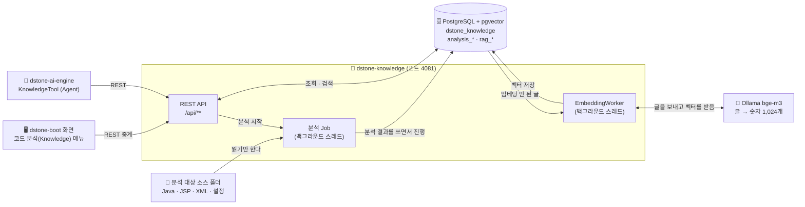

- **들어가는 것**: 서버가 읽을 수 있는 소스 폴더 하나(`localPath`). 소스를 고치지 않고, 대상 프로젝트를 빌드하지도 않는다.
- **나오는 것**: 모두 PostgreSQL의 행이다. 메모리에 들고 있는 결과물은 없어서 서버를 껐다 켜도 결과가 그대로다.
- **쓰는 쪽**: 사람은 `dstone-boot` 화면으로, LLM(Agent)은 `dstone-ai-engine`의 Tool로 쓴다. 둘 다 같은 REST API를 부른다.
- **이 모듈은 채팅 모델(LLM)을 쓰지 않는다.** 쓰는 AI는 글을 숫자로 바꿔 주는 임베딩 모델 하나뿐이다. 답을 문장으로 만드는 일은 `dstone-ai-engine`이 한다.

### 0.3 낱말 10개

뒤에서 계속 나오는 낱말이다. 이것만 알면 나머지는 따라 읽을 수 있다.

| 낱말 | 뜻 | 견주자면 |
|---|---|---|
| **프로젝트** | 분석할 대상 하나. 이름(`projectId`)과 소스 폴더 경로 | 책 한 권 |
| **리비전** | 어느 시점의 소스를 분석한 **결과 한 벌**. 분석할 때마다 새로 생긴다 | 그 책의 "몇 판" |
| **Job** | 분석을 한 번 돌리는 실행. 리비전 하나에 여러 번 돌 수 있다(이어 하기, 다시 돌리기) | 인쇄 작업 한 번 |
| **단계(패스)** | Job이 차례로 하는 일 9가지(SCAN, DECLARE, …) | 공장의 공정 |
| **심볼** | 소스에 선언된 것. 타입(클래스), 메소드, 필드 | 명부에 올린 이름 |
| **참조 → 관계** | 참조는 "`dao.delete(x)`라고 적혀 있다"는 **글자**, 관계는 "그것은 `OrderDAO#delete(String)`이다"라고 **풀린 결과** | 전화번호부의 이름 → 실제로 연결된 번호 |
| **신뢰도** | 관계가 얼마나 확실한지. `HIGH`(컴파일러처럼 풀었다) / `MEDIUM`(타입은 알고 이름으로 골랐다) / `LOW`(이름만 보고 짐작했다) | 증언의 확실한 정도 |
| **진입점** | 밖에서 프로그램으로 들어오는 입구. HTTP 주소, 서블릿, `main()`, 스케줄, JSP, 거래 ID | 건물의 출입문 |
| **계층** | 타입의 역할. `CONTROLLER` / `SERVICE` / `REPOSITORY` / `MODEL` … | 부서 |
| **문서 · 청크 · 임베딩** | 문서는 분석 결과를 글로 적은 것, 청크는 그 글을 검색 단위로 자른 조각, 임베딩은 청크를 숫자(벡터)로 바꾼 것 | 안내 책자 · 책자의 한 쪽 · 그 쪽의 색인 번호 |

프로젝트·리비전·Job은 이렇게 들어 있다.

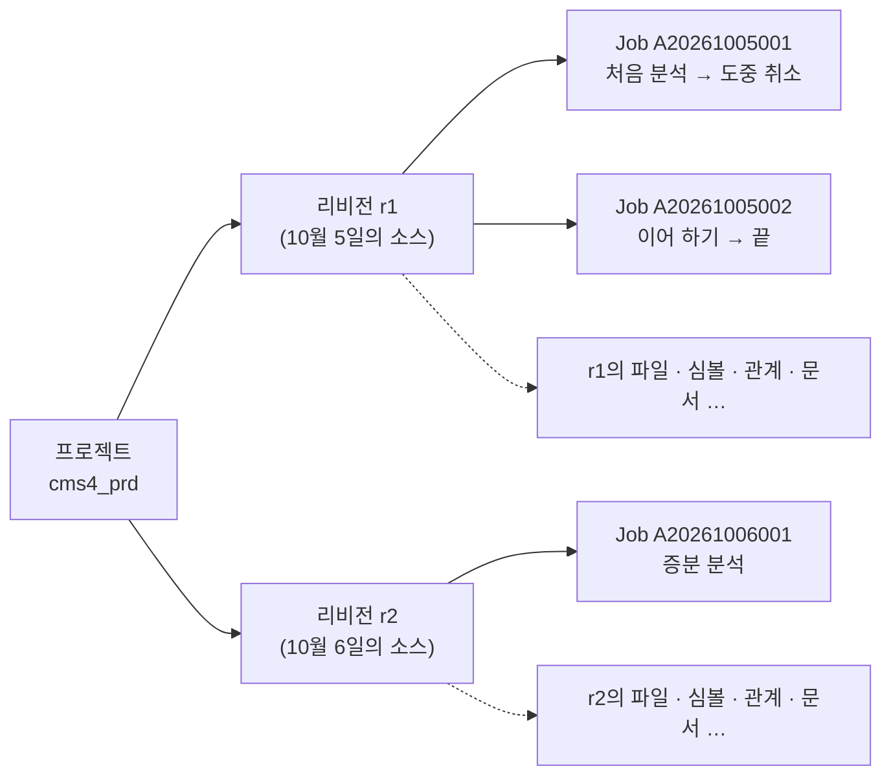

**분석 결과의 모든 행에는 `revision_id`가 붙는다.** 리비전은 서로 섞이지 않는 "전체 한 벌"이라서 r1을 지워도 r2는 온전하고, r1과 r2를 견줘 볼 수도 있다.

### 0.4 분석 공정 9단계

분석 시작을 한 번 누르면 아래 9단계가 차례로 돈다. 괄호 안 숫자는 코드의 실행 순서 값(`order()`)이다.

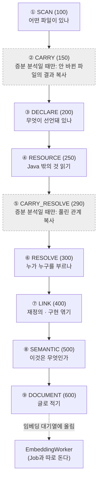

| 단계 | 견주자면 | 읽는 것 | 만드는 것(테이블) | 담당 클래스 |
|---|---|---|---|---|
| ① SCAN | **재고 조사**. 창고에 무엇이 있는지 목록부터 | 폴더의 모든 파일 | 파일 목록 `analysis_file` | `analysis.pass01.scan.ScanPass` |
| ② CARRY | 지난번 장부에서 **안 바뀐 것 베껴 오기** | 앞 리비전의 행 | 선언·자원의 복사본 | `analysis.pass02.carry.CarryPass` |
| ③ DECLARE | **명부 만들기**. 누가 있는지만 적는다 | Java 파일(과 JSP 안의 Java) 하나씩 | 심볼 `analysis_symbol` / `_method` / `_field` / `_annotation`, 참조 `analysis_reference`, Java 문자열 SQL | `analysis.pass03.declare.DeclarePass` |
| ④ RESOURCE | **부속 서류 정리**. SQL, 설정, 빌드 파일 | XML · properties · YAML · DDL 하나씩 | `analysis_mapper` / `_config` / `_resource` | `analysis.pass04.resource.ResourcePass` |
| ⑤ CARRY_RESOLVE | 지난번의 **연결 결과 베껴 오기**(베껴도 되는 것만) | 앞 리비전의 관계 | 관계의 복사본 | `analysis.pass05.carryresolve.CarryResolvePass` |
| ⑥ RESOLVE | **전화 연결**. 명부의 이름을 실제 상대와 잇는다 | Java 파일 하나씩(다시 파싱) | 관계 `analysis_relation` | `analysis.pass06.resolve.ResolvePass` |
| ⑦ LINK | **족보 정리**. 재정의와 인터페이스 구현 | DB만(SQL) | `OVERRIDES` 등의 관계, 품질 지표 `analysis_metric` | `analysis.pass07.link.LinkPass` |
| ⑧ SEMANTIC | **간판 달기**. "여기는 출입문", "여기는 영업부" | DB + 규칙 파일 `conf/rules` + `web.xml` · Struts 설정 · 화면 글자 | 진입점 `analysis_endpoint`, 계층, SQL·테이블·화면 관계, 사전 | `analysis.pass08.semantic.SemanticPass` + 처리기(`LayerResolver`, `EntryFinder` …) |
| ⑨ DOCUMENT | **안내 책자 쓰기**. 지도를 글로 풀어 적는다 | DB + 소스의 해당 줄 | `rag_document` / `rag_chunk`, 대기열 `rag_embedding` | `analysis.pass09.document.DocumentPass` |

**DECLARE와 RESOLVE를 나눈 까닭.** `getLogsDAO().selectLoginHistList(vo)`가 누구의 `selectLoginHistList`인지 알려면 `getLogsDAO()`가 무엇을 돌려주는지(`BaseService`에 있다), 그 타입 `LogsDAO`가 어떤 클래스인지 알아야 한다. 그런데 그것은 다른 파일에 있다. 그래서 먼저 모든 파일의 "누가 있는지"를 DB에 다 넣고(③), 그다음에 "누구를 가리키는지"를 DB에 물어 가며 푼다(⑥). 이렇게 하면 프로젝트 전체를 메모리에 올리지 않아도 된다.

### 0.5 예제 하나로 끝까지 따라가기

`cms4_prd`는 운영 서버에서 받아 온 실제 Spring MVC + MyBatis 웹 애플리케이션이다(펼친 WAR). Java 232개, JSP 200개, MyBatis 매퍼 42개, jar 113개로 작지 않지만 분석 한 번이 1분 36초면 끝난다(임베딩 제외). 여기서는 그 가운데 **"로그인 기록 조회" 기능 하나**를 처음부터 끝까지 따라간다.

**분석 대상 소스(이 기능에 관련된 것만 줄여서)**

```
cms4_prd/                                        파일 2,244개 (이미지·CSS·jar 포함)
├── WEB-INF/web.xml                              DispatcherServlet 등 서블릿 7개, 필터 9개
├── WEB-INF/classes/spring/context-*.xml         Spring 빈·component-scan·MyBatis 설정
├── WEB-INF/classes/sqlmap/mapper/system/logs-mapper.xml
│                                                namespace="logs": selectLoginHistList → selectLoginHistListSql 조각
│                                                (FROM tbsy_login_hist LEFT OUTER JOIN tbin_empmst …)
├── WEB-INF/classes/kr/co/gnx/
│   ├── base/BaseController.java                 @Autowired LogsService logsService;  getLogsService()
│   ├── base/BaseService.java                    @Autowired LogsDAO logsDAO;  getLogsDAO()
│   ├── base/BaseDAO.java                        logsMapper = "logs.";  getLogsmapper() { return logsMapper; }
│   └── logs/
│       ├── LogsController.java                  @RequestMapping("/logs/loginHist.go")          → new ModelAndView("/logs/loginHist")
│       │                                        @RequestMapping("/logs/getLoginHistList.ajax") → getLogsService().getLoginHistList(vo)
│       ├── LogsService.java                     getLogsDAO().selectLoginHistList(vo)
│       └── LogsDAO.java                         getSqlSession().selectList(getLogsmapper() + "selectLoginHistList", vo)
├── WEB-INF/views/logs/loginHist.jsp             $.ajax({ url : "/logs/getLoginHistList.ajax?…" })
└── WEB-INF/lib/*.jar                            113개 (Spring, MyBatis, json-lib …)
```

이 기능의 사실은 **다섯 군데에 흩어져 있다.** 화면은 JSP에, 주소는 컨트롤러 애노테이션에, 처리 코드는 컨트롤러·서비스·DAO 세 클래스와 공통 부모(`Base…`)에, SQL은 매퍼 XML에 있다. 게다가 DAO는 SQL 이름을 글자 그대로 적지 않고 부모 클래스의 메소드(`getLogsmapper()`)를 불러 만든다. 어느 하나만 봐서는 "로그인 기록 화면이 어느 테이블을 읽는지" 알 수 없다. 9단계가 이것을 차례로 잇는다.

단계마다 **📥 저장되는 곳**에 그 단계가 쓰는 테이블과 `cms4_prd` 전체에서 생긴 행 수를 적었다. 테이블 전체 모양은 0.13절과 5장에 있다.

단계와 상관없이 분석 한 번마다 쌓이는 관리용 행이 있다.

| 테이블 | 언제 | `cms4_prd` |
|---|---|---|
| `analysis_project` | 프로젝트를 등록할 때 한 번(`POST /api/projects`). 경로, `classpath`, `ruleSets` | 1 |
| `analysis_revision` | 분석을 시작할 때 한 벌. 아래 모든 행이 이 `revision_id`를 단다 | 1 |
| `analysis_job` | 분석 실행 기록(`analysisId`, 상태, 시작·끝 시각) | 1 |
| `analysis_revision_pass` | 단계마다 한 행(`PENDING` → `RUNNING` → `DONE`). 증분 분석에만 일하는 CARRY·CARRY_RESOLVE도 행은 남는다 | 9 |
| `analysis_file_pass` | 파일 단위 단계에서 파일마다 한 행. 죽었다 다시 시작해도 끝난 파일을 건너뛰는 근거다 | 1,421 |
| `analysis_error` | 단계가 남긴 오류·경고(인코딩을 모름, 파싱 실패 등) | 0 |

**① SCAN** — 파일 2,244개 가운데 분석할 1,331개의 목록이 생긴다. 이미지, CSS, jar, 소스맵(`.map`)은 목록에 넣지 않는다(jar는 ⑥에서 따로 쓴다).

| 이 기능의 파일 | 언어 | 용도(`file_type`) | 어떻게 알았나 |
|---|---|---|---|
| `WEB-INF/classes/kr/co/gnx/logs/LogsDAO.java` 외 Java 232개 | `JAVA` | `SOURCE` | 확장자. 폴더 경로 끝 `kr/co/gnx/logs`가 `package kr.co.gnx.logs`와 같으므로 그 앞(`WEB-INF/classes`)을 소스 루트로 본다 |
| `WEB-INF/views/logs/loginHist.jsp` 외 JSP 200개 | `JSP` | `JSP` | 확장자 |
| `WEB-INF/classes/sqlmap/mapper/system/logs-mapper.xml` 외 42개 | `XML` | `MYBATIS_MAPPER` | 맨 위 요소가 `<mapper>` |
| `WEB-INF/classes/spring/context-common.xml` 외 6개 | `XML` | `SPRING_XML` | 맨 위 요소가 `<beans>` |
| `WEB-INF/web.xml` | `XML` | `WEB_XML` | 맨 위 요소가 `<web-app>` |
| `resources/**/*.js` 836개 | `SCRIPT` | `SCRIPT` | 확장자. 내용은 ⑧에서 필요할 때만 읽는다 |

파일마다 인코딩과 내용 해시(SHA-256)도 같이 적는다. 해시는 나중에 증분 분석이 "이 파일이 바뀌었나"를 가리는 열쇠다.

> 📥 **저장되는 곳**: `analysis_file` 1,331행(Java 232, JSP 200, 스크립트 836, XML 62, properties 1. 경로, 언어, `file_type`, 인코딩, `checksum`, 줄 수). 이 단계는 이 테이블 하나만 쓴다. 파일 단위 단계가 아니어서 `analysis_file_pass` 행은 없다.

**③ DECLARE** — `LogsDAO.java` 한 파일에서 이런 행이 생긴다. 다른 파일은 보지 않는다.

| 종류 | 생기는 행 |
|---|---|
| 타입 | `kr.co.gnx.logs.LogsDAO` (`CLASS`, 상위 타입 `BaseDAO`는 이름만 적어 둔다) |
| 메소드 | `selectLoginHistList(LoginHistVO)` 등 7개 + 만들어 넣은 기본 생성자 `<init>()`(소스에 생성자가 없어서, `is_synthetic`) |
| 필드 | `logger` |
| 애노테이션 | `@Repository(value = "LogsDAO")` |
| 참조(아직 누구인지 모름) 46개 | `selectLoginHistList` 안에만 7개 — 호출 `selectList`(대상 식 `getSqlSession()`, 인자 2개), 호출 `getSqlSession()`, 호출 `getLogsmapper()`(앞에 `객체.`가 없음), 타입 사용 `LoginHistVO`, `List`, `Map`, `String` |

`getSqlSession()`과 `getLogsmapper()`는 이 파일에 없는 메소드다(부모 `BaseDAO`에 있다). 이 단계는 그것을 모른 채 "이런 이름을 부른다"만 적는다. JSP는 `<% %>`(Java 코드)가 있는 12개만 Java 소스로 바꿔서 똑같이 처리한다(4.10절). `loginHist.jsp`는 Java 코드가 없어서 건너뛴다.

> 📥 **저장되는 곳**(Java 232개 + JSP 200개 전체 기준)
>
> | 테이블 | 담는 것 | 행 |
> |---|---|---|
> | `analysis_symbol` | 타입(클래스 239, 익명 클래스 9, enum 6, 인터페이스 2). 계층(`layer`)은 아직 비어 있다 | 256 |
> | `analysis_method` | 메소드. 소스에 적힌 5,797개 + 만들어 넣은 기본 생성자 230개(`is_synthetic`) | 6,027 |
> | `analysis_field` | 필드와 초기값(`BaseDAO.logsMapper = "logs."` 같은 것. ⑧에서 쓴다) | 2,076 |
> | `analysis_annotation` | 타입·메소드·필드에 붙은 애노테이션(`@Controller`, `@RequestMapping`, `@Autowired` …) | 1,574 |
> | `analysis_reference` | 아직 누구인지 모르는 참조(호출, 타입 사용, 객체 생성, 상속 …). 상태는 모두 `PENDING` | 39,480 |
> | `analysis_file` | 파싱 결과(`parse_status`, `language_level`)를 고쳐 쓴다 | (432행 갱신) |
> | `analysis_file_pass` | `DECLARE` 파일별 진행 | 432 |
>
> 파일 하나를 읽고 이 행들을 쓴 뒤 AST는 버린다. 프로젝트 전체를 메모리에 올리지 않는 까닭이다(2장).

**④ RESOURCE** — `logs-mapper.xml`에서 statement 10개(`SELECT` 4, `INSERT` 3, 조각 3)가 `analysis_mapper`에 들어간다. 이 기능이 쓰는 것은 둘이다.

| 이름 | 종류 | 저장되는 SQL(태그를 벗겨 한 글로 편 것) |
|---|---|---|
| `logs.selectLoginHistListSql` | 조각(`SQL_FRAGMENT`) | `@@include(Comm.OrgTree)@@ SELECT tb1.mb_id, tb1.seq, tb1.emp_cd, tb2.emp_nm, … FROM tbsy_login_hist tb1 LEFT OUTER JOIN tbin_empmst tb2 … LEFT OUTER JOIN org_cte tb3 … WHERE …` |
| `logs.selectLoginHistList` | `SELECT` | `@@include(Comm.PagingStart)@@ @@include(selectLoginHistListSql)@@ @@include(Comm.PagingEnd)@@` |

`<include refid>`는 이 단계에서 펼치지 않고 `@@include(…)@@` 표시만 남긴다. 다른 매퍼 파일(`Comm.PagingStart` 등)에 있는 조각일 수 있어서, 모든 매퍼를 읽은 뒤 ⑧에서 채운다. `<if>` 같은 조건 태그는 벗기고 안의 글을 모두 남긴다. 이 단계는 **읽어서 저장만** 한다.

> 📥 **저장되는 곳**
>
> | 테이블 | 담는 것 | 행 |
> |---|---|---|
> | `analysis_mapper` | statement 이름, 종류, 펼친 SQL, 매퍼 종류. `SELECT` 367, `INSERT` 107, `UPDATE` 86, `DELETE` 99, 조각 129 | 788 |
> | `analysis_config` | `.properties`·`.yml`의 키와 값(비밀값은 `****`) | 5 |
> | `analysis_resource` | Spring XML의 빈 37, `component-scan` 3, 빌드 파일의 의존성 52 | 92 |
> | `analysis_file_pass` | `RESOURCE` 파일별 진행(XML·properties) | 63 |
>
> 증분 분석이라면 이 앞(②)과 뒤(⑤)에서 CARRY·CARRY_RESOLVE가 바뀌지 않은 파일의 위 행들과 ⑥의 관계를 앞 리비전에서 복사한다(0.12절). 이번처럼 전체 분석이면 아무것도 하지 않는다.

**⑥ RESOLVE** — 이제 모든 파일의 선언이 DB에 있으므로 참조를 푼다. `LogsController#getLoginHistList`와 그 아래가 이렇게 풀린다.

| 소스에 적힌 것 | 풀린 결과 | 신뢰도 |
|---|---|---|
| `getLogsService()` (`LogsController.java:67`) | `CALLS` → `BaseController#getLogsService()` (부모 클래스에서 물려받은 메소드) | `HIGH` |
| `getLogsService().getLoginHistList(loginHistVO)` | `CALLS` → `LogsService#getLoginHistList(LoginHistVO)` (앞 호출의 반환 타입 `LogsService`로 찾음) | `HIGH` |
| `getLogsDAO().selectLoginHistList(loginHistVO)` (`LogsService.java:57`) | `CALLS` → `LogsDAO#selectLoginHistList(LoginHistVO)` | `HIGH` |
| `getLogsmapper()` (`LogsDAO.java:46`) | `CALLS` → `BaseDAO#getLogsmapper()` | `HIGH` |
| `getSqlSession().selectList(…)` | `CALLS` → `org.mybatis.spring.SqlSessionTemplate.selectList(java.lang.String, java.lang.Object)` (프로젝트 밖, jar로 확인) | `HIGH` |
| `JSONObject.fromObject(…)` (`LogsController.java:59`) | `CALLS` → `net.sf.json.JSONObject.fromObject(java.lang.Object)` (프로젝트 밖, jar로 확인) | `HIGH` |

이 프로젝트는 `WEB-INF/lib`에 jar 113개가 있어서 프로젝트 **밖**으로 나가는 호출도 컴파일러처럼 풀린다(프로젝트 폴더 안의 jar는 따로 설정하지 않아도 쓴다). 그래서 호출 19,349건 가운데 99.90%가 풀렸고, 이름으로 짐작한 것은 1건뿐이다. jar가 없으면 밖으로 나가는 호출은 "타입과 이름만" 남는다(`MEDIUM`, 0.8절).

> 📥 **저장되는 곳**
>
> | 테이블 | 담는 것 | 행 |
> |---|---|---|
> | `analysis_relation` | 풀린 관계. `CALLS` 20,001, `USES_TYPE` 14,948, `ACCESSES_FIELD` 2,074, `CREATES` 2,025, `THROWS` 806, `EXTENDS` 191, `IMPLEMENTS` 20 | 40,065 |
> | `analysis_reference` | 참조의 상태를 고쳐 쓴다. `EXTERNAL` 21,456, `RESOLVED` 17,937, `IGNORED` 65, `UNRESOLVED` 21(이유는 `fail_reason`), `HEURISTIC` 1 | (39,480행 갱신) |
> | `analysis_file_pass` | `RESOLVE` 파일별 진행 | 432 |
>
> 프로젝트 밖으로 나가는 관계는 `to_id` 없이 `to_external`에 이름(`org.mybatis.spring.SqlSessionTemplate.selectList(…)`)을 둔다.

**⑦ LINK** — 재정의(`OVERRIDES`) 68건을 엮는다. 이 프로젝트의 서비스와 DAO는 인터페이스 없이 클래스로 바로 만들어져 있어서 "인터페이스 메소드를 부르는 호출 → 구현 메소드"(`CALLS_POSSIBLE_IMPLEMENTATION`)는 생기지 않는다. 인터페이스를 쓰는 프로젝트라면 여기서 `OrderService.findOrders` → `OrderServiceImpl.findOrders`가 이어진다.

> 📥 **저장되는 곳**: `analysis_relation`에 `OVERRIDES` 68행, `analysis_metric`에 품질 지표 7개(`callResolutionRate` 99.90, `callHeuristicRate` 0.01, `callUnresolvedRate` 0.10, `callCount` 19,349, `relationCount` 40,133, `parseSuccessRate` 100, `typeResolutionRate` 100). 지표는 리비전이 아니라 실행(`analysis_id`)에 붙는다. 이 단계는 파일을 읽지 않고 SQL로만 돈다.

**⑧ SEMANTIC** — 흩어져 있던 다섯 군데가 여기서 하나로 이어진다.

| 처리기 | 이 기능에서 한 일 | 프로젝트 전체 |
|---|---|---|
| `EntryFinder`, `LayerResolver`, `WiringMarker` | `@RequestMapping("/logs/getLoginHistList.ajax")` → `HTTP` 진입점. `@Controller`/`@Service`/`@Repository` → `LogsController` `CONTROLLER`, `LogsService` `SERVICE`, `LogsDAO` `REPOSITORY`(`HIGH`, 규칙 `common/spring.yml`) | `HTTP` 694, `SCHEDULED` 2, `INJECTS` 108, 계층 `HIGH` 143 |
| `ServletEntries` | — | `web.xml` → `SERVLET` 진입점 7, 필터 9·리스너 4는 `analysis_resource` |
| `EntryFinder` | — | `main()` 2, `WEB-INF` 밖 JSP 2 |
| `MapperLinker`, `SqlLinker` | `getLogsmapper() + "selectLoginHistList"`를 계산한다(규칙 `common/mybatis.yml`의 `_.selectList(SQL)`). `getLogsmapper()`는 `return logsMapper;` 한 줄이고 `logsMapper`는 상수 `"logs."`이므로 `logs.selectLoginHistList` → `EXECUTES_SQL`(`HIGH`). 조각을 채운 SQL에서 테이블을 뽑아 `READS_TABLE` → `TBSY_LOGIN_HIST`, `TBIN_EMPMST`, `TBIN_SCD`(`Comm.OrgTree` 조각의 `WITH org_cte`가 읽는다) | `EXECUTES_SQL` 740(그중 19건은 이름만 알고 statement가 없다), `READS_TABLE` 1,163, `WRITES_TABLE` 305, 테이블 167개 |
| `ViewLinker`, `JspLinker` | `new ModelAndView("/logs/loginHist")` → `logs/loginHist.jsp` `RENDERS`(`HIGH`). `loginHist.jsp:92`의 `"/logs/getLoginHistList.ajax?…"` 글자가 진입점 주소와 같음 → `REQUESTS`(`MEDIUM`) | `RENDERS` 178, `REQUESTS` 825(화면 글자 685 + `<script src>`로 불러온 스크립트 140), `INCLUDES` 186, 화면 계층 `VIEW` 12, 화면명 16 |
| `LayerResolver`(상속 · 이름 규칙) | — | 상위 타입으로 `MEDIUM` 1, 이름 끝말로 `LOW` 58(`…VO` → `MODEL` 46 등) |
| `MethodTitlePlugin`, `SourceNamePlugin` | 메소드 위 주석 첫 줄 → 기능명 "로그인 기록 리스트 조회" | 기능명 1,818, 소스에서 찾은 컬럼 한글명 551 |

`selectLoginHistList`의 SQL은 Oracle 문법과 `${page}` 같은 치환 변수가 섞여 SQL 파서가 읽지 못했다. 그래서 `FROM`/`JOIN` 뒤의 이름을 정규식으로 찾았고(`via = PATTERN`) 신뢰도는 `MEDIUM`이다. 프로젝트 전체로 봐도 `READS_TABLE`의 절반(582건)이 이 경우다.

> 📥 **저장되는 곳**
>
> | 테이블 | 담는 것 | 행 |
> |---|---|---|
> | `analysis_endpoint` | 진입점. `HTTP` 694, `SERVLET` 7, `JSP` 2, `MAIN` 2, `SCHEDULED` 2 | 707 |
> | `analysis_relation` | 프레임워크를 알아야 잇는 관계. `READS_TABLE` 1,163, `REQUESTS` 825, `EXECUTES_SQL` 740, `WRITES_TABLE` 305, `INCLUDES` 186, `RENDERS` 178, `INJECTS` 108 | +3,505 (모두 43,638) |
> | `analysis_symbol` | 계층(`layer`, `layer_confidence`)을 고쳐 쓴다. 256개 가운데 214개에 붙었다 | (214행 갱신) |
> | `analysis_method` | 프록시가 끼어드는 메소드(`proxy_related`)를 고쳐 쓴다(이 프로젝트는 해당 애노테이션이 없다) | (0행) |
> | `analysis_resource` | 기능명 `METHOD_TITLE` 1,818, 소스에서 찾은 컬럼 한글명 `SOURCE_NAME` 551, 화면명 `SCREEN_NAME` 16, `web.xml`의 `FILTER_MAPPING` 9·`SERVLET_MAPPING` 7·`LISTENER` 4, 쓴 규칙 파일 `RULE_SET` 7, 처리기 상태 `SEMANTIC_STATUS` 3 | +2,415 |
>
> SEMANTIC은 시작할 때 자기가 전에 만든 행을 지우고 한 트랜잭션 안에서 다시 만든다. 그래서 규칙을 고친 뒤 `rerunFrom: SEMANTIC`으로 다시 돌려도 결과가 겹치지 않는다(4.7절).

**분석이 끝난 뒤 DB에 그려진 지도**(이 기능 부분만. 이 그림이 이 모듈이 만드는 것의 전부다)

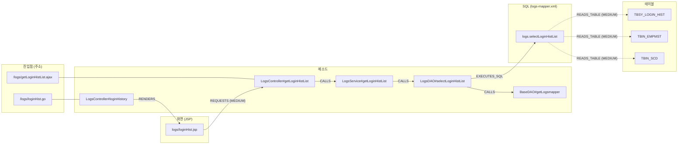

- 화살표 하나가 `analysis_relation`의 한 행이다(주소와 메소드를 잇는 선만 `analysis_endpoint`의 행이다). 점선은 `MEDIUM`이다.
- 실제로는 컨트롤러가 `BaseController#getLogsService()`, `BaseVO#setPage()` 같은 부모 클래스의 메소드도 부른다. 그림에서는 줄였다.
- **화살표를 따라 오른쪽으로 가면** "이 주소를 부르면 무슨 일이 일어나나"(`/callees`)이고, **거슬러 왼쪽으로 가면** "이 테이블을 고치면 어디가 영향받나"(`/impact`)다. 조회 API는 모두 이 그림 위를 걷는 일이다.
- `TBSY_LOGIN_HIST`에서 거슬러 올라가면 이 기능 말고 로그인 처리(`LoginDAO`)까지 닿는다. 메소드 16개(DAO 6, 서비스 6, 컨트롤러 4), 진입점 4개(`/logs/getLoginHistList.ajax`, `/login/getLoginList.ajax` 등), 화면 2개(`logs/loginHist.jsp`, `system/userAccountManage/userAccountManage.jsp`)다.

**⑨ DOCUMENT** — 위 지도를 글로 풀어 적는다. 문서 3,625건이 생긴다(`METHOD` 2,299, `MAPPER` 659, `TYPE` 235, `FILE` 232, `VIEW` 200). 메소드 문서 하나는 이런 모양이다(서버가 만든 그대로).

```text
[메소드] kr.co.gnx.logs.LogsDAO#selectLoginHistList(LoginHistVO)
반환: List<Map<String,String>>
계층: REPOSITORY
파일: WEB-INF/classes/kr/co/gnx/logs/LogsDAO.java (줄 45-47)
설명: 로그인 기록 리스트 조회
호출하는 것: BaseDAO#getLogsmapper(), BaseDAO#getSqlSession()
밖으로 나가는 호출: org.mybatis.spring.SqlSessionTemplate.selectList(java.lang.String, java.lang.Object)
실행하는 SQL: logs.selectLoginHistList [SELECT, 테이블 TBIN_EMPMST(R), TBIN_SCD(R), TBSY_LOGIN_HIST(R)]
호출받는 곳: LogsService#getLoginHistList(LoginHistVO)
소스:
	public List<Map<String, String>> selectLoginHistList(LoginHistVO loginHistVO) {
		return getSqlSession().selectList(getLogsmapper() + "selectLoginHistList", loginHistVO);
	}
```

**소스 세 줄에는 `TBSY_LOGIN_HIST`라는 글자도, SQL의 전체 이름도, 누가 부르는지도 적혀 있지 않다.** 그것은 다른 파일(`BaseDAO.java`, `logs-mapper.xml`, `LogsService.java`)에 있고, 분석이 이어 줬기 때문에 여기에 적을 수 있다. 그래서 "로그인 기록을 조회하는 코드"라고 물어도 이 문서가 걸린다.

> 📥 **저장되는 곳**
>
> | 테이블 | 담는 것 | 행 |
> |---|---|---|
> | `rag_document` | 문서 한 건(종류, 제목, 원본 경로, 메타데이터) | 3,625 |
> | `rag_chunk` | 문서를 검색 단위로 자른 조각과 그 내용 해시. 긴 문서는 여러 조각이 된다 | 4,000 |
> | `rag_embedding` | 조각의 벡터. `(content_hash, model)`이 키라 리비전이 바뀌어도 내용이 같으면 다시 계산하지 않는다. 이 단계는 처음 보는 해시만 `PENDING`으로 줄 세우고, 벡터는 서버의 백그라운드 스레드(`EmbeddingWorker`)가 채운다 | (새 해시만) |
> | `analysis_file_pass` | `DOCUMENT` 파일별 진행 | 494 |
>
> `rag_*`는 `analysis_*`에서 언제든 다시 만들 수 있다. 원본은 `analysis_*`뿐이다.

**단계별 저장 테이블 한눈에 보기**(`cms4_prd`)

| 단계 | 새로 쓰는 테이블(행) | 고쳐 쓰는 테이블 |
|---|---|---|
| ① SCAN | `analysis_file`(1,331) | — |
| ② CARRY | 증분 분석일 때만: ③·④의 테이블에 앞 리비전 행을 복사 | `analysis_file.carried_from_file_id` |
| ③ DECLARE | `analysis_symbol`(256), `analysis_method`(6,027), `analysis_field`(2,076), `analysis_annotation`(1,574), `analysis_reference`(39,480), Java 문자열 SQL은 `analysis_mapper` | `analysis_file`(파싱 결과) |
| ④ RESOURCE | `analysis_mapper`(788), `analysis_config`(5), `analysis_resource`(92) | — |
| ⑤ CARRY_RESOLVE | 증분 분석일 때만: 앞 리비전의 `analysis_relation` 복사 | `analysis_reference.status`(다시 풀 파일만 `PENDING`으로) |
| ⑥ RESOLVE | `analysis_relation`(40,065) | `analysis_reference.status` |
| ⑦ LINK | `analysis_relation`(68), `analysis_metric`(7) | — |
| ⑧ SEMANTIC | `analysis_endpoint`(707), `analysis_relation`(3,505), `analysis_resource`(2,415), JPA statement는 `analysis_mapper` | `analysis_symbol.layer`, `analysis_method.proxy_related`, `analysis_mapper.method_id` |
| ⑨ DOCUMENT | `rag_document`(3,625), `rag_chunk`(4,000), `rag_embedding`(새 해시만, `PENDING`) | — |
| 모든 단계 | `analysis_revision_pass`(9), `analysis_file_pass`(1,421), `analysis_error`(0) | — |

저장소 안의 작은 표본(`struts-app`은 파일 11개짜리 Struts 1 + iBATIS 게시판)으로 같은 흐름을 몇 초 만에 볼 수도 있다. 표본 목록은 7.4절에 있다.

### 0.6 Job은 어떻게 도나

분석은 오래 걸릴 수 있어서 요청을 받으면 바로 돌려보내고 뒤에서 돈다.

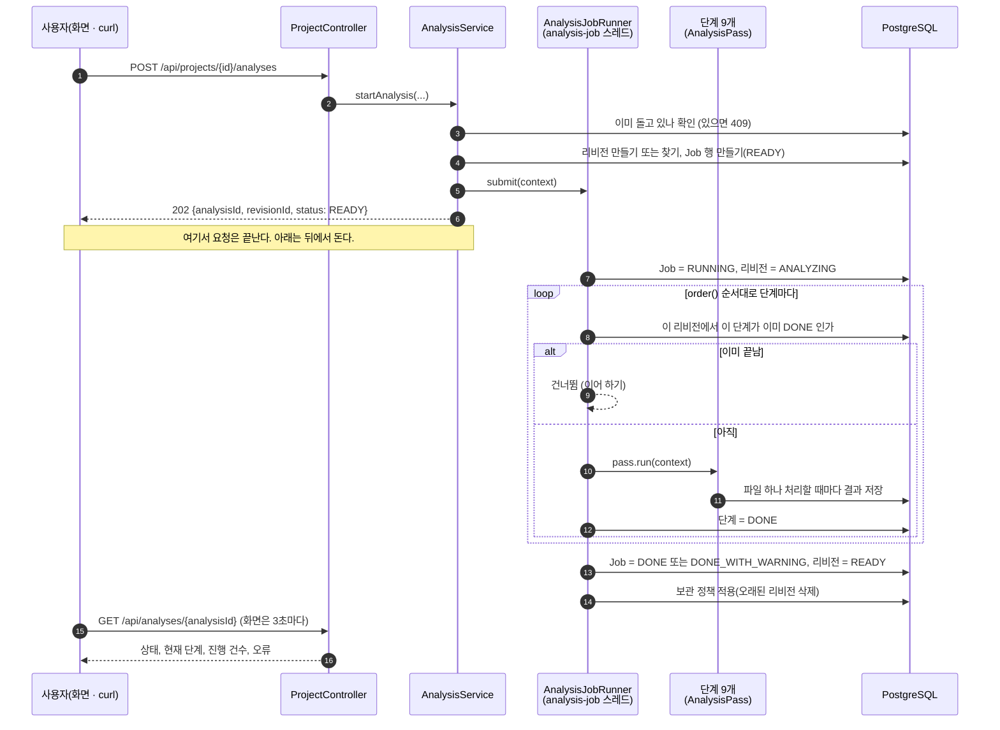

Job의 상태는 이렇게 바뀐다.

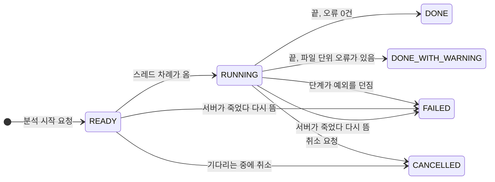

| Job이 끝난 모양 | 리비전 상태 | 그다음에 할 수 있는 것 |
|---|---|---|
| `DONE` / `DONE_WITH_WARNING` | `READY` | 조회, 검색, 증분 분석의 기준으로 쓰기 |
| `CANCELLED` | `CREATED` | 같은 리비전 라벨(`revisionLabel`)로 다시 시작하면 멈춘 단계부터 이어서 한다 |
| `FAILED` | `FAILED` | 원인을 고친 뒤 같은 리비전 라벨로 다시 시작하면 이어서 한다 |

- `DONE_WITH_WARNING`은 실패가 아니다. "파일 몇 개는 못 읽었지만 나머지는 다 했다"는 뜻이다. 못 읽은 파일은 `analysis_error`에 남는다.
- **이어 하기가 되는 까닭**: 진행 상태를 두 군데에 적어 두기 때문이다. 단계가 끝났는지는 `analysis_revision_pass`, 파일 하나하나는 `analysis_file_pass`. 다시 시작하면 끝난 단계를 건너뛰고, 끝나지 않은 단계에서는 끝난 파일을 건너뛴다.
- 동시에 도는 Job은 2개까지다(`job.max-concurrent`). 넘치면 `READY`로 기다리고, 기다리는 것이 100개를 넘으면 503이다. 한 프로젝트에서는 한 번에 하나만 돈다.

### 0.7 파일 하나는 어떻게 처리되나

DECLARE, RESOURCE, RESOLVE, DOCUMENT는 "파일을 하나씩 처리하는 단계"라서 같은 실행기(`analysis.job.FilePassRunner`)를 쓴다. 단계마다 다른 것은 `FileHandler`의 `prepare`와 `write` 두 메소드뿐이다.

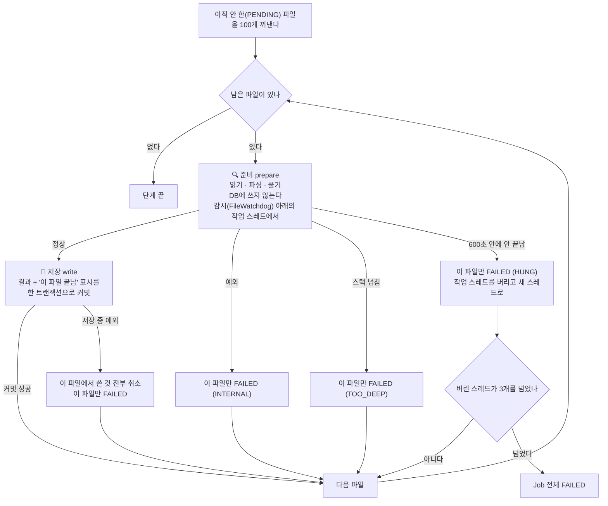

이 그림에서 기억할 것은 둘이다.

- **파일 하나가 잘못돼도 분석은 계속 간다.** 깨진 소스, 지나치게 깊은 식, 끝나지 않는 파싱 모두 "그 파일만 실패"로 끝난다. 숨기지 않고 `analysis_error`에 남긴다.
- **오래 걸리는 일(준비)과 DB에 쓰는 일(저장)을 갈라 놓았다.** 준비가 멈춰도 DB 연결이나 트랜잭션을 붙든 채 남지 않는다. 저장은 "결과와 끝남 표시"가 함께 들어가거나 함께 취소되므로 반쯤 저장된 파일이 생기지 않는다.

### 0.8 호출 하나는 어떻게 풀리나 (RESOLVE)

`something.doIt(a, b)`라는 글자 하나를 놓고 `analysis.pass06.resolve.ReferenceResolver`가 내리는 판단이다. 위에서 풀리면 아래로 내려가지 않는다.

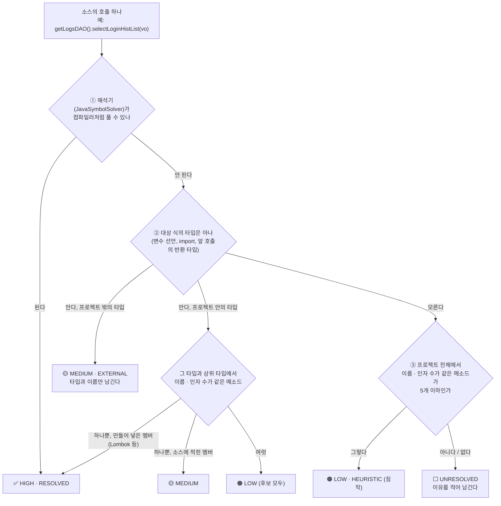

| 신뢰도 | 뜻 | 실제로 맞는 비율(jar 없이 돌린 `dstone-batchadmin`을 손으로 대조) | 어떻게 쓰나 |
|---|---|---|---|
| `HIGH` | 컴파일러와 같은 방식으로 풀었다 | 46 / 46 | 그대로 믿는다 |
| `MEDIUM` | 타입은 알고, 메소드는 이름으로 골랐다 | 170 / 170 | 믿어도 된다 |
| `LOW` | 이름만 보고 짐작했다 | 11 / 27 | 참고로만 본다. 절반 넘게 틀린다 |

**대상 프로젝트의 라이브러리 jar가 있으면 ①에서 대부분 끝난다.** jar가 없으면 ②·③으로 내려가는 것이 늘어난다. 그래서 프로젝트 폴더 안에 `WEB-INF/lib`가 있거나 프로젝트 등록 때 `classpath`를 주면 결과가 훨씬 좋아진다.

### 0.9 계층을 넘는 호출은 어떻게 이어지나 (화면 → 컨트롤러 → 서비스 → DAO → SQL → 테이블)

결론부터 말하면 **계층마다 따로 도는 분석 로직은 없다.** "컨트롤러 분석기", "서비스 분석기" 같은 것이 없다. 분석기는 계층 대신 **경계의 종류**를 본다. 화면과 서버 사이, Java 메소드끼리, 인터페이스와 구현체 사이, Java와 SQL 사이, SQL과 테이블 사이처럼 성격이 다른 경계마다 관계를 만드는 담당이 따로 있다. 이렇게 만든 관계를 조회할 때 한 줄로 이어 걷는다.

```mermaid
flowchart LR
    SCR["화면<br/>JSP · WebSquare · Nexacro"]
    CTL["컨트롤러 메소드<br/>(진입점)"]
    SVC["서비스 메소드"]
    IMPL["서비스 구현체 메소드"]
    DAO["DAO 메소드"]
    SQL["SQL statement<br/>(매퍼 XML · Java 문자열 · JPA)"]
    TBL["테이블"]

    SCR -->|"REQUESTS<br/>⑧ SEMANTIC"| CTL
    CTL -->|"CALLS<br/>③ DECLARE → ⑥ RESOLVE"| SVC
    SVC -.->|"CALLS_POSSIBLE_IMPLEMENTATION<br/>⑦ LINK"| IMPL
    IMPL -->|"CALLS<br/>⑥ RESOLVE"| DAO
    DAO -->|"EXECUTES_SQL<br/>⑧ SEMANTIC"| SQL
    SQL -->|"READS_TABLE / WRITES_TABLE<br/>⑧ SEMANTIC"| TBL
    CTL -->|"RENDERS<br/>⑧ SEMANTIC"| SCR
```

- 화살표마다 **만드는 단계가 다르다.** 화살표 위 번호가 0.4절 공정의 몇 번째 단계인지 가리킨다.
- 가운데 `CALLS`는 계층을 가리지 않는다. 컨트롤러가 서비스를 부르든, 서비스가 DAO를 부르든, 유틸이 유틸을 부르든 같은 규칙(0.8절)으로 푼다.
- 그림 속 "컨트롤러", "서비스", "DAO"라는 이름은 나중에 따로 붙이는 이름표다. 이름표가 틀리거나 비어 있어도 화살표는 그대로 이어진다.

#### 경계별로 누가, 무엇을 보고 잇나

| 경계 | 소스에 적힌 모습(예) | 생기는 관계 | 누가 잇나 | 무엇을 근거로 |
|---|---|---|---|---|
| 화면 → 서버 | `url : "/logs/getLoginHistList.ajax"`, `doRequestAjax("JCST0200M01S", …)` | `REQUESTS` | `JspLinker`, `ScreenLinker` | 화면 안의 글자가 진입점 주소와 같은가, 거래 ID 규칙에 맞는 메소드가 있는가 |
| 주소 → 처리 메소드 | `@RequestMapping("/order/list")`, `struts-config.xml`, `web.xml` | 진입점(`analysis_endpoint`) | `EntryFinder`, `StrutsEntries`, `ServletEntries` | 애노테이션과 설정 파일 |
| 메소드 → 메소드 (컨트롤러 → 서비스 → DAO) | `orderService.cancel(orderId)` | `CALLS` | DECLARE가 적고 RESOLVE가 푼다 | 소스의 호출과 타입 정보 |
| 인터페이스 → 구현체 | `OrderService.cancel` → `OrderServiceImpl.cancel` | `CALLS_POSSIBLE_IMPLEMENTATION` | `LinkPass` (SQL만 씀) | 상속·구현 관계 |
| DAO → SQL | `selectList(getLogsmapper() + "selectLoginHistList", …)`, `new QueryProperty("OrderD.selectOrderList")`, `jdbcTemplate.query("SELECT …")` | `EXECUTES_SQL` | `MapperLinker`, `SqlLinker`, `JavaSqlLinker` | 규칙(`sql:`)이 정한 자리의 인자를 계산한 statement 이름, 매퍼 인터페이스 이름, Java 문자열 SQL |
| SQL → 테이블 | `SELECT … FROM tbsy_login_hist LEFT OUTER JOIN tbin_empmst …` | `READS_TABLE`, `WRITES_TABLE` | `MapperLinker`, `JavaSqlLinker` (`SqlTableExtractor`) | SQL 파싱 |
| 메소드 → 화면 | `new ModelAndView("/logs/loginHist")`, Struts `forward` | `RENDERS` | `ViewLinker`, `StrutsEntries` | 뷰 이름으로 끝나는 JSP가 하나뿐인가 |
| 화면 → 화면 | `<jsp:include>`, `<w2:wframe src>`, 팝업 열기 | `INCLUDES` | `JspLinker`, `ScreenLinker` | 경로 끝이 맞는 화면 |

"무엇을 근거로" 가운데 프레임워크마다 다른 것(진입점 애노테이션, SQL 이름을 받는 메소드와 몇 번째 인자인지, 거래 ID 함수, 계층을 정하는 상위 타입과 이름)은 코드가 아니라 규칙 파일 `conf/rules/**/*.yml`에 있다. 새 환경에서 처음 보는 관례는 규칙 파일만 더하면 이어진다(4.7.1절).

하나씩 쉽게 풀어 본다.

**① 화면 → 서버 (`REQUESTS`)**

화면은 서버 코드를 직접 부르지 않는다. 주소나 거래 ID를 보낼 뿐이다. 그래서 "화면이 보내는 값"과 "서버가 받는 값"을 맞춰 보는 식으로 잇는다.

- **JSP**: 화면 안에서 `/path`처럼 생긴 글자를 모두 모은 뒤 진입점 주소와 **정확히 같은 것만** 남긴다(`MEDIUM`). `logs/loginHist.jsp`의 `"/logs/getLoginHistList.ajax?…"`는 `?` 앞까지가 `/logs/getLoginHistList.ajax` 진입점과 같으니 `LogsController#getLoginHistList`로 이어진다. 화면이 `<script src>`로 불러온 프로젝트 안 `.js`에 적힌 주소도 같은 방법으로 잇는다(`via = SCRIPT_SRC`).
- **WebSquare / Nexacro**: 방법이 셋 더 있다.
  - 경로 글자 맞추기: JSP와 같다. `svc::order/list.do`처럼 앞에 붙은 접두어는 떼고 맞춘다.
  - **거래 호출 규칙**: 화면이 URL 대신 거래 ID로 서버를 부르는 프로젝트를 위한 규칙이다. 규칙 파일에 `{ call: doRequestAjax(ID), to: "perform{ID}" }`라고 적어 두면 `doRequestAjax("JCST0200M01S")`가 `performJCST0200M01S` 메소드로 이어진다. 이름이 맞는 메소드가 하나면 `HIGH`, 2~5개면 각각 `LOW`, 하나도 없으면 `UNRESOLVED`로 남긴다.
  - 폼 필드와 공통 스크립트: 숨은 필드(`tranId`)에 적힌 거래 ID나, 공통 `.js` 함수 안에서 부르는 거래 ID도 같은 방식으로 잇는다.
- 어느 방법이든 **따옴표로 적힌 값만 믿는다.** `doRequestAjax(tranId)`처럼 변수로 넘기면 개수만 세고 잇지 않는다. 짐작으로 이은 선은 영향도 분석을 틀리게 만들기 때문이다.

**② 주소 → 처리 메소드 (진입점)**

"어떤 주소가 어느 메소드에서 처리되나"를 정하는 일이다. 프레임워크마다 적는 곳이 달라서 처리기가 하나씩 맡는다.

| 처리기 | 읽는 곳 | 예 |
|---|---|---|
| `EntryFinder` | 애노테이션(규칙 `entry:`), 설정 XML, 상위 타입, `main()`, JSP | 클래스의 `@RequestMapping("/order")` + 메소드의 `@GetMapping("/list")` → `/order/list`. `cms4_prd`는 메소드에만 적는다: `@RequestMapping("/logs/getLoginHistList.ajax")` → `LogsController#getLoginHistList` |
| `StrutsEntries` | `struts-config.xml`, `struts.xml` | `/board/list` + `*.do` → `/board/list.do` → `BoardListAction#execute` (`struts-app` 표본) |
| `ServletEntries` | `web.xml`, `@WebServlet` | `<servlet-mapping>` → 서블릿 클래스 |
| `ScreenLinker` | 거래 호출 규칙 | `perform{ID}` 모양의 public 메소드 → `TRANSACTION` 진입점 (주소 자리에 거래 ID) |

진입점이 정해져야 ①의 화면 글자와 맞춰 볼 대상이 생긴다. 그래서 화면 연결은 진입점을 만든 다음에 한다(`SemanticPass.steps()`의 순서가 그렇게 짜여 있다).

**③ 컨트롤러 → 서비스 → DAO (`CALLS`)**

관계가 가장 많이 나오는 곳이다. 두 단계에 걸쳐 만든다.

1. **DECLARE**: 파일 하나만 읽고 "여기서 `orderService.cancel`을 인자 1개로 부른다"는 사실만 적는다. 이때는 `orderService`가 무슨 타입인지 모른다. 다른 파일을 보지 않기 때문이다.
2. **RESOLVE**: 모든 파일의 선언이 DB에 들어간 뒤 적어 둔 호출을 하나씩 푼다. `orderService` 필드의 타입이 `OrderService`라는 것을 알아내고, 그 타입에서 `cancel(1개)`를 찾는다. 푸는 순서와 신뢰도는 0.8절 그림 그대로다.

여기에는 계층이라는 개념이 없다. 컨트롤러 → 서비스든 서비스 → DAO든 같은 코드가 같은 규칙으로 푼다. `@Autowired`로 받았든, 생성자로 받았든, `new`로 만들었든 상관없다. **필드나 변수의 타입만 알면 풀린다.**

**④ 인터페이스 → 구현체 (`CALLS_POSSIBLE_IMPLEMENTATION`)**

Spring 프로젝트의 컨트롤러는 보통 구현체가 아니라 인터페이스를 부른다.

```java
@Autowired OrderService orderService;      // 인터페이스
...
orderService.cancel(orderId);              // ③에서는 OrderService#cancel 까지만 이어진다
```

`OrderService#cancel`에는 몸통이 없으니 길이 여기서 끊긴다. LINK 단계가 이 끊긴 곳을 메운다. "몸통 없는 메소드(인터페이스·abstract)를 부르는 호출"을 찾아 그것을 구현한 `OrderServiceImpl#cancel`로 선을 하나 더 긋는다(`MEDIUM`). 실행할 때 어느 구현체가 들어올지는 소스만으로 알 수 없으므로 이름에 "POSSIBLE(그럴 수 있는)"이 붙는다.

몸통이 있는 일반 메소드는 일부러 넓히지 않는다. 넓혔더니 `BaseVO.setMb_id()` 호출 1,553건이 그 클래스를 상속한 모든 하위 클래스로 퍼져 쓸모없는 선이 27,715개 생겼다(`anybiz_prd`).

**⑤ DAO → SQL (`EXECUTES_SQL`)**

Java는 SQL을 이름으로 부른다. 그 이름이 무엇인지 **계산할 수 있을 때만** 잇는다.

| DAO 소스 | 계산 결과 | 잇나 |
|---|---|---|
| `delete("Order.deleteOrder", id)` | `Order.deleteOrder` | 잇는다 |
| `selectList(getLogsmapper() + "selectLoginHistList", vo)` (`getLogsmapper()`는 부모 `BaseDAO`의 `return logsMapper;`, `logsMapper = "logs."`) | `return` 한 줄짜리 메소드와 상수 필드 값을 읽어 `logs.selectLoginHistList` | 잇는다 |
| `selectOne("countOrder")` | 네임스페이스 없는 id. 그 id의 statement가 하나뿐 | 잇는다 |
| `queryForList(sqlId, vo)` (`sqlId`는 매개변수) | 값을 모른다 | 잇지 않는다 |

`analysis.pass08.semantic.ConstantEvaluator`가 계산을 맡는다. 문자열 리터럴, `+`, 그 타입과 상위 타입의 상수 필드, `return` 한 줄짜리 메소드까지 계산한다. 모르는 조각이 하나라도 섞이면 전체를 모르는 것으로 본다. 이름은 알았는데 그런 statement가 없으면 `UNRESOLVED`로 이름만 남긴다.

SQL을 매퍼 파일이 아니라 Java 코드에 문자열로 적은 경우(`jdbcTemplate.query("SELECT … FROM T_ORDER …")`)는 이름이 필요 없다. DECLARE가 그 문자열을 statement로 만들어 두고, SEMANTIC의 `JavaSqlLinker`가 메소드와 테이블에 바로 잇는다(4.3절).

**⑥ SQL → 테이블 (`READS_TABLE`, `WRITES_TABLE`)**

RESOURCE 단계가 매퍼 XML에서 꺼내 둔 SQL을 JSQLParser로 읽어 테이블을 뽑는다. `SELECT`는 `READS_TABLE`, `INSERT`/`UPDATE`/`DELETE`는 `WRITES_TABLE`이고, 무엇을 했는지는 `crud`(C/R/U/D)에 적는다. 파서가 실패하면 `FROM`/`JOIN`/`INTO`/`UPDATE` 뒤의 낱말을 정규식으로 찾아 대신 쓴다(`MEDIUM`).

#### 계층 이름표는 따로 붙는다

"이 클래스는 컨트롤러다"라는 이름표(`analysis_symbol.layer`)는 위 연결과 **상관없이** SEMANTIC 단계의 `LayerResolver`가 붙인다. 앞에서 정한 값은 뒤에서 덮어쓰지 않으므로 먼저 보는 근거가 이긴다. 보는 순서는 이렇다.

| 차례 | 근거 | 예 | 신뢰도 |
|---|---|---|---|
| 0 | 규칙 없이 확실한 것 | JSP에서 만든 타입 → `VIEW`, `struts-config.xml`의 액션 클래스 → `CONTROLLER`(`StrutsEntries`) | `HIGH` |
| 1 | 프로젝트 규칙(`conf/rules/projects/{프로젝트}/`) | `CONTROLLER: extends jef.application.services.AbstractMainService` | 모양에 따라 |
| 2 | 공통 규칙(`conf/rules/common/`) | `"@Controller"`, `"@Service"`, `extends javax.servlet.http.HttpServlet` | 모양에 따라 |
| 3 | 짐작 규칙(`conf/rules/guess/`) | `"@Component"`, `name *DAO`, `name *VO` | 모양에 따라 |

같은 차례(같은 폴더) 안에서는 애노테이션(`HIGH`) → 상속(`MEDIUM`) → 이름(`LOW`) 순서로 본다. 어느 규칙 때문에 정해졌는지는 `analysis_symbol.properties_json`의 `layerRuleAt`(파일:줄)과 `layerBy`(적힌 모양)에 남는다. 애노테이션도 없고 이름 규칙도 맞지 않는 레거시 프로젝트(클래스 이름이 `…M`/`…S`/`…D`로 끝나는 식)는 상위 타입을 프로젝트 규칙에 적어 주면 된다(4.7.1절).

이름표는 화면 표시, 노드 맵의 열 배치(화면 → 컨트롤러 → 서비스 → DAO → SQL → 테이블), 검색의 `layer` 조건, RAG 문서의 "계층:" 줄에 쓰인다. **호출 관계를 만들거나 따라갈 때는 쓰지 않는다.** 그래서 이름표가 비어 있는 클래스도 호출 사슬에서 빠지지 않는다.

#### 조회할 때 이어 걷는다

관계는 모두 한 테이블(`analysis_relation`)에 같은 모양으로 들어 있다. 조회 API는 정해진 관계 종류만 골라 SQL 재귀 쿼리(`WITH RECURSIVE`)로 한 칸씩 따라간다. 계층별 쿼리가 따로 있는 것이 아니라 **따라갈 관계 종류 목록**만 다르다.

| 질문 | API | 따라가는 관계 |
|---|---|---|
| 이 메소드는 무엇을 부르나 (아래로) | `/callees` | `CALLS`, `CALLS_POSSIBLE_IMPLEMENTATION`, `EXECUTES_SQL`, `READS_TABLE`, `WRITES_TABLE`, `RENDERS` |
| 이 메소드를 누가 부르나 (위로) | `/callers` | `CALLS`, `CALLS_POSSIBLE_IMPLEMENTATION`, `REQUESTS` |
| 이 테이블·메소드를 고치면 어디가 영향받나 | `/impact` (4.11절) | `CALLS`, `CALLS_POSSIBLE_IMPLEMENTATION`, `REQUESTS` |

`/callees`가 `EXECUTES_SQL`까지 따라가기 때문에 DAO 메소드 다음 칸이 SQL이 되고, 그다음 칸이 테이블이 된다. `/callers`는 `REQUESTS`까지 따라가기 때문에 컨트롤러 메소드 다음 칸이 화면이 된다. 같은 걷기 하나로 Java 밖까지 넘어가는 셈이다.

`cms4_prd`의 `/logs/getLoginHistList.ajax` 처리 메소드(`LogsController#getLoginHistList`)에서 `/callees`를 깊이 4로 부르면 26줄이 나온다. 부모 클래스의 getter·setter(`BaseVO#setPage` 등)를 빼고 줄이면 이렇다.

```text
깊이 1  LogsController#getLoginHistList ─CALLS→        BaseController#getLogsService, LogsService#getLoginHistList
깊이 2  LogsService#getLoginHistList    ─CALLS→        BaseService#getLogsDAO, LogsDAO#selectLoginHistList
깊이 3  LogsDAO#selectLoginHistList     ─CALLS→        BaseDAO#getLogsmapper, BaseDAO#getSqlSession
깊이 3  LogsDAO#selectLoginHistList     ─EXECUTES_SQL→ logs.selectLoginHistList
깊이 4  logs.selectLoginHistList        ─READS_TABLE→  TBSY_LOGIN_HIST, TBIN_EMPMST, TBIN_SCD (MEDIUM)
```

걷기에는 안전장치가 있다.

- **깊이 제한**: `/callees`, `/callers`는 최대 5칸(`/impact`는 최대 10칸)까지만 간다. 한 번에 2,000행까지 돌려준다.
- **순환 호출**: `a → b → a`처럼 서로 부르는 메소드가 있어도 끝난다. 이미 담은 행은 다시 담지 않고(`UNION`), 같은 선이 여러 깊이에서 나오면 가장 얕은 것 하나만 남긴다.
- **프로젝트 밖**: JDK나 라이브러리로 나가는 호출은 거기서 멈춘다. 그 안까지는 소스가 없어서 따라갈 수 없다.

#### 사슬이 끊기는 곳

연결은 "계산할 수 있는 것만 잇는다"가 원칙이다. 그래서 아래 경우에는 선이 없거나 약하게 남는다.

| 상황 | 결과 |
|---|---|
| 거래 ID나 SQL 이름을 변수로 넘긴다 (`doRequestAjax(id)`, `queryForList(sqlId)`) | 잇지 않는다 |
| 리플렉션, 문자열로 조립한 주소, `getBean("x")` | 잇지 않는다 |
| Java 문자열 SQL에 파라미터나 메소드 반환값으로 받은 조각이 낀다 | 그 자리는 `?`로 남는다. 테이블 이름 자리면 그 테이블은 잇지 않는다 |
| Struts `DispatchAction` (요청 파라미터로 메소드를 고른다) | 진입점이 클래스까지만 이어진다 |
| `return "order/list";`로 뷰를 고르는 컨트롤러, Tiles | `RENDERS`를 만들지 않는다 |
| 대상 프로젝트의 jar가 없어서 이름으로만 고른 호출 | `LOW`로 남는다. 참고로만 본다(0.8절) |
| 인터페이스 구현체가 여럿 | 구현체마다 `CALLS_POSSIBLE_IMPLEMENTATION`이 하나씩 생긴다. 실제로 어느 것이 불리는지는 모른다 |

끊긴 곳은 숨기지 않는다. `UNRESOLVED` 관계나 참조로 남기고 이유를 적으므로, 결과가 비어 있으면 그 행부터 보면 된다. 단계별 상세 규칙은 4.5절(RESOLVE), 4.6절(LINK), 4.7절(SEMANTIC), 4.10절(SQL·화면)에 있다.

### 0.10 검색은 어떻게 되나

검색은 두 가지 방법으로 따로 찾은 뒤 **순위로** 합친다.

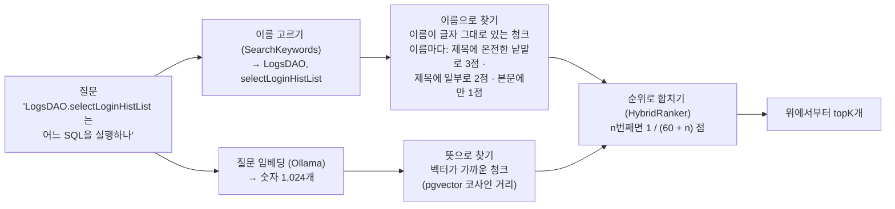

| | 뜻으로 찾기(벡터) | 이름으로 찾기 |
|---|---|---|
| 잘하는 질문 | "로그인 기록을 조회하는 코드" (글자가 달라도 뜻이 가까우면 찾는다) | `LogsDAO.selectLoginHistList`, `TBSY_LOGIN_HIST`, `/logs/getLoginHistList.ajax` (정확한 이름) |
| 못하는 질문 | 정확한 이름을 맨 위로 올리기 | 한글 낱말, 이름이 없는 질문 |
| 임베딩이 필요한가 | 필요하다 | 필요 없다. 임베딩 전에도, Ollama가 내려가 있어도 된다 |

**합치는 계산 예.** 세 청크가 두 목록에서 이렇게 나왔다고 하자. 이름 점수는 질문에서 골라낸 이름마다 매겨 더한다. 제목에 다른 글자와 붙지 않은 온전한 낱말로 있으면 3점, 제목 안에 일부로 들어 있으면 2점, 본문에만 있으면 1점이다.

| 청크 | 벡터 순위 | 이름 순위(이름 점수) | 합친 점수 |
|---|---|---|---|
| A `LogsDAO#selectLoginHistList(LoginHistVO)` | 2 | 1 (제목에 두 이름 다 → 6점) | 1/62 + **2** × 1/61 = 0.0489 |
| B `logs.selectLoginHistList` (SQL) | 1 | 2 (제목에 `selectLoginHistList` → 3점 이상) | 1/61 + **2** × 1/62 = 0.0487 |
| C 뜻만 비슷한 다른 메소드 | 3 | 없음 | 1/63 = 0.0159 |

- 점수 자체(유사도 0.8, 이름 점수 6)는 더하지 않는다. 단위가 달라서다. "몇 번째였나"만 쓴다.
- 이름 점수가 3 이상이면(제목에 이름이 온전한 낱말로 있으면) 이름 순위로 받는 점수를 두 배로 친다. 그래서 A가 맨 위로 온다.
- 양쪽에 다 나온 것(A, B)이 한쪽에만 나온 것(C)보다 훨씬 위다.

### 0.11 임베딩은 분석과 따로 돈다

글을 벡터로 바꾸는 일은 이 환경(GPU 없는 CPU)에서 가장 느리다. 짧은 청크는 0.5초, 긴 청크는 4초쯤 걸린다. 그래서 분석 Job에 넣지 않고 따로 뺐다.

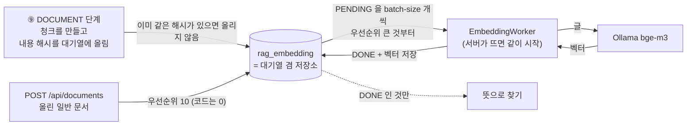

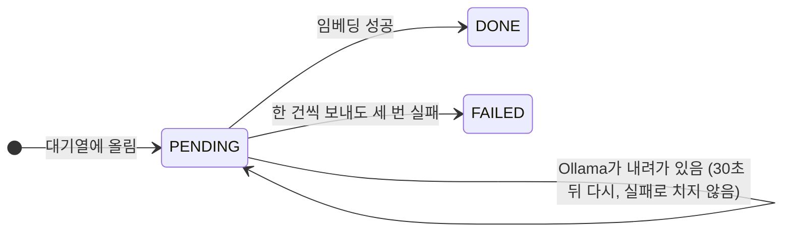

- **열쇠가 `(내용 해시, 모델)`이다.** 같은 글은 리비전이 달라도, 분석을 다시 돌려도 한 번만 임베딩한다. 소스를 조금 고쳐 다시 분석하면 바뀐 청크만 새로 임베딩된다.
- **Job이 `DONE`이어도 임베딩은 아직일 수 있다.** 진행 상황은 `GET /api/revisions/{id}/rag`(리비전별)와 `GET /api/system/embedding`(대기열 전체)으로 본다. 그동안에도 이름으로 찾는 검색은 된다.
- 임베딩은 사람이 따로 시작시키지 않는다. 테이블이 곧 대기열이라 서버가 죽었다 살아나도 남은 것부터 이어서 한다.

### 0.12 증분 분석 한 장

소스를 조금 고쳤을 때 전체를 다시 하지 않는 방법이다. **결과물(리비전)은 전체 분석과 똑같고, 만드는 길만 짧다.**

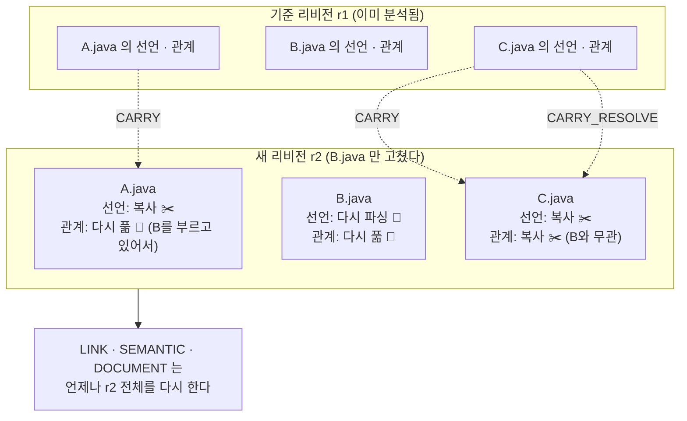

| 무엇 | 언제 복사하나 | 까닭 |
|---|---|---|
| 선언(타입·메소드·필드·참조), SQL statement, 설정 | 파일의 경로·내용 해시·분류가 기준 리비전과 같으면 | 파일 하나만 보면 정해지는 결과다 |
| 풀린 관계 | 파일이 같고, **그 파일이 가리키던 대상도 바뀌지 않았으면** | A가 그대로여도 A가 부르는 B가 바뀌면 다시 풀어야 한다 |
| 재정의, 진입점, SQL·테이블·화면 관계, 문서 | 복사하지 않는다 | 리비전 전체를 봐야 정해진다. SQL로만 도는 단계라 다시 해도 빠르다 |

헷갈리면 다시 푼다. 다시 푼다고 결과가 틀려지지는 않고 시간만 더 든다(4.14절).

### 0.13 DB 지도

테이블 21개를 "무엇을 담는가"로 묶으면 다섯 덩어리다. 선은 논리적인 연결이다(행이 많은 테이블에는 실제 FK를 걸지 않았다. 5장).

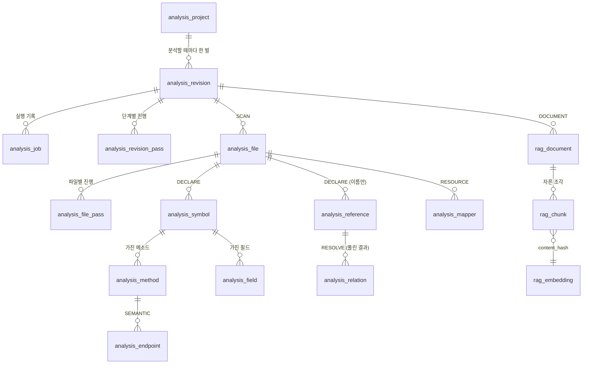

| 덩어리 | 테이블 | 한 줄 설명 |
|---|---|---|
| 🗂️ 관리 | `analysis_project`, `analysis_revision`, `analysis_job`, `analysis_revision_pass`, `analysis_file_pass` | 무엇을 언제 어디까지 분석했나 |
| 📄 재료 | `analysis_file`, `analysis_symbol`, `analysis_method`, `analysis_field`, `analysis_annotation`, `analysis_reference` | 소스에 **적혀 있는** 것 |
| 🔗 지도 | `analysis_relation`, `analysis_endpoint`, `analysis_mapper`, `analysis_config`, `analysis_resource` | 분석이 **이어 준** 것 |
| 🩺 품질 | `analysis_error`, `analysis_metric` | 못 한 것과 얼마나 잘했나 |
| 🔎 검색 | `rag_document`, `rag_chunk`, `rag_embedding` | 지도를 글로 적은 것과 그 벡터 |

`kg_node` / `kg_edge`는 테이블이 아니라 위의 것을 그래프 모양(점과 선)으로 보여 주는 VIEW다.

**하나만 고른다면 `analysis_relation`이다.** 0.5절 그림의 화살표가 모두 이 테이블의 행이다. 한 행은 `(어디서 from_id) ─ (무슨 관계 relation_type) → (어디로 to_id 또는 to_external)` + 신뢰도 + 근거가 된 파일과 줄이다.

### 0.14 코드 지도

"이 일은 어느 클래스가 하나"를 찾을 때 쓴다. 패키지 하나가 일 하나다.

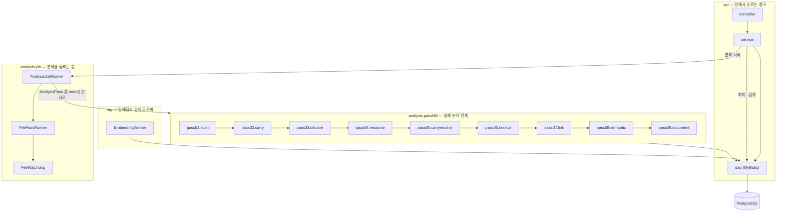

| 궁금한 것 | 열어 볼 곳 |
|---|---|
| 화면과 중계(`dstone-boot`) | `WEB-INF/views/knowledge/index.jsp`, `knowledge/assets/js/project.js` · `knowledge-common.js`, `knowledge.controller.KnowledgeProxyController` → `knowledge.service.KnowledgeProxyService`(4.1절, 4.17절) |
| 분석 시작 요청이 어떻게 처리되나 | `api.controller.ProjectController` → `api.service.AnalysisService#startAnalysis` |
| 단계를 차례로 돌리는 곳 | `analysis.job.AnalysisJobRunner#runJob` |
| 파일을 하나씩 처리하고 실패를 막는 곳 | `analysis.job.FilePassRunner#handleFile`, `analysis.job.FileWatchdog` |
| 증분 분석(바뀌지 않은 파일 옮기기) | `analysis.pass02.carry.CarryPass`, `analysis.pass05.carryresolve.CarryResolvePass`, `sqlmap/analysis/CarryDao.xml`, 기준 리비전 고르기 `AnalysisService#findBaseRevision`(4.14절) |
| 파일 종류와 인코딩을 알아내는 곳 | `analysis.pass01.scan.FileClassifier`, `analysis.common.EncodingDetector` |
| Java 소스에서 선언과 참조를 뽑는 곳 | `analysis.pass03.declare.DeclarationCollector` (Lombok은 `LombokExpander`, Java 문자열 SQL은 `JavaSqlCollector`) |
| JSP를 Java로 바꾸는 곳 | `analysis.pass03.declare.JspToJava` |
| 호출이 누구를 가리키는지 정하는 규칙 | `analysis.pass06.resolve.ReferenceResolver` |
| 메모리를 묶어 두는 타입 해석기 | `analysis.pass06.resolve.DbTypeSolver`, `analysis.common.BoundedCache` |
| 매퍼 XML을 읽는 곳 / SQL에서 테이블을 뽑는 곳 | `analysis.pass04.resource.MapperXmlReader` / `analysis.common.SqlTableExtractor` |
| 진입점과 계층을 정하는 규칙 | `conf/rules/{projects,common,guess}/**/*.yml`(4.7절)을 `analysis.pass08.semantic.rule.RuleFiles`가 읽고, 절마다 하나인 처리기(`LayerResolver`, `EntryFinder`, `SqlLinker` …)가 적용한다 |
| `getLogsmapper() + "selectLoginHistList"`를 계산하는 곳 | `analysis.pass08.semantic.ConstantEvaluator` |
| 검색용 글을 짓는 곳 | `analysis.pass09.document.CodeDocumentBuilder`, `ResourceDocumentBuilder` |
| 임베딩 대기열을 비우는 곳 | `rag.EmbeddingWorker` |
| 검색 / 순위 합치기 | `api.service.SearchService`, `rag.HybridRanker`, `rag.SearchKeywords` |
| 영향도 / 호출 그래프 / 리비전 비교 | `api.service.ImpactService` / `CallGraphService` / `DiffService` |
| 노드 맵 | `api.service.GraphService`, `sqlmap/analysis/GraphDao.xml` |
| 규칙 진단·후보·시험 적용 | `api.service.DiagnosticService`, `api.service.RuleService` |
| 실제 SQL | `src/main/resources/sqlmap/analysis/*Dao.xml` (조회의 대부분은 Java가 아니라 여기에 있다) |

새 기능을 붙이는 자리도 정해져 있다. **새 분석 단계**는 `AnalysisPass`를 구현한 빈을 만든다. **새 프레임워크 관례**는 먼저 규칙 파일에 적고, 규칙으로 안 되는 것만 `SemanticStep`을 구현한 빈을 만들어 `SemanticPass.steps()`의 알맞은 자리에 넣는다.

### 0.15 직접 해 보기

서버와 DB가 떠 있으면(7장) 아래 순서로 0.5절의 내용을 눈으로 확인한다. Ollama가 없어도 ④까지는 된다.

```bash
B=http://localhost:4081/api

# ① 프로젝트 등록 (소스 폴더를 알려 준다. 폴더 안의 WEB-INF/lib/*.jar 는 따로 적지 않아도 쓴다)
curl -X POST $B/projects -H 'Content-Type: application/json' \
     -d '{"projectId":"cms4_prd","localPath":"/app/sampleApps/cms4_prd"}'

# ② 분석 시작 → 응답의 analysisId, revisionId 를 적어 둔다
curl -X POST $B/projects/cms4_prd/analyses -H 'Content-Type: application/json' -d '{}'

# ③ 끝났는지 보기 (status 가 DONE 이면 끝. 이 프로젝트는 2분이 안 걸린다)
curl $B/analyses/{analysisId}

# ④ 지도 걸어 보기 ({rev} 는 ②의 revisionId)
curl "$B/revisions/{rev}/endpoints?type=HTTP"                    # 주소와 처리 메소드
curl "$B/revisions/{rev}/methods?owner=LogsController&name=getLoginHistList"   # methodId 얻기
curl "$B/revisions/{rev}/methods/{methodId}/callees?depth=4"     # 그 메소드에서 테이블까지
curl "$B/revisions/{rev}/tables/TBSY_LOGIN_HIST"                 # 이 테이블을 건드리는 SQL 과 메소드
curl "$B/revisions/{rev}/impact?table=TBSY_LOGIN_HIST"           # 고치면 닿는 메소드, 진입점, 화면

# ⑤ 검색 (임베딩이 끝나야 뜻으로 찾힌다. 진행 상황: GET $B/revisions/{rev}/rag)
curl -X POST $B/search -H 'Content-Type: application/json' \
     -d '{"projectId":"cms4_prd","query":"로그인 기록 조회 화면","topK":3}'
```

`cms4_prd`는 저장소 밖에 있는 소스다. 없는 환경이라면 저장소 안의 `struts-app` 표본(`dstone-knowledge/src/test/resources/samples/struts-app`, 몇 초면 끝난다)으로 같은 순서를 따라 하면 된다. 기대 값은 그 폴더의 `README.md`에 있다.

화면으로 보려면 `dstone-boot`의 "코드 분석(Knowledge)" 메뉴를 연다(4.17절). 같은 API를 화면이 대신 불러 준다.

### 0.16 자주 헷갈리는 것

| 질문 | 답 |
|---|---|
| LLM이 코드를 읽고 분석하는 것 아닌가 | 아니다. 분석은 모두 정해진 규칙(파서와 SQL)으로 한다. 이 모듈에는 채팅 모델이 없다. 같은 소스를 넣으면 언제나 같은 결과가 나온다 |
| 벡터 DB에 소스를 넣는 RAG와 무엇이 다른가 | 소스를 그대로 자르지 않는다. 분석으로 알아낸 사실(주소, 부르는 곳, 테이블)을 글로 적어 넣는다. 검색 말고도 호출 관계·영향도를 정확히 조회한다 |
| 대상 프로젝트를 빌드해야 하나 | 아니다. 소스 폴더만 있으면 된다. 라이브러리 jar가 있으면 더 정확해질 뿐이다 |
| Spring 프로젝트만 되나 | 아니다. ①~⑦은 프레임워크를 모른다. ⑧의 규칙 파일과 처리기가 Spring, 서블릿, Struts, MyBatis/iBATIS, JPA, JSP, WebSquare/Nexacro를 맡고, 맞는 것이 없어도 호출 관계까지는 정상으로 나온다 |
| 분석이 끝났는데 검색이 안 된다 | 임베딩이 아직 돌고 있거나 Ollama가 내려가 있다. `GET /api/revisions/{id}/rag`를 본다. 질문에 클래스·메소드 이름을 넣으면 임베딩 없이도 찾힌다 |
| 결과에 `LOW`가 붙어 있다 | 이름만 보고 짐작한 것이다. 절반은 틀린다고 보고 참고로만 쓴다. 대상 프로젝트의 jar를 `classpath`로 주면 줄어든다 |
| 영향도 결과가 "전부"인가 | 아니다. 저장된 관계만 따라간다. 리플렉션, 문자열로 조립한 주소, 파라미터로 받은 SQL 조각은 잇지 못한다(0.9절 "사슬이 끊기는 곳") |
| 리비전이 계속 쌓이지 않나 | 프로젝트마다 분석이 끝난 리비전을 최근 5개만 남기고 자동으로 지운다(4.16절) |
| 분석 도중 서버가 죽으면 | 다시 띄우고 같은 리비전 라벨로 분석을 시작하면 끝난 단계와 끝난 파일을 건너뛰고 이어서 한다 |
| 규칙 파일을 고쳤는데 결과가 그대로다 | 규칙은 SEMANTIC 단계에서만 쓴다. 같은 리비전 라벨에 `rerunFrom: "SEMANTIC"`을 주고 다시 돌린다(4.7절) |

여기까지가 전체 그림이다. 더 깊이 들어갈 때는 단계별 규칙은 4장, 테이블은 5장, 설정은 6장, 실행은 7장, API는 8장을 보면 된다.

## 1. 개요

Java 애플리케이션을 정적 분석해서 **구조와 관계를 먼저 구조화된 데이터로 만들고**, 그 결과를 Knowledge Graph와 RAG 청크 양쪽으로 내보내는 모듈이다. 소스를 잘게 잘라 벡터 DB에 넣는 방식이 아니다.

| 항목 | 내용 |
|---|---|
| 분석 대상 | Spring / Spring Boot 애플리케이션과 **구버전 일반 Java 프로그램**(Java 1.4~7 문법, 애노테이션 이전의 XML 설정, 서블릿, 직접 JDBC, JSP), Struts 1·2, MyBatis·iBATIS·JPA, WebSquare·Nexacro 화면 |
| 실행 형태 | 실행 JAR, 포트 4081, 루트 패키지 `net.dstone.knowledge` |
| 저장소 | PostgreSQL + pgvector (`dstone_knowledge` DB) |
| 임베딩 | Ollama `bge-m3`(1,024차원). Spring AI의 `EmbeddingModel`만 쓴다 |
| 배포 | VM 스타일(`bin/*.sh`). 분석 대상의 소스 폴더를 직접 읽어야 해서 Pod가 아니라 프로세스로 띄운다 |
| 화면 | 이 모듈에는 없다. `dstone-boot`의 "코드 분석(Knowledge)" 메뉴가 REST API를 중계한다(4.17절) |
| 원 설계서 | `docs/temp/Java_Application_Knowledge_Graph_RAG_Analysis_Platform_설계서_v1.0.docx`. 이 문서는 그 설계를 이 저장소에 맞게 조정한 결과와 지금 상태를 적는다 |

### 1.1 할 수 있는 일

| 하고 싶은 일 | 쓰는 기능 | 자세히 |
|---|---|---|
| 소스 폴더를 분석해 결과 한 벌(리비전)을 만든다 | 분석 Job(9단계) | 4.1~4.10절 |
| 이 메소드가 무엇을 부르는지, 누가 이 메소드를 부르는지 본다 | 호출 그래프 `/callees`, `/callers` | 0.9절, 8장 |
| 테이블·SQL·메소드를 고치면 닿는 진입점과 화면을 본다 | 영향도 분석 `/impact` | 4.11절 |
| 뜻이나 이름으로 코드를 찾는다 | 하이브리드 검색 `/api/search` | 4.8절 |
| 설계서·매뉴얼 같은 일반 문서도 같이 찾는다 | 문서 올리기 `/api/documents` | 4.12절 |
| LLM Agent가 위 기능을 쓰게 한다 | `dstone-ai-engine`의 `KnowledgeTool` | 4.13절 |
| 바뀐 파일만 다시 분석한다 | 증분 분석 | 4.14절 |
| 두 시점의 차이를 메소드·SQL·테이블 단위로 본다 | 리비전 비교 `/diff` | 4.15절 |
| 호출 구조를 그림으로 본다 | 노드 맵 `/graph` | 4.18절 |
| 처음 보는 프레임워크 관례를 알려 준다 | 규칙 파일 `conf/rules`, 적용 진단·후보·시험 적용 | 4.7절 |

### 1.2 다른 모듈과의 관계

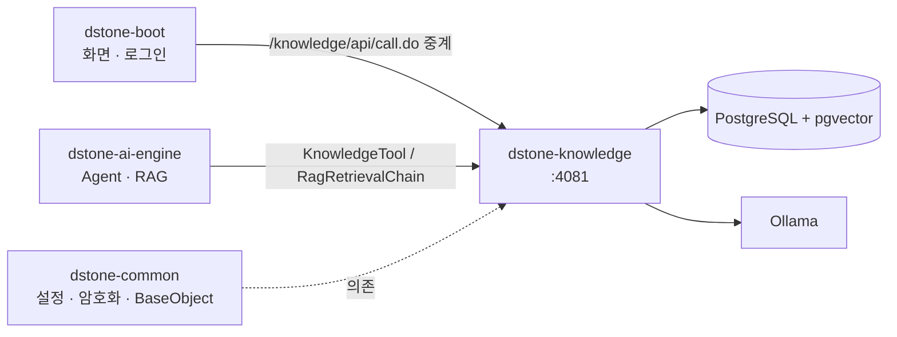

- **`dstone-common`**: 설정 읽기(`ConfigProperty`), `ENC(...)` 복호화, 공통 기반 클래스를 쓴다.
- **`dstone-boot`**: 사람이 쓰는 화면이 여기에 있다. 브라우저는 이 모듈을 직접 부르지 않는다.
- **`dstone-ai-engine`**: Agent가 Tool로 분석 결과를 묻고(`KnowledgeTool`), RAG가 올린 문서를 이 모듈의 검색으로 찾는다. 예전에 `dstone-ai-engine` 안에 있던 문서 임베딩·RAG 검색 기능은 이 모듈로 옮겨 왔다.
- **이 모듈은 LLM 채팅을 하지 않는다.** 질의 분류와 답변 생성은 `dstone-ai-engine`의 Agent가 맡고, 이 모듈은 결정론적인 분석 결과와 검색 결과만 돌려준다.

### 1.3 구축 단계와 현재 상태

M0부터 M9까지 마일스톤 10개로 나눠 만들었다. "마일스톤"은 만든 순서이고, 분석 공정의 "단계(패스)"와는 다른 말이다.

| 마일스톤 | 내용 | 주로 만든 단계 / 테이블 | 상태 |
|---|---|---|---|
| **M0** | 모듈 골격, 스키마, 검증 표본 | — | 완료 |
| **M1** | 파일 수집, 인코딩·문법 수준·소스 루트 탐지, 선언(Lombok 멤버 포함), DB 기반 타입 해석기 | SCAN, DECLARE / `analysis_file`, `analysis_symbol` 등 | 완료 |
| **M2** | 참조 풀기, 호출 그래프, 신뢰도, 구현 후보, 품질 지표, 호출자/피호출자 API | RESOLVE, LINK / `analysis_relation`, `analysis_metric` | 완료 |
| **M3** | 진입점과 계층(Spring, `main`, 서블릿, `web.xml`, `Runnable`, 이름 규칙) | SEMANTIC / `analysis_endpoint` | 완료 |
| **M4** | 코드 RAG: 문서·청크, 임베딩 대기열, 벡터 검색 (여기까지가 MVP) | DOCUMENT / `rag_*` | 완료 |
| **M5** | MyBatis·iBATIS·Struts·JSP·설정·빌드 파일·Spring XML, SQL 테이블 CRUD, 리치클라이언트 화면 | RESOURCE, SEMANTIC 처리기 / `analysis_mapper` 등 | 완료 |
| **M6** | 일반 문서 수집(Tika, 호출자 격리), 하이브리드 검색, 영향도 분석, `dstone-ai-engine` Tool | API | 완료 |
| **M7** | 증분 분석, 리비전 비교, 보관 정책 | CARRY, CARRY_RESOLVE | 완료 |
| **M8** | 화면(`dstone-boot`에 둠): 분석 관리, 검색, 영향도, 노드 맵, 비교, 사용 안내 | — | 완료 |
| **M9** | 이관: `dstone-ai-engine`의 임베딩·RAG와 `dstone-boot`의 소스 분석기를 이 모듈로 대체 | — | `dstone-ai-engine` 쪽 완료. `dstone-boot` 분석기는 남음 |

M8까지 끝난 뒤에도 기능을 계속 더했다. 지금 들어 있는 주요 기능은 이렇다.

- **규칙 파일**(`conf/rules`, 코드 모양 그대로 적는 형식): 프레임워크 관례를 Java가 아니라 파일로 적는다. 적용 진단, 후보 제안, 시험 적용 API가 함께 있다(4.7절).
- **Java 문자열 SQL과 JPA**: 매퍼 없이 코드에 적은 SQL, `@Query`·`@NamedQuery`·Spring Data 메소드 이름 쿼리도 테이블과 잇는다(분석기 버전 1.2, 4.3절·4.7.4절).
- **주소 상수와 상속된 주소**: `@RequestMapping(Urls.ORDER)`처럼 상수로 적은 주소와 상위 클래스·인터페이스에 적은 주소를 계산한다(4.7절).
- **이름 사전**: 메소드 기능명, 화면명, 테이블·컬럼 한글명을 소스·DDL·SQL 주석·사전 파일·DB 코멘트에서 모은다(4.18절).

**M9의 남은 일**: `dstone-boot`의 소스 분석기(`AppAnalyzer`와 `analyzer` 패키지, `analyzeDB`, 결과 화면 `ReportController`)를 이 모듈로 대체하고 원래 코드를 걷어낸다. 지우는 일이라 되돌리기 어렵다. 먼저 기능을 하나씩 대조한 표를 만들고, 사용자가 확인한 뒤에 걷어낸다.

## 2. 설계 원칙

모든 단계가 지키는 약속이다. 새 기능을 더할 때도 이 여덟 가지를 깨지 않는다.

| # | 원칙 | 무슨 뜻인가 | 그래서 코드에서는 |
|---|---|---|---|
| 1 | **분석 모델이 먼저, RAG는 그다음** | RAG 문서는 분석 결과에서 만든 파생물이다 | `rag_*`는 언제든 다시 만든다. 원본은 `analysis_*`뿐이다 |
| 2 | **LLM이 호출 관계를 추측하지 않는다** | 컴파일러처럼 심볼을 해석해서 정한다 | JavaSymbolSolver + DB 심볼 색인으로 푼다. 이 모듈에는 채팅 모델이 없다 |
| 3 | **불확실한 것은 지우지 않고 정도를 남긴다** | 모든 관계에 신뢰도와 해석 상태가 있다 | `confidence`(HIGH/MEDIUM/LOW/UNRESOLVED), `resolution_status`, 실패한 파일은 `analysis_error`, 못 푼 참조는 `fail_reason` |
| 4 | **분석은 DB에 쓰면서 진행한다** | 큰 프로젝트의 AST를 메모리에 다 올리면 OutOfMemoryError가 난다 | 파일 하나를 처리하면 바로 DB에 쓰고 버린다. 필요한 힙이 프로젝트 크기와 상관없이 일정하다 |
| 5 | **코어는 프레임워크를 모른다** | 스캔, AST, 심볼, 호출 그래프는 순수 Java만으로 끝난다 | Spring도 규칙 파일 가운데 하나(`common/spring.yml`)일 뿐이다. 맞는 규칙이 하나도 없어도 그래프와 RAG까지 나온다 |
| 6 | **컴파일하면 생기는 멤버도 심볼이다** | Lombok getter, 기본 생성자, record 접근자는 소스에 없지만 호출된다 | DECLARE가 `is_synthetic = true`인 정식 메소드로 넣는다. delombok은 줄 번호가 바뀌어 쓰지 않는다 |
| 7 | **임베딩은 내용 해시로 한 번만** | 임베딩이 가장 느린 작업이다 | 키가 `(content_hash, model)`. 분석 Job과 분리된 대기열이고, 중간에 죽어도 이어서 한다 |
| 8 | **리비전은 1급 개념** | 분석 결과는 시점마다 통째로 한 벌이다 | 모든 행에 `revision_id`. 심볼 ID는 리비전과 무관한 해시라 두 리비전을 바로 견준다. 오래된 리비전은 보관 정책이 지운다 |

이 밖에 지키는 것:

- **이름은 계산하고 추측하지 않는다.** SQL 이름, 거래 ID, 화면 경로는 따옴표 리터럴과 상수로 계산될 때만 잇는다.
- **비밀값은 저장하지 않는다.** 설정 값 가운데 비밀번호·키로 보이는 것은 `****`로 바꿔 넣는다.
- **밖에 접속하지 않는다.** 분석 대상의 XML은 `common.util.SafeXml`로 읽어 인터넷의 DTD를 가져오지 않는다.
- **이 모듈의 Java 코드는 Lombok과 람다를 쓰지 않는다**(저장소 규칙). 분석 대상의 Lombok을 읽는 것과는 별개다.

## 3. 모듈 구성

### 3.1 폴더

```
dstone-knowledge/
├── bin/                 startApp.sh / stopApp.sh / statusApp.sh, startApp.bat / stopApp.bat
├── conf/
│   ├── env.properties, env-wsl.properties, env-vm.properties    환경별 변수(APP_HOME, DB_HOST …)
│   ├── application.yml  설정(6장)
│   ├── log4j2.xml       로그 설정
│   └── rules/           의미 분석 규칙 파일(4.7절): projects/ · common/ · guess/
├── Jenkinsfile
└── src/
    ├── main/java/net/dstone/knowledge/
    │   ├── DstoneKnowledgeApplication.java
    │   ├── api/               REST 창구: controller → service → dao
    │   ├── analysis/          분석 파이프라인
    │   │   ├── job/                 Job 실행기와 단계 규약
    │   │   ├── common/              여러 단계가 같이 쓰는 도구
    │   │   ├── pass01/scan/         SCAN
    │   │   ├── pass02/carry/        CARRY (증분)
    │   │   ├── pass03/declare/      DECLARE (declare/model: 저장용 행 클래스)
    │   │   ├── pass04/resource/     RESOURCE
    │   │   ├── pass05/carryresolve/ CARRY_RESOLVE (증분)
    │   │   ├── pass06/resolve/      RESOLVE (resolve/model: 저장용 행 클래스)
    │   │   ├── pass07/link/         LINK
    │   │   ├── pass08/semantic/     SEMANTIC과 처리기(rule / layer / entry / wiring / sql / view / screen / dictionary)
    │   │   └── pass09/document/     DOCUMENT
    │   ├── rag/               임베딩 작업, 검색 도우미, 문서 글 뽑기 (rag/model: 저장용 행 클래스)
    │   └── common/            config · biz · exception · security · util · web
    ├── main/resources/
    │   ├── schema/            01-init(롤·DB·확장) · 02-create-table(테이블·VIEW·코멘트) · 03.truncate(데이터 비우기)
    │   └── sqlmap/            MyBatis 매퍼 (analysis/*Dao.xml, system/SystemDao.xml)
    ├── test/java/             단위 테스트 (DB·Spring 없이 도는 것만)
    └── test/resources/samples/   검증 표본 7개(7.4절)
```

단계 패키지의 번호(`pass01` …)는 실행 순서다. 실제 순서는 각 단계의 `order()` 값이 정하므로, 단계를 끼워 넣을 때는 둘을 같이 맞춘다.

### 3.2 패키지별 클래스

| 패키지 | 클래스와 하는 일 |
|---|---|
| `analysis.job` | `AnalysisJobRunner`(단계를 `order()` 순서로 실행, 끝난 단계는 건너뜀), `AnalysisPass`(단계 인터페이스), `AnalysisJobContext`(Job이 도는 동안 단계들이 함께 보는 정보와 취소 표시), `AnalysisJobReporter`(진행 건수·heartbeat·오류 기록), `AnalysisJobRecovery`(기동할 때 끝나지 못한 Job 정리), `FilePassRunner` + `FileHandler` + `FileResult`(파일 단위 단계의 공통 실행기), `FileWatchdog`(끝나지 않는 파일 처리를 버리는 감시자), `JobCancelledException` |
| `analysis.common` | `EncodingDetector`(파일별 인코딩 감지), `BoundedCache`(크기가 정해진 LRU 캐시), `SqlTableExtractor`(SQL에서 테이블·CRUD·컬럼·주석 한글명 뽑기) |
| `analysis.pass01.scan` | `ScanPass`, `FileClassifier`(언어와 용도 분류), `ScannedFile` |
| `analysis.pass02.carry` | `CarryPass`(같은 파일의 선언과 자원을 앞 리비전에서 복사). SQL만 쓴다(`CarryDao`) |
| `analysis.pass03.declare` | `DeclarePass`, `JavaSourceParser`(파싱과 문법 수준 탐지), `DeclarationCollector`(AST에서 선언과 참조 수집), `LombokExpander`(Lombok이 만드는 멤버), `JspToJava`(JSP 안의 Java 코드를 Java 소스로), `JavaSqlCollector`(Java 문자열 SQL) |
| `analysis.pass04.resource` | `ResourcePass`, `MapperXmlReader`(MyBatis·iBATIS 매퍼, 쿼리 XML), `ResourceReaders`(`.properties`, YAML, `pom.xml`, `build.gradle`, Spring XML), `DdlReader`(DDL의 테이블·컬럼 설명) |
| `analysis.pass05.carryresolve` | `CarryResolvePass`(풀린 관계를 옮겨도 되는 파일을 가려 복사) |
| `analysis.pass06.resolve` | `ResolvePass`, `ReferenceResolver`(참조 하나하나를 푸는 규칙), `DbTypeSolver`(프로젝트 타입을 DB 색인으로 찾는 해석기), `ClasspathResolver`(분석 대상의 jar 찾기) |
| `analysis.pass07.link` | `LinkPass`(재정의, 가능한 구현, 품질 지표) |
| `analysis.pass08.semantic` | `SemanticPass`(처리기 순서 `steps()`), `SemanticStep`(처리기 인터페이스), `ConstantEvaluator`(문자열 상수 계산), `AnnotationValues` |
| `… .semantic.rule` | 규칙 파일 읽기: `RuleFiles`(Spring 빈. 폴더 읽기, 기동 검사, 프로젝트별 고르기), `RuleFileParser`(YAML → `RuleFile`, 엄격 검사), `CodePattern`(패턴 글자 해석), 모델 `Rule` · `RuleFile` · `ProjectRules` · `Tier`, `RuleException` |
| `… .semantic.layer` | `LayerResolver` ← `layer:` |
| `… .semantic.entry` | `EntryFinder` ← `entry:` (+ `HttpEndpointBuilder` 주소 계산, `XmlEndpointReader` 설정 XML), 규칙 없이 표준 파일을 읽는 `ServletEntries` + `WebXmlReader`, `StrutsEntries` + `StrutsConfigReader` |
| `… .semantic.wiring` | `WiringMarker` ← `inject:` `proxy:` |
| `… .semantic.sql` | `JpaQueryReader` ← `jpa:`, `MapperLinker`(매퍼 인터페이스, SQL → 테이블), `SqlLinker` ← `sql:`, `JavaSqlLinker`(Java 문자열 SQL · JPA → 테이블), `StatementIndex`, `JpaEntities`, `JpqlTableExtractor` |
| `… .semantic.view` | `ViewLinker` ← `view:` |
| `… .semantic.screen` | `JspLinker`(JSP), `ScreenLinker` ← `screen:` call/field/open (+ `ScreenScript`, `ScriptFunctions`, `ScriptSources`, `IdTransform`), `ScreenMenuReader` + `ScreenMenu` ← `screen:` menu, `ScreenTitle` |
| `… .semantic.dictionary` | 이름 사전: `MethodTitlePlugin`(기능명), `SourceNamePlugin`(소스의 테이블·컬럼 한글명), `ScreenDictionaryPlugin` + `ScreenDictionaryReader`(화면 사전), `TableDictionaryPlugin` + `DictionaryFileReader`(테이블 사전), `DbCommentReader`(대상 DB 코멘트, 조회할 때만) |
| `analysis.pass09.document` | `DocumentPass`, `CodeDocumentBuilder`(Java 문서), `ResourceDocumentBuilder`(SQL·화면 문서), `TextChunker`(일반 문서 청크 자르기) |
| `rag` | `EmbeddingWorker`(대기열을 비우는 백그라운드 작업), `EmbeddingGate`(검색 중에는 임베딩이 양보), `RagSettings`(모델명·차원 등 RAG 설정), `SearchKeywords`(질문에서 이름 고르기), `HybridRanker`(두 검색 결과를 순위로 합치기), `DocumentTextExtractor`(올린 파일에서 글 뽑기, Tika) |
| `api.controller` | `ProjectController`, `AnalysisController`, `RevisionController`, `ResourceController`, `GraphController`, `SearchController`, `DocumentController`, `RuleController`, `SystemController` |
| `api.service` | `ProjectService`, `AnalysisService`, `RevisionService`, `SymbolService`, `CallGraphService`, `ImpactService`, `GraphService` + `GraphNodeId`, `DiffService`, `RetentionService`, `ResourceService`, `TableDictionaryService`, `SearchService` + `SearchQuery`, `UploadDocumentService`, `EmbeddingStatusService`, `DiagnosticService`(적용 진단), `RuleService`(규칙 목록·비교·후보·시험 적용), `DocumentSections`(문서를 설명과 소스로 나누기) |
| `api.dao` | MyBatis Dao 18개(`common.biz.BaseDao` 상속). SQL은 `sqlmap/analysis/*Dao.xml` |
| `common.config` | `Config`, `ConfigDatasource`(DataSource, MyBatis 세션 둘), `ConfigMapper`, `ConfigTransaction`(`txTemplateCommon`), `ConfigJob`(분석 Job 스레드 풀) |
| `common.security` | `ApiKeyAuthFilter`(`X-API-Key` 확인), `CallerContext`(이 요청의 호출자) |
| `common.web` | `RequestClockFilter`(요청이 들어온 시각을 적어 둔다. 부른 쪽이 먼저 연결을 끊었을 때 몇 초 만에 끊었는지 로그에 남기는 데 쓴다) |
| `common.exception` | `ApiException`, `ApiExceptionHandler`(오류를 `{status, message}`로) |
| `common.util` | `ErrorText`(예외를 글로), `HashText`(해시), `JsonText`(한 줄 JSON), `SafeXml`(밖에 접속하지 않는 XML 읽기), `TableName`(스키마를 뗀 대문자 테이블 이름), `KoreanName`(한글명 판정), `MethodTitle`(주석에서 기능명 고르기), `SqlFormatter`(SQL 줄바꿈 정리) |

### 3.3 DB 접근

- DataSource는 `dataSourceCommon` 하나다(`spring.datasource.common.hikari.*`).
- MyBatis 세션이 둘이다.
  - `sqlSessionCommon`: 일반 조회와 단건 변경.
  - `sqlSessionBatch`: 대량 저장용(`ExecutorType.BATCH`). 같은 SQL을 모아 한 번에 보낸다. 트랜잭션 안에서만 쓴다.
- **`sqlSessionBatch` 트랜잭션 안에서는 `sqlSessionCommon`을 쓰지 않는다**(MyBatis 오류가 난다). 그래서 진행 기록과 오류 기록은 트랜잭션이 끝난 뒤에 한다. 트랜잭션 안에서 쓰는 Dao 메소드는 이름이 `...InBatch`로 끝난다.
- 트랜잭션은 다른 모듈처럼 Service 메소드 이름에 AOP로 걸지 않는다. 분석은 몇 시간씩 돌 수 있어서 "파일 하나마다 커밋"처럼 코드에서 범위를 정하도록 `txTemplateCommon`(`TransactionTemplate`)을 쓴다.
- 새 DB 코드도 MyBatis로 쓴다: `sqlmap/analysis/` 아래 `*Dao.xml` + `BaseDao` 상속.

## 4. 분석 파이프라인

전체 AST를 들고 있지 않고 파일 단위로 여러 번 지나간다. 단계마다 "메모리에 남는 것"이 작게 묶여 있는 것이 핵심이다.

| 단계 (순서) | 하는 일 | 메모리에 남는 것 |
|---|---|---|
| SCAN (100) | 파일 수집, 인코딩 감지, 체크섬 계산 → `analysis_file` | 없음(`commit-size`개씩 쓰고 비운다) |
| CARRY (150) | 증분 분석일 때만: 앞 리비전과 내용이 같은 파일의 DECLARE / RESOURCE 결과를 복사(4.14절). 전체 분석이면 아무것도 하지 않는다 | 없음(SQL만) |
| DECLARE (200) | Java 파일 1개 파싱 → 타입/메소드/필드/애노테이션(Lombok 멤버 포함), 아직 대상을 모르는 참조, Java 문자열 SQL 저장. JSP도 안의 Java 코드를 Java로 바꿔 같은 길로 보낸다 | 지금 파일 하나 |
| RESOURCE (250) | Java가 아닌 파일 1개 읽기 → SQL statement, 설정 값, 의존성, Spring 빈, DDL. 읽어서 저장만 한다(4.10절) | 지금 파일 하나 |
| CARRY_RESOLVE (290) | 증분 분석일 때만: 풀린 관계를 옮겨도 되는 파일을 가려 복사(4.14절) | 없음(SQL만) |
| RESOLVE (300) | Java 파일 1개를 다시 파싱 → 타입은 DB 심볼 색인에 물어 가며 참조를 풀고 `analysis_relation` 저장 | 지금 파일 + 크기 제한 캐시 |
| LINK (400) | 재정의, 인터페이스 구현 후보, 품질 지표를 SQL로 계산 | 없음(SQL만) |
| SEMANTIC (500) | 규칙 파일을 읽어 계층, 진입점, 주입, SQL·테이블, 화면, 이름 사전을 정한다 | 주소·statement 이름 색인(진입점 수, statement 수만큼) |
| DOCUMENT (600) | 파일 단위로 분석 결과와 소스를 엮어 RAG 문서와 청크를 만들고 임베딩 대기열에 올린다 | 지금 파일 하나 |

- 진행 상태는 두 군데에 남는다. 단계 전체가 끝났는지는 `analysis_revision_pass`, 파일 하나하나는 `analysis_file_pass`. 죽어도 이어서 하고, 증분 분석도 같은 구조를 쓴다.
- 모든 단계는 **다시 돌려도 결과가 같게**(멱등) 만든다. 시작할 때 자기가 만든 것을 지우거나, 파일 단위로 지우고 다시 넣는다.
- 오래 도는 루프는 `context.checkCancelled()`를 불러 취소 요청을 확인한다.

### 4.1 Job 실행 방식

#### 분석 요청이 지나는 길

`dstone-boot` → 코드 분석(Knowledge) → **프로젝트 · 분석** 화면에서 [분석 시작]을 누르면 이렇게 흘러간다. 0.6절 그림의 앞뒤를 화면과 중계까지 넓혀 본 것이다.

```
[브라우저]                         [dstone-boot :7081]                  [dstone-knowledge :4081]
project.js                         KnowledgeProxyController              ProjectController
 startAnalysis() ──POST────────▶   /knowledge/api/call.do  ──POST───▶   /api/projects/{id}/analyses
   K.call()                         KnowledgeProxyService                  AnalysisService.startAnalysis()
                                    (경로 검사, X-API-Key)                   ├ 리비전 만들기 / 이어 하기
                                                                            ├ analysis_job INSERT (READY)
                                                                            └ AnalysisJobRunner.submit()  ──▶ 백그라운드 스레드
   ◀──────────── 202 {analysisId, revisionId ...} ◀───────────────────────
 watchJob()  ──3초마다 GET /api/analyses/{analysisId}──────────────────▶  AnalysisService.getAnalysis()
```

**① 화면**(`dstone-boot`의 `WEB-INF/views/knowledge/index.jsp`, `knowledge/assets/js/project.js`). 프로젝트를 고르면 분석 패널이 열린다.

| 입력 | 뜻 | 요청 본문 키 |
|---|---|---|
| 리비전 라벨 | 비우면 서버가 지금 시각으로 짓는다. **이미 있는 라벨이면 그 리비전을 이어서 분석**한다 | `revisionLabel` |
| 이 단계부터 다시 | SCAN ~ DOCUMENT. 이어 하기에서만 쓴다 | `rerunFrom` |
| 바뀐 파일만 다시 분석 | 증분 분석(4.14절). 새 리비전에서만 쓴다 | `incremental` |

빈 칸은 본문에 넣지 않는다. 아무것도 적지 않으면 `{}`(새 리비전, 전체 분석)가 간다. 시작하면 `watchJob()`이 3초마다 `GET /api/analyses/{analysisId}`를 불러, 상태가 `READY`/`RUNNING`이 아니게 될 때까지 Job 배지 · 지금 단계 · 단계별 표 · 앞쪽 오류 20건을 그린다. [취소]는 `POST /api/analyses/{id}/cancel`이다.

**② 중계**(`dstone-boot`의 `knowledge.controller.KnowledgeProxyController` → `knowledge.service.KnowledgeProxyService`). 브라우저는 이 모듈을 직접 부르지 않는다. 모든 호출이 `POST /knowledge/api/call.do`(`{method, path, query, body}`) 하나로 모이고, 로그인한 사용자만 쓴다. 중계는 `GET`/`POST`/`DELETE`만, `/api/`로 시작하고 `..` `//` `?` `#` `\`가 없는 경로만 넘긴다(아니면 400). 기준 주소는 `interface.knowledge.base-url`(없으면 503)이고, `interface.knowledge.api-key`가 있으면 `X-API-Key`를 붙인다. 상태 코드와 본문을 손대지 않고 돌려주며(읽기 제한 120초, 응답 32MB), 연결에 실패하면 502와 `{status, message}`를 돌려준다. 예외를 던지지 않는 까닭은 `dstone-boot`의 공통 예외 처리가 상태 코드를 200으로 바꾸기 때문이다.

**③ 시작 API**(`api.controller.ProjectController` → `api.service.AnalysisService.startAnalysis()`). 202로 곧바로 돌아온다. "돌고 있는 Job이 있나" 확인과 Job 등록 사이에 다른 요청이 끼지 못하게 메소드 전체가 `synchronized`다.

| 순서 | 하는 일 | 실패하면 |
|---|---|---|
| 1 | 프로젝트를 읽고 `localPath`가 실제 폴더인지 본다 | 400 |
| 2 | 같은 프로젝트에 `READY`/`RUNNING` Job이 있는지 본다 | 409 |
| 3 | 라벨을 정한다. 없으면 `yyyyMMdd-HHmmss`. 200자를 넘으면 거절 | 400 |
| 4 | 같은 라벨의 리비전이 있으면 **이어 하기**(`resumed=true`), 없으면 새 리비전. 이어 하기에 `incremental`을 주면 거절 | 400 |
| 5 | 새 리비전이고 증분이면 기준 리비전을 정해 `parent_revision_id`에 적는다. 없거나 분석기 버전이 다르면 전체 분석으로 돌리고 `note`에 까닭을 남긴다(4.14절) | — |
| 6 | `rerunFrom`이 있으면(이어 하기일 때만) 그 단계와 뒤 단계의 "끝남" 표시를 지운다 | 400 |
| 7 | Job ID를 짓는다: `A` + 날짜 + 그날의 일련번호 3자리(`A20261111001`) | — |
| 8 | `analysis_job`을 넣는다(`READY`) | — |
| 9 | `AnalysisJobRunner.submit()`. 대기열이 꽉 찼으면 Job을 `FAILED`로 바꾸고 503 | 503 |
| 10 | `{analysisId, projectId, revisionId, revisionLabel, resumed, incremental, baseRevisionId, note, rerunPasses, status}`를 돌려준다 | — |

**④ 끝난 뒤.** 마지막 단계가 끝나면 Job은 `DONE`(파일 단위 오류가 하나라도 있으면 `DONE_WITH_WARNING`), 리비전은 `READY`가 되어 다음 증분 분석의 기준이 될 수 있다. 이어서 `RetentionService.applyQuietly()`가 보관 개수를 넘는 옛 리비전을 지운다(4.16절). 임베딩은 `EmbeddingWorker`가 뒤에서 계속하지만 이름 검색 · 호출 관계 · 영향도는 바로 쓸 수 있다.

#### 단계를 돌리는 방식

- 분석은 REST로 시작하고 백그라운드 스레드 풀(`analysisJobExecutor`, `ConfigJob`)에서 돈다. 동시 실행 수는 `dstone.knowledge.job.max-concurrent`(기본 2), 대기열은 100개다. 넘치면 받지 않고 503이다.
- `AnalysisJobRunner`는 `AnalysisPass`를 구현한 빈을 모두 모아 `order()` 순서로 돌린다. 새 단계는 이 인터페이스를 구현한 빈만 만들면 끼워진다.
- **이어 하기**: 이 리비전에서 이미 `DONE`인 단계는 건너뛴다. 같은 리비전 라벨로 다시 시작하면 끝나지 않은 단계부터 한다. 죽은 분석이나 취소한 분석을 이어 갈 때, 나중에 단계가 더해진 뒤 나머지만 돌릴 때 같은 방법을 쓴다.
- **이 단계부터 다시**: 시작 요청에 `rerunFrom`(단계 이름)을 주면, 이미 분석한 리비전에서 그 단계와 뒤 단계를 처음부터 다시 돌린다. 문서 짓는 규칙을 고친 뒤 `DOCUMENT`만, 의미 분석 규칙을 고친 뒤 `SEMANTIC`부터 다시 하는 식이다. 앞 단계의 결과는 그대로 두고 다시 도는 단계가 자기 결과를 덮어쓴다.
- **한 프로젝트에 분석은 하나만.** 이미 돌고 있으면 409.
- **취소**: 요청하면 돌고 있는 단계가 다음 확인 지점(`context.checkCancelled()`)에서 멈춘다. 그때까지 저장한 결과는 지우지 않는다.
- **서버가 죽었을 때**: 다음에 서버가 뜰 때 `AnalysisJobRecovery`가 `READY`/`RUNNING`으로 남은 Job을 모두 `FAILED`로 바꾸고 돌던 단계의 상태도 정리한다. 그때까지 저장된 결과는 그대로라 같은 리비전으로 다시 시작하면 이어서 한다. **서버가 한 대만 뜬다는 전제**다. 같은 DB에 두 대를 띄우면 다른 서버의 Job까지 정리해 버린다.
- 분석 스레드에서는 SQL 로그를 끈다(`log4j2.xml`의 `SUPPRESS_SQL_LOG` 필터). 저장 SQL이 수만 건이라 로그를 덮기 때문이다.

#### 파일 단위 단계의 실행기 (`FilePassRunner`)

DECLARE, RESOURCE, RESOLVE, DOCUMENT가 쓴다.

1. 처리할 파일마다 `analysis_file_pass` 행을 만든다. 이미 있는 행은 그대로 둔다.
2. `PENDING`인 파일을 100개씩 꺼내 하나씩 처리한다.
3. 파일 하나는 두 걸음이다.
   - **준비(`prepare`)**: 파일을 읽고, 파싱하고, 풀어 보는 "오래 걸릴 수 있는" 부분. DB에 쓰지 않고 트랜잭션도 열지 않는다. 감시(`FileWatchdog`) 아래의 작업 스레드에서 돈다.
   - **저장(`write`)**: 준비한 결과와 "이 파일 끝남" 표시를 **한 트랜잭션**으로 커밋한다.

단계는 `FileHandler<T>`를 구현하고 결과를 `FileResult`(`done` / `doneWithWarning` / `failed` / `skipped`)로 돌려준다. 준비에서 예외가 나면 그 파일만 `FAILED`가 되고, 저장에서 예외가 나면 그 파일에서 쓴 것이 모두 취소되고 `FAILED`가 된다. 어느 경우든 분석은 다음 파일로 간다. 그래서 죽어도 끝난 파일은 끝난 채로 남고, 다시 시작하면 남은 파일만 처리한다.

오래 걸리는 부분을 트랜잭션 밖으로 뺀 까닭은, 그 부분이 끝나지 않을 때 DB 연결이나 트랜잭션을 붙든 채 남지 않게 하려는 것이다(4.9절).

### 4.2 SCAN 단계

프로젝트 폴더를 걸어가며 파일을 하나씩 읽고, `commit-size`개(기본 200)가 모이면 DB에 쓰고 비운다. 파일 목록 전체를 메모리에 올리지 않는다.

| 알아내는 것 | 방법 |
|---|---|
| 언어 | 확장자. `JAVA` / `JSP`(jsp, jspf, jspx, tag) / `XML`(xml, xfdl, xadl) / `YAML` / `PROPERTIES` / `GRADLE` / `SQL`(sql, ddl) / `SCRIPT`(js, xjs). 그 밖의 파일(이미지, class, jar, 소스맵 …)은 목록에 넣지 않는다 |
| 용도(`file_type`) | 아래 표 |
| 인코딩 | 파일마다 따로. BOM → 영문뿐이면 `US-ASCII` → `UTF-8` → 파일 안에 적힌 인코딩(XML `encoding`, JSP `pageEncoding`/`charset`) → 프로젝트의 `sourceEncoding` → `EUC-KR` → `MS949`. 모두 실패하면 `ISO-8859-1`로 읽고 `ENCODING` 오류를 남긴다 |
| 해시 / 크기 / 줄 수 | 해시는 내용의 SHA-256이다. 크기와 줄 수는 읽으면서 센다 |
| 패키지 | `package` 선언을 정규식으로 찾는다(주석을 먼저 지운다). DECLARE가 파싱하면서 다시 확인한다 |
| 소스 루트 | 파일이 놓인 폴더 경로의 끝부분이 패키지 경로(`kr/co/gnx/logs`)와 같으면 그 끝부분을 뺀 앞쪽 폴더다. 폴더 이름을 미리 정해 두지 않으므로 `WEB-INF/src`, `WEB-INF/classes` 같은 구조도 찾는다. 안 맞으면 NULL |
| 모듈 | 프로젝트 루트 아래에서 `pom.xml` / `build.gradle(.kts)`가 있는 가장 가까운 폴더 |

**용도 분류**(`FileClassifier`)

| `file_type` | 기준 |
|---|---|
| `SOURCE` | Java 파일 |
| `JSP` | JSP 파일 |
| `MYBATIS_MAPPER` / `MYBATIS_CONFIG` | 맨 위 요소가 `<mapper>` / `<configuration>` |
| `IBATIS_MAPPER` / `IBATIS_CONFIG` | 맨 위 요소가 `<sqlMap>` / `<sqlMapConfig>` |
| `QUERY_XML` | 맨 위가 `<document>`이고 안에 `id`와 `<statement>`가 있는 것(JEF 계열 쿼리 파일) |
| `SPRING_XML` / `WEB_XML` / `STRUTS_CONFIG` / `TILES` / `LOG_CONFIG` / `BUILD` | 맨 위 요소(`<beans>`, `<web-app>`, `<struts-config>`·`<struts>`, `<tiles-definitions>`, 로그 설정, `<project>`) |
| `WEBSQUARE` | 맨 위가 `<html>`이고 WebSquare 네임스페이스(`http://www.inswave.com/websquare`)가 적힌 XML |
| `NEXACRO` / `NEXACRO_APP` | `.xfdl`(맨 위 `<FDL>`) / `.xadl`(맨 위 `<ADL>`) |
| `CONFIG` | `.properties`, YAML |
| `DDL` / `SQL_SCRIPT` | `.sql` 가운데 `CREATE TABLE`이나 `COMMENT ON`이 있는 것 / 없는 것(읽지 않음) |
| `SCRIPT` | `.js`, `.xjs`. 내용은 SEMANTIC의 화면 처리기만 필요할 때 읽는다 |
| `XML` | 그 밖의 XML |

- `exclude-dirs`에 있는 이름의 폴더는 들어가지 않는다. `classes`는 일부러 넣지 않았다. 운영 서버에서 받아 온 웹앱은 `WEB-INF/classes`에 소스가 같이 들어 있기도 하다.
- `max-file-bytes`(기본 5MB)보다 큰 파일은 목록에는 넣되(해시만 계산) `parse_status=SKIPPED`로 두고 분석하지 않는다.
- 심볼릭 링크는 따라가지 않는다(폴더 순환 방지).
- 못 읽은 파일은 `analysis_error`에 남기고 계속한다.
- 중간에 죽으면 다음에는 처음부터 다시 훑는다. 이미 들어간 경로는 덮어쓰므로 겹치지 않는다.
- **리비전마다 `file_id`를 새로 매긴다.** 같은 파일이라도 리비전이 다르면 번호가 다르다. 타입 · 메소드 · 필드 ID는 리비전이 달라도 같다(5.2절).

### 4.3 DECLARE 단계

Java 파일을 하나씩 파싱해서 "무엇이 선언돼 있는지"를 DB에 넣는다. 다른 파일은 보지 않는다. 그래서 파일을 어떤 순서로 처리해도 결과가 같고, 메모리에는 지금 처리 중인 파일 하나만 올라간다.

**문법 수준 탐지.** 최신 문법부터 시도하고 실패하면 낮춘다: `21` → `8` → `1.4`. 프로젝트에 `javaVersion`을 지정했으면 그것을 맨 먼저 시도한다. 성공한 수준이 `analysis_file.language_level`에 남는다. 예전 소스는 지금의 예약어(`enum`, `assert`, `_`)를 변수 이름으로 쓰기도 해서, 최신 문법으로만 읽으면 그런 파일이 통째로 실패한다.

**저장하는 선언**

| 대상 | 내용 |
|---|---|
| 타입 | `CLASS` / `INTERFACE` / `ENUM` / `RECORD` / `ANNOTATION` / `ANONYMOUS`. 중첩 타입은 `Outer.Inner`, 익명 클래스는 `Outer$1`, 지역 클래스는 `Outer$1Local`(`properties_json`에 `local`) |
| 메소드 / 생성자 | 생성자 이름은 `<init>`. 시그니처는 `이름(파라미터 타입들)`이고 타입은 **소스에 적힌 그대로**(제네릭만 뺌). 예: `findOrders(String)`, `find(java.util.Map,String...)` |
| 필드 | enum 상수(그 enum의 `public static final` 필드)와 record 구성 요소 포함. 초기값 식을 500자까지 남긴다 |
| 애노테이션 | 타입 / 메소드 / 필드 / 파라미터. 전체 이름은 그 파일의 import로 알 수 있을 때만 채운다. 속성은 JSON(문자열은 따옴표를 벗기고 배열은 목록). 파라미터에 붙은 것은 `target_id`가 메소드 ID이고 `$parameter`에 파라미터 이름 |

**만들어 넣는 멤버**(`is_synthetic = true`, 줄 번호는 근거가 된 필드나 애노테이션의 줄)

| `synthetic_origin` | 언제 |
|---|---|
| `DEFAULT_CONSTRUCTOR` | 생성자를 하나도 적지 않은 클래스 |
| `RECORD_ACCESSOR`, `RECORD_CONSTRUCTOR` | record의 구성 요소 조회 메소드와 전체를 받는 생성자 |
| `LOMBOK_GETTER`, `LOMBOK_SETTER` | `@Getter` / `@Setter`(타입, 필드). `AccessLevel`이 `NONE`이면 만들지 않는다. boolean 필드 `isActive` → `isActive()` / `setActive(...)` |
| `LOMBOK_DATA`, `LOMBOK_VALUE` | `@Data` / `@Value`의 getter, setter, 생성자, `toString` / `equals` / `hashCode` / `canEqual` |
| `LOMBOK_NO_ARGS_CONSTRUCTOR`, `LOMBOK_ALL_ARGS_CONSTRUCTOR`, `LOMBOK_REQUIRED_ARGS_CONSTRUCTOR` | 각 생성자 애노테이션 |
| `LOMBOK_BUILDER` | `@Builder`: static `builder()`, 중첩 클래스 `XxxBuilder`(`properties_json`에 `synthetic`)와 그 메소드 |
| `LOMBOK_TO_STRING`, `LOMBOK_EQUALS_AND_HASH_CODE` | `@ToString`, `@EqualsAndHashCode` |
| `LOMBOK_LOG` (필드) | `@Slf4j`, `@XSlf4j`, `@Log4j`, `@Log4j2`, `@Log`, `@CommonsLog`, `@JBossLog`의 `log` 필드 |

- 소스에 같은 이름·같은 파라미터 수의 메소드를 직접 적어 두었으면 만들지 않는다(Lombok도 그렇게 한다).
- Lombok인지는 애노테이션의 전체 이름이 `lombok.`으로 시작하는지로 가린다(`import lombok.*;`도 알아본다).
- 다루지 않는 것: `@SuperBuilder`, `@With`, `@Delegate`, `@Accessors(fluent/chain)`, 메소드에 붙인 `@Builder`.

**저장하는 참조**(`analysis_reference`, 상태 `PENDING`). 이 단계에서는 이름만 적어 두고, 누구를 가리키는지는 RESOLVE가 푼다.

| `ref_kind` | 내용 |
|---|---|
| `CALL` | 메소드 호출. `name`, `scope_text`(호출 대상 식), `arg_count`, 따옴표 글자가 든 인자(`arg_text`, `args_json`). `this(...)` / `super(...)`는 `name`이 `<init>` |
| `METHOD_REF` | `Foo::bar` |
| `CREATE` | `new Foo(...)` |
| `FIELD_ACCESS` | `a.b` |
| `TYPE_USE` | 타입 사용(필드/파라미터/반환/지역 변수 타입, 형 변환, 타입 인자). 한 멤버 안에서 같은 타입은 한 번만 적는다 |
| `EXTENDS`, `IMPLEMENTS`, `THROWS` | 상속, 구현, throws |
| `ANONYMOUS_SUPER` | 익명 클래스가 상속/구현하는 타입. 클래스인지 인터페이스인지는 아직 모른다 |

- 참조가 "어디서 나가는지"(`from_id`)는 그것이 적힌 멤버다. 익명 클래스와 지역 클래스 안의 호출은 바깥 메소드가 아니라 그 클래스의 메소드에서 나간다. 람다 안의 호출은 바깥 메소드에서 나간다. 초기화 블록 안의 것은 타입에서 나간다.
- 위치(`line_start`, `column_start`)는 호출과 필드 접근이면 식 전체가 아니라 **이름의 위치**다. `a.get().get()`처럼 이어진 호출은 식의 시작 위치가 같아서, 이름의 위치라야 RESOLVE가 같은 호출을 다시 찾는다.
- 인자 글자(`arg_text`는 첫 인자, `args_json`은 둘째부터 열째까지)는 따옴표 글자가 들어 있을 때만 남긴다. SEMANTIC이 "몇 번째 인자가 SQL 이름인가" 규칙을 적용할 때 쓴다(4.7.4절).

**Java 문자열 SQL**(`JavaSqlCollector`). 메소드를 파싱한 김에 그 본문에 문자열로 적은 SQL을 찾아 SQL 매퍼와 같은 테이블(`analysis_mapper`)에 `mapper_type = JAVA`로 넣는다. 그러면 SQL 매퍼처럼 테이블 관계, 메소드 문서의 "실행하는 SQL", 테이블 사용처, 영향도가 이어진다(관계는 SEMANTIC의 `JavaSqlLinker`가 잇는다).

| 따라가는 것 | 예 |
|---|---|
| 문자열을 이어 붙인 식, 텍스트 블록 | `"SELECT A " + "FROM T"` |
| 지역 변수에 담고 덧붙이기 | `String sql = "…"; sql += " WHERE …";` |
| `StringBuilder` / `StringBuffer`의 `append` 사슬과 `toString()` | `sb.append("UPDATE T ").append("SET …")` |
| 같은 클래스(와 바깥 클래스)의 `final` 필드 상수 | `SELECT_SQL`, `this.X`, `OrderDao.X` |

- **SQL로 보는 글**: `SELECT … FROM`, `INSERT INTO`, `UPDATE … SET`, `DELETE FROM`, `MERGE INTO`, `WITH … AS (`로 시작하는 것. `"Select an item from the list"` 같은 안내 문구는 `SELECT`와 `FROM` 사이에 기호 없는 낱말이 둘 이상이라 거른다.
- **모르는 값은 `?`로 둔다.** 파라미터, 다른 클래스의 상수, 메소드가 돌려주는 값은 계산하지 않고 `?`를 넣은 뒤 `properties_json.dynamic`을 붙인다. 테이블 이름 자리가 `?`이면 그 테이블은 찾지 못한다. `if`에 따라 덧붙이는 조각은 모두 붙인다(어느 갈래로 가든 건드릴 수 있는 테이블을 다 보이려는 것이다).
- **어디서 나타나나**: 메소드 · 생성자의 인자로 넘길 때(`properties_json.call` = 받은 메소드 이름, 예: `prepareStatement`, `queryForList`, `createQuery`), `return`할 때(`call = return`), 어디에도 넘기지 않은 SQL 지역 변수(메소드 끝). 한 메소드에서 같은 글은 한 번만 남긴다.
- **이름**: 네임스페이스는 타입의 전체 이름, statement id는 메소드 이름(같은 메소드에 둘째 SQL이 있으면 `이름#2`). SQL을 담은 상수는 상수마다 행 하나(statement id = 필드 이름, `properties_json.fieldId`)이고, 같은 클래스에서 그 상수를 그대로 넘긴 메소드는 `properties_json.methods`에 적는다(새 행을 만들지 않는다).
- 익명 클래스와 지역 클래스의 SQL은 그 클래스의 메소드 것이다. 람다 안은 바깥 메소드의 것이다. JSP 스크립틀릿도 같은 길로 읽는다.
- 파일 하나만 보고 정해지는 결과라 증분 분석은 DECLARE 결과와 함께 옮긴다.

**실패와 중복**

| 경우 | 처리 |
|---|---|
| 어느 문법 수준으로도 파싱 실패 | `parse_status = FAILED`, `PARSE_ERROR` 오류. 최신 문법으로 읽었을 때의 오류 내용을 남긴다 |
| 한 파일 안에 같은 타입/메소드/필드가 두 번 | 뒤의 것을 버리고 `DUPLICATE_DECLARATION` 오류 |
| 같은 소스 루트의 다른 파일에 같은 이름의 타입 | 파일 이름이 클래스 이름과 같은 쪽(`Order.java`의 `Order`)을 남기고 다른 쪽(`Order_1.java`의 `Order`)은 `parse_status = SKIPPED`, `DUPLICATE_TYPE` 오류. 처리 순서와 상관없이 같은 결과다 |
| 프로젝트의 `rootPackages` 밖 | 읽지 않고 `SKIPPED` |

### 4.4 타입 해석기

호출 하나가 누구를 가리키는지 풀려면 관련된 타입의 선언(AST)이 필요하다. JavaSymbolSolver의 기본 소스 해석기(`JavaParserTypeSolver`)는 한 번 파싱한 파일을 끝까지 들고 있어서, 큰 프로젝트에서는 전체 AST가 메모리에 쌓인다. 그래서 `DbTypeSolver`로 바꿨다.

1. "이 이름의 타입이 어느 파일에 있나"는 DB(`analysis_symbol`)에 묻는다. DECLARE가 이미 넣어 두었다.
2. 그 파일 하나만 파싱한다(DECLARE가 성공한 문법 수준으로).
3. 파싱한 AST는 정해진 개수(`resolve.unit-cache-size`, 기본 100)까지만 들고 있고, 넘치면 오래 안 쓴 것부터 버린다(`BoundedCache`).
4. "프로젝트에 없는 이름"도 기억해 둔다. 해석기는 `java.lang.String` 같은 이름도 수없이 물어보기 때문이다.

**이 해석기만으로는 메모리가 묶이지 않는다.** JavaSymbolSolver의 다른 두 곳에도 크기 제한 없는 캐시가 있어서 같이 다룬다.

| 곳 | 문제 | 처리 |
|---|---|---|
| `CombinedTypeSolver` | 찾은 타입을 이름별로 끝없이 캐시한다. 타입 선언이 AST를 붙들고 있어서 버린 파일이 메모리에 남는다 | 만들 때 캐시를 끈다(`NoCache.create()`) |
| `JavaParserFacade` | 풀어 본 노드를 캐시한다 | 파일 하나를 끝낼 때마다 `JavaParserFacade.clearInstances()` |

해석기를 엮는 순서는 `DbTypeSolver`(프로젝트) → `ReflectionTypeSolver`(JDK) → `JarTypeSolver`(라이브러리)다.

- JDK 해석기에는 `java.`, `javax.`, `jdk.`, `org.w3c.dom.`, `org.xml.sax.`, `org.ietf.jgss.`로 시작하는 이름만 통과시킨다(`ResolvePass.JdkClassFilter`). 거르지 않으면 분석 대상이 쓰는 `org.springframework…`를 분석기 자신이 싣고 있는 버전의 클래스로 풀어 버린다. JavaSymbolSolver의 "JDK만" 옵션은 `java.`와 `javax.`만 통과시켜 `org.w3c.dom.Node` 같은 JDK 타입을 못 찾는다.
- 한계: 같은 이름의 타입이 여러 소스 루트에 있으면 지금은 파일 번호가 작은 것 하나만 돌려준다. 호출한 쪽과 같은 소스 루트를 먼저 보도록 고쳐야 멀티모듈 프로젝트에서 정확해진다.

### 4.5 RESOLVE 단계

DECLARE가 이름만 적어 둔 참조가 누구를 가리키는지 풀어서 `analysis_relation`에 넣는다. **대상 프로젝트를 빌드하지 않는다.** 라이브러리 jar는 있으면 쓰고 없으면 없는 대로 간다.

**클래스패스**(`ClasspathResolver`)

| 곳 | 내용 |
|---|---|
| 프로젝트 폴더 안의 jar | `WEB-INF/lib`, `target/…/WEB-INF/lib` 등. 적지 않아도 저절로 찾는다 |
| 프로젝트의 `classpath` | jar 파일이나 jar가 든 폴더를 쉼표 / 줄바꿈 / 경로 구분자(리눅스 `:`, 윈도우 `;`)로 이어 적는다. `mvn dependency:build-classpath`의 출력을 그대로 넣어도 된다 |

jar는 1,000개까지만 쓴다. 클래스 폴더(`target/classes`)는 받지 않는다(jar만 된다).

**푸는 순서.** 위에서 풀리면 아래로 내려가지 않는다(`ReferenceResolver`, 0.8절 그림).

| 순서 | 방법 | 결과 |
|---|---|---|
| 1 | 해석기(JavaSymbolSolver)로 푼다. 컴파일러와 같은 방식이다 | `HIGH` / `RESOLVED` |
| 2 | 해석기가 못 풀면 "어느 타입의 멤버인지"만 알아내서, 그 타입과 상위 타입(프로젝트 안)에서 이름과 인자 수로 찾는다 | 하나뿐이고 만들어 넣은 멤버(Lombok 등)면 `HIGH` / `RESOLVED`, 하나뿐이고 소스에 적힌 멤버면 `MEDIUM`, 여럿이면 모두 `LOW` |
| 3 | 타입이 프로젝트 밖이면 타입과 이름만 남긴다. 예: `javax.servlet.http.HttpServletRequest.getParameter` | `MEDIUM`, 참조 상태 `EXTERNAL` |
| 4 | 타입도 모르면 프로젝트 전체에서 이름과 인자 수가 같은 메소드를 찾는다. 다른 파일의 private 메소드는 부를 수 없으므로 후보에서 뺀다. 후보가 5개 이하일 때만 잇는다 | `LOW` / `HEURISTIC` |
| 5 | 그래도 안 되면 못 푼 것으로 남기고 이유를 적는다 | 참조 상태 `UNRESOLVED` |

"어느 타입의 멤버인지"는 이렇게 알아낸다.

- 해석기에 대상 식의 타입을 묻는다.
- 변수 이름이면 소스에서 그 변수의 선언(지역 변수 → 파라미터 → 필드)을 찾아 적힌 타입을 읽고, import로 전체 이름을 만든다. jar가 없는 타입의 변수도 이렇게 풀린다(`HttpServletRequest request`).
- 소스에 선언이 없는 변수면 만들어 넣은 필드를 찾는다(Lombok `@Slf4j`의 `log`).
- 메소드 호출에 이어 붙인 호출이면 앞 호출의 반환 타입(DECLARE가 적어 둔 것)을 따라간다. `Member.builder().name("x").build()`가 이렇게 풀린다.
- 앞 호출의 반환 타입이 프로젝트 밖의 타입이면, 그 메소드가 있는 파일의 import로 전체 이름을 만들어 3번(타입과 이름만 남김)으로 보낸다. import가 없고 `java.lang`에 있는 타입(`String`)이면 `java.lang.String`으로 본다. 예를 들어 `EncUtil.getEncryptor().decrypt(encStr)`에서 `getEncryptor()`가 jar에만 있는 jasypt 타입을 돌려주면, 프로젝트 안의 아무 `decrypt(String)`에나 `LOW`로 잇지 않고 `org.jasypt.encryption.pbe.StandardPBEStringEncryptor.decrypt`(`MEDIUM`, `via = SCOPE_TYPE`)로 남긴다.
- 대상을 적지 않은 호출(`foo()`)은 감싸고 있는 타입들에서 찾는다. 거기에 없으면 프로젝트 밖의 상위 타입에서 물려받은 것으로 보고, 프로젝트 전체에서 짐작하지 않는다.

타입 이름(상속, 타입 사용, 객체 생성)은 해석기 → import → 같은 패키지 → 프로젝트 안에 하나뿐인 단순 이름 순이다. import로 알아낸 것은 `MEDIUM`, 단순 이름으로 짐작한 것은 `LOW`다.

**만들어지는 관계**

| 참조 | 관계 | 비고 |
|---|---|---|
| `CALL`, `METHOD_REF` | `CALLS` | 대상이 프로젝트 밖이면 `to_kind = EXTERNAL_METHOD`, `to_external`에 이름. 메소드 참조는 해석기를 쓰지 않고 이름으로만 찾는다 |
| `CREATE` | `CREATES`(타입) + `CALLS`(생성자) | 생성자를 적지 않은 클래스는 만들어 넣은 기본 생성자로 잇는다 |
| `FIELD_ACCESS` | `ACCESSES_FIELD` | `java.util.Collections`처럼 패키지부터 적은 타입 이름이면 `USES_TYPE`, 패키지 이름의 일부나 배열의 `length`면 `IGNORED` |
| `TYPE_USE`, `EXTENDS`, `IMPLEMENTS`, `THROWS` | `USES_TYPE`, `EXTENDS`, `IMPLEMENTS`, `THROWS` | 타입 파라미터(`T`)는 `IGNORED` |
| `ANONYMOUS_SUPER` | 대상이 인터페이스면 `IMPLEMENTS`, 아니면 `EXTENDS` | `properties_json`에 `anonymous` |

- 해석기가 찾은 선언을 DB의 메소드 ID로 바꿀 때는 이름이 아니라 **위치**(그 선언이 있는 파일 + 줄 + 이름 + 파라미터 수)로 찾는다. 익명 클래스나 지역 클래스의 메소드는 타입 이름으로 가리킬 수 없기 때문이다.
- 참조 상태(`analysis_reference.status`): `RESOLVED` / `EXTERNAL`(프로젝트 밖) / `HEURISTIC`(짐작) / `UNRESOLVED` / `IGNORED`(풀 대상이 아님).
- 어떤 방법으로 찾았는지는 관계의 `properties_json.via`에 남는다: `SYNTHETIC_MEMBER`, `OWNER_TYPE`, `SCOPE_TYPE`, `NAME`, `IMPORT`, `QUALIFIED_NAME`, `COMPILER_GENERATED`.
- 참조를 푸는 일은 준비 걸음(트랜잭션 밖)에서 하고, 풀린 관계를 넣는 일만 저장 걸음(트랜잭션 안)에서 한다. 그래서 심볼 색인을 조회하는 `SymbolDao`는 일반 세션을 쓴다.
- 파일 하나에 부드러운 시간 제한이 있다(`resolve.file-timeout-seconds`, 기본 120초). 참조 사이사이에 스스로 확인하고, 넘기면 그때까지 푼 것만 저장한 뒤 남은 참조는 "시간 초과"로 남긴다(`RESOLVE_TIMEOUT` 오류).
- 리플렉션(`Class.forName`, `Method.invoke`)으로 부르는 호출은 관계가 생기지 않는다.

**풀지 못한 참조 살펴보기.** `GET /api/revisions/{id}/unresolved/groups`는 못 푼 참조를 원인(해석기가 못 찾은 기호) · 파일 · 이름별로 묶어 센다. 같은 기호가 많이 나오면 그 타입이 든 jar가 빠진 것이다. 그 jar를 `classpath`에 넣고 다시 분석하면 줄어든다. 화면은 리비전 요약의 [풀지 못한 참조 살펴보기] 단추다.

### 4.6 LINK 단계

이미 풀린 관계를 SQL로 엮는다. 파일을 읽지 않는다. 이 단계가 만든 관계를 지우고 새로 만들기 때문에 다시 돌려도 결과가 같다.

| 관계 | 내용 |
|---|---|
| `OVERRIDES` | 하위 타입의 메소드 → 상위 타입(프로젝트 안)의 같은 메소드. `EXTENDS` / `IMPLEMENTS`를 끝까지 따라 올라간다(20단계까지). 시그니처가 같으면 `HIGH`, 이름과 파라미터 수만 같으면 `MEDIUM`(상위 타입에 시그니처까지 같은 메소드가 따로 있으면 그쪽만 잇는다) |
| `CALLS_POSSIBLE_IMPLEMENTATION` | 몸통 없는 메소드(인터페이스 / abstract)를 부르는 호출 → 그것을 구현한 메소드. `MEDIUM`. `properties_json.declared`에 소스에 적힌 대상 |

- 몸통이 **있는** 메소드를 하위 타입이 재정의한 경우는 "가능한 구현"으로 잇지 않는다. 그랬더니 `anybiz_prd`에서 `BaseVO.setMb_id()`를 부르는 호출 1,553건이 그것을 재정의한 7개 클래스 모두로 퍼져 27,715건의 잡음이 됐다. 필요하면 `OVERRIDES`를 따라가면 된다.
- 품질 지표(`analysis_metric`)도 여기서 계산한다(`RelationDao.xml`의 `insertMetrics`).

| 지표 | 계산 |
|---|---|
| `parseSuccessRate` | 파싱에 성공한 Java 파일 비율 |
| `typeResolutionRate` | 타입 참조를 푼 비율 |
| `callCount` | 호출 참조 수 |
| `callResolutionRate` | 호출 가운데 `RESOLVED` + `EXTERNAL` 비율. 화면은 95% 이상이면 좋음, 80% 이상이면 주의로 본다 |
| `callHeuristicRate`, `callUnresolvedRate` | 짐작한 것, 못 푼 것의 비율 |
| `relationCount` | 만든 관계 수 |

### 4.7 SEMANTIC 단계

코드의 구조(타입, 메소드, 호출)에 "이것이 무엇인가"라는 뜻을 붙인다. 진입점과 계층을 정하고, 메소드 → SQL → 테이블, 메소드 ↔ 화면을 잇고, 이름 사전을 만든다.

- **처리기 구조.** 규칙 파일의 절마다 처리기가 하나씩 있고(`layer:` → `LayerResolver`, `entry:` → `EntryFinder` …), 규칙이 필요 없는 표준 형식(`web.xml`, Struts 설정, JSP, 매퍼 인터페이스)을 읽는 처리기가 따로 있다. 모두 `SemanticStep`을 구현하고, 도는 순서는 `SemanticPass.steps()` 목록 한 곳에 까닭과 함께 적혀 있다(숫자 `order()`는 없다). 맞는 규칙이 하나도 없는 프로젝트도 분석은 정상으로 끝난다.
- **관례는 규칙 파일에 있다.** 어떤 애노테이션이 진입점인지, 어떤 호출의 몇 번째 인자가 SQL 이름인지, 어떤 상위 타입이면 서비스인지 같은 프레임워크 관례는 `conf/rules`에 **코드 모양 그대로** 적는다(`layer: { SERVICE: "@Service" }`, `sql: [ _.selectList(SQL) ]`). 처리기는 "어떻게 잇는가"만 알고 "무엇을 보고 잇는가"는 규칙에서 읽는다(4.7.1~4.7.8절).
- **결과마다 근거가 남는다.** 규칙으로 만든 진입점·관계·JPA statement·메뉴 화면명에는 `properties_json.ruleAt`(규칙 파일:줄), 계층에는 `analysis_symbol.properties_json`의 `layerRuleAt`·`layerBy`가 남는다.
- **Java 파일을 다시 파싱하지 않는다.** DECLARE가 넣어 둔 애노테이션·인자 글자와 RESOLVE가 만든 관계를 SQL로 엮는다. 파일을 여는 것은 `web.xml`, Struts 설정, 화면(JSP·WebSquare·Nexacro·스크립트를 글자로만 읽는다), 사전 파일과, 상수·주석을 읽으려고 여는 Java 파일의 몇 줄뿐이다.
- **한 트랜잭션.** 시작할 때 전에 만든 것(진입점, 계층, `INJECTS`, `web.xml` 항목, 화면·SQL 관계, 사전 행)을 지우고(`SemanticDao.clear`) 새로 만든다. 다시 돌려도 결과가 같다. 시작하면서 이번에 쓴 규칙 파일을 `RULE_SET` 행으로 남긴다(4.7.6절).

**처리기와 순서**(`SemanticPass.steps()`). 차례 번호가 작은 묶음부터 돌고, 같은 묶음 안에서는 표에 적힌 순서대로 돈다.

| 차례 | 처리기 | 규칙 절 | 하는 일 |
|---|---|---|---|
| 1 | `entry.ServletEntries` | — | `web.xml`의 `servlet-mapping` → `SERVLET` 진입점. `filter-mapping`, `listener` → `analysis_resource`. `@WebServlet` → `SERVLET` 진입점 |
| 1 | `entry.StrutsEntries` | — | Struts 설정(`struts-config.xml` / `struts.xml`)의 액션 → `HTTP` 진입점(`properties_json.framework` = `STRUTS1` / `STRUTS2`), 액션 클래스 → `CONTROLLER`(`HIGH`, `layerBy: struts-config`), forward / result → `RENDERS`(4.10절) |
| 2 | `layer.LayerResolver` | `layer:` | JSP에서 만든 타입 → `VIEW`. 그다음 프로젝트 → 공통 → 짐작 규칙 순서, 같은 폴더 안에서는 애노테이션(`HIGH`) → 상속(`MEDIUM`) → 이름(`LOW`) 순서로 빈 계층을 채운다 |
| 3 | `entry.EntryFinder` | `entry:` | HTTP(`HttpEndpointBuilder`: 상수 주소 계산, 상위 클래스 · 인터페이스의 주소 물려받기), 애노테이션 진입점(`@Scheduled` → `SCHEDULED`, 리스너 → `LISTENER`), 설정 XML(`XmlEndpointReader`), 상위 타입(`Runnable#run()` → `THREAD`), 규칙 없이 `main()` → `MAIN`, `WEB-INF` 밖 JSP → `JSP` |
| 3 | `wiring.WiringMarker` | `inject:` `proxy:` | `@Autowired` 등이 붙은 필드 → `INJECTS`, `@Transactional` 등 → `proxy_related` |
| 4 | `sql.JpaQueryReader` | `jpa:` | `@Query`(JPQL, `nativeQuery = true`면 SQL), `@NamedQuery` / `@NamedNativeQuery`(`@NamedQueries` 안의 것도), Spring Data 메소드 이름 쿼리(`DERIVED`) → statement(`mapper_type = JPA`) |
| 4 | `sql.MapperLinker` | — | SQL 관계를 지우고 다시 만든다: 매퍼 인터페이스 방식의 `EXECUTES_SQL`, 조각을 채운 statement → 테이블(`READS_TABLE` / `WRITES_TABLE`). MyBatis와 iBATIS를 같이 다룬다(4.10절) |
| 4 | `sql.SqlLinker` | `sql:` | 호출 인자로 넘긴 이름 → `EXECUTES_SQL`(계산할 수 있는 이름만). 같은 자리 · 대상 타입 · 틀의 규칙끼리 묶어 한 번에 찾는다. 끝나면 statement마다 부르는 메소드(`analysis_mapper.method_id`)를 채운다 |
| 4 | `sql.JavaSqlLinker` | `jpa.jpql` | Java 문자열 SQL(`JAVA`)과 JPA 쿼리를 메소드와 테이블에 잇는다(`via`: `JAVA_STRING` / `JAVA_CONSTANT` / `JPA_QUERY` / `NAMED_QUERY` / `DERIVED_QUERY`). JPQL은 `JpqlTableExtractor` + `JpaEntities`로 엔티티를 테이블로 바꾼다 |
| 5 | `view.ViewLinker` | `view:` | 메소드 → 여는 JSP(`RENDERS`) |
| 5 | `screen.JspLinker` | — | JSP → 요청하는 주소의 메소드(`REQUESTS`, 화면 글자와 `<script src>`로 불러온 스크립트), 끼워 넣는 화면(`INCLUDES`), 화면명 |
| 5 | `screen.ScreenLinker` | `screen:` call/field/open | 리치클라이언트 화면(WebSquare, Nexacro / X-Platform) → 메소드(`REQUESTS`), 화면(`INCLUDES`), 거래 ID로 불리는 메소드 → `TRANSACTION` 진입점(4.10절) |
| 5 | `screen.ScreenMenuReader` | `screen:` menu | 메뉴 목록 → 화면명(`SCREEN_NAME`) |
| 6 | `dictionary.SourceNamePlugin`, `MethodTitlePlugin`, `ScreenDictionaryPlugin`, `TableDictionaryPlugin` | — | 소스의 테이블·컬럼 한글명, 메소드 기능명, 화면·테이블 사전(4.18절) |

순서에 까닭이 있는 곳:

- **Struts가 계층보다 먼저다.** 설정 파일이 알려 준 Action은 어떤 규칙보다 확실하다.
- **계층이 진입점보다 먼저다.** `HttpEndpointBuilder`가 상위 클래스의 주소를 물려받을 컨트롤러를 "애노테이션 규칙으로 `CONTROLLER`가 된 클래스"(`layerBy`가 `@`로 시작)로 알아본다.
- **`MapperLinker`가 SQL 관계를 지우므로** `SqlLinker`·`JavaSqlLinker`가 그 뒤다. JPA statement를 먼저 만들어야 `SqlLinker`가 `createNamedQuery("…")`를 이름 있는 쿼리로 잇는다.
- **화면은 진입점이 다 만들어진 뒤**라야 화면이 요청하는 주소를 진입점과 맞춰 본다.
- **이름 사전은 맨 뒤다.** SQL에서 쓰인 컬럼과 화면 제목이 다 모인 뒤에 돈다.

**진입점**(`analysis_endpoint`)

| 종류 | `path` | 비고 |
|---|---|---|
| `HTTP` | 클래스 주소 + 메소드 주소. Struts는 설정의 액션 주소 | 주소나 HTTP 메소드를 여러 개 적으면 조합마다 한 행. HTTP 메소드를 적지 않으면 `ALL`. Struts에서 온 것은 `properties_json.framework`로 구분한다 |
| `SERVLET` | `url-pattern` | 처리 메소드(`doGet` → `GET` …)마다 한 행. 서블릿 클래스가 프로젝트 밖이면(`DispatcherServlet` 등) 메소드 없이 남기고 `properties_json.external` |
| `SCHEDULED` | `cron` 또는 `fixedRate` / `fixedDelay` 값 | `properties_json`은 `annotation` + 애노테이션 속성 |
| `LISTENER` | `topics` / `queues` / `destination` | |
| `MAIN`, `THREAD` | 없음 | `THREAD`는 익명 클래스로 적은 `Runnable`도 잡힌다 |
| `JSP` | 웹 루트 아래의 경로 | `WEB-INF` 아래의 JSP는 밖에서 바로 열 수 없으므로 뺀다. Java 코드가 있는 JSP는 실행 메소드(`_jspService`)가 붙어서 진입점에서 호출을 따라갈 수 있다 |
| `TRANSACTION` | 거래 ID | 화면이 거래 ID로 부르는 메소드, 또는 설정 XML 규칙으로 찾은 메소드 |
| (규칙으로 만든 종류) | 규칙의 `KEY` 자리 값 | `entry:` 아래에 새 종류(`BATCH_JOB` 등)를 적으면 그 이름이 그대로 들어간다 |

**HTTP 진입점의 주소 계산**(`HttpEndpointBuilder`)

- **클래스 주소 + 메소드 주소**: 클래스 주소가 `/*`로 끝나면 Spring처럼 `/*`를 떼고 잇는다(`/sample/user/*` + `/listUser.do` → `/sample/user/listUser.do`). `/**`는 그대로 둔다.
- **상수로 적은 주소**: `Urls.ORDER`, `BASE + "/list"`, 중첩 클래스 `Urls.Admin.ROOT`처럼 적었으면 상수를 따라가 계산한다. 계산하지 못하면(static import 한 상수, 다른 jar의 상수) 적힌 글을 그대로 주소로 두고 `properties_json.unresolvedPath`를 남긴다.
- **클래스 주소가 없을 때**: 인터페이스 → 상위 클래스 차례로 올라가서 처음 만나는 클래스 주소를 쓴다.
- **상위 타입의 주소 메소드 물려받기**: 상위 클래스나 인터페이스에 적힌 주소 메소드는 그것을 물려받은 하위 컨트롤러의 진입점이 된다. 하위 컨트롤러로 치는 클래스는 abstract가 아니면서, 클래스 주소나 주소 메소드가 있거나 애노테이션 규칙으로 계층이 `CONTROLLER`가 된 클래스다.
  - 처리 클래스는 하위 컨트롤러다. 처리 메소드는 하위 컨트롤러 쪽에서 가장 가까운 재정의이고, 재정의가 없으면 상위 타입의 메소드다. `properties_json.inheritedFrom`에 상위 타입을 적는다.
  - 하위 컨트롤러가 재정의하면서 자기 주소를 따로 붙였으면 물려받지 않는다.
  - abstract 클래스나 인터페이스 자신의 진입점은 물려받은 컨트롤러가 하나도 없을 때만 남긴다.

**계층**(`analysis_symbol.layer`). 신뢰도는 근거의 모양이 정한다: 애노테이션 `HIGH`, 상속 `MEDIUM`, 이름 `LOW`. 쓸 수 있는 계층은 `CONTROLLER`, `SERVICE`, `REPOSITORY`, `MODEL`, `VIEW`, `CONFIG`, `WEB_FILTER`, `UTIL`, `EXCEPTION`, `BATCH`, `COMPONENT`, `ASPECT` 열둘이다. 기본 규칙은 이렇다.

| 계층 | 공통 규칙(`common/spring.yml`, `servlet.yml`) | 짐작 규칙(`guess/default.yml`, 이름 끝말) |
|---|---|---|
| `CONTROLLER` | `@Controller`, `@RestController`, `@ControllerAdvice`, `@RestControllerAdvice`, `HttpServlet`·`GenericServlet` 상속 | `Controller`, `Action`, `Servlet` |
| `SERVICE` | `@Service` | `Service`, `ServiceImpl`, `Manager(Impl)`, `Facade(Impl)`, `Biz(Impl)` |
| `REPOSITORY` | `@Repository`, `@Mapper` | `DAO`, `Dao`, `DAOImpl`, `DaoImpl`, `Repository(Impl)`, `Mapper` |
| `MODEL` | `@Entity`, `@Embeddable`, `@MappedSuperclass`, `@Document` | `VO`, `Vo`, `DTO`, `Dto`, `Entity`, `Bean`, `Model`, `Form` |
| `CONFIG` | `@Configuration`, `@SpringBootApplication`, `@ConfigurationProperties` | `Config`, `Configuration` |
| `WEB_FILTER` | `Filter` 구현 | `Filter`, `Interceptor` |
| `UTIL`, `EXCEPTION` | — | `Util(s)`, `Utility`, `Helper` / `Exception`, `Error` |
| `BATCH` | — | 이름 어디에든 `Batch`, 끝말 `Job`, `Scheduler`, `Tasklet` |
| `ASPECT` | `@Aspect` | — |
| `COMPONENT` | — | `@Component`(뜻이 넓어서 짐작 규칙에 둔다) |

다루지 않는 것:

- 애노테이션은 단순 이름으로 알아본다(`Service`). 같은 이름의 다른 애노테이션을 쓰는 프로젝트에서는 틀릴 수 있다.
- static import 한 상수나 다른 jar의 상수로 적은 주소는 계산하지 못해 상수 이름이 주소에 남는다(`unresolvedPath`, 적용 진단의 `unresolvedPaths`).
- 생성자 주입과 setter 주입은 `INJECTS`로 잇지 않는다(호출 관계는 RESOLVE가 그대로 잇는다).
- Spring Data 저장소가 물려받은 기본 메소드(`save`, `findById`, `deleteById` …)를 부르는 곳은 호출이 jar의 `CrudRepository`로 풀려 어느 엔티티의 것인지 남지 않아 테이블과 잇지 않는다.
- 처리 메소드를 상위 클래스에서 물려받은 서블릿은 메소드 없이 타입만 남긴다.
- 람다로 적은 `Runnable`, 프로젝트 안의 다른 타입을 거쳐 구현한 `Runnable`.
- Spring XML에 적은 빈은 읽어서 저장만 한다. 빈 사이의 주입(`property ref`)을 `INJECTS`로 잇지는 않는다.

#### 4.7.1 규칙 파일이 왜 필요한가

##### 같은 기능, 다른 코드

"주문 목록을 조회한다"는 같은 기능을 두 회사가 이렇게 만들었다.

**A사 (Spring + MyBatis)**

```java
@Controller
@RequestMapping("/order")
public class OrderController {
    @GetMapping("/list")
    public String list(Model model) { … }
}

@Repository
public class OrderDao {
    public List<OrderVO> list() { return sqlSession.selectList("Order.selectList"); }
}
```

**B사 (자체 프레임워크)**

```java
public class OrderAct extends com.acme.fw.BaseAction { public void list(Ctx ctx) { … } }

public class OrderStore extends com.acme.fw.BaseDao {
    public List<OrderVO> list(Ctx ctx) { return executeList(ctx, "Order.selectList", null); }
}
```

```xml
<!-- config/service-order.xml : 거래 ID와 처리 메소드의 짝 -->
<service id="ORD001" class="com.acme.order.OrderAct" method="list"/>
```

사람은 둘 다 "컨트롤러가 요청을 받고 DAO가 `Order.selectList` SQL을 실행한다"고 읽는다. 하지만 이것은 Java 문법이 정한 사실이 아니라 **약속**이다. `@GetMapping`이 주소라는 것은 Spring의 약속이고, `BaseAction`을 상속하면 컨트롤러라는 것과 `executeList`의 **두 번째** 인자가 SQL 이름이라는 것은 B사의 약속이다. 이런 약속을 분석기 코드에 박아 두면 새 회사를 만날 때마다 분석기를 고쳐야 한다.

##### 약속은 파일에, 코드 모양 그대로 적는다

B사 프로젝트를 분석하려면 Java를 고치지 않고 아래 파일 하나를 더한다. **찾고 싶은 코드를 생긴 그대로 적고, 그 옆에 뜻을 적는 것**이 전부다.

```yaml
# conf/rules/projects/acme-order/backend.yml
layer:
  CONTROLLER: extends com.acme.fw.BaseAction         # 이걸 상속하면 컨트롤러
  REPOSITORY: extends com.acme.fw.BaseDao            # 이걸 상속하면 DAO
sql:
  - com.acme.fw.BaseDao#executeList(_, SQL)          # executeList 의 둘째 인자가 SQL 이름
entry:
  TRANSACTION:
    - file: 'config/service-.*\.xml$'
      xml: '<service id="KEY" class="CLASS" method="METHOD"/>'   # XML 도 생긴 그대로
```

A사의 약속(Spring, MyBatis)도 똑같이 파일(`common/spring.yml`, `common/mybatis.yml`)에 들어 있다. Spring을 쓰지 않는 프로젝트에서는 맞는 코드가 없으니 아무 일도 하지 않는다.

##### 무엇이 코드에 남고, 무엇이 파일로 갔나

| 어디에 | 기준 | 예 |
|---|---|---|
| **Java 코드** | Java라면, 또는 표준 형식이라면 누구나 같은 것 | `main()`, JSP 파일, `web.xml`, `struts-config.xml`, MyBatis 매퍼 인터페이스, 호출 해석, SQL 파싱, Java 문자열 SQL, 주소 상수 계산, 상위 클래스의 주소 물려받기 |
| **규칙 파일** | 이 프레임워크(회사)를 쓰면 이렇다 | `@GetMapping`은 주소, `@Service`는 서비스, `selectList("x")`의 첫 인자는 SQL 이름, `AbstractMainService`를 상속하면 컨트롤러, 화면의 `doRequestAjax("거래ID")`는 서버 호출 |

##### 지금 들어 있는 규칙 파일

| 파일 | 담은 관례 |
|---|---|
| `common/java.yml` | 다른 스레드에서 도는 메소드: `Runnable#run()`, `Thread#run()`, `TimerTask#run()`, `Callable#call()` → `THREAD` |
| `common/servlet.yml` | `HttpServlet`·`GenericServlet` 상속 → `CONTROLLER`, `Filter` 구현 → `WEB_FILTER` (javax·jakarta 둘 다) |
| `common/spring.yml` | 스테레오타입 계층, `@RequestMapping` 계열 주소, `@Scheduled`, 메시지 리스너 7종, `inject:`(`@Autowired`, `@Inject`, `@Resource`), `proxy:`(`@Transactional`, `@Async`, `@Cacheable` …), `view:`(`ModelAndView`, `setViewName`) |
| `common/jpa.yml` | 엔티티·테이블, `@Query`, `@NamedQuery`·`@NamedNativeQuery`, Spring Data 저장소 6종, `createQuery`(JPQL), `createNamedQuery`·`getNamedQuery`(이름 있는 쿼리) |
| `common/mybatis.yml` | SQL 이름을 첫 인자로 받는 `SqlSession`(`selectList`, `selectOne`, `insert` …)과 iBATIS `SqlMapClient`(`queryForList` …) 메소드 |
| `guess/default.yml` | `@Component`와 클래스 이름 끝말로 짐작하는 계층(`LOW`) |
| `projects/hi-japan/backend.yml` | JEF 계열 자체 프레임워크: 상위 타입 계층(`AbstractMainService` → `CONTROLLER` …), `new QueryProperty(SQL)` |
| `projects/hi-japan/frontend.yml` | HI-Japan WebSquare 화면: 거래 호출 함수 `doRequestAjax`·`gfnCallService`, 폼 필드 `tranId`, 화면 열기 `fnOpenPage`, 메뉴 목록 `MENU_NM`/`SRC_PATH` |

##### 꼭 기억할 네 가지

1. **폴더가 우선순위다.** `projects/{프로젝트}/` → `common/` → `guess/` 순서로 먼저 맞은 규칙이 이긴다(4.7.5절).
2. **규칙은 SEMANTIC 단계에서만 쓴다.** 고친 뒤에는 서버를 다시 띄우지 않고 `rerunFrom: "SEMANTIC"`으로 그 단계만 다시 돌린다.
3. **짐작하지 않는다.** 규칙이 "둘째 인자가 SQL 이름"이라고 알려 줘도 그 인자가 따옴표 글자나 상수로 계산되지 않으면 잇지 않는다(4.7.4절).
4. **결과마다 근거가 남는다.** 어느 파일 몇 번째 줄 때문에 그렇게 됐는지 `ruleAt`으로 본다(4.7.6절).

#### 4.7.2 규칙 파일의 절 = 묻는 질문 = 처리기

절 이름과 처리기가 1:1이다. `sql:`을 고쳤는데 결과가 이상하면 `SqlLinker`를 보면 된다.

| 절 | 무엇을 보나 | 무엇이 생기나 | 처리기 |
|---|---|---|---|
| `layer:` | 타입의 애노테이션(`"@X"`), 바로 위 상위 타입(`extends`), 단순 이름(`name` 글롭) | 계층 `HIGH` / `MEDIUM` / `LOW`, `layerRuleAt`·`layerBy` | `LayerResolver` |
| `entry:` → `HTTP:` 아래 `class`, `GET` … `ANY` | 클래스·메소드의 주소 애노테이션 | `HTTP` 진입점(클래스 주소 + 메소드 주소) | `EntryFinder` + `HttpEndpointBuilder` |
| `entry:` → `종류: "@X(a = KEY)"` | 메소드의 애노테이션 | 그 종류의 진입점, KEY 자리 값이 `path` | `EntryFinder` |
| `entry:` → `종류: T#m()` | 바로 위 상위 타입 + 메소드 이름(글롭 가능)과 인자 수 | 진입점(`properties_json.super`) | `EntryFinder` |
| `entry:` → `종류:` 아래 `{ file, xml }` | 경로 정규식에 맞는 XML의 요소와 KEY·CLASS·METHOD 속성 | 진입점(`via = XML_RULE`, 클래스를 못 찾으면 `unresolvedClass`) | `EntryFinder` + `XmlEndpointReader` |
| `inject:` | 필드의 애노테이션 | `INJECTS` 관계 | `WiringMarker` |
| `proxy:` | 메소드 또는 그 클래스의 애노테이션 | `proxy_related = true` | `WiringMarker` |
| `sql:` | 메소드·생성자 호출의 SQL 자리 인자 | `EXECUTES_SQL`(이름은 알았는데 statement가 없으면 `UNRESOLVED`) | `SqlLinker` |
| `view:` | 호출의 VIEW 자리 따옴표 글자 | `RENDERS`(경로로 끝나는 JSP가 하나일 때) | `ViewLinker` |
| `screen:` call / field | 화면 함수의 ID 자리 글자, 폼 필드 값(ID 다듬기 뒤) | `REQUESTS`(`via = CALL_RULE`), `TRANSACTION` 진입점 | `ScreenLinker` |
| `screen:` open | 화면을 여는 함수의 ID 자리 글자 | `INCLUDES`(`via = OPEN_RULE`) | `ScreenLinker` |
| `screen:` menu | 메뉴 목록의 이름 키와 경로 키 | 화면명(`SCREEN_NAME`, via `MENU`) | `ScreenMenuReader` |
| `jpa:` entity / table / naming | 엔티티 · 테이블 애노테이션, 없을 때 이름 짓는 법 | JPQL의 엔티티 → 테이블. 관례로 지은 이름은 `MEDIUM`, `tableFrom = NAMING` | `JpaQueryReader`, `JavaSqlLinker` |
| `jpa:` query / namedQuery / repository | 쿼리 애노테이션, Spring Data 저장소 | statement(`mapper_type = JPA`) | `JpaQueryReader` |
| `jpa:` jpql | Java 문자열을 받은 메소드 이름 | 그 글을 JPQL로 읽는다 | `JavaSqlLinker` |

알아 둘 것:

- **계층은 먼저 본 규칙이 이긴다.** 순서는 `LayerResolver` 한 곳에 있다(4.7.5절).
- **상위 타입은 "바로 위" 하나만 본다.** 프로젝트 안의 중간 클래스를 거친다면 그 중간 클래스를 적는다.
- **애노테이션은 단순 이름**, **상위 타입과 `타입#`은 전체 이름**으로 적는다. 애노테이션을 단순 이름으로 적는 까닭은 `import a.b.*;` 같은 와일드카드 import로 쓴 애노테이션은 전체 이름을 알 수 없기 때문이다.
- **이름은 계산할 수 있을 때만 잇는다.** `sql:`은 따옴표 글자, `+`, 상수, 한 줄짜리 `return` 메소드까지, `view:`와 `screen:`은 따옴표 글자 하나만 쓴다.

#### 4.7.3 따라 해 보기: B사 프로젝트에 규칙 붙이기

4.7.1절의 B사 프로젝트를 `acme-order`라는 ID로 등록해 처음 분석했다고 하자. 숫자는 흐름을 보여 주는 **예시**다.

##### 규칙 없이 분석하면

공통 규칙과 짐작 규칙만 쓰인다. B사 코드에는 Spring 애노테이션도 `sqlSession` 호출도 없으니 거의 비어 있다.

| 클래스 / 메소드 | 계층 | 진입점 | SQL |
|---|---|---|---|
| `OrderAct` | (없음) | (없음) | — |
| `OrderStore` | (없음) | — | `list()` → (선 없음) |
| `OrderBiz` | `SERVICE (LOW)` — 이름 끝 `Biz`로 짐작 | — | — |

`OrderAct.list()`는 아무도 부르지 않는 메소드라 죽은 코드처럼 보이고, 영향도 분석도 여기서 출발하지 못한다.

##### 무엇이 비었는지 묻는다: 적용 진단

Knowledge 화면 [프로젝트·분석] → 리비전 요약의 **적용 진단**(`GET /api/revisions/{id}/diagnostics`)이 해결 방법과 함께 알려 준다.

```text
계층을 모르는 클래스   RULE   클래스 120개 가운데 48개는 계층을 정하지 못했습니다 … layer 규칙(extends 상위타입, "@애노테이션")을 더합니다
적용한 규칙            NONE   이 프로젝트 전용 규칙 폴더가 없습니다. conf/rules/projects/acme-order/ 아래에 적습니다
```

##### 무엇을 적을지 묻는다: 후보

`GET /api/revisions/{id}/rules/candidates`가 규칙이 아직 모르는 흔적을 모아 **붙여 넣을 조각**까지 만들어 준다.

```json
"superTypes": [{
  "superType": "com.acme.fw.BaseDao", "types": 31, "unlayered": 31,
  "suggestion": "layer:\n  <계층을 고르세요>: extends com.acme.fw.BaseDao\n"
}],
"callArguments": [{
  "kind": "CALL", "name": "executeList", "argIndex": 1, "receiverType": "com.acme.fw.BaseDao",
  "suggestion": "sql:\n  - com.acme.fw.BaseDao#executeList(_, SQL)   # …\n"
}]
```

계층과 진입점 종류는 분석기가 짐작할 수 없어서 비워 둔다. 사람이 채운다.

##### 규칙을 적는다

이 프로젝트에만 쓰는 약속이므로 `projects/acme-order/`에 둔다. 폴더 이름이 프로젝트 ID와 같으면(대소문자 무시) 저절로 쓰인다.

```yaml
# conf/rules/projects/acme-order/backend.yml
description: ACME 자체 프레임워크의 계층, SQL 호출, 거래 설정 XML

layer:
  CONTROLLER: extends com.acme.fw.BaseAction
  SERVICE: extends com.acme.fw.BaseBiz
  REPOSITORY: extends com.acme.fw.BaseDao

sql:
  # executeList(ctx, "Order.selectList", vo) — SQL 이름은 두 번째 인자. BaseDao 쪽 호출만 본다
  - com.acme.fw.BaseDao#executeList(_, SQL)
  - com.acme.fw.BaseDao#executeOne(_, SQL)
  - com.acme.fw.BaseDao#executeUpdate(_, SQL)

entry:
  # <service id="ORD001" class="com.acme.order.OrderAct" method="list"/>
  TRANSACTION:
    - file: 'config/service-.*\.xml$'
      xml: '<service id="KEY" class="CLASS" method="METHOD"/>'
```

##### 저장하기 전에 시험해 본다

파일 내용과 저장할 경로를 보내면 SEMANTIC을 실제로 돌려 본 뒤 **모두 되돌린다.** DB에 남는 것은 없다.

```bash
curl -X POST localhost:4081/api/revisions/{id}/rules/trial -H 'Content-Type: application/json' \
  -d '{"path": "projects/acme-order/backend.yml", "rules": "layer:\n  CONTROLLER: extends com.acme.fw.BaseAction\n ..."}'
```

응답의 `summary`에서 늘고 준 것을 확인한다.

```text
LAYER       CONTROLLER(MEDIUM)     before 0   after 22
LAYER       SERVICE(LOW)           before 19  after 0     ← 이름으로 짐작하던 것이
LAYER       SERVICE(MEDIUM)        before 0   after 19    ← 상위 타입 근거로 바뀌었다(프로젝트 규칙이 짐작보다 먼저)
RELATION    EXECUTES_SQL(HIGH)     before 0   after 87
ENDPOINT    TRANSACTION            before 0   after 64
```

##### 저장하고 SEMANTIC만 다시 돌린다

```json
POST /api/projects/acme-order/analyses
{ "revisionLabel": "<같은 리비전 라벨>", "rerunFrom": "SEMANTIC" }
```

##### 결과

| 클래스 / 메소드 | 계층 (근거) | 진입점 | SQL |
|---|---|---|---|
| `OrderAct` | `CONTROLLER (MEDIUM)` ← `projects/acme-order/backend.yml:5` | `list()` = `TRANSACTION ORD001` | — |
| `OrderStore` | `REPOSITORY (MEDIUM)` ← `…backend.yml:7` | — | `list()` → `Order.selectList` |
| `OrderBiz` | `SERVICE (MEDIUM)` ← `…backend.yml:6` | — | — |

이제 "`ORD001` 거래 → `OrderAct.list` → … → `Order.selectList` → `TB_ORDER` 테이블"로 이어지는 선을 따라 영향도를 볼 수 있다.

#### 4.7.4 절마다 예제

##### 한눈에 보기: 절과 키 범례

규칙 파일 맨 위에 올 수 있는 키는 `description`과 절 8개(`layer`, `entry`, `inject`, `proxy`, `sql`, `view`, `screen`, `jpa`)뿐이다. 다른 키를 적으면 "모르는 키입니다: X (쓸 수 있는 키: …)"로 서버가 뜨지 않는다(`RuleFileParser`). 대문자 낱말(`URL`, `KEY`, `SQL`, `ID` …)은 **자리**다. 실제 코드에서 그 위치에 온 값을 꺼내라는 뜻이고, 절마다 쓸 수 있는 자리가 정해져 있다(아래 "패턴 글자").

```yaml
description: ACME 자체 프레임워크 규칙       # 설명 글. 화면과 RULE_SET 기록에 나온다(선택)

# ── layer: 계층 ── 1단계 키 = 계층 이름(정해진 12개 중 하나)
layer:
  CONTROLLER: ["@Controller", "@RestController"]          # 애노테이션 → HIGH
  REPOSITORY: [extends jef.application.dao.jdbc.JdbcDAO]   # 바로 위 상위 타입 → MEDIUM
  SERVICE: [name *Service, name *ServiceImpl]              # 이름(짐작) → LOW
  # 쓸 수 있는 키: CONTROLLER SERVICE REPOSITORY MODEL VIEW CONFIG
  #               WEB_FILTER UTIL EXCEPTION BATCH COMPONENT ASPECT

# ── entry: 진입점 ── 1단계 키 = 진입점 종류(영문 대문자로 시작, 대문자·숫자·_ 20자 이내, 새로 지어도 된다)
entry:
  HTTP:                                                     # ① 모양: 2단계 키를 쓰는 것은 HTTP뿐
    class: "@RequestMapping(value|path = URL)"              #   class = 클래스 주소
    GET:   "@GetMapping(value|path = URL)"                  #   GET/POST/PUT/DELETE/PATCH/HEAD/OPTIONS = 그 HTTP 메소드
    ANY:   "@RequestMapping(value|path = URL, method = VERB)"  # ANY = HTTP 메소드를 VERB 자리에서 읽는다
  SCHEDULED: "@Scheduled(cron|fixedRate|fixedDelay = KEY)"  # ② 모양: "@애노테이션". KEY 자리 값이 path가 된다
  BATCH_JOB: "@MyJob"                                       #   KEY 없이 적으면 path는 비어 있다
  THREAD: [java.lang.Runnable#run()]                        # ③ 모양: 상위타입#메소드(인자). 이름에 * 가능
  TRANSACTION:                                              # ④ 모양: 설정 XML. 어느 종류 아래에나 쓸 수 있다
    - file: 'config/service-.*\.xml$'                       #   읽을 파일 경로(정규식) — 필수
      xml: '<service id="KEY" class="CLASS" method="METHOD"/>'  # 요소와 자리(KEY 필수, CLASS·METHOD) — 필수
      path: "{KEY}.do"                                      #   주소 틀(선택, 기본 "{KEY}")
      verb: POST                                            #   HTTP 메소드(선택, HTTP면 기본 ALL)

# ── inject: / proxy: ── 키 없이 애노테이션 목록만
inject: ["@Autowired", "@Inject", "@Resource"]              # 필드에 붙으면 INJECTS 관계
proxy: ["@Transactional", "@Async"]                         # 메소드나 클래스에 붙으면 proxy_related = true

# ── sql: 호출 인자로 SQL 이름 잇기 ── 자리 SQL
sql:
  - _.selectList(SQL)                                       # 짧은 모양: 아무 객체의 selectList, 첫 인자
  - com.acme.fw.BaseDao#executeList(_, SQL)                 # 타입#메소드: 그 타입(하위 포함) 호출만, 둘째 인자
  - new QueryProperty(SQL)                                  # 생성자 호출
  - call: [_.query(SQL), _.queryOne(SQL)]                   # 긴 모양: call(필수, 하나 또는 목록)
    name: "Order.{SQL}"                                     #   계산한 값 앞뒤에 붙일 글자(선택)
    skip: '^tmp\.'                                          #   이 정규식에 맞는 값은 버린다(선택)

# ── view: 호출 인자로 JSP 잇기 ── 자리 VIEW
view:
  - call: [new ModelAndView(VIEW), _.setViewName(VIEW)]     # call(필수)
    file: "{VIEW}.jsp"                                      #   JSP 경로 틀(선택, 기본값)
    skip: '^(redirect|forward):'                            #   버릴 값(선택)

# ── screen: 화면 스크립트 ── 항목마다 call / field / open / menu 가운데 하나, 자리 ID
screen:
  - call: doRequestAjax(ID)                                 # 거래 호출 함수 → 서버 메소드(REQUESTS)
    to: "perform{ID}"                                       #   메소드 이름 틀(필수)
    id:                                                     #   ID 다듬기(선택). 언제나 match → case → map 순서
      match: '^SVC_(.*)$'                                   #     ID 전체가 맞아야 한다
      replace: 'svc_$1'                                     #     match와 짝
      case: LOWER                                           #     UPPER / LOWER / UPPER_FIRST / LOWER_FIRST
      map: tx-map.csv                                       #     대응표(규칙 파일 폴더 기준)
  - { field: tranId, to: "perform{ID}" }                    # 숨은 폼 필드 값 → 서버 메소드
  - { open: fnOpenPage(_, ID), to: "{ID}.xml" }             # 화면 여는 함수 → 화면(INCLUDES)
  - menu: { name: MENU_NM, path: SRC_PATH }                 # 메뉴 목록의 이름 키·경로 키 → 화면명

# ── jpa: JPA와 Spring Data ── 2단계 키 7개
jpa:
  entity: "@Entity"                                         # 엔티티 애노테이션(name = 엔티티 이름)
  table: "@Table"                                           # 테이블 애노테이션(name = 테이블 이름)
  naming: SNAKE_CASE                                        # @Table이 없을 때: SNAKE_CASE | AS_IS
  query: "@Query(value = JPQL, nativeQuery = NATIVE)"       # 자리 JPQL / SQL / NATIVE
  namedQuery:                                               # 자리 NAME / JPQL / SQL, "in" 뒤는 묶음 애노테이션
    - "@NamedQuery(name = NAME, query = JPQL) in @NamedQueries"
  repository: [Repository, CrudRepository, JpaRepository]   # 이것을 상속한 인터페이스 = Spring Data 저장소
  jpql: _.createQuery(JPQL)                                 # 이 호출에 넘긴 Java 문자열은 JPQL
```

| 절 | 1단계 키 | 2단계 키 | 값 |
|---|---|---|---|
| `layer:` | 계층 이름(정해진 12개) | — | `"@X"` / `extends 타입` / `name 글롭` |
| `entry:` | 진입점 종류(자유롭게 짓는다) | `HTTP`일 때만 `class`·`GET`…·`ANY`. XML 모양은 `file`·`xml`·`path`·`verb` | `"@X(… = KEY)"` / `타입#메소드()` |
| `inject:` `proxy:` | — | — | `"@X"` 목록 |
| `sql:` `view:` | — | 긴 모양일 때 `call`·`name`(sql)·`file`(view)·`skip` | 호출 패턴 |
| `screen:` | — | `call`/`field`/`open` + `to` + `id`, 또는 `menu` | 함수 패턴, 이름 틀 |
| `jpa:` | `entity` `table` `naming` `query` `namedQuery` `repository` `jpql` | — | 애노테이션, 타입 이름, 호출 패턴 |

##### 패턴 글자

규칙은 거의 다 아래 글자 모양으로 적는다(`CodePattern`). 패턴 안의 영문 대문자 낱말은 **자리**다. 예를 들어 `_.selectList(SQL)`은 `selectList` 호출의 첫 인자를 SQL 이름으로 꺼낸다.

| 적는 법 | 뜻 | 쓰는 절 |
|---|---|---|
| `"@Service"` | 애노테이션(단순 이름). `@`로 시작하므로 **따옴표로 감싼다** | layer, entry, inject, proxy, jpa |
| `"@GetMapping(value\|path = URL)"` | 애노테이션과 값을 꺼낼 속성. 여럿이면 `\|`로 잇고 앞의 것부터 본다 | entry, jpa |
| `"@Scheduled(KEY)"` | 자리만 적으면 `value` 속성(Java의 기본 속성) | entry |
| `extends a.b.Base` | 이 타입을 **바로** 상속(구현)한 클래스. 전체 이름 | layer |
| `name *Dao` | 클래스 단순 이름. `*`는 아무 글자, `?`는 한 글자 | layer |
| `_.selectList(SQL)` | 아무 객체의 `selectList` 호출 | sql, view, jpa.jpql |
| `a.b.BaseDao#execute(_, SQL)` | `BaseDao`(하위 타입 포함)의 `execute` 호출. `_`는 보지 않는 인자 | sql, view |
| `new QueryProperty(SQL)` | 생성자 호출(소스에 적힌 대로, 보통 단순 이름) | sql, view |
| `java.lang.Runnable#run()` | `Runnable`을 바로 구현한 클래스의 `run()`. `()`는 인자 0개, `(_, _)`는 2개, `(...)`는 보지 않음, 이름은 `perform*`처럼 글롭도 된다 | entry |
| `doRequestAjax(ID)`, `fnOpenPage(_, ID)` | 화면 스크립트의 함수 호출. 앞의 마디(`HiJS.svr.`)는 적지 않아도 맞는다 | screen |
| `'<service id="KEY" class="CLASS"/>'` | XML 요소와 값을 꺼낼 속성 | entry |

인자 자리는 열 번째까지(0~9) 쓸 수 있다. 절마다 쓸 수 있는 자리가 정해져 있고, 잘못 적으면 서버가 쓸 수 있는 자리를 알려 준다.

> **YAML 주의**: `[a, b]` 안에 쉼표가 든 호출(`#execute(_, SQL)`)을 적으면 YAML이 쉼표에서 나눈다. 그런 것은 한 줄에 하나씩 `-`로 적는다. 서버도 "괄호가 닫히지 않았습니다"로 알려 준다.

##### `layer:` 계층

```yaml
layer:
  CONTROLLER: ["@Controller", "@RestController"]          # 애노테이션 → HIGH
  REPOSITORY: [extends jef.application.dao.jdbc.JdbcDAO]   # 바로 위 상위 타입 → MEDIUM
  SERVICE: [name *Service, name *ServiceImpl]              # 이름(짐작) → LOW
```

- 값은 하나(`SERVICE: "@Service"`)도, 목록도 된다.
- 상위 타입은 jar가 없어도 된다. import로 전체 이름을 알면 맞는다. 여러 단계 거슬러 올라가지는 않는다.
- 어느 규칙이 이기는지는 4.7.5절.

##### `entry:` 입구(진입점)

`entry:` 바로 아래 키가 진입점 종류다(`HTTP`, `SCHEDULED`, `TRANSACTION` …). 영문 대문자로 시작해 20자 이내(대문자·숫자·`_`)로 새 종류를 지어도 된다(`BATCH_JOB`). 이 이름이 `analysis_endpoint.endpoint_type`에 그대로 들어간다. 종류 아래에 무엇을 적느냐에 따라 네 가지 모양이 있다.

**① HTTP — 클래스 주소 + 메소드 주소** (`common/spring.yml`)

```yaml
entry:
  HTTP:
    class: "@RequestMapping(value|path = URL)"                # 클래스에 붙은 주소가 앞에 붙는다
    ANY: "@RequestMapping(value|path = URL, method = VERB)"   # HTTP 메소드는 method 속성. 비었으면 ALL
    GET: "@GetMapping(value|path = URL)"
    POST: "@PostMapping(value|path = URL)"
```

```java
@RestController @RequestMapping("/order")
class OrderController { @GetMapping("/list") List<Order> list() { … } }      // → GET /order/list
```

- `HTTP:` 아래 키는 `class`, `GET`, `POST`, `PUT`, `DELETE`, `PATCH`, `HEAD`, `OPTIONS`, `ANY`다. `class`는 클래스에 붙은 주소, 나머지는 그 HTTP 메소드의 주소 애노테이션이다. `ANY`는 HTTP 메소드를 애노테이션의 `method` 속성(`VERB` 자리)에서 읽는다.
- 주소 계산(상수, `/*`, 상위 타입 물려받기)은 4.7절 "HTTP 진입점의 주소 계산"과 같다. 주소가 하나도 없는 사내 컨트롤러 애노테이션을 쓰면, 상위 클래스 주소를 물려받도록 `layer:`에도 그 애노테이션을 적는다.

**② 애노테이션이 붙은 메소드**

```yaml
entry:
  SCHEDULED: "@Scheduled(cron|fixedRate|fixedDelay = KEY)"     # KEY 자리 값이 진입점의 path 열에 들어간다
  LISTENER: ["@KafkaListener(topics = KEY)", "@RabbitListener(queues = KEY)"]
  BATCH_JOB: "@MyJob"                                          # KEY 없이 적으면 path 는 비어 있다
```

**③ 상위 타입의 메소드**

```yaml
entry:
  THREAD: [java.lang.Runnable#run(), java.util.concurrent.Callable#call()]
  TRANSACTION:
    - jef.application.services.AbstractMainService#perform*(...)    # perform 으로 시작하는 메소드 모두
```

호출 그래프만 보면 `run()`을 부르는 곳이 없어 죽은 코드처럼 보이는데, 이 규칙으로 입구임을 알려 준다. 람다로 적은 `Runnable`은 잡히지 않는다.

**④ 자체 프레임워크의 설정 XML**

```yaml
entry:
  TRANSACTION:
    - file: 'config/service-.*\.xml$'                         # 파일 경로(Java 정규식, find)
      xml: '<service id="KEY" class="CLASS" method="METHOD"/>'
  HTTP:
    - file: 'WEB-INF/actions\.xml$'
      xml: '<action url="KEY" method="METHOD"/>'                # CLASS 는 바깥 <controller class="…"> 에서 찾는다
      path: "{KEY}.do"                                          # 주소 앞뒤에 붙일 글자
      verb: POST                                                # HTTP 일 때. 없으면 ALL
```

- `CLASS`·`METHOD` 속성이 그 요소에 없으면 바깥 요소에서 찾는다.
- 클래스는 전체 이름이 같거나, 단순 이름이면 그 이름의 클래스가 하나일 때만 잇는다. 못 찾으면 `unresolvedClass`.
- 주소가 `${…}`처럼 실행할 때 정해지는 값이면 건너뛴다.

##### `inject:` `proxy:` 주입과 프록시

```yaml
inject: ["@Autowired", "@Inject", "@Resource"]     # 필드 → INJECTS 관계(필드를 가진 타입 → 필드의 타입)
proxy: ["@Transactional", "@Async"]                # 메소드나 그 클래스에 붙으면 proxy_related = true
```

생성자 주입과 setter 주입은 다루지 않는다.

##### `sql:` 호출 인자로 SQL 잇기

| 파일 | 소스 | 규칙 | 결과 |
|---|---|---|---|
| `common/mybatis.yml` | `sqlSession.selectList("Order.list", vo)` | `_.selectList(SQL)` | 메소드 → statement `Order.list` |
| `projects/hi-japan/backend.yml` | `new QueryProperty("OrderD.selectOrderList")` | `new QueryProperty(SQL)` | 메소드 → `OrderD.selectOrderList` |
| `common/jpa.yml` | `em.createNamedQuery("Order.findAll")` | `_.createNamedQuery(SQL)` | 메소드 → `@NamedQuery` statement |

```yaml
sql:
  - com.acme.fw.BaseDao#execute(_, SQL)             # 둘째 인자, BaseDao(하위 타입 포함) 쪽 호출만
  - call: _.execute(SQL)
    name: "Order.{SQL}"                             # 계산한 값 앞뒤에 글자를 붙인다
    skip: '^tmp\.'                                  # 이 정규식에 맞는 값은 버린다
  - call: [_.query(SQL), _.queryOne(SQL)]           # 같은 name/skip 을 여러 호출에
```

###### 어떤 값을 "안다"고 보나

| 소스 | 잇나 | 까닭 |
|---|---|---|
| `selectList("Order.list")` | 잇는다 | 따옴표 글자 |
| `selectList(NS + "list")` (`NS`는 그 클래스나 상위 타입의 상수) | 잇는다 | 상수와 `+`는 계산한다 |
| `selectList(ns() + "list")` (`ns()`는 `return "Order.";` 한 줄) | 잇는다 | `return` 한 줄짜리 메소드까지 따라간다 |
| `selectList(prefix + "list")` (`prefix`는 지역 변수나 매개변수) | 잇지 않는다 | 실행해 봐야 아는 값이라 짐작하지 않는다 |
| `list.insert("abc def")` | 잇지 않는다 | SQL 이름처럼 생기지 않았다(영문자·숫자·`_`·`.`·`-`만) |

- 이름에 점이 있는데 그런 statement가 없으면 `UNRESOLVED` `EXECUTES_SQL`로 **이름만** 남긴다(적용 진단의 "이름은 아는데 없는 SQL").
- 점이 없으면 namespace 없이 id만 넘기는 방식(iBATIS 기본)으로 보고, 그 id의 statement가 **하나뿐일 때만** 잇는다.
- 같은 이름이 여러 파일에 있으면 부르는 Java 파일과 같은 소스 루트의 것을 고른다.

###### `타입#메소드`로 좁히기

`insert`, `update` 같은 흔한 이름은 다른 객체의 호출도 걸린다. 대부분 걸러지지만 불안하면 `_.` 대신 `타입#`으로 적는다. 아래 셋 가운데 하나면 맞는다.

```java
class OrderStore extends com.acme.fw.BaseDao {
    void a() { baseDao.executeList(ctx, "X.a"); }   // ① RESOLVE 가 BaseDao(또는 하위 타입)의 메소드로 풀었다
    void b() { executeList(ctx, "X.b"); }           // ③ 대상 없이(this·super 포함) 불렀고, OrderStore 가 BaseDao 의 하위 타입이다
}
// ② 프로젝트 밖(jar) 메소드 com.acme.fw.BaseDao.executeList(...) 로 풀린 호출도 맞는다
```

둘째 인자부터는 DECLARE가 남긴 `args_json`을 쓴다. 분석기 1.1보다 앞서 만든 리비전에는 이 값이 없으므로 DECLARE부터 다시 분석한다.

##### `view:` 호출 인자로 JSP 잇기 (`common/spring.yml`)

```yaml
view:
  - call: [new ModelAndView(VIEW), _.setViewName(VIEW)]
    file: "{VIEW}.jsp"                 # 기본값이라 생략해도 된다
    skip: '^(redirect|forward):'
```

```java
return new ModelAndView("order/list");      // → …/order/list.jsp RENDERS
return new ModelAndView("redirect:/main");  // skip 에 걸린다
```

`VIEW` 자리는 따옴표 글자 하나만 본다. 틀을 채운 경로로 끝나는 JSP가 **하나뿐일 때만** 잇는다. 뷰 리졸버의 prefix가 무엇이든 맞도록 "끝이 같은지"로 본다. `return "order/list";`처럼 뷰 이름을 돌려주는 방식과 Tiles는 다루지 않는다.

##### `screen:` 리치클라이언트 화면 (WebSquare, Nexacro)

화면 스크립트가 서버를 주소가 아니라 **거래 ID**로 부르는 프로젝트를 위한 규칙이다. HI-Japan 화면의 실제 규칙(`projects/hi-japan/frontend.yml`):

| 규칙 | 화면 소스 | 결과 |
|---|---|---|
| `{ call: doRequestAjax(ID), to: "perform{ID}" }` | `HiJS.svr.doRequestAjax("JCST0200M01S", …)` | 화면 → `performJCST0200M01S` `REQUESTS` |
| `{ field: tranId, to: "perform{ID}" }` | `<input type='hidden' name='tranId' value='JIMC1000M03S'/>` | 화면 → `performJIMC1000M03S` `REQUESTS` |
| `{ open: fnOpenPage(ID), to: "{ID}.xml" }` | `parent.scwin.fnOpenPage("JIMC1000G", …)` | 화면 → `JIMC1000G.xml` `INCLUDES` |
| `{ menu: { name: MENU_NM, path: SRC_PATH } }` | `{'MENU_NM':'履行期間管理', …, 'SRC_PATH':'/ui/jc/JCIQ0700G.xml'}` | 그 화면의 이름(`SCREEN_NAME`, 화면 파일에 제목이 없을 때) |

- 서버 메소드는 그 이름의 메소드가 있을 때만, 화면은 그 경로로 끝나는 화면이 **하나뿐일 때만** 잇는다.
- `call` 규칙의 메소드 이름 틀에 고정 글자가 3자 이상 있으면(`perform{ID}`) 그 틀에 맞는 공개 메소드를 모두 `TRANSACTION` 진입점으로 올린다. 프레임워크가 ID만으로 찾아 부르기 때문이다.

###### ID 자리가 첫 번째가 아닐 때

```yaml
screen:
  - { open: fnOpenPage(ID), to: "{ID}.xml" }        # fnOpenPage("JIMC1000G", …)
  - { open: fnOpenPage(_, ID), to: "{ID}.xml" }     # fnOpenPage(param, "JIMC1000G", …)
```

- 같은 함수에 자리가 다른 규칙을 함께 둘 수 있다.
- 인자는 짝이 맞는 닫는 괄호까지 나눈다. 문자열 속 쉼표, 중첩 괄호, 주석 속 쉼표는 나누는 곳으로 보지 않는다.
- 그 자리의 인자가 **따옴표 글자 하나일 때만** ID로 쓴다. 변수면 건너뛰고 함수별로 센다. 다른 자리에 따옴표 글자가 있었으면 후보 API(`screenRules`)가 `open: fnOpenPage(_, ID)` 같은 규칙을 제안한다.

###### ID 다듬기 (`id:`)

적은 순서와 상관없이 **언제나 match → case → map 순서로** 다듬은 뒤 `{ID}`에 넣는다(`IdTransform`).

| 순서 | 키 | 하는 일 | 맞지 않으면 |
|---|---|---|---|
| 1 | `match` + `replace` | ID **전체**가 정규식에 맞으면 `$1`, `$2`로 바꾼다 | 이 규칙으로 잇지 않는다 |
| 2 | `case` | `UPPER` / `LOWER` / `UPPER_FIRST` / `LOWER_FIRST` | — |
| 3 | `map` | 대응표에서 찾아 바꾼다(이 규칙 파일이 있는 폴더 기준) | 표에 없는 ID는 잇지 않는다 |

```yaml
screen:
  # callService("SVC_ORDER_LIST") → svc_order_list 메소드
  - call: callService(ID)
    to: "{ID}"
    id: { match: '^SVC_(.*)$', replace: 'svc_$1', case: LOWER }
  # callTx("ORD001") → 대응표가 알려 주는 메소드
  - call: callTx(ID)
    to: "{ID}"
    id: { map: tx-map.csv }
```

```text
# conf/rules/projects/acme-order/tx-map.csv  — 한 줄에 "ID,값" ("=" 이나 탭도 된다), # 은 주석
ORD001,OrderAct.list
ORD002,com.acme.order.OrderAct.save
ORD003,cancelOrder
```

- 값이 `클래스.메소드`면 그 클래스(전체 이름이 같거나 그 이름으로 끝나는 것)의 메소드에만 잇는다.
- 대응표가 있는 `call` 규칙은 표의 ID 하나하나를 `TRANSACTION` 진입점으로 올린다(메소드가 하나로 정해질 때만).
- 대응표는 규칙 폴더 밖을 가리킬 수 없다. 대응표를 고치면 그 규칙 파일의 해시도 바뀐다.
- 대응표가 없는 규칙에서는 점이 든 값(`order.list`)을 메소드 이름으로 보지 않는다.

##### `jpa:` JPA와 Spring Data (`common/jpa.yml`)

핵심은 **엔티티 이름 → 테이블 이름**을 알아내 JPQL의 엔티티 이름을 테이블로 바꾸는 것이다.

```yaml
jpa:
  entity: "@Entity"                     # name 속성 = 엔티티 이름(없으면 클래스 이름)
  table: "@Table"                       # name 속성 = 테이블 이름
  naming: SNAKE_CASE                    # @Table 이 없을 때: SNAKE_CASE(OrderItem → ORDER_ITEM) | AS_IS
  query: "@Query(value = JPQL, nativeQuery = NATIVE)"           # NATIVE 가 true 면 SQL
  namedQuery:
    - "@NamedQuery(name = NAME, query = JPQL) in @NamedQueries"   # in 뒤는 여럿을 묶는 애노테이션
    - "@NamedNativeQuery(name = NAME, query = SQL) in @NamedNativeQueries"   # SQL 자리면 언제나 SQL
  repository: [Repository, CrudRepository, JpaRepository]     # 이걸 상속한 인터페이스 = Spring Data 저장소
  jpql: _.createQuery(JPQL)                                   # 이 메소드에 넘긴 Java 문자열은 JPQL
sql:
  - _.createNamedQuery(SQL)                                   # 이름 있는 쿼리 부르기
```

| 소스 | 결과 |
|---|---|
| `@Entity @Table(name="TB_ORDER") class Order` | 엔티티 `Order` → 테이블 `TB_ORDER` |
| `@Entity class OrderItem` (`@Table` 없음) | → `ORDER_ITEM` (`SNAKE_CASE`, `MEDIUM`) |
| `@Query("select o from Order o …") List<Order> findActive()` | statement(`JPA`, `JPQL`) + `EXECUTES_SQL` + `READS_TABLE TB_ORDER` |
| `interface OrderRepository extends JpaRepository<Order, Long> { List<Order> findByName(…); }` | `findByName`이 `TB_ORDER`를 읽는다. `delete…`는 쓴다 |
| `em.createQuery("select c from Customer c")` | JPQL로 읽어 테이블로 바꾼다 |

JPA statement는 SEMANTIC이 돌 때마다 새로 만들어서 `mapper_id`가 매번 바뀐다. 시험 적용에서 JPA 쪽 관계가 "같은 수만큼 없어지고 생긴" 것으로 보이면 내용은 그대로다.

##### 규칙 없이 코드가 하는 일

- **Java 문자열 SQL**: 메소드 안에서 `"SELECT …" + …`, `sql += …`, `sb.append(…)`, 같은 클래스의 상수로 만든 글이 SQL처럼 생겼으면 statement(`mapper_type = JAVA`)가 되고 테이블과 이어진다(4.3절).
- **주소 상수**와 **상위 타입 주소 물려받기**(4.7절 "HTTP 진입점의 주소 계산").
- `main()`, 주소로 열 수 있는 JSP, `web.xml`·`@WebServlet`, `struts-config.xml`·`struts.xml`, MyBatis 매퍼 인터페이스 방식(namespace = 인터페이스 이름).

#### 4.7.5 우선순위와 적용 범위: 폴더가 정한다

##### 폴더와 이름

```text
conf/rules/
├─ projects/
│  └─ hi-japan/
│     ├─ backend.yml     → projects/hi-japan/backend   (프로젝트 HI-Japan 에만)
│     └─ frontend.yml    → projects/hi-japan/frontend
├─ common/
│  ├─ java.yml           → common/java                 (모든 프로젝트)
│  ├─ servlet.yml, spring.yml, jpa.yml, mybatis.yml
├─ guess/
│  └─ default.yml        → guess/default               (모든 프로젝트, 가장 약함)
└─ README.md             (YAML 이 아니라 건너뛴다)
```

- 규칙 이름은 경로에서 확장자를 뺀 것이다. 파일 이름은 마음대로 지어도 된다. `.yml`과 `.yaml`이 같은 이름으로 함께 있으면 서버가 뜨지 않는다.
- 이 세 폴더 밖(규칙 폴더 바로 아래 등)에 `.yml`을 두면 서버가 뜨지 않는다. 어디에 둘지 알려 준다.
- 규칙 파일에는 순서·적용 여부를 정하는 값이 없다. 우선순위와 적용 범위는 폴더만 정한다.

##### 어느 파일을 쓰나

| 파일 | `HI-Japan` | `HI-Japan-batch` (`ruleSets: hi-japan`) | 다른 프로젝트 |
|---|---|---|---|
| `common/*`, `guess/*` | 쓴다 | 쓴다 | 쓴다 |
| `projects/hi-japan/*` | 쓴다 (자기 폴더) | 쓴다 (빌려 쓰기) | **안 쓴다** |

- 프로젝트 폴더 이름과 프로젝트 ID는 대소문자를 가리지 않고 맞춘다(`hi-japan` → `HI-Japan`).
- 같은 프레임워크를 쓰는 다른 프로젝트는 등록할 때 `ruleSets`에 폴더 이름(`hi-japan`)이나 파일(`hi-japan/backend`)을 적어 빌려 쓴다. 표본 `websquare-app`도 이렇게 쓴다. 없는 이름을 적으면 등록을 거절하고 있는 폴더를 알려 준다.

```json
POST /api/projects
{ "projectId": "HI-Japan-batch", "localPath": "/app/HI-Japan/batch", "ruleSets": "hi-japan" }
```

##### 계층: 먼저 본 규칙이 이긴다

계층은 한 번 정하면 뒤의 규칙이 바꾸지 않는다. 보는 순서는 **한 곳**(`LayerResolver`, `ProjectRules.layers()`)에서 이렇게 정한다.

```text
0) 규칙 없이 확실한 것   JSP 에서 만든 타입 → VIEW, struts-config.xml 의 Action → CONTROLLER
1) projects/{프로젝트}   애노테이션 → 상속 → 이름
2) common/               애노테이션 → 상속 → 이름
3) guess/                애노테이션 → 상속 → 이름
   (같은 폴더 · 같은 모양 안에서는 파일 이름 순, 한 파일 안에서는 적힌 순서)
```

| 소스 | 결과 | 까닭 |
|---|---|---|
| `@Service class OrderService` | `SERVICE (HIGH)` ← `common/spring.yml` | 공통 규칙의 애노테이션 |
| `class OrderBiz extends BaseBiz` (`projects/acme/…`에 `SERVICE: extends …BaseBiz`) | `SERVICE (MEDIUM)` | 프로젝트 규칙이 `guess`의 `name *Biz`보다 먼저다 |
| `@Component class OrderAct extends BaseAction` (`projects/acme/…`에 `CONTROLLER: extends …BaseAction`) | `CONTROLLER (MEDIUM)` | 프로젝트 규칙이 `guess`의 `"@Component"`보다 먼저다 |
| `@Component class X extends HttpServlet` | `CONTROLLER (MEDIUM)` ← `common/servlet.yml` | 공통 규칙이 짐작보다 먼저다 |
| `@Service class S extends AbstractMainService` (HI-Japan) | `CONTROLLER (MEDIUM)` | 프로젝트 규칙이 공통 규칙보다 먼저다 |

신뢰도(HIGH/MEDIUM/LOW)는 폴더가 아니라 규칙의 **모양**이 정한다. 애노테이션은 HIGH, 상속은 MEDIUM, 이름은 LOW다.

##### 계층 말고는 순서가 결과를 바꾸지 않는다

- 진입점: 같은 애노테이션으로 진입점을 만드는 규칙이 둘이면 진입점이 두 번 생긴다. 그래서 규칙을 합칠 때 오류로 막고 두 규칙이 적힌 곳(파일:줄)을 알려 준다.
- `inject:` `proxy:` `jpa.entity` 같은 목록: 겹치는 것은 하나만 남긴다(근거는 먼저 나온 파일의 것).
- `jpa.naming`: 여러 파일에 있으면 먼저 오는 파일의 것을 쓴다. 아무도 적지 않으면 `SNAKE_CASE`.
- `sql:`: 한 호출에 규칙 여럿이 맞아도 한 번만 잇는다.

#### 4.7.6 결과에 남는 근거와 규칙 기록

##### 결과마다 남는 근거 (`ruleAt`)

규칙으로 만든 결과에는 그 규칙의 **파일과 줄 번호**가 남는다.

| 결과 | 어디에 |
|---|---|
| 진입점(HTTP, 애노테이션, 상위 타입, 설정 XML, 거래) | `analysis_endpoint.properties_json.ruleAt` |
| `INJECTS`, `EXECUTES_SQL`, `RENDERS`, `REQUESTS`, `INCLUDES` | `analysis_relation.properties_json.ruleAt` |
| JPA statement | `analysis_mapper.properties_json.ruleAt` |
| 메뉴로 찾은 화면명 | `analysis_resource`(`SCREEN_NAME`)`.properties_json.ruleAt` |
| 계층 | `analysis_symbol.properties_json`의 `layerRuleAt`(파일:줄)과 `layerBy`(적힌 모양: `@Service`, `extends …`, `name *Dao`, `struts-config`, `JSP`) |

```sql
-- 이 클래스는 왜 CONTROLLER 인가?
SELECT fqn, layer, layer_confidence, properties_json->>'layerRuleAt', properties_json->>'layerBy'
  FROM analysis_symbol WHERE revision_id = {리비전} AND fqn = 'hi.jm.agent.service.JMAT0105M';
--  → CONTROLLER | MEDIUM | projects/hi-japan/backend.yml:8 | extends jef.application.services.AbstractMainService
```

`proxy_related`는 참/거짓 칸이라 근거를 남기지 않는다.

##### 리비전마다 남는 기록 (`RULE_SET`)

분석할 때 쓴 규칙 파일은 `analysis_resource`에 `RULE_SET` 행으로 남는다: `name`(`common/spring`), `location`(`common/spring.yml`), `value`(내용 해시 앞 12자, 대응표 포함), `properties_json`(`tier`, `rules`, `description`).

`GET /api/revisions/{id}/rules`가 이 기록과 지금 파일을 해시로 견준다.

| `status` | 뜻 |
|---|---|
| `SAME` | 분석할 때와 같다 |
| `CHANGED` | 파일(또는 대응표) 내용이 바뀌었다 |
| `REMOVED` | 그때는 썼는데 지금은 안 쓴다 |
| `ADDED` | 지금은 쓰는데 그때는 없었다 |

하나라도 `SAME`이 아니면 `upToDate: false`다. SEMANTIC부터 다시 돌리면 맞춰진다.

#### 4.7.7 새 관례를 규칙으로 만드는 순서와 자주 만나는 오류

```text
 처음 분석 ─▶ ① 적용 진단 ─▶ ② 후보 보기 ─▶ ③ 시험 적용 ─▶ ④ 파일로 저장 ─▶ ⑤ SEMANTIC 다시 돌리기
```

| API | 하는 일 |
|---|---|
| `GET /api/revisions/{id}/diagnostics` | 적용 진단. 무엇을 규칙으로 풀지(`RULE`) 알려 준다(4.7.9절) |
| `GET /api/revisions/{id}/rules/candidates?limit=20` | 규칙이 모르는 관례의 흔적과 붙여 넣을 조각 |
| `POST /api/revisions/{id}/rules/trial?samples=30` | 시험 적용 후 되돌리기. 본문 `{"path": "projects/x/backend.yml", "rules": "…"}` |
| `GET /api/rules` | 폴더의 규칙 파일 목록(이름, 우선순위 구분 `tier`, 프로젝트 폴더, 파일, 해시, 규칙 수) |
| `GET /api/revisions/{id}/rules` | 분석 때 쓴 파일과 지금 파일 비교(4.7.6절) |

##### ② 후보

| 키 | 무엇 | 제안 모양 |
|---|---|---|
| `callArguments` | 따옴표 글자를 인자로 받는 호출 가운데 그 글자가 이 프로젝트의 SQL 이름이나 JSP 이름과 같은 것. 몇 번째 인자인지, RESOLVE가 가장 많이 푼 대상 타입도 함께 | `sql: - 타입#메소드(_, SQL)` 또는 `view:` |
| `annotations` | 규칙이 모르는 애노테이션 가운데 많이 붙은 것 | `layer: <계층>: "@X"` 또는 `entry: HANDLER: "@X"` |
| `superTypes` | 규칙이 모르는 상위 타입 가운데 계층이 없거나 LOW인 하위 타입이 많은 것 | `layer: <계층>: extends a.b.X` |
| `screenRules` | 화면 규칙이 보는 자리가 글자가 아니어서 건너뛴 호출 가운데, 다른 자리에 따옴표 글자가 있던 것 | `screen: - open: fnOpenPage(_, ID)` |

계층과 진입점 종류는 짐작이라 **꼭 사람이 고친다.** Lombok·테스트·JSON 애노테이션처럼 뜻이 도구에 있는 것은 후보에서 뺀다.

##### ③ 시험 적용

규칙 파일 글과 저장할 경로를 보내면 SEMANTIC을 **한 트랜잭션 안에서 실제로 돌려 보고** 전후를 견준 뒤 **모두 되돌린다**(`RuleService.trial` → `SemanticPass.runSteps`).

- `path`의 파일이 이미 있으면 시험하는 동안 그 파일 대신 쓴다. 우선순위는 폴더(`projects/` · `common/` · `guess/`)가 정하므로, `path`를 어디로 주느냐가 시험할 규칙의 우선순위도 정한다.
- 시험하는 파일은 다른 프로젝트 폴더에 있어도 이번 시험에는 쓴다.
- 본문 없이 부르면 지금 파일 그대로 돌린다. "파일을 고쳤는데 다시 돌리면 무엇이 바뀌나"를 볼 때 쓴다.
- 그 프로젝트에 분석이 돌고 있거나 SEMANTIC 앞 단계가 끝나지 않았으면 409다. 시험은 서버 전체에서 한 번에 하나만 돈다.

##### ④ 저장, ⑤ 반영

- 여러 프로젝트가 쓰는 관례 → `conf/rules/common/<이름>.yml` (짐작에 가까우면 `guess/`)
- 한 프로젝트의 관례 → `conf/rules/projects/<프로젝트ID>/<이름>.yml`

반영은 서버를 다시 띄우지 않고 SEMANTIC부터 다시 돌린다. 규칙 파일은 분석할 때마다 다시 읽는다.

##### 작업할 때 지킬 것

1. 후보를 보고 실제 소스에서 몇 개를 열어 "몇 번째 인자인지", "바로 위 상위 타입인지", "따옴표 글자로 넘기는지"를 확인한다.
2. 저장하기 전에 시험 적용으로 `summary`·`added`·`removed`를 본다. 줄어든 것이 있으면 새 규칙이 기존 규칙보다 먼저 계층을 정했거나 진입점을 바꾼 것이다. 바뀐 클래스의 `layerRuleAt`으로 어느 규칙이 이겼는지 본다.
3. 실행 중인 서버가 읽는 폴더(`dstone.knowledge.semantic.rules-dir`, 비우면 `${APP_CONF_DIR}/rules`)에 저장하고 `rerunFrom=SEMANTIC`으로 반영한 뒤 `GET /api/revisions/{id}/rules`가 `upToDate: true`인지 확인한다.
4. 규칙 파일을 커밋한다. 검증 표본에 넣었다면 그 표본의 README 기대 값에 적는다.

##### 자주 만나는 오류

| 증상 | 원인 | 해결 |
|---|---|---|
| 서버가 뜨지 않고 `의미 분석 규칙 파일이 잘못 적혀 있습니다. <파일> N번째 줄: …` | 모르는 키, 없는 계층, 틀린 패턴·정규식, YAML 문법 | 메시지의 파일과 줄을 고친다. 메시지에 올바른 예가 있다 |
| `모르는 키입니다: X (쓸 수 있는 키: [description, layer, entry, …])` | 절 이름 오타, 또는 예전 형식의 키(`layers`, `callArguments`, `order` …) | 4.7.4절의 절 이름으로 고친다 |
| `YAML 문법이 맞지 않습니다 (@ 로 시작하는 값은 따옴표로 감쌉니다…)` | `SERVICE: @Service` | `SERVICE: "@Service"` |
| `괄호가 닫히지 않았습니다…` | `[a#run(_, SQL)]`처럼 `[ ]` 안에 쉼표가 든 호출 | 한 줄에 하나씩 `-`로 적거나 따옴표로 감싼다 |
| `규칙 파일은 common/, guess/, projects/{프로젝트ID}/ 아래에 둡니다` | 규칙 폴더 바로 아래에 `.yml`을 뒀다 | 세 폴더 가운데 하나로 옮긴다 |
| `규칙 폴더가 없습니다…` | `rules-dir`이 틀렸거나 `conf/rules`가 없다 | 폴더 경로를 고친다. 기본 규칙도 이 폴더에 있다 |
| `진입점 규칙 HTTP/GetMapping 이(가) … 에도 있습니다` | 같은 애노테이션을 두 파일에 적었다 | 한쪽에만 둔다 |
| 프로젝트 등록에서 `빌려 쓸 규칙 X 이(가) … 에 없습니다` | `ruleSets` 오타 | `conf/rules/projects` 아래 폴더 이름을 적는다 |
| 규칙을 고쳤는데 결과가 그대로다 | SEMANTIC을 다시 돌리지 않았다 | `rerunFrom: "SEMANTIC"`. `GET /api/revisions/{id}/rules`의 `upToDate`로 확인 |
| 내 규칙의 계층이 안 붙는다 | 앞선 규칙이 이미 정했다 | 그 클래스의 `layerRuleAt`을 보고(4.7.6절) 4.7.5절의 순서를 확인한다. 이겨야 하면 `projects/`에 둔다 |
| 규칙에 맞는 호출인데 선이 안 생긴다 | 인자가 지역 변수·매개변수라 계산되지 않는다 | 의도된 동작이다(짐작하지 않는다, 4.7.4절) |
| 기동 로그에 `application.yml 의 옛 규칙 키 … 는 더 이상 읽지 않습니다` | `dstone.knowledge.semantic.screen.*`, `semantic.layer.super-types`가 남아 있다 | 그 키를 지우고 내용은 규칙 파일(`screen:`, `layer:`)로 옮긴다. 경고일 뿐 기동은 된다 |

틀린 규칙을 모른 채 분석하면 결과가 조용히 비어 버린다. 그래서 서버가 뜰 때(`RuleFiles.check()`) 일부러 크게 실패시킨다. 서버가 뜬 뒤 파일을 잘못 고치면 그 분석의 SEMANTIC만 실패하고 서버는 그대로 돈다.

##### 규칙을 쓸까, 코드를 고칠까

| 이런 경우 | 어떻게 |
|---|---|
| 애노테이션, 상위 타입, 클래스 이름, "몇 번째 인자가 SQL·화면·거래 ID인가", "거래 ID를 어떻게 바꾸면 메소드 이름인가"(정규식 · 대소문자 · 대응표), "어느 설정 XML의 어느 요소가 진입점인가"로 설명되는 관례 | **규칙 파일**에 적는다(4.7.4절) |
| 규칙 절에 맞는 자리가 없지만 이미 저장된 `analysis_*` 행으로 알아낼 수 있는 관례 | 새 `SemanticStep` 빈을 만들어 `SemanticPass.steps()`에 넣는다. Java를 다시 파싱하지 않고 SQL로 도출하고, 규칙으로 만든 결과에는 `ruleAt`을 남긴다 |
| 언어나 표준 형식 자체의 규칙(`main()`, `web.xml`, JSP, JavaScript 문법 등) | 코드. 예: Nexacro의 `pForm = nexacro.Form.prototype` 별칭은 JavaScript 문법이라 `ScriptFunctions`가 다룬다(4.10절) |
| 값이 변수로만 넘어가거나 실행할 때 조립되는 관례 | 잇지 않는다. 짐작으로 이은 선은 영향도 분석을 틀리게 만든다 |

#### 4.7.8 규칙 백엔드 들여다보기

규칙 파일을 쓰기만 할 사람은 건너뛰어도 된다.

##### 흐름

```text
 conf/rules/**/*.yml
      │ ① 서버가 뜰 때       RuleFiles.check()       모든 파일 검사. 틀리면 서버가 뜨지 않는다
      │ ② 프로젝트 등록 때   checkBorrowNames()      ruleSets 에 적은 폴더가 있는지
      │ ③ SEMANTIC 시작      rulesFor()              다시 읽기 → 고르기 → ProjectRules 로 합치기
      ▼
 RuleFileParser   YAML 노드를 줄 번호와 함께 읽고, 패턴 글자는 CodePattern 이 해석 → RuleFile(Rule 목록)
      ▼
 ProjectRules     우선순위(projects → common → guess) 순서로 이어 붙이고, 절마다 꺼내 준다
      ▼
 SemanticPass     처리기를 정해진 순서로 돌린다(4.7절 첫머리의 표). 처리기는 결과에 rule.at() 을 ruleAt 으로 남긴다
```

- 규칙 폴더: `dstone.knowledge.semantic.rules-dir`, 비우면 `APP_CONF_DIR/rules`, 그것도 없으면 `conf/rules`.

##### 규칙 모델 (`analysis.pass08.semantic.rule`)

| 클래스 | 하는 일 |
|---|---|
| `Tier` | 우선순위 구분 `PROJECT` / `COMMON` / `GUESS`(폴더 `projects/` · `common/` · `guess/`와 짝) |
| `CodePattern` | `"@X(a\|b = URL)"`, `extends X`, `name *X`, `T#m(_, SQL)`, `new T(SQL)`, `f(ID)`, `<e a="KEY"/>`를 읽는 순수 클래스 |
| `Rule` | 규칙 한 줄. 모두 `file`, `line`, `tier`, `text`, `at()`을 가진다. 하위 클래스: `Layer`, `HttpEntry`/`HttpAnnotation`, `AnnotationEntry`, `ExtendsEntry`, `XmlEntry`, `Mark`(inject/proxy/jpa 애노테이션), `CallArgument`(sql/view), `JpaQuery`. 화면 규칙은 `ScreenScript.CallRule`, `ScreenMenu.Rule`이 `at`을 가진다 |
| `RuleFile` | 파일 하나: 이름, 경로, `tier`, 프로젝트 폴더, 해시, 절마다 규칙 목록 |
| `RuleFileParser` | YAML 하나 → `RuleFile`. 엄격하다(모르는 키, 틀린 모양은 파일:줄과 올바른 예를 담아 `RuleException`) |
| `ProjectRules` | 한 프로젝트가 쓰는 파일들. `layers()`는 4.7.5절 순서로 정렬해 돌려준다. 진입점 애노테이션이 겹치면 막는다 |
| `RuleFiles` | Spring 빈. 폴더 읽기, 서버 기동 검사, 프로젝트별 고르기, 빌려 쓰기 이름 확인 |

##### SQL과 DAO

| 쿼리 | 규칙 |
|---|---|
| `SemanticDao.xml` `updateLayerByRule` | `Rule.Layer` 하나. `by`가 ANNOTATION/EXTENDS/NAME에 따라 조건이 다르다. `layer IS NULL`인 타입만 |
| `SemanticDao.xml` `insertAnnotationEntries` | `Rule.AnnotationEntry` 하나 |
| `SemanticDao.xml` `insertExtendsEntries` | 같은 종류·메소드·인자 수인 `Rule.ExtendsEntry` 묶음(`VALUES`로 상위 타입과 `ruleAt`) |
| `SemanticDao.xml` `insertInjects` | `inject:` 전부(`VALUES`로 애노테이션과 `ruleAt`) |
| `SemanticDao.xml` `insertViewArgumentRelations` | `view:` 규칙 하나 |
| `ResourceDao.xml` `selectMapperCallPage` | `sql:` 규칙 묶음 하나. `ruleReferenceFilter`·`receiverTypesCte`·`ruleArgText` 조각을 같이 쓴다 |

#### 4.7.9 지원 범위와 적용 진단

**솔루션으로 쓸 때의 약속**: 아래 "지원하는 것"에 드는 애플리케이션은 **Java 소스를 고치지 않고** 분석한다. 프로젝트마다 다른 호출 관례는 `conf/rules/projects/{프로젝트ID}/`의 규칙 파일로 맞춘다. "지원하지 않는 것"은 규칙으로 풀 수 없고 분석기를 개발해야 한다.

| 영역 | 지원하는 것(설정 없이) | 규칙 파일로 맞추는 것 | 지원하지 않는 것(개발 필요) |
|---|---|---|---|
| 언어 | Java(1.4 ~ 21 문법), JSP(스크립틀릿 포함) | — | Kotlin, Groovy, Scala, TypeScript, 그 밖의 언어 |
| 웹 진입점 | Spring `@RequestMapping` 계열(주소 상수 `Urls.X` · `BASE + "/x"`, 상위 클래스 · 인터페이스의 클래스 주소와 주소 메소드 포함), `web.xml` 서블릿·필터, `@WebServlet`, Struts 1·2 설정, `main()`, 스레드 | 사내 애노테이션(`entry:`의 `HTTP` / `"@X(KEY)"`), 상위 타입(`T#m()`), **설정 XML에 적은 주소 → 클래스·메소드(`entry:`의 `{ file, xml }`)** | static import 한 상수 · 다른 jar의 상수로 적은 주소(상수 이름이 남는다), Struts DispatchAction처럼 요청 파라미터로 메소드를 고르는 방식(타입만 남는다), 코드로 등록하는 라우팅(`registry.add("/x", handler)`) |
| SQL | MyBatis 매퍼(인터페이스·문자열), iBATIS sqlMap, JEF 쿼리 XML, `SqlSession` / `SqlMapClient` 호출, **Java 소스에 문자열로 적은 SQL**(이어 붙이기, `StringBuilder`, 같은 클래스 상수), **JPA**(`@Query`, `@NamedQuery`, `createQuery` / `createNativeQuery` / `createNamedQuery`, Spring Data 메소드 이름 쿼리, 엔티티 → 테이블) | SQL 이름을 받는 사내 메소드·생성자(`sql:`의 `T#m(_, SQL)`, `new T(SQL)`, `name:` 틀), 사내 JPA 애노테이션 · 테이블 이름 짓는 법(`jpa:`) | 위에 없는 쿼리 파일 형식(properties에 쿼리를 두는 방식 등), MyBatis `@Select` 같은 애노테이션 SQL, 파라미터로 받은 SQL 조각(그 자리는 `?`, 테이블이면 찾지 못한다), Criteria API · QueryDSL처럼 코드로 짓는 쿼리, Spring Data 저장소가 물려받은 기본 메소드(`save`, `findById` …)를 부르는 곳, 프로시저 안에서 건드리는 테이블 |
| 화면 | JSP(폼·AJAX·링크 주소, `<script src>`로 불러온 스크립트 한 단계), WebSquare(`.xml`), Nexacro(`.xfdl`/`.xadl`, `transaction` 주소), 공통 스크립트의 주소 | 거래 ID로 부르는 공통 함수(`screen:`의 `call` / `field`), ID 다듬기(`id: { match, case, map }`), 화면 ID로 여는 함수(`open`), 메뉴 목록(`menu`) | Vue·React 등 SPA 화면, MiPlatform 등 위에 없는 리치클라이언트, 화면 ID를 변수·실행 시 조립으로 넘기는 호출, JavaScript로 조립한 주소 |
| 계층 | Spring 스테레오타입, `HttpServlet`/`Filter`, 이름 끝말(LOW) | 애노테이션·상위 타입·이름 규칙(`layer:`) | 여러 단계를 거친 상속만으로 정해지는 계층(바로 위 상위 타입만 본다) |
| 호출 해석 | 프로젝트 소스와 jar로 정적 해석(람다 안의 호출은 바깥 메소드의 호출로 적는다) | jar 위치(`classpath`)는 규칙이 아니라 프로젝트 설정 | 리플렉션, 문자열로 고르는 빈(`getBean("x")`), 람다로 적은 `Runnable`의 스레드 진입점, 클래스 폴더(`target/classes`) |

**적용 진단**(`GET /api/revisions/{id}/diagnostics`, 화면: 리비전 요약 맨 위의 "적용 진단"): 처음 분석한 뒤 무엇부터 할지 정하는 표다. `DiagnosticService`가 분석 결과를 읽어 항목마다 수준(`good` / `info` / `warn` / `bad`)과 **해결 방법**을 붙인다. 해결 방법은 `RULE`(규칙 파일), `CLASSPATH`(jar 위치), `SETTING`(Java 버전·인코딩), `SOURCE`(빠진 소스·매퍼 보충), `DEVELOP`(지원 범위 밖), `NONE` 가운데 하나다.

| 항목(`key`) | 보는 것 | 해결 방법 |
|---|---|---|
| `calls` | 호출 해석률(`callResolutionRate`) | 95% 미만이면 `CLASSPATH`("풀지 못한 참조 살펴보기"로 원인 확인) |
| `parse` | Java 파일을 다 읽었는지 | `SETTING` |
| `unsupportedFiles` | 프로젝트 폴더의 `.kt` `.groovy` `.scala` `.ts` `.tsx` `.jsx` `.vue` `.py` `.cs` `.go` `.mrd` 파일 수(지금 폴더를 훑는다. `node_modules`, `target` 등은 건너뛴다) | `DEVELOP` |
| `endpoints` | 진입점 종류별 수. 0이면 `bad` | `RULE` |
| `endpointsWithoutMethod` | 처리 메소드를 정하지 못한 진입점(JSP·서블릿 제외)과 그 까닭(`unresolvedClass` 등) | `RULE`(대개), 일부 `SOURCE` / `DEVELOP` |
| `unresolvedPaths` | 주소를 상수로 적었는데 값을 계산하지 못한 HTTP 진입점 | `SOURCE`(상수가 있는 소스를 더한다), static import는 `DEVELOP` |
| `screens` | 서버를 하나도 부르지 않는 화면 수(40%를 넘으면 `warn`) | `RULE`(`screen:`의 `call`, ID 다듬기) |
| `unresolvedRequests` | 화면 규칙으로 이름을 만들었는데 그 메소드가 없는 거래 | `RULE`(ID 다듬기, 대응표) |
| `unresolvedSql` | 이름은 아는데 매퍼에 없는 SQL | `SOURCE`(매퍼 보충) 또는 `RULE`(`sql:`의 `name:` 틀) |
| `unknownXml` | 종류를 모르는 XML(파일 이름별) | `RULE`(`entry:`의 `{ file, xml }` 후보) |
| `javaSql` | Java 문자열 SQL과 JPA 쿼리 수, 모르는 부분(`?`)이 든 것, 테이블을 하나도 찾지 못한 것의 보기 | — (테이블 이름이 변수면 풀 수 없다. 엔티티가 없으면 `SOURCE`, 애노테이션 이름이 다르면 `RULE`) |
| `layers` | 계층을 정하지 못한 클래스(30%를 넘으면 `warn`)와 패키지 | `RULE`(`layer:`) |
| `rules` | 이 리비전에 쓴 규칙 파일, 프로젝트 전용 폴더(`conf/rules/projects/{프로젝트ID}`)가 있는지 | — |

### 4.8 DOCUMENT 단계, 임베딩, 검색

분석 결과를 RAG 문서로 만들고, 임베딩해서, 뜻과 이름으로 찾게 한다. **사람이 따로 할 일이 없다.** 분석 시작 한 번이면 문서 생성까지 이어서 돌고, 임베딩은 서버가 뒤에서 알아서 한다.

```
분석 Job ─ … ─ DOCUMENT 단계 ──(청크의 내용 해시를 대기열에 올림)──▶ rag_embedding (PENDING)
                                                                        │
                                              EmbeddingWorker(서버 안의 백그라운드 스레드)가 꺼내서
                                              임베딩 모델(Ollama bge-m3)에 보내고 벡터를 저장 (DONE)
                                                                        │
                                                POST /api/search ──▶ 뜻으로 찾기(벡터) + 이름으로 찾기
```

#### 문서 짓기

`CodeDocumentBuilder`(Java)와 `ResourceDocumentBuilder`(SQL·화면)가 짓는다. 파싱하지 않고, DB의 분석 결과와 줄 번호로 잘라 온 소스를 엮는다.

| 문서 | 단위 | 담는 것 |
|---|---|---|
| `FILE` | Java 파일 | 경로, 패키지, 선언된 타입(계층), import |
| `TYPE` | 타입 | 계층, 설명(주석), 상속 / 구현 / 주입받는 것, 애노테이션, 진입점, 필드와 메소드 목록. 소스는 넣지 않는다 |
| `METHOD` | 메소드 | 계층, 설명(주석), **진입점 주소**, 애노테이션, **호출하는 것**, **실행될 수 있는 구현**, 밖으로 나가는 호출, **실행하는 SQL**(이름, 종류, 건드리는 테이블), **여는 화면**, **호출받는 곳**(이 메소드의 주소를 요청하는 화면 포함), 그리고 소스 |
| `MAPPER` | SQL statement | 이름(`네임스페이스.id`)과 종류, 파라미터 / 결과 타입, **읽는 테이블**, **쓰는 테이블**(넣기 / 고치기 / 지우기), **실행하는 메소드**, 그리고 SQL. 조각(`<sql>`)은 문서를 만들지 않는다 |
| `VIEW` | 화면 파일(JSP, WebSquare, Nexacro) | 제목(`<title>`, Nexacro는 `titletext`), 화면명, 화면 종류, **이 화면을 여는 메소드**, **이 화면이 요청하는 주소·거래와 그것을 처리하는 메소드**, 끼워 넣는 화면 / 이 화면을 끼워 넣는 화면, 화면 안 Java 코드가 호출하는 것, 그리고 소스의 앞부분 |

- 메소드 문서에 소스만 넣지 않고 분석 결과를 글로 풀어 넣는다. "주문 취소는 어디서 처리하나" 같은 질문은 소스 글자와 닮지 않았지만, 그 메소드가 어느 주소를 처리하고 무엇을 부르는지를 적어 두면 가까워진다. 이 사실들은 그 메소드의 소스에는 적혀 있지 않다.
- **단순 접근자는 메소드 문서를 만들지 않는다**(`rag.skip-accessors`). 세 가지가 다 맞는 메소드다: 이름이 `get` / `set` / `is`로 시작하고, 세 줄을 넘지 않고, **같은 타입에 그 이름의 필드가 있다**(`getName` → `name`). 타입 문서의 메소드 목록에는 들어간다. 필드까지 보는 까닭은 `DBUtil.getConnection()`처럼 짧지만 일을 하는 메소드가 문서 없이 빠지지 않게 하려는 것이다.
- 만들어 넣은 멤버(Lombok 등)와 익명 클래스 자체는 문서를 만들지 않는다. 타입 문서의 목록에 `(자동 생성)`으로 적힌다.
- 설명은 선언 바로 위의 주석에서 가져온다(`@param` 같은 태그 줄과 HTML 태그는 뺀다). EUC-KR 소스의 한글 주석도 그대로 들어간다.
- 긴 메소드는 `rag.chunk-max-chars`(기본 1,800자)에 맞춰 줄 단위로 나눈다. 첫 조각에만 사실 전체를 붙이고, 뒤 조각에는 "누구의 몇 번째 조각인지"만 붙인다(`(이어서)` 머리말). 조각마다 원본의 줄 범위가 남는다.
- 이름으로 짐작한 계층은 `(이름으로 추정)`, 짐작으로 이은 호출은 `(추정)`이라고 글에 적는다.
- SQL과 화면의 문서도 같은 생각으로 짓는다. "회원 테이블을 고치는 SQL", "글쓰기 화면에서 저장을 누르면 어디로 가나" 같은 질문은 SQL이나 JSP의 글자와 닮지 않았으므로 테이블·메소드·주소와의 연결을 먼저 적는다.
- 화면 문서는 청크를 둘까지만 만든다. 화면은 대부분 HTML이라 길게 담아도 검색에 보탬이 적고 임베딩 시간만 늘어난다. 소스는 들여쓰기와 빈 줄을 빼고 붙인다.
- 설정 파일(`.properties`, YAML), 빌드 파일, Spring XML은 문서를 만들지 않는다. 값은 API로 조회한다(8장).
- 문서 ID(`document_id`)는 리비전이 달라도 같은 대상이면 같다(`METHOD:메소드ID`, `SQL:경로와statement해시` …). 그래서 리비전을 바꿔도 같은 문서끼리 견줄 수 있다.

#### 임베딩 (`EmbeddingWorker`)

- 키가 `(내용 해시, 모델)`이다. 같은 내용은 리비전이 달라도, 분석을 다시 돌려도 한 번만 임베딩한다. 메소드가 바뀌지 않았어도 그것을 부르는 곳이 늘면 글이 달라지므로 다시 임베딩된다.
- `rag_embedding` 테이블이 곧 대기열이다. 서버가 뜨면 작업 스레드가 같이 시작해서 `PENDING`을 `batch-size`개씩 꺼내 임베딩한다. 서버가 죽었다 살아나도 남은 것부터 이어서 한다. `rag.embedding.enabled=false`면 작업 스레드를 띄우지 않는다(대기열에 쌓이기만 한다).
- **임베딩 서버가 내려가 있으면** 아무것도 실패로 치지 않고 30초마다 다시 시도한다. 서버가 뜨면 이어서 처리된다.
- 한꺼번에 보낸 것이 세 번 연달아 실패하면 한 건씩 보내 문제가 되는 것을 가려낸다. 한 건으로 보내도 실패하는 것만 실패 횟수가 올라가고, 세 번이면 `FAILED`로 두고 더 시도하지 않는다.
- **우선순위**(`rag_embedding.priority`)가 큰 것부터 처리한다. 코드는 0, 올린 일반 문서는 10이다. 사람이 올린 문서 한 건이 큰 프로젝트의 청크 수만 건 뒤에서 몇 시간씩 기다리지 않게 하려는 것이다.
- 리비전을 지우면 문서와 청크는 지워지지만 임베딩은 남는다(같은 내용을 다시 분석할 때 다시 쓴다). 청크가 하나도 남지 않은 대기 항목은 작업 스레드가 만나는 대로 지운다.
- 분석 Job과 분리돼 있다. Job이 `DONE`이어도 임베딩은 진행 중일 수 있다.
- Spring AI는 임베딩 모델 호출에만 쓴다(`EmbeddingModel`). 벡터의 저장과 검색 SQL은 MyBatis로 쓴다(`PgVectorStore`를 쓰지 않는다).
- 모델명과 차원은 `RagSettings`로 읽는다. 차원이 다른 모델로 바꾸려면 `rag_embedding.embedding` 컬럼과 HNSW 인덱스를 다시 만들어야 한다.

#### 검색은 임베딩에 밀리지 않는다 (`EmbeddingGate`)

임베딩 서버(Ollama)는 요청을 하나씩 차례로 처리한다. `EmbeddingWorker`가 대기열을 비우는 동안 검색의 "질문 한 줄 임베딩"(혼자면 0.1초)이 Worker가 보낸 묶음 뒤에서 기다리게 된다. 이 환경은 GPU 없이 CPU로 돌려 3,500자 청크 하나에 약 4초가 걸리므로, 막지 않으면 검색 한 번이 1분을 넘겨 `dstone-ai-engine`의 RAG가 시간 초과로 실패한다.

그래서 두 가지를 해 두었다.

- **`rag.EmbeddingGate`**: 검색이 질문을 임베딩하는 동안과 끝난 뒤 1.5초 동안은 Worker가 새 묶음을 보내지 않는다(Agent는 검색을 연달아 하는 일이 많다). `SearchService`가 임베딩 앞뒤로 `searchStarted()` / `searchFinished()`를 부르고, Worker는 묶음을 보내기 전에 `awaitOpen()`으로 기다린다. 대화형 요청에서 `EmbeddingModel`을 부르는 새 코드도 이 문을 거친다.
- **`rag.embedding.batch-size`를 1로**: 이미 보낸 묶음은 멈출 수 없으므로, 검색이 기다리는 시간의 상한은 묶음 하나의 시간이다. CPU에서는 묶어 보내도 건당 시간이 같아서 손해가 없다. GPU가 있는 서버라면 8~32로 올리는 편이 빠르다.

이렇게 하면 대기열이 도는 중에도 검색은 1~2초 안에 끝난다. 대신 검색이 잦으면 대기열은 그만큼 천천히 줄어든다. 임베딩 자체를 빠르게 하려면 GPU가 있는 임베딩 서버나 OpenAI 임베딩으로 바꾼다(Spring AI `EmbeddingModel`만 쓰므로 의존성과 설정만 바꾸면 된다).

#### 임베딩 현황 보기

| 보는 곳 | 범위 |
|---|---|
| `GET /api/revisions/{id}/rag` | 리비전 하나: 문서 / 청크 수, 임베딩 `DONE` / `PENDING` / `FAILED` |
| `GET /api/system/embedding` (`EmbeddingStatusService`), 화면 "프로젝트 · 분석" 맨 위 "임베딩 현황"(10초마다 갱신) | 대기열 전체(프로젝트·리비전 통틀어) |

- 남은 시간은 **건수가 아니라 글자 수로** 어림한다. 임베딩 한 건의 시간이 길이에 비례해서(500자 0.6초, 3,500자 4초) 건수로 나누면 크게 틀린다. 최근 10분에 끝난 글자 수로 속도를 내고 남은 글자 수를 나눈다. 30초 이상, 3건 이상 처리했을 때만 어림한다(아니면 `null`, 화면에는 "알 수 없음").
- 검색이 끼어들면 그동안 임베딩이 양보하므로 실제로는 어림보다 더 걸린다.
- 가리키는 청크가 없어진 대기 항목(`orphans`, 리비전이 지워진 것)은 남은 일로 치지 않는다.
- 상태: `DONE` 밀린 것 없음 / `WORKING` 최근에 처리한 것이 있음 / `WAITING` 작업은 도는데 최근 10분에 처리한 것이 없음(방금 띄웠거나, 임베딩 서버가 내려가 있거나, 검색에 양보 중) / `STOPPED` 작업이 돌고 있지 않음(`rag.embedding.enabled=false`).

#### 검색 (`SearchService`)

두 가지 방법으로 찾아 순위로 합친다(하이브리드 검색, 0.10절 그림). 답을 지어내지 않는다. 찾은 조각으로 답을 만드는 일은 부르는 쪽(`dstone-ai-engine`의 Agent)이 한다.

| 방법 | 찾는 것 | 잘하는 질문 |
|---|---|---|
| 뜻으로 찾기(벡터) | 질문을 같은 모델로 임베딩해서 코사인 거리가 가까운 청크 | "주문 취소는 어디서 처리하나"처럼 글자가 달라도 뜻이 가까운 것 |
| 이름으로 찾기 | 질문에 들어 있는 이름이 글자 그대로 있는 청크 | `OrderService.cancel`, `TB_ORDER`, `/order/list.do`처럼 정확한 이름 |

- **이름 고르기**(`SearchKeywords`). 질문에서 영문 이름처럼 생긴 글자만 고른다(3자 이상, 최대 8개). `BoardDAO.deleteBoard`는 점과 `#`에서 나누고, `/board/list.do` 같은 주소와 경로는 통째로 쓴다. 한글 낱말은 고르지 않는다. 조사가 붙어 글자가 그대로 맞는 일이 드물고, 뜻으로 찾는 일은 벡터가 더 잘한다. 질문에 이름이 없으면 뜻으로만 찾는다.
- **이름 점수**. 이름 하나마다 매겨 더한다: 문서 제목(타입 / 메소드 / statement 이름, 경로)에 다른 글자와 붙지 않은 온전한 낱말로 있으면 3, 제목 안에 일부로 들어 있으면 2, 본문에만 있으면 1. 점수가 같은 것끼리는 질문과 뜻이 가까운 순이다. 그래서 `SQL`처럼 어디에나 있는 낱말이 섞여도 결과가 엉뚱해지지 않는다.
- **순위로 합치기**(`HybridRanker`, Reciprocal Rank Fusion). 두 검색의 점수는 단위가 달라 그대로 더할 수 없으므로 "몇 번째로 나왔는지"만 쓴다. 각 목록에서 n번째면 1 / (60 + n)점이고 두 목록의 점수를 더한다. 양쪽에서 다 위에 나온 것이 맨 위로 온다.
- **이름 점수가 3 이상인 것은 이름 목록에서 받는 순위 점수를 두 배로 친다.** `NewCandidateService.CandidateDupChk`라고 물었는데 바로 그 메소드가 뜻만 비슷한 다른 메소드 아래에 나오면 안 되기 때문이다.
- **임베딩 전에도, 임베딩 서버가 내려가 있어도 이름으로는 찾힌다.** 임베딩 서버를 부르지 못했을 때 질문에 이름이 있으면 이름으로만 찾고 응답의 `warning`에 알린다. 이름이 없으면 503이다.
- 응답의 각 행에는 어느 검색에서 나왔는지(`matched`: `VECTOR` / `KEYWORD`), 유사도(`score`), 이름 점수(`keywordScore`), 합친 점수(`rankScore`)가 있다. `mode`로 한쪽만 쓸 수 있다(`VECTOR` / `KEYWORD`).
- 리비전을 걸러서 찾는다. `projectId`만 주면 분석이 끝난 가장 최근 리비전에서 찾는다.
- 여러 리비전의 벡터가 한 인덱스에 섞여 있으므로, 가까운 것 몇 개만 보고 끝내면 다른 리비전의 것이 자리를 차지해 결과가 모자랄 수 있다. 그래서 조건에 맞는 것이 모일 때까지 인덱스를 계속 훑게 한다(`SET LOCAL hnsw.iterative_scan = relaxed_order`, pgvector 0.8 이상).
- 임베딩이 덜 끝난 리비전은 끝난 청크에서만 뜻으로 찾는다. 응답의 `embedding`에 진행 상황이 같이 나온다.
- 이름 검색은 색인 없이 그 리비전의 청크를 훑는다(`strpos`). 청크 1만 건쯤에서 0.2초다. 청크가 수십만 건이 되면 `pg_trgm` 색인을 붙여야 한다.

### 4.9 순환과 멈춤에 대한 방어

순환이 있는 코드나 병적인 소스 때문에 분석이 끝나지 않거나 Job 전체가 죽는 일을 막는 장치들이다. `cycle-app` 표본(7.4절)이 이것을 확인한다.

| 함정 | 어디서 | 방어 |
|---|---|---|
| 재귀 호출, 서로를 부르는 메소드(`a → b → c → a`) | 호출 그래프 조회 | 따라가는 깊이가 묶여 있고(`/callees` 최대 5), `UNION`이 같은 행을 다시 넣지 않아 행 수가 "관계 수 × depth"를 넘지 못한다. 같은 호출이 여러 깊이로 나오면 가장 얕은 것 하나만 돌려준다. RESOLVE 자체는 호출을 따라가지 않으므로(호출 하나를 관계 하나로 적을 뿐) 순환의 영향을 받지 않는다 |
| 순환 상속(`A extends B`, `B extends A`. 컴파일은 안 되지만 소스에는 있을 수 있다) | LINK의 상위 타입 찾기 | 20단계까지만 올라가고 `UNION`으로 중복을 막는다. 자기 자신이 상위 타입으로 나오는 행은 뺀다 |
| 같은 순환 상속 | RESOLVE의 해석기 | JavaSymbolSolver가 스택 넘침(`StackOverflowError`)으로 실패한다. 참조 하나마다 잡아서 그 참조만 다음 방법(타입의 멤버 → 이름 짐작)으로 넘기거나 못 푼 것으로 남긴다 |
| 지나치게 깊게 중첩된 식(문자열 수천 개를 `+`로 이은 것 등) | DECLARE / RESOLVE | AST를 따라 내려가다 스택이 넘친다. 파일 하나의 실패(`TOO_DEEP`)로 막는다. 막지 않으면 Job 전체가 죽고, 다시 시작해도 같은 파일에서 또 죽어 영원히 넘어가지 못한다 |
| 해석기가 특정 파일에서 지나치게 오래 걸림 | RESOLVE | 파일 하나에 부드러운 시간 제한(`resolve.file-timeout-seconds`, 기본 120초). 넘기면 그때까지 푼 것만 저장하고 남은 참조는 "시간 초과"로 남긴다(`RESOLVE_TIMEOUT`) |
| 라이브러리 호출 한 번이 끝나지 않음(무한 반복) | DECLARE / RESOLVE | 감시자(`FileWatchdog`). 준비 걸음이 `job.file-hard-timeout-seconds`(기본 600초) 안에 끝나지 않으면 그 파일을 `FAILED`(`HUNG`)로 남기고, 작업 스레드를 버린 뒤 새 스레드로 다음 파일을 계속한다 |
| SQL 파서가 끝없이 오래 걸림 | SEMANTIC의 SQL → 테이블 | JSQLParser를 빠른 모드로만, 같은 스레드에서 부른다. 괄호가 12겹보다 깊거나 2만 자를 넘는 SQL은 파서에 넣지 않고 바로 정규식으로 찾는다(4.10절) |
| 거대한 화면 파일의 주석 찾기 | SEMANTIC의 화면 처리기 | 주석 구간을 파일마다 한 번 훑어 표시해 두고 다시 거슬러 훑지 않는다 |
| 참조가 수천 개인 파일을 푸는 도중의 취소 | RESOLVE | 참조 하나를 풀 때마다 취소 요청을 확인한다 |
| 폴더의 순환(심볼릭 링크) | SCAN | 심볼릭 링크를 따라가지 않는다 |

**감시자가 하는 일과 한계**

- Java에서는 돌고 있는 스레드를 밖에서 강제로 끝낼 수 없다. 멈추라는 신호(interrupt)는 보내지만 무한 반복에 빠진 코드는 그 신호를 보지 않는다. 그래서 "멈춘다"가 아니라 "버리고 넘어간다"다. 버려진 스레드는 서버를 내릴 때까지 CPU를 쓰며 남을 수 있다.
- 버린 횟수가 `job.max-stuck-files`(기본 3)를 넘으면 Job을 실패시킨다. 버려진 스레드가 쌓여 서버가 느려지는 것을 막기 위해서다. 건너뛴 파일은 `FAILED`로 남아 있으므로, 서버를 다시 띄우고 같은 리비전으로 시작하면 다음 파일부터 이어서 한다.
- 버려진 스레드는 쓰던 객체를 계속 만질 수 있다. 그래서 건너뛴 뒤에는 해석 도구 한 벌(타입 해석기, 참조 해석기, 캐시)을 통째로 새로 만든다(`FileHandler.reset`).
- 준비 걸음은 DB에 쓰지 않고 트랜잭션도 열지 않으므로, 버려진 스레드가 DB 연결이나 잠금을 붙들고 남지 않는다.
- 스레드를 버리지 않고 완전히 끝내려면 분석을 별도 프로세스에서 돌려야 한다. 지금은 그렇게까지 하지 않았다.

### 4.10 Java 밖의 자원: SQL 매퍼, 화면, 설정

Java만 보면 "이 요청이 어느 테이블을 고치는지", "이 화면에서 저장을 누르면 어디로 가는지"를 알 수 없다. SQL은 XML에, 화면은 JSP·XML에, 주소는(Struts라면) 설정 파일에 있기 때문이다. 이것들을 읽어서 Java의 호출 관계에 이어 붙인다.

```
화면(JSP 등) ─REQUESTS→ 메소드(컨트롤러) ─CALLS→ … ─CALLS→ 메소드(DAO) ─EXECUTES_SQL→ SQL ─READS_TABLE / WRITES_TABLE→ 테이블
     ▲                    │
     └──────RENDERS───────┘        화면 ─INCLUDES→ 화면
```

일을 둘로 나눴다. **읽기는 RESOURCE 단계**(파일 하나씩, 저장만), **잇기는 SEMANTIC 단계의 처리기**(모든 파일을 읽은 뒤)다. SQL 조각(`<include>`)이 다른 파일에 있을 수 있고, 메소드와 SQL을 이으려면 양쪽이 다 DB에 있어야 해서다.

#### RESOURCE 단계 (`ResourcePass`, 순서 250)

SCAN이 분류해 둔 파일 종류에 따라 읽는다. 읽지 못한 파일(깨진 XML 등)은 그 파일만 실패로 남기고 계속한다.

| 파일 | 읽는 것 | 저장 |
|---|---|---|
| MyBatis 매퍼(`<mapper>`), iBATIS 매퍼(`<sqlMap>`) | statement(`select` / `insert` / `update` / `delete` / `statement` / `procedure`)와 조각(`sql`) | `analysis_mapper` |
| 쿼리 XML(`<document>`, JEF 계열) | `id`가 있고 안에 `<statement>`가 있는 항목(`query` / `combo` / `delete` …). 네임스페이스는 파일 이름 | `analysis_mapper`(`mapper_type = QUERY_XML`) |
| `.properties`, YAML | 키와 값. YAML의 중첩된 키는 점으로 잇는다(`spring.datasource.url`) | `analysis_config` |
| `pom.xml`, `build.gradle` | 의존성(`groupId:artifactId` = 버전) | `analysis_resource`(`DEPENDENCY`) |
| Spring 설정 XML | 빈 정의와 속성, 컴포넌트 스캔 범위, import | `analysis_resource`(`SPRING_BEAN`, `COMPONENT_SCAN`, `SPRING_IMPORT`) |
| DDL 파일(`.sql`) | 테이블 / 컬럼과 그 설명(아래) | `analysis_resource`(`DDL_TABLE`, `DDL_COLUMN`) |

- **SQL은 "글 하나"로 편다**(`MapperXmlReader`). 조건 태그(`if`, `choose`, `foreach`, `isNotEmpty`, `dynamic` …)는 벗기고 안의 글을 모두 남긴다. 실제로는 그중 일부만 실행되지만, 어느 테이블을 건드리는지 보는 데는 모두 있는 편이 낫다. `where` / `set` 태그와 `prefix` / `open` / `prepend`는 글자로 바꿔 붙이고 `selectKey`는 뺀다. `include`는 `@@include(…)@@` 표시만 남겼다가 SEMANTIC에서 채운다. SQL 주석은 그대로 둔다(무엇을 하는 SQL인지 적어 둔 경우가 많아 문서에 쓴다).
- **쿼리 XML**(`MapperXmlReader.readQueryXml`)은 MyBatis / iBATIS가 아닌 프레임워크(JEF 계열)가 SQL을 적는 파일이다: `<document><query id="selectOrderList"><statement><![CDATA[ … ]]></statement></query></document>`. 매퍼와 다른 점이 넷이다.
  1. 네임스페이스가 파일 안에 없고 **파일 이름**이다(`OrderD.xml` → Java에서 `"OrderD.selectOrderList"`).
  2. 감싸는 태그 이름(`query`, `combo`, `delete`)은 SQL의 종류가 아니어서, 종류는 **맨 앞 주석을 건너뛴 SQL의 첫 단어**로 정한다.
  3. 조건에 따라 붙는 부분을 태그가 아니라 Velocity 지시문(`#if(…)` / `#elseif(…)` / `#else` / `#end`)으로 적는다. 지시문만 떼고 안의 SQL은 모두 남긴다(조건의 괄호가 겹치거나 따옴표 안에 괄호가 있어도 맞게 뗀다). 지시문 밖에서 SQL 글자로 쓰인 Velocity 변수(`$name`)는 따로 다루지 않는다.
  4. `include`가 없다.
- **DDL**(`DdlReader`): `CREATE TABLE`의 컬럼 정의와 MySQL `COMMENT '…'`, 테이블 옵션 `COMMENT [=] '…'`, Oracle / PostgreSQL `COMMENT ON TABLE / COLUMN … IS '…'`를 읽는다. 정식 COMMENT가 없으면 일반 주석의 한글명도 읽는다: `CREATE TABLE` 줄 끝이나 바로 윗줄(빈 줄 없이)의 주석 → 테이블, 컬럼 정의 줄 끝의 주석이나 주석만 있는 바로 윗줄 → 그 컬럼(한글이 있는 것만, `commentKind = NOTE`). 행 모양: `DDL_TABLE`(name = 테이블), `DDL_COLUMN`(name = 테이블.컬럼, value = 설명, properties = `{table, column, dataType, ordinal, commentKind}`).
- **비밀 값은 저장하지 않는다.** 키에 `password`, `secret`, `token`, `api-key` 같은 글자가 있으면 값 대신 `****`를 넣는다(`value_type = MASKED`). Spring XML의 빈 속성도 같다. 분석 결과는 검색되고 다른 곳으로 전달되는 데이터라서, 분석 대상의 비밀 값이 섞여 들어가면 안 된다.
- **밖에 접속하지 않는다**(`SafeXml`). 오래된 XML은 맨 위에 인터넷의 DTD 주소를 적어 두는데, 그대로 파싱하면 그 주소로 접속하려다 멈춘다. 밖의 DTD와 엔티티는 빈 내용으로 대신한다. YAML은 `SafeConstructor`로 읽어 파일에 적힌 대로 아무 Java 객체나 만들지 못하게 한다.
- `web.xml`과 Struts 설정은 여기서 읽지 않는다. 진입점을 만드는 처리기(`ServletEntries`, `StrutsEntries`)가 직접 읽는다.

#### 메소드 → SQL

| 방식 | 모양 | 잇는 처리기와 방법 |
|---|---|---|
| 인터페이스 | 매퍼의 `namespace`가 인터페이스의 전체 이름, statement `id`가 메소드 이름 | `MapperLinker`. 이름이 같으면 짝이다(SQL 한 번으로 끝난다) |
| 문자열 | `sqlSession.selectList("Order.selectList", vo)`, `getSqlMapClientTemplate().queryForList("selectList")` | `SqlLinker`. 호출의 SQL 자리 인자가 statement 이름이다. 어떤 메소드인지는 규칙 `common/mybatis.yml`에 있다 |
| 문자열을 객체에 담음 | `new QueryProperty("OrderD.selectOrderList")` → `executeVOQuery(qp, …)` (JEF 계열) | `SqlLinker`. 생성자의 첫 인자가 statement 이름이고, 그 객체를 만든 메소드가 SQL을 실행하는 것으로 본다(`projects/hi-japan/backend.yml`) |
| 다른 자리의 인자, 대상 타입으로 좁히기 | `dao.execute(param, "Order.list")` | 규칙에 `{ call: com.fw.BaseDao#execute(_, SQL), name: "Order.{SQL}" }`처럼 적는다(4.7.4절) |
| Java 문자열 SQL | `jdbcTemplate.query("SELECT … FROM T_ORDER")` | `JavaSqlLinker`. DECLARE가 만든 `JAVA` statement를 그 메소드에 잇는다(이름 계산이 필요 없다) |
| JPA | `@Query`, `@NamedQuery`, `createQuery("select o from Order o")`, `findByName` | `JpaQueryReader` + `JavaSqlLinker`(4.7.4절 `jpa:`) |

- 문자열 방식은 **SQL 자리 인자를 계산해야 한다.** 실제 프로젝트는 `getSqlSession().selectList(getOrderMapper() + "selectOrderList", vo)`처럼 적고, `getOrderMapper()`는 상위 클래스에서 `private static final String orderMapper = "Order.";`를 돌려준다. 그래서 DECLARE가 인자를 소스에 적힌 그대로 담아 두고(`arg_text`, `args_json`, 따옴표가 들어 있을 때만), `ConstantEvaluator`가 그것을 문자열로 계산한다: 문자열 그대로, `+`로 이은 것, 자기 타입과 상위 타입의 필드 초기값, 파라미터 없는 메소드가 `return` 하는 식(`return`이 하나일 때만).
- **짐작하지 않는다.** 식의 한 부분이라도 모르면(지역 변수, 파라미터) 전체를 모르는 것으로 한다. 계산한 이름이 SQL 이름처럼 생기지 않았으면(`list.insert(...)`처럼 이름만 같은 호출) 버린다.
- 이름은 알았는데 그런 statement가 없으면 지우지 않고 `UNRESOLVED`로 남긴다(`to_external`에 이름). 매퍼 파일이 분석 대상에 없거나 이름이 틀린 것이라 그 자체가 쓸모 있는 사실이다.
- 네임스페이스 없이 `id`만 넘기는 방식(iBATIS의 기본)은 그 `id`의 statement가 하나뿐일 때만 잇는다.
- **같은 이름이 여러 파일에 있으면 부르는 Java와 같은 소스 루트의 것을 고른다.** 펼친 WAR에는 같은 SQL 파일이 `WEB-INF/src`(소스)와 `WEB-INF/classes`(예전에 빌드된 것)에 둘 다 있고 내용이 다르기도 하다. 분석하는 Java가 `src`의 것이므로 짝이 맞는 것은 `src`의 SQL이다. 소스 루트로 하나를 고를 수 없으면 뒤에 읽은 것으로 한다.

#### SQL → 테이블 (`SqlTableExtractor`)

statement의 SQL에 `include` 조각을 채운 뒤 테이블과 읽기 / 쓰기 종류를 뽑는다. `properties_json.crud`가 `C`(넣기) / `R`(읽기) / `U`(고치기) / `D`(지우기)다.

- 먼저 SQL 파서(JSQLParser 4.7)로 읽는다(`HIGH`). 못 읽으면 `FROM` / `JOIN` / `INTO` / `UPDATE` 뒤의 이름을 정규식으로 찾는다(`MEDIUM`, `properties_json.via = PATTERN`). 정규식 결과는 읽기 / 쓰기 구분이 덜 정확하다. 실제 운영 앱에서는 statement의 20~30%가 파서를 통과하지 못해 이 길로 간다.
- 파서에 넣기 전에 다듬는다: 주석을 떼고, `#{…}` / `#…#`는 `?`로, `${…}` / `$…$`(SQL 글자 자체를 끼워 넣는 자리)는 이름 하나로 바꾼다. 조건 조각을 모두 이어 붙여서 생긴 `WHERE AND …`, `( OR …`, 조건이 하나도 없어 남은 `WHERE ORDER BY`도 고친다.
- `WITH` 절의 임시 이름, `DUAL`, `${…}`로 실행할 때 정해지는 테이블 이름은 테이블로 세지 않는다. 테이블 이름은 대문자로 맞추고 스키마는 뗀다(`common.util.TableName`). `DPHJSDBA.JZ_EMP_INFO`와 `JZ_EMP_INFO`는 같은 테이블 하나가 된다. DDL과 사전 파일도 스키마를 떼고 읽으므로 이름이 서로 맞는다. 테이블 사용처·영향도·노드 상세 API에 스키마를 붙여 물어도 뗀 이름으로 찾는다.
- **파서는 빠른 모드로만, 같은 스레드에서 부른다.** JSQLParser는 빠른 모드로 못 읽으면 복잡한 모드로 다시 시도하는데, 그 모드는 어떤 SQL에서 끝없이 오래 걸린다. 라이브러리의 시간 제한 기능은 파싱을 다른 스레드에 맡기고 기다리기만 그만두는 것이라 그 스레드가 계속 CPU를 쓴다. 괄호가 12겹보다 깊거나 2만 자를 넘는 SQL은 파서에 넣지 않고 바로 정규식으로 찾는다.

**SQL 주석의 한글명**도 테이블 관계에 남긴다: `properties_json.columnComments`(`{컬럼: 한글명}`)와 `tableComment`. 한글이 들어 있는 주석만 본다.

- **테이블 한글명**: 주석 바로 앞이 `FROM / JOIN / INTO / UPDATE 테이블 [별칭]`인 경우다. `FROM`을 앞줄에 적었거나 쉼표로 늘어놓은 두 번째 이후 테이블처럼, 같은 줄 앞이 `[,] 테이블 [별칭]`뿐이어도 그 자리가 `FROM` / `JOIN` / `INTO` / `UPDATE` 절 안이면 테이블 한글명으로 본다. 절은 SQL을 앞에서부터 읽으며 괄호 깊이마다 기억하므로 서브쿼리 안의 `FROM` 목록도 알아보고, 조회 목록의 `식 별칭 /* … */`은 테이블로 잡지 않는다. 스키마를 붙인 테이블(`DPHJSDBA.JZ_EMP_INFO e /* 사원정보 */`)은 스키마를 뗀 이름에 붙인다.
- **컬럼 한글명**: 주석 앞이 `[별칭.]컬럼`(그 앞이 줄의 처음 / 쉼표 / 괄호 / `SELECT`)이거나 `[별칭.]컬럼 = 파라미터`(`#{…}`, `#…#`, `?`, 현재 시각)인 경우다. 주석 끝에 붙여 적은 타입(`VARCHAR(20)` …)은 뗀다. 컬럼이 어느 테이블의 것인지는 별칭이 가리키는 테이블이 하나일 때, 별칭이 없으면 그 SQL에서 그 컬럼을 쓴 테이블이 하나일 때만 정한다.
- **넣지 않는 주석**: `식 AS 별칭 /* … */`(별칭 설명), `status = '01' /* 접수 */`(값의 뜻), `ON a.x = b.x /* … */`(조인 조건). 정규식으로 찾은 SQL에서는 테이블 한글명만 읽는다.

**쓰인 컬럼**: 파서로 읽은 SQL에서는 쓰인 컬럼도 모아 테이블 관계마다 `properties_json.columns`(대문자, 이름 순)에 남긴다. DB 정의가 아니라 SQL에 적힌 컬럼이고, 어느 테이블의 것인지 확실할 때만 넣는다.

- 넣는 것: `A.COL`은 별칭 `A`가 가리키는 테이블(안쪽 FROM부터 바깥으로 찾는다), 별칭 없는 `COL`은 그 FROM에 테이블이 하나뿐일 때만, `INSERT`의 컬럼 목록과 `UPDATE`의 `SET` 왼쪽은 대상 테이블.
- 넣지 않는 것: 서브쿼리 별칭으로 적힌 것, SELECT 목록에서 붙인 별칭, `SYSDATE`/`ROWNUM` 같은 값, `${…}` 자리. 정규식으로 찾은 관계에는 `columns` 키 자체가 없다(= 컬럼을 못 읽음).
- 노드 맵의 테이블 상세가 이것을 테이블별로 모아 보여 준다(4.18절).

#### JSP 화면 (`JspToJava`, `JspLinker`)

- **JSP 안의 Java 코드는 Java로 바꿔서 푼다.** `<% %>`는 `_jspService()` 메소드의 몸통으로, `<%= %>`는 `out.print(…)`로, `<%! %>`는 클래스의 멤버로, `<%@ page import %>`는 import로, `<jsp:useBean>`은 변수 선언으로 바꾼다. 그 결과를 일반 Java 파일과 똑같이 DECLARE와 RESOLVE에 보내므로, 화면이 부르는 메소드가 다른 호출 관계와 같은 방식으로 저장된다. JSP용 분석기를 따로 두지 않았다.
- **줄 번호를 원본과 맞춘다.** 버리는 글(HTML, EL, 태그)도 줄바꿈만은 남겨서, 바꾼 소스의 N번째 줄이 JSP의 N번째 줄이다. 타입 이름은 경로로 만든다(`order/list.jsp` → `jsp.order.list_jsp`).
- Java 코드가 없는 JSP(EL과 태그만 쓴 화면)는 바꿀 것이 없어 DECLARE에서 건너뛴다. 아래 화면 관계는 Java 코드와 상관없이 모든 JSP에 대해 만든다.
- **여는 화면**(`RENDERS`, `HIGH`): `view:` 규칙(4.7.4절)으로 잇는다.
- **요청하는 주소**(`REQUESTS`, `MEDIUM`): 주소가 적히는 모양(`action="…"`, `url: '…'`, `location.href = …`, `${ctx}/…`)을 하나하나 따지지 않는다. JSP 안에서 `/`로 시작하는 경로처럼 생긴 글자를 모두 찾아, 이 프로젝트의 진입점 주소와 정확히 같을 때만 잇는다. 진입점과 같지 않은 글자는 버려지므로 잘못 잇는 일이 적다. 주석 안의 주소는 뺀다(지워 둔 옛 호출이 지금도 불리는 것처럼 보이면 안 된다).
- **불러온 스크립트에 적힌 주소**(`REQUESTS`, `MEDIUM`, `via = SCRIPT_SRC`, `script` = 스크립트 경로): 화면이 주소를 JSP에 적지 않고 `<script src>`로 불러온 `.js`에 적는 경우다.
  - `src` 값에서 실행할 때 붙는 앞부분(`<%= %>`, `${ }`, `<c:url value=…/>`)과 `?파라미터`를 떼고 글자로 적힌 뒷부분만 쓴다(`ScriptSources`).
  - 그 경로로 끝나는 `SCRIPT` 파일이 하나일 때만 읽는다. 주석 밖의 주소 글자 가운데 진입점과 같은 것을 잇고, 줄 번호는 화면에서 그 스크립트를 불러온 줄이다.
  - 빼는 것: 다른 서버의 파일(`http://`, `//cdn…`), 이름 한가운데가 실행할 때 정해지는 경로(`${ctx}/js/${name}.js`), 화면 글자에서 이미 이은 메소드.
  - 한계: 스크립트에 주소가 적혀 있다는 것만 보므로 화면이 그 함수를 실제로 부르는지는 모른다. 불러온 스크립트가 또 불러오는 스크립트는 따라가지 않는다(한 단계만).
- **끼워 넣기**(`INCLUDES`, `HIGH`): `<jsp:include page>`와 `<%@ include file %>`. 경로가 가리키는 JSP가 하나로 정해질 때만 잇는다.

#### 리치클라이언트 화면 (`ScreenScript`, `ScreenLinker`)

WebSquare, Nexacro, X-Platform 화면이다.

- **JSP와 다른 점.** 서버가 화면을 열어 주지 않는다. 화면이 혼자 떠서 데이터만 주고받으므로 `RENDERS`가 없고, 화면과 Java를 잇는 것은 "화면이 무엇을 부르나"(`REQUESTS`) 하나뿐이다. 화면 안에 Java 코드가 없으므로 DECLARE / RESOLVE도 거치지 않는다.
- **화면 알아보기는 SCAN이 한다**(4.2절). 언어는 `XML`이라, 화면으로 다뤄야 하는 곳(노드 맵의 화면 노드, 화면 문서)은 "`language = 'JSP'` 또는 `file_type`이 화면"으로 가린다.
- **부르는 메소드**(`REQUESTS`)는 두 길로 찾는다.
  - **주소**(`via = PATH_TEXT`): JSP와 같은 방법이다. WebSquare의 `<xf:submission action="…">`과 `$p.ajax`의 주소, Nexacro의 `transaction("id", "svc::order/list.do", …)`이 여기에 걸린다. 서비스 접두어(`svc::`)는 떼고 앞에 `/`를 붙여 맞춘다. 앞에 컨텍스트 경로를 글자로 붙여 쓴 주소(`/hi-japan/reporting.do`)는 첫 마디를 떼고 한 번 더 맞춰 본다(`LOW`).
  - **거래 호출**(`via = CALL_RULE`): 화면이 주소가 아니라 **거래 ID**로 서버를 부르는 프로젝트가 있다. 공통 함수 하나가 모든 요청을 받고, 서버 쪽 프레임워크가 "ID → 메소드 이름" 규칙으로 메소드를 고른다. 이 규칙은 프로젝트마다 다르므로 규칙 파일의 `screen:`에 적는다(4.7.4절). 그 이름의 메소드가 프로젝트에 하나면 `HIGH`, 여럿(5개 이하)이면 어느 것인지 몰라 모두 `LOW`로 잇는다. 없으면 짐작하지 않고 `UNRESOLVED`로 남긴다(찾던 이름은 `to_external`). `properties_json.path`에는 주소 대신 거래 ID를 둔다. 공통 함수가 여럿이면 규칙도 함수마다 적는다.
- **거래 ID로 불리는 메소드는 진입점이다**(`endpoint_type = TRANSACTION`, `path` = 거래 ID). 규칙의 이름 틀에 맞는 공개 메소드를 모두 올린다. 화면에서 실제로 불리는지는 따지지 않는다(프레임워크가 ID만으로 찾아 부르므로 불릴 수 있는 것 모두가 입구다). 조건이 둘 있다: 이 프로젝트의 화면이 그 규칙의 함수를 실제로 쓸 것, 틀에 고정된 글자가 3자 이상일 것(`{ID}`뿐인 틀은 모든 메소드가 맞는다). 서버 쪽 설정(거래 ID → 클래스 표)은 읽지 않는다.
- **계산되는 것만 잇는다.** ID 자리 인자가 따옴표로 싼 글자일 때만 본다. 변수로 넘긴 ID는 세기만 하고 잇지 않는다. 주석(`//`, `/* */`, `<!-- -->`) 안의 호출과 주소는 뺀다.
- **화면 안의 화면**(`INCLUDES`, `HIGH`): 따옴표 안에 적힌 화면 파일(WebSquare는 `.xml`, Nexacro는 `.xfdl`)이 이 프로젝트의 화면 하나로 정해질 때 잇는다. `<w2:wframe src>`로 끼워 넣는 것과 팝업으로 띄우는 것을 구분하지 않는다. 적힌 경로는 웹 주소라서 "그 경로로 끝나는 화면"을 찾고, 없으면 앞 마디(컨텍스트 경로)를 하나 떼고 다시 찾는다. 뒤의 `?파라미터`와 앞의 서비스 접두어(`Base::`)는 뗀다.
- **폼 필드로 보내는 거래**(`REQUESTS`, `via = CALL_RULE`, `field` = 필드 이름): 화면이 폼을 만들어 거래 ID를 숨은 필드에 담아 보내는 경우다(규칙 `{ field: tranId, to: "perform{ID}" }`). 태그 안에서 `name` 뒤에 `value`가 오고 그 값이 따옴표 글자일 때만 잇는다. 이은 뒤의 처리는 거래 호출과 같다.
- **화면 ID로 여는 화면**(`INCLUDES`, `HIGH`, `via = OPEN_RULE`): 경로 대신 화면 ID로 다른 화면을 여는 프로젝트를 위한 규칙이다(`{ open: fnOpenPage(ID), to: "{ID}.xml" }`, `properties_json.path` = 화면 ID, `function` = 함수 이름). 그 경로로 끝나는 화면이 하나일 때만 잇고, 자기 자신을 여는 호출은 잇지 않는다. 이 규칙은 "화면 ID = 파일 이름"을 전제로 한다.
- **공통 함수가 여는 화면과 요청**(`INCLUDES` / `REQUESTS`, `MEDIUM`, `via = COMMON_SCRIPT`): 화면이 다른 화면을 열거나 서버를 부르는 일을 공통 스크립트의 함수에 맡기는 경우다. 예: 화면은 `comLib.gfnOpenPopupEmp(joParam)`만 부르고, 실제로 `/ui/jz/JZCO0102P.xml`을 여는 글자는 `js/wq/com_lib.js`의 그 함수 본문에 있다.
  - **준비**: SCAN이 `.js`/`.xjs`를 `SCRIPT`로 목록에 올린다. `ScreenLinker`가 화면을 처리하기 전에 공통 스크립트를 모두 읽어 "공통 함수 → 여는 화면 · 부르는 거래 · 적힌 주소" 표를 만든다. 함수 정의와 호출은 `ScriptFunctions`가 찾는다.
  - **함수 정의로 보는 모양**: `comLib.gfnX = function(…) {…}`(점이 있는 이름은 어느 깊이에 있든 본다), `var gfnX = function`·`function gfnX(`(점 없는 이름은 파일 맨 바깥의 것만), prototype에 붙인 함수(`nexacro.Form.prototype.gfnX = function`과 파일 맨 바깥의 별칭 `var pForm = nexacro.Form.prototype;`에 붙인 `pForm.gfnX`는 화면에서 `this.`로 부르므로 이름을 `this.gfnX`로 바꿔 둔다). 객체 글자 안의 `success: function`은 보지 않는다. 함수 본문의 끝은 문자열·주석·정규식 글자 안의 중괄호를 빼고 세며, 끝을 못 찾은 함수는 버린다.
  - **본문에서 찾는 것**: 화면 경로, 글자로 적힌 거래 호출(ID를 변수로 받아 넘기는 감싸기 함수는 세지 않는다), 진입점 주소. 본문이 다른 공통 함수를 부르면 그 함수의 결과도 합친다.
  - **화면의 호출과 맞추기**: 이름의 뒤쪽이 같아야 맞는다(`window.comLib.gfnX`는 `comLib.gfnX`와 맞고 `otherLib.gfnX`는 아니다). 같은 이름이 여러 곳에 정의돼 있으면 쓰지 않고, 화면이 같은 이름의 함수를 스스로 정의하면 그 화면에서는 잇지 않는다.
  - **결과**: 화면 → 화면은 `INCLUDES`, 화면 → 거래 · 주소는 `REQUESTS`다. 함수 안에서 조건에 따라 열 수도 있으므로 거래는 메소드가 하나여도 `MEDIUM`이다. `properties_json`에 함수 이름(`function` / `commonFunction`)과 `script`를 남기고, 줄 번호는 화면에서 그 함수를 부른 줄이다.
  - **반영**: `.js`가 앞 리비전 목록에 없었다면 새 리비전으로 분석해야 나온다(`rerunFrom: SEMANTIC`으로는 안 된다).
- 화면 문서(`VIEW`)는 JSP와 같은 틀로 만든다. "화면 종류"(WebSquare / Nexacro) 한 줄이 더 들어가고, "이 화면이 요청하는 주소"에 거래 ID와 처리 메소드가 나온다.
- 한계: Nexacro / X-Platform과 WebSquare 표준 방식(`submission`, `$p.ajax`)은 손으로 만든 표본으로 확인했다. 실무 프로젝트는 `transaction`을 공통 함수로 감싸는 경우가 많아 실제 소스를 보고 규칙을 정해야 한다. Nexacro 서비스 접두어가 실제로 가리키는 주소(`typedefinition`의 `<Service>`)와 MiPlatform은 다루지 않는다.

#### Struts (`StrutsConfigReader`, `StrutsEntries`)

Struts는 주소와 클래스의 연결을 애노테이션이 아니라 설정 파일에 적는다.

| | Struts 1 (`struts-config.xml`) | Struts 2 (`struts.xml`) |
|---|---|---|
| 주소 | 액션의 `path`에 `web.xml`에서 `ActionServlet`에 걸어 둔 모양을 입힌다(`*.do` → `/order/list.do`, `/do/*` → `/do/order/list`). 매핑을 못 찾으면 `*.do`로 본다 | 패키지의 `namespace` + 액션의 `name` + 확장자(`struts.action.extension`, 없으면 `action`) |
| 처리 메소드 | 액션 클래스의 `execute`(옛 버전은 `perform`). 없으면(DispatchAction) 타입만 남긴다 | 액션의 `method`, 없으면 `execute` |
| 끝나고 가는 화면 | `forward`의 `path`가 JSP면 `RENDERS` | `result`의 글이 JSP면 `RENDERS` |

다루지 않는 것: 클래스 없이 화면으로 바로 넘기는 액션과 화면의 연결, Struts 2의 이름 패턴(`name="*_*"`)과 애노테이션으로 적은 액션. Struts 2는 단위 테스트(`StrutsConfigReaderTest`)로만 확인했다.

#### 그래프에서 보이는 모양

호출 그래프 조회가 여기까지 이어진다. `/callees`는 `EXECUTES_SQL`, `READS_TABLE` / `WRITES_TABLE`, `RENDERS`를 따라가고, `/callers`는 `REQUESTS`를 포함한다. 그래서 진입점의 메소드에서 깊이를 늘려 조회하면 테이블까지, DAO 메소드에서 거슬러 올라가면 화면까지 나온다. 그래프 VIEW(`kg_node`)에는 SQL statement(`node_type = SQL`, ID는 `S` + `mapper_id`)와 파일(`FILE`, ID는 `F` + `file_id`)이 노드로 들어 있다. 테이블은 노드가 아니라 관계의 `to_external`에 이름으로 남는다.

#### 다루지 않는 것 (모아 보기)

- **SQL**: MyBatis `@Select` 같은 애노테이션에 적은 SQL, Java 문자열 SQL 가운데 파라미터나 메소드 반환값으로 받은 조각(`?`로 남는다), 테이블 이름이 실행할 때 정해지는 SQL(`${tableName}`), 프로시저 안에서 건드리는 테이블.
- **statement 이름**: 지역 변수나 파라미터로 넘어온 이름, 조건에 따라 달라지는 이름.
- **화면 주소**: JavaScript에서 조립하는 주소(`'/order/' + type + '.do'`), JSP에 컨텍스트 경로를 글자로 붙여 쓴 주소(리치클라이언트 화면은 첫 마디를 떼고 한 번 더 맞춰 본다), 두 단계 이상 불러온 스크립트 안의 주소.
- **뷰 이름**: 컨트롤러 메소드가 `return "order/list";`로 돌려주는 방식, Tiles 정의 이름, `jsonView` 같은 빈 이름.
- **설정**: 설정 값을 읽는 코드와의 연결(`@Value("${…}")`), Spring XML 빈 사이의 주입 관계.

### 4.11 영향도 분석

"이것을 고치면 어디까지 닿는가"를 한 번의 조회로 돌려준다(`ImpactService`, `GET /api/revisions/{id}/impact`).

```
대상을 직접 건드리는 메소드(거리 0) ─ 부르는 쪽으로 거슬러 올라감 ─▶ 닿는 메소드 ─▶ 진입점(주소, 스케줄, main, 거래)
                                                                         └────▶ 화면
```

| 대상 | 출발점(거리 0) |
|---|---|
| `table` | 그 테이블을 읽거나 쓰는 SQL을 실행하는 메소드. `access=READ` / `WRITE`로 한쪽만 볼 수 있다 |
| `statement` | 그 SQL statement를 실행하는 메소드 |
| `type` | 그 타입의 모든 메소드 |
| `methodId` | 그 메소드 |

- 따라가는 관계는 `CALLS`, `CALLS_POSSIBLE_IMPLEMENTATION`(인터페이스를 통해 부르는 호출. `includePossible=false`로 끈다), `REQUESTS`(화면이 그 주소를 요청)다. 깊이는 기본 5, 최대 10이다. 종류(진입점 / 화면 / 메소드)마다 2,000행까지 돌려준다(`truncated`).
- **결과마다 신뢰도가 붙는다.** 대상에서 거기까지 가는 길에서 가장 약한 관계의 신뢰도다. 길이 여럿이면 가장 믿을 만한 길의 값이다. `HIGH`는 확실한 관계만 따라온 것, `MEDIUM`은 덜 확실한 관계가 낀 것(타입만 알고 메소드를 이름으로 고른 호출, 화면 안의 주소 글자, 정규식으로 찾은 테이블), `LOW`는 이름만 보고 짐작한 관계가 낀 것이라 참고로만 본다.
- **화면은 세 가지 길로 닿는다**(`via`): `REQUESTS`(화면이 닿는 메소드의 주소를 요청한다), `CALLS`(화면 안의 Java 코드가 직접 부른다), `RENDERS`(닿는 메소드가 끝나고 이 화면을 연다. 화면에 보이는 내용이 달라질 수 있다).
- 메소드 없이 타입까지만 이어진 진입점(Struts의 `DispatchAction`처럼 어느 메소드가 불리는지 모르는 것)은 그 타입의 메소드가 하나라도 닿으면 넣되 `LOW`로 표시한다(`matchedBy = TYPE`).
- 순환 호출이 있어도 끝난다. 깊이로 묶여 있고, 같은 (노드, 깊이, 신뢰도)는 다시 넣지 않는다.
- 저장된 관계만 따라간다. 분석이 잇지 못한 호출(리플렉션, 문자열로 조립한 주소, 파라미터로 받은 SQL 조각)은 여기에도 나오지 않는다. 결과가 "전부"라는 보장은 없다.
- 끼워 넣는 화면(`INCLUDES`)은 따라가지 않는다. 공통 머리글이 닿으면 그것을 끼워 넣는 모든 화면이 따라 나와 결과가 쓸모없어지기 때문이다.

### 4.12 일반 문서 올리기와 호출자 인증

설계서, 운영 매뉴얼, 회의록 같은 일반 문서를 올려 코드와 같은 검색으로 찾는다(`UploadDocumentService`, `/api/documents`). 예전에 `dstone-ai-engine`에 있던 문서 임베딩 기능을 옮겨 온 것이다.

```
POST /api/documents ─▶ 글 뽑기(Tika) ─▶ 청크로 자르기 ─▶ rag_document / rag_chunk 저장, 임베딩 대기열(우선순위 10) ─▶ 바로 응답
                                                                                          └─▶ EmbeddingWorker 가 뒤에서 임베딩
```

- **코드 문서와 같은 테이블에 들어간다.** `rag_document.source_type = DOCUMENT`, `doc_type = UPLOAD`이고 리비전이 없다. 분석과 상관없이 올리고 지운다. `projectId`를 주면 그 프로젝트에 붙는다.
- **문서 이름(`sourceId`)이 열쇠다.** 같은 호출자가 같은 이름으로 다시 올리면 앞의 것을 바꿔 넣는다. 이름을 주지 않으면 파일 이름이다.
- **글 뽑기**(`DocumentTextExtractor`). Tika 하나로 PDF, Word, PowerPoint, Excel, HTML, 텍스트를 읽는다. 파일 종류와 텍스트 인코딩은 Tika가 알아낸다. 읽는 글자 수에 상한이 있고(`rag.upload.max-chars`), 넘으면 거기까지만 쓰고 응답의 `truncated`로 알린다. 파일 하나는 50MB까지 받는다(넘으면 413).
- **글을 한 글자도 뽑지 못하면 400이고, 이미 올린 문서는 그대로 둔다.** 스캔한 PDF처럼 글자가 그림으로만 들어 있으면 읽지 못한다(OCR은 하지 않는다). 잘못 올린 파일 때문에 멀쩡하던 문서가 사라지면 안 된다. 원본 파일은 보관하지 않는다(뽑은 글만 저장).
- **청크로 자르기**(`TextChunker`). 빈 줄로 문단을 나누고, 문단을 이어 붙이다가 `rag.chunk-max-chars`를 넘기 전에 끊는다. 문단 하나가 그보다 길면 줄바꿈 → 문장 끝 → 빈칸 순으로 끊을 자리를 찾는다. 다음 청크는 앞 청크의 마지막 문단으로 시작한다(그 문단이 `rag.upload.overlap-chars`보다 짧을 때만). 경계에 걸친 내용이 양쪽에서 다 찾히게 하려는 것이다. 청크의 첫 줄에는 `[문서] 제목 (n/N)`을 적는다.
- `.jsonl` 파일은 한 줄을 청크 하나로 본다. "한 줄 = 한 건"인 파일이라 나누거나 합치면 건의 경계가 깨진다.
- **올리면 바로 돌아오고**, 임베딩은 뒤에서 코드보다 먼저 처리된다. 임베딩이 끝나기 전에도 이름으로는 찾힌다. 진행 상황은 `GET /api/documents`의 `chunks` / `embedded`로 본다. 글 뽑기는 요청 안에서 하므로 아주 큰 파일은 응답이 늦다.
- 문서를 지워도 임베딩은 남는다(키가 내용 해시라 같은 내용을 다시 올리면 그대로 다시 쓴다).

**호출자 인증과 격리**(`ApiKeyAuthFilter`, `CallerContext`)

- `dstone.knowledge.security.auth.enabled=true`면 `/api/**` 요청에 `X-API-Key` 헤더가 있어야 한다(`/api/system/health` 제외). 키가 없거나 틀리면 401이다. `dstone-ai-engine`의 같은 이름 필터와 같은 방식이고 Spring Security는 쓰지 않는다.
- 키마다 호출자(`caller`) 이름이 붙는다. **올린 일반 문서는 올린 호출자에게만 보인다**(`rag_document.tenant`). 다른 호출자의 문서는 목록에도 검색에도 나오지 않고, 같은 이름이어도 지워지지 않는다.
- 인증을 꺼 두면(기본값) 호출자가 없다. 올린 문서는 `tenant`가 비어 있는 채로 한곳에 모이고 누구나 본다.
- **코드 분석 결과는 호출자별로 나누지 않는다.** 키가 있는 호출자는 모든 프로젝트를 본다. 프로젝트별 권한이 필요해지면 그때 넣는다.

### 4.13 `dstone-ai-engine`에서 쓰기

`dstone-ai-engine`이 이 모듈을 부르는 길은 둘이다. 둘 다 `common.knowledge.KnowledgeClient`를 거치고 같은 설정(`dstone.ai.tool.knowledge.*`)을 쓴다.

| 길 | 무엇을 하나 |
|---|---|
| `tools.knowledge.KnowledgeTool` | Agent(LLM)가 Tool로 분석 결과를 묻는다 |
| RAG(`ragEnabled`, `RagRetrievalChain`, `searchDocuments` Tool) | 올린 일반 문서를 이 모듈의 `POST /api/search`(`sourceTypes: DOCUMENT`)로 찾아 프롬프트에 붙인다 |

**KnowledgeTool**: 이 모듈의 REST API를 부르고, 결과를 LLM이 읽기 쉬운 짧은 글로 바꿔 준다.

| Tool | 부르는 API | 쓰임 |
|---|---|---|
| `knowledgeListProjects` | `/api/projects` | 프로젝트 ID를 모를 때 |
| `knowledgeSearch` | `/api/search` | 어디를 봐야 할지 모를 때. 결과에 `methodId`가 같이 나온다 |
| `knowledgeFindMethods` | `/methods` | 이름으로 `methodId` 얻기 |
| `knowledgeCallers` / `knowledgeCallees` | `/methods/{id}/callers`, `/callees` | 누가 부르나 / 무엇을 부르나(SQL, 테이블, 화면까지) |
| `knowledgeTableUsage` | `/tables/{table}` | 테이블을 건드리는 SQL과 메소드 |
| `knowledgeImpact` | `/impact` | 이것을 고치면 닿는 진입점, 화면, 메소드 |

- 모든 Tool은 프로젝트 ID를 받고, 그 프로젝트에서 분석이 끝난 가장 최근 리비전을 쓴다.
- 설정은 `dstone-ai-engine/conf/application.yml`의 `dstone.ai.tool.knowledge`다.

| 키 | 지금 값 | 뜻 |
|---|---|---|
| `base-url` | `http://${KNOWLEDGE_HOST}:${KNOWLEDGE_PORT}` | 이 모듈의 주소(환경별 값은 `env-*.properties`). 비어 있으면 Tool은 늘 실패 문구로 끝나고 RAG도 쓸 수 없다 |
| `api-key` | (없음) | 이 모듈이 호출자 인증을 켰을 때만. `ENC(...)` |
| `timeout-seconds` | 60 | 응답 대기 시간. 검색은 질문을 임베딩해야 해서 임베딩 서버가 바쁘면 수 초가 걸린다 |
| `max-content-chars` | 800 | `knowledgeSearch` 결과 한 건의 본문 글자 수 상한 |
| `max-top-k` | 5 | `knowledgeSearch` 결과 개수 상한. LLM이 `topK`를 더 크게 줘도 이만큼만 준다 |

- 결과를 줄이는 까닭: Tool 결과는 대화에 쌓여 다음 호출 때마다 다시 보내진다. 크게 두면 뒤 라운드가 모두 무거워진다.
- 이 모듈이 인증을 켜 두었으면 올린 문서는 그 키의 호출자 것만 보인다. `dstone-ai-engine`을 부른 쪽이 누구인지와는 상관없다(이 모듈이 보는 호출자는 `dstone-ai-engine` 하나다).
- 쓰는 예는 `dstone-ai-engine/conf/definitions/agents/sample/sample-knowledge-agent.md`다. `{projectId, question}`을 받아 Tool을 골라 쓰고, 결과에 없는 것을 지어내지 않도록 prompt에 적어 두었다. Tool 설명과 Agent는 [09.dstone-ai-engine.md](09.dstone-ai-engine.md)에도 있다.

### 4.14 증분 분석

소스가 조금 바뀔 때마다 전체를 다시 분석하지 않는다. **바뀌지 않은 파일의 결과는 앞 리비전에서 옮겨 오고, 바뀐 파일과 그 영향을 받는 파일만 다시 분석한다.** 분석 시작 요청에 `incremental: true`를 준다.

리비전이 "그 시점의 전체 모습"을 담는다는 원칙은 그대로다. 증분 분석은 그 전체를 만드는 길을 줄일 뿐이고, 만들어진 리비전은 전체 분석으로 만든 것과 똑같다. 옮겨 온 결과는 **가리키는 것이 아니라 복사본**이라 기준이었던 리비전을 지워도 온전하다. 그래서 리비전 비교(4.15절)는 두 리비전을 통째로 읽어 견주면 되고, 보관 정책(4.16절)은 증분 분석의 기준 리비전도 지울 수 있다.

```
SCAN ─▶ CARRY ─▶ DECLARE / RESOURCE ─▶ CARRY_RESOLVE ─▶ RESOLVE ─▶ LINK ─▶ SEMANTIC ─▶ DOCUMENT
전체를    같은 파일의    바뀐 파일만         관계를 옮겨도 되는     남은 파일만   ──── 언제나 리비전 전체를 다시 ────
훑는다    결과를 복사    처리한다            파일을 가려 복사       푼다
```

#### 리비전이 바뀌면 달라지는 값과 그대로인 값

| 값 | 리비전이 바뀌면 | 까닭 |
|---|---|---|
| `revision_id` | 바뀐다 | 리비전의 번호 |
| `file_id` | **바뀐다** | SCAN이 리비전마다 파일 행을 새로 만든다 |
| 타입 · 메소드 · 필드 ID | **그대로** | 프로젝트 · 소스 루트 · FQN · 시그니처로 지은 해시라 리비전 번호가 들어가지 않는다 |
| SQL statement ID(`'S' \|\| mapper_id`) | 바뀐다 | 자동 번호 |

그래서 복사할 때는 `revision_id`와 `file_id`만 새 값으로 바꾸고 나머지는 그대로 옮긴다. 복사한 메소드와 새로 파싱한 메소드가 같은 ID를 쓰므로 뒤 단계에서 둘이 섞여도 서로를 찾는다.

#### 리비전을 만드는 세 가지 길

| 길 | 요청 | 결과 리비전 | CARRY / CARRY_RESOLVE |
|---|---|---|---|
| ① 새 리비전, 전체 분석 | `{}` 또는 `{revisionLabel: "새 라벨"}` | 새 행. `parent_revision_id = NULL` | 아무것도 안 함 |
| ② 새 리비전, 증분 분석 | `{incremental: true}` (또는 `baseRevisionId: 105`를 더해) | 새 행. `parent_revision_id = 기준 리비전` | 일한다 |
| ③ 이어 하기 / 다시 하기 | `{revisionLabel: "있는 라벨"}` (+ `rerunFrom`) | **같은 행**을 다시 쓴다 | 그 리비전이 증분으로 만들어졌으면 다시 일한다(`parent_revision_id`를 다시 읽는다) |

- ③은 죽은 분석을 이어 가거나, 규칙 파일만 고친 뒤 `rerunFrom=SEMANTIC`으로 뒷부분만 다시 돌릴 때 쓴다. DONE으로 남은 단계는 건너뛴다.
- ③에 `incremental`을 주면 400이다. 증분 여부는 리비전을 처음 만들 때 정해진다.

#### 기준 리비전 고르기와 전체 분석으로 바뀌는 경우

`AnalysisService.findBaseRevision()`

1. `baseRevisionId`를 줬으면 그 리비전. 이 프로젝트의 것이 아니거나 READY가 아니면 400.
2. 안 줬으면 이 프로젝트에서 **분석이 끝난(READY) 가장 최근 리비전**.

기준 리비전을 찾았어도 다음이면 **전체 분석으로 바꾼다**(응답 `incremental: false`, `note`에 까닭).

| 경우 | note |
|---|---|
| READY 리비전이 하나도 없다 | "기준으로 쓸 분석이 끝난 리비전이 없어 전체 분석으로 돌립니다." |
| 기준 리비전의 `analyzer_version`이 지금 설정(`dstone.knowledge.analyzer-version`)과 다르다 | "기준 리비전의 분석기 버전(1.1)이 지금(1.2)과 달라 전체 분석으로 돌립니다." |
| 분석 도중 기준 리비전이 지워졌다 | (CARRY가 아무것도 하지 않아 결과적으로 전체 분석) |

분석기 버전은 "옛 결과를 그대로 옮기면 안 될 만큼 분석 규칙이 바뀌었을 때" 올린다(6장).

#### 리비전과 파일이 이어지는 모양

같은 파일 `sql/OrderSql.java`가 리비전 셋에서 어떻게 적히는지 보면 이렇다.

| 리비전 | `parent_revision_id` | 분석 | 이 리비전의 `OrderSql.java` 행 | `carried_from_file_id` |
|---|---|---|---|---|
| #104 | (없음) | 전체 | 파일 행 ⓐ | (없음) — 처음부터 분석 |
| #105 | 104 | 증분 | 파일 행 ⓑ. 내용이 ⓐ와 같다 | ⓐ — 결과를 ⓐ에서 복사해 왔다 |
| #106 | 105 | 증분 | 파일 행 ⓒ. 주석을 더해 내용이 바뀌었다 | (없음) — 새로 DECLARE / RESOLVE 한다 |

- 리비전 사이의 연결은 `analysis_revision.parent_revision_id` 하나뿐이다.
- 파일 사이의 연결은 `analysis_file.carried_from_file_id`이다. "이 파일의 결과를 앞 리비전의 어느 파일에서 옮겨 왔나"를 적은 **기록**이고, 행을 읽을 때 이 값을 따라가지는 않는다. 결과는 이미 복사돼 있기 때문이다.
- 증분의 증분도 된다(104 → 105 → 106). 106은 104를 몰라도 된다.

#### CARRY 단계 (order 150) — 바뀌지 않은 파일의 선언과 자원 옮기기

**한 줄로**: 앞 리비전과 내용이 똑같은 파일은 다시 파싱하지 않고 앞 리비전의 결과를 이번 리비전으로 복사해 둔다. 그러면 DECLARE와 RESOURCE는 바뀐 파일만 처리한다.

**SCAN 바로 뒤인 까닭**: "같은 파일인가"를 알려면 새 리비전의 파일 목록과 `checksum`이 있어야 하고(SCAN이 만든다), DECLARE가 돌기 전에 "이 파일은 끝났음" 표시를 넣어 둬야 DECLARE가 건너뛴다.

**하는 일**(`CarryPass.run()`, 트랜잭션 하나, SQL은 `sqlmap/analysis/CarryDao.xml`)

| 순서 | SQL id | 하는 일 |
|---|---|---|
| 0 | `clearCarriedFrom` | 이 리비전 파일들의 `carried_from_file_id`를 먼저 비운다(이 단계를 다시 돌릴 때를 위해) |
| 1 | `markCarriedFiles` | 새 리비전의 파일마다, 기준 리비전에서 **경로 · checksum · 언어 · 파일 종류 · 모듈 · 인코딩**이 모두 같은 파일을 찾아 `carried_from_file_id`에 그 파일 번호를 적는다 |
| 2 | `carryFilePasses` | 짝이 있는 파일 가운데 기준 리비전에서 DECLARE · RESOURCE가 **DONE**이었던 것만 `analysis_file_pass`에 `DONE, carried = TRUE`로 넣는다 |
| 3 | `copyRows` × 6 | DECLARE 테이블(`analysis_symbol`, `analysis_method`, `analysis_field`, `analysis_annotation`, `analysis_reference`, `analysis_mapper`)의 행을 복사한다. 복사 직전에 `deleteCarriedRows`로 그 파일들에 이미 있던 행을 지운다 |
| 4 | `carryFileParsed` | DECLARE가 파일 행에 남기는 값(파싱 결과, 문법 수준, 패키지, 소스 루트)도 옮긴다 |
| 5 | `copyRows` × 3 | RESOURCE 테이블(`analysis_mapper`, `analysis_config`, `analysis_resource`)을 같은 방법으로 복사한다 |
| 6 | `analyzeTable` | 트랜잭션이 끝난 뒤 복사한 테이블마다 `ANALYZE`로 통계를 새로 낸다 |

조건마다 까닭이 있다.

- **분류까지 같아야 같은 파일**: 내용이 같아도 위 폴더에 빌드 파일이 생기면 모듈이 바뀌고, 인코딩 판정이 바뀌면 한글 주석이 달리 읽힌다. 분석 결과가 달라질 수 있는 것은 모두 견준다.
- **DONE이었던 것만 옮긴다**: 앞에서 FAILED나 SKIPPED였던 파일은 이번에는 성공할 수 있어서 다시 처리한다.
- **어떤 행을 옮기나**: `analysis_file_pass`에 그 단계가 `carried = TRUE`로 적힌 파일의 행뿐이다. `analysis_mapper`는 DECLARE(Java 문자열 SQL)와 RESOURCE(XML 매퍼) 양쪽에서 옮기는데, 한 파일에 두 단계가 함께 있는 경우는 없어서(Java 파일에는 RESOURCE가 없고 XML 파일에는 DECLARE가 없다) 두 번 들어가지 않는다.
- **컬럼 목록은 DB에서 읽는다**(`selectCopyColumns`, `information_schema`): 테이블에 컬럼을 더해도 이 SQL을 고칠 필요가 없고, 그 컬럼만 조용히 빠지는 일도 없다. 자동 번호(`nextval`) 컬럼은 빼고 새로 매기게 한다.
- **`ANALYZE`를 꼭 돌린다**: 빼면 DB가 "이 리비전에는 행이 거의 없다"고 잘못 알고 나쁜 실행 계획을 골라, LINK의 SQL이 1초에서 2분 넘게 늘어난다.

**결과**: DECLARE와 RESOURCE의 `FilePassRunner`는 이미 DONE인 파일을 건너뛰므로 새로 생겼거나 고친 파일만 읽는다. 지워진 파일은 새 SCAN 목록에 없으니 아무것도 복사되지 않고 저절로 빠진다.

**여기서 옮기지 않는 것**

- **관계(`analysis_relation`)**: 내 파일이 그대로여도, 내가 부르는 쪽 파일이 바뀌면 호출이 가리키는 대상이 달라질 수 있다. 바뀐 파일의 선언이 다 들어온 뒤에야 판단할 수 있으므로 CARRY_RESOLVE가 따로 한다.
- **LINK · SEMANTIC · DOCUMENT의 결과**: 이 단계들은 증분이어도 언제나 리비전 전체를 보고 새로 만든다. 예를 들어 JPA 쿼리 statement(`mapper_type = JPA`)는 Java 파일의 행이라 CARRY가 함께 복사하지만, SEMANTIC의 `JpaQueryReader`가 시작할 때 지우고 다시 만든다.

#### CARRY_RESOLVE 단계 (order 290) — 옮겨도 되는 "풀린 관계"만 옮기기

**한 줄로**: 바뀌지 않은 파일의 호출 · 상속 같은 관계를, 다시 풀 필요가 없는 파일만 골라 앞 리비전에서 복사한다. 골라지지 않은 파일은 RESOLVE가 다시 푼다.

**따로 있는 까닭**: 선언은 파일 하나만 보면 정해지지만, `orderSql.COUNT_ALL`이 어느 필드인지, `orderService.find()`가 어느 메소드인지는 **다른 파일**에 달려 있다. A.java가 그대로여도 A가 부르는 B.java가 바뀌었으면 A의 호출은 다시 풀어야 한다. 그래서 바뀐 파일의 선언이 다 들어온 뒤(DECLARE · RESOURCE 뒤), RESOLVE 바로 앞에서 돈다.

**하는 일**(`CarryResolvePass.run()`, 트랜잭션 하나)

| 순서 | SQL id | 하는 일 |
|---|---|---|
| 1 | `carryResolvePasses` | 다시 풀지 않아도 되는 파일에 `RESOLVE = DONE, carried = TRUE`를 넣는다(아래 판정) |
| 2 | `copyRows(analysis_relation, RESOLVE, 빼는 종류)` | 그 파일들의 관계를 복사한다. LINK와 SEMANTIC이 만드는 9종(`OVERRIDES`, `CALLS_POSSIBLE_IMPLEMENTATION`, `INJECTS`, `EXECUTES_SQL`, `READS_TABLE`, `WRITES_TABLE`, `RENDERS`, `REQUESTS`, `INCLUDES`)은 뺀다 |
| 3 | `resetReferencesToResolve` | 다시 풀 파일의 참조를 `PENDING`으로 되돌린다. 복사해 온 참조에는 앞 리비전에서 푼 상태(RESOLVED 등)가 적혀 있기 때문이다 |
| 4 | `analyzeTable` | `analysis_relation`, `analysis_reference`, `analysis_file_pass`의 통계를 새로 낸다 |

**다시 풀어야 하는 파일 고르기**(`carryResolvePasses`의 WITH 절을 차례로 풀면)

```
touched_file   이번에 "건드려진" 파일
               - NEW: 새 리비전에서 carried_from 이 없는 파일(새로 생겼거나 고친 파일)
               - OLD: 기준 리비전에서 새 리비전으로 옮겨지지 못한 파일(고쳤거나 지운 파일의 옛 모습)
touched_id     그 파일들에 선언된 타입 · 메소드 · 필드의 ID (옛 모습 + 새 모습)
touched_name   새 모습(NEW)에 선언된 타입 · 메소드 · 필드의 "이름"
affected       다시 풀 파일 (기준 리비전 기준)
               ① 관계가 touched_id 를 가리키던 파일
                  → 가리키던 것의 시그니처가 바뀌었거나 없어졌을 수 있다
               ② 확실히 풀지 못한 참조(EXTERNAL / HEURISTIC / UNRESOLVED)의 이름이 touched_name 과 같은 파일
                  → 그때는 밖의 것으로 봤지만 이번에는 새로 생긴 선언으로 풀릴 수 있다
결과           DECLARE 를 옮겨 왔고(carried), 기준 리비전에서 RESOLVE 가 DONE 이었고, affected 가 아닌 파일만
               "RESOLVE 끝남(옮겨 옴)"
```

**조심스러운 쪽으로 기울어 있다.** 헷갈리면 다시 푼다. 다시 푼다고 결과가 틀려지지는 않고 시간만 조금 더 든다.

#### 예제로 따라가기 — `jpa-app` 리비전 105 → 106

표본 `jpa-app`(Java 파일 12개)으로 돌린 결과다. 리비전 105를 기준으로 증분 분석해 106을 만들었고, 그사이 두 파일을 바꿨다: `web/Urls.java`(주석 한 줄을 지움), `sql/OrderSql.java`(끝에 주석 한 줄을 더함).

```json
POST /api/projects/jpa-app/analyses   {"incremental": true, "baseRevisionId": 105}

{"analysisId":"A20261109011","projectId":"jpa-app","revisionId":106,"revisionLabel":"20261109-144013",
 "resumed":false,"incremental":true,"baseRevisionId":105,"status":"READY"}
```

**① CARRY가 짝을 적는다**(`analysis_file`, 경로 앞 `src/main/java/com/shop/`는 뺐다)

| 106 file_id | 경로 | 106 checksum | **carried_from_file_id** | 105 checksum |
|---|---|---|---|---|
| 247689 | dao/OrderJdbcDao.java | 3e3640c2 | **247677** | 3e3640c2 |
| 247696 | repository/OrderRepository.java | c670afa2 | **247684** | c670afa2 |
| … (나머지 8개 같음) | | | | |
| 247697 | sql/OrderSql.java | **a9bab364** | **(없음)** | 70a78af7 |
| 247695 | web/Urls.java | **587eac68** | **(없음)** | fa538949 |

`file_id`는 리비전마다 다른 번호다. checksum이 다른 두 파일만 `carried_from_file_id`가 비어 있다. 이 둘이 "바뀐 파일"이다.

**② 어느 단계를 옮겨 왔고 어느 단계를 실제로 돌렸나**(`analysis_file_pass`)

| 경로 | DECLARE | RESOLVE | DOCUMENT |
|---|---|---|---|
| dao/OrderJdbcDao.java | DONE **(carried)** | DONE | DONE |
| entity/Customer.java 외 8개 | DONE **(carried)** | DONE **(carried)** | DONE |
| sql/OrderSql.java, web/Urls.java | DONE | DONE | DONE |

API로도 같은 요약을 본다(`GET /api/revisions/106`의 `incremental`).

```json
{"baseRevisionId": 105,
 "files":  {"files": 12, "unchangedFiles": 10, "changedFiles": 2, "addedFiles": 0, "removedFiles": 0},
 "passes": [{"pass": "DECLARE", "carriedFiles": 10, "analyzedFiles": 2},
            {"pass": "RESOLVE", "carriedFiles": 9,  "analyzedFiles": 3}]}
```

**③ 복사한 행은 ID가 그대로다.** 같은 메소드 `OrderJdbcDao.countAll()`의 105 행과 106 행은 `file_id`만 247677 → 247689로 바뀌고 `method_id`(`5aa05d97393a…`)는 같다. 그래서 106에서 새로 푼 관계든 복사한 관계든 같은 메소드를 가리킨다.

**④ `OrderJdbcDao.java`는 내용이 그대로인데 RESOLVE가 옮겨지지 않았다.** 105에 `OrderJdbcDao.java → ACCESSES_FIELD → OrderSql.COUNT_ALL`(필드 ID `47d24b8c…`) 관계가 있었다. `OrderSql.java`가 바뀐 파일이므로 그 필드 ID는 `touched_id`에 들고, 이 ID를 가리키던 `OrderJdbcDao.java`는 `affected`(①번 규칙)가 된다. 실제로는 주석 한 줄만 바뀌었지만 분석기는 그것까지 알 수 없으니 조심스럽게 다시 푼다. 이 파일의 참조 38건을 `PENDING`으로 되돌려 RESOLVE가 다시 풀었고, 결과는 105와 같았다.

반대로 `Urls.java`도 바뀌었지만 컨트롤러들은 `Urls` 상수를 애노테이션 안에서만 쓴다(`@RequestMapping(Urls.ORDER)`). 애노테이션 속성은 참조나 관계가 아니라서 컨트롤러는 다시 풀 대상이 되지 않았다. 주소 상수는 SEMANTIC이 매번 새로 계산하므로 문제가 없다.

**⑤ 바뀐 파일의 Java 문자열 SQL**(`OrderSql.CLOSE_OLD`, `OrderSql.COUNT_ALL`)은 106에서 CARRY가 아니라 DECLARE가 새로 만든 행이다. `file_id`는 새 번호이고 `properties_json.fieldId`는 그대로다.

**⑥ 로그**

```
CARRY: 기준 리비전 105과 같은 파일 10개, 옮겨 온 단계 10건, 옮긴 행 179건. analysisId=A20261109011
CARRY_RESOLVE: 관계를 옮겨 온 파일 9개(관계 41건), 다시 풀 참조 38건. analysisId=A20261109011
```

이렇게 작은 표본에서는 **증분 분석이 오히려 느리다**(전체 약 1초, 증분 약 23초). CARRY와 CARRY_RESOLVE의 `ANALYZE`가 이 리비전만이 아니라 DB에 쌓인 모든 리비전의 테이블 전체를 대상으로 하는 고정 비용이기 때문이다. 증분 분석은 큰 프로젝트에서 이득이 난다. Java 500개쯤인 `anybiz_prd` 사본에서는 전체 분석 215초가 증분 80~102초로 줄었다(RESOLVE 131초 → 2.5~27초). 남는 시간은 SEMANTIC(약 35초, 대부분 SQL 파싱)과 DOCUMENT(약 30초)다.

#### 정리: 증분 분석에서 단계별로 무엇이 일어나나

| 단계 | 바뀌지 않은 파일 | 바뀐 · 새 파일 | 지운 파일 |
|---|---|---|---|
| SCAN | 새 `file_id`로 다시 등록 | 새 `file_id`로 등록 | 목록에 없다 |
| CARRY | 선언 · 자원 복사, DECLARE/RESOURCE "끝남" | 아무것도 안 함 | 아무것도 안 함(그래서 빠진다) |
| DECLARE / RESOURCE | 건너뜀 | 파싱해서 넣음 | — |
| CARRY_RESOLVE | 다시 풀 필요가 없으면 관계 복사 + RESOLVE "끝남". 있으면 참조를 PENDING으로 | 아무것도 안 함 | 그 선언을 가리키던 파일을 다시 풀게 한다 |
| RESOLVE | 표시가 없는 것만 다시 푼다 | 푼다 | — |
| LINK · SEMANTIC · DOCUMENT | 리비전 전체를 다시 만든다 | 같음 | — |

#### 결과가 전체 분석과 같은가

증분 분석의 약속은 **"전체 분석과 결과가 같다"**는 것이다. 같은 소스를 한 번은 증분으로, 한 번은 전체로 분석해 `analysis_*` 13개 테이블과 청크 해시를 ID 대신 경로 · 이름으로 견줘 0행이 달라야 한다. DAO 메소드 이름 바꾸기, 널리 쓰는 VO 지우기, 클래스 더하기, JSP · 매퍼 고치기, 되돌리기, 증분 리비전을 기준으로 한 증분까지 이 비교를 통과했다. **분석 단계를 고칠 때마다 이 비교를 다시 한다**(절차는 `.claude/docs/knowledge-search-incremental.md`).

#### 조심할 점

- **jar가 바뀐 것은 모른다.** 호출이 밖의 어느 타입으로 풀리는지가 달라질 수 있으므로, 분석 대상의 라이브러리를 바꿨으면 증분 분석을 고르지 말고 전체 분석을 돌린다.
- **분석기 버전이 다르면 저절로 전체 분석**이다. 버전을 올린 직후의 첫 분석은 느리다.
- **이어 하기와는 다르다.** 이어 하기는 같은 리비전을 다시 쓰고, 증분 분석은 새 리비전을 만든다.
- **기준 리비전을 지워도 된다.** 결과가 복사돼 있으므로 106은 105가 없어도 온전하다. 다만 보관 정책은 돌고 있는 증분 분석의 기준 리비전은 지우지 않는다.
- **실패하면 처음부터.** CARRY와 CARRY_RESOLVE는 각각 트랜잭션 하나라, 도중에 죽으면 그 단계에서 복사한 것이 모두 되돌아가고 다시 시작하면 처음부터 복사한다.
- **SCAN은 언제나 모든 파일의 해시를 다시 계산한다.** 수만 파일 규모라면 크기와 수정 시각으로 먼저 거르는 편이 낫다(아직 하지 않았다).
- 멀티모듈 프로젝트와 수만 파일 규모에서는 전체 분석과의 비교를 아직 하지 않았다.

### 4.15 리비전 비교

두 리비전 사이에 무엇이 달라졌는지를 **분석 결과의 말로** 돌려준다(`DiffService`, `GET /api/revisions/{id}/diff`). 소스의 줄 단위 차이(git diff)가 아니다.

| 종류 | 보는 것 | 같은 것인지 가리는 열쇠 |
|---|---|---|
| `FILE` | 생김 / 없어짐 / 내용이 바뀜 | 경로. 바뀜은 `checksum` |
| `TYPE` | 생김 / 없어짐 | 타입 ID |
| `METHOD` | 생김 / 없어짐 / 반환 타입이나 제한자가 바뀜 | 메소드 ID. 만들어 넣은 멤버(Lombok 등)는 뺀다 |
| `ENDPOINT` | 생김 / 없어짐 | 종류 + HTTP 메소드 + 주소 + 처리 메소드 |
| `STATEMENT` | 생김 / 없어짐 / SQL이 바뀜 | 파일 경로 + 네임스페이스 + id + 조각인지 |
| `TABLE_USE` | 어느 statement가 어느 테이블을 읽거나 쓰게 됐는지 / 더는 안 쓰는지 | statement + 테이블 + 읽기·쓰기 종류 |
| `CALL` | 프로젝트 안의 메소드 → 메소드 호출이 생김 / 없어짐 | 부르는 메소드 ID + 불리는 메소드 ID |

- 타입과 메소드의 ID는 리비전이 달라도 같은 선언이면 같은 값이라(설계 원칙 8) 그대로 열쇠가 된다. 파일 번호와 statement 번호는 리비전마다 새로 매겨지므로 경로와 이름을 쓴다.
- 메소드의 **몸통만 바뀐 것**은 `METHOD`에 나오지 않는다(몸통의 해시를 저장하지 않는다). `FILE`의 "바뀜"과, 그 결과로 달라진 `CALL` / `TABLE_USE`로 본다.
- 주소나 처리 메소드가 바뀐 진입점은 "없어짐 + 생김"으로 나온다. 메소드 이름을 바꾼 것도 같다.
- 기준 리비전(`base`)을 주지 않으면 증분 분석의 기준 리비전, 그것도 없으면 같은 프로젝트의 바로 앞 리비전이다. 다른 프로젝트의 리비전과는 견줄 수 없다(ID에 프로젝트가 들어 있다).
- 건수(`summary`)는 언제나 전체고, 목록은 종류마다 `limit`건까지다(기본 200, 최대 2,000).
- `STATEMENT`의 열쇠에 "조각인지"가 들어 있는 까닭: 실제 매퍼에 `<select id="x">`와 `<sql id="x">`가 같은 id를 쓰는 경우가 있다. id만 보면 둘이 서로 짝지어져 바뀌지 않은 것이 "바뀜"으로 나온다.

### 4.16 보관 정책

리비전은 전체 모습을 통째로 담으므로 분석할 때마다 그만큼 행이 늘어난다. 그래서 프로젝트마다 최근 몇 개만 남긴다(`RetentionService`).

- **남기는 것**: 분석이 끝난(`READY`) 리비전 가운데 최근 `retention.max-revisions`개(기본 5, 0이면 지우지 않는다).
- **지우지 않는 것**: 분석이 돌고 있는 리비전, 지금 돌고 있는 증분 분석이 기준으로 삼은 리비전.
- **건드리지 않는 것**: 끝나지 않은 리비전(실패, 취소). 같은 리비전 라벨로 다시 시작해 이어 갈 수 있으므로 지울지는 사람이 정한다(`DELETE /api/revisions/{id}`).
- **쓰이지 않는 임베딩**: 어느 청크도 가리키지 않게 된 임베딩을, 만든 지 `retention.orphan-embedding-days`일(기본 30)이 지나면 지운다. 리비전을 지워도 임베딩은 남기는데(같은 내용을 다시 분석할 때 다시 쓴다), 그것이 끝없이 쌓이지 않게 한다.
- 분석이 성공으로 끝날 때마다 그 프로젝트에 적용된다. 정리하다 실패해도 분석 결과에는 영향이 없다(로그만 남긴다). `POST /api/projects/{id}/retention?keep=`으로 직접 부를 수도 있다.

### 4.17 화면

이 모듈에는 화면이 없다(REST만). 화면은 `dstone-boot`에 있고 `dstone-boot`가 이 모듈의 API를 대신 불러 준다. `dstone-ai-engine`의 화면을 `dstone-boot`에 둔 것과 같은 방식이다.

```
브라우저 ─▶ dstone-boot (로그인, 화면 JSP + JS) ─ /knowledge/api/call.do ─▶ dstone-knowledge /api/**
```

| 화면 | 주소(`defaultLink.do?defaultLink=`) | 할 수 있는 것 |
|---|---|---|
| 프로젝트 · 분석 | `knowledge/index` | 프로젝트 등록 / 수정, 분석 시작(라벨, 증분 분석, 이 단계부터 다시), **임베딩 현황**(대기열 전체: 진행률, 남은 건수, 최근 속도, 예상 남은 시간, 작업 상태, 프로젝트별 남은 양. 10초마다 갱신), 진행 상황(3초마다 갱신)과 취소, 리비전 목록 / 삭제, 보관 정책 적용, **리비전 요약**(품질 지표, 관계의 종류·신뢰도, 풀지 못한 참조의 이유, 진입점, 계층, 증분 분석의 옮겨 온 양, 임베딩 진행 …), **적용 진단**(요약 맨 위. 항목마다 규칙 / jar / 설정 / 소스 / 개발 가운데 무엇으로 풀지와 보기), **풀지 못한 참조 살펴보기**(요약의 단추로 연다. 원인 · 파일 · 이름별로 묶어 세고, 줄을 누르면 파일 · 줄 번호 목록을 보여 준다) |
| 검색 · 문서 | `knowledge/search/search` | 검색(방법, 찾을 곳, 종류, 건수. 결과마다 어느 검색에서 나왔는지와 점수), 일반 문서 올리기 / 목록 / 삭제 |
| 영향도 · 호출 관계 | `knowledge/impact/impact` | 영향도 분석(테이블 / SQL / 타입 / 메소드 → 진입점, 화면, 메소드), 메소드 찾기 → 부르는 쪽 / 불리는 쪽 / 영향도, 테이블 찾기 → 영향도 |
| 노드 맵 | `knowledge/graph/graph` | 호출 구조를 그림으로: 전체 맵, 노드를 누르면 이어진 것만 강조, 메소드 단위 관계 트리 팝업, 노드 상세(4.18절) |
| 리비전 비교 | `knowledge/diff/diff` | 두 리비전의 차이(요약 표와 종류별 목록) |
| 사용 안내 | `knowledge/guide/guide` | 이 메뉴로 무엇을 할 수 있는지, 처음부터 따라 하는 순서, `struts-app`으로 하는 예제, 말뜻, 화면별 쓰는 법과 결과 읽는 법, 잘 안 될 때 |

- **쓰는 법은 화면 안에 있다.** 각 화면 위쪽의 "이렇게 씁니다"(눌러서 펴는 설명과, 누르면 입력 칸이 채워지는 예시 단추)와 "사용 안내" 화면이다. 화면을 고치면 이 설명도 같이 고친다. 예시는 `struts-app` 표본 기준이라 그 프로젝트가 분석돼 있어야 그대로 눌러 볼 수 있다.
- **리비전 요약의 설명은 한 파일에서 나온다**(`knowledge/assets/js/knowledge-terms.js`). 표마다 무엇을 보여 주는지, 열의 뜻, 영문 값(단계, 관계 종류, 신뢰도, 참조 상태, 진입점 종류, 계층 …)의 뜻, 품질 지표의 계산식, 읽는 법을 담은 사전이다. 요약 화면은 이것으로 영문 값 옆에 뜻을 붙이고 표마다 "이 표 읽는 법"을 보여 주며, 사용 안내 화면은 같은 사전을 통째로 펼쳐 보여 준다. **이 모듈의 요약 API나 지표 계산(`RelationDao.xml`의 `insertMetrics`)을 바꾸면 이 파일도 같이 고친다.** 요약에 표를 더하려면 `SECTIONS`에 항목(응답에서 꺼낼 경로, 제목, 열과 값의 뜻, 읽는 법)을 더한다. 사전에 없는 응답 항목은 화면에 나오지 않는다.
- 요약 맨 위의 "한눈에 보기"는 숫자를 말로 풀어 준 판정이다(`project.js`의 `verdictBox`): 호출이 풀린 비율(95% 이상 좋음, 80% 이상 주의, 그 아래 나쁨), Java 파일을 다 읽었는지, 진입점을 찾았는지, 메소드와 SQL이 이어졌는지, 임베딩 진행률. `struts-app`은 jar 없이 넣은 표본이라 첫 줄이 "나쁨"으로 나온다. 사용 안내에 그 까닭을 적어 두었다.
- 들어가는 곳: `dstone-boot` 왼쪽 메뉴의 "코드 분석(Knowledge)", AI 화면 위쪽 메뉴의 같은 이름. 나가는 곳: 위쪽 메뉴 맨 앞의 "← Dstone 홈"과 맨 뒤의 "AI 화면으로".
- **브라우저가 이 모듈을 직접 부르지 않는다.** 이 모듈은 사용자 로그인이 없는 내부 서버라, 로그인한 사용자만 쓰게 하려면 `dstone-boot`가 앞에 서야 한다. 주소와 API 키도 브라우저에 내려가지 않는다.
- **API마다 중계 메소드를 두지 않았다.** 화면이 쓰는 API가 많아서 `KnowledgeProxyService`가 `{method, path, query, body}`를 받아 그대로 넘긴다. 대신 넘길 수 있는 범위를 좁혔다(4.1절 ②). 응답은 상태 코드와 본문을 손대지 않고 돌려주므로 이 모듈의 오류 메시지(`{status, message}`)가 화면에 그대로 보인다. 전체 맵처럼 큰 응답(1MB 안팎)을 받으려고 WebClient의 버퍼 한도를 32MB로 늘려 두었다.
- 문서 올리기만 따로 있다(`/knowledge/api/upload.do`). `dstone-boot`는 Spring의 멀티파트 처리를 꺼 두고 자체 `RequestUtil`로 파일을 받기 때문에, 받은 파일을 이 모듈로 넘긴 뒤 지운다.
- 설정은 `dstone-boot/conf/application.yml`의 `interface.knowledge.base-url`(`http://${KNOWLEDGE_HOST}:${KNOWLEDGE_PORT}`)과 `interface.knowledge.api-key`(이 모듈이 호출자 인증을 켰을 때만)다.
- 화면 파일: `dstone-boot`의 `webapp/WEB-INF/views/knowledge/**.jsp`, `webapp/knowledge/assets/js/*.js`(`knowledge-common.js`가 공통 도우미, 화면마다 `project.js`·`embedding.js`·`unresolved.js`·`search.js`·`impact.js`·`graph.js`·`diff.js`·`guide.js`), `webapp/knowledge/assets/css/knowledge.css`, 라이브러리 `webapp/knowledge/assets/lib/`(Cytoscape.js, highlight.js — 폐쇄망에서도 돌도록 CDN이 아니라 파일로 넣어 두었다).
- 화면 모양: CSS는 세 겹이다. 바탕(색·글꼴 변수, 왼쪽 메뉴, 구역 카드, 조건 표, 단추, 목록 표, 상태 딱지)은 `ai/assets/css/console.css`, AI 화면 부품은 `ai/assets/css/main.css`, 이 화면에만 쓰는 것은 `knowledge.css`이고 `common/head.jsp`가 이 순서로 읽는다. 색은 `console.css`의 `:root` 변수만 쓴다. 왼쪽 메뉴는 AI 화면과 같은 `WEB-INF/views/console/sidebar.jsp`를 `section=knowledge`로 쓴다. 입력 칸은 **조건 표**(`table.ai-form`)에 넣고 실행 단추는 표 아래 오른쪽 `div.ai-form-actions`에 둔다. 화면 스크립트는 요소 id만 보므로 칸의 위치는 바꿔도 된다. 자세한 디자인 규칙은 `.claude/docs/knowledge-ui.md`.
- 화면 접근 권한은 AI 화면과 같다: 화면 자체는 열리지만, 데이터를 부르는 `/knowledge/api/*.do`와 정적 파일은 로그인해야 한다. 역할별로 나누지는 않았다(로그인한 사용자는 리비전 삭제까지 한다).

### 4.18 노드 맵

호출 구조를 그림으로 본다(`GraphService`, `dstone-boot`의 `knowledge/graph/graph` 화면, 스크립트 `graph.js`, 그림은 Cytoscape.js). 새로 분석하거나 저장하는 것은 없다. 이미 있는 관계(`analysis_relation`)를 노드와 선 모양으로 읽어 줄 뿐이다.

#### 전체 맵 (`GET .../graph`)

**전체 맵은 메소드가 아니라 묶음 단위로 그린다.** 메소드가 1만 5천 개쯤 되는 프로젝트를 그대로 그리면 그릴 수도 읽을 수도 없다. 그래서 서버가 네 종류의 노드로 묶는다.

| 노드 | 무엇을 묶나 | ID |
|---|---|---|
| `TYPE` | 클래스 하나. 안쪽 클래스와 익명 클래스는 가장 바깥 클래스에 합친다 | `symbol_id` |
| `JSP` | 화면 파일 하나(JSP, WebSquare, Nexacro). 그 안의 Java 코드(스크립틀릿)도 여기에 합친다 | `F` + `file_id` |
| `MAPPER` | SQL 매퍼 파일 하나. 그 안의 statement를 모두 합친다(Java 문자열 SQL·JPA가 있는 Java 파일도 매퍼 노드로 보인다) | `M` + `file_id` |
| `TABLE` | 테이블 하나 | `T:` + 이름 |

선은 메소드끼리의 관계를 노드끼리의 관계로 합친 것이다(`count` = 합쳐진 관계 수, `confidence` = 그 가운데 가장 확실한 값). 같은 노드 안의 관계와 프로젝트 밖으로 나가는 관계는 뺀다. 기본으로 그리는 관계는 호출 흐름(`CALLS`, `CALLS_POSSIBLE_IMPLEMENTATION`, `EXECUTES_SQL`, `READS_TABLE`, `WRITES_TABLE`, `RENDERS`, `REQUESTS`)이고, `relations`로 `EXTENDS` / `IMPLEMENTS` / `INJECTS` / `INCLUDES`를 더한다. 노드 20,000개, 선 100,000개까지 돌려준다(`truncated`). 노드 1,400개쯤이면 응답이 1MB 안팎, 1초 남짓이다.

화면은 이것을 한 번 받아서 나머지를 브라우저에서 한다.

- **배치**: 기본은 계층별이다. 화면 → 컨트롤러 → 서비스 → DAO → SQL 매퍼 → 테이블 → 그 밖 → 모델 순으로 세로 줄을 주고 왼쪽에서 오른쪽으로 놓는다. 한 열의 줄 수는 그림 칸의 가로·세로 비율에 맞춰 배율이 가장 커지는 값을 고른다(`bestRows`). 그래도 맵 전체를 넣으면 0.8배보다 작아질 때는 0.8배로 맵의 왼쪽 위(화면 계층 쪽)부터 보여 주고, 전체는 [화면에 맞추기]로 본다. "자유" 배치는 Cytoscape의 `cose`인데 노드 수의 제곱만큼 느려져서 400개까지만 허용한다.
- **묶음으로 접기**: 노드가 250개를 넘으면 패키지(폴더)별 묶음 노드로 접어서 시작한다. 묶음을 두 번 누르거나 이름으로 찾으면 그 묶음만 펼치고, 펼친 묶음을 화면 가운데에 둔다. 서버에는 묶음이라는 개념이 없고 노드의 `group`(패키지 / 폴더)만 준다. 묶음은 패키지 한 단계뿐이다.
- **모델(VO) 계층은 처음에 끈다.** getter / setter 호출이 그림을 덮는다.
- **노드를 누르면** 이어진 노드와 선만 남기고 나머지를 흐리게 한다. 부르는 쪽은 파란 테, 불리는 쪽은 주황 테다. 범위는 "끝까지 / 바로 옆 / 두 걸음"에서 고른다. 큰 프로젝트는 공통 클래스를 거쳐 거의 모두가 이어지므로 "바로 옆"으로 시작한다.
- **"클래스.메소드"로 찾기**: 이름으로 찾기에 맞는 노드가 없고 글자가 `클래스.메소드`(또는 `클래스#메소드`) 모양이면, 마지막 `.`/`#` 앞을 클래스(화면 포함) 이름으로 찾고 그 클래스마다 노드 상세의 메소드 목록에서 이름에 뒷부분이 들어간 메소드를 모은다. 고르면 그 클래스로 간 뒤 메소드의 관계 트리를 연다(화면에서만 하는 일).
- **전체 화면**: [전체 화면]을 누르면 노드 맵 영역이 브라우저 화면 전체를 덮는다. 새 창을 만들지 않아 그리던 그림, 고른 노드, 펼친 묶음이 그대로다. [조건 숨기기]로 조건표를 접어 그림 칸을 넓힌다. Esc는 관계 트리 팝업이 열려 있으면 팝업을 먼저 닫고, 그 밖에서는 전체 화면을 끝낸다. 860px보다 좁은 화면에서는 그림 아래에 상세 칸을 쌓는다.

**클래스끼리의 선을 따라가는 것은 정확한 호출 경로가 아니다.** `A`의 메소드 하나가 `B.x()`를 부르고 `B.y()`가 `C`를 부르면 그림에는 `A → B → C`로 보이지만 실제로 `A`에서 `C`까지 가는 길은 없다. 그래서 정확한 길은 **관계 트리**로 따로 본다.

#### 관계 트리 (`GET .../graph/neighborhood`)

고른 노드에서 메소드 단위로 양쪽을 따라간다.

- 부르는 쪽(`up`): `CALLS`(+ 가능한 구현), `EXECUTES_SQL`, `READS_TABLE` / `WRITES_TABLE`, `REQUESTS`를 거슬러 올라간다. 테이블에서 시작하면 SQL → DAO 메소드 → … → 화면까지 간다.
- 불리는 쪽(`down`): `CALLS`(+ 가능한 구현), `EXECUTES_SQL`, 테이블, `RENDERS`를 따라 내려간다.
- **화면이 끼는 관계는 첫 걸음에만 따라간다.** 고른 노드가 화면일 때만 올라갈 때 `RENDERS`(이 화면을 여는 메소드), 내려갈 때 `REQUESTS`(이 화면이 요청하는 주소)를 본다. 중간에 만난 화면에서 또 따라가면 호출이 아니라 화면 이동을 따라가게 되어 앱 전체가 딸려 나온다.
- 모델 계층의 메소드로는 가지 않는다(`includeModel=true`로 켠다). 고른 노드 자신이 모델이면 숨기지 않는다.
- 묶음 노드(클래스 / 화면 / 매퍼 파일)에서 시작하면 그 안의 메소드와 statement 모두가 출발점이다. 메소드 ID나 `S` + 매퍼 ID를 주면 그것 하나에서 시작한다.
- 깊이는 방향마다 기본 3, 최대 10이고, 한 방향에 선 3,000개까지 돌려준다(`truncated`). `BaseService`처럼 어디서나 쓰는 클래스는 이 한도에 걸린다. 그럴 때는 메소드 하나를 고른다.
- 노드의 `level`이 가로 자리다: 0 = 고른 것, 음수 = 부르는 쪽, 양수 = 불리는 쪽. 순환 호출이 있어도 끝난다(깊이 제한 + `UNION`).
- **계층 보이기 / 숨기기**: 팝업의 "보일 계층" 칩(화면 / 컨트롤러 / 서비스 / DAO / SQL 매퍼 / 테이블 / 그 밖, 옆 숫자는 이 트리에 있는 노드 수)으로 계층을 끄고 켠다. 서버를 다시 부르지 않는다. 끈 계층의 노드는 빼고 자리를 다시 잡으며, 숨긴 노드를 거쳐 이어지는 길은 보이는 노드끼리 점선 하나로 잇는다(예: DAO와 SQL 매퍼를 끄면 서비스 ┄> 테이블). 고른 노드는 그 계층을 꺼도 남는다.
- **화면호출관계**: [화면호출관계] 칩(처음에는 꺼짐)을 켜면 트리에 나온 화면마다 화면 호출(`INCLUDES`: 끼워 넣기, 팝업, 화면 ID로 열기)로 이어진 다른 화면을 양쪽으로 그린다. 그 화면을 부르는 화면은 한 칸 왼쪽, 그 화면이 부르는 화면은 한 칸 오른쪽이다. 출발점은 트리에 원래 있던 화면뿐이다(새로 들어온 화면에서 다시 가면 앱 전체가 딸려 나온다). 화면은 늘 `includeScreenLinks=true`로 받아 두고 칩으로만 끄고 켠다. 서버는 트리에 없던 화면에만 `screenLink`(`CALLER` / `CALLEE`)를 붙인다(방향마다 3,000선 한도).
- **전체 화면**: 팝업 위쪽 [전체 화면]은 같은 팝업을 브라우저 화면 전체로 키운다. Esc 한 번이면 원래 크기, 한 번 더 누르면 팝업이 닫힌다.

#### 노드 상세 (`GET .../graph/node`)

종류에 따라 위치, 계층, 처리하는 진입점, 메소드 목록(클래스), statement 목록(매퍼 파일), 테이블을 건드리는 SQL(테이블)을 준다. 여기에 이름 사전이 붙는다.

**메소드 기능명**(`title`). 클래스의 메소드 목록과 메소드 노드에 붙는다. 메소드 바로 위 주석에서 태그(`@…`) 앞의 첫 줄을 쓰고, 없거나 쓸 수 없는 글이면 `@Description` 값을 쓴다(`common.util.MethodTitle`). 양식만 남은 자리 채움 글(`(non-Javadoc)` 같은 것), 저작권 문구, 주석으로 막아 둔 코드, 기호, 소문자 한 단어는 버린다. 소스에 없는 메소드(기본 생성자, Lombok)에는 붙이지 않는다. SEMANTIC의 `MethodTitlePlugin`이 소스 파일을 하나씩 읽어 `analysis_resource` `METHOD_TITLE`(name = method_id)로 남긴다. 파일의 SHA-256이 SCAN 때의 `checksum`과 다르면 줄 번호가 어긋날 수 있으므로 그 파일은 읽지 않고 까닭을 `METHOD_TITLE_SKIP`으로 남긴다(상세의 `methodTitleNote` / `titleNote`).

**화면명**(`screenName`, `screenNameVia`, `screenNameWhere`, `screenNameOriginal`). 찾는 순서는 이렇다. 모두 SEMANTIC 단계가 저장한다.

1. 화면 파일의 `<title>`(JSP·WebSquare, `TITLE`), 다음은 Nexacro / X-Platform `<Form>`의 `titletext`(`TITLETEXT`). `ScreenTitle`이 찾는다. `${…}`·`#{…}`·`<%= %>`·태그가 섞인 제목과 주석 안의 것은 쓰지 않는다.
2. 그래도 없으면 소스에 적힌 **메뉴 목록**의 메뉴 이름(`MENU`, 규칙 `screen:`의 `menu`). `ScreenMenuReader`가 경로 키가 들어 있는 JSP·XML 파일만 읽고, `ScreenMenu`가 메뉴 항목을 뽑는다. 한 메뉴 항목은 경로 키를 감싼 가장 가까운 `{ }` 또는 XML 태그 하나이고, 그 안에 두 키가 함께 있어야 한다. `'키':'값'`·`"키": "값"`·`키: '값'`·`키="값"` 모양을 읽는다. 메뉴의 경로로 끝나는 화면이 하나로 정해질 때만 쓴다. `properties_json`에 `menuFile`·`menuLine`·`menuPath`를 남긴다. 메뉴를 DB에만 두는 프로젝트는 소스에 목록이 없어서 채울 수 없다.
3. 1·2에서 찾은 이름에 한글이 없으면 **화면 사전 파일**의 한글명(`DICT`, `ScreenDictionaryPlugin` → `DICT_SCREEN_NAME`). 설정 `dstone.knowledge.dictionary.screen-file.{projectId}`(쉼표로 여럿, 상대 경로는 `localPath` 기준). 머리글로 열을 찾는다: 화면명(`화면한글명`·`화면명`·`한글명`·`메뉴명`·`프로그램명`·`SCREEN_NAME`), 화면 파일(`파일`·`파일경로`·`화면파일`·`화면경로`·`경로`·`SRC_PATH`·`PATH`·`FILE`), 화면 ID(`화면ID`·`화면코드`·`프로그램ID`·`PAGE_ID`·`SCREEN_ID`). 파일 경로가 한쪽이 다른 쪽으로 끝나면 같은 화면으로 보고, 없으면 화면 ID = 화면 파일 이름으로 찾는다. 사전의 한글명을 쓰면 원래 이름은 `screenNameOriginal`(화면의 "원어명" 줄)로 준다.

화면명은 화면 검색 문서(VIEW)에도 "화면명:" 줄로 들어간다.

**테이블 한글명과 컬럼**(`TableDictionaryService`). 테이블 노드의 상세에 `koreanName` / `koreanNameSource` / `koreanNameWhere`와 `columns`가 붙는다. **출처의 우선순위는 `DB` → `DDL`(정식 COMMENT) → `DDL_NOTE`(DDL의 일반 주석) → `SQL`(주석) → `SOURCE`(Java 소스) → `DICT`(사전 파일)**이다.

| 출처 | 어디서 | 언제 읽나 |
|---|---|---|
| `DB` | 대상 DB의 테이블 / 컬럼 코멘트(`DbCommentReader`, JDBC 메타데이터의 `REMARKS`). 프로젝트마다 `dstone.knowledge.dictionary.db.{프로젝트ID}.{url, username, password, schema}`를 적었을 때만. MySQL / MariaDB, PostgreSQL, Oracle 드라이버가 들어 있다 | **상세를 열 때** 그 테이블 하나만 읽는다(읽기 전용, 접속 10초 / 응답 30초 제한, 10분 캐시, 실패는 1분 캐시). 코멘트는 소스가 아니라 운영 DB의 것이라 리비전과 상관이 없어서 저장하지 않는다 |
| `DDL` / `DDL_NOTE` | RESOURCE가 DDL 파일에서 읽어 둔 `DDL_TABLE` / `DDL_COLUMN`(4.10절). 정식 COMMENT를 모두 채운 뒤에 일반 주석으로 빈 곳을 채운다 | 분석할 때 |
| `SQL` | SEMANTIC이 테이블 관계에 남긴 SQL 주석. 한 컬럼에 다른 글이 달렸으면 가장 많이 쓰인 것 | 분석할 때 |
| `SOURCE` | `SourceNamePlugin`이 Java 소스에서 찾은 것. JPA 엔티티(`@Table` 클래스 → `SOURCE_TABLE_NAME`, 그 필드 → `SOURCE_NAME` `via = ENTITY`)가 먼저이고, 다음은 이름이 이 리비전의 컬럼과 같은 필드(`mb_nm` / `mbNm` → `MB_NM`, `via = NAME`, 화면에서는 점선으로 덜 확실하다고 알린다). 설명은 애노테이션(`@ApiModelProperty`, `@Schema(description)`, `@Comment`) → 선언 줄 끝의 주석 → 바로 위의 Javadoc / 블록 주석 순서로 찾는다(바로 위의 `//` 주석은 필드 여럿을 묶는 제목인 경우가 많아 쓰지 않는다) | 분석할 때 |
| `DICT` | 프로젝트 담당자가 정리한 테이블 목록 / 컬럼 사전(CSV, `dstone.knowledge.dictionary.file.{프로젝트ID}`). `TableDictionaryPlugin`이 `DICT_TABLE_NAME` / `DICT_COLUMN_NAME`으로 옮겨 둔다(`file_id`는 비어 있다). 머리글 이름으로 열을 찾고(테이블ID·물리테이블명·`TABLE_NAME`…, 테이블한글명·논리테이블명…, 컬럼ID·`COLUMN_NAME`…, 컬럼한글명·컬럼설명…), 대소문자·띄어쓰기·밑줄·끝의 괄호 설명은 보지 않는다. UTF-8(BOM 가능)로 읽고 안 맞으면 MS949. 사람(또는 LLM)이 약어를 보고 짐작해 붙인 이름이 섞여 있을 수 있어서 맨 뒤에 둔다 | 분석할 때 |

- `columns`: `{column, koreanName, koreanNameSource, koreanNameWhere, dataType, statementCount, crud}`. 순서는 DB에 정의된 순서, 없으면 DDL에 적힌 순서이고, 정의에 없이 SQL에만 나온 컬럼은 그 뒤에 이름 순으로 붙는다. `DICT`와 `SOURCE`는 한글명만 채우고 컬럼을 늘리지 않는다(엔티티 필드는 예외). `statementCount` / `crud`는 SQL에서 쓰인 정도다.
- `columnCoverage`(`{statements, unread}`): 컬럼을 못 읽은 SQL 수(정규식으로 찾은 SQL).
- `dictionary`(`{db, dbMessage, ddlFiles, file, fileMessage, files}`): 한글명을 찾아본 곳. `db`는 `NOT_CONFIGURED` / `OK` / `NOT_FOUND` / `FAILED`, `file`은 `NOT_CONFIGURED` / `OK` / `FAILED`.

**분석 결과에 저장하는 까닭.** 메소드 기능명, 화면 사전, 테이블 사전은 SEMANTIC 단계에서 `analysis_resource`에 저장한다. 그래서 리비전만 보면 같은 값이 나오고, 프로젝트 `localPath`가 없는 인스턴스(같은 DB를 쓰는 다른 PC의 인스턴스)에서 열어도, 분석 뒤에 소스나 사전 파일이 바뀌어도 값이 그대로다. 상세를 열 때 바깥에서 읽는 것은 대상 DB 코멘트뿐이다. 처리기마다 `SEMANTIC_STATUS` 행(name = `METHOD_TITLE` / `SCREEN_DICTIONARY` / `TABLE_DICTIONARY`, value = `OK` / `NOT_CONFIGURED` / `FAILED`)을 남긴다. 사전 파일을 고쳤으면 `rerunFrom: SEMANTIC`으로 다시 분석해야 바뀐다. DDL은 `.sql`이 처음 스캔되는 것이라 새 리비전으로 분석해야 나온다.

**설명 문서와 [소스 보기] / [SQL 보기].** 클래스 / 메소드 / SQL / 화면은 DOCUMENT 단계가 만들어 둔 **설명 문서**(`rag_document`, 검색에 쓰는 것과 같은 글)를 그대로 싣는다. 설명을 새로 지어내지 않는다. 응답에서는 문서를 둘로 나눈다(`DocumentSections`): `document`는 소스·SQL 앞까지의 설명이고, `code`(`{kind: SOURCE | SQL, text}`)는 `소스:` / `SQL:` 줄 뒤의 본문이다(조각이 여럿이면 `(이어서)` 머리말을 떼고 잇는다). DOCUMENT가 돌지 않은 리비전이나 문서를 만들지 않는 단순 getter / setter는 `document`가 `null`이다. 화면은 [소스 보기] / [SQL 보기]를 누르면 본문을 팝업([복사] 단추, Esc로 닫힘)으로 보여 준다. 화면 파일(JSP·WebSquare·Nexacro)은 [소스 보기]를 꺼 둔다. 화면 문서는 검색용이라 빈 줄과 들여쓰기를 빼고 앞부분만 담아서, 팝업에 띄우면 전체 소스처럼 보이기 때문이다.

**SQL 정리**(`common.util.SqlFormatter`). SQL은 `code.formatted`에 줄바꿈과 들여쓰기를 넣은 것도 담는다. 절(`SELECT`/`FROM`/`WHERE`/`GROUP BY`/`ORDER BY` …)은 혼자 한 줄, 내용은 4칸 들여 쓰고, 쉼표와 `WHERE`/`HAVING`/`ON`의 `AND`·`OR`는 줄 앞에 둔다. 서브쿼리는 4칸 더, `CASE`는 `WHEN`/`ELSE`를 한 줄씩, `INSERT` 컬럼과 `VALUES` 목록은 한 줄에 하나씩이다. 공백과 줄바꿈만 바꾸고(대소문자, 문자열, 파라미터는 그대로) 공백을 뺀 글자가 원문과 달라지면 원문을 돌려준다. 팝업은 정리한 것을 먼저 보여 주고 [원문 보기]로 바꿔 본다. 본문에는 highlight.js로 구문 강조를 입힌다(SQL은 `sql`, 소스는 확장자로 고른다. 30만 자가 넘는 글은 색 없이 보여 준다).

## 5. DB 스키마

스키마는 `src/main/resources/schema/02-create-table-postgresql-dstone-knowledge.sql` 한 파일이다. 테이블 21개와 VIEW 2개가 있고, 테이블·컬럼 코멘트는 같은 파일 맨 끝에 있다. 모든 문장이 `IF NOT EXISTS` / `OR REPLACE` / `COMMENT ON`이라 여러 번 실행해도 된다. 나중에 더한 컬럼(`classpath`, `rule_sets`, `arg_text`, `args_json`, `carried_from_file_id`, `carried`, `analysis_mapper.properties_json`, `rag_embedding.priority`)은 이미 만든 DB에도 생기도록 `ALTER TABLE … ADD COLUMN IF NOT EXISTS`로 넣는다. **컬럼을 더하면 같은 방식으로 넣고, 맨 끝에 코멘트도 적는다.**

이 장은 테이블마다 "무엇을 담는지", "어느 단계가 채우는지", "컬럼이 무슨 뜻인지"를 예와 함께 적는다. 단계의 흐름은 0장과 4장에 있다.

### 5.1 한눈에 보기

| 구분 | 테이블 | 담는 것 | 채우는 단계 |
|---|---|---|---|
| 프로젝트 | `analysis_project` | 분석 대상 프로젝트 | 화면·API로 등록 |
| | `analysis_revision` | 어느 시점 소스의 분석 결과 한 벌 | 분석 요청 |
| | `analysis_job` | 분석 실행 1건 | 분석 요청 |
| | `analysis_revision_pass` | 리비전별·단계별 진행 상태 | 모든 단계 |
| 파일 | `analysis_file` | 스캔한 파일 | SCAN (CARRY가 출처 표시) |
| | `analysis_file_pass` | 파일별·단계별 진행 상태 | 모든 파일 단위 단계 |
| 심볼 | `analysis_symbol` | 타입(클래스 등) | DECLARE (계층은 SEMANTIC) |
| | `analysis_method` | 메소드·생성자 | DECLARE |
| | `analysis_field` | 필드 | DECLARE |
| | `analysis_annotation` | 애노테이션이 붙은 자리 | DECLARE |
| 관계 | `analysis_reference` | 아직 대상을 모르는 참조 | DECLARE가 쓰고 RESOLVE가 상태를 바꾼다 |
| | `analysis_relation` | 대상을 찾은 관계 = 그래프의 간선 | RESOLVE, LINK, SEMANTIC |
| 의미 | `analysis_endpoint` | 진입점(URL, main, 스케줄, 거래 …) | SEMANTIC |
| | `analysis_config` | 설정 키·값 | RESOURCE |
| | `analysis_mapper` | SQL statement | RESOURCE(XML), DECLARE(Java 문자열), SEMANTIC(JPA) |
| | `analysis_resource` | 그 밖의 항목(bean, 의존 jar, 사전, DDL …) | RESOURCE, SEMANTIC |
| 품질 | `analysis_error` | 분석 중 생긴 오류 | 모든 단계 |
| | `analysis_metric` | 품질 지표 | LINK |
| RAG | `rag_document` | 검색용 논리 문서 | DOCUMENT, 문서 올리기 |
| | `rag_chunk` | 문서를 자른 조각 | DOCUMENT, 문서 올리기 |
| | `rag_embedding` | 조각의 임베딩 벡터(겸 대기열) | `EmbeddingWorker` |
| 그래프 | `kg_node`, `kg_edge` (VIEW) | `analysis_*`를 노드·간선 모양으로 | 저장하지 않음 |

### 5.2 먼저 알아 둘 것

- **리비전 = 결과 한 벌.** 분석으로 생기는 행에는 모두 `revision_id`가 붙는다. 리비전 하나만 보면 그 시점의 소스 전체 결과가 다 있다(증분 분석이라도 바뀌지 않은 파일의 결과를 복사해 온다).
- **ID는 두 가지다.**
  - *안정 ID*: `symbol_id`, `method_id`, `field_id`. SHA-1 해시라 리비전이 달라도 같은 대상이면 같은 값이다. 타입 = `프로젝트 | 소스 루트 | T | 전체 이름`, 메소드 = `… | M | 타입 전체 이름#시그니처`, 필드 = `… | F | 타입 전체 이름#필드 이름`. 소스 루트를 넣은 까닭은 한 프로젝트에 같은 이름의 클래스가 여러 벌 있는 경우(모듈마다 복사한 클래스, main과 test)가 실제로 있어서다. 시그니처의 타입은 소스에 적힌 그대로다(`String`이지 `java.lang.String`이 아니다). 전체 이름으로 바꾸려면 다른 파일을 봐야 하고, 그러면 ID가 분석 순서에 따라 달라질 수 있기 때문이다.
  - *일련번호*: `file_id`, `reference_id`, `relation_id`, `mapper_id` 같은 BIGSERIAL. 리비전마다 새로 매기므로 리비전끼리 견줄 때 쓰면 안 된다.
- **관계의 양 끝은 심볼만이 아니다.** SQL statement는 `'S' || mapper_id`, 파일(JSP·화면)은 `'F' || file_id`로 가리킨다. 테이블처럼 프로젝트 안에 선언이 없는 것은 ID 없이 이름(`to_external`)으로 남긴다.
- **위치 컬럼**: 대부분의 테이블에 `file_id`, `line_start`, `line_end`가 있다. "이 행은 이 파일 몇 번째 줄에서 나왔다"는 근거다.
- **`properties_json` / `metadata_json`**: 컬럼으로 따로 둘 만큼 흔하지 않은 덧붙임 정보다. 테이블마다 쓰는 키는 아래 각 표에 적었다.
- **행이 많은 테이블에는 FK를 걸지 않았다.** 대량 저장과 리비전 단위 삭제가 느려지기 때문이다. 정합성은 `revision_id`로 묶어 코드에서 지킨다.
- **원본은 `analysis_*`뿐이다.** `kg_*`는 VIEW이고 `rag_*`는 `analysis_*`만 있으면 언제든 다시 만든다.

### 5.3 프로젝트 / 리비전 / Job

#### analysis_project — 분석 대상 프로젝트

프로젝트 하나 = 1행. 화면 [프로젝트·분석]이나 `POST /api/projects`로 등록한다.

| 컬럼 | 뜻 | 예 |
|---|---|---|
| `project_id` | 사용자가 정하는 키. 프로젝트 전용 규칙 폴더 `conf/rules/projects/{project_id}/`의 이름도 이것이다(대소문자 무시) | `cms4_prd` |
| `project_name` | 화면에 보이는 이름 | `CMS 운영` |
| `repository`, `branch` | git 저장소 URL과 브랜치(기록용). 없으면 NULL | |
| `local_path` | 소스가 있는 로컬 폴더. 분석은 이 폴더를 읽는다 | `/app/sampleApps/cms4_prd` |
| `root_packages` | 분석할 루트 패키지(쉼표 구분). 이 밖의 Java 코드는 분석하지 않는다. 비우면 모두 | `com.hen,kr.co.hen` |
| `java_version` | 소스 문법 수준. 적어 두면 그것을 먼저 시도하고, 실패하거나 NULL이면 21 → 8 → 1.4 순서로 파싱해 본다 | `1.4`, `8` |
| `source_encoding` | 소스 인코딩. NULL이면 파일마다 자동 감지 | `EUC-KR` |
| `classpath` | 호출 대상을 풀 때 쓰는 라이브러리 jar(또는 jar 폴더) 목록. 쉼표·줄바꿈·`:`·`;`로 구분하고 `mvn dependency:build-classpath` 출력을 그대로 넣어도 된다. 프로젝트 폴더 안의 jar(`WEB-INF/lib` 등)는 적지 않아도 찾는다 | |
| `rule_sets` | 빌려 쓸 다른 프로젝트의 규칙(`conf/rules/projects` 아래 폴더 이름이나 폴더/파일, 4.7.5절). `common/`, `guess/`, 자기 프로젝트 폴더는 적지 않아도 쓴다 | `hi-japan` |
| `description`, `created_at`, `updated_at` | 설명과 등록·수정 시각 | |

#### analysis_revision — 분석 결과 한 벌

새 리비전으로 분석을 요청할 때마다 1행이 생긴다. 이 행의 `revision_id`가 이후 모든 결과 행에 붙는다.

| 컬럼 | 뜻 | 예 |
|---|---|---|
| `revision_id` | 일련번호 | `106` |
| `project_id` | 어느 프로젝트의 리비전인지 | `jpa-app` |
| `revision_label` | 커밋 해시나 사용자가 붙인 이름. 프로젝트 안에서 겹치지 않는다. 같은 라벨로 요청하면 이어 하기다 | `20261109-144013` |
| `branch` | 브랜치 | |
| `parent_revision_id` | 증분 분석의 기준이 된 앞 리비전. 전체 분석이면 NULL | `105` |
| `status` | `CREATED` → `ANALYZING` → `READY`(완료) 또는 `FAILED` | |
| `analyzer_version` | 분석한 분석기 버전(6장). 기준 리비전과 버전이 다르면 증분을 하지 않고 전체 분석한다 | `1.2` |
| `created_at` | 생성 시각 | |

#### analysis_job — 분석 실행 1건

같은 리비전을 다시 돌리면(취소 후 재시작, `rerunFrom`) Job은 새로 생기고 리비전은 그대로다.

| 컬럼 | 뜻 | 예 |
|---|---|---|
| `analysis_id` | `A` + 날짜 + 그날의 순번 | `A20261111001` |
| `project_id`, `revision_id` | 무엇을 분석하는지 | |
| `job_type` | `ANALYZE`(분석) / `RAG_BUILD`(RAG만 다시 만들기) | |
| `status` | `READY` / `RUNNING` / `DONE` / `DONE_WITH_WARNING`(끝났지만 파일 단위 오류가 있음) / `FAILED` / `CANCELLED` | |
| `current_pass` | 지금 돌고 있는 단계. 화면 진행 표시가 읽는다 | `RESOLVE` |
| `options_json` | 실행 옵션 | |
| `total_files`, `done_files` | 진행률 | `275`, `275` |
| `error_message` | 실패 사유 | |
| `started_at`, `ended_at`, `created_at` | 시각 | |
| `heartbeat_at` | 살아 있다는 표시. 진행 건수를 기록할 때마다 같이 고쳐 쓴다(`AnalysisJobReporter`). 서버가 죽었을 때의 정리는 이 값이 아니라 기동할 때 `AnalysisJobRecovery`가 남은 Job을 모두 `FAILED`로 바꾸는 방식이다(4.1절) | |

#### analysis_revision_pass — 리비전별·단계별 진행 상태

리비전 하나에 단계 수(9개)만큼 행이 있다. Job이 죽거나 취소된 뒤 같은 리비전으로 다시 시작하면 `DONE`인 단계는 건너뛴다.

| 컬럼 | 뜻 | 예 |
|---|---|---|
| `revision_id`, `pass` | 어느 리비전의 어느 단계인지. `pass`는 `SCAN` / `CARRY` / `DECLARE` / `RESOURCE` / `CARRY_RESOLVE` / `RESOLVE` / `LINK` / `SEMANTIC` / `DOCUMENT` | `106`, `DECLARE` |
| `status` | `PENDING` / `RUNNING` / `DONE` / `FAILED` / `CANCELLED` | |
| `analysis_id` | 마지막으로 이 단계를 돌린 Job | |
| `total_count`, `done_count` | 이 단계가 처리할 건수와 처리한 건수(모르면 0) | `242`, `242` |
| `started_at`, `ended_at` | 단계별 걸린 시간을 여기서 본다 | |

### 5.4 파일과 진행 상태

#### analysis_file — 스캔한 파일

SCAN이 `local_path` 아래를 돌며 분석할 파일마다 1행을 만든다. `file_id`는 리비전마다 새로 매긴다.

| 컬럼 | 뜻 | 예 |
|---|---|---|
| `file_id`, `revision_id` | 일련번호, 리비전 | |
| `module` | 멀티모듈일 때 모듈 폴더 | `hen-web` |
| `path` | 프로젝트 루트 기준 상대 경로. 리비전 안에서 겹치지 않는다 | `src/main/java/com/shop/dao/OrderJdbcDao.java` |
| `source_root` | 이 파일이 속한 소스 루트. 심볼 ID에 들어간다 | `src/main/java` |
| `language` | `JAVA` / `JSP` / `XML` / `YAML` / `PROPERTIES` / `GRADLE` / `SQL` / `SCRIPT` | |
| `file_type` | 파일의 용도(4.2절 표). `SOURCE`, `MYBATIS_MAPPER`, `IBATIS_MAPPER`, `QUERY_XML`, `SPRING_XML`, `WEB_XML`, `STRUTS_CONFIG`, `CONFIG`, `BUILD`, `JSP`, `WEBSQUARE`, `NEXACRO`, `DDL`, `SQL_SCRIPT`, `SCRIPT` … | |
| `package_name` | Java 패키지 | `com.shop.dao` |
| `encoding` | 실제로 읽을 때 쓴 인코딩 | `UTF-8` |
| `language_level` | 실제로 파싱에 성공한 Java 문법 수준 | `21`, `1.4` |
| `checksum` | 내용의 SHA-256. 증분 분석에서 "바뀐 파일"을 가리는 기준이다 | |
| `size_bytes`, `line_count` | 크기, 줄 수 | |
| `parse_status` | `PENDING` / `OK` / `FAILED` / `SKIPPED` | |
| `parse_error` | 파싱 실패 사유 | |
| `carried_from_file_id` | 증분 분석에서 이 파일의 결과를 복사해 온 **앞 리비전의 `file_id`**. 새 파일이거나 내용이 바뀐 파일이면 NULL. 앞 리비전이 지워져도 값은 남는다("어디서 왔는지"의 기록일 뿐이다) | `247677` |
| `created_at` | 등록 시각 | |

#### analysis_file_pass — 파일별·단계별 진행 상태

"이 단계에서 아직 안 한 파일 N개"를 여기서 꺼낸다. 그래서 분석 중 서버가 죽어도 남은 파일부터 이어서 한다.

| 컬럼 | 뜻 | 예 |
|---|---|---|
| `file_id`, `pass`, `revision_id` | 어느 파일의 어느 단계인지. 파일 단위로 도는 단계(`DECLARE` / `RESOURCE` / `RESOLVE` / `DOCUMENT`)만 행이 있다 | |
| `status` | `PENDING` / `DONE` / `FAILED` / `SKIPPED` | |
| `error_message` | 실패 사유 | |
| `carried` | `true`면 이 단계를 실제로 돌리지 않고 앞 리비전의 결과를 복사해 왔다는 뜻(CARRY, CARRY_RESOLVE가 표시) | |
| `updated_at` | 마지막 상태 변경 시각 | |

### 5.5 심볼 (타입 / 메소드 / 필드 / 애노테이션)

DECLARE가 Java 파일 하나를 파싱하면서 그 파일 안에 선언된 것을 적는다. 이 시점에는 다른 파일을 보지 않는다.

#### analysis_symbol — 타입

클래스, 인터페이스, enum, record, 애노테이션 선언, 익명 클래스 하나 = 1행.

| 컬럼 | 뜻 | 예 |
|---|---|---|
| `revision_id`, `symbol_id` | 리비전 + 안정 ID(5.2절) | |
| `kind` | `CLASS` / `INTERFACE` / `ENUM` / `RECORD` / `ANNOTATION` / `ANONYMOUS` | |
| `fqn` | 패키지를 포함한 전체 이름. 중첩 타입은 `.`, 익명 클래스는 `바깥타입$번호` | `com.shop.web.OrderController`, `com.shop.Util$1` |
| `simple_name` | 단순 이름 | `OrderController` |
| `package_name` | 패키지 | |
| `outer_symbol_id` | 중첩·익명 타입이면 바깥 타입의 ID | |
| `visibility` | `public` / `protected` / `package` / `private` | |
| `is_abstract`, `is_final`, `is_static` | 수식어. `is_static`은 중첩 타입에만 뜻이 있다 | |
| `layer` | 계층(12가지, 4.7절). SEMANTIC이 채운다 | `CONTROLLER` |
| `layer_confidence` | 계층을 정한 근거의 모양. 애노테이션이면 `HIGH`, 상위 타입이면 `MEDIUM`, 이름으로 짐작했으면 `LOW` | |
| `properties_json` | 계층의 근거(`layerRuleAt`, `layerBy`), 지역 클래스 표시(`local`), Lombok 빌더 표시(`synthetic`) 등 | |
| `file_id`, `line_start`, `line_end` | 선언 위치 | |

#### analysis_method — 메소드 / 생성자

| 컬럼 | 뜻 | 예 |
|---|---|---|
| `revision_id`, `method_id` | 리비전 + 안정 ID | |
| `owner_symbol_id` | 이 메소드를 가진 타입 | |
| `name` | 이름. 생성자는 `<init>` | `cancelOrder` |
| `signature` | `이름(파라미터 타입들)`. 타입은 소스에 적힌 그대로 | `cancelOrder(Long)` |
| `return_type` | 반환 타입. 생성자는 NULL | `void` |
| `param_count`, `parameters_json` | 파라미터 수와 목록 `[{name, type}]` | `[{"name":"id","type":"Long"}]` |
| `visibility`, `is_static`, `is_abstract` | 수식어. 인터페이스의 몸통 없는 메소드는 `is_abstract = true` | |
| `is_constructor` | 생성자인지 | |
| `is_synthetic` | 소스에는 없지만 컴파일하면 생기는 멤버인지. 이것도 정식 메소드로 넣어야 `vo.getName()` 같은 호출을 푼다 | |
| `synthetic_origin` | 생긴 근거(4.3절 표) | `LOMBOK_GETTER` |
| `proxy_related` | Spring 프록시가 끼어드는 메소드인지(`proxy:` 규칙) | |
| `properties_json` | 덧붙임 정보 | |
| `file_id`, `line_start`, `line_end` | 위치. 만들어 넣은 멤버는 근거가 된 필드·애노테이션의 줄 | |

#### analysis_field — 필드

| 컬럼 | 뜻 | 예 |
|---|---|---|
| `revision_id`, `field_id`, `owner_symbol_id` | 리비전, 안정 ID, 가진 타입 | |
| `name`, `type` | 이름과 소스에 적힌 타입 | `orderService`, `OrderService` |
| `visibility`, `is_static`, `is_final` | 수식어 | |
| `is_synthetic`, `synthetic_origin` | 소스에 없이 생기는 필드(예: Lombok `@Slf4j`의 `log`) | |
| `initializer_summary` | 초기값 식(500자까지). 상수(`static final String URL = "/order"`)를 따라갈 때 쓴다 | `"/order"` |
| `file_id`, `line_start`, `line_end` | 위치 | |

#### analysis_annotation — 애노테이션이 붙은 자리

애노테이션 하나가 붙은 자리 = 1행. 같은 `@Transactional`이라도 붙은 메소드마다 행이 따로 있다.

| 컬럼 | 뜻 | 예 |
|---|---|---|
| `annotation_id`, `revision_id` | 일련번호, 리비전 | |
| `target_kind`, `target_id` | 어디에 붙었는지. `TYPE`(→`symbol_id`) / `METHOD`(→`method_id`) / `FIELD`(→`field_id`) / `PARAMETER`(→ 그 메소드의 `method_id`) | |
| `annotation_name` | 소스에 적힌 단순 이름 | `RequestMapping` |
| `annotation_fqn` | 그 파일의 import로 알면 전체 이름 | `org.springframework.web.bind.annotation.RequestMapping` |
| `attributes_json` | 속성 값. 이름 없이 적은 값은 `value`, 파라미터 애노테이션은 `$parameter`에 파라미터 이름 | `{"value":"/api/getInspolList.api"}` |
| `file_id`, `line_start` | 위치 | |

### 5.6 참조와 관계

호출 관계는 두 번에 나눠 만든다. DECLARE는 파일 하나만 보므로 `orderService.cancel(id)`가 **어느 클래스의** `cancel`인지 모른다. 그래서 이름과 위치만 `analysis_reference`에 적어 둔다. 모든 파일의 선언이 DB에 들어간 뒤 RESOLVE가 이 참조를 하나씩 풀어 `analysis_relation`에 관계로 쓴다.

#### analysis_reference — 아직 대상을 모르는 참조

| 컬럼 | 뜻 | 예 |
|---|---|---|
| `reference_id`, `revision_id`, `file_id` | 일련번호, 리비전, 파일 | |
| `from_kind`, `from_id` | **참조가 들어 있는 쪽**. 아래 설명 참고 | `METHOD`, (메소드 ID) |
| `ref_kind` | 참조 종류. `CALL`, `METHOD_REF`, `CREATE`, `FIELD_ACCESS`, `TYPE_USE`, `THROWS`, `EXTENDS`, `IMPLEMENTS`, `ANONYMOUS_SUPER`(4.3절) | `CALL` |
| `name` | 가리키는 메소드·타입·필드의 이름 | `queryForList` |
| `scope_text` | 호출 앞에 붙은 식을 적힌 그대로 | `jdbcTemplate`, `this.dao` |
| `arg_count` | 인자 개수. 오버로드 가운데 하나를 고를 때 쓴다 | `3` |
| `arg_text` | 첫 인자를 소스에 적힌 그대로(따옴표 문자열이 들어 있을 때만). 문자열로 다른 것을 가리키는 호출(SQL 이름 등)을 풀 때 쓴다 | `"order.findAll"` |
| `args_json` | 둘째 인자부터 따옴표 문자열이 든 인자를 자리에 맞춰 담은 JSON 배열. 첫 칸과 따옴표 없는 인자는 `null`. 규칙의 SQL 자리가 둘째 인자 이후일 때(`T#execute(_, SQL)`) 읽는다 | `[null, "\"Order.list\""]` |
| `line_start`, `column_start` | 위치(호출·필드 접근은 이름의 위치). RESOLVE가 같은 AST 노드를 다시 찾는 열쇠다 | |
| `status` | 풀린 결과. `PENDING`(아직), `RESOLVED`(프로젝트 안 대상을 찾음), `EXTERNAL`(프로젝트 밖 라이브러리·JDK), `HEURISTIC`(짐작), `UNRESOLVED`(못 풂), `IGNORED`(풀 필요 없음) | `EXTERNAL` |
| `fail_reason` | 못 푼 이유(해석기 오류 포함) | |

**`from_kind`의 세 값**

- `METHOD`: 메소드·생성자의 본문과 시그니처 안의 참조. 대부분이 이것이다.
- `FIELD`: 필드 선언의 타입과 초기값 식 안의 참조. 예: `private Map<String, Order> cache = new HashMap<>();`의 `Map`, `Order`, `HashMap`.
- `TYPE`: 메소드나 필드가 아니라 **타입에 직접 걸린 참조**다. `from_id`는 그 타입의 `symbol_id`다.

  | 위치 | `ref_kind` | 예 |
  |---|---|---|
  | 클래스 선언부의 상속·구현 | `EXTENDS`, `IMPLEMENTS` | `class OrderService extends BaseService implements Auditable` |
  | 그 상속·구현 타입의 제네릭 인자 | `TYPE_USE` | `implements Comparator<Order>`의 `Order` |
  | 익명 클래스가 상속·구현하는 것 | `ANONYMOUS_SUPER` | `new Runnable() { … }`의 `Runnable`. `from_id`는 익명 클래스(`Outer$1`)의 ID |
  | 초기화 블록 `{ … }`, `static { … }` 안 | `CALL`, `CREATE`, `FIELD_ACCESS`, `TYPE_USE` | `static { CACHE.put("A", load()); }`의 `load()` |

  초기화 블록은 메소드가 아니어서 붙일 `method_id`가 없다. 그래서 그 안의 참조는 블록을 가진 타입에서 나가는 것으로 적는다.

#### analysis_relation — 관계 = 그래프의 간선

모든 관계 종류가 이 한 테이블에 들어간다. "A가 B를 ○○한다"를 `from` → `relation_type` → `to`로 적는다.

| 컬럼 | 뜻 | 예 |
|---|---|---|
| `relation_id`, `revision_id` | 일련번호, 리비전 | |
| `from_kind`, `from_id` | 출발점. `TYPE` / `METHOD` / `FIELD` / `SQL`(`S`+mapper_id) / `FILE`(`F`+file_id) | `METHOD` |
| `relation_type` | 관계 종류. 아래 표 | `CALLS` |
| `to_kind` | 도착점 종류. 프로젝트 안이면 `TYPE` / `METHOD` / `FIELD` / `SQL` / `FILE`, 밖이면 `EXTERNAL_TYPE` / `EXTERNAL_METHOD` / `EXTERNAL_FIELD`, DB 테이블이면 `TABLE` | `EXTERNAL_METHOD` |
| `to_id` | 프로젝트 안 도착점의 ID. 밖이거나 테이블이면 NULL | |
| `to_external` | 프로젝트 밖 대상이나 테이블의 이름. 이름만 알고 못 찾은 SQL·메소드도 여기에 | `java.util.List.add(E)`, `TB_ORDER` |
| `confidence` | `HIGH` / `MEDIUM` / `LOW` / `UNRESOLVED`. 불확실한 것도 지우지 않고 정도를 남긴다 | |
| `resolution_status` | `RESOLVED` / `HEURISTIC` / `UNRESOLVED` / `DYNAMIC`(리플렉션 등. 지금은 만들지 않는다) | |
| `properties_json` | 이 관계를 **어떻게 찾았는지**와 덧붙임 정보. 대표 키: `via`(찾은 방법: `SCOPE_TYPE`, `OWNER_TYPE`, `IMPORT`, `NAME`, `SYNTHETIC_MEMBER`, `STATEMENT_NAME`, `JAVA_STRING`/`JAVA_CONSTANT`, `JPA_QUERY`/`NAMED_QUERY`/`DERIVED_QUERY`, `PATTERN`, `PATH_TEXT`/`SCRIPT_SRC`/`CALL_RULE`/`OPEN_RULE`/`COMMON_SCRIPT` …), `ruleAt`(근거 규칙), `crud`·`columns`·`columnComments`·`tableComment`(테이블 관계), `statement`, `path`, `call`, `function`, `candidates`(짐작한 후보 수) | `{"via":"JAVA_STRING","call":"queryForList"}` |
| `file_id`, `line_start`, `line_end` | 근거가 된 소스 위치. SQL로 계산한 관계는 NULL일 수 있다 | |

관계 종류(`from` → `to`)와 만드는 단계:

| `relation_type` | 뜻 | 방향 | 단계 | 증분 분석에서 |
|---|---|---|---|---|
| `CALLS` | 호출한다 | METHOD/FIELD/TYPE → METHOD | RESOLVE | CARRY_RESOLVE가 옮긴다 |
| `CREATES` | `new`로 만든다 | → TYPE | RESOLVE | CARRY_RESOLVE가 옮긴다 |
| `ACCESSES_FIELD` | 필드를 읽거나 쓴다 | → FIELD | RESOLVE | CARRY_RESOLVE가 옮긴다 |
| `USES_TYPE` | 타입을 쓴다(변수, 파라미터, 반환 타입 …) | → TYPE | RESOLVE | CARRY_RESOLVE가 옮긴다 |
| `THROWS` | 예외를 던진다고 선언한다 | METHOD → TYPE | RESOLVE | CARRY_RESOLVE가 옮긴다 |
| `EXTENDS`, `IMPLEMENTS` | 상속한다, 구현한다 | TYPE → TYPE | RESOLVE | CARRY_RESOLVE가 옮긴다 |
| `OVERRIDES` | 상위 타입의 메소드를 재정의한다 | METHOD → METHOD | LINK | 매번 새로 |
| `CALLS_POSSIBLE_IMPLEMENTATION` | 인터페이스 호출이 실제로 갈 수 있는 구현 메소드 | METHOD → METHOD | LINK | 매번 새로 |
| `INJECTS` | 의존성 주입(`@Autowired` 필드 등)으로 받는다 | TYPE → TYPE | SEMANTIC | 매번 새로 |
| `EXECUTES_SQL` | SQL statement를 실행한다 | METHOD → SQL | SEMANTIC | 매번 새로 |
| `READS_TABLE`, `WRITES_TABLE` | 테이블을 읽는다, 쓴다 | SQL → TABLE | SEMANTIC | 매번 새로 |
| `RENDERS` | 화면(JSP 등)을 돌려준다 | METHOD → FILE | SEMANTIC | 매번 새로 |
| `REQUESTS` | 화면이 서버 주소·거래를 부른다 | FILE → METHOD | SEMANTIC | 매번 새로 |
| `INCLUDES` | 화면이 다른 화면을 끼워 넣거나 연다 | FILE → FILE | SEMANTIC | 매번 새로 |

**다시 돌려도 관계가 두 번 생기지 않는 까닭**

| 만든 단계 | 지우는 범위 |
|---|---|
| RESOLVE | 파일 단위: 그 파일의 관계를 지우고 다시 넣는다(`RelationDao.replaceRelationsInBatch`) |
| CARRY_RESOLVE | 파일 단위: 옮길 파일의 관계를 먼저 지우고(`deleteCarriedRows`) 복사한다 |
| LINK | 리비전 단위: `OVERRIDES`, `CALLS_POSSIBLE_IMPLEMENTATION` 모두 |
| SEMANTIC | 리비전 단위: `SemanticDao.clear()`(`INJECTS`, 화면 관계, 진입점, 계층, 사전 행 등), `MapperLinker`가 시작할 때 SQL 관계 모두, `JpaQueryReader`가 JPA statement 모두 |

`rerunFrom=RESOLVE`를 주면 RESOLVE · LINK · SEMANTIC · DOCUMENT의 상태가 지워져 이 차례로 다시 만들어진다.

### 5.7 의미 분석 결과

#### analysis_endpoint — 진입점

밖에서 이 프로그램으로 들어오는 입구다. HTTP만 담지 않는 까닭은 구버전 일반 Java 프로그램(main, 스레드)과 거래 ID 방식도 다뤄야 하기 때문이다.

| 컬럼 | 뜻 | 예 |
|---|---|---|
| `endpoint_id`, `revision_id` | 일련번호, 리비전 | |
| `endpoint_type` | `HTTP`, `SERVLET`, `JSP`, `MAIN`, `SCHEDULED`, `LISTENER`, `THREAD`, `TRANSACTION`, 그리고 규칙 파일로 만든 종류(4.7절) | `HTTP` |
| `http_method` | `GET` / `POST` … / `ALL` | |
| `path` | URL 패턴. `TRANSACTION`은 거래 ID, `SCHEDULED`는 주기, `LISTENER`는 토픽·큐. 주소가 없는 종류는 NULL | `/order/list.do` |
| `symbol_id`, `method_id` | 처리하는 타입과 메소드 | |
| `properties_json` | `annotation`(근거 애노테이션), `ruleAt`, `rule`·`function`(거래 호출 규칙의 이름 틀과 함수), `inheritedFrom`(상위 타입의 주소를 물려받음), `unresolvedPath`(상수 주소를 계산하지 못함), `unresolvedClass`(설정 XML의 클래스를 못 찾음), `framework`(Struts), `super`(상위 타입 규칙), `via`, `external`·`servletName`·`servletClass` | `{"annotation":"GetMapping","ruleAt":"common/spring.yml:18"}` |
| `file_id`, `line_start` | 위치 | |

#### analysis_config — 설정 값

`application.yml`, `*.properties`의 키 하나 = 1행.

| 컬럼 | 뜻 | 예 |
|---|---|---|
| `config_id`, `revision_id` | 일련번호, 리비전 | |
| `key_path` | 점으로 이은 키 | `spring.datasource.url` |
| `value` | 값. 비밀로 보이는 값(비밀번호, 키 …)은 `****`로 가린다 | |
| `value_type` | `STRING` / `NUMBER` / `BOOLEAN` / `NULL` / `MASKED`(가린 비밀값) | |
| `placeholder` | 값 안의 변수 참조 | `${DB_HOST}` |
| `file_id`, `line_start` | 위치 | |

#### analysis_mapper — SQL statement

SQL 하나 = 1행. 출처가 셋이다.

| `mapper_type` | 출처 | 채우는 단계 |
|---|---|---|
| `MYBATIS` / `IBATIS` / `QUERY_XML` | XML 파일의 statement | RESOURCE |
| `JAVA` | Java 소스에 문자열로 적은 SQL(`StringBuilder` 이어 붙이기·상수 포함, 모르는 부분은 `?`) | DECLARE |
| `JPA` | `@Query`, `@NamedQuery`, `createQuery(…)`, Spring Data 메소드 이름 | SEMANTIC(`JpaQueryReader`) |

`JAVA`와 `JPA` 행은 Java 파일에 있어서, 그 파일이 노드 맵에서 SQL 매퍼 노드로도 보인다.

| 컬럼 | 뜻 | 예 |
|---|---|---|
| `mapper_id`, `revision_id` | 일련번호, 리비전. 관계에서는 `'S' \|\| mapper_id`로 가리킨다 | |
| `mapper_type` | 위 표 | |
| `namespace`, `statement_id` | 네임스페이스와 statement 이름. Java 코드가 `"namespace.statement_id"` 문자열로 부른다. `JAVA`는 타입 전체 이름과 메소드(또는 상수) 이름 | `order`, `findAll` |
| `statement_type` | `SELECT` / `INSERT` / `UPDATE` / `DELETE` / `OTHER` / `SQL_FRAGMENT`(`<sql>` 조각. 그래프 노드와 문서에서는 뺀다) | |
| `parameter_type`, `result_type` | XML에 적힌 파라미터·결과 타입 | |
| `sql_body` | SQL 본문(태그를 벗겨 한 글로 편 것) | |
| `method_id` | 실행하는 Java 메소드가 **하나로 정해질 때만** 채운다. 정확한 연결은 `EXECUTES_SQL` 관계로 본다 | |
| `properties_json` | `JAVA`·`JPA` 행의 덧붙임 정보. `methodId`·`fieldId`·`methods`(어느 메소드·상수의 SQL인지), `call`(무엇에 넘겼는지), `language`(`JPQL` / `SQL` / `DERIVED`), `entity`, `annotation`, `dynamic`(일부를 계산하지 못함), `ruleAt` | `{"call":"createQuery","language":"JPQL"}` |
| `file_id`, `line_start`, `line_end` | 위치 | |

#### analysis_resource — 그 밖의 항목

전용 테이블을 둘 만큼 크지 않은 것들을 `resource_type`으로 나눠 담는다.

| 컬럼 | 뜻 |
|---|---|
| `resource_id`, `revision_id` | 일련번호, 리비전 |
| `resource_type` | 종류(아래 표) |
| `name` | 항목 이름. 종류마다 다르다(bean 클래스, 테이블 이름, 메소드 ID, 화면 경로 …) |
| `location` | 파일 안의 위치나 덧붙인 이름(컬럼 등) |
| `value` | 값. 종류마다 다르다(한글명, 상태, 해시 …) |
| `properties_json` | 종류별 덧붙임 정보 |
| `file_id`, `line_start` | 위치. 소스 밖(사전 CSV 등)에서 온 행은 `file_id`가 NULL |

| `resource_type` | 담는 것 | 채우는 곳 |
|---|---|---|
| `SPRING_BEAN`, `SPRING_IMPORT`, `COMPONENT_SCAN` | Spring XML의 bean 정의, import, component-scan | RESOURCE |
| `DEPENDENCY` | 빌드 파일(pom 등)의 의존 라이브러리 | RESOURCE |
| `DDL_TABLE`, `DDL_COLUMN` | `.sql` DDL에서 읽은 테이블·컬럼(설명, 타입) | RESOURCE |
| `SERVLET_MAPPING`, `FILTER_MAPPING`, `LISTENER` | web.xml의 서블릿·필터 매핑, 리스너 | SEMANTIC(`ServletEntries`) |
| `METHOD_TITLE`, `METHOD_TITLE_SKIP` | 메소드 기능명(name = method_id), 읽지 못한 파일과 까닭 | SEMANTIC(`MethodTitlePlugin`) |
| `SOURCE_TABLE_NAME`, `SOURCE_NAME` | Java 소스(엔티티, VO 필드 주석)에서 찾은 테이블·컬럼 한글명 | SEMANTIC(`SourceNamePlugin`) |
| `SCREEN_NAME` | 화면명(화면 title, 메뉴 목록) | SEMANTIC(`JspLinker`, `ScreenLinker`, `ScreenMenuReader`) |
| `DICT_SCREEN_NAME` | 화면 사전 CSV의 한글명 | SEMANTIC(`ScreenDictionaryPlugin`) |
| `DICT_TABLE_NAME`, `DICT_COLUMN_NAME` | 테이블·컬럼 사전 CSV의 한글명 | SEMANTIC(`TableDictionaryPlugin`) |
| `RULE_SET` | 이 리비전에 쓴 규칙 파일(이름, 경로, 해시, `tier`, 규칙 수, 설명) | SEMANTIC 시작 |
| `SEMANTIC_STATUS` | 사전 처리기의 상태(`OK` / `NOT_CONFIGURED` / `FAILED`) | SEMANTIC |

### 5.8 품질

#### analysis_error — 분석 오류

실패한 파일과 못 한 것을 숨기지 않고 여기에 남긴다. 파일 단위 오류가 있으면 Job은 `DONE_WITH_WARNING`으로 끝난다.

| 컬럼 | 뜻 | 예 |
|---|---|---|
| `error_id` | 일련번호 | |
| `analysis_id`, `revision_id` | 어느 Job·리비전에서 났는지 | |
| `file_id`, `pass` | 어느 파일·단계에서 났는지(파일과 상관없으면 `file_id`는 NULL) | `RESOLVE` |
| `error_type` | `PARSE_ERROR`, `ENCODING`, `CLASSPATH`, `DUPLICATE_DECLARATION`, `DUPLICATE_TYPE`, `RESOLVE_TIMEOUT`, `TOO_DEEP`, `HUNG`, `INTERNAL` … | |
| `message`, `detail` | 메시지와 자세한 내용 | |
| `line_start`, `created_at` | 줄, 시각 | |

#### analysis_metric — 품질 지표

Job 하나에 지표마다 1행. 비율은 백분율(0~100)이다. 지표 목록과 계산은 4.6절.

| 컬럼 | 뜻 |
|---|---|
| `analysis_id` | 어느 실행(Job)의 지표인지. 리비전이 아니라 실행에 붙는다 |
| `metric_name`, `metric_value` | 지표 이름과 값 |
| `created_at` | 계산한 시각 |

### 5.9 RAG

#### rag_document — 검색용 논리 문서

코드에서 만든 문서(`source_type = CODE`)와 사용자가 올린 일반 문서(`DOCUMENT`)를 같이 담는다.

| 컬럼 | 뜻 |
|---|---|
| `doc_seq` | 일련번호 |
| `document_id` | 리비전이 달라도 같은 대상이면 같은 값. `METHOD:메소드ID`, `TYPE:심볼ID`, `FILE:경로해시`, `SQL:경로와statement해시`, `VIEW:경로해시`, 올린 문서는 문서 이름(`sourceId`) |
| `source_type` | `CODE` / `DOCUMENT` |
| `tenant` | 호출자별 격리 키. 올린 문서만 쓴다(4.12절) |
| `project_id`, `revision_id` | 코드 문서일 때만(올린 문서는 `project_id`만 줄 수 있다) |
| `doc_type` | `FILE` / `TYPE` / `METHOD` / `MAPPER`(SQL) / `VIEW`(화면) / `UPLOAD`(올린 문서) |
| `ref_kind`, `ref_id` | 문서의 근거가 된 대상(`TYPE` / `METHOD` / `FILE` / `SQL` / `DOCUMENT`)과 그 ID |
| `title`, `source_path` | 제목, 원본 경로 |
| `metadata_json` | 검색 결과에 같이 보여 줄 정보. `layer`, `fqn`, `signature`, `statement`, `statementType`, `path`, `endpoints`, `reads`·`writes`(읽고 쓰는 테이블) … |
| `content_hash`, `created_at` | 내용 해시, 생성 시각 |

#### rag_chunk — 문서 조각

검색 결과로 돌려주는 단위다. 긴 문서는 여러 조각으로 나뉜다.

| 컬럼 | 뜻 |
|---|---|
| `chunk_id`, `doc_seq` | 일련번호, 소속 문서 |
| `revision_id`, `tenant` | 문서와 같다 |
| `chunk_no` | 문서 안의 순번(0부터). 둘째 조각부터 `(이어서)` 머리말이 붙는다 |
| `chunk_type` | 문서의 `doc_type`과 같다 |
| `content` | 조각 본문(설명 + 소스·SQL) |
| `content_hash` | 본문의 SHA-256. 임베딩을 찾는 열쇠다 |
| `char_count` | 글자 수 |
| `metadata_json` | 문서의 것과 같은 키 |
| `file_id`, `line_start`, `line_end` | 원본 위치 |

#### rag_embedding — 임베딩(겸 대기열)

키가 `(content_hash, model)`이다. 같은 내용은 리비전이 달라도, 분석을 다시 돌려도 한 번만 임베딩한다.

| 컬럼 | 뜻 | 예 |
|---|---|---|
| `content_hash`, `model` | 키. 모델명·차원은 `RagSettings`로 읽는다 | `bge-m3:latest` |
| `dimensions` | 벡터 차원 | `1024` |
| `status` | `PENDING`(대기) → `DONE` 또는 `FAILED`. `PENDING`인 행이 곧 임베딩 대기열이다 | |
| `attempts`, `last_error` | 시도 횟수, 마지막 실패 사유 | |
| `embedding` | `vector(1024)`. 임베딩 전에는 NULL. HNSW 인덱스가 걸려 있다. 차원이 다른 모델로 바꾸려면 컬럼과 인덱스를 다시 만든다 | |
| `priority` | 큰 것부터 처리한다. 코드 0, 올린 문서 10 | |
| `created_at`, `embedded_at` | 대기열에 들어온 시각, 임베딩한 시각 | |

### 5.10 그래프 VIEW (kg_node, kg_edge)

설계서에는 `kg_node`/`kg_edge`가 테이블로 있지만, 같은 내용을 두 군데 저장하면 어긋난다. 그래서 `analysis_*` 위에 VIEW로 얹었다. Neo4j 같은 그래프 DB로 옮길 때는 이 VIEW를 내보내면 된다. `kg_node`는 노드 종류를 더하면서 컬럼 타입이 넓어졌으므로 스키마 SQL이 지우고 다시 만든다(`CREATE OR REPLACE`는 컬럼 타입이 바뀌면 실패한다).

**kg_node** — 노드

| 컬럼 | 뜻 |
|---|---|
| `project_id`, `revision_id` | 프로젝트, 리비전 |
| `node_id` | 심볼 ID, `'S' \|\| mapper_id`(SQL), `'F' \|\| file_id`(파일) |
| `node_type` | `TYPE` / `METHOD` / `FIELD` / `SQL` / `FILE` |
| `sub_type` | 타입은 `kind`, 메소드는 `METHOD` / `CONSTRUCTOR`, SQL은 `statement_type`(`SQL_FRAGMENT`는 뺀다), 파일은 `language` |
| `name`, `fqn` | 이름과 전체 이름. 메소드는 `타입fqn#시그니처`, SQL은 `namespace.statement_id`, 파일은 경로 |
| `properties_json`, `file_id`, `line_start`, `line_end` | 원본 행의 것 |

**kg_edge** — 간선

`analysis_relation`에 `project_id`를 붙이고 이름만 바꾼 것이다. `edge_id` = `relation_id`, `from_node_id` = `from_id`, `edge_type` = `relation_type`, `to_node_id` = `to_id`. 나머지(`to_external`, `confidence`, `resolution_status`, `properties_json`, `file_id`, `line_start`, `line_end`)는 그대로다.

## 6. 설정

설정 파일은 셋이다. 기동 순서는 다른 dstone 모듈과 같다: `env*.properties`를 System 프로퍼티로 먼저 올리고 → `application.yml`을 읽고 → `log4j2.xml`로 로그를 시작한다.

| 파일 | 담는 것 |
|---|---|
| `conf/env.properties`, `env-wsl.properties`, `env-vm.properties` | 환경마다 다른 값: `APP_HOME`, `APP_NAME`, `APP_CONF_DIR`, `DB_HOST`, `DB_PORT`. 프로파일이 없거나 `local`이면 `env.properties`(Windows PC용), 그 밖에는 `env-{프로파일}.properties`(`wsl` → `env-wsl.properties`)를 읽는다 |
| `conf/application.yml` | 아래 표 |
| `conf/log4j2.xml` | 로그 위치(`${APP_HOME}/LOGS/dstone-knowledge/…`)와 분석 스레드의 SQL 로그 끄기(`SUPPRESS_SQL_LOG`) |
| `conf/rules/**` | 의미 분석 규칙(4.7절). 설정 파일은 아니지만 서버가 뜰 때 검사한다 |

| 프로파일 | 쓰는 곳 | 띄우는 법 |
|---|---|---|
| `wsl` | WSL 개발 환경(기본) | `bin/startApp.sh` |
| `vm` | Jenkins 배포 | `DSTONE_PROFILE=vm bin/startApp.sh` |
| `local` | Windows PC | `bin\startApp.bat` (`env.properties`를 읽는다) |

### 6.1 `conf/application.yml`

비밀번호와 키는 `ENC(...)`로 적는다. 복호화는 `dstone-common`의 `ConfigProperty`가 기동할 때 한다(저장소 공통 규칙).

**서버와 DB, 임베딩 모델**

| 키 | 값 | 설명 |
|---|---|---|
| `server.port` | 4081 | |
| `spring.autoconfigure.exclude` | Spring Security 자동설정 5종 | `dstone-common`이 Security를 클래스패스에 올려 두므로 뺀다. 호출자 인증은 아래 `security.auth`의 API 키 필터로 한다 |
| `spring.servlet.multipart.max-file-size` / `max-request-size` | 50MB / 55MB | 올리는 일반 문서 한 건의 최대 크기. 넘으면 413 |
| `spring.datasource.common.hikari.*` | `jdbc:log4jdbc:postgresql://${DB_HOST}:${DB_PORT}/dstone_knowledge`, 사용자 `dstone_knowledge`, 풀 2~10 | 비밀번호는 `ENC(...)` |
| `spring.ai.model.embedding` / `spring.ai.model.chat` | `ollama` / `none` | 임베딩 모델만 쓴다. 채팅·음성·이미지 모델은 모두 `none` |
| `spring.ai.ollama.base-url`, `spring.ai.ollama.embedding.model` | `http://localhost:11434`, `bge-m3:latest` | 임베딩 서버와 모델. 모델을 바꾸면 차원이 달라질 수 있다(아래 `dimensions`) |
| `spring.http.clients.connect-timeout` / `read-timeout` | 5s / 300s | 임베딩 서버가 응답하지 않을 때 끝없이 기다리지 않게 한다 |

**분석**(`dstone.knowledge.*`)

| 키 | 값 | 설명 |
|---|---|---|
| `analyzer-version` | `"1.2"` | 리비전과 RAG 메타데이터에 같이 남긴다. **분석 규칙이 바뀌어 옛 결과를 그대로 옮기면 안 될 때 올린다.** 기준 리비전과 버전이 다르면 증분 분석이 전체 분석으로 바뀐다(4.14절). 1.1: DECLARE가 둘째 인자부터의 글자(`args_json`)를 남긴다. 1.2: DECLARE가 Java 문자열 SQL(`JAVA` statement)을 남긴다 |
| `job.max-concurrent` | 2 | 동시에 도는 분석 Job 수. 기다리는 Job은 100개까지 |
| `job.file-hard-timeout-seconds` | 600 | 파일 하나의 준비 걸음이 이 시간 안에 끝나지 않으면 버리고 넘어간다(`HUNG`). `resolve.file-timeout-seconds`보다 넉넉히 커야 한다 |
| `job.max-stuck-files` | 3 | 그렇게 버린 파일이 이 개수를 넘으면 Job을 실패시킨다 |
| `scan.exclude-dirs` | `.git,.svn,.hg,node_modules,target,build,.gradle,.idea,.settings,.metadata` | 훑지 않을 폴더 이름 |
| `scan.max-file-bytes` | 5242880 | 이보다 큰 파일은 목록에만 넣고 분석하지 않는다 |
| `scan.commit-size` | 200 | 파일 몇 개마다 DB에 쓰고 커밋할지 |
| `semantic.rules-dir` | (비움 → `${APP_CONF_DIR}/rules`) | 의미 분석 규칙 폴더(4.7절). 그 아래 `projects/`, `common/`, `guess/` |
| `resolve.file-timeout-seconds` | 120 | RESOLVE 때 파일 하나에 쓸 시간. 넘기면 남은 참조는 "시간 초과"로 남긴다 |
| `resolve.unit-cache-size` | 100 | RESOLVE 때 메모리에 들고 있을 "파싱한 파일" 수. 크게 하면 빨라지고 메모리를 더 쓴다. 결과는 달라지지 않는다 |

**RAG**(`dstone.knowledge.rag.*`)

| 키 | 값 | 설명 |
|---|---|---|
| `skip-accessors` | true | 단순 접근자(이름, 길이, 같은 이름의 필드가 다 맞는 것)는 메소드 문서를 만들지 않는다 |
| `chunk-max-chars` | 1800 | 청크 하나에 담는 글의 최대 글자 수(코드와 올린 문서 공통) |
| `upload.max-chars` | 5000000 | 올린 문서 하나에서 읽는 최대 글자 수. 넘는 부분은 버리고 `truncated`로 알린다 |
| `upload.overlap-chars` | 200 | 청크 경계에서 앞 청크의 마지막 문단을 다음 청크에 다시 넣을 때 그 문단의 최대 글자 수. 0이면 겹치지 않는다 |
| `upload.embedding-priority` | 10 | 올린 문서의 임베딩 우선순위. 코드(0)보다 커야 먼저 처리된다 |
| `embedding.enabled` | true | 임베딩 대기열을 서버가 알아서 비울지. 시험 인스턴스는 `false`로 띄운다(7.3절) |
| `embedding.batch-size` | 1 | 임베딩 모델에 한 번에 보내는 청크 수. CPU에서는 묶어도 빨라지지 않고 검색만 오래 기다리게 해서 1로 둔다. GPU 서버라면 8~32(4.8절) |
| `embedding.dimensions` | 1024 | 벡터의 차원. `rag_embedding.embedding` 컬럼(`vector(1024)`)과 같아야 한다 |
| `embedding.idle-seconds` | 5 | 대기열이 비었을 때 다시 볼 때까지 쉬는 시간 |

**이름 사전**(`dstone.knowledge.dictionary.*`, 모두 선택. 4.18절)

| 키 | 지금 값 | 설명 |
|---|---|---|
| `file.{프로젝트ID}` | `HI-Japan`, `HI-Japan-batch`: 테이블 목록·컬럼 사전 CSV 두 개 | 테이블 / 컬럼 한글명 사전 파일. 쉼표로 여러 개, 상대 경로는 프로젝트의 `localPath` 기준. SEMANTIC에서 저장하므로 파일을 고쳤으면 `rerunFrom: SEMANTIC` |
| `screen-file.{프로젝트ID}` | `HI-Japan`: 화면 목록 CSV | 화면 한글명 사전 파일. 같은 규칙 |
| `db.{프로젝트ID}.url` / `.username` / `.password` / `.schema` | (없음) | 테이블 / 컬럼 코멘트를 읽을 대상 DB. 없으면 DB에 접속하지 않는다. 비밀번호는 `ENC(...)` |

**보관과 보안**

| 키 | 값 | 설명 |
|---|---|---|
| `retention.max-revisions` | 5 | 프로젝트마다 남길 "분석이 끝난 리비전" 수. 넘는 것은 오래된 것부터 지운다. 0이면 지우지 않는다 |
| `retention.orphan-embedding-days` | 30 | 어느 청크도 가리키지 않는 임베딩을, 만든 지 며칠이 지나면 지울지. 0이면 지우지 않는다 |
| `security.auth.enabled` | false | true면 `/api/**`에 `X-API-Key` 헤더가 있어야 한다(`/api/system/health` 제외) |
| `security.auth.keys` | (없음) | `[{key, caller}]`. 키 값은 `ENC(...)`로 적는다. `caller`는 올린 문서를 나누는 이름(tenant)이라 반드시 적는다 |

- `application.yml`에 옛 규칙 키(`dstone.knowledge.semantic.screen.*`, `semantic.layer.super-types`)가 남아 있으면 기동할 때 경고만 남기고 읽지 않는다. 그 내용은 규칙 파일에 적는다.

### 6.2 이 모듈을 부르는 쪽의 설정

| 모듈 | 키 | 값 |
|---|---|---|
| `dstone-boot` | `interface.knowledge.base-url`, `interface.knowledge.api-key` | `http://${KNOWLEDGE_HOST}:${KNOWLEDGE_PORT}`, 인증을 켰을 때만 |
| `dstone-ai-engine` | `dstone.ai.tool.knowledge.base-url` · `api-key` · `timeout-seconds` · `max-content-chars` · `max-top-k` | 4.13절 |

`KNOWLEDGE_HOST` / `KNOWLEDGE_PORT`는 각 모듈의 `env-*.properties`에 있다(로컬은 `localhost`/`4081`, kind 안의 Pod에서는 브리지 게이트웨이 `172.18.0.1`).

## 7. 빌드와 실행

### 7.1 준비

| 무엇 | 어떻게 | 없으면 |
|---|---|---|
| PostgreSQL + pgvector(0.8 이상) | 최초 1회: `schema/01-init-postgresql-dstone-knowledge.sql`(롤·DB·확장) → `02-create-table-postgresql-dstone-knowledge.sql`(테이블·VIEW). 설치와 실행은 [docs/software/05.postgresql.md](software/05.postgresql.md) | 서버는 뜨지만 `/api/system/health`가 `DB_DOWN`(503) |
| Ollama + `bge-m3` | 기동 `/opt/ollama/ollama-start.sh`, 확인 `curl http://localhost:11434/api/tags`([docs/software/14.ollama.md](software/14.ollama.md)) | 분석은 끝까지 가고 청크는 대기열에서 기다린다. 이름 검색은 된다 |
| 분석 대상 소스 | 서버가 읽을 수 있는 로컬 폴더 | — |

- 스키마 SQL이 바뀌면 `02-create-table-…sql`을 다시 실행한다(여러 번 실행해도 된다). 테이블이 모자라면 `/api/system/health`가 `SCHEMA_NOT_READY`(503)다.
- 분석 결과를 모두 비우고 처음부터 시작하려면 `schema/03.truncate-table-postgresql-dstone-knowledge.sql`을 실행한다. `rag_embedding`까지 모든 테이블을 비우므로 임베딩도 처음부터 다시 계산한다(CPU에서는 오래 걸린다). 서버가 분석 중이 아닐 때 실행한다.

### 7.2 빌드와 테스트

```bash
# 빌드 (dstone-common 먼저)
cd /app/dstone && mvn -pl dstone-common,dstone-knowledge -am -DskipTests clean install

# 단위 테스트 (DB · Spring 없이 돈다)
cd /app/dstone && mvn -pl dstone-knowledge test
```

- `pom.xml`에 `maven-surefire-plugin` 버전(3.5.2)을 적어 두었다. 적지 않으면 Maven 기본값(2.x)이 잡혀 JUnit 5 테스트를 돌리지 못한다.
- `spring-boot-starter-test`에는 `spring-boot-starter-logging` 제외가 걸려 있다. 이 제외를 지우면 logback이 실행 jar에 딸려 들어와 `log4j-slf4j2-impl cannot be present with log4j-to-slf4j`로 기동이 깨진다.
- 분석 단계를 고쳤다면 단위 테스트에 더해 증분 분석과 전체 분석의 결과가 같은지 견준다(4.14절).

### 7.3 기동 / 상태 / 중지

```bash
sh dstone-knowledge/bin/startApp.sh      # 기본 프로파일 wsl (DSTONE_PROFILE 로 바꾼다)
sh dstone-knowledge/bin/statusApp.sh
sh dstone-knowledge/bin/stopApp.sh
curl http://localhost:4081/api/system/health
# → {"app":"dstone-knowledge","analyzerVersion":"1.2","db":{"database":"dstone_knowledge","pgvectorVersion":"0.8.1","tableCount":21},"status":"UP"}
```

- 저장소 루트의 `bin/startApps.sh` / `stopApps.sh` / `statusApps.sh`는 `dstone-knowledge` → `dstone-ai-engine` → `dstone-boot` 순으로 함께 띄운다(내릴 때는 거꾸로).
- 스크립트는 `bin`으로 이동해 앱을 띄우고(`-Xms512m -Xmx1024m`), 화면 출력은 버린다. **로그는 `conf/log4j2.xml`이 정한 `${APP_HOME}/LOGS/dstone-knowledge/execution/execution.log`에만 남는다.** PID 파일 `bin/application.pid`는 앱이 스스로 쓴다.
- `startApp.sh`는 그 PID가 살아 있으면 띄우지 않는다(exit 1). 같은 DB에 두 대가 뜨면 기동 정리(`AnalysisJobRecovery`)가 다른 서버의 Job을 실패로 바꾸기 때문이다.
- `stopApp.sh`는 30초까지 기다리고, 그래도 살아 있으면 PID 파일을 남긴 채 exit 1로 끝난다(`kill -9`를 하지 않는다).
- log4j2가 시작되기 전에 죽으면 흔적이 없다. 그때는 `startApp.sh` 맨 끝에 주석으로 둔 앞쪽 실행 줄로 띄워 화면에서 본다.
- Windows에서는 `bin\startApp.bat` / `stopApp.bat`(프로파일 `local`).
- 배포: Jenkins(`dstone-knowledge/Jenkinsfile`)가 `mvn -pl dstone-knowledge -am`으로 빌드하고 결과물을 `/app/dstone/dstone-knowledge`에 놓은 뒤 `stopApp.sh` + `startApp.sh`(`DSTONE_PROFILE=vm`)로 다시 띄운다. Pod가 아닌 프로세스로 띄우는 까닭은 분석 대상 소스 폴더를 직접 읽어야 하기 때문이다.

**시험 인스턴스.** 4081 포트에 이미 서버가 떠 있을 수 있다. 고친 코드를 시험할 때는 실행 중인 jar를 그 자리에서 다시 빌드하지 말고 사본을 다른 포트로 띄운다.

```bash
cp dstone-knowledge/target/dstone-knowledge.jar /tmp/kn-test/ && cd /tmp/kn-test
java -Dspring.profiles.active=wsl -Dserver.port=4181 \
     -Ddstone.knowledge.rag.embedding.enabled=false -jar dstone-knowledge.jar
```

- `bin`이 아닌 작업 폴더에서 띄운다(`bin/application.pid`를 덮어쓰지 않게).
- 임베딩 작업을 끈다(같은 대기열을 두 서버가 비우지 않게).
- 같은 DB를 쓰므로 시험 인스턴스를 띄울 때도 기동 정리가 돈다. 원래 서버에서 분석이 돌고 있을 때는 띄우지 않는다.

### 7.4 검증 표본

저장소 안 `dstone-knowledge/src/test/resources/samples/`에 손으로 만든 표본이 있다. 폴더마다 `README.md`에 **기대 값**이 적혀 있고, 분석 규칙을 바꾸면 그 값으로 확인한다. 분석 대상 폴더로 등록하면 몇 초 안에 끝난다.

| 표본 | 확인하는 것 |
|---|---|
| `legacy-app` | 구버전 일반 Java. EUC-KR, `WEB-INF/src` 소스 루트, 빌드 파일 없음, Java 1.4 문법(`enum`을 변수 이름으로 사용), raw 타입, 서블릿 + `web.xml`, 직접 JDBC(Java 문자열 SQL), `main()`, JSP 스크립틀릿. **소스를 일부러 EUC-KR로 저장했으니 편집기로 열 때 인코딩을 바꿔 저장하지 않는다** |
| `lombok-app` | Lombok이 만드는 멤버(getter, setter, 빌더 사슬, `log`)를 **부르는** 코드가 Lombok jar 없이 풀리는지 |
| `cycle-app` | 순환과 병적인 소스: 재귀 호출, 서로를 부르는 메소드, 순환 상속(일부러 컴파일되지 않음), 문자열 6,000개를 `+`로 이은 식. 분석이 멈추거나 죽지 않아야 한다(4.9절) |
| `struts-app` | Struts 1 + iBATIS + JSP. 화면 → 액션 → DAO → SQL → 테이블이 이어지는지. 화면의 사용 안내 예제도 이 표본 기준이다 |
| `websquare-app` | WebSquare 화면: 주소(`submission`)와 거래 ID로 부르기, 서버에 없는 거래, 변수로 넘긴 ID, 주석 안의 호출, 컨텍스트 경로가 붙은 주소, 화면 안의 화면, 공통 스크립트. SQL은 JEF 쿼리 XML, DAO는 `new QueryProperty("…")`. `ruleSets: hi-japan`으로 등록한다 |
| `nexacro-app` | Nexacro / X-Platform 화면(`.xfdl`): 서비스 접두어가 붙은 주소(`svc::order/list.do`), 화면 안의 화면, 화면 제목(`titletext`) |
| `jpa-app` | JPA 엔티티 · 저장소(`@Query`, `@NamedQuery`, 메소드 이름 쿼리), `EntityManager`의 JPQL · 네이티브 SQL, `JdbcTemplate`에 넘긴 Java 문자열 SQL(`StringBuilder`, 상수), 주소 상수와 상위 클래스 · 인터페이스의 `@RequestMapping`. 빌드 파일과 jar가 없다 |

저장소 밖의 실제 프로젝트로도 확인한다.

| 프로젝트 | 위치 | 특징 |
|---|---|---|
| `cms4_prd`, `anybiz_prd` | `/app/sampleApps/` | 운영 서버에서 받아 온 Spring MVC + MyBatis 웹앱(펼친 WAR). 소스가 `WEB-INF/classes`에 `.class`와 같이 있고 `WEB-INF/lib`에 jar가 있다. 0.5절 예제와 성능·증분 측정에 쓴다 |
| `HI-Japan` | `/app/HI-Japan/was` | 실제 WebSquare 프로젝트. 화면이 공통 함수에 거래 ID를 넘겨 서버를 부르고, SQL은 자체 프레임워크(JEF)의 쿼리 XML에 있다. `conf/rules/projects/hi-japan/`의 규칙과 사전 파일 설정이 이 프로젝트용이다 |
| 이 저장소의 `dstone-batchadmin`, `dstone-boot`, `dstone-knowledge` | `/app/dstone/…` | 손으로 대조하기 쉬운 전형적인 Spring 구조(0.8절의 신뢰도 대조), Lombok·record를 쓰는 코드 |

## 8. API

모든 API는 `/api` 아래에 있고 JSON으로 주고받는다(문서 올리기만 `multipart/form-data`). 오류는 `{status, message}`다.

### 8.1 시스템과 프로젝트

| 메소드 | 경로 | 설명 |
|---|---|---|
| GET | `/api/system/health` | 상태 확인. `UP`(200) / `SCHEMA_NOT_READY`(503, DB는 붙었지만 테이블이 모자람) / `DB_DOWN`(503). 인증을 켜도 키 없이 부른다 |
| GET | `/api/system/embedding` | 임베딩 대기열 전체의 현황(4.8절). `state`(`DONE` / `WORKING` / `WAITING` / `STOPPED`), `totals`(`done` / `pending` / `failed` / `orphans` / `pendingChars` / `percent`), `recent`(최근 10분에 끝난 건수 / 글자 수 / 분당 속도), `etaSeconds`(모르면 `null`), `worker`(`running` / `embeddedSinceStart` / `lastError` / `batchSize`), `pendingByProject` |
| POST | `/api/projects` | 프로젝트 등록(같은 `projectId`면 수정). `{projectId, localPath, projectName?, rootPackages?, javaVersion?, sourceEncoding?, classpath?, ruleSets?, description?}`. `ruleSets`는 빌려 쓸 규칙 폴더 이름(쉼표로 잇거나 목록, `conf/rules/projects`에 없으면 400) |
| GET | `/api/projects`, `/api/projects/{projectId}` | 프로젝트 목록 / 한 건 |
| GET | `/api/projects/{projectId}/revisions` | 리비전 목록 |
| POST | `/api/projects/{projectId}/retention` | 보관 정책을 지금 적용. `keep`(남길 리비전 수. 없으면 설정 값). 지운 리비전, 건너뛴 리비전, 지운 임베딩 수를 돌려준다(4.16절) |

### 8.2 분석 실행

| 메소드 | 경로 | 설명 |
|---|---|---|
| POST | `/api/projects/{projectId}/analyses` | 분석 시작(202). `{revisionLabel?, rerunFrom?, incremental?, baseRevisionId?}`. 라벨이 없으면 지금 시각으로 새 리비전, 이미 있는 라벨이면 그 리비전을 이어서 분석(끝난 단계는 건너뜀). `rerunFrom`(단계 이름, 예: `SEMANTIC`)을 주면 그 리비전에서 그 단계와 뒤 단계를 다시 돌린다. `incremental: true`면 새 리비전을 증분 분석으로 만든다(4.14절). 응답은 4.1절 ③의 10번 |
| GET | `/api/analyses/{analysisId}` | Job 상태: 상태, 현재 단계, 진행 건수, 단계별 진행 상태, 오류 수와 앞쪽 20건 |
| POST | `/api/analyses/{analysisId}/cancel` | 취소 요청. 다음 확인 지점에서 멈춘다 |
| DELETE | `/api/revisions/{revisionId}` | 리비전과 딸린 결과를 모두 삭제. 분석이 돌고 있으면 409. 임베딩은 남긴다 |

### 8.3 리비전 조회

| 메소드 | 경로 | 설명 |
|---|---|---|
| GET | `/api/revisions/{revisionId}` | 리비전 요약: 상태, 단계별 진행, Job 목록, 파일 요약(종류별 / 인코딩별 / Java 소스 루트별), 선언 요약(문법 수준별 파일 수, 타입 / 멤버 / 만들어 넣은 멤버 / 참조 수), 관계 요약(종류·신뢰도별 수, 못 푼 이유, 품질 지표), 의미 요약(진입점 종류별, 계층별, 자원 종류별 수), 증분 분석이었으면 `incremental`(기준 리비전, 같은 / 바뀐 / 새로 생긴 / 없어진 파일 수, 단계별로 옮겨 온 파일 수) |
| GET | `/api/revisions/{revisionId}/files` | 파일 목록. `language`, `fileType`, `encoding`(일치), `path`(포함), `page`, `size`(최대 500) |
| GET | `/api/revisions/{revisionId}/symbols` | 타입 목록. `kind`, `layer`(일치), `name`(전체 이름에 포함), `page`, `size` |
| GET | `/api/revisions/{revisionId}/symbols/{symbolId}` | 타입 하나: 메소드, 필드, 애노테이션, 나가는 참조 |
| GET | `/api/revisions/{revisionId}/endpoints` | 진입점 목록. `type`(`HTTP` / `SERVLET` / `MAIN` / `SCHEDULED` / `LISTENER` / `THREAD` / `JSP` / `TRANSACTION`, 규칙으로 만든 종류도 된다), `path`(포함), `page`, `size` |
| GET | `/api/revisions/{revisionId}/methods` | 메소드 찾기. `owner`(타입 전체 이름에 포함), `name`(메소드 이름 일치), `page`, `size` |
| GET | `/api/revisions/{revisionId}/unresolved/groups` | 풀지 못한 참조를 묶어 센다(4.5절). `byCause`(못 찾은 기호별, 같은 원인의 md5 `causeKey`도 같이), `byFile`, `byName`. 조건 `status`(`UNRESOLVED` 기본 / `HEURISTIC` / `IGNORED`), `refKind`, `cause` · `causeKey` · `name` · `fileId`(일치), `path`(포함), `limit`(기본 30) |
| GET | `/api/revisions/{revisionId}/unresolved` | 풀지 못한 참조 한 건씩: 파일 · 줄, 종류, 호출식(`scopeText`.`name`), 들어 있는 메소드, 원인, 이유. 조건은 위와 같고 `page`, `size`(최대 500) |
| GET | `/api/revisions/{revisionId}/diagnostics` | 적용 진단(4.7.9절). `summary`(해결 방법별 살펴볼 항목 수), `checks`(`key`, `title`, `level`, `solution`, `count`, `total`, `message`, `samples`) |

### 8.4 호출 관계, 테이블, 영향도, 비교

| 메소드 | 경로 | 설명 |
|---|---|---|
| GET | `/api/revisions/{revisionId}/methods/{methodId}/callers` | 이 메소드를 부르는 쪽. `depth`(기본 1, 최대 5), `includePossible`(기본 true: "가능한 구현"으로 이어진 호출 포함). 이 메소드의 주소를 요청하는 화면(`REQUESTS`)도 나온다 |
| GET | `/api/revisions/{revisionId}/methods/{methodId}/callees` | 이 메소드가 부르는 쪽. `depth`, `includePossible`, `includeExternal`(기본 false: 프로젝트 밖으로 나가는 호출 제외). 실행하는 SQL, 그 SQL이 건드리는 테이블, 여는 화면까지 이어서 나온다 |
| GET | `/api/revisions/{revisionId}/tables` | 테이블 목록과 읽기 / 넣기 / 고치기 / 지우기 statement 수. `name`(포함), `page`, `size` |
| GET | `/api/revisions/{revisionId}/tables/{table}` | 테이블 하나를 건드리는 SQL statement와 그것을 실행하는 메소드. 스키마를 붙여 물어도 된다 |
| GET | `/api/revisions/{revisionId}/mappers` | SQL statement 목록: 종류, 파일과 줄, 건드리는 테이블, 실행하는 메소드 수. `namespace`, `id`(포함), `page`, `size` |
| GET | `/api/revisions/{revisionId}/configs` | 설정 값 목록. `key`(포함), `page`, `size`. 비밀로 보이는 값은 `****` |
| GET | `/api/revisions/{revisionId}/resources` | 그 밖의 항목. `type`(`SPRING_BEAN` / `COMPONENT_SCAN` / `SPRING_IMPORT` / `DEPENDENCY` / `SERVLET_MAPPING` / `FILTER_MAPPING` / `LISTENER` …), `name`(포함), `page`, `size` |
| GET | `/api/revisions/{revisionId}/impact` | 영향도 분석(4.11절). 대상은 `table` / `statement` / `type` / `methodId` 가운데 하나. `access`(`ALL` / `READ` / `WRITE`, 테이블일 때), `depth`(기본 5, 최대 10), `includePossible`(기본 true). 닿는 진입점, 화면, 메소드를 신뢰도와 함께 돌려준다 |
| GET | `/api/revisions/{revisionId}/diff` | 리비전 비교(4.15절). `base`(없으면 증분 분석의 기준, 그것도 없으면 바로 앞 리비전), `kinds`(`FILE,TYPE,METHOD,ENDPOINT,STATEMENT,TABLE_USE,CALL` 가운데. 없으면 모두), `limit`(종류마다 최대 건수. 기본 200, 최대 2000, 0이면 건수만) |

### 8.5 노드 맵

| 메소드 | 경로 | 설명 |
|---|---|---|
| GET | `/api/revisions/{revisionId}/graph` | 전체 맵(4.18절). 클래스 / 화면 / 매퍼 파일 / 테이블 노드와 합쳐진 선. `relations`(쉼표로. 없으면 호출 흐름 7가지, `EXTENDS` / `IMPLEMENTS` / `INJECTS` / `INCLUDES`를 더한다). 노드 20,000개, 선 100,000개까지(`truncated`) |
| GET | `/api/revisions/{revisionId}/graph/neighborhood` | 노드 하나의 관계 트리(메소드 단위). `id`(전체 맵의 노드 id, 메소드 ID, `S` + 매퍼 ID), `up` / `down`(기본 3, 최대 10, 0이면 그 방향은 보지 않음), `includePossible`(기본 true), `includeModel`(기본 false), `includeScreenLinks`(기본 false). 노드의 `level`이 자리(0 = 고른 것) |
| GET | `/api/revisions/{revisionId}/graph/node` | 노드 하나의 상세. `id`. 위치, 계층, 화면명, 진입점, 메소드 목록(기능명 `title`) / statement 목록, 테이블 사용과 컬럼(`columns`, `columnCoverage`, `dictionary`), 설명 문서(`document`, `code`) |

### 8.6 검색과 문서

| 메소드 | 경로 | 설명 |
|---|---|---|
| POST | `/api/search` | 검색(뜻 + 이름, 4.8절). `{query, projectId?, revisionId?, sourceTypes?, docTypes?, layer?, mode?, topK?}`. `sourceTypes`는 `CODE` / `DOCUMENT`(없으면 프로젝트를 줬을 때 `CODE`, 안 줬을 때 `DOCUMENT`). 코드에서 찾으려면 `projectId`나 `revisionId`가 필요하다. `docTypes`는 `METHOD` / `TYPE` / `FILE` / `MAPPER` / `VIEW` / `UPLOAD`, `mode`는 `HYBRID`(기본) / `VECTOR` / `KEYWORD`, `topK`는 기본 10(최대 50). 결과 행마다 `matched`, `score`, `keywordScore`, `rankScore`, 문서 종류, 제목, 파일과 줄 범위, `content`, `documentId`. 임베딩 서버가 내려가 있을 때 질문에 이름이 있으면 이름으로만 찾고(`warning`), 없으면 503 |
| GET | `/api/revisions/{revisionId}/rag` | RAG 상태: 문서 / 청크 수, 임베딩 진행(`DONE` / `PENDING` / `FAILED`), 임베딩 작업의 상태 |
| POST | `/api/documents` | 일반 문서 올리기(`multipart/form-data`, 4.12절). `file`(필수), `sourceId?`(문서 이름. 없으면 파일 이름. 같은 이름이면 바꿔 넣음), `title?`, `projectId?`. 글을 뽑지 못하면 400, 50MB를 넘으면 413 |
| GET | `/api/documents` | 올린 문서 목록(호출자의 것만). 문서마다 청크 수(`chunks`)와 임베딩이 끝난 수(`embedded`). `projectId`, `page`, `size` |
| DELETE | `/api/documents?sourceId=` | 올린 문서 지우기. 없으면 404 |

### 8.7 규칙

| 메소드 | 경로 | 설명 |
|---|---|---|
| GET | `/api/rules` | 규칙 폴더의 규칙 파일: 이름, 설명, 우선순위 구분(`tier`), 프로젝트 폴더, 파일, 해시, 규칙 수(4.7.5절) |
| GET | `/api/revisions/{revisionId}/rules` | 그 리비전을 분석할 때 쓴 규칙 파일과 지금 파일의 비교. 파일마다 `SAME` / `CHANGED` / `REMOVED` / `ADDED`, 전체 `upToDate`(4.7.6절) |
| GET | `/api/revisions/{revisionId}/rules/candidates` | 규칙이 아직 모르는 관례의 후보: `callArguments`, `annotations`, `superTypes`, `screenRules`, 요약 `summary`. 후보마다 규칙 조각 `suggestion`. `limit`(기본 20, 최대 100) |
| POST | `/api/revisions/{revisionId}/rules/trial` | 규칙 시험 적용(4.7.7절). `{path?: "projects/x/backend.yml", rules?: "<규칙 파일 YAML>"}`, `samples`(보기 수, 기본 30). SEMANTIC을 한 트랜잭션 안에서 돌려 보고 바뀐 묶음(`summary`: 전, 후, 새로 생긴 수, 없어진 수)과 보기(`added`, `removed`)를 돌려준 뒤 되돌린다. 규칙이 틀리면 400, 그 프로젝트에 분석이 돌고 있거나 SEMANTIC 앞 단계가 끝나지 않았으면 409 |

### 8.8 쓰는 요령과 공통 규칙

- **진입점에서 무엇이 실행되나**: 진입점의 `methodId`로 `/callees`를 조회한다. `depth`를 늘리면 SQL과 테이블까지 나온다.
- **테이블에서 거슬러 올라가기**: `/impact?table=…` 한 번이면 진입점과 화면까지 나온다. 한 단계씩 보려면 `/tables/{table}`로 그 테이블을 건드리는 메소드를 찾고, 그 `methodId`로 `/callers`를 조회한다.
- **구현 메소드의 호출자**(`OrderServiceImpl.findOrders`)를 볼 때는 `includePossible`을 켜 둬야 인터페이스(`OrderService`)를 통해 부르는 쪽이 나온다.
- 호출 그래프 조회와 영향도 분석은 한 번에(영향도는 종류마다) 2,000행까지 돌려준다(`truncated`).
- 소스는 이 서버가 직접 읽을 수 있는 로컬 폴더(`localPath`)여야 한다. git에서 받아 오는 기능은 없다. Jenkins 같은 바깥 도구가 소스를 받아 두고 분석 시작 API를 부르는 방식을 전제로 한다.
- 호출자 인증은 기본값이 꺼짐이다. 켜면 `/api/**`에 `X-API-Key` 헤더가 있어야 한다(`/api/system/health` 제외, 4.12절).

| 상태 코드 | 뜻 |
|---|---|
| 400 | 입력 오류(없는 폴더, 틀린 단계 이름, 틀린 규칙, 글을 뽑지 못한 문서 …) |
| 401 | 인증을 켰는데 API 키가 없거나 틀림 |
| 404 | 없음(없는 주소를 불러도 404) |
| 409 | 이미 돌고 있음 / 이미 끝남 / 앞 단계가 끝나지 않음 |
| 413 | 올린 파일이 너무 큼 |
| 503 | DB나 스키마가 준비되지 않음, 임베딩 서버를 부르지 못했는데 질문에 이름도 없음, 기다리는 분석이 너무 많음 |

```bash
B=http://localhost:4081/api
curl -X POST $B/projects -H 'Content-Type: application/json' \
     -d '{"projectId":"struts-app","localPath":"/app/dstone/dstone-knowledge/src/test/resources/samples/struts-app"}'
curl -X POST $B/projects/struts-app/analyses -H 'Content-Type: application/json' -d '{}'
curl $B/analyses/{analysisId}
curl $B/revisions/{revisionId}
curl -X POST $B/search -H 'Content-Type: application/json' \
     -d '{"projectId":"struts-app","query":"게시글 목록을 조회하는 SQL","topK":5}'
```
