# dstone-knowledge

## 목차

- [0. 먼저 읽기: 그림으로 이해하는 dstone-knowledge](#0-먼저-읽기-그림으로-이해하는-dstone-knowledge) ← 처음이면 여기부터
- [1. 개요](#1-개요)
- [2. 분석 파이프라인](#2-분석-파이프라인) ← 단계마다 하는 일, 테이블, 화면에 미치는 영향
- [3. 규칙(Rule)](#3-규칙rule) ← 프레임워크 관례를 적는 법
- [4. 화면과 조회](#4-화면과-조회)
- [5. 증분 분석, 다시 돌리기, 보관](#5-증분-분석-다시-돌리기-보관)
- [6. 설정, 빌드, 실행](#6-설정-빌드-실행)
- [7. API](#7-api)

## 0. 먼저 읽기: 그림으로 이해하는 dstone-knowledge

이 장은 이 모듈을 **처음 보는 사람**을 위한 안내다. 1장부터는 개요, 단계별 상세(2장), 규칙(3장) 순서로 적었다. 여기서 전체 그림을 잡고, 궁금한 부분만 뒤에서 찾아 읽으면 된다.

> 0.5절과 0.9절의 숫자와 예시는 `cms4_prd`(운영 서버에서 받아 온 실제 Spring MVC + MyBatis 웹앱, 저장소 밖 `/app/sampleApps/cms4_prd`)를 2026-11-08에 분석한 결과(리비전 95)에서 가져왔다. 문서 모양과 조회 결과는 서버가 돌려준 그대로다. 그 뒤 DB를 비웠기 때문에 지금 서버에서 같은 리비전 번호로 조회되지는 않는다. 직접 확인하려면 0.15절 순서대로 다시 분석하면 된다. 0.10절의 점수 계산 예만 설명을 위해 손으로 꾸민 것이다.

### 0.1 한 문장으로

**소스 코드를 읽어서 "누가 누구를 부르고, 어느 주소가 어느 테이블까지 닿는지"를 DB에 지도로 그려 두고, 그 지도에 물어볼 수 있게 해 주는 서버다.**

사람이 하던 일과 견주면 이렇다.

| 궁금한 것 | 예전에 하던 방법 | 이 모듈로 |
|---|---|---|
| `TBSY_LOGIN_HIST` 테이블을 고치면 어느 화면이 영향을 받나 | 매퍼 XML에서 테이블 이름 검색 → SQL 이름으로 DAO 검색 → DAO를 부르는 곳 검색 → … 손으로 거슬러 올라감 | `GET /impact?table=TBSY_LOGIN_HIST` 한 번 |
| `/logs/getLoginHistList.ajax`를 부르면 무슨 일이 일어나나 | 애노테이션으로 클래스 찾기 → 소스를 열어 부모 클래스까지 따라 읽기 | 진입점 메소드에서 `/callees?depth=4` |
| "로그인 기록을 조회하는 코드"가 어디 있나 | 짐작 가는 낱말로 `grep` | `POST /api/search` (뜻으로 찾는다) |
| 지난번 배포와 무엇이 달라졌나 | `git diff`를 줄 단위로 읽기 | `GET /diff` (메소드·주소·SQL·테이블 단위) |

핵심은 두 가지다.

1. **추측하지 않고 계산한다.** LLM에게 소스를 던져 주고 "누가 부르는 것 같니"라고 묻지 않는다. 컴파일러처럼 이름을 풀어서 정한다. 확실하지 않은 것은 지우지 않고 "얼마나 확실한지"(신뢰도)를 붙여 남긴다.
2. **분석 결과가 먼저고, 검색은 그 결과로 만든다.** 소스를 잘라 벡터 DB에 넣는 흔한 RAG와 순서가 반대다. 분석으로 알아낸 사실("이 메소드는 `/logs/getLoginHistList.ajax`를 처리하고 `TBSY_LOGIN_HIST`를 읽는다")을 글로 적고, 그 글을 검색한다.

### 0.2 전체 그림

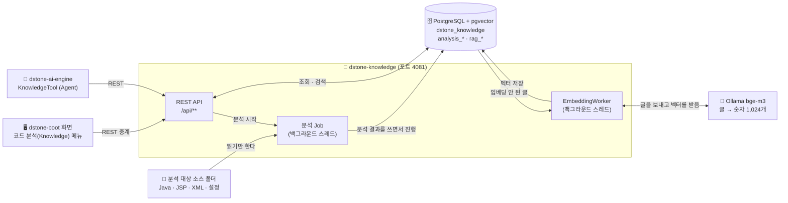

- **들어가는 것**: 서버가 읽을 수 있는 소스 폴더 하나(`localPath`). 소스를 고치지 않고, 대상 프로젝트를 빌드하지도 않는다.
- **나오는 것**: 모두 PostgreSQL의 행이다. 메모리에 들고 있는 결과물은 없어서 서버를 껐다 켜도 결과가 그대로다.
- **쓰는 쪽**: 사람은 `dstone-boot` 화면으로, LLM(Agent)은 `dstone-ai-engine`의 Tool로 쓴다. 둘 다 같은 REST API를 부른다.
- **이 모듈은 채팅 모델(LLM)을 쓰지 않는다.** 쓰는 AI는 글을 숫자로 바꿔 주는 임베딩 모델 하나뿐이다. 답을 문장으로 만드는 일은 `dstone-ai-engine`이 한다.

### 0.3 낱말 10개

뒤에서 계속 나오는 낱말이다. 이것만 알면 나머지는 따라 읽을 수 있다.

| 낱말 | 뜻 | 견주자면 |
|---|---|---|
| **프로젝트** | 분석할 대상 하나. 이름(`projectId`)과 소스 폴더 경로 | 책 한 권 |
| **리비전** | 어느 시점의 소스를 분석한 **결과 한 벌**. 분석할 때마다 새로 생긴다 | 그 책의 "몇 판" |
| **Job** | 분석을 한 번 돌리는 실행. 리비전 하나에 여러 번 돌 수 있다(이어 하기, 다시 돌리기) | 인쇄 작업 한 번 |
| **단계(패스)** | Job이 차례로 하는 일 9가지(SCAN, DECLARE, …) | 공장의 공정 |
| **심볼** | 소스에 선언된 것. 타입(클래스), 메소드, 필드 | 명부에 올린 이름 |
| **참조 → 관계** | 참조는 "`dao.delete(x)`라고 적혀 있다"는 **글자**, 관계는 "그것은 `OrderDAO#delete(String)`이다"라고 **풀린 결과** | 전화번호부의 이름 → 실제로 연결된 번호 |
| **신뢰도** | 관계가 얼마나 확실한지. `HIGH`(컴파일러처럼 풀었다) / `MEDIUM`(타입은 알고 이름으로 골랐다) / `LOW`(이름만 보고 짐작했다) | 증언의 확실한 정도 |
| **진입점** | 밖에서 프로그램으로 들어오는 입구. HTTP 주소, 서블릿, `main()`, 스케줄, JSP, 거래 ID | 건물의 출입문 |
| **계층** | 타입의 역할. `CONTROLLER` / `SERVICE` / `REPOSITORY` / `MODEL` … | 부서 |
| **문서 · 청크 · 임베딩** | 문서는 분석 결과를 글로 적은 것, 청크는 그 글을 검색 단위로 자른 조각, 임베딩은 청크를 숫자(벡터)로 바꾼 것 | 안내 책자 · 책자의 한 쪽 · 그 쪽의 색인 번호 |

프로젝트·리비전·Job은 이렇게 들어 있다.

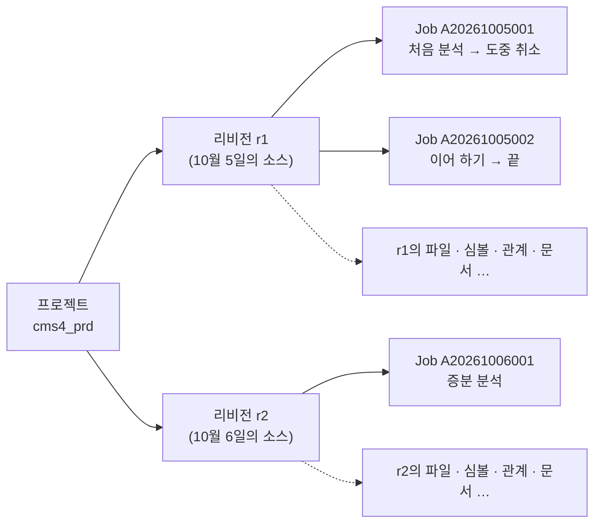

**분석 결과의 모든 행에는 `revision_id`가 붙는다.** 리비전은 서로 섞이지 않는 "전체 한 벌"이라서 r1을 지워도 r2는 온전하고, r1과 r2를 견줘 볼 수도 있다.

### 0.4 분석 공정 9단계

분석 시작을 한 번 누르면 아래 9단계가 차례로 돈다. 괄호 안 숫자는 코드의 실행 순서 값(`order()`)이다.

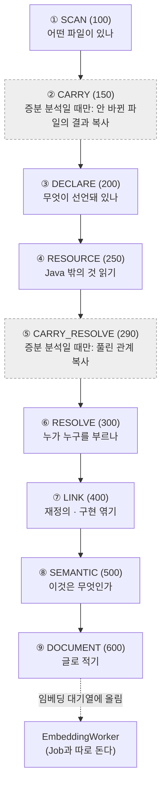

| 단계 | 견주자면 | 읽는 것 | 만드는 것(테이블) | 담당 클래스 |
|---|---|---|---|---|
| ① SCAN | **재고 조사**. 창고에 무엇이 있는지 목록부터 | 폴더의 모든 파일 | 파일 목록 `analysis_file` | `analysis.pass01.scan.ScanPass` |
| ② CARRY | 지난번 장부에서 **안 바뀐 것 베껴 오기** | 앞 리비전의 행 | 선언·자원의 복사본 | `analysis.pass02.carry.CarryPass` |
| ③ DECLARE | **명부 만들기**. 누가 있는지만 적는다 | Java 파일(과 JSP 안의 Java) 하나씩 | 심볼 `analysis_symbol` / `_method` / `_field` / `_annotation`, 참조 `analysis_reference`, Java 문자열 SQL | `analysis.pass03.declare.DeclarePass` |
| ④ RESOURCE | **부속 서류 정리**. SQL, 설정, 빌드 파일 | XML · properties · YAML · DDL 하나씩 | `analysis_mapper` / `_config` / `_resource` | `analysis.pass04.resource.ResourcePass` |
| ⑤ CARRY_RESOLVE | 지난번의 **연결 결과 베껴 오기**(베껴도 되는 것만) | 앞 리비전의 관계 | 관계의 복사본 | `analysis.pass05.carryresolve.CarryResolvePass` |
| ⑥ RESOLVE | **전화 연결**. 명부의 이름을 실제 상대와 잇는다 | Java 파일 하나씩(다시 파싱) | 관계 `analysis_relation` | `analysis.pass06.resolve.ResolvePass` |
| ⑦ LINK | **족보 정리**. 재정의와 인터페이스 구현 | DB만(SQL) | `OVERRIDES` 등의 관계, 품질 지표 `analysis_metric` | `analysis.pass07.link.LinkPass` |
| ⑧ SEMANTIC | **간판 달기**. "여기는 출입문", "여기는 영업부" | DB + 규칙 파일 `conf/rules` + `web.xml` · Struts 설정 · 화면 글자 | 진입점 `analysis_endpoint`, 계층, SQL·테이블·화면 관계, 사전 | `analysis.pass08.semantic.SemanticPass` + 처리기(`LayerResolver`, `EntryFinder` …) |
| ⑨ DOCUMENT | **안내 책자 쓰기**. 지도를 글로 풀어 적는다 | DB + 소스의 해당 줄 | `rag_document` / `rag_chunk`, 대기열 `rag_embedding` | `analysis.pass09.document.DocumentPass` |

**DECLARE와 RESOLVE를 나눈 까닭.** `getLogsDAO().selectLoginHistList(vo)`가 누구의 `selectLoginHistList`인지 알려면 `getLogsDAO()`가 무엇을 돌려주는지(`BaseService`에 있다), 그 타입 `LogsDAO`가 어떤 클래스인지 알아야 한다. 그런데 그것은 다른 파일에 있다. 그래서 먼저 모든 파일의 "누가 있는지"를 DB에 다 넣고(③), 그다음에 "누구를 가리키는지"를 DB에 물어 가며 푼다(⑥). 이렇게 하면 프로젝트 전체를 메모리에 올리지 않아도 된다.

### 0.5 예제 하나로 끝까지 따라가기

`cms4_prd`는 운영 서버에서 받아 온 실제 Spring MVC + MyBatis 웹 애플리케이션이다(펼친 WAR). Java 232개, JSP 200개, MyBatis 매퍼 42개, jar 113개로 작지 않지만 분석 한 번이 1분 36초면 끝난다(임베딩 제외). 여기서는 그 가운데 **"로그인 기록 조회" 기능 하나**를 처음부터 끝까지 따라간다.

**분석 대상 소스(이 기능에 관련된 것만 줄여서)**

```
cms4_prd/                                        파일 2,244개 (이미지·CSS·jar 포함)
├── WEB-INF/web.xml                              DispatcherServlet 등 서블릿 7개, 필터 9개
├── WEB-INF/classes/spring/context-*.xml         Spring 빈·component-scan·MyBatis 설정
├── WEB-INF/classes/sqlmap/mapper/system/logs-mapper.xml
│                                                namespace="logs": selectLoginHistList → selectLoginHistListSql 조각
│                                                (FROM tbsy_login_hist LEFT OUTER JOIN tbin_empmst …)
├── WEB-INF/classes/kr/co/gnx/
│   ├── base/BaseController.java                 @Autowired LogsService logsService;  getLogsService()
│   ├── base/BaseService.java                    @Autowired LogsDAO logsDAO;  getLogsDAO()
│   ├── base/BaseDAO.java                        logsMapper = "logs.";  getLogsmapper() { return logsMapper; }
│   └── logs/
│       ├── LogsController.java                  @RequestMapping("/logs/loginHist.go")          → new ModelAndView("/logs/loginHist")
│       │                                        @RequestMapping("/logs/getLoginHistList.ajax") → getLogsService().getLoginHistList(vo)
│       ├── LogsService.java                     getLogsDAO().selectLoginHistList(vo)
│       └── LogsDAO.java                         getSqlSession().selectList(getLogsmapper() + "selectLoginHistList", vo)
├── WEB-INF/views/logs/loginHist.jsp             $.ajax({ url : "/logs/getLoginHistList.ajax?…" })
└── WEB-INF/lib/*.jar                            113개 (Spring, MyBatis, json-lib …)
```

이 기능의 사실은 **다섯 군데에 흩어져 있다.** 화면은 JSP에, 주소는 컨트롤러 애노테이션에, 처리 코드는 컨트롤러·서비스·DAO 세 클래스와 공통 부모(`Base…`)에, SQL은 매퍼 XML에 있다. 게다가 DAO는 SQL 이름을 글자 그대로 적지 않고 부모 클래스의 메소드(`getLogsmapper()`)를 불러 만든다. 어느 하나만 봐서는 "로그인 기록 화면이 어느 테이블을 읽는지" 알 수 없다. 9단계가 이것을 차례로 잇는다.

단계마다 **📥 저장되는 곳**에 그 단계가 쓰는 테이블과 `cms4_prd` 전체에서 생긴 행 수를 적었다. 테이블 전체 모양은 0.13절과 2장에 있다.

단계와 상관없이 분석 한 번마다 쌓이는 관리용 행이 있다.

| 테이블 | 언제 | `cms4_prd` |
|---|---|---|
| `analysis_project` | 프로젝트를 등록할 때 한 번(`POST /api/projects`). 경로, `classpath`, `ruleSets` | 1 |
| `analysis_revision` | 분석을 시작할 때 한 벌. 아래 모든 행이 이 `revision_id`를 단다 | 1 |
| `analysis_job` | 분석 실행 기록(`analysisId`, 상태, 시작·끝 시각) | 1 |
| `analysis_revision_pass` | 단계마다 한 행(`PENDING` → `RUNNING` → `DONE`). 증분 분석에만 일하는 CARRY·CARRY_RESOLVE도 행은 남는다 | 9 |
| `analysis_file_pass` | 파일 단위 단계에서 파일마다 한 행. 죽었다 다시 시작해도 끝난 파일을 건너뛰는 근거다 | 1,421 |
| `analysis_error` | 단계가 남긴 오류·경고(인코딩을 모름, 파싱 실패 등) | 0 |

**① SCAN** — 파일 2,244개 가운데 분석할 1,331개의 목록이 생긴다. 이미지, CSS, jar, 소스맵(`.map`)은 목록에 넣지 않는다(jar는 ⑥에서 따로 쓴다).

| 이 기능의 파일 | 언어 | 용도(`file_type`) | 어떻게 알았나 |
|---|---|---|---|
| `WEB-INF/classes/kr/co/gnx/logs/LogsDAO.java` 외 Java 232개 | `JAVA` | `SOURCE` | 확장자. 폴더 경로 끝 `kr/co/gnx/logs`가 `package kr.co.gnx.logs`와 같으므로 그 앞(`WEB-INF/classes`)을 소스 루트로 본다 |
| `WEB-INF/views/logs/loginHist.jsp` 외 JSP 200개 | `JSP` | `JSP` | 확장자 |
| `WEB-INF/classes/sqlmap/mapper/system/logs-mapper.xml` 외 42개 | `XML` | `MYBATIS_MAPPER` | 맨 위 요소가 `<mapper>` |
| `WEB-INF/classes/spring/context-common.xml` 외 6개 | `XML` | `SPRING_XML` | 맨 위 요소가 `<beans>` |
| `WEB-INF/web.xml` | `XML` | `WEB_XML` | 맨 위 요소가 `<web-app>` |
| `resources/**/*.js` 836개 | `SCRIPT` | `SCRIPT` | 확장자. 내용은 ⑧에서 필요할 때만 읽는다 |

파일마다 인코딩과 내용 해시(SHA-256)도 같이 적는다. 해시는 나중에 증분 분석이 "이 파일이 바뀌었나"를 가리는 열쇠다.

> 📥 **저장되는 곳**: `analysis_file` 1,331행(Java 232, JSP 200, 스크립트 836, XML 62, properties 1. 경로, 언어, `file_type`, 인코딩, `checksum`, 줄 수). 이 단계는 이 테이블 하나만 쓴다. 파일 단위 단계가 아니어서 `analysis_file_pass` 행은 없다.

**③ DECLARE** — `LogsDAO.java` 한 파일에서 이런 행이 생긴다. 다른 파일은 보지 않는다.

| 종류 | 생기는 행 |
|---|---|
| 타입 | `kr.co.gnx.logs.LogsDAO` (`CLASS`, 상위 타입 `BaseDAO`는 이름만 적어 둔다) |
| 메소드 | `selectLoginHistList(LoginHistVO)` 등 7개 + 만들어 넣은 기본 생성자 `<init>()`(소스에 생성자가 없어서, `is_synthetic`) |
| 필드 | `logger` |
| 애노테이션 | `@Repository(value = "LogsDAO")` |
| 참조(아직 누구인지 모름) 46개 | `selectLoginHistList` 안에만 7개 — 호출 `selectList`(대상 식 `getSqlSession()`, 인자 2개), 호출 `getSqlSession()`, 호출 `getLogsmapper()`(앞에 `객체.`가 없음), 타입 사용 `LoginHistVO`, `List`, `Map`, `String` |

`getSqlSession()`과 `getLogsmapper()`는 이 파일에 없는 메소드다(부모 `BaseDAO`에 있다). 이 단계는 그것을 모른 채 "이런 이름을 부른다"만 적는다. JSP는 `<% %>`(Java 코드)가 있는 12개만 Java 소스로 바꿔서 똑같이 처리한다(2-3절). `loginHist.jsp`는 Java 코드가 없어서 건너뛴다.

> 📥 **저장되는 곳**(Java 232개 + JSP 200개 전체 기준)
>
> | 테이블 | 담는 것 | 행 |
> |---|---|---|
> | `analysis_symbol` | 타입(클래스 239, 익명 클래스 9, enum 6, 인터페이스 2). 계층(`layer`)은 아직 비어 있다 | 256 |
> | `analysis_method` | 메소드. 소스에 적힌 5,797개 + 만들어 넣은 기본 생성자 230개(`is_synthetic`) | 6,027 |
> | `analysis_field` | 필드와 초기값(`BaseDAO.logsMapper = "logs."` 같은 것. ⑧에서 쓴다) | 2,076 |
> | `analysis_annotation` | 타입·메소드·필드에 붙은 애노테이션(`@Controller`, `@RequestMapping`, `@Autowired` …) | 1,574 |
> | `analysis_reference` | 아직 누구인지 모르는 참조(호출, 타입 사용, 객체 생성, 상속 …). 상태는 모두 `PENDING` | 39,480 |
> | `analysis_file` | 파싱 결과(`parse_status`, `language_level`)를 고쳐 쓴다 | (432행 갱신) |
> | `analysis_file_pass` | `DECLARE` 파일별 진행 | 432 |
>
> 파일 하나를 읽고 이 행들을 쓴 뒤 AST는 버린다. 프로젝트 전체를 메모리에 올리지 않는 까닭이다(2.0절).

**④ RESOURCE** — `logs-mapper.xml`에서 statement 10개(`SELECT` 4, `INSERT` 3, 조각 3)가 `analysis_mapper`에 들어간다. 이 기능이 쓰는 것은 둘이다.

| 이름 | 종류 | 저장되는 SQL(태그를 벗겨 한 글로 편 것) |
|---|---|---|
| `logs.selectLoginHistListSql` | 조각(`SQL_FRAGMENT`) | `@@include(Comm.OrgTree)@@ SELECT tb1.mb_id, tb1.seq, tb1.emp_cd, tb2.emp_nm, … FROM tbsy_login_hist tb1 LEFT OUTER JOIN tbin_empmst tb2 … LEFT OUTER JOIN org_cte tb3 … WHERE …` |
| `logs.selectLoginHistList` | `SELECT` | `@@include(Comm.PagingStart)@@ @@include(selectLoginHistListSql)@@ @@include(Comm.PagingEnd)@@` |

`<include refid>`는 이 단계에서 펼치지 않고 `@@include(…)@@` 표시만 남긴다. 다른 매퍼 파일(`Comm.PagingStart` 등)에 있는 조각일 수 있어서, 모든 매퍼를 읽은 뒤 ⑧에서 채운다. `<if>` 같은 조건 태그는 벗기고 안의 글을 모두 남긴다. 이 단계는 **읽어서 저장만** 한다.

> 📥 **저장되는 곳**
>
> | 테이블 | 담는 것 | 행 |
> |---|---|---|
> | `analysis_mapper` | statement 이름, 종류, 펼친 SQL, 매퍼 종류. `SELECT` 367, `INSERT` 107, `UPDATE` 86, `DELETE` 99, 조각 129 | 788 |
> | `analysis_config` | `.properties`·`.yml`의 키와 값(비밀값은 `****`) | 5 |
> | `analysis_resource` | Spring XML의 빈 37, `component-scan` 3, 빌드 파일의 의존성 52 | 92 |
> | `analysis_file_pass` | `RESOURCE` 파일별 진행(XML·properties) | 63 |
>
> 증분 분석이라면 이 앞(②)과 뒤(⑤)에서 CARRY·CARRY_RESOLVE가 바뀌지 않은 파일의 위 행들과 ⑥의 관계를 앞 리비전에서 복사한다(0.12절). 이번처럼 전체 분석이면 아무것도 하지 않는다.

**⑥ RESOLVE** — 이제 모든 파일의 선언이 DB에 있으므로 참조를 푼다. `LogsController#getLoginHistList`와 그 아래가 이렇게 풀린다.

| 소스에 적힌 것 | 풀린 결과 | 신뢰도 |
|---|---|---|
| `getLogsService()` (`LogsController.java:67`) | `CALLS` → `BaseController#getLogsService()` (부모 클래스에서 물려받은 메소드) | `HIGH` |
| `getLogsService().getLoginHistList(loginHistVO)` | `CALLS` → `LogsService#getLoginHistList(LoginHistVO)` (앞 호출의 반환 타입 `LogsService`로 찾음) | `HIGH` |
| `getLogsDAO().selectLoginHistList(loginHistVO)` (`LogsService.java:57`) | `CALLS` → `LogsDAO#selectLoginHistList(LoginHistVO)` | `HIGH` |
| `getLogsmapper()` (`LogsDAO.java:46`) | `CALLS` → `BaseDAO#getLogsmapper()` | `HIGH` |
| `getSqlSession().selectList(…)` | `CALLS` → `org.mybatis.spring.SqlSessionTemplate.selectList(java.lang.String, java.lang.Object)` (프로젝트 밖, jar로 확인) | `HIGH` |
| `JSONObject.fromObject(…)` (`LogsController.java:59`) | `CALLS` → `net.sf.json.JSONObject.fromObject(java.lang.Object)` (프로젝트 밖, jar로 확인) | `HIGH` |

이 프로젝트는 `WEB-INF/lib`에 jar 113개가 있어서 프로젝트 **밖**으로 나가는 호출도 컴파일러처럼 풀린다(프로젝트 폴더 안의 jar는 따로 설정하지 않아도 쓴다). 그래서 호출 19,349건 가운데 99.90%가 풀렸고, 이름으로 짐작한 것은 1건뿐이다. jar가 없으면 밖으로 나가는 호출은 "타입과 이름만" 남는다(`MEDIUM`, 0.8절).

> 📥 **저장되는 곳**
>
> | 테이블 | 담는 것 | 행 |
> |---|---|---|
> | `analysis_relation` | 풀린 관계. `CALLS` 20,001, `USES_TYPE` 14,948, `ACCESSES_FIELD` 2,074, `CREATES` 2,025, `THROWS` 806, `EXTENDS` 191, `IMPLEMENTS` 20 | 40,065 |
> | `analysis_reference` | 참조의 상태를 고쳐 쓴다. `EXTERNAL` 21,456, `RESOLVED` 17,937, `IGNORED` 65, `UNRESOLVED` 21(이유는 `fail_reason`), `HEURISTIC` 1 | (39,480행 갱신) |
> | `analysis_file_pass` | `RESOLVE` 파일별 진행 | 432 |
>
> 프로젝트 밖으로 나가는 관계는 `to_id` 없이 `to_external`에 이름(`org.mybatis.spring.SqlSessionTemplate.selectList(…)`)을 둔다.

**⑦ LINK** — 재정의(`OVERRIDES`) 68건을 엮는다. 이 프로젝트의 서비스와 DAO는 인터페이스 없이 클래스로 바로 만들어져 있어서 "인터페이스 메소드를 부르는 호출 → 구현 메소드"(`CALLS_POSSIBLE_IMPLEMENTATION`)는 생기지 않는다. 인터페이스를 쓰는 프로젝트라면 여기서 `OrderService.findOrders` → `OrderServiceImpl.findOrders`가 이어진다.

> 📥 **저장되는 곳**: `analysis_relation`에 `OVERRIDES` 68행, `analysis_metric`에 품질 지표 7개(`callResolutionRate` 99.90, `callHeuristicRate` 0.01, `callUnresolvedRate` 0.10, `callCount` 19,349, `relationCount` 40,133, `parseSuccessRate` 100, `typeResolutionRate` 100). 지표는 리비전이 아니라 실행(`analysis_id`)에 붙는다. 이 단계는 파일을 읽지 않고 SQL로만 돈다.

**⑧ SEMANTIC** — 흩어져 있던 다섯 군데가 여기서 하나로 이어진다.

| 처리기 | 이 기능에서 한 일 | 프로젝트 전체 |
|---|---|---|
| `EntryFinder`, `LayerResolver`, `WiringMarker` | `@RequestMapping("/logs/getLoginHistList.ajax")` → `HTTP` 진입점. `@Controller`/`@Service`/`@Repository` → `LogsController` `CONTROLLER`, `LogsService` `SERVICE`, `LogsDAO` `REPOSITORY`(`HIGH`, 규칙 `common/spring.yml`) | `HTTP` 694, `SCHEDULED` 2, `INJECTS` 108, 계층 `HIGH` 143 |
| `ServletEntries` | — | `web.xml` → `SERVLET` 진입점 7, 필터 9·리스너 4는 `analysis_resource` |
| `EntryFinder` | — | `main()` 2, `WEB-INF` 밖 JSP 2 |
| `MapperLinker`, `SqlLinker` | `getLogsmapper() + "selectLoginHistList"`를 계산한다(규칙 `common/mybatis.yml`의 `_.selectList(SQL)`). `getLogsmapper()`는 `return logsMapper;` 한 줄이고 `logsMapper`는 상수 `"logs."`이므로 `logs.selectLoginHistList` → `EXECUTES_SQL`(`HIGH`). 조각을 채운 SQL에서 테이블을 뽑아 `READS_TABLE` → `TBSY_LOGIN_HIST`, `TBIN_EMPMST`, `TBIN_SCD`(`Comm.OrgTree` 조각의 `WITH org_cte`가 읽는다) | `EXECUTES_SQL` 740(그중 19건은 이름만 알고 statement가 없다), `READS_TABLE` 1,163, `WRITES_TABLE` 305, 테이블 167개 |
| `ViewLinker`, `JspLinker` | `new ModelAndView("/logs/loginHist")` → `logs/loginHist.jsp` `RENDERS`(`HIGH`). `loginHist.jsp:92`의 `"/logs/getLoginHistList.ajax?…"` 글자가 진입점 주소와 같음 → `REQUESTS`(`MEDIUM`) | `RENDERS` 178, `REQUESTS` 825(화면 글자 685 + `<script src>`로 불러온 스크립트 140), `INCLUDES` 186, 화면 계층 `VIEW` 12, 화면명 16 |
| `LayerResolver`(상속 · 이름 규칙) | — | 상위 타입으로 `MEDIUM` 1, 이름 끝말로 `LOW` 58(`…VO` → `MODEL` 46 등) |
| `MethodTitlePlugin`, `SourceNamePlugin` | 메소드 위 주석 첫 줄 → 기능명 "로그인 기록 리스트 조회" | 기능명 1,818, 소스에서 찾은 컬럼 한글명 551 |

`selectLoginHistList`의 SQL은 Oracle 문법과 `${page}` 같은 치환 변수가 섞여 SQL 파서가 읽지 못했다. 그래서 `FROM`/`JOIN` 뒤의 이름을 정규식으로 찾았고(`via = PATTERN`) 신뢰도는 `MEDIUM`이다. 프로젝트 전체로 봐도 `READS_TABLE`의 절반(582건)이 이 경우다.

> 📥 **저장되는 곳**
>
> | 테이블 | 담는 것 | 행 |
> |---|---|---|
> | `analysis_endpoint` | 진입점. `HTTP` 694, `SERVLET` 7, `JSP` 2, `MAIN` 2, `SCHEDULED` 2 | 707 |
> | `analysis_relation` | 프레임워크를 알아야 잇는 관계. `READS_TABLE` 1,163, `REQUESTS` 825, `EXECUTES_SQL` 740, `WRITES_TABLE` 305, `INCLUDES` 186, `RENDERS` 178, `INJECTS` 108 | +3,505 (모두 43,638) |
> | `analysis_symbol` | 계층(`layer`, `layer_confidence`)을 고쳐 쓴다. 256개 가운데 214개에 붙었다 | (214행 갱신) |
> | `analysis_method` | 프록시가 끼어드는 메소드(`proxy_related`)를 고쳐 쓴다(이 프로젝트는 해당 애노테이션이 없다) | (0행) |
> | `analysis_resource` | 기능명 `METHOD_TITLE` 1,818, 소스에서 찾은 컬럼 한글명 `SOURCE_NAME` 551, 화면명 `SCREEN_NAME` 16, `web.xml`의 `FILTER_MAPPING` 9·`SERVLET_MAPPING` 7·`LISTENER` 4, 쓴 규칙 파일 `RULE_SET` 7, 처리기 상태 `SEMANTIC_STATUS` 3 | +2,415 |
>
> SEMANTIC은 시작할 때 자기가 전에 만든 행을 지우고 한 트랜잭션 안에서 다시 만든다. 그래서 규칙을 고친 뒤 `rerunFrom: SEMANTIC`으로 다시 돌려도 결과가 겹치지 않는다(2-8절).

**분석이 끝난 뒤 DB에 그려진 지도**(이 기능 부분만. 이 그림이 이 모듈이 만드는 것의 전부다)

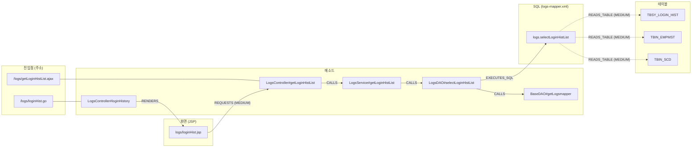

- 화살표 하나가 `analysis_relation`의 한 행이다(주소와 메소드를 잇는 선만 `analysis_endpoint`의 행이다). 점선은 `MEDIUM`이다.
- 실제로는 컨트롤러가 `BaseController#getLogsService()`, `BaseVO#setPage()` 같은 부모 클래스의 메소드도 부른다. 그림에서는 줄였다.
- **화살표를 따라 오른쪽으로 가면** "이 주소를 부르면 무슨 일이 일어나나"(`/callees`)이고, **거슬러 왼쪽으로 가면** "이 테이블을 고치면 어디가 영향받나"(`/impact`)다. 조회 API는 모두 이 그림 위를 걷는 일이다.
- `TBSY_LOGIN_HIST`에서 거슬러 올라가면 이 기능 말고 로그인 처리(`LoginDAO`)까지 닿는다. 메소드 16개(DAO 6, 서비스 6, 컨트롤러 4), 진입점 4개(`/logs/getLoginHistList.ajax`, `/login/getLoginList.ajax` 등), 화면 2개(`logs/loginHist.jsp`, `system/userAccountManage/userAccountManage.jsp`)다.

**⑨ DOCUMENT** — 위 지도를 글로 풀어 적는다. 문서 3,625건이 생긴다(`METHOD` 2,299, `MAPPER` 659, `TYPE` 235, `FILE` 232, `VIEW` 200). 메소드 문서 하나는 이런 모양이다(서버가 만든 그대로).

```text
[메소드] kr.co.gnx.logs.LogsDAO#selectLoginHistList(LoginHistVO)
반환: List<Map<String,String>>
계층: REPOSITORY
파일: WEB-INF/classes/kr/co/gnx/logs/LogsDAO.java (줄 45-47)
설명: 로그인 기록 리스트 조회
호출하는 것: BaseDAO#getLogsmapper(), BaseDAO#getSqlSession()
밖으로 나가는 호출: org.mybatis.spring.SqlSessionTemplate.selectList(java.lang.String, java.lang.Object)
실행하는 SQL: logs.selectLoginHistList [SELECT, 테이블 TBIN_EMPMST(R), TBIN_SCD(R), TBSY_LOGIN_HIST(R)]
호출받는 곳: LogsService#getLoginHistList(LoginHistVO)
소스:
	public List<Map<String, String>> selectLoginHistList(LoginHistVO loginHistVO) {
		return getSqlSession().selectList(getLogsmapper() + "selectLoginHistList", loginHistVO);
	}
```

**소스 세 줄에는 `TBSY_LOGIN_HIST`라는 글자도, SQL의 전체 이름도, 누가 부르는지도 적혀 있지 않다.** 그것은 다른 파일(`BaseDAO.java`, `logs-mapper.xml`, `LogsService.java`)에 있고, 분석이 이어 줬기 때문에 여기에 적을 수 있다. 그래서 "로그인 기록을 조회하는 코드"라고 물어도 이 문서가 걸린다.

> 📥 **저장되는 곳**
>
> | 테이블 | 담는 것 | 행 |
> |---|---|---|
> | `rag_document` | 문서 한 건(종류, 제목, 원본 경로, 메타데이터) | 3,625 |
> | `rag_chunk` | 문서를 검색 단위로 자른 조각과 그 내용 해시. 긴 문서는 여러 조각이 된다 | 4,000 |
> | `rag_embedding` | 조각의 벡터. `(content_hash, model)`이 키라 리비전이 바뀌어도 내용이 같으면 다시 계산하지 않는다. 이 단계는 처음 보는 해시만 `PENDING`으로 줄 세우고, 벡터는 서버의 백그라운드 스레드(`EmbeddingWorker`)가 채운다 | (새 해시만) |
> | `analysis_file_pass` | `DOCUMENT` 파일별 진행 | 494 |
>
> `rag_*`는 `analysis_*`에서 언제든 다시 만들 수 있다. 원본은 `analysis_*`뿐이다.

**단계별 저장 테이블 한눈에 보기**(`cms4_prd`)

| 단계 | 새로 쓰는 테이블(행) | 고쳐 쓰는 테이블 |
|---|---|---|
| ① SCAN | `analysis_file`(1,331) | — |
| ② CARRY | 증분 분석일 때만: ③·④의 테이블에 앞 리비전 행을 복사 | `analysis_file.carried_from_file_id` |
| ③ DECLARE | `analysis_symbol`(256), `analysis_method`(6,027), `analysis_field`(2,076), `analysis_annotation`(1,574), `analysis_reference`(39,480), Java 문자열 SQL은 `analysis_mapper` | `analysis_file`(파싱 결과) |
| ④ RESOURCE | `analysis_mapper`(788), `analysis_config`(5), `analysis_resource`(92) | — |
| ⑤ CARRY_RESOLVE | 증분 분석일 때만: 앞 리비전의 `analysis_relation` 복사 | `analysis_reference.status`(다시 풀 파일만 `PENDING`으로) |
| ⑥ RESOLVE | `analysis_relation`(40,065) | `analysis_reference.status` |
| ⑦ LINK | `analysis_relation`(68), `analysis_metric`(7) | — |
| ⑧ SEMANTIC | `analysis_endpoint`(707), `analysis_relation`(3,505), `analysis_resource`(2,415), JPA statement는 `analysis_mapper` | `analysis_symbol.layer`, `analysis_method.proxy_related`, `analysis_mapper.method_id` |
| ⑨ DOCUMENT | `rag_document`(3,625), `rag_chunk`(4,000), `rag_embedding`(새 해시만, `PENDING`) | — |
| 모든 단계 | `analysis_revision_pass`(9), `analysis_file_pass`(1,421), `analysis_error`(0) | — |

저장소 안의 작은 표본(`struts-app`은 파일 11개짜리 Struts 1 + iBATIS 게시판)으로 같은 흐름을 몇 초 만에 볼 수도 있다. 표본 목록은 6.3절에 있다.

### 0.6 Job은 어떻게 도나

분석은 오래 걸릴 수 있어서 요청을 받으면 바로 돌려보내고 뒤에서 돈다.

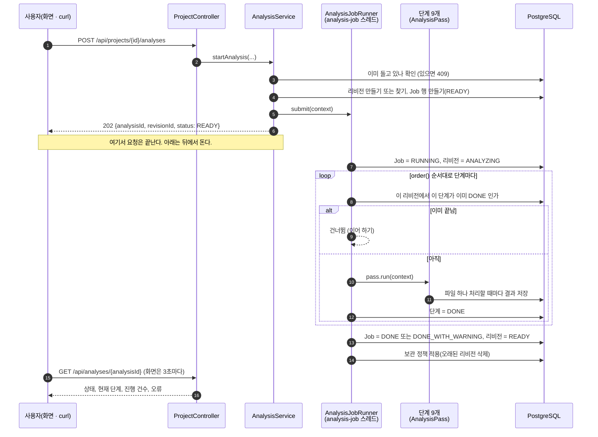

Job의 상태는 이렇게 바뀐다.

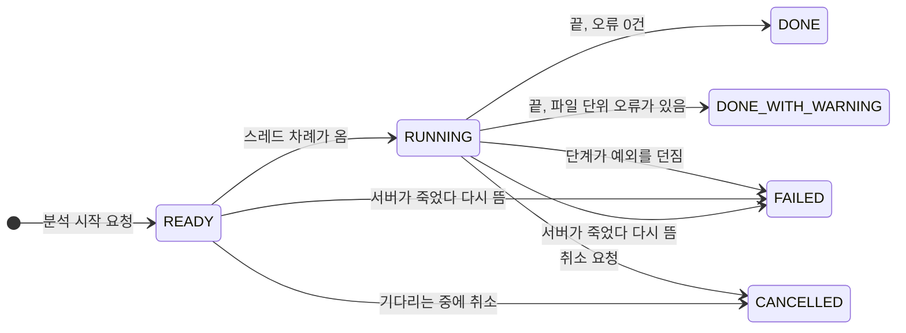

| Job이 끝난 모양 | 리비전 상태 | 그다음에 할 수 있는 것 |
|---|---|---|
| `DONE` / `DONE_WITH_WARNING` | `READY` | 조회, 검색, 증분 분석의 기준으로 쓰기 |
| `CANCELLED` | `CREATED` | 같은 리비전 라벨(`revisionLabel`)로 다시 시작하면 멈춘 단계부터 이어서 한다 |
| `FAILED` | `FAILED` | 원인을 고친 뒤 같은 리비전 라벨로 다시 시작하면 이어서 한다 |

- `DONE_WITH_WARNING`은 실패가 아니다. "파일 몇 개는 못 읽었지만 나머지는 다 했다"는 뜻이다. 못 읽은 파일은 `analysis_error`에 남는다.
- **이어 하기가 되는 까닭**: 진행 상태를 두 군데에 적어 두기 때문이다. 단계가 끝났는지는 `analysis_revision_pass`, 파일 하나하나는 `analysis_file_pass`. 다시 시작하면 끝난 단계를 건너뛰고, 끝나지 않은 단계에서는 끝난 파일을 건너뛴다.
- 동시에 도는 Job은 2개까지다(`job.max-concurrent`). 넘치면 `READY`로 기다리고, 기다리는 것이 100개를 넘으면 503이다. 한 프로젝트에서는 한 번에 하나만 돈다.

### 0.7 파일 하나는 어떻게 처리되나

DECLARE, RESOURCE, RESOLVE, DOCUMENT는 "파일을 하나씩 처리하는 단계"라서 같은 실행기(`analysis.job.FilePassRunner`)를 쓴다. 단계마다 다른 것은 `FileHandler`의 `prepare`와 `write` 두 메소드뿐이다.

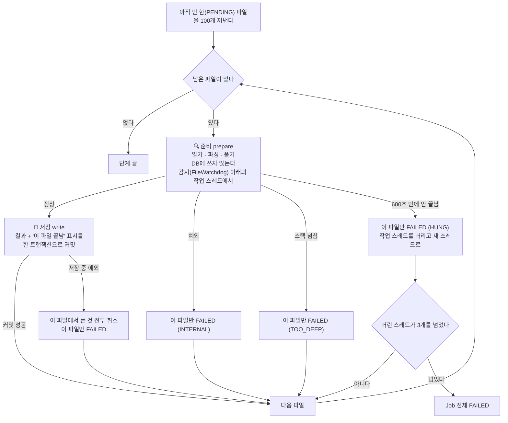

이 그림에서 기억할 것은 둘이다.

- **파일 하나가 잘못돼도 분석은 계속 간다.** 깨진 소스, 지나치게 깊은 식, 끝나지 않는 파싱 모두 "그 파일만 실패"로 끝난다. 숨기지 않고 `analysis_error`에 남긴다.
- **오래 걸리는 일(준비)과 DB에 쓰는 일(저장)을 갈라 놓았다.** 준비가 멈춰도 DB 연결이나 트랜잭션을 붙든 채 남지 않는다. 저장은 "결과와 끝남 표시"가 함께 들어가거나 함께 취소되므로 반쯤 저장된 파일이 생기지 않는다.

### 0.8 호출 하나는 어떻게 풀리나 (RESOLVE)

`something.doIt(a, b)`라는 글자 하나를 놓고 `analysis.pass06.resolve.ReferenceResolver`가 내리는 판단이다. 위에서 풀리면 아래로 내려가지 않는다.

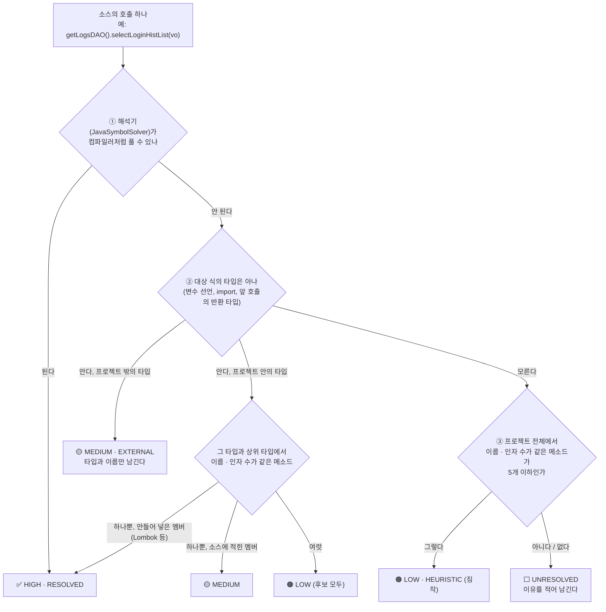

| 신뢰도 | 뜻 | 실제로 맞는 비율(jar 없이 돌린 `dstone-batchadmin`을 손으로 대조) | 어떻게 쓰나 |
|---|---|---|---|
| `HIGH` | 컴파일러와 같은 방식으로 풀었다 | 46 / 46 | 그대로 믿는다 |
| `MEDIUM` | 타입은 알고, 메소드는 이름으로 골랐다 | 170 / 170 | 믿어도 된다 |
| `LOW` | 이름만 보고 짐작했다 | 11 / 27 | 참고로만 본다. 절반 넘게 틀린다 |

**대상 프로젝트의 라이브러리 jar가 있으면 ①에서 대부분 끝난다.** jar가 없으면 ②·③으로 내려가는 것이 늘어난다. 그래서 프로젝트 폴더 안에 `WEB-INF/lib`가 있거나 프로젝트 등록 때 `classpath`를 주면 결과가 훨씬 좋아진다.

### 0.9 계층을 넘는 호출은 어떻게 이어지나 (화면 → 컨트롤러 → 서비스 → DAO → SQL → 테이블)

결론부터 말하면 **계층마다 따로 도는 분석 로직은 없다.** "컨트롤러 분석기", "서비스 분석기" 같은 것이 없다. 분석기는 계층 대신 **경계의 종류**를 본다. 화면과 서버 사이, Java 메소드끼리, 인터페이스와 구현체 사이, Java와 SQL 사이, SQL과 테이블 사이처럼 성격이 다른 경계마다 관계를 만드는 담당이 따로 있다. 이렇게 만든 관계를 조회할 때 한 줄로 이어 걷는다.

```mermaid
flowchart LR
    SCR["화면<br/>JSP · WebSquare · Nexacro"]
    CTL["컨트롤러 메소드<br/>(진입점)"]
    SVC["서비스 메소드"]
    IMPL["서비스 구현체 메소드"]
    DAO["DAO 메소드"]
    SQL["SQL statement<br/>(매퍼 XML · Java 문자열 · JPA)"]
    TBL["테이블"]

    SCR -->|"REQUESTS<br/>⑧ SEMANTIC"| CTL
    CTL -->|"CALLS<br/>③ DECLARE → ⑥ RESOLVE"| SVC
    SVC -.->|"CALLS_POSSIBLE_IMPLEMENTATION<br/>⑦ LINK"| IMPL
    IMPL -->|"CALLS<br/>⑥ RESOLVE"| DAO
    DAO -->|"EXECUTES_SQL<br/>⑧ SEMANTIC"| SQL
    SQL -->|"READS_TABLE / WRITES_TABLE<br/>⑧ SEMANTIC"| TBL
    CTL -->|"RENDERS<br/>⑧ SEMANTIC"| SCR
```

- 화살표마다 **만드는 단계가 다르다.** 화살표 위 번호가 0.4절 공정의 몇 번째 단계인지 가리킨다.
- 가운데 `CALLS`는 계층을 가리지 않는다. 컨트롤러가 서비스를 부르든, 서비스가 DAO를 부르든, 유틸이 유틸을 부르든 같은 규칙(0.8절)으로 푼다.
- 그림 속 "컨트롤러", "서비스", "DAO"라는 이름은 나중에 따로 붙이는 이름표다. 이름표가 틀리거나 비어 있어도 화살표는 그대로 이어진다.

#### 경계별로 누가, 무엇을 보고 잇나

| 경계 | 소스에 적힌 모습(예) | 생기는 관계 | 누가 잇나 | 무엇을 근거로 |
|---|---|---|---|---|
| 화면 → 서버 | `url : "/logs/getLoginHistList.ajax"`, `doRequestAjax("JCST0200M01S", …)` | `REQUESTS` | `JspLinker`, `ScreenLinker` | 화면 안의 글자가 진입점 주소와 같은가, 거래 ID 규칙에 맞는 메소드가 있는가 |
| 주소 → 처리 메소드 | `@RequestMapping("/order/list")`, `struts-config.xml`, `web.xml` | 진입점(`analysis_endpoint`) | `EntryFinder`, `StrutsEntries`, `ServletEntries` | 애노테이션과 설정 파일 |
| 메소드 → 메소드 (컨트롤러 → 서비스 → DAO) | `orderService.cancel(orderId)` | `CALLS` | DECLARE가 적고 RESOLVE가 푼다 | 소스의 호출과 타입 정보 |
| 인터페이스 → 구현체 | `OrderService.cancel` → `OrderServiceImpl.cancel` | `CALLS_POSSIBLE_IMPLEMENTATION` | `LinkPass` (SQL만 씀) | 상속·구현 관계 |
| DAO → SQL | `selectList(getLogsmapper() + "selectLoginHistList", …)`, `new QueryProperty("OrderD.selectOrderList")`, `jdbcTemplate.query("SELECT …")` | `EXECUTES_SQL` | `MapperLinker`, `SqlLinker`, `JavaSqlLinker` | 규칙(`sql:`)이 정한 자리의 인자를 계산한 statement 이름, 매퍼 인터페이스 이름, Java 문자열 SQL |
| SQL → 테이블 | `SELECT … FROM tbsy_login_hist LEFT OUTER JOIN tbin_empmst …` | `READS_TABLE`, `WRITES_TABLE` | `MapperLinker`, `JavaSqlLinker` (`SqlTableExtractor`) | SQL 파싱 |
| 메소드 → 화면 | `new ModelAndView("/logs/loginHist")`, Struts `forward` | `RENDERS` | `ViewLinker`, `StrutsEntries` | 뷰 이름으로 끝나는 JSP가 하나뿐인가 |
| 화면 → 화면 | `<jsp:include>`, `<w2:wframe src>`, 팝업 열기 | `INCLUDES` | `JspLinker`, `ScreenLinker` | 경로 끝이 맞는 화면 |

"무엇을 근거로" 가운데 프레임워크마다 다른 것(진입점 애노테이션, SQL 이름을 받는 메소드와 몇 번째 인자인지, 거래 ID 함수, 계층을 정하는 상위 타입과 이름)은 코드가 아니라 규칙 파일 `conf/rules/**/*.yml`에 있다. 새 환경에서 처음 보는 관례는 규칙 파일만 더하면 이어진다(3장).

하나씩 쉽게 풀어 본다.

**① 화면 → 서버 (`REQUESTS`)**

화면은 서버 코드를 직접 부르지 않는다. 주소나 거래 ID를 보낼 뿐이다. 그래서 "화면이 보내는 값"과 "서버가 받는 값"을 맞춰 보는 식으로 잇는다.

- **JSP**: 화면 안에서 `/path`처럼 생긴 글자를 모두 모은 뒤 진입점 주소와 **정확히 같은 것만** 남긴다(`MEDIUM`). `logs/loginHist.jsp`의 `"/logs/getLoginHistList.ajax?…"`는 `?` 앞까지가 `/logs/getLoginHistList.ajax` 진입점과 같으니 `LogsController#getLoginHistList`로 이어진다. 화면이 `<script src>`로 불러온 프로젝트 안 `.js`에 적힌 주소도 같은 방법으로 잇는다(`via = SCRIPT_SRC`).
- **WebSquare / Nexacro**: 방법이 셋 더 있다.
  - 경로 글자 맞추기: JSP와 같다. `svc::order/list.do`처럼 앞에 붙은 접두어는 떼고 맞춘다.
  - **거래 호출 규칙**: 화면이 URL 대신 거래 ID로 서버를 부르는 프로젝트를 위한 규칙이다. 규칙 파일에 `{ call: doRequestAjax(ID), to: "perform{ID}" }`라고 적어 두면 `doRequestAjax("JCST0200M01S")`가 `performJCST0200M01S` 메소드로 이어진다. 이름이 맞는 메소드가 하나면 `HIGH`, 2~5개면 각각 `LOW`, 하나도 없으면 `UNRESOLVED`로 남긴다.
  - 폼 필드와 공통 스크립트: 숨은 필드(`tranId`)에 적힌 거래 ID나, 공통 `.js` 함수 안에서 부르는 거래 ID도 같은 방식으로 잇는다.
- 어느 방법이든 **따옴표로 적힌 값만 믿는다.** `doRequestAjax(tranId)`처럼 변수로 넘기면 개수만 세고 잇지 않는다. 짐작으로 이은 선은 영향도 분석을 틀리게 만들기 때문이다.

**② 주소 → 처리 메소드 (진입점)**

"어떤 주소가 어느 메소드에서 처리되나"를 정하는 일이다. 프레임워크마다 적는 곳이 달라서 처리기가 하나씩 맡는다.

| 처리기 | 읽는 곳 | 예 |
|---|---|---|
| `EntryFinder` | 애노테이션(규칙 `entry:`), 설정 XML, 상위 타입, `main()`, JSP | 클래스의 `@RequestMapping("/order")` + 메소드의 `@GetMapping("/list")` → `/order/list`. `cms4_prd`는 메소드에만 적는다: `@RequestMapping("/logs/getLoginHistList.ajax")` → `LogsController#getLoginHistList` |
| `StrutsEntries` | `struts-config.xml`, `struts.xml` | `/board/list` + `*.do` → `/board/list.do` → `BoardListAction#execute` (`struts-app` 표본) |
| `ServletEntries` | `web.xml`, `@WebServlet` | `<servlet-mapping>` → 서블릿 클래스 |
| `ScreenLinker` | 거래 호출 규칙 | `perform{ID}` 모양의 public 메소드 → `TRANSACTION` 진입점 (주소 자리에 거래 ID) |

진입점이 정해져야 ①의 화면 글자와 맞춰 볼 대상이 생긴다. 그래서 화면 연결은 진입점을 만든 다음에 한다(`SemanticPass.steps()`의 순서가 그렇게 짜여 있다).

**③ 컨트롤러 → 서비스 → DAO (`CALLS`)**

관계가 가장 많이 나오는 곳이다. 두 단계에 걸쳐 만든다.

1. **DECLARE**: 파일 하나만 읽고 "여기서 `orderService.cancel`을 인자 1개로 부른다"는 사실만 적는다. 이때는 `orderService`가 무슨 타입인지 모른다. 다른 파일을 보지 않기 때문이다.
2. **RESOLVE**: 모든 파일의 선언이 DB에 들어간 뒤 적어 둔 호출을 하나씩 푼다. `orderService` 필드의 타입이 `OrderService`라는 것을 알아내고, 그 타입에서 `cancel(1개)`를 찾는다. 푸는 순서와 신뢰도는 0.8절 그림 그대로다.

여기에는 계층이라는 개념이 없다. 컨트롤러 → 서비스든 서비스 → DAO든 같은 코드가 같은 규칙으로 푼다. `@Autowired`로 받았든, 생성자로 받았든, `new`로 만들었든 상관없다. **필드나 변수의 타입만 알면 풀린다.**

**④ 인터페이스 → 구현체 (`CALLS_POSSIBLE_IMPLEMENTATION`)**

Spring 프로젝트의 컨트롤러는 보통 구현체가 아니라 인터페이스를 부른다.

```java
@Autowired OrderService orderService;      // 인터페이스
...
orderService.cancel(orderId);              // ③에서는 OrderService#cancel 까지만 이어진다
```

`OrderService#cancel`에는 몸통이 없으니 길이 여기서 끊긴다. LINK 단계가 이 끊긴 곳을 메운다. "몸통 없는 메소드(인터페이스·abstract)를 부르는 호출"을 찾아 그것을 구현한 `OrderServiceImpl#cancel`로 선을 하나 더 긋는다(`MEDIUM`). 실행할 때 어느 구현체가 들어올지는 소스만으로 알 수 없으므로 이름에 "POSSIBLE(그럴 수 있는)"이 붙는다.

몸통이 있는 일반 메소드는 일부러 넓히지 않는다. 넓혔더니 `BaseVO.setMb_id()` 호출 1,553건이 그 클래스를 상속한 모든 하위 클래스로 퍼져 쓸모없는 선이 27,715개 생겼다(`anybiz_prd`).

**⑤ DAO → SQL (`EXECUTES_SQL`)**

Java는 SQL을 이름으로 부른다. 그 이름이 무엇인지 **계산할 수 있을 때만** 잇는다.

| DAO 소스 | 계산 결과 | 잇나 |
|---|---|---|
| `delete("Order.deleteOrder", id)` | `Order.deleteOrder` | 잇는다 |
| `selectList(getLogsmapper() + "selectLoginHistList", vo)` (`getLogsmapper()`는 부모 `BaseDAO`의 `return logsMapper;`, `logsMapper = "logs."`) | `return` 한 줄짜리 메소드와 상수 필드 값을 읽어 `logs.selectLoginHistList` | 잇는다 |
| `selectOne("countOrder")` | 네임스페이스 없는 id. 그 id의 statement가 하나뿐 | 잇는다 |
| `queryForList(sqlId, vo)` (`sqlId`는 매개변수) | 값을 모른다 | 잇지 않는다 |

`analysis.pass08.semantic.ConstantEvaluator`가 계산을 맡는다. 문자열 리터럴, `+`, 그 타입과 상위 타입의 상수 필드, `return` 한 줄짜리 메소드까지 계산한다. 모르는 조각이 하나라도 섞이면 전체를 모르는 것으로 본다. 이름은 알았는데 그런 statement가 없으면 `UNRESOLVED`로 이름만 남긴다.

SQL을 매퍼 파일이 아니라 Java 코드에 문자열로 적은 경우(`jdbcTemplate.query("SELECT … FROM T_ORDER …")`)는 이름이 필요 없다. DECLARE가 그 문자열을 statement로 만들어 두고, SEMANTIC의 `JavaSqlLinker`가 메소드와 테이블에 바로 잇는다(2-3절).

**⑥ SQL → 테이블 (`READS_TABLE`, `WRITES_TABLE`)**

RESOURCE 단계가 매퍼 XML에서 꺼내 둔 SQL을 JSQLParser로 읽어 테이블을 뽑는다. `SELECT`는 `READS_TABLE`, `INSERT`/`UPDATE`/`DELETE`는 `WRITES_TABLE`이고, 무엇을 했는지는 `crud`(C/R/U/D)에 적는다. 파서가 실패하면 `FROM`/`JOIN`/`INTO`/`UPDATE` 뒤의 낱말을 정규식으로 찾아 대신 쓴다(`MEDIUM`).

#### 계층 이름표는 따로 붙는다

"이 클래스는 컨트롤러다"라는 이름표(`analysis_symbol.layer`)는 위 연결과 **상관없이** SEMANTIC 단계의 `LayerResolver`가 붙인다. 앞에서 정한 값은 뒤에서 덮어쓰지 않으므로 먼저 보는 근거가 이긴다. 보는 순서는 이렇다.

| 차례 | 근거 | 예 | 신뢰도 |
|---|---|---|---|
| 0 | 규칙 없이 확실한 것 | JSP에서 만든 타입 → `VIEW`, `struts-config.xml`의 액션 클래스 → `CONTROLLER`(`StrutsEntries`) | `HIGH` |
| 1 | 프로젝트 규칙(`conf/rules/projects/{프로젝트}/`) | `CONTROLLER: extends jef.application.services.AbstractMainService` | 모양에 따라 |
| 2 | 공통 규칙(`conf/rules/common/`) | `"@Controller"`, `"@Service"`, `extends javax.servlet.http.HttpServlet` | 모양에 따라 |
| 3 | 짐작 규칙(`conf/rules/guess/`) | `"@Component"`, `name *DAO`, `name *VO` | 모양에 따라 |

같은 차례(같은 폴더) 안에서는 애노테이션(`HIGH`) → 상속(`MEDIUM`) → 이름(`LOW`) 순서로 본다. 어느 규칙 때문에 정해졌는지는 `analysis_symbol.properties_json`의 `layerRuleAt`(파일:줄)과 `layerBy`(적힌 모양)에 남는다. 애노테이션도 없고 이름 규칙도 맞지 않는 레거시 프로젝트(클래스 이름이 `…M`/`…S`/`…D`로 끝나는 식)는 상위 타입을 프로젝트 규칙에 적어 주면 된다(3.5절).

이름표는 화면 표시, 노드 맵의 열 배치(화면 → 컨트롤러 → 서비스 → DAO → SQL → 테이블), 검색의 `layer` 조건, RAG 문서의 "계층:" 줄에 쓰인다. **호출 관계를 만들거나 따라갈 때는 쓰지 않는다.** 그래서 이름표가 비어 있는 클래스도 호출 사슬에서 빠지지 않는다.

#### 조회할 때 이어 걷는다

관계는 모두 한 테이블(`analysis_relation`)에 같은 모양으로 들어 있다. 조회 API는 정해진 관계 종류만 골라 SQL 재귀 쿼리(`WITH RECURSIVE`)로 한 칸씩 따라간다. 계층별 쿼리가 따로 있는 것이 아니라 **따라갈 관계 종류 목록**만 다르다.

| 질문 | API | 따라가는 관계 |
|---|---|---|
| 이 메소드는 무엇을 부르나 (아래로) | `/callees` | `CALLS`, `CALLS_POSSIBLE_IMPLEMENTATION`, `EXECUTES_SQL`, `READS_TABLE`, `WRITES_TABLE`, `RENDERS` |
| 이 메소드를 누가 부르나 (위로) | `/callers` | `CALLS`, `CALLS_POSSIBLE_IMPLEMENTATION`, `REQUESTS` |
| 이 테이블·메소드를 고치면 어디가 영향받나 | `/impact` (4.1절) | `CALLS`, `CALLS_POSSIBLE_IMPLEMENTATION`, `REQUESTS` |

`/callees`가 `EXECUTES_SQL`까지 따라가기 때문에 DAO 메소드 다음 칸이 SQL이 되고, 그다음 칸이 테이블이 된다. `/callers`는 `REQUESTS`까지 따라가기 때문에 컨트롤러 메소드 다음 칸이 화면이 된다. 같은 걷기 하나로 Java 밖까지 넘어가는 셈이다.

`cms4_prd`의 `/logs/getLoginHistList.ajax` 처리 메소드(`LogsController#getLoginHistList`)에서 `/callees`를 깊이 4로 부르면 26줄이 나온다. 부모 클래스의 getter·setter(`BaseVO#setPage` 등)를 빼고 줄이면 이렇다.

```text
깊이 1  LogsController#getLoginHistList ─CALLS→        BaseController#getLogsService, LogsService#getLoginHistList
깊이 2  LogsService#getLoginHistList    ─CALLS→        BaseService#getLogsDAO, LogsDAO#selectLoginHistList
깊이 3  LogsDAO#selectLoginHistList     ─CALLS→        BaseDAO#getLogsmapper, BaseDAO#getSqlSession
깊이 3  LogsDAO#selectLoginHistList     ─EXECUTES_SQL→ logs.selectLoginHistList
깊이 4  logs.selectLoginHistList        ─READS_TABLE→  TBSY_LOGIN_HIST, TBIN_EMPMST, TBIN_SCD (MEDIUM)
```

걷기에는 안전장치가 있다.

- **깊이 제한**: `/callees`, `/callers`는 최대 5칸(`/impact`는 최대 10칸)까지만 간다. 한 번에 2,000행까지 돌려준다.
- **순환 호출**: `a → b → a`처럼 서로 부르는 메소드가 있어도 끝난다. 이미 담은 행은 다시 담지 않고(`UNION`), 같은 선이 여러 깊이에서 나오면 가장 얕은 것 하나만 남긴다.
- **프로젝트 밖**: JDK나 라이브러리로 나가는 호출은 거기서 멈춘다. 그 안까지는 소스가 없어서 따라갈 수 없다.

#### 사슬이 끊기는 곳

연결은 "계산할 수 있는 것만 잇는다"가 원칙이다. 그래서 아래 경우에는 선이 없거나 약하게 남는다.

| 상황 | 결과 |
|---|---|
| 거래 ID나 SQL 이름을 변수로 넘긴다 (`doRequestAjax(id)`, `queryForList(sqlId)`) | 잇지 않는다 |
| 리플렉션, 문자열로 조립한 주소, `getBean("x")` | 잇지 않는다 |
| Java 문자열 SQL에 파라미터나 메소드 반환값으로 받은 조각이 낀다 | 그 자리는 `?`로 남는다. 테이블 이름 자리면 그 테이블은 잇지 않는다 |
| Struts `DispatchAction` (요청 파라미터로 메소드를 고른다) | 진입점이 클래스까지만 이어진다 |
| `return "order/list";`로 뷰를 고르는 컨트롤러, Tiles | `RENDERS`를 만들지 않는다 |
| 대상 프로젝트의 jar가 없어서 이름으로만 고른 호출 | `LOW`로 남는다. 참고로만 본다(0.8절) |
| 인터페이스 구현체가 여럿 | 구현체마다 `CALLS_POSSIBLE_IMPLEMENTATION`이 하나씩 생긴다. 실제로 어느 것이 불리는지는 모른다 |

끊긴 곳은 숨기지 않는다. `UNRESOLVED` 관계나 참조로 남기고 이유를 적으므로, 결과가 비어 있으면 그 행부터 보면 된다. 단계별 상세 규칙은 2-6절(RESOLVE), 2-7절(LINK), 2-8절(SEMANTIC), 3장(규칙)에 있다.

### 0.10 검색은 어떻게 되나

검색은 두 가지 방법으로 따로 찾은 뒤 **순위로** 합친다.

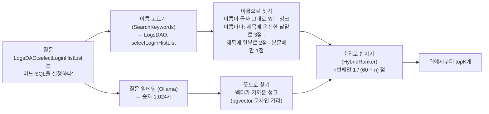

| | 뜻으로 찾기(벡터) | 이름으로 찾기 |
|---|---|---|
| 잘하는 질문 | "로그인 기록을 조회하는 코드" (글자가 달라도 뜻이 가까우면 찾는다) | `LogsDAO.selectLoginHistList`, `TBSY_LOGIN_HIST`, `/logs/getLoginHistList.ajax` (정확한 이름) |
| 못하는 질문 | 정확한 이름을 맨 위로 올리기 | 한글 낱말, 이름이 없는 질문 |
| 임베딩이 필요한가 | 필요하다 | 필요 없다. 임베딩 전에도, Ollama가 내려가 있어도 된다 |

**합치는 계산 예.** 세 청크가 두 목록에서 이렇게 나왔다고 하자. 이름 점수는 질문에서 골라낸 이름마다 매겨 더한다. 제목에 다른 글자와 붙지 않은 온전한 낱말로 있으면 3점, 제목 안에 일부로 들어 있으면 2점, 본문에만 있으면 1점이다.

| 청크 | 벡터 순위 | 이름 순위(이름 점수) | 합친 점수 |
|---|---|---|---|
| A `LogsDAO#selectLoginHistList(LoginHistVO)` | 2 | 1 (제목에 두 이름 다 → 6점) | 1/62 + **2** × 1/61 = 0.0489 |
| B `logs.selectLoginHistList` (SQL) | 1 | 2 (제목에 `selectLoginHistList` → 3점 이상) | 1/61 + **2** × 1/62 = 0.0487 |
| C 뜻만 비슷한 다른 메소드 | 3 | 없음 | 1/63 = 0.0159 |

- 점수 자체(유사도 0.8, 이름 점수 6)는 더하지 않는다. 단위가 달라서다. "몇 번째였나"만 쓴다.
- 이름 점수가 3 이상이면(제목에 이름이 온전한 낱말로 있으면) 이름 순위로 받는 점수를 두 배로 친다. 그래서 A가 맨 위로 온다.
- 양쪽에 다 나온 것(A, B)이 한쪽에만 나온 것(C)보다 훨씬 위다.

### 0.11 임베딩은 분석과 따로 돈다

글을 벡터로 바꾸는 일은 이 환경(GPU 없는 CPU)에서 가장 느리다. 짧은 청크는 0.5초, 긴 청크는 4초쯤 걸린다. 그래서 분석 Job에 넣지 않고 따로 뺐다.

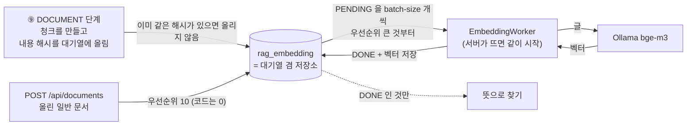

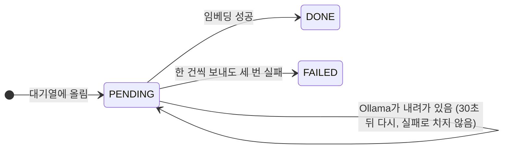

- **열쇠가 `(내용 해시, 모델)`이다.** 같은 글은 리비전이 달라도, 분석을 다시 돌려도 한 번만 임베딩한다. 소스를 조금 고쳐 다시 분석하면 바뀐 청크만 새로 임베딩된다.
- **Job이 `DONE`이어도 임베딩은 아직일 수 있다.** 진행 상황은 `GET /api/revisions/{id}/rag`(리비전별)와 `GET /api/system/embedding`(대기열 전체)으로 본다. 그동안에도 이름으로 찾는 검색은 된다.
- 임베딩은 사람이 따로 시작시키지 않는다. 테이블이 곧 대기열이라 서버가 죽었다 살아나도 남은 것부터 이어서 한다.

### 0.12 증분 분석 한 장

소스를 조금 고쳤을 때 전체를 다시 하지 않는 방법이다. **결과물(리비전)은 전체 분석과 똑같고, 만드는 길만 짧다.**

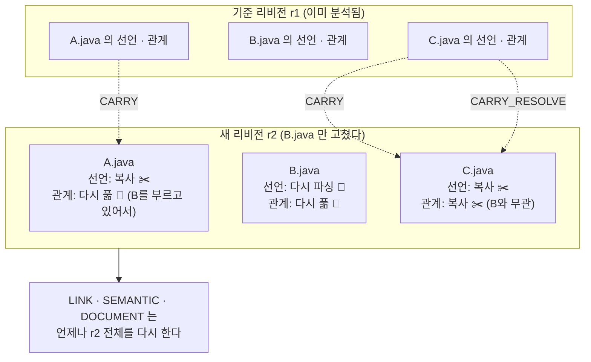

| 무엇 | 언제 복사하나 | 까닭 |
|---|---|---|
| 선언(타입·메소드·필드·참조), SQL statement, 설정 | 파일의 경로·내용 해시·분류가 기준 리비전과 같으면 | 파일 하나만 보면 정해지는 결과다 |
| 풀린 관계 | 파일이 같고, **그 파일이 가리키던 대상도 바뀌지 않았으면** | A가 그대로여도 A가 부르는 B가 바뀌면 다시 풀어야 한다 |
| 재정의, 진입점, SQL·테이블·화면 관계, 문서 | 복사하지 않는다 | 리비전 전체를 봐야 정해진다. SQL로만 도는 단계라 다시 해도 빠르다 |

헷갈리면 다시 푼다. 다시 푼다고 결과가 틀려지지는 않고 시간만 더 든다(2-5절, 5장).

### 0.13 DB 지도

테이블 21개를 "무엇을 담는가"로 묶으면 다섯 덩어리다. 선은 논리적인 연결이다(행이 많은 테이블에는 실제 FK를 걸지 않았다. 테이블 정의는 `schema/02-create-table-postgresql-dstone-knowledge.sql`).

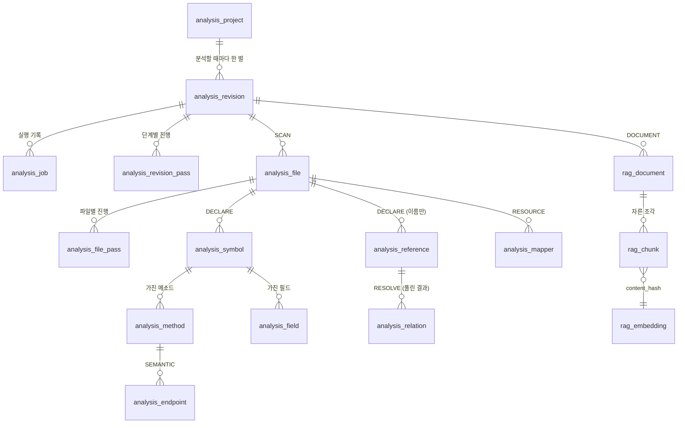

| 덩어리 | 테이블 | 한 줄 설명 |
|---|---|---|
| 🗂️ 관리 | `analysis_project`, `analysis_revision`, `analysis_job`, `analysis_revision_pass`, `analysis_file_pass` | 무엇을 언제 어디까지 분석했나 |
| 📄 재료 | `analysis_file`, `analysis_symbol`, `analysis_method`, `analysis_field`, `analysis_annotation`, `analysis_reference` | 소스에 **적혀 있는** 것 |
| 🔗 지도 | `analysis_relation`, `analysis_endpoint`, `analysis_mapper`, `analysis_config`, `analysis_resource` | 분석이 **이어 준** 것 |
| 🩺 품질 | `analysis_error`, `analysis_metric` | 못 한 것과 얼마나 잘했나 |
| 🔎 검색 | `rag_document`, `rag_chunk`, `rag_embedding` | 지도를 글로 적은 것과 그 벡터 |

`kg_node` / `kg_edge`는 테이블이 아니라 위의 것을 그래프 모양(점과 선)으로 보여 주는 VIEW다.

**하나만 고른다면 `analysis_relation`이다.** 0.5절 그림의 화살표가 모두 이 테이블의 행이다. 한 행은 `(어디서 from_id) ─ (무슨 관계 relation_type) → (어디로 to_id 또는 to_external)` + 신뢰도 + 근거가 된 파일과 줄이다.

### 0.14 코드 지도

"이 일은 어느 클래스가 하나"를 찾을 때 쓴다. 패키지 하나가 일 하나다.

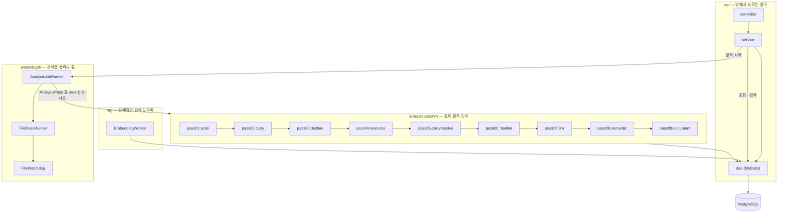

| 궁금한 것 | 열어 볼 곳 |
|---|---|
| 화면과 중계(`dstone-boot`) | `WEB-INF/views/knowledge/index.jsp`, `knowledge/assets/js/project.js` · `knowledge-common.js`, `knowledge.controller.KnowledgeProxyController` → `knowledge.service.KnowledgeProxyService`(4장) |
| 분석 시작 요청이 어떻게 처리되나 | `api.controller.ProjectController` → `api.service.AnalysisService#startAnalysis` |
| 단계를 차례로 돌리는 곳 | `analysis.job.AnalysisJobRunner#runJob` |
| 파일을 하나씩 처리하고 실패를 막는 곳 | `analysis.job.FilePassRunner#handleFile`, `analysis.job.FileWatchdog` |
| 증분 분석(바뀌지 않은 파일 옮기기) | `analysis.pass02.carry.CarryPass`, `analysis.pass05.carryresolve.CarryResolvePass`, `sqlmap/analysis/CarryDao.xml`, 기준 리비전 고르기 `AnalysisService#findBaseRevision`(2-2절, 2-5절, 5장) |
| 파일 종류와 인코딩을 알아내는 곳 | `analysis.pass01.scan.FileClassifier`, `analysis.common.EncodingDetector` |
| Java 소스에서 선언과 참조를 뽑는 곳 | `analysis.pass03.declare.DeclarationCollector` (Lombok은 `LombokExpander`, Java 문자열 SQL은 `JavaSqlCollector`) |
| JSP를 Java로 바꾸는 곳 | `analysis.pass03.declare.JspToJava` |
| 호출이 누구를 가리키는지 정하는 규칙 | `analysis.pass06.resolve.ReferenceResolver` |
| 메모리를 묶어 두는 타입 해석기 | `analysis.pass06.resolve.DbTypeSolver`, `analysis.common.BoundedCache` |
| 매퍼 XML을 읽는 곳 / SQL에서 테이블을 뽑는 곳 | `analysis.pass04.resource.MapperXmlReader` / `analysis.common.SqlTableExtractor` |
| 진입점과 계층을 정하는 규칙 | `conf/rules/{projects,common,guess}/**/*.yml`(3장)을 `analysis.pass08.semantic.rule.RuleFiles`가 읽고, 절마다 하나인 처리기(`LayerResolver`, `EntryFinder`, `SqlLinker` …)가 적용한다 |
| `getLogsmapper() + "selectLoginHistList"`를 계산하는 곳 | `analysis.pass08.semantic.ConstantEvaluator` |
| 검색용 글을 짓는 곳 | `analysis.pass09.document.CodeDocumentBuilder`, `ResourceDocumentBuilder` |
| 임베딩 대기열을 비우는 곳 | `rag.EmbeddingWorker` |
| 검색 / 순위 합치기 | `api.service.SearchService`, `rag.HybridRanker`, `rag.SearchKeywords` |
| 영향도 / 호출 그래프 / 리비전 비교 | `api.service.ImpactService` / `CallGraphService` / `DiffService` |
| 노드 맵 | `api.service.GraphService`, `sqlmap/analysis/GraphDao.xml` |
| 규칙 진단·후보·시험 적용 | `api.service.DiagnosticService`, `api.service.RuleService` |
| 실제 SQL | `src/main/resources/sqlmap/analysis/*Dao.xml` (조회의 대부분은 Java가 아니라 여기에 있다) |

새 기능을 붙이는 자리도 정해져 있다. **새 분석 단계**는 `AnalysisPass`를 구현한 빈을 만든다. **새 프레임워크 관례**는 먼저 규칙 파일에 적고, 규칙으로 안 되는 것만 `SemanticStep`을 구현한 빈을 만들어 `SemanticPass.steps()`의 알맞은 자리에 넣는다.

### 0.15 직접 해 보기

서버와 DB가 떠 있으면(6.2절) 아래 순서로 0.5절의 내용을 눈으로 확인한다. Ollama가 없어도 ④까지는 된다.

```bash
B=http://localhost:4081/api

# ① 프로젝트 등록 (소스 폴더를 알려 준다. 폴더 안의 WEB-INF/lib/*.jar 는 따로 적지 않아도 쓴다)
curl -X POST $B/projects -H 'Content-Type: application/json' \
     -d '{"projectId":"cms4_prd","localPath":"/app/sampleApps/cms4_prd"}'

# ② 분석 시작 → 응답의 analysisId, revisionId 를 적어 둔다
curl -X POST $B/projects/cms4_prd/analyses -H 'Content-Type: application/json' -d '{}'

# ③ 끝났는지 보기 (status 가 DONE 이면 끝. 이 프로젝트는 2분이 안 걸린다)
curl $B/analyses/{analysisId}

# ④ 지도 걸어 보기 ({rev} 는 ②의 revisionId)
curl "$B/revisions/{rev}/endpoints?type=HTTP"                    # 주소와 처리 메소드
curl "$B/revisions/{rev}/methods?owner=LogsController&name=getLoginHistList"   # methodId 얻기
curl "$B/revisions/{rev}/methods/{methodId}/callees?depth=4"     # 그 메소드에서 테이블까지
curl "$B/revisions/{rev}/tables/TBSY_LOGIN_HIST"                 # 이 테이블을 건드리는 SQL 과 메소드
curl "$B/revisions/{rev}/impact?table=TBSY_LOGIN_HIST"           # 고치면 닿는 메소드, 진입점, 화면

# ⑤ 검색 (임베딩이 끝나야 뜻으로 찾힌다. 진행 상황: GET $B/revisions/{rev}/rag)
curl -X POST $B/search -H 'Content-Type: application/json' \
     -d '{"projectId":"cms4_prd","query":"로그인 기록 조회 화면","topK":3}'
```

`cms4_prd`는 저장소 밖에 있는 소스다. 없는 환경이라면 저장소 안의 `struts-app` 표본(`dstone-knowledge/src/test/resources/samples/struts-app`, 몇 초면 끝난다)으로 같은 순서를 따라 하면 된다. 기대 값은 그 폴더의 `README.md`에 있다.

화면으로 보려면 `dstone-boot`의 "코드 분석(Knowledge)" 메뉴를 연다(4장). 같은 API를 화면이 대신 불러 준다.

### 0.16 자주 헷갈리는 것

| 질문 | 답 |
|---|---|
| LLM이 코드를 읽고 분석하는 것 아닌가 | 아니다. 분석은 모두 정해진 규칙(파서와 SQL)으로 한다. 이 모듈에는 채팅 모델이 없다. 같은 소스를 넣으면 언제나 같은 결과가 나온다 |
| 벡터 DB에 소스를 넣는 RAG와 무엇이 다른가 | 소스를 그대로 자르지 않는다. 분석으로 알아낸 사실(주소, 부르는 곳, 테이블)을 글로 적어 넣는다. 검색 말고도 호출 관계·영향도를 정확히 조회한다 |
| 대상 프로젝트를 빌드해야 하나 | 아니다. 소스 폴더만 있으면 된다. 라이브러리 jar가 있으면 더 정확해질 뿐이다 |
| Spring 프로젝트만 되나 | 아니다. ①~⑦은 프레임워크를 모른다. ⑧의 규칙 파일과 처리기가 Spring, 서블릿, Struts, MyBatis/iBATIS, JPA, JSP, WebSquare/Nexacro를 맡고, 맞는 것이 없어도 호출 관계까지는 정상으로 나온다 |
| 분석이 끝났는데 검색이 안 된다 | 임베딩이 아직 돌고 있거나 Ollama가 내려가 있다. `GET /api/revisions/{id}/rag`를 본다. 질문에 클래스·메소드 이름을 넣으면 임베딩 없이도 찾힌다 |
| 결과에 `LOW`가 붙어 있다 | 이름만 보고 짐작한 것이다. 절반은 틀린다고 보고 참고로만 쓴다. 대상 프로젝트의 jar를 `classpath`로 주면 줄어든다 |
| 영향도 결과가 "전부"인가 | 아니다. 저장된 관계만 따라간다. 리플렉션, 문자열로 조립한 주소, 파라미터로 받은 SQL 조각은 잇지 못한다(0.9절 "사슬이 끊기는 곳") |
| 리비전이 계속 쌓이지 않나 | 프로젝트마다 분석이 끝난 리비전을 최근 5개만 남기고 자동으로 지운다(5.3절) |
| 분석 도중 서버가 죽으면 | 다시 띄우고 같은 리비전 라벨로 분석을 시작하면 끝난 단계와 끝난 파일을 건너뛰고 이어서 한다 |
| 규칙 파일을 고쳤는데 결과가 그대로다 | 규칙은 SEMANTIC 단계에서만 쓴다. 같은 리비전 라벨에 `rerunFrom: "SEMANTIC"`을 주고 다시 돌린다(3.14절) |

여기까지가 전체 그림이다. 더 깊이 들어갈 때는 단계별 동작과 테이블은 2장, 규칙은 3장, 화면은 4장, 증분 분석은 5장, 설정과 실행은 6장, API는 7장을 보면 된다.

## 1. 개요

Java 애플리케이션을 정적 분석해서 **구조와 관계를 먼저 구조화된 데이터로 만들고**, 그 결과를 Knowledge Graph와 RAG 청크 양쪽으로 내보내는 모듈이다. 소스를 잘게 잘라 벡터 DB에 넣는 방식이 아니다.

| 항목 | 내용 |
|---|---|
| 분석 대상 | Spring / Spring Boot 애플리케이션과 **구버전 일반 Java 프로그램**(Java 1.4~7 문법, 애노테이션 이전의 XML 설정, 서블릿, 직접 JDBC, JSP), Struts 1·2, MyBatis·iBATIS·JPA, WebSquare·Nexacro 화면 |
| 실행 형태 | 실행 JAR, 포트 4081, 루트 패키지 `net.dstone.knowledge` |
| 저장소 | PostgreSQL + pgvector (`dstone_knowledge` DB) |
| 임베딩 | Ollama `bge-m3`(1,024차원). Spring AI의 `EmbeddingModel`만 쓴다 |
| 배포 | VM 스타일(`bin/*.sh`). 분석 대상의 소스 폴더를 직접 읽어야 해서 Pod가 아니라 프로세스로 띄운다 |
| 화면 | 이 모듈에는 없다. `dstone-boot`의 "코드 분석(Knowledge)" 메뉴가 REST API를 중계한다(4장) |
| 원 설계서 | `docs/temp/Java_Application_Knowledge_Graph_RAG_Analysis_Platform_설계서_v1.0.docx`. 이 문서는 그 설계를 이 저장소에 맞게 조정한 결과와 지금 상태를 적는다 |

### 1.1 할 수 있는 일

| 하고 싶은 일 | 쓰는 기능 | 자세히 |
|---|---|---|
| 소스 폴더를 분석해 결과 한 벌(리비전)을 만든다 | 분석 Job(9단계) | 2장 |
| 이 메소드가 무엇을 부르는지, 누가 이 메소드를 부르는지 본다 | 호출 그래프 `/callees`, `/callers` | 0.9절, 7장 |
| 테이블·SQL·메소드를 고치면 닿는 진입점과 화면을 본다 | 영향도 분석 `/impact` | 4.1절 |
| 뜻이나 이름으로 코드를 찾는다 | 하이브리드 검색 `/api/search` | 2-9절, 4.3절 |
| 설계서·매뉴얼 같은 일반 문서도 같이 찾는다 | 문서 올리기 `/api/documents` | 7장 |
| LLM Agent가 위 기능을 쓰게 한다 | `dstone-ai-engine`의 `KnowledgeTool` | 1.2절, 7장 |
| 바뀐 파일만 다시 분석한다 | 증분 분석 | 5장 |
| 두 시점의 차이를 메소드·SQL·테이블 단위로 본다 | 리비전 비교 `/diff` | 5.2절 |
| 호출 구조를 그림으로 본다 | 노드 맵 `/graph` | 4.2절 |
| 처음 보는 프레임워크 관례를 알려 준다 | 규칙 파일 `conf/rules`, 적용 진단·후보·시험 적용 | 3장 |

### 1.2 다른 모듈과의 관계

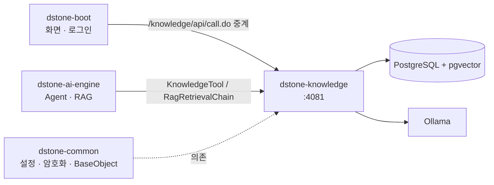

- **`dstone-common`**: 설정 읽기(`ConfigProperty`), `ENC(...)` 복호화, 공통 기반 클래스를 쓴다.
- **`dstone-boot`**: 사람이 쓰는 화면이 여기에 있다. 브라우저는 이 모듈을 직접 부르지 않는다.
- **`dstone-ai-engine`**: Agent가 Tool로 분석 결과를 묻고(`KnowledgeTool`), RAG가 올린 문서를 이 모듈의 검색으로 찾는다. 예전에 `dstone-ai-engine` 안에 있던 문서 임베딩·RAG 검색 기능은 이 모듈로 옮겨 왔다.
- **이 모듈은 LLM 채팅을 하지 않는다.** 질의 분류와 답변 생성은 `dstone-ai-engine`의 Agent가 맡고, 이 모듈은 결정론적인 분석 결과와 검색 결과만 돌려준다.

### 1.3 구축 단계와 현재 상태

M0부터 M9까지 마일스톤 10개로 나눠 만들었다. "마일스톤"은 만든 순서이고, 분석 공정의 "단계(패스)"와는 다른 말이다.

| 마일스톤 | 내용 | 주로 만든 단계 / 테이블 | 상태 |
|---|---|---|---|
| **M0** | 모듈 골격, 스키마, 검증 표본 | — | 완료 |
| **M1** | 파일 수집, 인코딩·문법 수준·소스 루트 탐지, 선언(Lombok 멤버 포함), DB 기반 타입 해석기 | SCAN, DECLARE / `analysis_file`, `analysis_symbol` 등 | 완료 |
| **M2** | 참조 풀기, 호출 그래프, 신뢰도, 구현 후보, 품질 지표, 호출자/피호출자 API | RESOLVE, LINK / `analysis_relation`, `analysis_metric` | 완료 |
| **M3** | 진입점과 계층(Spring, `main`, 서블릿, `web.xml`, `Runnable`, 이름 규칙) | SEMANTIC / `analysis_endpoint` | 완료 |
| **M4** | 코드 RAG: 문서·청크, 임베딩 대기열, 벡터 검색 (여기까지가 MVP) | DOCUMENT / `rag_*` | 완료 |
| **M5** | MyBatis·iBATIS·Struts·JSP·설정·빌드 파일·Spring XML, SQL 테이블 CRUD, 리치클라이언트 화면 | RESOURCE, SEMANTIC 처리기 / `analysis_mapper` 등 | 완료 |
| **M6** | 일반 문서 수집(Tika, 호출자 격리), 하이브리드 검색, 영향도 분석, `dstone-ai-engine` Tool | API | 완료 |
| **M7** | 증분 분석, 리비전 비교, 보관 정책 | CARRY, CARRY_RESOLVE | 완료 |
| **M8** | 화면(`dstone-boot`에 둠): 분석 관리, 검색, 영향도, 노드 맵, 비교, 사용 안내 | — | 완료 |
| **M9** | 이관: `dstone-ai-engine`의 임베딩·RAG와 `dstone-boot`의 소스 분석기를 이 모듈로 대체 | — | `dstone-ai-engine` 쪽 완료. `dstone-boot` 분석기는 남음 |

M8까지 끝난 뒤에도 기능을 계속 더했다. 지금 들어 있는 주요 기능은 이렇다.

- **규칙 파일**(`conf/rules`, 코드 모양 그대로 적는 형식): 프레임워크 관례를 Java가 아니라 파일로 적는다. 적용 진단, 후보 제안, 시험 적용 API가 함께 있다(3장).
- **Java 문자열 SQL과 JPA**: 매퍼 없이 코드에 적은 SQL, `@Query`·`@NamedQuery`·Spring Data 메소드 이름 쿼리도 테이블과 잇는다(분석기 버전 1.2, 2-3절·3.11절).
- **주소 상수와 상속된 주소**: `@RequestMapping(Urls.ORDER)`처럼 상수로 적은 주소와 상위 클래스·인터페이스에 적은 주소를 계산한다(3.6절).
- **이름 사전**: 메소드 기능명, 화면명, 테이블·컬럼 한글명을 소스·DDL·SQL 주석·사전 파일·DB 코멘트에서 모은다(2-8절).

**M9의 남은 일**: `dstone-boot`의 소스 분석기(`AppAnalyzer`와 `analyzer` 패키지, `analyzeDB`, 결과 화면 `ReportController`)를 이 모듈로 대체하고 원래 코드를 걷어낸다. 지우는 일이라 되돌리기 어렵다. 먼저 기능을 하나씩 대조한 표를 만들고, 사용자가 확인한 뒤에 걷어낸다.

## 2. 분석 파이프라인

이 장은 분석 Job이 도는 9단계를 하나씩 설명한다. 단계마다 다음 네 가지를 같은 순서로 적는다.

- **하는 일과 의미**: 무엇을 읽어서 무엇을 알아내는가, 그것이 왜 필요한가
- **테이블**: 이 단계가 넣는(INSERT) 행, 고치는(UPDATE) 컬럼, 지우는(DELETE) 행
- **화면에 미치는 영향**: 그 행과 컬럼이 영향도 화면과 노드 맵의 어디에 나타나는가
- **못 하는 것**: 이 단계가 일부러 하지 않거나 아직 하지 못하는 것

### 2.0 먼저 알아 둘 것

#### 단계와 실행 순서

| 단계 | `order()` | 담당 클래스 | 처리 단위 | 전체 분석에서 | 증분 분석에서 |
|---|---|---|---|---|---|
| SCAN | 100 | `analysis.pass01.scan.ScanPass` | 폴더 전체 | 돈다 | 돈다 |
| CARRY | 150 | `analysis.pass02.carry.CarryPass` | SQL 몇 문장 | 아무것도 안 한다 | 돈다 |
| DECLARE | 200 | `analysis.pass03.declare.DeclarePass` | 파일 하나씩 | 돈다 | 바뀐 파일만 |
| RESOURCE | 250 | `analysis.pass04.resource.ResourcePass` | 파일 하나씩 | 돈다 | 바뀐 파일만 |
| CARRY_RESOLVE | 290 | `analysis.pass05.carryresolve.CarryResolvePass` | SQL 몇 문장 | 아무것도 안 한다 | 돈다 |
| RESOLVE | 300 | `analysis.pass06.resolve.ResolvePass` | 파일 하나씩 | 돈다 | 다시 풀어야 하는 파일만 |
| LINK | 400 | `analysis.pass07.link.LinkPass` | SQL 몇 문장 | 돈다 | 리비전 전체 |
| SEMANTIC | 500 | `analysis.pass08.semantic.SemanticPass` | 처리기 17개, SQL 중심 | 돈다 | 리비전 전체 |
| DOCUMENT | 600 | `analysis.pass09.document.DocumentPass` | 파일 하나씩 | 돈다 | 리비전 전체 |

`AnalysisJobRunner`는 `AnalysisPass` 빈을 `order()` 값이 작은 것부터 차례로 부른다. 앞 단계가 쓴 행을 뒤 단계가 DB에서 읽으므로 순서를 바꾸면 결과가 달라진다.

#### 모든 단계가 공통으로 쓰는 관리 테이블

어느 단계든 아래 행을 남긴다. 단계별 설명에서는 되풀이하지 않는다.

| 테이블 | 동작 | 컬럼 | 언제 |
|---|---|---|---|
| `analysis_revision_pass` | INSERT · UPDATE | `status`(`PENDING` → `RUNNING` → `DONE` / `FAILED` / `CANCELLED`), `analysis_id`, `total_count`, `done_count`, `started_at`, `ended_at` | 단계가 시작하고 끝날 때. `DONE`인 단계는 다시 시작해도 건너뛴다 |
| `analysis_job` | UPDATE | `current_pass`, `total_files`, `done_files`, `heartbeat_at` | 진행할 때마다 |
| `analysis_error` | INSERT | `analysis_id`, `revision_id`, `file_id`, `pass`, `error_type`, `message`, `detail` | 파일 하나가 실패하거나 경고를 남길 때 |
| `analysis_file_pass` | INSERT · UPDATE | `status`(`PENDING` / `DONE` / `FAILED` / `SKIPPED`), `error_message`, `carried`, `updated_at` | 파일 단위 단계(DECLARE, RESOURCE, RESOLVE, DOCUMENT)만. 아래 "파일 단위 실행기" 참고 |

#### 파일 단위 실행기 (`analysis.job.FilePassRunner`)

DECLARE, RESOURCE, RESOLVE, DOCUMENT는 같은 실행기로 돈다.

1. `analysis_file_pass`에 처리할 파일마다 `PENDING` 행을 넣는다(`seedFilePass`). 대상은 그 단계가 맡은 언어의 파일이다. SCAN이 `parse_status = SKIPPED`로 적은 파일(너무 큰 파일)은 처음부터 `SKIPPED`로 넣는다. 이미 행이 있으면 건드리지 않는다(`ON CONFLICT DO NOTHING`).
2. `PENDING` 행을 `file_id` 순서로 100개씩 꺼낸다.
3. 파일 하나를 **준비(`prepare`)** 와 **저장(`write`)** 두 걸음으로 처리한다.
   - 준비: 파일 읽기, 파싱, 계산. DB에 쓰지 않는다. 감시 스레드(`FileWatchdog`) 아래에서 돌고 600초(`job.file-hard-timeout-seconds`)를 넘기면 그 파일만 `FAILED`(`HUNG`)로 남긴다.
   - 저장: 결과 행과 `analysis_file_pass.status`를 한 트랜잭션으로 커밋한다. 둘이 함께 들어가거나 함께 취소된다.
4. 예외, 스택 넘침(`TOO_DEEP`), 시간 초과는 모두 "그 파일만 실패"로 끝나고 다음 파일로 간다. 시간 초과로 버린 스레드가 3개(`job.max-stuck-files`)를 넘으면 Job 전체를 실패시킨다.

그래서 서버가 죽었다 살아나도 `DONE`인 파일은 건너뛰고 `PENDING`인 파일부터 이어서 한다.

#### 화면 두 개는 무엇을 읽나

단계마다 "화면에 미치는 영향"을 적으려면 두 화면이 무엇을 읽는지 먼저 알아야 한다. 두 화면 모두 `dstone-boot`에 있고 이 모듈의 API를 부른다(4장).

**영향도 화면**(`knowledge/impact/impact`, API `GET /api/revisions/{id}/impact`, `api.service.ImpactService`, SQL `RelationDao.xml`의 `impactWalk`)

```text
① 출발 메소드 찾기
   대상이 테이블   : analysis_relation(READS_TABLE / WRITES_TABLE, to_external = 테이블)의 from_id(= SQL)
                     → 그 SQL 을 to_id 로 가진 analysis_relation(EXECUTES_SQL)의 from_id(= 메소드)
   대상이 SQL      : analysis_mapper(statement_id 또는 namespace.statement_id) → EXECUTES_SQL → 메소드
   대상이 타입     : analysis_symbol.fqn → 그 타입의 analysis_method 전부
   대상이 메소드   : 그 method_id
② 거슬러 올라가기: analysis_relation 에서 to_id = 지금 노드인 행의 from_id 로 한 칸씩
   따라가는 relation_type = CALLS, REQUESTS (+ includePossible 이면 CALLS_POSSIBLE_IMPLEMENTATION)
   신뢰도 = 지나온 관계의 confidence 가운데 가장 약한 것
③ 결과 세 묶음
   메소드  : analysis_method + analysis_symbol(fqn, layer) + analysis_file.path
   진입점  : analysis_endpoint.method_id 가 닿은 메소드인 것
             (method_id 가 비어 있고 symbol_id 가 닿은 메소드의 타입이면 LOW, matchedBy = TYPE)
   화면    : ⓐ REQUESTS 로 닿은 FILE 노드(from_id = 'F' + file_id)
             ⓑ 닿은 메소드가 JSP 파일(analysis_file.language = 'JSP') 안의 메소드
             ⓒ 닿은 메소드에서 나가는 RENDERS(to_kind = FILE)
```

**노드 맵 화면**(`knowledge/graph/graph`, API `/api/revisions/{id}/graph`, `/graph/neighborhood`, `/graph/node`, `api.service.GraphService`, SQL `GraphDao.xml`)

| 화면 요소 | 읽는 테이블과 컬럼 |
|---|---|
| 전체 맵의 클래스 노드(`TYPE`) | `analysis_symbol`의 바깥 타입(`outer_symbol_id IS NULL`). 중첩·익명 타입은 바깥 타입에 접힌다. 묶음은 `package_name`, 열(화면 → 컨트롤러 → 서비스 → DAO → SQL 매퍼 → 테이블)은 `layer`, 크기는 합성되지 않은 메소드 수 |
| 화면 노드(`JSP`) | `analysis_file`에서 `language = 'JSP'`이거나 `file_type`이 `WEBSQUARE` / `NEXACRO`인 파일. ID는 `'F' + file_id`. JSP에서 만든 타입은 이 노드에 접힌다 |
| SQL 매퍼 노드(`MAPPER`) | `analysis_mapper`를 파일(`file_id`)로 묶은 것. ID는 `'M' + file_id`. Java 문자열 SQL(`JAVA`)과 JPA 쿼리(`JPA`)를 가진 Java 파일도 여기에 들어간다 |
| 테이블 노드(`TABLE`) | `analysis_relation`에서 `to_kind = 'TABLE'`인 행의 `to_external`. ID는 `'T:' + 테이블` |
| 노드 사이의 선 | `analysis_relation`을 노드 쌍마다 합친 것(`count`, 가장 강한 `confidence`). 기본은 `CALLS`, `CALLS_POSSIBLE_IMPLEMENTATION`, `EXECUTES_SQL`, `READS_TABLE`, `WRITES_TABLE`, `RENDERS`, `REQUESTS`. 고르면 `EXTENDS`, `IMPLEMENTS`, `INJECTS`, `INCLUDES`를 더한다 |
| 관계 트리(팝업) | 같은 관계를 메소드 단위로 따라간다. `analysis_symbol.layer = 'MODEL'`인 타입의 메소드는 기본으로 뺀다. `RENDERS`(위로)와 `REQUESTS`(아래로)는 고른 노드가 화면일 때 첫 칸에서만 따라간다 |
| 노드 상세 | 클래스·메소드: `analysis_endpoint`, `analysis_resource`(`METHOD_TITLE`), `rag_document`. 화면: `analysis_resource`(`SCREEN_NAME`, `DICT_SCREEN_NAME`), `rag_document`. 매퍼: `analysis_mapper`. 테이블: `analysis_relation.properties_json`(`columns`, `columnComments`, `tableComment`)과 `analysis_resource`(`DDL_TABLE`, `DDL_COLUMN`, `SOURCE_TABLE_NAME`, `SOURCE_NAME`, `DICT_TABLE_NAME`, `DICT_COLUMN_NAME`) |

두 화면 모두 **저장된 행만 읽는다.** 분석이 만들지 않은 관계는 화면에도 나오지 않는다.

---

### 2-1. SCAN — 어떤 파일이 있나

#### 하는 일과 의미

프로젝트 폴더(`analysis_project.local_path`)를 처음부터 끝까지 훑어 분석할 파일의 목록을 만든다. 뒤의 모든 단계는 이 목록(`analysis_file`)에서 일감을 꺼낸다. **여기에 없는 파일은 이후 어느 단계에서도, 어느 화면에서도 보이지 않는다.**

파일마다 알아내는 것은 다음과 같다.

| 알아내는 것 | 방법 |
|---|---|
| 건너뛸 폴더 | 설정 `dstone.knowledge.scan.exclude-dirs`에 적힌 이름과 폴더 이름이 같으면 그 아래를 보지 않는다(기본 `.git`, `.svn`, `node_modules`, `target`, `build`, `.idea` 등). `classes`는 일부러 넣지 않았다. 운영 서버에서 받아 온 웹앱은 `WEB-INF/classes`에 소스가 함께 있기 때문이다 |
| 언어(`language`) | 확장자. `.java` → `JAVA`, `.jsp` `.jspf` `.jspx` `.tag` → `JSP`, `.xml` `.xfdl` `.xadl` → `XML`, `.yml` `.yaml` → `YAML`, `.properties` → `PROPERTIES`, `.gradle` `.gradle.kts` → `GRADLE`, `.sql` `.ddl` → `SQL`, `.js` `.xjs` → `SCRIPT`. 이 밖의 확장자(이미지, `.class`, `.jar`, `.css`)는 목록에 넣지 않는다 |
| 용도(`file_type`) | Java → `SOURCE`, JSP → `JSP`, YAML·properties → `CONFIG`, Gradle → `BUILD`, 스크립트 → `SCRIPT`. SQL은 `CREATE TABLE`이나 `COMMENT ON`이 있으면 `DDL`, 없으면 `SQL_SCRIPT`. XML은 맨 위 요소 이름으로 가린다(아래 표) |
| 모듈(`module`) | 파일이 들어 있는 폴더 가운데 `pom.xml`, `build.gradle`, `build.gradle.kts`가 있는 가장 가까운 폴더(프로젝트 루트는 모듈로 치지 않는다) |
| 인코딩(`encoding`) | 프로젝트에 `sourceEncoding`을 적었으면 그것, 아니면 UTF-8 → EUC-KR → MS949 순으로 깨끗하게 읽히는 것. 어느 것도 아니면 ISO-8859-1로 읽고 `analysis_error`에 `ENCODING`을 남긴다 |
| 내용 해시(`checksum`) | 파일 바이트의 SHA-256. 증분 분석이 "바뀌었나"를 가리는 열쇠다 |
| 패키지(`package_name`), 소스 루트(`source_root`) | Java 파일만. 주석을 지운 뒤 `package` 문장을 정규식으로 찾는다. 폴더 경로의 끝이 패키지 경로와 같으면 그 앞부분이 소스 루트다(`WEB-INF/classes/kr/co/gnx/logs/LogsDAO.java` + `kr.co.gnx.logs` → `WEB-INF/classes`). 맞지 않으면 `NULL` |

XML의 `file_type`은 이렇게 정한다(접두어 `beans:beans`는 뒤쪽 이름만 본다).

| 맨 위 요소 | `file_type` | 뒤에서 읽는 단계 |
|---|---|---|
| `mapper` | `MYBATIS_MAPPER` | RESOURCE → `analysis_mapper` |
| `sqlMap` | `IBATIS_MAPPER` | RESOURCE → `analysis_mapper` |
| `document`(안에 `<statement`와 ` id=`가 있을 때) | `QUERY_XML` | RESOURCE → `analysis_mapper` |
| `beans` | `SPRING_XML` | RESOURCE → `analysis_resource` |
| `web-app`, `web-fragment` | `WEB_XML` | SEMANTIC(`ServletEntries`) |
| `struts-config`, `struts` | `STRUTS_CONFIG` | SEMANTIC(`StrutsEntries`) |
| `html`(WebSquare 네임스페이스가 앞 3,000자 안에 있을 때) | `WEBSQUARE` | SEMANTIC(`ScreenLinker`), DOCUMENT |
| `FDL` | `NEXACRO` | SEMANTIC(`ScreenLinker`), DOCUMENT |
| `ADL` | `NEXACRO_APP` | 읽지 않는다(화면이 아니다) |
| `project`, 파일 이름 `pom.xml` | `BUILD` | RESOURCE(`pom.xml`만. Ant 파일은 건너뜀) |
| `sqlMapConfig` / `configuration`(앞 1,000자에 `mybatis`) | `IBATIS_CONFIG` / `MYBATIS_CONFIG` | 읽지 않는다 |
| `tiles-definitions` | `TILES` | 읽지 않는다 |
| `configuration`, `log4j…` | `LOG_CONFIG` | 읽지 않는다 |
| 그 밖 | `XML` | 읽지 않는다 |

5MB(`scan.max-file-bytes`)보다 큰 파일은 메모리에 올리지 않는다. 해시만 흘려 읽으며 계산하고 `parse_status = SKIPPED`로 넣는다. 뒤 단계에서는 모두 `SKIPPED`가 된다.

폴더를 걸으면서 200개(`scan.commit-size`)씩 모아 DB에 쓴다. 중간에 죽으면 처음부터 다시 훑는다. 같은 경로는 덮어쓰므로(`ON CONFLICT (revision_id, path) DO UPDATE`) 중복되지 않는다. 파일 단위 단계가 아니어서 `analysis_file_pass` 행은 만들지 않는다.

#### 테이블

| 테이블 | 동작 | 컬럼 |
|---|---|---|
| `analysis_file` | INSERT(경로가 같으면 UPDATE) | `revision_id`, `module`, `path`, `source_root`, `language`, `file_type`, `package_name`, `encoding`, `checksum`, `size_bytes`, `line_count`, `parse_status`(`PENDING`, 큰 파일은 `SKIPPED`), `parse_error`(큰 파일일 때 사유) |
| `analysis_error` | INSERT | `ENCODING`(인코딩을 모름), `IO`(파일·폴더를 읽지 못함) |

`language_level`과 `carried_from_file_id`는 비워 둔다. 각각 DECLARE와 CARRY가 채운다. `package_name`, `source_root`도 DECLARE가 파서로 읽은 값으로 다시 쓴다.

#### 화면에 미치는 영향

| 컬럼 | 영향도 화면 | 노드 맵 |
|---|---|---|
| `path` | 메소드 목록과 화면 목록의 "파일" 칸 | 화면 노드의 이름(마지막 마디)과 묶음(폴더), 매퍼 노드의 이름(네임스페이스가 없을 때) |
| `language` | `JSP`인 파일 안의 메소드에 닿으면 그 파일이 "화면"으로 잡힌다(③ⓑ) | `JSP`인 파일이 화면 노드가 된다. JSP에서 만든 타입은 클래스 노드가 아니라 화면 노드에 접힌다 |
| `file_type` | — | `WEBSQUARE`, `NEXACRO`인 파일이 화면 노드가 된다 |
| `line_count` | — | 화면 노드의 크기 |
| `file_type`, `parse_status = SKIPPED` | 뒤 단계가 그 파일을 읽지 않으므로 그 파일에서 나올 메소드·SQL·화면이 통째로 빠진다 | 같다 |

#### 못 하는 것

- 압축 파일(`.jar`, `.war`) 안은 열지 않는다. jar는 RESOLVE가 타입 해석용으로만 쓴다.
- 확장자가 목록에 없는 파일(`.vm`, `.ftl`, `.html` 등)은 화면이어도 목록에 들어가지 않는다.

---

### 2-2. CARRY — 안 바뀐 파일의 선언과 자원 옮기기 (증분 분석)

#### 하는 일과 의미

증분 분석일 때만 일한다. 기준 리비전(`analysis_revision.parent_revision_id`)이 없으면(전체 분석이면) 아무것도 하지 않고 끝난다. 기준 리비전이 그사이 지워졌어도 전체 분석과 똑같이 돈다.

리비전은 언제나 "그 시점의 전체 모습"을 담는다. 증분 분석은 그 전체를 만드는 길을 줄이는 방법이다. **파일 하나만 보면 정해지는 결과**는 내용이 같으면 결과도 같으므로 다시 파싱하지 않고 기준 리비전의 행을 그대로 복사한다. 옮긴 파일은 DECLARE와 RESOURCE에서 "끝남"으로 표시되어 건너뛴다.

"같은 파일"의 조건은 다섯 가지가 모두 같은 것이다: `path`, `checksum`, `language`, `file_type`, `module`, `encoding`. 내용이 같아도 상위 폴더에 빌드 파일이 생기면 `module`이 달라지듯, 분류가 달라지면 분석 결과도 달라질 수 있기 때문이다.

모든 일을 한 트랜잭션으로 한다. 도중에 죽으면 아무것도 옮겨지지 않은 상태로 돌아가고, 다시 시작하면 처음부터 한다. 끝나면 복사한 테이블마다 `ANALYZE`를 돌린다. 하지 않으면 PostgreSQL이 "이 리비전 행은 거의 없다"고 잘못 알고 바로 뒤 단계에서 나쁜 실행 계획을 고른다(1초짜리 SQL이 2분 넘게 걸린 적이 있다).

#### 테이블

순서대로 이렇게 한다.

| 순서 | 테이블 | 동작 | 컬럼 / 내용 |
|---|---|---|---|
| 1 | `analysis_file` | UPDATE | `carried_from_file_id`를 먼저 모두 `NULL`로 비운 뒤, 같은 파일이면 기준 리비전 파일의 `file_id`를 적는다 |
| 2 | `analysis_file_pass` | INSERT(있으면 UPDATE) | 같은 파일 가운데 기준 리비전에서 `DECLARE`·`RESOURCE`가 `DONE`이었던 것에 `status = DONE`, `error_message`, `carried = TRUE`. 실패했거나 건너뛴 파일은 옮기지 않고 다시 처리한다 |
| 3 | `analysis_symbol`, `analysis_method`, `analysis_field`, `analysis_annotation`, `analysis_reference`, `analysis_mapper` | DELETE 후 INSERT | DECLARE가 옮겨진 파일의 행. `revision_id`와 `file_id`만 새 값으로 바꾸고 나머지 컬럼은 그대로 복사한다. 일련번호 컬럼(`annotation_id`, `reference_id`, `mapper_id`)은 새로 매겨진다 |
| 4 | `analysis_file` | UPDATE | DECLARE가 옮겨진 파일의 `parse_status`, `parse_error`, `language_level`, `package_name`, `source_root`를 기준 리비전 값으로 |
| 5 | `analysis_mapper`, `analysis_config`, `analysis_resource` | DELETE 후 INSERT | RESOURCE가 옮겨진 파일의 행 |

- 복사할 컬럼 목록은 SQL에 적지 않고 `information_schema.columns`에서 읽는다. 테이블에 컬럼을 더해도 이 단계를 고칠 필요가 없다.
- `analysis_reference.status`는 기준 리비전에서 풀린 상태 그대로 복사된다. 다시 풀 파일의 참조는 CARRY_RESOLVE가 `PENDING`으로 되돌린다.
- `analysis_mapper`의 JPA 행(SEMANTIC이 만든 것)도 Java 파일에 딸려 복사되지만, SEMANTIC이 시작할 때 JPA 행을 모두 지우고 새로 만들므로 결과에 영향이 없다.

#### 화면에 미치는 영향

직접 영향은 없다. 이 단계가 옮긴 행은 DECLARE·RESOURCE가 직접 만든 행과 내용이 같다. 그래서 증분 분석으로 만든 리비전의 영향도·노드 맵은 같은 소스를 전체 분석한 결과와 같아야 한다(5장의 비교 절차로 확인한다).

#### 못 하는 것

- 분석 대상의 라이브러리 jar가 바뀐 것은 알아채지 못한다. jar를 바꿨으면 전체 분석을 돌린다.
- 분석기 버전(`analyzer-version`)이 다른 리비전은 기준으로 쓰지 않는다(5장).

---

### 2-3. DECLARE — 무엇이 선언돼 있나

#### 하는 일과 의미

Java 파일(과 JSP 안의 Java 코드)을 하나씩 파싱해서 **"누가 있는지"(선언)** 와 **"누구를 부른다고 적혀 있는지"(참조)** 를 DB에 넣는다. 이 단계는 다른 파일을 보지 않는다. 그래서 파일을 어떤 순서로 처리해도 결과가 같고, 메모리에는 지금 파일 하나만 올라간다.

`orderDao.delete(x)`가 어느 클래스의 `delete`인지는 `orderDao` 필드의 타입이 선언된 다른 파일을 봐야 알 수 있다. 그래서 여기서는 "`orderDao`라는 식에 `delete`를 인자 1개로 부른다"는 **글자**만 `analysis_reference`에 적고, 누구인지는 모든 파일의 선언이 DB에 들어간 뒤 RESOLVE가 푼다.

파일 하나의 처리 순서는 이렇다.

1. **대상인지 본다.** 프로젝트에 `rootPackages`를 적었으면 그 밖의 패키지(SCAN이 정규식으로 찾아 둔 값)는 읽지 않고 `SKIPPED`로 끝낸다. JSP는 이 조건으로 거르지 않는다.
2. **JSP면 Java로 바꾼다**(`JspToJava`). `<% %>`는 `_jspService()` 몸통에, `<%= %>`는 `out.print(…)`로, `<%! %>`는 클래스 멤버로, `<%@ page import %>`는 import로, `<jsp:useBean>`은 변수 선언으로 바꾸고 나머지 글(HTML, EL, 태그)은 버린다. 줄바꿈은 남겨서 N번째 줄이 원본 JSP의 N번째 줄이 되게 한다. 클래스 이름은 경로로 만든다(`order/list.jsp` → `jsp.order.list_jsp`). Java 코드가 없는 JSP는 `SKIPPED`다.
3. **파싱한다**(`JavaSourceParser`). 프로젝트에 `javaVersion`을 적었으면 그것을 먼저 시도하고, 그다음 Java 21 → 8 → 1.4 순서로 낮춰 다시 시도한다. 옛 소스는 지금의 예약어(`enum`, `assert`, `_`)를 변수 이름으로 쓰기도 해서 최신 문법으로는 파일 전체가 오류가 나기 때문이다. 성공한 수준을 `language_level`에 적는다.
4. **선언과 참조를 뽑는다**(`DeclarationCollector`). 아래 표.
5. **같은 타입이 두 파일에 있는지 본다.** 같은 소스 루트에 같은 전체 이름의 타입이 이미 다른 파일에 있으면(복사해 둔 백업 파일 등) 하나만 남긴다. 파일 이름이 타입 이름과 같은 쪽(`Order.java` 안의 `Order`)을 살리고, 다른 쪽은 선언을 지운 뒤 `parse_status = SKIPPED`와 오류 `DUPLICATE_TYPE`을 남긴다.
6. **저장한다.** 이 파일에서 전에 만든 행을 먼저 지우고(다시 처리해도 중복되지 않게) 새로 넣는다. AST는 버린다.

뽑는 것:

| 종류 | 담는 곳 | 내용 |
|---|---|---|
| 타입 | `analysis_symbol` | 클래스, 인터페이스, enum, record, 애노테이션, 중첩·지역 타입, 익명 클래스(`바깥$1`, `kind = ANONYMOUS`) |
| 메소드 | `analysis_method` | 메소드와 생성자. 시그니처의 파라미터 타입은 **소스에 적힌 그대로**(제네릭만 뺀다. `findOrders(String)`, `sort(List,Comparator)`) |
| 합성 멤버 | `analysis_method`, `analysis_field`(`is_synthetic = TRUE`, `synthetic_origin`) | 소스에는 없지만 컴파일하면 생기는 멤버. 생성자가 하나도 없을 때의 기본 생성자(`DEFAULT_CONSTRUCTOR`), record의 조회 메소드와 생성자, Lombok의 getter·setter·생성자·빌더·`log` 필드(`LOMBOK_…`). 줄 번호는 근거가 된 필드·애노테이션의 줄이다. 같은 이름·같은 파라미터 수의 메소드를 소스에 적어 두었으면 만들지 않는다 |
| 필드 | `analysis_field` | 필드, enum 상수(`public static final`), record 구성 요소(`private final`), 인터페이스 필드. 초기값 요약(`initializer_summary`)은 SEMANTIC이 상수를 계산할 때 쓴다 |
| 애노테이션 | `analysis_annotation` | 타입·메소드·필드·파라미터에 붙은 것. 속성 값은 `attributes_json`(문자열은 따옴표를 벗기고, 배열은 목록으로). 전체 이름은 이 파일의 import만으로 알 수 있을 때 `annotation_fqn`에 |
| 참조 | `analysis_reference` | 호출(`CALL`), 객체 생성(`CREATE`), 필드 접근(`FIELD_ACCESS`), 타입 사용(`TYPE_USE`), `throws`(`THROWS`), 상속·구현(`EXTENDS`, `IMPLEMENTS`), 익명 클래스의 상위 타입(`ANONYMOUS_SUPER`), 메소드 참조 `Foo::bar`(`METHOD_REF`). 한 멤버 안에서 같은 타입을 여러 번 써도 `TYPE_USE`는 한 번만 적는다 |
| Java 문자열 SQL | `analysis_mapper`(`mapper_type = JAVA`) | 메소드 본문에서 `SELECT … FROM`, `INSERT INTO`, `UPDATE … SET`, `DELETE FROM`, `MERGE INTO`, `WITH … AS (`로 시작하는 문자열(`JavaSqlCollector`). 아래 설명 |

**참조 한 행에 적는 것.** `from_kind`·`from_id`(참조가 들어 있는 메소드·필드·타입), `ref_kind`, `name`(부르는 메소드·타입·필드 이름), `scope_text`(점 앞의 식, 예: `getLogsDAO()`), `arg_count`, `line_start`·`column_start`(RESOLVE가 같은 AST 노드를 다시 찾는 키. 이어진 호출 `a.get().get()`은 식의 시작이 아니라 **이름의 위치**를 적는다), `arg_text`(첫 인자를 소스에 적힌 그대로), `args_json`(둘째부터 열 번째 인자). `arg_text`와 `args_json`에는 **큰따옴표(`"`)가 들어 있는 인자만** 담는다(500자 이내). `selectList(getLogsmapper() + "selectLoginHistList", vo)`의 첫 인자는 담기지만 `selectList(SQL_ID, vo)`의 첫 인자는 담기지 않는다. SEMANTIC이 SQL 이름과 화면 이름을 계산할 때 이 글자만 쓰기 때문에, 따옴표가 하나도 없는 인자는 뒤에서 잇지 못한다(3.8절).

**ID 만드는 규칙.** 리비전이 달라도 같은 대상이면 같은 ID가 나와야 두 리비전을 ID로 바로 견줄 수 있다.

```text
타입   symbol_id = SHA-1(프로젝트 | 소스 루트 | T | 전체 이름)
메소드 method_id = SHA-1(프로젝트 | 소스 루트 | M | 타입 전체 이름 # 시그니처)
필드   field_id  = SHA-1(프로젝트 | 소스 루트 | F | 타입 전체 이름 # 필드 이름)
```

소스 루트를 넣은 까닭은 한 프로젝트 안에 같은 이름의 클래스가 여러 벌 있는 경우(모듈마다 복사한 클래스, main과 test)가 실제로 있어서다. 소스 루트를 못 찾은 파일은 놓인 폴더(`?` + 폴더)를 대신 넣는다.

**Java 문자열 SQL.** JDBC, `JdbcTemplate`, `EntityManager.createQuery`처럼 SQL을 매퍼 파일이 아니라 Java 문자열로 적은 경우를 위한 것이다. 문자열 이어 붙이기(`+`), 지역 변수에 담고 덧붙이기(`sql += …`), `StringBuilder.append(…)`, 같은 클래스(와 바깥 클래스)의 `final` 문자열 상수까지 따라간다. 파라미터, 다른 클래스의 상수, 메소드 반환값은 `?`로 두고 `dynamic`으로 표시한다. `if`로 덧붙이는 조각은 모두 붙인다(어느 갈래로 가든 건드릴 수 있는 테이블을 다 보이려는 것이다). 한 행의 모양은 이렇다.

| 경우 | `namespace` | `statement_id` | `properties_json` |
|---|---|---|---|
| 메소드 안의 SQL | 타입 전체 이름 | 메소드 이름. 한 메소드에 둘 이상이면 `이름#2`, `이름#3` | `methodId`, `call`(넘긴 메소드 이름, `return`이면 `"return"`), `dynamic` |
| SQL을 담은 상수(`final` 필드) | 타입 전체 이름 | 필드 이름 | `fieldId`, `methods`(그 상수를 그대로 넘긴 같은 클래스의 메소드들), `dynamic` |

`statement_type`은 SQL 첫 낱말로 정한다. 테이블을 잇는 일은 SEMANTIC의 `JavaSqlLinker`가 한다.

#### 테이블

| 테이블 | 동작 | 컬럼 |
|---|---|---|
| `analysis_symbol` | DELETE(이 파일) 후 INSERT | `revision_id`, `symbol_id`, `kind`, `fqn`, `simple_name`, `package_name`, `outer_symbol_id`, `visibility`, `is_abstract`, `is_final`, `is_static`, `properties_json`(지역 클래스는 `{"local":true}`, 합성 타입은 `{"synthetic":"…"}`), `file_id`, `line_start`, `line_end`. **`layer`, `layer_confidence`는 비워 둔다**(SEMANTIC이 채운다) |
| `analysis_method` | DELETE 후 INSERT | `method_id`, `owner_symbol_id`, `name`, `signature`, `return_type`, `param_count`, `parameters_json`(`[{name, type}]`), `visibility`, `is_static`, `is_abstract`(인터페이스 메소드 포함), `is_constructor`, `is_synthetic`, `synthetic_origin`, `properties_json`, `file_id`, `line_start`, `line_end`. **`proxy_related`는 `FALSE`**(SEMANTIC이 채운다) |
| `analysis_field` | DELETE 후 INSERT | `field_id`, `owner_symbol_id`, `name`, `type`, `visibility`, `is_static`, `is_final`, `is_synthetic`, `synthetic_origin`, `initializer_summary`, `file_id`, `line_start`, `line_end` |
| `analysis_annotation` | DELETE 후 INSERT | `target_kind`(`TYPE`/`METHOD`/`FIELD`/`PARAMETER`), `target_id`, `annotation_name`, `annotation_fqn`, `attributes_json`(파라미터에 붙은 것은 `$parameter`에 파라미터 이름), `file_id`, `line_start` |
| `analysis_reference` | DELETE 후 INSERT | `file_id`, `from_kind`, `from_id`, `ref_kind`, `name`, `scope_text`, `arg_count`, `arg_text`, `args_json`, `line_start`, `column_start`. **`status = PENDING`, `fail_reason = NULL`**(RESOLVE가 채운다) |
| `analysis_mapper` | DELETE(이 파일의 `mapper_type = JAVA` 행) 후 INSERT | `mapper_type = JAVA`, `namespace`, `statement_id`, `statement_type`, `sql_body`, `properties_json`, `file_id`, `line_start`. `method_id`는 비워 둔다 |
| `analysis_file` | UPDATE | `parse_status`(`OK` / `FAILED` / `SKIPPED`), `parse_error`, `language_level`, `package_name`, `source_root`(파서가 읽은 패키지로 다시 계산) |
| `analysis_file` (같은 타입을 가진 다른 파일) | UPDATE | `parse_status = SKIPPED`, `parse_error`(밀려난 사유). 그 파일의 선언 행은 DELETE, `analysis_file_pass.status = FAILED` |
| `analysis_error` | INSERT | `PARSE_ERROR`, `TOO_DEEP`, `DUPLICATE_TYPE`, `DUPLICATE_DECLARATION` |

`rootPackages` 밖이거나 Java 코드가 없는 JSP로 `SKIPPED`된 파일은 `analysis_file`을 고치지 않는다(`parse_status`가 `PENDING`으로 남는다). RESOLVE와 DOCUMENT는 `parse_status = OK`인 파일만 처리하므로 이 파일들도 건너뛴다.

**`analysis_reference.ref_kind` 범례.** DECLARE는 이름만 보고 참조를 적고(`DeclarationCollector`), RESOLVE가 그 이름이 가리키는 대상을 찾아 `analysis_relation`의 관계로 바꾼다(`ReferenceResolver`).

| ref_kind | 적는 대상 (예) | `name` | `from_kind` | RESOLVE 뒤 관계 |
|---|---|---|---|---|
| `CALL` | 메소드 호출 `orderService.save(vo)`, 생성자 안의 `this(…)`·`super(…)` | 메소드 이름(`save`). `this`·`super`는 `<init>` | METHOD, FIELD(초기화식) | `CALLS` |
| `CREATE` | 객체 생성 `new OrderVo(a, b)` | 타입 이름(제네릭 뺌) | METHOD, FIELD | `CREATES`(타입)와 `CALLS`(생성자) |
| `FIELD_ACCESS` | 필드 접근 `this.dao`, `Const.MAX` | 필드 이름 | METHOD, FIELD | `ACCESSES_FIELD` |
| `TYPE_USE` | 파라미터·반환·변수·제네릭 인자에 쓴 타입 | 타입 이름 | METHOD, FIELD | `USES_TYPE` |
| `THROWS` | 메소드의 `throws BizException` | 예외 타입 이름 | METHOD | `THROWS` |
| `EXTENDS` | 클래스의 `extends BaseDao` | 상위 클래스 이름 | TYPE | `EXTENDS` |
| `IMPLEMENTS` | class·enum·record의 `implements OrderService` | 인터페이스 이름 | TYPE | `IMPLEMENTS` |
| `ANONYMOUS_SUPER` | 익명 클래스 `new Runnable() { … }`, 몸통이 있는 enum 상수 | 상위 타입 이름 | TYPE(익명 클래스 `바깥$번호`) | 클래스면 `EXTENDS`, 인터페이스면 `IMPLEMENTS` |
| `METHOD_REF` | 메소드 참조 `OrderVo::getId` | 메소드 이름 | METHOD, FIELD | `CALLS`(이름으로만 짐작) |

- `ANONYMOUS_SUPER`를 따로 두는 까닭은 DECLARE 시점에 `new X() {}`의 `X`가 클래스인지 인터페이스인지 모르기 때문이다. 프로젝트 밖 타입이라 RESOLVE도 가리지 못하면 `EXTENDS`로 잇고 `kindUnknown: true`를 붙인다.
- `METHOD_REF`는 해석기가 잘 풀지 못해 이름으로만 후보를 찾는다. 그래서 결과는 `HEURISTIC`이다.
- 람다 안의 호출은 바깥 메소드의 `CALL`로 적힌다. JSP 스크립틀릿도 Java로 바꾼 뒤 같은 종류로 적으므로 JSP 전용 `ref_kind`는 없다.
- `status`는 `PENDING`(RESOLVE 전), `RESOLVED`(프로젝트 안 대상), `EXTERNAL`(JDK·라이브러리), `HEURISTIC`(짐작해서 이음), `UNRESOLVED`(못 찾음, 사유는 `fail_reason`), `IGNORED`(풀 대상 아님) 가운데 하나다.

#### 화면에 미치는 영향

| 행 · 컬럼 | 영향도 화면 | 노드 맵 |
|---|---|---|
| `analysis_symbol`(`fqn`) | 대상을 "타입"으로 고를 때 이 값으로 찾는다. 결과 메소드 이름 앞부분(`fqn#signature`) | 바깥 타입마다 클래스 노드 하나. `simple_name`이 노드 이름, `package_name`이 묶음 |
| `analysis_symbol.outer_symbol_id` | — | 중첩·익명 타입을 바깥 타입 노드에 접는다 |
| `analysis_method`(`signature`, `line_start`) | 결과 메소드 목록의 이름과 줄. 대상이 타입이면 그 타입의 메소드 전부가 출발점이 된다 | 관계 트리의 노드 하나하나. 클래스 노드 크기 = `is_synthetic = FALSE`인 메소드 수 |
| `analysis_method.is_synthetic` | — | 클래스 상세의 메소드 목록에서 기능명을 붙이지 않는다 |
| `analysis_field`, `analysis_annotation`, `analysis_reference` | 직접 읽지 않는다. RESOLVE와 SEMANTIC의 재료다 | 직접 읽지 않는다 |
| `analysis_mapper`(`JAVA`) | 대상을 "SQL"로 고를 때 `타입.메소드` 이름으로 찾힌다 | 그 Java 파일이 SQL 매퍼 노드(`'M' + file_id`)로도 나온다 |

DECLARE가 실패한 파일(`parse_status = FAILED`)은 타입과 메소드가 없으므로 영향도 결과와 노드 맵에서 통째로 빠진다. 리비전 요약 화면의 "파싱 성공률"과 `analysis_error`로 확인한다.

#### 못 하는 것

- 람다는 타입이나 메소드로 저장하지 않는다. 람다 안의 호출은 바깥 메소드에서 나가는 것으로 적힌다.
- Lombok의 `@SuperBuilder`, `@With`, `@Delegate`, `@Accessors(fluent/chain)`, 메소드에 붙인 `@Builder`는 멤버를 만들지 않는다.
- 다른 JSP를 끼워 넣어야 괄호가 맞는 JSP는 바꾼 Java가 문법에 맞지 않아 `PARSE_ERROR`가 된다.
- 시그니처의 파라미터 타입은 적힌 그대로라, 같은 타입을 `List`와 `java.util.List`로 다르게 적으면 다른 글자가 된다(LINK의 재정의 판정에 영향).

---

### 2-4. RESOURCE — Java 밖의 것 읽기

#### 하는 일과 의미

Java가 아닌 파일에서 사실을 읽어 그대로 저장한다. SQL 매퍼의 statement, 설정 값, 빌드 의존성, Spring 빈 정의, DDL의 테이블·컬럼 설명이 여기서 들어간다. **읽어서 저장만 한다.** 이 SQL을 어느 메소드가 실행하는지, 이 SQL이 어느 테이블을 건드리는지 잇는 일은 모든 파일을 읽은 뒤 SEMANTIC이 한다.

언어 `XML`, `PROPERTIES`, `YAML`, `GRADLE`, `SQL` 파일을 처리한다. `file_type`에 따라 읽는 방법이 다르다.

| `file_type` | 읽는 클래스 | 저장하는 것 |
|---|---|---|
| `MYBATIS_MAPPER`, `IBATIS_MAPPER` | `MapperXmlReader` | `<select>`, `<insert>`, `<update>`, `<delete>`, `<sql>`(조각) 하나하나 |
| `QUERY_XML` | `MapperXmlReader.readQueryXml` | `<query id><statement>` 하나하나. 파일 안에 네임스페이스가 없어서 파일 이름이 네임스페이스다 |
| `SPRING_XML` | `ResourceReaders.readSpringXml` | `<bean>`(`SPRING_BEAN`), `<context:component-scan>`(`COMPONENT_SCAN`), `<import>`(`SPRING_IMPORT`) |
| `BUILD`(`pom.xml`, `build.gradle`) | `ResourceReaders.readPom` / `readGradle` | 의존성(`DEPENDENCY`) |
| `CONFIG`(`.properties`, `.yml`) | `ResourceReaders.readProperties` / `readYaml` | 설정 키와 값 하나하나 |
| `DDL` | `DdlReader` | 테이블(`DDL_TABLE`)과 컬럼(`DDL_COLUMN`), 그 설명. MySQL의 `COMMENT '…'`, Oracle·PostgreSQL의 `COMMENT ON`, 그리고 `CREATE TABLE` 줄이나 컬럼 줄 옆의 일반 주석(`commentKind = NOTE`) |
| 그 밖(`WEB_XML`, `STRUTS_CONFIG`, `WEBSQUARE`, `NEXACRO`, `LOG_CONFIG`, `XML` …) | — | 읽지 않는다(`SKIPPED`). `web.xml`과 Struts 설정은 SEMANTIC이 직접 읽는다 |

**매퍼 statement를 "글 한 줄"로 펴는 방법.** statement 하나의 SQL은 XML 안에 조각나 있다. 그것을 이렇게 편다.

- 조건 태그(`<if>`, `<choose>`, `<foreach>`, `<isNotEmpty>` …)는 벗기고 안의 글을 **모두** 남긴다. 실제로는 그중 일부만 실행되지만 건드릴 수 있는 테이블을 보는 데는 전부 있는 편이 낫다.
- `<where>`, `<set>`은 `WHERE`, `SET` 글자로 바꾼다. `<trim>`·`<foreach>`·`<dynamic>`의 `prefix`·`open`·`prepend`도 글자로 붙인다.
- `<include refid="x"/>`는 **펼치지 않고** `@@include(x)@@` 표시를 남긴다. 다른 매퍼 파일의 조각일 수 있어서 모든 매퍼를 읽은 뒤 SEMANTIC의 `MapperLinker`가 메모리에서 채운다(`sql_body`는 표시가 든 채로 남는다).
- `<selectKey>`는 뺀다.
- SQL 주석은 그대로 둔다. 무엇을 하는 SQL인지 적어 둔 경우가 많아 문서에 쓰고, SEMANTIC이 컬럼 한글명을 뽑는다.

**비밀값.** 키 이름이 비밀번호처럼 보이는 설정 값과 빈 속성 값은 저장하지 않는다. 값 자리에 `****`를 넣고 `value_type = MASKED`로 적는다.

#### 테이블

파일마다 먼저 그 파일의 행을 지우고 새로 넣는다.

| 테이블 | 동작 | 컬럼 |
|---|---|---|
| `analysis_mapper` | DELETE(이 파일) 후 INSERT | `mapper_type`(`MYBATIS` / `IBATIS` / `QUERY_XML`), `namespace`, `statement_id`, `statement_type`(`SELECT` / `INSERT` / `UPDATE` / `DELETE` / `OTHER` / `SQL_FRAGMENT`), `parameter_type`, `result_type`, `sql_body`, `file_id`, `line_start`, `line_end`. **`method_id`는 비워 둔다**(SEMANTIC이 채운다) |
| `analysis_config` | DELETE 후 INSERT | `key_path`(YAML은 `a.b.c`로 편 경로), `value`, `value_type`(`STRING` / `NUMBER` / `BOOLEAN` / `NULL` / `MASKED`), `placeholder`(값 안의 `${…}`), `file_id`, `line_start` |
| `analysis_resource` | DELETE(이 파일의 행 가운데 `SERVLET_MAPPING`, `FILTER_MAPPING`, `LISTENER`가 아닌 것) 후 INSERT | `resource_type`, `name`, `location`, `value`, `properties_json`, `file_id`, `line_start`. 종류별 값은 아래 |

| `resource_type` | `name` | `value` | `properties_json` |
|---|---|---|---|
| `SPRING_BEAN` | 빈 `id`(없으면 클래스) | 클래스 | 속성 값(비밀은 `****`) |
| `COMPONENT_SCAN` | `component-scan` | `base-package` | — |
| `SPRING_IMPORT` | `import` | `resource` | — |
| `DEPENDENCY` | `groupId:artifactId` | 버전 | — |
| `DDL_TABLE` | 테이블(스키마를 뗀 대문자) | 설명 | `commentKind` 등 |
| `DDL_COLUMN` | `테이블.컬럼` | 설명 | 데이터 타입, `commentKind` 등 |

#### 화면에 미치는 영향

| 행 · 컬럼 | 영향도 화면 | 노드 맵 |
|---|---|---|
| `analysis_mapper`(`namespace`, `statement_id`) | 대상을 "SQL"로 고를 때 `statement_id`나 `namespace.statement_id`가 같은 행을 찾는다 | 매퍼 파일마다 SQL 매퍼 노드 하나. 이름은 네임스페이스의 마지막 마디, 크기는 조각을 뺀 statement 수. 상세에 statement 목록 |
| `analysis_mapper`(`mapper_id`) | — | 관계 트리의 SQL 노드 ID(`'S' + mapper_id`) |
| `analysis_mapper.statement_type = SQL_FRAGMENT` | 조각은 출발점이 되지 않는다 | 조각은 노드가 되지 않는다(`kg_node`도 뺀다) |
| `analysis_resource`(`DDL_TABLE`, `DDL_COLUMN`) | — | 테이블 노드 상세의 한글명(`DDL`, `DDL_NOTE`)과 컬럼 타입 |
| `analysis_config`, `SPRING_BEAN`, `DEPENDENCY` | — | — (API `/configs`, `/resources`로만 본다) |

RESOURCE만으로는 테이블 노드가 생기지 않는다. 테이블 노드와 "이 SQL을 누가 실행하나"는 SEMANTIC이 만든 관계에서 나온다.

#### 못 하는 것

- Ant 빌드 파일, `web.xml`, `struts-config.xml`, 로그 설정은 이 단계에서 읽지 않는다.
- MyBatis `<bind>`, OGNL 식, `${…}` 치환 변수의 값은 계산하지 않는다. 글자 그대로 남는다.

---

### 2-5. CARRY_RESOLVE — 옮겨도 되는 "풀린 관계"만 옮기기 (증분 분석)

#### 하는 일과 의미

증분 분석일 때만 일한다(기준 리비전이 없으면 아무것도 하지 않는다). 선언은 파일 하나만 보면 정해지지만 **호출이 누구를 가리키는지는 다른 파일에 달려 있다.** `A.java`가 그대로여도 `A`가 부르는 `B.java`의 메소드가 바뀌었으면 `A`의 호출을 다시 풀어야 한다. 그래서 이 단계는 바뀐 파일의 선언이 다 들어온 뒤(DECLARE 뒤), RESOLVE 바로 앞에서 돈다.

CARRY가 옮긴 파일 가운데 아래 두 경우에 **걸리지 않는** 파일만 기준 리비전의 관계를 옮긴다.

1. 기준 리비전에서 그 파일의 관계가 **바뀐 파일(고쳐졌거나 없어진 파일)에 선언된 타입·메소드·필드**를 가리켰다(`to_id`). 시그니처가 바뀌었거나 없어졌을 수 있다.
2. 기준 리비전에서 그 파일의 참조 가운데 확실히 풀지 못한 것(`status`가 `EXTERNAL`, `HEURISTIC`, `UNRESOLVED`)의 이름이 **새로 생겼거나 고쳐진 파일에 선언된 이름**과 같다. 이번에는 프로젝트 안에서 풀릴 수 있다.

걸린 파일은 RESOLVE가 다시 푼다. 판단은 조심스러운 쪽으로 기운다. 다시 푼다고 결과가 틀려지지는 않고 시간만 더 든다.

LINK와 SEMANTIC이 만드는 관계(`OVERRIDES`, `CALLS_POSSIBLE_IMPLEMENTATION`, `INJECTS`, `EXECUTES_SQL`, `READS_TABLE`, `WRITES_TABLE`, `RENDERS`, `REQUESTS`, `INCLUDES`)는 옮기지 않는다. 그 단계들은 언제나 리비전 전체를 보고 새로 만든다.

한 트랜잭션으로 하고, 끝나면 `analysis_relation`, `analysis_reference`, `analysis_file_pass`에 `ANALYZE`를 돌린다.

#### 테이블

| 순서 | 테이블 | 동작 | 컬럼 / 내용 |
|---|---|---|---|
| 1 | `analysis_file_pass` | INSERT(있으면 UPDATE) | 옮겨도 되는 파일에 `pass = RESOLVE`, `status = DONE`, `carried = TRUE` |
| 2 | `analysis_relation` | DELETE 후 INSERT | 1에서 표시한 파일의 관계를 기준 리비전에서 복사(위 9가지 종류 제외). `revision_id`, `file_id`만 새 값 |
| 3 | `analysis_reference` | UPDATE | CARRY가 옮겼지만 1에서 표시되지 않은(다시 풀) 파일의 참조: `status = PENDING`, `fail_reason = NULL` |

#### 화면에 미치는 영향

직접 영향은 없다. 옮긴 관계는 RESOLVE가 같은 파일을 풀어 만들었을 관계와 같아야 한다.

#### 못 하는 것

- jar가 바뀌어 프로젝트 밖 타입의 해석이 달라진 경우는 알아채지 못한다.

---

### 2-6. RESOLVE — 누가 누구를 부르나

#### 하는 일과 의미

DECLARE가 이름만 적어 둔 참조(`analysis_reference`)를 하나씩 풀어 **관계(`analysis_relation`)** 로 만든다. 호출 그래프의 뼈대인 `CALLS`가 여기서 생긴다. 컨트롤러 → 서비스 → DAO처럼 계층을 넘는 호출도 계층을 따로 보지 않고 같은 규칙으로 푼다. **필드나 변수의 타입만 알면 풀린다.**

파일 하나마다 이렇게 한다.

1. `parse_status = OK`인 파일만 처리한다. 아니면 `SKIPPED`.
2. 파일을 다시 파싱한다(타입 해석기의 캐시에 있으면 그것을 쓴다).
3. 그 파일의 참조를 DB에서 읽고, AST에서 `line_start`·`column_start`가 같은 노드를 찾아 푼다(`ReferenceResolver`).
4. 그 파일을 근거로 만든 관계(`file_id = 이 파일`)를 모두 지우고 새로 넣는다. 참조의 상태를 바꾼다.

**타입 해석기 사슬.** 프로젝트 타입(`DbTypeSolver`: DB 색인으로 선언 파일을 찾아 그 파일만 파싱, 100개까지 캐시) → JDK(`java.`, `javax.`, `jdk.`, `org.w3c.dom.`, `org.xml.sax.`, `org.ietf.jgss.`만) → 대상 프로젝트의 jar 순서로 찾는다. jar는 프로젝트 폴더 안의 `*.jar`(예: `WEB-INF/lib`)와 프로젝트에 등록한 `classpath`를 쓴다(`ClasspathResolver`). 분석기 자신이 싣고 있는 Spring 등의 클래스로 풀지 않도록 JDK 밖의 것은 거른다.

**참조 하나를 푸는 순서**(위에서 풀리면 아래로 내려가지 않는다. 그림은 0.8절)

| 차례 | 방법 | 결과 `confidence` / `resolution_status` | 참조 `status` |
|---|---|---|---|
| ① | 해석기(JavaSymbolSolver)가 컴파일러처럼 푼다 | `HIGH` / `RESOLVED` | 프로젝트 안이면 `RESOLVED`, 밖이면 `EXTERNAL` |
| ② | 대상 식의 타입은 안다(변수 선언, import, 앞 호출의 반환 타입). 그 타입과 상위 타입에서 이름·인자 수가 같은 메소드를 찾는다 | 하나뿐이고 합성 멤버(Lombok 등) → `HIGH` / `RESOLVED`. 하나뿐이고 소스 멤버 → `MEDIUM` / `HEURISTIC`. 여럿 → 모두 `LOW` | `RESOLVED` / `HEURISTIC` |
| ②′ | 대상 식의 타입이 프로젝트 밖 타입 | `MEDIUM` / `HEURISTIC`, `to_external = 타입.이름` | `EXTERNAL` |
| ③ | 타입도 모른다. 프로젝트 전체에서 이름·인자 수가 같은 메소드가 5개 이하 | 후보마다 `LOW` / `HEURISTIC`, `properties_json = {via: NAME, candidates: n}` | `HEURISTIC` |
| ④ | 그래도 못 푼다 | 관계를 만들지 않는다 | `UNRESOLVED`, 이유는 `fail_reason` |

메소드 참조(`Foo::bar`)는 인자 수를 알 수 없어서 ③처럼 이름으로만 찾는다. 타입 파라미터(`T`)나 배열의 `length`처럼 풀 대상이 아닌 것은 `IGNORED`로 적는다.

**만드는 관계 종류**

| 참조(`ref_kind`) | 관계(`relation_type`) | `to_kind` |
|---|---|---|
| `CALL`, `METHOD_REF`, `this(…)`/`super(…)` | `CALLS` | `METHOD` / `EXTERNAL_METHOD` |
| `CREATE` | `CREATES` | `TYPE` / `EXTERNAL_TYPE` |
| `FIELD_ACCESS` | `ACCESSES_FIELD` | `FIELD` / `EXTERNAL_FIELD` |
| `TYPE_USE` | `USES_TYPE` | `TYPE` / `EXTERNAL_TYPE` |
| `EXTENDS`, `IMPLEMENTS`, `ANONYMOUS_SUPER` | `EXTENDS`, `IMPLEMENTS`(익명 클래스는 상위 타입이 인터페이스인지 보고 고른다. 모르면 `EXTENDS` + `kindUnknown`) | `TYPE` / `EXTERNAL_TYPE` |
| `THROWS` | `THROWS` | `TYPE` / `EXTERNAL_TYPE` |

**시간 제한.** 파일 하나를 푸는 데 120초(`resolve.file-timeout-seconds`)를 넘기면 그때까지 푼 것만 저장하고, 남은 참조는 `UNRESOLVED`("시간 초과")로, 파일은 경고(`RESOLVE_TIMEOUT`)로 남긴다.

#### 테이블

| 테이블 | 동작 | 컬럼 |
|---|---|---|
| `analysis_relation` | DELETE(`file_id = 이 파일`) 후 INSERT | `revision_id`, `from_kind`, `from_id`, `relation_type`, `to_kind`, `to_id`(프로젝트 안), `to_external`(프로젝트 밖. 예: `org.mybatis.spring.SqlSessionTemplate.selectList(java.lang.String, java.lang.Object)`), `confidence`, `resolution_status`, `properties_json`(`via`, `candidates`, `anonymous`, `kindUnknown`), `file_id`, `line_start` |
| `analysis_reference` | UPDATE | `status`(`RESOLVED` / `EXTERNAL` / `HEURISTIC` / `UNRESOLVED` / `IGNORED`), `fail_reason` |
| `analysis_error` | INSERT | `PARSE_ERROR`(다시 읽지 못함), `RESOLVE_TIMEOUT` |

#### 화면에 미치는 영향

| 행 · 컬럼 | 영향도 화면 | 노드 맵 |
|---|---|---|
| `CALLS`(`from_id`, `to_id`) | **거슬러 올라가는 길의 거의 전부.** DAO에서 서비스, 서비스에서 컨트롤러로 올라가는 칸이 모두 이 행이다 | 클래스 노드 사이의 선(같은 노드 쌍의 호출을 합쳐 `count`로). 관계 트리의 메소드 → 메소드 선 |
| `CALLS`의 `confidence` | 결과 행의 신뢰도 = 지나온 길에서 가장 약한 값. `LOW`가 한 칸이라도 끼면 결과가 `LOW`가 된다 | 선 하나에 합쳐진 관계 가운데 가장 강한 값 |
| `to_id`가 `NULL`인 관계(프로젝트 밖) | 거기서 멈춘다(그 위로는 소스가 없다) | 그리지 않는다 |
| `EXTENDS`, `IMPLEMENTS` | — | "관계 고르기"에서 켜면 상속 선으로 그린다. LINK와 SEMANTIC(계층 규칙의 `extends`)의 재료 |
| `CREATES`, `USES_TYPE`, `ACCESSES_FIELD`, `THROWS` | 따라가지 않는다 | 그리지 않는다. RAG 문서와 SEMANTIC(`JavaSqlLinker`의 상수 접근)이 쓴다 |
| `analysis_reference.status` | — | — (리비전 요약의 "풀지 못한 참조 살펴보기"와 품질 지표가 쓴다) |

RESOLVE가 이 파일의 호출을 풀지 못하면(`UNRESOLVED`), 영향도 결과에서 그 위쪽 메소드·진입점·화면이 모두 빠진다. 결과가 이상하게 짧으면 먼저 `UNRESOLVED` 참조를 본다.

#### 못 하는 것

- 리플렉션, `getBean("x")`, 문자열로 고르는 메소드는 풀지 못한다.
- jar가 없으면 프로젝트 밖 상위 클래스에서 물려받은 메소드를 부르는 호출이 `UNRESOLVED`나 `LOW`로 남는다. 리비전 요약 화면의 "적용 진단"이 빠진 jar를 알려 준다.

---

### 2-7. LINK — 재정의와 구현 엮기

#### 하는 일과 의미

파일을 읽지 않고 이미 들어 있는 관계를 SQL로 엮어, 파일 하나만 봐서는 알 수 없는 관계 두 가지를 만든다. 다시 돌려도 결과가 같도록 먼저 이 단계가 만든 관계를 지운다. 전체가 한 트랜잭션이다.

**`OVERRIDES`(하위 타입의 메소드 → 상위 타입의 같은 메소드)**

- `EXTENDS`·`IMPLEMENTS`(프로젝트 안, `to_id`가 있는 것)를 20단계까지 따라 올라가 모든 상위 타입을 구한다. 순환 상속이 있어도 끝나고, 자기 자신은 뺀다.
- 하위 타입의 메소드와 상위 타입의 메소드가 이름·파라미터 수가 같고, 둘 다 생성자·static이 아니고, 상위 메소드가 `private`이 아니면 잇는다.
- 시그니처 글자까지 같으면 `HIGH` / `RESOLVED`, 이름·파라미터 수만 같으면 `MEDIUM` / `HEURISTIC`. 상위 타입에 시그니처까지 같은 메소드가 따로 있으면 그쪽만 잇는다.

**`CALLS_POSSIBLE_IMPLEMENTATION`(몸통 없는 메소드를 부르는 호출 → 실제로 실행될 수 있는 구현 메소드)**

```java
@Autowired OrderService orderService;   // 인터페이스
orderService.cancel(orderId);           // RESOLVE 는 OrderService#cancel 까지만 잇는다
```

`OrderService#cancel`에는 몸통이 없어서 호출 사슬이 여기서 끊긴다. LINK가 "`CALLS`의 대상이 `is_abstract = TRUE`인 메소드이고, 그 메소드를 `OVERRIDES`하는 몸통 있는 메소드가 있으면" 호출한 쪽에서 구현 메소드로 선을 하나 더 긋는다(`MEDIUM` / `HEURISTIC`, `properties_json.declared` = 원래 부른 메소드). 구현체가 여럿이면 구현체마다 하나씩 생긴다. 실행할 때 어느 것이 들어올지는 소스만으로 모르므로 이름에 "POSSIBLE"이 붙는다.

몸통이 있는 일반 메소드를 재정의한 경우는 일부러 넓히지 않는다. 넓혔더니 `BaseVO.setMb_id()` 호출 1,553건이 하위 클래스 전부로 퍼져 쓸모없는 선이 27,715개 생겼다(`anybiz_prd`).

**품질 지표.** 마지막에 `analysis_metric`을 다시 계산한다.

| 지표 | 계산 |
|---|---|
| `parseSuccessRate` | Java 파일 가운데 `parse_status = OK` 비율(`SKIPPED` 제외) |
| `callCount` | `ref_kind = CALL`인 참조 수 |
| `callResolutionRate` | 호출 가운데 `RESOLVED` + `EXTERNAL` 비율 |
| `callHeuristicRate` / `callUnresolvedRate` | 호출 가운데 `HEURISTIC` / `UNRESOLVED` 비율 |
| `typeResolutionRate` | 타입 참조(`TYPE_USE`, `EXTENDS`, `IMPLEMENTS`, `THROWS`, `CREATE`, `ANONYMOUS_SUPER`) 가운데 `RESOLVED` + `EXTERNAL` 비율(`IGNORED` 제외) |
| `relationCount` | 이 리비전의 관계 수 |

#### 테이블

| 테이블 | 동작 | 컬럼 |
|---|---|---|
| `analysis_relation` | DELETE(`relation_type IN (OVERRIDES, CALLS_POSSIBLE_IMPLEMENTATION)`) | — |
| `analysis_relation` | INSERT `OVERRIDES` | `from_kind = METHOD`, `from_id`(하위), `to_kind = METHOD`, `to_id`(상위), `confidence`, `resolution_status`. `file_id`, `line_start`는 비어 있다 |
| `analysis_relation` | INSERT `CALLS_POSSIBLE_IMPLEMENTATION` | `from_kind`·`from_id`(호출한 쪽), `to_kind = METHOD`, `to_id`(구현 메소드), `confidence = MEDIUM`, `resolution_status = HEURISTIC`, `properties_json = {declared}`, `file_id`·`line_start`(원래 호출의 위치) |
| `analysis_metric` | DELETE(이 `analysis_id`) 후 INSERT | `analysis_id`, `metric_name`, `metric_value`. 리비전이 아니라 Job에 붙는다 |

#### 화면에 미치는 영향

| 행 | 영향도 화면 | 노드 맵 |
|---|---|---|
| `CALLS_POSSIBLE_IMPLEMENTATION` | "가능한 구현 포함"(`includePossible`, 기본 켬)일 때 따라간다. 이것이 없으면 `OrderServiceImpl#cancel`에서 출발한 길이 컨트롤러까지 올라가지 못한다(컨트롤러는 인터페이스를 부르므로) | 기본으로 그리는 선이다. 컨트롤러 → 구현 서비스 클래스 선이 이것으로 이어진다 |
| `OVERRIDES` | 따라가지 않는다 | 그리지 않는다. `CALLS_POSSIBLE_IMPLEMENTATION`의 재료다 |
| `analysis_metric` | — | — (리비전 요약의 "한눈에 보기"와 품질 표) |

---

### 2-8. SEMANTIC — 이것은 무엇인가

#### 하는 일과 의미

여기까지는 프레임워크를 모르는 "Java 문법" 수준의 사실이다. SEMANTIC은 거기에 **뜻**을 붙인다. "이 메소드는 `/order/list.do` 요청을 받는 입구다", "이 클래스는 서비스다", "이 메소드는 `Order.list` SQL을 실행하고 그 SQL은 `TB_ORDER`를 읽는다", "이 화면은 이 주소를 부른다". 화면 → 컨트롤러 → 서비스 → DAO → SQL → 테이블이 하나로 이어지는 곳이 여기다.

프레임워크마다 다른 관례(어느 애노테이션이 입구인지, 어느 호출의 몇 번째 인자가 SQL 이름인지)는 코드가 아니라 **규칙 파일**(`conf/rules`, 3장)에 있다. 규칙이 필요 없는 표준 형식(`web.xml`, `struts-config.xml`, JSP, 매퍼 인터페이스)은 코드가 직접 읽는다.

**Java를 다시 파싱하지 않는다.** DECLARE가 넣은 애노테이션·참조와 RESOLVE가 만든 관계를 SQL로 엮는다. 파일을 읽는 처리기는 화면 파일·설정 XML·스크립트를 읽는 것과 메소드 주석을 읽는 것뿐이다.

**전체가 한 트랜잭션이다.** 시작할 때 전에 만든 결과를 지우고 처리기 17개를 차례로 돌린다. 다시 돌려도 결과가 같고, 도중에 실패하면 지운 것까지 되돌아간다. 시작할 때 규칙 폴더를 다시 읽으므로 규칙을 고친 뒤에는 서버를 다시 띄우지 않고 `rerunFrom: "SEMANTIC"`으로 다시 돌리면 된다.

#### 시작할 때 지우는 것

| 테이블 | 동작 | 대상 |
|---|---|---|
| `analysis_endpoint` | DELETE | 이 리비전 전부 |
| `analysis_resource` | DELETE | `resource_type IN (SERVLET_MAPPING, FILTER_MAPPING, LISTENER, SOURCE_NAME, SOURCE_TABLE_NAME, SCREEN_NAME, METHOD_TITLE, METHOD_TITLE_SKIP, DICT_SCREEN_NAME, DICT_TABLE_NAME, DICT_COLUMN_NAME, SEMANTIC_STATUS, RULE_SET)` |
| `analysis_relation` | DELETE | `INJECTS`, `RENDERS`, `REQUESTS`, `INCLUDES`(SQL 관계 셋은 `MapperLinker`가 지운다) |
| `analysis_symbol` | UPDATE | `layer = NULL`, `layer_confidence = NULL`, `properties_json`에서 `layerRuleAt`, `layerBy` 키 제거 |
| `analysis_method` | UPDATE | `proxy_related = FALSE` |

그다음 쓰는 규칙 파일마다 `analysis_resource`에 `RULE_SET` 행을 넣는다(`name` = 규칙 이름, `location` = 경로, `value` = 파일 해시, `properties_json` = `{tier, rules, description}`). 나중에 "분석할 때 쓴 규칙과 지금 파일이 같은가"를 이 해시로 견준다(3.13절).

#### 처리기와 순서

순서가 결과를 바꾸는 곳이 있어서 `SemanticPass.steps()` 한 곳에 순서를 적어 두었다. 처리기 이름을 누르면 아래 "처리기별 설명"의 그 처리기로 간다.

| # | 처리기 | 규칙 절 | 하는 일 | 순서의 까닭 |
|---|---|---|---|---|
| 1 | [`ServletEntries`](#1-servletentries-서블릿-입구) | (없음) | `web.xml`의 서블릿·필터·리스너, `@WebServlet` | 규칙 없이 확실한 입구 |
| 2 | [`StrutsEntries`](#2-strutsentries-struts-액션-입구) | (없음) | `struts-config.xml`·`struts.xml`의 액션 → 입구, 액션 클래스 계층, 이동할 JSP | 액션 클래스를 규칙보다 먼저 `CONTROLLER`로 정한다 |
| 3 | [`LayerResolver`](#3-layerresolver-layer-계층) | `layer:` | 클래스의 계층 | 입구보다 먼저. 상위 클래스의 주소를 물려받는 컨트롤러를 알아보려고 |
| 4 | [`EntryFinder`](#4-entryfinder-entry-진입점) | `entry:` | 애노테이션·상속·설정 XML로 입구, `main()`, 바로 열리는 JSP | 화면 연결보다 먼저(화면 글자와 견줄 주소가 있어야 한다) |
| 5 | [`WiringMarker`](#5-wiringmarker-inject-proxy-주입과-프록시) | `inject:`, `proxy:` | 주입 관계, 프록시가 끼는 메소드 |  |
| 6 | [`JpaQueryReader`](#6-jpaqueryreader-jpa-쿼리-읽기) | `jpa:` | JPA 쿼리를 statement로 | `MapperLinker`보다 먼저(이름 있는 쿼리를 이름으로 찾게) |
| 7 | [`MapperLinker`](#7-mapperlinker-매퍼-sql-잇기) | (없음) | SQL 관계를 모두 지우고, 매퍼 인터페이스 방식 연결과 매퍼 SQL → 테이블 |  |
| 8 | [`SqlLinker`](#8-sqllinker-sql-호출-인자로-sql-잇기) | `sql:` | 호출 인자로 SQL 이름을 계산해 메소드 → statement | `MapperLinker` 다음 |
| 9 | [`JavaSqlLinker`](#9-javasqllinker-java-문자열-sql과-jpa-잇기) | `jpa:`의 `jpql` | Java 문자열 SQL·JPA를 메소드·테이블에 | `SqlLinker` 다음 |
| 10 | [`ViewLinker`](#10-viewlinker-view-jsp-화면) | `view:` | 메소드 → JSP(`RENDERS`) | 화면 연결은 입구가 다 만들어진 뒤 |
| 11 | [`JspLinker`](#11-jsplinker-jsp-요청과-포함) | (없음) | JSP → 메소드(`REQUESTS`), JSP → JSP(`INCLUDES`), JSP 화면명 |  |
| 12 | [`ScreenLinker`](#12-screenlinker-screen-리치클라이언트-화면) | `screen:` | WebSquare·Nexacro 화면 → 메소드·화면, 거래 입구, 화면명 |  |
| 13 | [`ScreenMenuReader`](#13-screenmenureader-screen-menu-메뉴-화면명) | `screen:`의 `menu` | 메뉴 목록에서 화면명 | 화면 파일의 제목이 먼저 |
| 14 | [`SourceNamePlugin`](#14-sourcenameplugin-소스-주석-한글명) | (없음) | Java 소스에서 테이블·컬럼 한글명 | SQL에 쓰인 컬럼이 다 모인 뒤 |
| 15 | [`MethodTitlePlugin`](#15-methodtitleplugin-메소드-기능명) | (없음) | 메소드 기능명 |  |
| 16 | [`ScreenDictionaryPlugin`](#16-screendictionaryplugin-화면-사전) | (없음, 설정) | 화면 사전 CSV의 한글명 |  |
| 17 | [`TableDictionaryPlugin`](#17-tabledictionaryplugin-테이블-사전) | (없음, 설정) | 테이블·컬럼 사전 CSV |  |

#### 처리기별 설명

처리기마다 먼저 표 하나로 규칙 절, 읽는 것, 만드는 것, 순서의 까닭을 적고, 이어서 `run()`이 무엇을 어떤 순서로 부르는지 적었다. 규칙을 쓰는 처리기는 그 뒤에 처리 방식, 지금 규칙 파일에 적힌 것, 저장하는 테이블과 컬럼, 패턴을 더하는 법을 붙였다. 규칙이 없는 처리기는 표준 형식이나 설정만 읽으므로, 바꾸려면 Java를 고치거나(`SemanticStep`) 설정을 바꾼다. 규칙 문법 전체는 3장, 테이블 기준으로 모은 컬럼은 아래 "처리기별 테이블"에 있다.

호출 순서의 들여쓰기는 "그 메소드 안에서 부른다"는 뜻이다. DAO 메소드는 대부분 SQL 한 번으로 끝나므로 그 SQL이 하는 일만 짧게 적었다.

**실행 틀 `SemanticPass`** — 규칙 이외의 공통 작업. 전체가 한 트랜잭션이다.

- `SemanticPass.run()` — 규칙을 읽어 `context`에 싣고 트랜잭션을 연다
  - `RuleFiles.rulesFor()` — `projects/{ID}` > `common` > `guess` 순으로 규칙을 읽는다
  - `SemanticPass.runSteps()`
    - `SemanticDao.clear()` — 이 리비전의 입구, SEMANTIC이 만든 자원·관계 삭제, `layer`·`proxy_related` 초기화
    - `SemanticPass.recordRuleFiles()` — 쓰는 규칙 파일마다 `RULE_SET` 행(파일 해시)
    - `SemanticPass.steps()` — 아래 1~17을 차례로 `run()`

##### 1. ServletEntries (서블릿 입구)

| 항목 | 내용 |
|---|---|
| 규칙 절 | 없음 |
| 읽는 것 | `web.xml`, `@WebServlet` |
| 만드는 것 | `SERVLET` 진입점, `SERVLET_MAPPING`·`FILTER_MAPPING`·`LISTENER` 자원 |
| 순서의 까닭 | 규칙 없이 확실한 입구라 맨 먼저 돈다 |

**호출 순서.**

- `SemanticDao.selectFilesByType("WEB_XML")` — `web.xml` 목록
- `WebXmlReader.read()` — 서블릿·매핑·필터·리스너 읽기. 실패하면 `AnalysisJobReporter.error()`로 남기고 다음 파일
- `ServletEntries.addServletEndpoints()` — `<servlet-mapping>`마다
  - `addResource()` → `SemanticDao.insertResource()` — `SERVLET_MAPPING`
  - `SymbolDao.selectTypeLocation()` — 서블릿 클래스. 없으면 `external`로 메소드 없는 입구
  - `SemanticDao.selectServletHandlers()` — `doGet`·`doPost`·`service`
  - `addEndpoint()` → `SemanticDao.insertEndpoint()` — `SERVLET` 입구(`doGet` → `GET`, `service` → `ALL`, 메소드가 없으면 타입만)
- `ServletEntries.addResources()` → `insertResource()` — `FILTER_MAPPING`, `LISTENER`
- `SemanticDao.insertWebServletEndpoints()` — `@WebServlet` 입구

##### 2. StrutsEntries (Struts 액션 입구)

| 항목 | 내용 |
|---|---|
| 규칙 절 | 없음 |
| 읽는 것 | `struts-config.xml`, `struts.xml` |
| 만드는 것 | `HTTP` 진입점, 액션 클래스 계층 `CONTROLLER`, `forward`·`result` → `RENDERS` |
| 순서의 까닭 | 액션 클래스를 규칙보다 먼저 `CONTROLLER`로 정한다 |

**호출 순서.**

- `SemanticDao.selectFilesByType("STRUTS_CONFIG")` — 없으면 끝
- `StrutsEntries.strutsUrlPatterns()` → `SemanticDao.selectServletMappings()` — 1번이 넣은 `ActionServlet`의 `url-pattern`(없으면 `*.do`)
- `StrutsConfigReader.read()` — 액션·forward 읽기
- `StrutsEntries.addAction()` — 액션마다
  - `applyPattern()` / `struts2Extension()` — 주소 만들기(Struts1은 `url-pattern`, Struts2는 `.action` 또는 설정한 확장자)
  - `SymbolDao.selectTypeLocation()` — 액션 클래스
  - `SemanticDao.updateLayerBySymbol(.., "CONTROLLER")` — 계층
  - `SemanticDao.selectMethodsByName()` — `execute`·`perform`(Struts2는 `method` 속성)
  - `addEndpoint()` → `SemanticDao.insertEndpoint()` — `HTTP` 입구
  - `jspPathOf()` → `SemanticDao.selectJspByPathEnd()` — forward JSP가 하나로 정해질 때만
  - `SemanticDao.insertRelation()` — 메소드 → JSP(`RENDERS`)

##### 3. LayerResolver (layer 계층)

| 항목 | 내용 |
|---|---|
| 규칙 절 | `layer:` (3.5절) |
| 읽는 것 | 클래스의 애노테이션, 바로 위 상위 타입, 클래스 이름 |
| 만드는 것 | `analysis_symbol.layer` |
| 순서의 까닭 | 입구보다 먼저. 상위 클래스의 주소를 물려받는 컨트롤러를 알아보려고 |

**호출 순서.**

- `SemanticDao.updateJspLayer()` — JSP에서 만든 타입은 규칙과 상관없이 `VIEW`
- `ProjectRules.layers()` — 규칙 목록(프로젝트 > 공통 > 짐작)
- `SemanticDao.updateLayerByRule()` — 규칙마다 UPDATE 한 번(애노테이션 / 상위 타입 / 이름 정규식). `layer IS NULL`인 것만 바꾸므로 앞선 규칙이 이긴다

**계층 종류.** 쓸 수 있는 이름은 12개로 정해져 있다(`RuleFileParser.LAYERS`). 노드 맵의 열은 3.5절에 있다.

| 계층 | 뜻 | 정하는 곳 |
|---|---|---|
| `CONTROLLER` | 밖의 요청을 처음 받는 클래스. Spring 컨트롤러, 서블릿, Struts 액션 | 규칙, `StrutsEntries` |
| `SERVICE` | 업무 로직 | 규칙 |
| `REPOSITORY` | DB에 접근하는 클래스. DAO, 매퍼 인터페이스, 저장소 | 규칙 |
| `MODEL` | 데이터를 담는 클래스. VO, DTO, 엔티티. 관계 트리에서 기본으로 뺀다 | 규칙 |
| `VIEW` | JSP에서 만든 타입(`JspToJava`). Java 코드(`<% %>`, `<%= %>`, `<%! %>`, `<jsp:useBean>`)가 있는 JSP만 타입이 생긴다 | 코드(`LayerResolver`) |
| `CONFIG` | 설정 클래스 | 규칙 |
| `WEB_FILTER` | 서블릿 필터, 인터셉터. 노드 맵에서는 컨트롤러 열에 놓인다 | 규칙 |
| `ASPECT` | AOP 애스펙트 | 규칙 |
| `UTIL` | 공용 도구 클래스 | 짐작 규칙 |
| `EXCEPTION` | 예외 클래스 | 짐작 규칙 |
| `BATCH` | 배치, 잡, 스케줄러 | 짐작 규칙 |
| `COMPONENT` | `@Component`만 붙어 무엇인지 더 모르는 클래스 | 짐작 규칙 |

**규칙을 읽어 처리하는 순서.** 규칙 값의 모양으로 처리 방식이 정해진다(`RuleFileParser.readLayers`).

| 처리 방식 | 규칙 값의 모양 | 맞는 조건 | 신뢰도 |
|---|---|---|---|
| `BY_ANNOTATION` | `@`로 시작한다(`"@Service"`) | 클래스에 그 단순 이름의 애노테이션이 붙어 있다(`analysis_annotation`, `target_kind = TYPE`). 패키지는 보지 않는다 | `HIGH` |
| `BY_EXTENDS` | `extends 전체이름`(`extends javax.servlet.http.HttpServlet`) | 그 타입을 **바로** 상속하거나 구현했다(RESOLVE가 만든 `EXTENDS`·`IMPLEMENTS` 한 칸. 상위 타입이 jar에 있으면 `to_external`, 프로젝트 안에 있으면 그 타입의 `fqn`과 견준다) | `MEDIUM` |
| `BY_NAME` | `name 글롭`(`name *Dao`) | 클래스 단순 이름이 글롭에 맞는다(`*` 아무 글자, `?` 한 글자). 익명 클래스와 합성 타입은 뺀다 | `LOW` |

세 방식이 전체에서 한 번씩 차례로 도는 것이 아니다. 규칙 하나가 `layer IS NULL`인 클래스에 UPDATE 한 번이고, 그 순서는 이렇다(`ProjectRules.layers()`).

1. SEMANTIC 시작 때 모든 클래스의 `layer`를 비운다.
2. `StrutsEntries`(2번 처리기)가 Struts 액션 클래스를 `CONTROLLER`로 정한다.
3. `LayerResolver`가 JSP에서 만든 타입을 `VIEW`로 정한다.
4. 규칙을 **단계**(① 프로젝트 → ② 공통 → ③ 짐작)로 나누고, 단계 안에서 **모양**(`BY_ANNOTATION` → `BY_EXTENDS` → `BY_NAME`), 그다음 파일 이름 순, 파일 안에서 적힌 순서로 돌린다.
5. 이미 계층이 있는 클래스는 건너뛴다. 먼저 정한 것이 이긴다.

그래서 공통 규칙의 애노테이션보다 프로젝트 규칙의 이름 규칙이 먼저 돈다. 예를 들어 `@Component class OrderAct extends com.acme.BaseAction`은 프로젝트 규칙 `CONTROLLER: extends com.acme.BaseAction`이 먼저 맞아 `CONTROLLER`가 되고, 짐작 규칙 `COMPONENT: "@Component"`는 건너뛴다.

**지금 규칙 파일에 적힌 것.**

| 파일(단계)                             | 규칙                                                                                                                                                                                                                                                                                                                                                    | 처리 방식           |
| ---------------------------------- | ----------------------------------------------------------------------------------------------------------------------------------------------------------------------------------------------------------------------------------------------------------------------------------------------------------------------------------------------------- | --------------- |
| `projects/hi-japan/backend.yml`(①) | `CONTROLLER: extends jef.application.services.AbstractMainService`<br>`SERVICE: extends jef.application.services.AbstractSubService`<br>`REPOSITORY: [extends jef.application.dao.jdbc.JdbcDAO, extends jef.application.dao.jdbc.helper.JdbcRowGetter]`<br>`MODEL: extends jef.application.entity.BusinessVO`                                         | `BY_EXTENDS`    |
| `common/spring.yml`(②)             | `CONTROLLER: ["@Controller", "@RestController", "@ControllerAdvice", "@RestControllerAdvice"]`<br>`SERVICE: "@Service"`, `REPOSITORY: ["@Repository", "@Mapper"]`<br>`CONFIG: ["@Configuration", "@SpringBootApplication", "@ConfigurationProperties"]`<br>`MODEL: ["@Entity", "@Embeddable", "@MappedSuperclass", "@Document"]`, `ASPECT: "@Aspect"` | `BY_ANNOTATION` |
| `common/servlet.yml`(②)            | `CONTROLLER: extends javax.servlet.http.HttpServlet` 외 `jakarta`·`GenericServlet` 3개<br>`WEB_FILTER: [extends javax.servlet.Filter, extends jakarta.servlet.Filter]`                                                                                                                                                                                  | `BY_EXTENDS`    |
| `guess/default.yml`(③)             | `COMPONENT: "@Component"`                                                                                                                                                                                                                                                                                                                             | `BY_ANNOTATION` |
| `guess/default.yml`(③)             | `CONTROLLER: [name *Controller, name *Action, name *Servlet]`<br>`SERVICE: [name *Service, name *ServiceImpl, …]`<br>`REPOSITORY: [name *DAO, name *Dao, …, name *Mapper]`<br>`MODEL: [name *VO, name *DTO, …]`<br>`CONFIG`<br>`WEB_FILTER`<br>`UTIL`<br>`EXCEPTION`<br>`BATCH`                                                                                       | `BY_NAME`       |

샘플 소스와 결과:

```java
@Controller                                      // common/spring.yml  CONTROLLER "@Controller"  → BY_ANNOTATION, HIGH
public class ReportController { … }

@Service                                         // common/spring.yml  SERVICE "@Service"        → BY_ANNOTATION, HIGH
public class ReportService extends BaseService { … }

public class FileDownServlet extends HttpServlet { … }
                                                 // common/servlet.yml  extends javax.servlet.http.HttpServlet → BY_EXTENDS, MEDIUM
                                                 // (import 로 HttpServlet 의 전체 이름을 알 수 있어야 맞는다)

public class OrderD extends JdbcDAO { … }        // projects/hi-japan/backend.yml  extends …JdbcDAO → REPOSITORY, BY_EXTENDS, MEDIUM

public class OrderHelper { … }                   // 애노테이션·상속 규칙이 모두 못 정함
                                                 // guess/default.yml  UTIL name *Helper → BY_NAME, LOW
```

**저장하는 테이블과 컬럼.** `analysis_symbol`을 UPDATE 한다.

| 처리기 | 고치는 컬럼 | 값 |
|---|---|---|
| `StrutsEntries` | `layer`, `layer_confidence`, `properties_json.layerBy` | `CONTROLLER`, `HIGH`, `struts-config` |
| `LayerResolver`(JSP) | 같다 | `VIEW`, `HIGH`, `JSP`. Java 코드가 있는 JSP만 해당한다. JSTL과 EL만 쓴 JSP는 DECLARE에서 건너뛰어 타입이 없으므로 고칠 행도 없다 |
| `LayerResolver`(규칙) | `layer`, `layer_confidence`, `properties_json.layerRuleAt`, `properties_json.layerBy` | 규칙의 계층, `HIGH`/`MEDIUM`/`LOW`(위 처리 방식 표의 신뢰도), `파일:줄`(예: `common/spring.yml:7`), 적힌 모양(예: `@Service`). `layer IS NULL`인 클래스만 고친다 |

**패턴을 더할 때.**

1. 진단(`GET /api/revisions/{id}/diagnostics`의 "계층을 모르는 클래스")과 후보(`GET /api/revisions/{id}/rules/candidates`)에서 규칙이 아직 모르는 애노테이션과 상위 타입을 본다.
2. 어디에 적을지 고른다. 그 프로젝트만의 관례면 `projects/{프로젝트ID}/`, 모든 프로젝트에 통하는 프레임워크 관례면 `common/`, 이름으로 하는 짐작이면 `guess/`다. 넣는 폴더가 곧 우선순위다.
3. 모양을 고른다. 애노테이션이 있으면 애노테이션, 없으면 바로 위 상위 타입, 그것도 없을 때만 이름을 쓴다. 상위 타입은 전체 이름으로 적고, 손자 클래스까지 잡으려면 중간 상위 타입도 따로 적는다.
4. 시험 적용(`POST /api/revisions/{id}/rules/trial`)으로 몇 개가 바뀌는지 본 뒤 파일로 저장하고 `rerunFrom: "SEMANTIC"`으로 다시 돌린다.
5. 결과는 `analysis_symbol.properties_json.layerRuleAt`으로 확인한다. 기대와 다르면 더 앞 단계나 더 센 모양의 규칙이 먼저 정한 것이다.
6. 12개 밖의 새 계층 이름은 규칙만으로 만들 수 없다. `RuleFileParser.LAYERS`에 더해야 하고, 노드 맵에서는 "그 밖" 열에 놓인다.

##### 4. EntryFinder (entry 진입점)

| 항목 | 내용 |
|---|---|
| 규칙 절 | `entry:` (3.6절) |
| 읽는 것 | 매핑 애노테이션, 상속 관계, 설정 XML |
| 만드는 것 | `analysis_endpoint`(`HTTP`, 애노테이션·상속·설정 XML 입구, `MAIN`, `JSP`) |
| 순서의 까닭 | 화면 연결보다 먼저(화면 글자와 견줄 주소가 있어야 한다) |

**호출 순서.**

- `EntryFinder.insertHttpEntries()` — `http` 규칙
  - `SemanticDao.selectHttpMappingAnnotations()` — `@RequestMapping` 등
  - `EntryFinder.typeGraph()` → `selectTypeEdges()`·`selectTypeFlags()` — 상속 그래프
  - `SemanticDao.selectTypeFlags()`·`selectMethodsOfTypes()` — 관련 타입과 메소드
  - `HttpEndpointBuilder.build()` — 클래스와 메소드 주소를 합치고, 상위 타입에서 물려받고, 상수로 적은 주소는 `ConstantEvaluator.evaluate()`로 계산
  - `SemanticDao.insertEndpoint()` — `HTTP` 입구
- `SemanticDao.insertAnnotationEntries()` — 애노테이션 입구(스케줄, 리스너 등)
- `EntryFinder.insertXmlEntries()` — `xml` 규칙
  - `SemanticDao.selectFilesByLanguage("XML")` + 규칙의 파일 패턴
  - `XmlEndpointReader.read()` — 규칙의 요소·속성에서 주소·클래스·메소드
  - `addXmlEntry()` → `findType()` → `selectMethodsByName()` → `insertXmlEndpoint()`
- `SemanticDao.insertMainEndpoints()` — `main()`
- `SemanticDao.insertJspEndpoints()` — 바로 열리는 JSP
- `EntryFinder.insertExtendsEntries()` → `SemanticDao.insertExtendsEntries()` — 상위 타입 입구(`Thread.run` 등). 메소드 조건이 같은 규칙끼리 묶어 SQL 한 번

**진입점 종류.** `entry:` 아래 키가 `analysis_endpoint.endpoint_type`이 된다. 영문 대문자·숫자·`_` 20자 이내면 새로 지어도 된다.

| 종류 | 뜻 | 만드는 곳 |
|---|---|---|
| `HTTP` | 주소로 들어오는 요청 | 규칙(`EntryFinder`), `StrutsEntries` |
| `SCHEDULED` | 정해진 시각에 도는 메소드. `path`에 주기 | 규칙 |
| `LISTENER` | 메시지·이벤트를 받는 메소드. `path`에 토픽·큐 이름 | 규칙 |
| `THREAD` | 다른 스레드에서 도는 메소드(`run()`, `call()`) | 규칙 |
| `TRANSACTION` | 거래 ID로 불리는 메소드. `path`에 거래 ID | 규칙(설정 XML), `ScreenLinker` |
| `SERVLET` | `web.xml`·`@WebServlet`의 서블릿 | `ServletEntries` |
| `MAIN` | `public static void main(String[])` | 코드 |
| `JSP` | 주소로 바로 열 수 있는 JSP(`WEB-INF` 밖) | 코드 |

**규칙을 읽어 처리하는 순서.** 규칙 값의 모양이 넷이고 `EntryFinder.run()`이 이 순서로 처리한다. 계층과 달리 맞는 규칙은 모두 적용된다.

처리 방법은 진입점 **종류 이름이 아니라 규칙 값의 모양**으로 정해진다. `RuleFileParser.readEntries()`가 규칙을 읽을 때 모양을 보고 `Rule.HttpEntry`·`AnnotationEntry`·`XmlEntry`·`ExtendsEntry` 중 하나로 나누고, 종류 이름은 `endpoint_type` 컬럼에 그대로 넣을 값으로만 들고 간다. 그래서 `SCHEDULED`와 `LISTENER`는 같은 코드를 타고 애노테이션만 다르다. `BATCH_JOB: [some.Job#execute()]`처럼 새 종류를 지어도 모양이 맞으면 코드를 고칠 필요가 없다. 이름으로 갈리는 것은 `HTTP`뿐이다(`class:`·`GET:` 같은 키는 `HTTP` 아래에서만 쓴다).

1. **HTTP**(`HTTP: { class, GET, POST, … }`): 메소드에 붙은 매핑 애노테이션을 찾아 `URL` 자리 값을 꺼낸다. 주소는 클래스 주소(`class`) + 메소드 주소다. 상수로 적은 주소는 계산하고(`ConstantEvaluator`), 상위 클래스·인터페이스 메소드에 적은 주소는 물려받는다(`inheritedFrom`). HTTP 메소드는 키 이름(`GET` …)이고, `ANY`면 `VERB` 자리 값, 그것도 없으면 `ALL`이다.
2. **애노테이션 입구**(`SCHEDULED: "@Scheduled(cron = KEY)"`): 그 애노테이션이 붙은 메소드 하나가 입구 하나다. `KEY` 자리 값이 `path`가 된다.
3. **설정 XML 입구**(`TRANSACTION: { file, xml, path, verb }`): 경로가 `file` 정규식에 맞는 XML에서 요소를 찾아 `KEY`로 주소를, `CLASS`·`METHOD`로 처리 메소드를 정한다.
4. **규칙 없는 입구**: `main()` → `MAIN`, `WEB-INF` 밖 JSP → `JSP`.
5. **상속 입구**(`THREAD: java.lang.Runnable#run()`): 그 타입을 바로 구현한 클래스의 그 메소드. `()`는 인자 0개, `(...)`는 인자 수를 보지 않고, 메소드 이름에 `perform*` 같은 글롭도 된다.

같은 애노테이션으로 진입점을 만드는 규칙이 두 파일에 있으면 진입점이 두 번 생기므로 규칙을 읽을 때 오류로 막는다.

단계마다 처리하는 코드와 SQL(`sqlmap/analysis/SemanticDao.xml`)은 아래와 같다. 앞의 다섯 줄이 `EntryFinder`의 순서이고, 나머지는 `EntryFinder` 밖의 `SemanticStep`이 따로 만든다.

| 단계 | 종류(예) | 처리 코드 | SQL |
|---|---|---|---|
| 1. HTTP | `HTTP` | `EntryFinder.insertHttpEntries()`, 주소 조립은 `HttpEndpointBuilder` | Java에서 행을 만들어 `insertEndpoint` |
| 2. 애노테이션 | `SCHEDULED`, `LISTENER` | `EntryFinder.run()` 루프 → `SemanticDao.insertAnnotationEntries()` | `insertAnnotationEntries` |
| 3. 설정 XML | `TRANSACTION` | `EntryFinder.insertXmlEntries()` → `addXmlEntry()` → `insertXmlEndpoint()`, XML 읽기는 `XmlEndpointReader` | `insertEndpoint` |
| 4. 규칙 없음 | `MAIN`, `JSP` | `SemanticDao.insertMainEndpoints()`, `insertJspEndpoints()` | `insertMainEndpoints`, `insertJspEndpoints` (종류 이름이 SQL에 고정) |
| 5. 상속 | `THREAD` | `EntryFinder.insertExtendsEntries()` → `SemanticDao.insertExtendsEntries()` | `insertExtendsEntries` |
| 규칙 밖 | `HTTP`(Struts) | `StrutsEntries.addAction()` → `addEndpoint()` | `insertEndpoint` |
| 규칙 밖 | `SERVLET` | `ServletEntries.addServletEndpoints()`(web.xml), `SemanticDao.insertWebServletEndpoints()`(`@WebServlet`) | `insertEndpoint`, `insertWebServletEndpoints` |
| 규칙 밖 | `TRANSACTION`(화면) | `ScreenLinker.insertEndpoints()` | `insertCallRuleEndpoints`, `insertTransactionEndpoint` |

분석이 끝난 뒤 종류 이름을 보고 동작이 갈리는 곳은 결과를 쓰는 쪽이다. 문서 청크에 종류별 설명을 붙이는 `CodeDocumentBuilder`, 진단에서 `JSP`·`SERVLET`을 빼는 `DiagnosticService`가 그렇다.

**지금 규칙 파일에 적힌 것.**

| 파일 | 규칙 | 모양 |
|---|---|---|
| `common/spring.yml` | `HTTP: { class: "@RequestMapping(value\|path = URL)", ANY: "@RequestMapping(value\|path = URL, method = VERB)", GET: "@GetMapping(…)", POST, PUT, DELETE, PATCH }` | HTTP |
| `common/spring.yml` | `SCHEDULED: "@Scheduled(cron\|fixedRate\|fixedDelay\|fixedRateString\|fixedDelayString = KEY)"` | 애노테이션 |
| `common/spring.yml` | `LISTENER: "@KafkaListener(topics\|queues\|destination\|value = KEY)"` 외 `@RabbitListener`, `@JmsListener`, `@SqsListener`, `@StreamListener`, `@EventListener`, `@TransactionalEventListener` | 애노테이션 |
| `common/java.yml` | `THREAD: [java.lang.Runnable#run(), java.lang.Thread#run(), java.util.TimerTask#run(), java.util.concurrent.Callable#call()]` | 상속 |

설정 XML 입구 규칙은 지금 파일에 없다. 쓰는 법은 3.6절 ④에 있다.

샘플 소스와 결과:

```java
@Controller
@RequestMapping("/analyzer/report")              // class: "@RequestMapping(value|path = URL)"
public class ReportController {
    @GetMapping("/list.do")                      // GET: "@GetMapping(value|path = URL)"
    public ModelAndView list() { … }             // → HTTP, GET, /analyzer/report/list.do
}

@Scheduled(fixedDelay = 5000)                    // SCHEDULED → path = 5000
public void relay() { … }

public class SendTask implements Runnable {      // THREAD: java.lang.Runnable#run()
    public void run() { … }                      // → THREAD 진입점. 부르는 곳이 없어도 죽은 코드로 보지 않는다
}
```

**저장하는 테이블과 컬럼.** `analysis_endpoint`에 INSERT 한다.

| 모양 | `endpoint_type` | `http_method` | `path` | `properties_json` |
|---|---|---|---|---|
| HTTP | `HTTP` | 키 이름 / `VERB` / `ALL` | 클래스 주소 + 메소드 주소 | `ruleAt`, `inheritedFrom`, 계산하지 못한 주소 `unresolvedPath` |
| 애노테이션 | 규칙의 키 | — | `KEY` 자리 값 | `ruleAt` |
| 설정 XML | 규칙의 키 | 규칙의 `verb` | `KEY` 값에 `path` 틀을 입힌 것 | `via = XML_RULE`, `element`, `ruleAt`. 클래스·메소드를 못 찾으면 `unresolvedClass`·`unresolvedMethod` |
| 상속 | 규칙의 키 | — | — | `ruleAt` |
| 규칙 없음 | `MAIN` / `JSP` | — | — / JSP 경로 | — |

`symbol_id`·`method_id`에는 처리 클래스와 메소드가 들어간다. 설정 XML에 적힌 클래스나 메소드를 찾지 못하면 비워 둔다. 전체 컬럼은 아래 "처리기별 테이블" ①에 있다.

**패턴을 더할 때.**

1. 진단의 "진입점 수", "처리 메소드를 모르는 진입점", "값을 모르는 주소 상수"를 본다. 부르는 곳이 없어 죽은 코드처럼 보이는 메소드가 많으면 입구 규칙이 빠진 것이다.
2. 모양을 고른다. 주소 매핑 애노테이션이면 `HTTP`, 메소드 하나가 입구인 애노테이션이면 애노테이션 입구, 프레임워크 상위 타입의 메소드를 구현해 불리는 방식이면 상속 입구, 설정 XML에 주소와 클래스가 적혀 있으면 설정 XML 입구다.
3. 애노테이션 입구는 같은 애노테이션을 다른 파일과 겹쳐 적지 않는다(오류).
4. 시험 적용 → 저장 → `rerunFrom: "SEMANTIC"`. 결과는 `analysis_endpoint.properties_json.ruleAt`으로 확인한다.

##### 5. WiringMarker (inject proxy 주입과 프록시)

| 항목 | 내용 |
|---|---|
| 규칙 절 | `inject:`, `proxy:` (3.7절) |
| 읽는 것 | 필드·메소드·클래스에 붙은 애노테이션 |
| 만드는 것 | `INJECTS` 관계, `analysis_method.proxy_related` |
| 순서의 까닭 | — |

**호출 순서.**

- `SemanticDao.insertInjects()` — 규칙 애노테이션이 붙은 필드의 타입 → `INJECTS`
- `SemanticDao.markProxyRelated()` — 메소드나 그 클래스에 규칙 애노테이션(`@Transactional` 등)이 있으면 `proxy_related = TRUE`

**처리 방식.** 둘 다 애노테이션 모양만 쓰고 값 자리는 없다.

| 절 | 맞는 조건 | 만드는 것 |
|---|---|---|
| `inject:` | 그 애노테이션이 **필드**에 붙어 있다 | `INJECTS` 관계(필드를 가진 타입 → 필드의 타입). 필드의 타입은 RESOLVE가 그 필드에 만든 `USES_TYPE`의 대상을 그대로 쓴다 |
| `proxy:` | 그 애노테이션이 메소드나 그 메소드의 클래스에 붙어 있다 | `analysis_method.proxy_related = TRUE` |

생성자 주입과 setter 주입은 아직 다루지 않는다. 호출 관계는 이것과 상관없이 RESOLVE가 필드 타입으로 이미 풀어 두었다.

**지금 규칙 파일에 적힌 것**(`common/spring.yml`).

```yaml
inject: ["@Autowired", "@Inject", "@Resource"]
proxy: ["@Transactional", "@Async", "@Cacheable", "@CacheEvict", "@CachePut", "@Retryable", "@PreAuthorize", "@Secured"]
```

```java
@Service
public class ReportService {
    @Autowired
    private ReportDao reportDao;                 // → INJECTS: ReportService → ReportDao

    @Transactional
    public void save(…) { … }                    // → proxy_related = TRUE
}
```

**저장하는 테이블과 컬럼.**

| 테이블 | 동작 | 값 |
|---|---|---|
| `analysis_relation` | INSERT | `relation_type = INJECTS`, `from_kind = TYPE`, 대상은 `USES_TYPE`의 `to_id`·`to_external`, 신뢰도도 그대로, `properties_json` = `{field, annotation, ruleAt}` |
| `analysis_method` | UPDATE | `proxy_related = TRUE` |

**패턴을 더할 때.** 프로젝트가 쓰는 주입 애노테이션이나 트랜잭션 애노테이션을 단순 이름으로 목록에 더한다. 관계를 보려면 노드 맵의 "관계 고르기"에서 `INJECTS`를 켠다.

##### 6. JpaQueryReader (jpa 쿼리 읽기)

| 항목 | 내용 |
|---|---|
| 규칙 절 | `jpa:` (3.11절) |
| 읽는 것 | `@Query`, `@NamedQuery`, 저장소 인터페이스 메소드 |
| 만드는 것 | `analysis_mapper`의 JPA statement |
| 순서의 까닭 | `MapperLinker`보다 먼저(이름 있는 쿼리를 이름으로 찾게) |

**호출 순서.**

- `JavaSqlDao.deleteJpaStatements()` — 지난번 JPA statement 삭제. 규칙이 없으면 여기서 끝
- `JpaEntities.load()` — 엔티티 → 테이블
- `JpaQueryReader.addQueries()` — 메소드의 `@Query`
  - `JavaSqlDao.selectAnnotations("METHOD")` → `AnnotationValues.parse()`
  - `queryText()` — 리터럴, 텍스트 블록, 상수(`ConstantEvaluator`)
  - `insert()` → `JavaSqlDao.insertJpaStatement()`
- `JpaQueryReader.namedQueries()` — 타입의 `@NamedQuery`. 묶음(`@NamedQueries`)은 `innerAnnotation()`으로 푼다
- `JpaQueryReader.addRepositoryMethods()` — 저장소 인터페이스 메소드
  - `JavaSqlDao.selectRepositories()` → `repositoryEntity()` — 타입 인자로 엔티티
  - `JavaSqlDao.selectDeclaredMethods()` — `엔티티.메소드` 이름 쿼리가 있으면 `addMethod()`로 붙이고, `findBy…`·`countBy…` 모양이면 `DERIVED` statement를 넣는다
- 이름 있는 쿼리 `insert()` — 메소드 목록을 다 채운 뒤 마지막에 넣는다

**키별 뜻과 처리 방식.** `JpaQueryReader`(6번)가 statement를 만들고, `JavaSqlLinker`(9번)가 메소드·테이블과 잇는다. `MapperLinker`(7번)가 SQL 관계를 지우고 다시 만들기 때문에 잇는 일은 그 뒤로 미룬다.

| 키 | 뜻 | 처리 |
|---|---|---|
| `entity` | 엔티티 애노테이션 | 엔티티 이름은 `name` 속성, 없으면 클래스 이름 |
| `table` | 테이블 이름 애노테이션 | `name` 속성. 있으면 `HIGH` |
| `naming` | `@Table`이 없을 때 테이블 이름 짓는 법 | `SNAKE_CASE`(`OrderItem` → `ORDER_ITEM`) 또는 `AS_IS`. 지은 이름은 `MEDIUM` |
| `query` | 메소드에 붙은 쿼리 | 그 메소드의 statement. `NATIVE`가 true면 SQL, 아니면 JPQL |
| `namedQuery` | 엔티티에 붙은 이름 있는 쿼리 | 이름 있는 statement. `in` 뒤 묶음 애노테이션 안도 읽는다 |
| `repository` | Spring Data 저장소의 상위 타입 | `findByStatus`처럼 이름으로 만드는 쿼리를 SQL 글 없는 statement(`derived`)로 만든다. 엔티티 테이블을 읽고, `delete…`·`remove…`는 지운다 |
| `jpql` | JPQL을 받는 호출 | 그 호출에 넘긴 Java 문자열 SQL(DECLARE가 만든 `JAVA` statement)을 JPQL로 읽는다 |

**지금 규칙 파일에 적힌 것**(`common/jpa.yml`): `entity: "@Entity"`, `table: "@Table"`, `naming: SNAKE_CASE`, `query: "@Query(value = JPQL, nativeQuery = NATIVE)"`, `namedQuery`(`@NamedQuery`, `@NamedNativeQuery`), `repository`(`Repository`, `CrudRepository`, `JpaRepository` 등 6개), `jpql: _.createQuery(JPQL)`. 같은 파일의 `sql:`에 `_.createNamedQuery(SQL)`, `_.getNamedQuery(SQL)`도 있다(8번 `SqlLinker`가 처리한다).

```java
@Entity @Table(name = "TB_ORDER")
public class Order { … }                          // 엔티티 Order → 테이블 TB_ORDER (HIGH)

public interface OrderRepository extends JpaRepository<Order, Long> {
    @Query("select o from Order o where o.status = :s")
    List<Order> findOpen(String s);                // → JPA statement(JPQL) → READS_TABLE TB_ORDER
    List<Order> findByStatus(String s);            // → derived statement → READS_TABLE TB_ORDER
}
```


**저장하는 테이블과 컬럼.** `analysis_mapper`에서 `mapper_type = JPA`인 행을 모두 지운 뒤 INSERT 한다. `mapper_type = JPA`, `namespace`, `statement_id`, `sql_body`(메소드 이름 쿼리는 비어 있다), `properties_json`(이을 메소드, `jpql`, `derived`, `ruleAt`).

**패턴을 더할 때.** JPA 표준이 아닌 애노테이션(예: 자체 엔티티 애노테이션)을 쓰거나, 테이블 이름 관례가 Spring Boot 기본과 다르면(`AS_IS`) 프로젝트 규칙에 `jpa:`를 적는다. 다른 이름의 저장소 상위 타입은 `repository`에 단순 이름으로 더한다.

##### 7. MapperLinker (매퍼 SQL 잇기)

| 항목 | 내용 |
|---|---|
| 규칙 절 | 없음 |
| 읽는 것 | 매퍼 `namespace`(= 인터페이스 전체 이름)와 statement id(= 메소드 이름), 매퍼 SQL 본문 |
| 만드는 것 | SQL 관계를 모두 지운 뒤 `EXECUTES_SQL`(`via = MAPPER_INTERFACE`), `READS_TABLE`·`WRITES_TABLE` |
| 순서의 까닭 | SQL 관계를 지우므로 SQL을 잇는 8·9번보다 먼저 |

**호출 순서.**

- `ResourceDao.clearSqlRelations()` — `EXECUTES_SQL`·`READS_TABLE`·`WRITES_TABLE` 삭제
- `StatementIndex.load()` — statement·조각 색인. 없으면 끝
- `ResourceDao.insertInterfaceMapperRelations()` — 매퍼 인터페이스 메소드 → 같은 이름 statement(`EXECUTES_SQL`)
- `MapperLinker.extractTables()`
  - `ResourceDao.selectMapperPage()` — 500건씩
  - `expandIncludes()` — `<include refid>` 풀기(`fragmentOf()`, `selectMapperBody()`)
  - `SqlTableExtractor.extract()` — 테이블·CRUD·컬럼. 파서가 실패하면 정규식
  - `ResourceDao.insertRelation()` — SQL → 테이블(`READS_TABLE` / `WRITES_TABLE`)

##### 8. SqlLinker (sql 호출 인자로 SQL 잇기)

| 항목 | 내용 |
|---|---|
| 규칙 절 | `sql:` (3.8절) |
| 읽는 것 | 규칙에 맞는 호출의 `SQL` 자리 인자 |
| 만드는 것 | `EXECUTES_SQL`(메소드 → statement), `analysis_mapper.method_id` |
| 순서의 까닭 | `MapperLinker` 다음 |

**호출 순서.**

- `StatementIndex.load()` — 없으면 끝
- `SqlLinker.groups()` — 수신 타입·인자 위치·`prefix`·`suffix`가 같은 규칙끼리 묶는다
- `SqlLinker.linkCalls()` — 묶음마다
  - `ResourceDao.selectMapperCallPage()` — 그 메소드 호출 500건씩
  - `ConstantEvaluator.evaluate()` — 인자를 문자열로 계산해 `prefix + 값 + suffix`
  - `looksLikeStatementName()`, `skip` 패턴 — SQL 이름이 아니면 버린다
  - `StatementIndex.statementOf()` — 없으면 id만으로 찾되 하나뿐일 때만
  - `ResourceDao.insertRelation()` — 메소드 → SQL(`EXECUTES_SQL`). statement가 없으면 `UNRESOLVED`로 남긴다
- `ResourceDao.updateMapperMethods()` — statement에 대표 메소드 기록

**처리 방식.** 규칙 하나가 "이 호출의 몇 번째 인자가 SQL 이름인가"다. 호출 하나를 이렇게 잇는다(자세히는 3.8절).

1. `analysis_reference`에서 이름이 맞는 `CALL`(생성자 패턴이면 `CREATE`)을 고른다. 받는 타입을 적었으면(`타입#메소드`) 그 타입이나 하위 타입으로 풀린 호출만 고른다.
2. `SQL` 자리 인자의 글자를 꺼낸다(첫 인자는 `arg_text`, 둘째부터는 `args_json`). 큰따옴표가 없는 인자는 저장돼 있지 않아 여기서 끝난다.
3. 값을 계산한다(따옴표 글자, `+`, 상수 필드, `return` 한 줄 메소드). 한 조각이라도 모르면 잇지 않는다.
4. `name` 틀을 입히고 `skip` 정규식에 맞는 값은 버린다.
5. SQL 이름처럼 생기지 않은 값(영문자·숫자·`_`·`.`·`-` 밖의 글자)은 버린다. 그래서 `list.insert(…)` 같은 다른 객체의 호출은 걸러진다.
6. `analysis_mapper`에서 `namespace.statement_id`가 같은 statement를 찾는다. 이름에 `.`이 없으면 id만 같은 statement가 하나뿐일 때 그것을 쓴다.

**지금 규칙 파일에 적힌 것.**

| 파일 | 규칙 |
|---|---|
| `common/mybatis.yml` | `_.selectList(SQL)`, `_.selectOne(SQL)`, `_.selectMap(SQL)`, `_.selectCursor(SQL)`, `_.select(SQL)`, `_.insert(SQL)`, `_.update(SQL)`, `_.delete(SQL)`, iBATIS의 `_.queryForList(SQL)`, `_.queryForObject(SQL)`, `_.queryForMap(SQL)`, `_.queryForPaginatedList(SQL)`, `_.queryWithRowHandler(SQL)` |
| `common/jpa.yml` | `_.createNamedQuery(SQL)`, `_.getNamedQuery(SQL)` |
| `projects/hi-japan/backend.yml` | `new QueryProperty(SQL)` |

```java
sqlSession.selectList("Report.selectList", vo);    // _.selectList(SQL) → statement Report.selectList, HIGH
sqlSession.selectList(NS + "selectList", vo);       // NS 가 같은 클래스의 상수면 계산해서 잇는다
sqlSession.selectList(sqlId, vo);                   // 따옴표가 없어 잇지 않는다
new QueryProperty("OrderD.selectOrderList");         // new QueryProperty(SQL) → statement OrderD.selectOrderList
```

**저장하는 테이블과 컬럼.**

| 테이블 | 동작 | 값 |
|---|---|---|
| `analysis_relation` | INSERT | `EXECUTES_SQL`(메소드 → statement `'S' + mapper_id`), `HIGH`, `properties_json` = `{via: STATEMENT_NAME, statement, ruleAt}`. 이름에 `.`이 있는데 statement가 없으면 `UNRESOLVED`, `to_id = NULL`, `to_external = 이름` |
| `analysis_mapper` | UPDATE | `method_id` = 그 statement를 가리키는 메소드 가운데 ID가 가장 작은 것 |

**패턴을 더할 때.**

1. 후보 API의 "SQL 이름처럼 생긴 따옴표 인자를 받는 호출"을 본다.
2. 받는 타입이 프로젝트 공통 DAO로 정해져 있으면 `com.acme.fw.BaseDao#execute(_, SQL)`처럼 타입을 적는다. 이름이 흔한 메소드일수록 타입을 적는 편이 안전하다. 인자 사이에 쉼표가 있으므로 `- `로 한 줄에 하나씩 적는다.
3. 이름이 객체에 담겨 넘어가면 그 객체를 만드는 생성자를 적는다(`new QueryProperty(SQL)`).
4. 넘기는 값에 네임스페이스가 빠져 있으면 `name: "Order.{SQL}"` 틀을 쓴다.
5. 진단의 "이름은 아는데 없는 SQL"(`UNRESOLVED`)이 많으면 매퍼 파일이 SCAN에 들어갔는지부터 본다.

##### 9. JavaSqlLinker (Java 문자열 SQL과 JPA 잇기)

| 항목 | 내용 |
|---|---|
| 규칙 절 | `jpa:`의 `jpql` (3.11절) |
| 읽는 것 | DECLARE가 만든 Java 문자열 SQL, 6번이 만든 JPA statement |
| 만드는 것 | `EXECUTES_SQL`, `READS_TABLE`·`WRITES_TABLE` |
| 순서의 까닭 | `SqlLinker` 다음 |

**호출 순서.**

- `JpaEntities.load()`, `ProjectRules.jpqlMethods()`
- `JavaSqlDao.selectStatementPage()` — Java 문자열 SQL과 JPA statement 500건씩
  - `JavaSqlLinker.languageOf()` — JPA는 저장된 언어, 문자열은 `jpql` 규칙의 메소드로 넘기면 JPQL
  - `JavaSqlLinker.linkTables()` — SQL → 테이블. `DERIVED`는 엔티티의 테이블, JPQL은 `JpqlTableExtractor.extract()`, SQL은 `SqlTableExtractor.extract()` → `ResourceDao.insertRelation()`
  - `JavaSqlLinker.linkMethods()` — 메소드 → SQL(`EXECUTES_SQL`). SQL을 쓴 메소드, 이름 있는 쿼리를 쓰는 메소드, SQL 상수 필드를 읽는 메소드(`JavaSqlDao.selectFieldReaders()`, `MEDIUM`)
- `ResourceDao.updateMapperMethods()`

**처리 방식.** 6번 `JpaQueryReader`가 만든 JPA statement와 DECLARE가 만든 Java 문자열 SQL(`JAVA` statement)을 메소드·테이블과 잇는다. 7번 `MapperLinker`가 SQL 관계를 지우고 다시 만들기 때문에 이 일은 그 뒤로 미뤘다. 문자열 SQL을 `jpql` 규칙의 호출(지금은 `_.createQuery(JPQL)`)에 넘기면 JPQL로 읽고, 아니면 SQL로 읽는다. 키별 뜻은 [6번](#6-jpaqueryreader-jpa-쿼리-읽기)의 표에 있다.

**저장하는 테이블과 컬럼.** `analysis_relation` INSERT: `EXECUTES_SQL`(메소드 → statement), `READS_TABLE`·`WRITES_TABLE`(statement → 테이블. `@Table` `HIGH`, 관례 `MEDIUM`).

##### 10. ViewLinker (view JSP 화면)

| 항목 | 내용 |
|---|---|
| 규칙 절 | `view:` (3.9절) |
| 읽는 것 | 규칙에 맞는 호출의 `VIEW` 자리 따옴표 글자 |
| 만드는 것 | `RENDERS`(메소드 → JSP) |
| 순서의 까닭 | 화면 연결은 입구가 다 만들어진 뒤 |

**호출 순서.**

- `ProjectRules.viewCalls()` — 규칙마다
  - `SemanticDao.insertViewArgumentRelations()` — 호출 인자가 따옴표 리터럴이고 `prefix + 이름 + suffix`에 맞는 JSP가 하나뿐이면 `RENDERS`

**처리 방식.** `call`의 `VIEW` 자리 인자가 **따옴표 글자 하나**일 때만 본다. `sql:`과 달리 상수나 `+`는 계산하지 않는다. 앞의 `/`를 떼고 `file` 틀(생략하면 `{VIEW}.jsp`)을 입힌 경로로 **끝나는** JSP가 정확히 하나일 때 `RENDERS`를 만든다. 뷰 리졸버의 prefix가 무엇이든 맞추려고 "끝이 같은지"로 본다. `skip` 정규식에 맞는 값은 화면이 아니다.

**지금 규칙 파일에 적힌 것**(`common/spring.yml`).

```yaml
view:
  - call: [new ModelAndView(VIEW), _.setViewName(VIEW)]
    file: "{VIEW}.jsp"
    skip: '^(redirect|forward):'
```

```java
return new ModelAndView("analyzer/report/list");   // → …/analyzer/report/list.jsp 로 끝나는 JSP 하나와 RENDERS
mav.setViewName("redirect:/login.do");              // skip 에 맞아 버린다
return "analyzer/report/list";                      // 호출이 아니라 잇지 않는다(못 하는 것)
```

**저장하는 테이블과 컬럼.** `analysis_relation` INSERT: `RENDERS`, 메소드 → JSP 파일(`to_kind = FILE`, `to_id = 'F' + file_id`), `HIGH`, `properties_json` = `{view, ruleAt}`.

**패턴을 더할 때.** 프로젝트가 화면 이름을 넘기는 자체 메소드(`setView("…")`, `new ViewResult("…")`)를 `call`에 더한다. JSP 대신 다른 확장자를 쓰면 `file` 틀을 바꾼다.

##### 11. JspLinker (JSP 요청과 포함)

| 항목 | 내용 |
|---|---|
| 규칙 절 | 없음 |
| 읽는 것 | JSP 안의 `/경로` 글자, `<script src>`로 부른 `.js`, `<jsp:include>`, `<title>` |
| 만드는 것 | `REQUESTS`, `INCLUDES`, `SCREEN_NAME`, `JSP` 진입점의 `_jspService` |
| 순서의 까닭 | — |

**호출 순서.**

- `SemanticDao.updateJspEndpointMethods()` — JSP 입구에 `_jspService` 메소드 채우기
- `SemanticDao.selectEndpointHandlers()` — 주소 → 메소드 표
- `SemanticDao.selectFilePage("JSP")` — 200건씩, 파일마다
  - `saveScreenName()` — `ScreenTitle.of()` → `SemanticDao.insertScreenName()`
  - `linkRequests()` — 본문의 경로 글자가 입구 주소와 같으면 `REQUESTS`(`MEDIUM`)
  - `linkScriptRequests()` — `ScriptSources.find()`로 `<script src>`를 찾고 `scriptPathsOf()`(`selectScriptByPathEnd()`, `ScreenScript.findPaths()`)로 그 `.js`에 적힌 주소를 읽어 `REQUESTS`
  - `linkIncludes()` — `jsp:include`, `@include` → `selectJspByPathEnd()` → `INCLUDES`

##### 12. ScreenLinker (screen 리치클라이언트 화면)

| 항목 | 내용 |
|---|---|
| 규칙 절 | `screen:`의 `call`·`field`·`open` (3.10절) |
| 읽는 것 | WebSquare·Nexacro 화면 파일, 화면이 부르는 공통 스크립트 |
| 만드는 것 | `REQUESTS`, `INCLUDES`, `TRANSACTION` 진입점, `SCREEN_NAME` |
| 순서의 까닭 | — |

**호출 순서.**

- `ProjectRules.screenCalls()`·`screenOpens()` — 거래 호출 규칙, 화면 열기 규칙
- `SemanticDao.selectFilePageByTypes(WEBSQUARE, NEXACRO)` — 200건씩
  - 첫 페이지에서 한 번: `loadHandlers()`(주소 → 메소드 표), `loadCommonFunctions()`(공통 스크립트에서 화면을 열거나 서버를 부르는 함수, `ScriptFunctions.findFunctions()`)
  - 파일마다
    - `saveScreenName()` — `ScreenTitle.of()` → `insertScreenName()`
    - `commonUsesOf()` — 이 화면이 부르는 공통 함수
    - `linkPaths()` — `ScreenScript.findPaths()` → 입구 주소와 같으면 `REQUESTS`
    - `linkCalls()` — `ScreenScript.findCalls(rules)` → `methodNameOf()`(`IdTransform`) → `MethodIndex.load()` → `REQUESTS`. 메소드가 없으면 `UNRESOLVED`
    - `linkScreens()` — `findScreenRefs()`, `findCalls(openRules)` → `findScreen()` → 화면 → 화면 `INCLUDES`
    - `linkCommonScreens()` — 공통 함수가 여는 화면 → `INCLUDES`(`MEDIUM`)
- `ScreenLinker.insertEndpoints()` — 실제로 쓰인 규칙마다 거래 입구: `SemanticDao.insertCallRuleEndpoints()`, ID 표 규칙은 `insertMapEndpoints()`(`MethodIndex` → `insertTransactionEndpoint()`)
- `ScreenLinker.saveRuleStatus()` — ID를 글자로 적지 않은 호출 통계 → `SEMANTIC_STATUS`(`SCREEN_RULES`)

**항목 종류.** 항목마다 `call`, `field`, `open`, `menu` 가운데 하나를 적는다.

| 종류 | 화면에서 찾는 것 | 만드는 것 | 처리기 |
|---|---|---|---|
| `call` | 거래 ID를 따옴표 글자로 넘기는 함수 호출 | `REQUESTS`(화면 → 메소드, `via = CALL_RULE`), `TRANSACTION` 진입점 | `ScreenLinker` |
| `field` | 거래 ID를 값으로 담는 폼 필드 | `REQUESTS`(`properties_json.field`) | `ScreenLinker` |
| `open` | 화면 ID로 다른 화면을 여는 함수 호출 | `INCLUDES`(화면 → 화면, `via = OPEN_RULE`) | `ScreenLinker` |
| `menu` | 메뉴 목록의 화면명 키와 경로 키 | `SCREEN_NAME`(`via = MENU`) | `ScreenMenuReader` |

**처리 방식.**

- `call`·`field`: 거래 ID에 `id:` 다듬기(`match` → `case` → `map`)를 적용하고 `to` 틀에 넣어 메소드 이름을 만든다. 그 이름의 메소드가 1개면 `HIGH`, 2~5개면 각각 `LOW`, 0개나 6개 이상이면 `UNRESOLVED`(`to_external`에 메소드 이름)다. 화면이 부르는 공통 스크립트(`.js`, `.xjs`) 함수 안에 적힌 호출도 따라가 잇는다(`via = COMMON_SCRIPT`, `MEDIUM`).
- `TRANSACTION` 진입점: 화면에서 실제로 쓰인 `call`·`field` 규칙마다 `to` 틀에 이름이 맞는 public 메소드에 만든다. `path`는 메소드 이름에서 틀의 고정 글자를 뗀 거래 ID다. 틀의 고정 글자가 3자 미만이면(`{ID}`뿐인 틀) 만들지 않는다.
- `open`: `to` 틀로 만든 경로로 끝나는 화면이 하나일 때만 `INCLUDES`를 만든다.
- `menu`: JSP·XML 파일 가운데 두 키가 한 `{ }`나 한 태그 안에 있는 것을 메뉴 목록으로 읽는다. 화면 파일의 `<title>`·`titletext`로 화면명을 이미 찾은 화면은 건드리지 않는다(13번이 11·12번 뒤에 도는 까닭).
- 규칙 없이도 화면 안의 주소 글자(`/order/list.do`)는 진입점 주소와 같으면 잇는다(`via = PATH_TEXT`, `MEDIUM`).

**지금 규칙 파일에 적힌 것**(`projects/hi-japan/frontend.yml`).

```yaml
screen:
  - { call: doRequestAjax(ID), to: perform{ID} }      # HiJS.svr.doRequestAjax("JCST0200M01S") → performJCST0200M01S
  - { call: gfnCallService(ID), to: perform{ID} }     # comLib.gfnCallService("JIAC0000M02I")  → performJIAC0000M02I
  - { field: tranId, to: perform{ID} }                # <input name='tranId' value='JIMC1000M03S'> → performJIMC1000M03S
  - { open: fnOpenPage(ID), to: "{ID}.xml" }          # parent.scwin.fnOpenPage("JIMC1000G") → JIMC1000G.xml
  - menu: { name: MENU_NM, path: SRC_PATH }           # {'MENU_NM':'履行期間管理', …, 'SRC_PATH':'/ui/jc/JCIQ0700G.xml'}
```

**저장하는 테이블과 컬럼.**

| 테이블 | 값 |
|---|---|
| `analysis_relation` | `REQUESTS`(`via` = `CALL_RULE` / `COMMON_SCRIPT` / `PATH_TEXT`, `path`(거래 ID), `function` 또는 `field`, `ruleAt`), `INCLUDES`(`via = OPEN_RULE` / `COMMON_SCRIPT`, `ruleAt`) |
| `analysis_endpoint` | `TRANSACTION`, `path` = 거래 ID, `properties_json` = `{function, rule, ruleAt}` |
| `analysis_resource` | `SCREEN_NAME`, `name` = 화면 경로, `value` = 화면명, `properties_json` = `{via: MENU, menuFile, menuLine, menuPath}` |

**패턴을 더할 때.**

1. 진단의 "서버와 이어지지 않은 화면"과 후보 API의 화면 함수를 본다.
2. 화면이 서버를 부르는 공통 함수 이름과 메소드 이름 규칙을 `call`·`to`로 적는다. 함수 이름 앞의 마디(`HiJS.svr.`)는 적지 않는다.
3. 거래 ID와 메소드 이름이 글자 그대로 같지 않으면 `id:`로 다듬는다. 규칙으로 바꿀 수 없으면 대응표(`map`)를 같은 폴더에 둔다.
4. 진단의 "화면이 부르는데 메소드가 없는 거래"(`UNRESOLVED`)로 틀이 맞는지 확인한다.

##### 13. ScreenMenuReader (screen menu 메뉴 화면명)

| 항목 | 내용 |
|---|---|
| 규칙 절 | `screen:`의 `menu` (3.10절) |
| 읽는 것 | JSP·XML 파일 안의 메뉴 목록 |
| 만드는 것 | `SCREEN_NAME`(`via = MENU`) |
| 순서의 까닭 | 화면 파일의 제목이 먼저(11·12번 뒤) |

**호출 순서.**

- `ProjectRules.screenMenus()` — 없으면 끝
- `SemanticDao.selectScreenNamedFileIds()` — 이미 화면명이 있는 화면(11·12번이 넣은 것)
- `SemanticDao.selectFilePageByLanguages(JSP, XML)` — 200건씩
  - `ScreenMenu.findEntries()` — 메뉴 항목(경로, 이름)
  - `ScreenLinker.findScreen()` — 경로로 화면 파일 찾기
  - `SemanticDao.insertScreenName()` — 화면명이 아직 없는 화면만(`via = MENU`)

**처리 방식.** JSP·XML 파일 가운데 `menu`의 두 키(화면명 키, 경로 키)가 한 `{ }`나 한 태그 안에 있는 것을 메뉴 목록으로 읽는다. 경로로 화면 파일을 찾아 화면명을 넣되, 11·12번이 화면 파일의 `<title>`·`titletext`로 이미 화면명을 찾은 화면은 건드리지 않는다. 지금 규칙(`projects/hi-japan/frontend.yml`의 `menu: { name: MENU_NM, path: SRC_PATH }`)과 항목 종류 표는 [12번](#12-screenlinker-screen-리치클라이언트-화면)에 있다.

**저장하는 테이블과 컬럼.** `analysis_resource` INSERT: `SCREEN_NAME`, `name` = 화면 경로, `value` = 화면명, `properties_json` = `{via: MENU, menuFile, menuLine, menuPath}`.

##### 14. SourceNamePlugin (소스 주석 한글명)

| 항목 | 내용 |
|---|---|
| 규칙 절 | 없음 |
| 읽는 것 | JPA `@Table` 클래스와 필드 설명, SQL·DDL 컬럼과 이름이 같은 VO 필드 설명 |
| 만드는 것 | `SOURCE_TABLE_NAME`, `SOURCE_NAME` |
| 순서의 까닭 | SQL에 쓰인 컬럼이 다 모인 뒤 |

**호출 순서.**

- `SemanticDao.selectEntityTypes()` → `describe()` → `SOURCE_TABLE_NAME`
- `SemanticDao.selectEntityFields()` → `describe()` → `SOURCE_NAME`(`ENTITY`)
- `SemanticDao.selectNameCandidateFields()` — SQL·DDL 컬럼과 이름이 같은 필드 → `describe()` → `SOURCE_NAME`(`NAME`)
- `describe()`는 JavaDoc 설명 → 줄 끝 주석 → 바로 위 주석 순으로 찾는다

##### 15. MethodTitlePlugin (메소드 기능명)

| 항목 | 내용 |
|---|---|
| 규칙 절 | 없음 |
| 읽는 것 | 메소드 바로 위 주석의 첫 줄, `@Description` |
| 만드는 것 | `METHOD_TITLE`, `METHOD_TITLE_SKIP`, `SEMANTIC_STATUS` |
| 순서의 까닭 | — |

**호출 순서.**

- `SemanticDao.selectMethodFilePage()` — 메소드가 있는 파일 200건씩
  - `readLines()` — 못 읽거나 체크섬이 다르면 `METHOD_TITLE_SKIP`
  - `SemanticDao.selectMethodLinesByFile()` → `MethodTitle.of(lines, lineStart)` → `METHOD_TITLE`
- `insertSemanticResource(SEMANTIC_STATUS, METHOD_TITLE)` — 건수 기록

##### 16. ScreenDictionaryPlugin (화면 사전)

| 항목 | 내용 |
|---|---|
| 규칙 절 | 없음(설정) |
| 읽는 것 | 설정한 화면 사전 CSV |
| 만드는 것 | `DICT_SCREEN_NAME`, `SEMANTIC_STATUS` |
| 순서의 까닭 | — |

**호출 순서.**

- `ScreenDictionaryReader.load()` — 설정한 화면 사전 CSV. 없으면 `NOT_CONFIGURED`
- `SemanticDao.selectFilePageByTypes(JSP, WEBSQUARE, NEXACRO)` — 200건씩
  - `ScreenDictionaryReader.find()` → `DICT_SCREEN_NAME`
- `insertSemanticResource(SEMANTIC_STATUS, SCREEN_DICTIONARY)`

##### 17. TableDictionaryPlugin (테이블 사전)

| 항목 | 내용 |
|---|---|
| 규칙 절 | 없음(설정) |
| 읽는 것 | 설정한 테이블·컬럼 사전 CSV |
| 만드는 것 | `DICT_TABLE_NAME`, `DICT_COLUMN_NAME`, `SEMANTIC_STATUS` |
| 순서의 까닭 | — |

**호출 순서.**

- `DictionaryFileReader.load()` — 설정한 테이블·컬럼 사전 CSV
- `insertSemanticResource(DICT_TABLE_NAME)` — 테이블마다
- `insertSemanticResource(DICT_COLUMN_NAME)` — 컬럼마다
- `insertSemanticResource(SEMANTIC_STATUS, TABLE_DICTIONARY)`

#### 처리기별 테이블

규칙으로 만든 결과에는 그 규칙의 자리(예: `common/spring.yml:17`)가 `properties_json.ruleAt`에 남는다(계층은 `layerRuleAt`).

**① 진입점(`analysis_endpoint`, INSERT · UPDATE)**

| 만드는 처리기 | `endpoint_type` | `http_method` | `path` | `symbol_id` · `method_id` | `properties_json` |
|---|---|---|---|---|---|
| `ServletEntries` | `SERVLET` | 처리 메소드마다 한 건(`doGet` → `GET`, `doPost` → `POST`, `service` → `ALL`) | `<url-pattern>` | 서블릿 클래스와 처리 메소드. 처리 메소드를 상위 클래스에서 물려받았거나 서블릿이 프로젝트 밖(`DispatcherServlet`)이면 메소드를 비운다 | — |
| `StrutsEntries` | `HTTP` | — | Struts 1: `path` + 서블릿 매핑(`*.do` → `/x.do`). Struts 2: 네임스페이스 + 이름 + 확장자 | 액션 클래스, `execute`(옛 버전 `perform`, Struts 2는 설정의 `method`). `DispatchAction`이면 메소드를 비운다 | `framework`(`STRUTS1`/`STRUTS2`), `actionClass`, `dispatchParameter`, `forwards` |
| `EntryFinder`(`entry: HTTP`) | `HTTP` | 애노테이션 키(`GET` …), `ANY`면 `method =` 값, 없으면 `ALL` | 클래스 주소 + 메소드 주소. 상수로 적은 주소는 계산하고, 상위 클래스·인터페이스의 주소도 물려받는다 | 그 메소드 | `ruleAt`, `inheritedFrom`, 계산하지 못한 글 `unresolvedPath` |
| `EntryFinder`(애노테이션 입구) | 규칙의 키(`SCHEDULED`, `LISTENER` …) | — | `KEY` 자리 값(cron, 토픽) | 그 메소드 | `ruleAt` |
| `EntryFinder`(상속 입구) | 규칙의 키(`THREAD` …) | — | — | 그 타입을 바로 구현한 클래스의 그 메소드 | `ruleAt` |
| `EntryFinder`(설정 XML 입구) | 규칙의 키(`TRANSACTION` …) | 규칙의 `verb` | `KEY` 속성 값에 `path` 틀을 입힌 것 | `CLASS`·`METHOD` 속성이 가리키는 것 | `ruleAt` |
| `EntryFinder`(규칙 없음) | `MAIN` / `JSP` | — | — / JSP 경로 | `public static void main(String[])` / JSP | — |
| `ScreenLinker` | `TRANSACTION` | — | 거래 ID(메소드 이름에서 틀의 고정 글자를 뗀 부분) | 화면이 실제로 쓴 `screen:` `call`·`field` 규칙의 `to` 틀에 이름이 맞는 public 메소드(static·생성자·합성 제외). 틀의 고정 글자가 3자 미만이면(`{ID}`뿐인 틀) 만들지 않는다. 대응표(`id: {map}`)가 있으면 표의 ID마다, 메소드가 하나로 정해질 때만 | `function`, `rule`, `ruleAt` |
| `JspLinker` | (UPDATE) | | | `JSP` 입구에 그 JSP의 `_jspService` 메소드를 채운다 | |

**② 계층(`analysis_symbol`, UPDATE)**

| 처리기 | 고치는 컬럼 | 값 |
|---|---|---|
| `StrutsEntries` | `layer`, `layer_confidence`, `properties_json.layerBy` | `CONTROLLER`, `HIGH`, `struts-config` |
| `LayerResolver`(JSP) | 같다 | JSP에서 만든 타입은 `VIEW`, `HIGH`, `JSP`. Java 코드가 없는 JSP는 타입이 없어 해당하지 않는다 |
| `LayerResolver`(규칙) | `layer`, `layer_confidence`, `properties_json.layerRuleAt`, `properties_json.layerBy` | 규칙의 계층, 애노테이션 `HIGH` / 상속 `MEDIUM` / 이름 `LOW`, `파일:줄`, 적힌 모양. **이미 `layer`가 있는 타입은 바꾸지 않는다**(먼저 정한 것이 이긴다, 3.5절) |

**③ 관계(`analysis_relation`, INSERT)**

| `relation_type` | 만드는 처리기 | from → to | `confidence` | `properties_json` |
|---|---|---|---|---|
| `INJECTS` | `WiringMarker` | 필드를 가진 타입 → 필드의 타입(RESOLVE가 그 필드에 만든 `USES_TYPE`의 대상. 프로젝트 밖이면 `to_external`) | 그 `USES_TYPE`의 신뢰도 | `field`, `annotation`, `ruleAt` |
| `EXECUTES_SQL` | `MapperLinker`(인터페이스 방식) | 메소드 → statement(`'S' + mapper_id`). 매퍼의 `namespace` = 인터페이스 전체 이름, `statement_id` = 메소드 이름일 때 | `HIGH` | `via = MAPPER_INTERFACE` |
| `EXECUTES_SQL` | `SqlLinker` | 메소드 → statement. 이름을 알았는데 statement가 없으면 `to_id = NULL`, `to_external = 이름` | `HIGH` / `UNRESOLVED` | `via = STATEMENT_NAME`, `statement`, `ruleAt` |
| `EXECUTES_SQL` | `JavaSqlLinker` | 메소드 → Java 문자열 SQL·JPA statement | 그 메소드 안·같은 클래스 상수 `HIGH`(`via = JAVA_STRING`), 다른 클래스 상수를 읽음 `MEDIUM`(`JAVA_CONSTANT`) | `via` |
| `READS_TABLE` / `WRITES_TABLE` | `MapperLinker`, `JavaSqlLinker` | statement → 테이블(`to_kind = TABLE`, `to_id = NULL`, `to_external` = 스키마를 뗀 대문자 테이블 이름) | SQL 파서로 읽음 `HIGH` / 정규식으로 찾음 `MEDIUM`. JPQL: `@Table`로 적은 이름 `HIGH`, 이름 관례로 지음 `MEDIUM` | `crud`(`R`/`C`/`U`/`D`), `columns`(파서로 읽었을 때 쓰인 컬럼), `columnComments`, `tableComment`, 정규식이면 `via = PATTERN` |
| `RENDERS` | `ViewLinker`, `StrutsEntries` | 메소드 → JSP 파일(`to_kind = FILE`, `to_id = 'F' + file_id`) | `HIGH` | `ruleAt`(`ViewLinker`) |
| `REQUESTS` | `JspLinker` | JSP 파일(`from_kind = FILE`) → 메소드 | `MEDIUM` | `via = PATH_TEXT` / `SCRIPT_SRC`(화면이 `<script src>`로 불러온 `.js`), 맞춘 주소 |
| `REQUESTS` | `ScreenLinker` | 화면 파일 → 메소드 | 주소 글자 `MEDIUM`, 컨텍스트 경로를 떼고 맞춤 `LOW`. 거래 호출 규칙: 메소드 1개 `HIGH`(공통 스크립트 안의 호출이면 `MEDIUM`) / 2~5개 각각 `LOW` / 0개나 6개 이상이면 `UNRESOLVED`(`to_id = NULL`, `to_external = 메소드 이름`) | `via = PATH_TEXT` / `CALL_RULE` / `COMMON_SCRIPT`, `path`(거래 ID), `function` 또는 `field`, `ruleAt` |
| `INCLUDES` | `JspLinker`, `ScreenLinker` | 화면 파일 → 화면 파일 | 경로 `HIGH`, 화면 열기 규칙 `HIGH`(그 경로로 끝나는 화면이 하나일 때만), 공통 스크립트 안 `MEDIUM` | `via = OPEN_RULE` / `COMMON_SCRIPT`, `ruleAt` |

`MapperLinker`는 시작할 때 이 리비전의 `EXECUTES_SQL`, `READS_TABLE`, `WRITES_TABLE`을 모두 지운다. 테이블을 뽑을 때 `@@include(…)@@`를 조각 본문으로 채운다(같은 이름 → 같은 네임스페이스 → id가 하나뿐인 조각 순으로 찾고, 6단계까지). SQL 파서(JSQLParser)가 읽지 못하면 `FROM`·`JOIN`·`INTO`·`UPDATE` 뒤의 낱말을 정규식으로 찾는다.

**④ SQL statement(`analysis_mapper`)**

| 처리기 | 동작 | 컬럼 |
|---|---|---|
| `JpaQueryReader` | DELETE(`mapper_type = JPA` 전부) 후 INSERT | `mapper_type = JPA`, `namespace`, `statement_id`, `statement_type`, `sql_body`(JPQL·SQL. 메소드 이름 쿼리는 글이 없다), `properties_json`(이을 메소드, `jpql` 여부, `derived`, `ruleAt`), `file_id`, `line_start` |
| `MapperLinker` | UPDATE | `method_id = NULL`(이 리비전 전부) |
| `SqlLinker` | UPDATE | `method_id` = 그 statement를 `EXECUTES_SQL`로 가리키는 메소드 가운데 ID가 가장 작은 것 |

**⑤ 프록시(`analysis_method`, UPDATE)** — `WiringMarker`가 `proxy:` 애노테이션이 메소드나 그 클래스에 붙은 메소드의 `proxy_related = TRUE`.

**⑥ 그 밖의 사실(`analysis_resource`, INSERT)**

| `resource_type` | 처리기 | `name` / `value` / 그 밖 |
|---|---|---|
| `SERVLET_MAPPING`, `FILTER_MAPPING`, `LISTENER` | `ServletEntries` | `web.xml`의 매핑. `file_id` = `web.xml` |
| `SCREEN_NAME` | `JspLinker`(`<title>`), `ScreenLinker`(Nexacro `titletext`, WebSquare `<title>`), `ScreenMenuReader`(메뉴) | `name` = 화면 경로, `value` = 화면명, `properties_json.via` = `TITLE` / `TITLETEXT` / `MENU`, 메뉴면 `menuFile`, `menuLine`, `menuPath` |
| `SOURCE_TABLE_NAME`, `SOURCE_NAME` | `SourceNamePlugin` | JPA `@Table` 클래스의 설명 / 필드 설명(`via = ENTITY`, `table`), 컬럼과 이름이 같은 VO 필드의 설명(`via = NAME`, `table = null`) |
| `METHOD_TITLE` | `MethodTitlePlugin` | `name` = `method_id`, `value` = 메소드 바로 위 주석의 첫 줄이나 `@Description` 값. SCAN 뒤에 파일이 바뀌었으면(해시가 다르면) 읽지 않고 `METHOD_TITLE_SKIP` |
| `DICT_SCREEN_NAME` | `ScreenDictionaryPlugin` | 화면 사전 CSV의 한글명. `properties_json.where` = 사전 파일:줄 |
| `DICT_TABLE_NAME`, `DICT_COLUMN_NAME` | `TableDictionaryPlugin` | 테이블·컬럼 사전 CSV. `file_id`는 비어 있다(사전은 소스 밖에 있을 수 있다) |
| `SEMANTIC_STATUS` | 15~17번 | `name` = `METHOD_TITLE` / `SCREEN_DICTIONARY` / `TABLE_DICTIONARY`, `value` = `OK` / `NOT_CONFIGURED` / `FAILED`. 이 행이 없으면 그 기능이 생기기 전에 분석한 리비전이다 |
| `RULE_SET` | `SemanticPass` | 쓴 규칙 파일(위) |

#### 화면에 미치는 영향

SEMANTIC은 두 화면에 가장 많이 나타나는 단계다.

| 행 · 컬럼 | 영향도 화면 | 노드 맵 |
|---|---|---|
| `READS_TABLE`, `WRITES_TABLE` | 대상이 테이블일 때 **출발점**. 이 행이 없으면 "그 테이블을 건드리는 SQL을 실행하는 메소드가 없습니다"(404). `access`가 `READ`면 `READS_TABLE`만, `WRITE`면 `WRITES_TABLE`만 | 테이블 노드는 이 행의 `to_external`로만 생긴다. 매퍼 → 테이블 선 |
| `READS_TABLE`의 `properties_json`(`columns`, `columnComments`, `tableComment`) | — | 테이블 상세의 컬럼 목록, 컬럼별 사용 SQL 수·CRUD, SQL 주석의 한글명(`SQL`) |
| `EXECUTES_SQL` | 테이블·SQL 대상의 다음 칸(SQL → 메소드). `UNRESOLVED`(`to_id = NULL`)는 이어지지 않는다 | 클래스 → 매퍼 선, 관계 트리의 메소드 → SQL |
| `analysis_mapper.method_id` | — | — (`/mappers` API의 "실행하는 메소드") |
| `REQUESTS` | 메소드 → 화면 칸. 결과의 "화면" 목록(③ⓐ). 신뢰도가 `MEDIUM` 이하라 화면까지 닿은 결과는 대개 `MEDIUM`이다 | 화면 → 클래스 선. 관계 트리에서 화면을 골랐을 때 첫 칸 |
| `RENDERS` | 닿은 메소드가 여는 JSP를 "화면" 목록에 넣는다(③ⓒ) | 클래스 → 화면 선 |
| `INCLUDES` | 따라가지 않는다 | "관계 고르기"에서 켤 때, 관계 트리의 "화면호출관계" 칩 |
| `INJECTS` | 따라가지 않는다 | "관계 고르기"에서 켤 때 |
| `analysis_endpoint` | 결과의 "진입점" 목록. `method_id`가 비어 있는 입구(DispatchAction 등)는 타입이 닿으면 `LOW`로 나온다 | 클래스·메소드 상세의 "처리하는 진입점" |
| `analysis_symbol.layer` | 메소드 목록의 계층 칸, 요약의 "계층별 메소드 수" | **클래스 노드가 놓이는 열**(`CONTROLLER` → 컨트롤러 열, `SERVICE` → 서비스 열, `REPOSITORY` → DAO 열, `WEB_FILTER` → 컨트롤러 열, 없거나 그 밖 → "그 밖" 열), 계층 칩 필터. 관계 트리는 `MODEL`의 메소드를 기본으로 뺀다 |
| `analysis_symbol.properties_json.layerRuleAt`, `layerBy` | — | — ("왜 이 계층인가"의 근거. `/symbols` API) |
| `SCREEN_NAME`, `DICT_SCREEN_NAME` | — | 화면 노드 상세의 "화면명". `SCREEN_NAME`에 한글이 없으면 `DICT_SCREEN_NAME`을 보여 주고 원래 이름은 "원어명"에 |
| `METHOD_TITLE`, `METHOD_TITLE_SKIP` | — | 클래스 상세의 메소드별 기능명, 메소드 상세·관계 트리 팝업의 기능명 |
| `DDL_*`(RESOURCE), `SOURCE_*`, `DICT_TABLE_NAME`, `DICT_COLUMN_NAME` | — | 테이블 상세의 한글명. 우선순위는 대상 DB 코멘트(설정했을 때만, 저장하지 않음) → DDL `COMMENT` → DDL 일반 주석 → SQL 주석 → Java 소스 → 사전 파일 |

SEMANTIC이 없거나 실패한 리비전에서는 영향도 화면에서 테이블·SQL을 대상으로 고를 수 없고, 노드 맵에는 클래스와 호출 선만 남는다(모두 "그 밖" 열에, 테이블·화면 연결 없이).

#### 못 하는 것

- SQL 이름·거래 ID·화면 ID를 변수로 넘기면 잇지 않는다. 계산할 수 있는 것은 따옴표 글자, `+`, 그 타입과 상위 타입의 상수 필드, `return` 한 줄짜리 메소드까지다(`ConstantEvaluator`). 한 조각이라도 모르면 전체를 모르는 것으로 본다.
- `return "order/list";`로 뷰를 고르는 컨트롤러, Tiles 정의 이름은 `RENDERS`를 만들지 않는다.
- Struts `DispatchAction`처럼 요청 파라미터로 메소드를 고르는 방식은 입구가 클래스까지만 이어진다.
- JavaScript에서 조립한 주소(`'/order/' + type + '.do'`)는 잇지 않는다.

---

### 2-9. DOCUMENT — 글로 적기

#### 하는 일과 의미

분석 결과로 검색용 문서와 청크를 짓고, 청크를 임베딩 대기열에 올린다. **분석 결과를 글로 풀어 적는 것**이지 소스를 그대로 자르는 것이 아니다. 메소드 문서에는 그 메소드의 소스와 함께 계층, 처리하는 주소, 부르는 것, 실행하는 SQL과 테이블, 부르는 곳이 적힌다(예는 0.5절 ⑨). 그래서 "로그인 기록을 조회하는 코드"라고 물어도 테이블 이름이 소스에 없는 DAO 메소드가 찾힌다.

| 파일 | 만드는 문서(`doc_type`) | 짓는 클래스 | 재료 |
|---|---|---|---|
| Java(`parse_status = OK`) | `FILE` 1건, 타입마다 `TYPE`, 메소드마다 `METHOD` | `CodeDocumentBuilder` | 그 파일의 타입·필드·메소드·애노테이션, 타입 관계, 부르는 것, 부르는 곳(10곳까지), 진입점, 화면·SQL 연결, 그리고 소스의 해당 줄 |
| SQL 매퍼 XML | statement마다 `MAPPER` | `ResourceDocumentBuilder.buildMapper` | statement, 건드리는 테이블, 실행하는 메소드 |
| WebSquare·Nexacro 화면 XML | 파일마다 `VIEW` | `ResourceDocumentBuilder.buildView` | 화면명, 요청하는 메소드, 끼워 넣는 화면, 파일 내용(앞쪽 청크 2개까지) |
| JSP | 파일마다 `VIEW`(Java 코드가 없어도 만든다) | 같다 | 같다 |

- 단순 접근자(이름이 `get`/`set`/`is`로 시작하고, 세 줄 이하이고, 같은 이름의 필드가 있는 메소드)는 메소드 문서를 따로 만들지 않는다(`rag.skip-accessors`). 타입 문서의 멤버 목록에는 들어간다.
- 긴 문서는 1,800자(`rag.chunk-max-chars`)씩 청크로 나눈다.
- 임베딩은 이 단계에서 하지 않는다. 청크의 내용 해시를 `rag_embedding`에 `PENDING`으로 올리기만 하고, 서버의 `EmbeddingWorker`가 따로 채운다(0.11절). 그래서 Job이 `DONE`이어도 임베딩은 진행 중일 수 있다.
- `rag_*`는 원본이 아니다. `analysis_*`만 있으면 언제든 다시 만들 수 있다.

#### 테이블

| 테이블 | 동작 | 컬럼 |
|---|---|---|
| `rag_chunk` | DELETE(이 파일의 청크) 후 INSERT | `doc_seq`, `revision_id`, `chunk_no`, `chunk_type`, `content`, `content_hash`(SHA-256), `char_count`, `metadata_json`, `file_id`, `line_start`, `line_end` |
| `rag_document` | DELETE(이 리비전·이 경로의 `CODE` 문서) 후 INSERT | `document_id`(리비전이 달라도 같은 대상이면 같은 값), `source_type = CODE`, `project_id`, `revision_id`, `doc_type`, `ref_kind`, `ref_id`(근거 대상의 ID), `title`, `source_path`, `metadata_json`, `content_hash` |
| `rag_embedding` | INSERT(이미 있는 `(content_hash, model)`이면 아무것도 안 함) | `content_hash`, `model`, `dimensions`, `status = PENDING`. 같은 글은 리비전이 달라도 한 번만 임베딩한다 |

`EmbeddingWorker`는 뒤에서 `rag_embedding`의 `status`(`DONE` / `FAILED`), `embedding`, `attempts`, `last_error`, `embedded_at`을 고친다.

#### 화면에 미치는 영향

| 행 | 영향도 화면 | 노드 맵 |
|---|---|---|
| `rag_document`(`ref_id`), `rag_chunk`(`content`) | — | 클래스·메소드·화면·SQL 노드 상세의 "설명"(`document`)과 [소스 보기]·[SQL 보기] 팝업(`code`). 문서가 없으면(단순 접근자, DOCUMENT 전 리비전) 비어 있다. 화면 노드는 청크 2개만 담기 때문에 [소스 보기]를 막아 두었다 |
| `rag_embedding.status = DONE` | — | — (검색 화면의 "뜻으로 찾기"가 이 행만 쓴다. 이름으로 찾기는 임베딩 없이도 된다) |

영향도와 노드 맵의 구조(노드, 선, 결과 목록)는 이 단계와 상관없다. DOCUMENT가 실패해도 두 화면의 그림과 목록은 그대로 나온다.

---

### 2.10 단계별 테이블 영향 한눈에 보기

`I` = 행을 넣는다, `U` = 컬럼을 고친다, `D` = 행을 지운다, `C` = 앞 리비전에서 복사한다. 관리 테이블(`analysis_revision_pass`, `analysis_job`, `analysis_error`, `analysis_file_pass`)은 뺐다.

| 테이블 | SCAN | CARRY | DECLARE | RESOURCE | CARRY_RESOLVE | RESOLVE | LINK | SEMANTIC | DOCUMENT |
|---|---|---|---|---|---|---|---|---|---|
| `analysis_file` | I | U `carried_from_file_id`, 파싱 결과 | U `parse_status` `parse_error` `language_level` `package_name` `source_root` | | | | | | |
| `analysis_symbol` | | C | D·I | | | | | U `layer` `layer_confidence` `properties_json` | |
| `analysis_method` | | C | D·I | | | | | U `proxy_related` | |
| `analysis_field` | | C | D·I | | | | | | |
| `analysis_annotation` | | C | D·I | | | | | | |
| `analysis_reference` | | C | D·I | | U `status` `fail_reason`(→`PENDING`) | U `status` `fail_reason` | | | |
| `analysis_relation` | | | | | C | D·I (`CALLS` 등 7종) | D·I (`OVERRIDES`, `CALLS_POSSIBLE_IMPLEMENTATION`) | D·I (`INJECTS`, `EXECUTES_SQL`, `READS_TABLE`, `WRITES_TABLE`, `RENDERS`, `REQUESTS`, `INCLUDES`) | |
| `analysis_mapper` | | C | D·I (`JAVA`) | D·I (`MYBATIS`, `IBATIS`, `QUERY_XML`) | | | | D·I (`JPA`), U `method_id` | |
| `analysis_config` | | C | | D·I | | | | | |
| `analysis_resource` | | C | | D·I (빈, 의존성, DDL) | | | | D·I (매핑, 화면명, 기능명, 이름 사전, 규칙 기록) | |
| `analysis_endpoint` | | | | | | | | D·I, U `method_id` | |
| `analysis_metric` | | | | | | | D·I | | |
| `rag_document`, `rag_chunk` | | | | | | | | | D·I |
| `rag_embedding` | | | | | | | | | I (새 해시만) |

## 3. 규칙(Rule)

### 3.1 규칙이 하는 일

SEMANTIC 단계(2-8절)가 "이것은 무엇인가"를 판단할 때, 프레임워크마다 다른 부분은 코드가 아니라 규칙 파일에서 읽는다. 같은 기능도 프로젝트마다 코드 모양이 다르기 때문이다.

| 알고 싶은 것 | Spring 프로젝트 | 자체 프레임워크(JEF 계열) 프로젝트 |
|---|---|---|
| 이 클래스는 서비스인가 | `@Service`가 붙어 있다 | `AbstractSubService`를 상속한다 |
| 이 호출은 어떤 SQL을 실행하나 | `sqlSession.selectList("Order.list", vo)` | `executeVOQuery(new QueryProperty("OrderD.selectList"), …)` |
| 화면은 서버의 무엇을 부르나 | `url: "/order/list.do"` | `doRequestAjax("JCST0200M01S")` → `performJCST0200M01S` |

규칙 파일은 이런 약속을 **코드 모양 그대로** 적는 곳이다. 처음 보는 프레임워크도 규칙 파일만 더하면 이어진다. Java를 고치거나 서버를 다시 빌드할 필요가 없다.

규칙 파일이 영향을 주는 범위는 정확히 이렇다.

- **SEMANTIC 단계에서만 쓴다.** SCAN~LINK(파일 목록, 선언, 호출 관계)는 규칙과 상관없다. 규칙이 하나도 맞지 않아도 호출 관계까지는 정상으로 나온다.
- 규칙이 바꾸는 결과는 계층(`analysis_symbol.layer`), 진입점(`analysis_endpoint`), 관계 `INJECTS`·`EXECUTES_SQL`·`RENDERS`·`REQUESTS`·`INCLUDES`, 프록시 표시(`proxy_related`), JPA statement, 메뉴에서 찾은 화면명이다.
- 규칙 없이 코드가 하는 일은 3.12절에 있다.

### 3.2 폴더, 우선순위, 적용 범위

#### 폴더 = 우선순위

```text
conf/rules/                          (설정 dstone.knowledge.semantic.rules-dir, 비우면 APP_CONF_DIR/rules)
├─ projects/{프로젝트ID}/*.yml        ① 프로젝트 규칙(tier PROJECT). 그 프로젝트에만 쓴다. 가장 먼저 본다
├─ common/*.yml                      ② 공통 규칙(tier COMMON). 모든 프로젝트에 쓴다
└─ guess/*.yml                       ③ 짐작 규칙(tier GUESS). 모든 프로젝트에 쓰지만 가장 약하다
```

지금 들어 있는 파일:

| 파일 | 담은 것 |
|---|---|
| `common/java.yml` | `Runnable#run()` 등을 구현한 클래스의 메소드 → `THREAD` 입구 |
| `common/servlet.yml` | `HttpServlet`·`GenericServlet` 상속 → `CONTROLLER`, `Filter` 구현 → `WEB_FILTER` |
| `common/spring.yml` | 스테레오타입 애노테이션 계층, `@RequestMapping` 계열 `HTTP` 입구, `@Scheduled`, 리스너 애노테이션, `inject:`, `proxy:`, `ModelAndView` 화면 |
| `common/mybatis.yml` | `SqlSession`·`SqlMapClient`의 메소드(`selectList`, `queryForList` …) 첫 인자 = SQL 이름 |
| `common/jpa.yml` | JPA 엔티티·테이블·쿼리 관례, `createNamedQuery` |
| `guess/default.yml` | `@Component` → `COMPONENT`, 클래스 이름 끝말로 계층 짐작(`*Controller`, `*Service`, `*DAO`, `*VO` …) |
| `projects/hi-japan/backend.yml` | JEF 계열 상위 타입 계층, `new QueryProperty(SQL)` |
| `projects/hi-japan/frontend.yml` | WebSquare 거래 호출 함수, 폼 필드, 화면 열기 함수, 메뉴 목록 |

#### 어느 파일을 쓰나

- `common/`, `guess/` 아래 파일은 모든 프로젝트에 쓴다. 해당하는 코드가 없으면 아무 일도 하지 않는다.
- `projects/X/` 아래 파일은 다음 둘 중 하나일 때만 쓴다.
  1. `X`가 프로젝트 ID와 같다(대소문자 무시. `projects/hi-japan/`은 프로젝트 `HI-Japan`에 쓴다).
  2. 프로젝트를 등록할 때 `ruleSets`에 `X`(폴더 전체) 또는 `X/파일이름`(확장자 없이, 파일 하나)을 적었다. 쉼표로 여럿을 적는다. 빌려 온 파일도 ① 프로젝트 규칙으로 친다. 없는 이름을 적으면 등록이 400으로 거절된다.
- `*.yml`, `*.yaml`만 읽는다. 하위 폴더 4단계까지 보고, `.`으로 시작하는 폴더와 다른 파일(`README.md`, 대응표 `*.csv`)은 건너뛴다.
- 파일은 반드시 `common/`, `guess/`, `projects/{폴더}/` 아래에 있어야 한다. 폴더·파일 이름은 영문자, 숫자, `-`, `_`, `.`으로 60자 이내다.
- 규칙 이름은 확장자를 뗀 경로다(`common/spring.yml` → `common/spring`).

#### 순서: 계층만 순서가 결과를 바꾼다

쓰는 파일을 이 순서로 늘어놓는다: **① 프로젝트 → ② 공통 → ③ 짐작**, 같은 단계 안에서는 **파일 이름 순**, 파일 안에서는 **적힌 순서**.

**계층(`layer:`)** 은 한 클래스에 규칙 여럿이 맞을 수 있고, **먼저 정해진 계층을 뒤의 규칙이 바꾸지 않는다.** 그래서 보는 순서가 곧 결과다.

1. 규칙 없이 코드가 확실히 아는 것: JSP에서 만든 타입 → `VIEW`, Struts 설정의 액션 → `CONTROLLER`
2. ① 프로젝트 규칙 → ② 공통 규칙 → ③ 짐작 규칙
3. 같은 단계 안에서는 모양 순서: 애노테이션(`HIGH`) → 상속(`MEDIUM`) → 이름(`LOW`)
4. 그다음 파일 이름 순, 파일 안에서 적힌 순서

예: `@Component class OrderAct extends com.acme.BaseAction`에 프로젝트 규칙 `CONTROLLER: extends com.acme.BaseAction`과 짐작 규칙 `COMPONENT: "@Component"`가 둘 다 맞는다. 프로젝트 규칙이 먼저라 `CONTROLLER`가 된다.

**계층이 아닌 절**(`entry:`, `sql:`, `view:`, `screen:`, `inject:`, `proxy:`, `jpa:`)은 맞는 규칙이 모두 적용된다. 순서가 결과를 바꾸지 않는다. 다만 다음 두 가지는 막는다.

- 같은 애노테이션으로 진입점을 만드는 규칙이 두 파일에 있으면 진입점이 두 번 생기므로 오류로 막는다(두 자리를 알려 준다).
- 같은 호출을 두 `sql:` 규칙이 가리키면 한 번만 잇는다.

#### 읽는 시점

- **서버가 뜰 때** 폴더 전체를 읽어 검사한다. 하나라도 틀리면 파일과 줄 번호, 올바른 예를 로그에 남기고 서버가 뜨지 않는다.
- **SEMANTIC이 시작할 때마다** 다시 읽는다. 규칙을 고친 뒤에는 서버를 다시 띄울 필요 없이 같은 리비전에 `rerunFrom: "SEMANTIC"`으로 분석을 다시 돌린다. 이때 SEMANTIC과 DOCUMENT만 다시 돈다.

### 3.3 파일 모양

규칙 파일 하나는 YAML 매핑이다. 맨 위에 쓸 수 있는 키는 9개이고, 모두 생략할 수 있다.

```yaml
description: 이 파일이 무엇을 담았는지 한 줄    # 규칙 목록 API 와 RULE_SET 기록에 나온다
layer:   { 계층: 패턴 | [패턴, …] }              # 3.5절
entry:   { 입구종류: 패턴 | [패턴, …] }          # 3.6절
inject:  [ "@애노테이션", … ]                     # 3.7절
proxy:   [ "@애노테이션", … ]                     # 3.7절
sql:     [ 호출패턴 | { call, name, skip }, … ]   # 3.8절
view:    [ 호출패턴 | { call, file, skip }, … ]   # 3.9절
screen:  [ { call | field | open | menu, to, id }, … ]   # 3.10절
jpa:     { entity, table, naming, query, namedQuery, repository, jpql }   # 3.11절
```

- 모르는 키, 같은 키를 두 번 적은 것은 오류다.
- 값 하나만 적을 때는 목록 대신 글자 하나로 적어도 된다(`SERVICE: "@Service"` = `SERVICE: ["@Service"]`).
- `@`로 시작하는 글자는 YAML에서 따옴표로 감싸야 한다(`"@Service"`).
- `[a, b]` 안에 쉼표가 든 패턴(`com.fw.BaseDao#execute(_, SQL)`)을 적으면 YAML이 쉼표에서 나눈다. 그런 것은 `- `로 한 줄에 하나씩 적는다.
- `#` 뒤는 주석이다. 규칙마다 무엇을 맞추려는지 예를 적어 두기를 권한다.

### 3.4 패턴 글자

규칙의 값은 찾고 싶은 코드를 생긴 그대로 적은 "패턴"이다(`CodePattern`). 모양은 다섯 가지다.

| 모양 | 예 | 맞는 것 |
|---|---|---|
| 애노테이션 | `"@Service"` | 단순 이름이 `Service`인 애노테이션. 패키지는 보지 않는다(와일드카드 import면 전체 이름을 알 수 없어서) |
| 애노테이션 + 값 자리 | `"@GetMapping(value\|path = URL)"` | `value`나 `path` 속성의 값을 `URL` 자리로 꺼낸다. 속성 이름은 `\|`로 여럿 적는다. `"@Scheduled(KEY)"`처럼 자리만 적으면 `value` 속성 |
| 상위 타입 | `extends com.fw.BaseService` | 이 타입을 **바로** 상속하거나 구현한 클래스(`EXTENDS`·`IMPLEMENTS` 관계 한 칸). 손자 클래스는 맞지 않는다. 전체 이름으로 적는다. 상위 타입이 jar에 있으면 `to_external`로, 프로젝트 안에 있으면 그 타입의 `fqn`으로 견준다 |
| 클래스 이름 | `name *Dao` | 클래스 단순 이름. `*`는 아무 글자 여럿, `?`는 한 글자. 익명 클래스와 합성 타입은 맞지 않는다 |
| 호출 | `_.selectList(SQL)` | 받는 객체를 가리지 않는 `selectList` 호출. 인자 목록에서 `SQL` 자리의 인자를 본다 |
| 타입을 정한 호출 | `com.fw.BaseDao#execute(_, SQL)` | `BaseDao`와 그 하위 타입의 `execute` 호출. `_`는 보지 않는 인자. 둘째 인자를 본다 |
| 생성자 | `new QueryProperty(SQL)` | `QueryProperty` 생성자 호출 |
| 상속 메소드 | `java.lang.Runnable#run()` | (`entry:`에서만) `Runnable`을 바로 구현한 클래스의 `run()`. `()`는 인자 0개, `(...)`는 인자 수를 보지 않음. 메소드 이름에 `perform*` 같은 글롭도 된다 |
| 화면 함수 | `doRequestAjax(ID)` | (`screen:`에서만) 화면 스크립트의 함수 호출. 앞의 마디(`HiJS.svr.`)는 적지 않아도 맞는다 |
| XML 요소 | `'<service id="KEY" class="CLASS" method="METHOD"/>'` | (`entry:`에서만) 그 요소와 속성. 속성 값을 자리로 꺼낸다 |

**값 자리**는 영문 대문자로 적는 이름이다. 절마다 쓸 수 있는 자리가 정해져 있고, 다른 자리를 적으면 오류다.

| 자리 | 쓰는 절 | 뜻 |
|---|---|---|
| `URL`, `VERB` | `entry: HTTP` | 주소, HTTP 메소드 |
| `KEY` | `entry:`(애노테이션, XML) | 진입점 주소 자리(`path`)에 넣을 값 |
| `CLASS`, `METHOD` | `entry:`(XML) | 처리 클래스·메소드 |
| `SQL` | `sql:`, `jpa:` | SQL 이름 또는 SQL 글 |
| `VIEW` | `view:` | 뷰 이름 |
| `ID` | `screen:` | 거래 ID 또는 화면 ID |
| `JPQL`, `NATIVE`, `NAME` | `jpa:` | JPQL 글, 네이티브 여부, 쿼리 이름 |

**인자 자리는 10번째 인자(0부터 9)까지** 볼 수 있다. DECLARE가 그만큼만 저장하기 때문이다.

### 3.5 `layer:` 계층

**묻는 것**: 이 클래스는 어느 계층인가. **처리기**: `LayerResolver`. **결과**: `analysis_symbol.layer`, `layer_confidence`, `properties_json.layerRuleAt`, `layerBy`.

```yaml
layer:
  CONTROLLER: ["@Controller", "@RestController"]            # 애노테이션 → HIGH
  SERVICE: extends jef.application.services.AbstractSubService   # 바로 위 상위 타입 → MEDIUM
  REPOSITORY: [name *DAO, name *Dao]                         # 클래스 이름 → LOW
```

- 키는 계층 이름이고 아래 12개만 쓸 수 있다: `CONTROLLER`, `SERVICE`, `REPOSITORY`, `MODEL`, `VIEW`, `CONFIG`, `WEB_FILTER`, `UTIL`, `EXCEPTION`, `BATCH`, `COMPONENT`, `ASPECT`.
- 값은 애노테이션, `extends 전체이름`, `name 글롭` 세 모양 가운데 하나다. 다른 모양은 오류다.
- 신뢰도는 모양으로 정해진다: 애노테이션 `HIGH`, 상속 `MEDIUM`, 이름 `LOW`.
- 먼저 정한 계층을 바꾸지 않는다. 보는 순서는 3.2절.

계층이 화면에서 쓰이는 곳: 노드 맵의 열 배치와 계층 칩, 관계 트리에서 `MODEL` 빼기, 영향도 결과의 계층 칸과 요약, 검색의 `layer` 조건, RAG 문서의 "계층:" 줄. **호출 관계를 만들거나 따라갈 때는 쓰지 않는다.** 계층이 비어 있는 클래스도 호출 사슬에서 빠지지 않는다.

노드 맵의 열은 `VIEW`(화면), `CONTROLLER`(`WEB_FILTER` 포함), `SERVICE`, `REPOSITORY`(DAO), `MODEL`, 그리고 나머지(`CONFIG`, `UTIL`, `COMPONENT` …와 계층 없음)를 모은 "그 밖"이다. 클래스가 "그 밖" 열에 많이 몰려 있으면 계층 규칙이 모자란 것이다.

### 3.6 `entry:` 진입점

**묻는 것**: 이 메소드는 밖에서 들어오는 입구인가. **처리기**: `EntryFinder`. **결과**: `analysis_endpoint`.

키는 진입점 종류(`endpoint_type`)다. 영문 대문자로 시작하는 대문자·숫자·`_` 20자 이내이며, 새로 지어도 된다(`BATCH_JOB` 등). 값은 네 모양이다.

**① `HTTP`: 클래스 주소 + 메소드 주소**

```yaml
entry:
  HTTP:
    class: "@RequestMapping(value|path = URL)"                       # 클래스에 붙은 주소(없어도 된다)
    ANY: "@RequestMapping(value|path = URL, method = VERB)"          # method 가 없으면 ALL
    GET: "@GetMapping(value|path = URL)"
    POST: "@PostMapping(value|path = URL)"
```

- `HTTP` 아래 키는 `class`, `ANY`, `GET`, `POST`, `PUT`, `DELETE`, `PATCH`, `HEAD`, `OPTIONS`만 쓴다. 메소드에 붙는 애노테이션(`class`가 아닌 키)을 하나 이상 적어야 한다.
- 모든 애노테이션에 `URL` 자리가 있어야 한다.
- 주소 = 클래스 주소 + 메소드 주소.
- 주소를 상수로 적었으면(`@RequestMapping(Urls.ORDER)`) 상수를 계산한다(3.8절의 "계산할 수 있는 값"과 같다). 계산하지 못하면 적힌 글을 `properties_json.unresolvedPath`에 남긴다.
- 상위 클래스나 인터페이스의 메소드에 적은 주소는 Spring처럼 물려받는다(`properties_json.inheritedFrom`).

**② 애노테이션 입구**

```yaml
entry:
  SCHEDULED: "@Scheduled(cron|fixedRate|fixedDelay = KEY)"
  LISTENER: ["@KafkaListener(topics|value = KEY)", "@RabbitListener(queues = KEY)"]
```

애노테이션이 붙은 메소드 하나가 입구 하나다. `KEY` 자리 값이 `path`에 들어간다(`KEY`는 생략할 수 있다).

**③ 상속 입구**

```yaml
entry:
  THREAD: [java.lang.Runnable#run(), java.util.concurrent.Callable#call()]
  BATCH_JOB: com.acme.batch.BaseJob#perform*(...)
```

그 타입을 **바로** 구현(상속)한 클래스의 그 메소드가 입구다. 호출 그래프만 보면 `run()`을 부르는 곳이 없어서 죽은 코드처럼 보이므로 입구로 알아 둔다.

**④ 설정 XML 입구**

```yaml
entry:
  TRANSACTION:
    - file: 'config/service-.*\.xml$'                               # 읽을 파일 경로의 정규식(필수)
      xml: '<service id="KEY" class="CLASS" method="METHOD"/>'      # 요소와 속성(필수, KEY 자리 필수)
      path: "{KEY}.do"                                               # 주소 틀(생략하면 {KEY}). {KEY} 를 한 번 적는다
      verb: POST                                                     # HTTP 메소드(생략하면 HTTP 종류는 ALL)
```

경로가 `file` 정규식에 맞는 XML에서 그 요소를 찾아, `KEY` 속성 값으로 주소를, `CLASS`·`METHOD` 속성으로 처리 메소드를 정한다.

규칙 없이도 만드는 입구: `public static void main(String[])` → `MAIN`, `WEB-INF` 밖에 있어 주소로 바로 열 수 있는 JSP → `JSP`, `web.xml`·`@WebServlet` → `SERVLET`, Struts 설정 → `HTTP`.

### 3.7 `inject:` · `proxy:` 주입과 프록시

```yaml
inject: ["@Autowired", "@Inject", "@Resource"]
proxy: ["@Transactional", "@Async", "@Cacheable"]
```

- `inject:` 애노테이션이 붙은 **필드** 하나마다 `INJECTS` 관계(필드를 가진 타입 → 필드의 타입)를 만든다. 생성자 주입과 setter 주입은 아직 다루지 않는다. 호출 관계는 이것과 상관없이 RESOLVE가 필드 타입으로 이미 풀어 두었다.
- `proxy:` 애노테이션이 메소드나 그 클래스에 붙으면 그 메소드의 `analysis_method.proxy_related = TRUE`.
- 값은 애노테이션 모양만 쓴다. 값 자리는 쓰지 않는다.

### 3.8 `sql:` 호출 인자로 SQL 잇기

**묻는 것**: 이 호출은 어떤 SQL statement를 실행하나. **처리기**: `SqlLinker`. **결과**: `EXECUTES_SQL`(메소드 → statement), `analysis_mapper.method_id`.

```yaml
sql:
  - _.selectList(SQL)                               # sqlSession.selectList("Order.list", vo)
  - com.acme.fw.BaseDao#executeList(_, SQL)         # BaseDao(하위 포함).executeList(param, "Order.list")
  - new QueryProperty(SQL)                          # new QueryProperty("OrderD.selectList")
  - call: _.execute(SQL)                            # 계산한 값 앞뒤에 글자를 붙인다
    name: "Order.{SQL}"                             # execute("list") → Order.list
    skip: '^tmp_'                                   # 이 정규식에 맞는 값은 SQL 이 아니다
```

호출 하나를 잇는 순서는 정확히 이렇다.

1. **호출을 고른다.** `analysis_reference`에서 메소드 안의 `CALL`(또는 생성자 패턴이면 `CREATE`) 가운데 이름이 맞고, 받는 타입을 적었으면 그 타입이나 하위 타입으로 풀린 것을 고른다.
2. **인자 글자를 꺼낸다.** `SQL` 자리가 첫 인자면 `arg_text`, 둘째 이후면 `args_json`의 그 칸. **소스의 그 인자에 큰따옴표가 하나도 없으면 글자가 저장되지 않아 여기서 끝난다**(2-3절).
3. **값을 계산한다**(`ConstantEvaluator`). 계산할 수 있는 것은 이것뿐이다.

   | 적힌 식 | 계산 |
   |---|---|
   | `"글"` | 그대로 |
   | `a + b` | 이어 붙임 |
   | `이름`, `this.이름` | 자기 타입이나 상위 타입 필드의 초기값 |
   | `타입.이름`(중첩 타입 포함) | 그 타입 필드의 초기값 |
   | `이름()`, `this.이름()` | 자기 타입이나 상위 타입의 파라미터 없는 메소드가 `return` 하는 식 |
   | `타입.이름()` | 그 타입의 파라미터 없는 메소드가 `return` 하는 식 |

   지역 변수, 파라미터, 조건에 따라 달라지는 값이 한 조각이라도 섞이면 전체를 모르는 것으로 보고 잇지 않는다.
4. **틀을 입힌다.** `name` 틀이 있으면 앞뒤 글자를 붙인다(생략하면 `{SQL}` 그대로). `skip` 정규식에 맞는 값은 버린다.
5. **이름처럼 생겼는지 본다.** 영문자·숫자·`_`·`.`·`-`만으로 된 300자 이내여야 한다. 아니면 이름이 같을 뿐 SQL 호출이 아닌 것(`list.insert(…)`, `map.update(…)`)으로 보고 버린다.
6. **statement를 찾는다.** `analysis_mapper`에서 `namespace.statement_id`가 같은 것. 같은 이름이 여럿이면 호출한 파일과 같은 소스 루트 아래에 있는 것을 고른다. 없고 이름에 `.`이 없으면 id만 같은 statement가 **하나뿐일 때** 그것(iBATIS의 네임스페이스 없는 방식).
7. **관계를 넣는다.** 찾았으면 `EXECUTES_SQL`, `HIGH`. 이름에 `.`이 있는데 statement가 없으면 `UNRESOLVED`로 이름만 남긴다(`to_external`). 매퍼 파일이 분석 대상에 없거나 이름이 틀린 경우다.

`common/mybatis.yml`에 `_.insert(SQL)`처럼 흔한 이름이 있어 다른 객체의 호출도 1단계에서 걸리지만, 5·6단계에서 걸러지므로 잘못 잇지 않는다.

매퍼 인터페이스 방식(`namespace` = 인터페이스 전체 이름, statement id = 메소드 이름)은 규칙 없이 `MapperLinker`가 잇는다.

### 3.9 `view:` 호출 인자로 JSP 잇기

**묻는 것**: 이 메소드는 어떤 JSP 화면을 여나. **처리기**: `ViewLinker`. **결과**: `RENDERS`(메소드 → JSP 파일).

```yaml
view:
  - call: [new ModelAndView(VIEW), _.setViewName(VIEW)]
    file: "{VIEW}.jsp"                 # 생략하면 {VIEW}.jsp. {VIEW} 를 한 번 적는다
    skip: '^(redirect|forward):'       # 화면이 아닌 값
```

- `VIEW` 자리 인자는 **따옴표 글자 하나**여야 한다. `sql:`과 달리 상수나 `+`는 계산하지 않는다.
- 값 앞의 `/`는 떼고 틀을 입힌 뒤, 그 경로로 **끝나는** JSP가 정확히 하나일 때만 잇는다. 뷰 리졸버의 prefix(`/WEB-INF/views/`)가 무엇이든 맞추려고 "끝이 같은지"로 본다.

### 3.10 `screen:` 리치클라이언트 화면

**묻는 것**: 화면이 서버의 어느 메소드를 부르나, 어느 화면을 여나, 화면 이름은 무엇인가. **처리기**: `ScreenLinker`, `ScreenMenuReader`. 항목마다 `call`, `field`, `open`, `menu` 가운데 **하나**를 적는다.

```yaml
screen:
  # ① 거래 호출: 화면이 주소 대신 거래 ID 로 서버를 부른다
  - call: doRequestAjax(ID)            # HiJS.svr.doRequestAjax("JCST0200M01S", …)
    to: perform{ID}                    # → performJCST0200M01S 메소드
  # ② 폼 필드: 거래 ID 를 숨은 필드 값으로 보낸다
  - field: tranId                      # <input name='tranId' value='JIMC1000M03S'>
    to: perform{ID}                    # → performJIMC1000M03S
  # ③ 화면 열기: 화면 ID 로 다른 화면을 연다
  - open: fnOpenPage(ID)               # parent.scwin.fnOpenPage("JIMC1000G")
    to: "{ID}.xml"                     # → JIMC1000G.xml 로 끝나는 화면
  # ④ 메뉴 목록: 화면 파일에 제목이 없을 때 메뉴 이름을 화면명으로
  - menu: { name: MENU_NM, path: SRC_PATH }
```

| 종류 | 만드는 것 | 신뢰도 |
|---|---|---|
| `call` | `REQUESTS`(화면 → 메소드, `via = CALL_RULE`). 그리고 화면에서 실제로 쓰인 규칙이면 `to` 틀에 이름이 맞는 public 메소드마다 `TRANSACTION` 진입점(`path` = 거래 ID). 틀의 고정 글자가 3자 미만이면 진입점은 만들지 않는다 | 이름이 맞는 메소드가 1개 `HIGH`, 2~5개 각각 `LOW`, 0개나 6개 이상 `UNRESOLVED`(`to_external`에 메소드 이름) |
| `field` | `REQUESTS`(`properties_json.field`) | 위와 같다 |
| `open` | `INCLUDES`(화면 → 화면, `via = OPEN_RULE`) | 그 경로로 끝나는 화면이 하나일 때만 `HIGH` |
| `menu` | `analysis_resource` `SCREEN_NAME`(`via = MENU`). 화면 파일의 `<title>`·`titletext`로 이미 화면명을 찾은 화면은 건드리지 않는다 | — |

- `call`·`open`의 `ID` 자리 인자는 **따옴표 글자**여야 한다. `doRequestAjax(tranId)`처럼 변수로 넘기면 잇지 않는다.
- `to`에는 `{ID}`가 반드시 들어간다.
- 화면이 부르는 공통 스크립트(`.js`, `.xjs`) 함수 안에 적힌 거래 호출·화면 경로도 따라가 잇는다(`via = COMMON_SCRIPT`, `MEDIUM`. 함수 안에서 조건에 따라 부를 수 있어서다). 이것은 따로 적는 규칙이 없다.
- `menu`의 `name`, `path`는 메뉴 목록에 적힌 키 이름이다(영문자·숫자·`_`·`$`). 두 키가 한 `{ }`나 한 XML 태그 안에 있는 JSP·XML 파일을 메뉴 목록으로 읽는다. 메뉴의 화면 경로로 끝나는 화면이 하나일 때만 쓴다.

**ID 다듬기(`id:`).** 거래 ID와 메소드 이름이 글자 그대로 같지 않을 때 `call`, `field`, `open`에 붙인다. `match` → `case` → `map` 순서로 적용한다.

```yaml
screen:
  - call: callService(ID)                    # callService("SVC_ORDER_LIST")
    to: "{ID}"
    id: { match: '^SVC_(.*)$', replace: 'svc_$1', case: LOWER }   # → svc_order_list
  - call: callTx(ID)
    to: "{ID}"
    id: { map: tx-map.csv }                  # 대응표에서 바꾼다
```

| 키 | 뜻 |
|---|---|
| `match`, `replace` | 정규식으로 바꾼다. `replace`는 `match`와 함께 쓰고, `$1`처럼 묶음 번호는 `match`의 묶음 수 안이어야 한다 |
| `case` | `UPPER`, `LOWER`, `UPPER_FIRST`, `LOWER_FIRST` |
| `map` | 대응표 파일. 이 규칙 파일이 있는 폴더 기준이며 규칙 폴더 밖은 가리킬 수 없다. 한 줄에 `ID,값`(`=`나 탭도 된다), `#`은 주석. 비어 있거나 형식이 틀린 줄이 있으면 오류 |

### 3.11 `jpa:` JPA와 Spring Data

**처리기**: `JpaQueryReader`(statement 만들기), `JavaSqlLinker`(메소드·테이블 잇기). **결과**: `analysis_mapper`(`mapper_type = JPA`), `EXECUTES_SQL`, `READS_TABLE`, `WRITES_TABLE`.

```yaml
jpa:
  entity: "@Entity"                                   # 엔티티. 엔티티 이름은 name 속성, 없으면 클래스 이름
  table: "@Table"                                     # 테이블 이름(name 속성)
  naming: SNAKE_CASE                                  # @Table 이 없을 때: SNAKE_CASE(OrderItem → ORDER_ITEM) 또는 AS_IS
  query: "@Query(value = JPQL, nativeQuery = NATIVE)" # 메소드에 붙은 쿼리. NATIVE 가 true 면 SQL
  namedQuery:                                         # 엔티티에 붙은 이름 있는 쿼리. in 뒤의 묶음 애노테이션 안도 읽는다
    - "@NamedQuery(name = NAME, query = JPQL) in @NamedQueries"
    - "@NamedNativeQuery(name = NAME, query = SQL) in @NamedNativeQueries"
  repository: [JpaRepository, CrudRepository]         # 이 타입을 상속한 인터페이스는 Spring Data 저장소(단순 이름)
  jpql: _.createQuery(JPQL)                           # 이 호출에 넘긴 Java 문자열은 JPQL
```

| 코드 | 만드는 statement | 테이블 |
|---|---|---|
| `@Query("select o from Order o …")` | 그 메소드의 statement(JPQL) | JPQL의 엔티티를 테이블로 바꾼다 |
| `@Query(value = "…", nativeQuery = true)` | SQL | SQL 파서 |
| `@NamedQuery(name = "Order.findAll", …)` | 이름 있는 statement. `em.createNamedQuery("Order.findAll")`은 `sql:`의 `_.createNamedQuery(SQL)` 규칙으로, 저장소의 같은 이름 메소드는 여기서 잇는다 | JPQL과 같다 |
| 저장소의 `findByStatus(…)`(메소드 이름 쿼리) | SQL 글 없는 statement(`derived`) | 저장소 엔티티의 테이블을 읽는다. `delete…`·`remove…`는 지운다 |
| `em.createQuery("…")`에 넘긴 Java 문자열 | DECLARE가 만든 `JAVA` statement를 JPQL로 읽는다 | JPQL과 같다 |

테이블 이름을 `@Table`로 적었으면 `HIGH`, `naming` 관례로 지었으면 `MEDIUM` / `HEURISTIC`이다. 쿼리 글을 상수와 이어 붙였으면 3.8절과 같은 방법으로 계산하고, 계산하지 못하면 만들지 않는다.

### 3.12 규칙 없이 코드가 하는 일

| 일 | 처리기 | 근거 |
|---|---|---|
| `web.xml`의 서블릿·필터·리스너, `@WebServlet` | `ServletEntries` | 서블릿 표준 |
| Struts 1·2의 액션 → 입구, 액션 클래스 → `CONTROLLER`, `forward`·`result` → `RENDERS` | `StrutsEntries` | Struts 설정 파일 |
| JSP에서 만든 타입 → `VIEW` | `LayerResolver` | JSP |
| `main()` → `MAIN`, `WEB-INF` 밖 JSP → `JSP` 입구 | `EntryFinder` | 언어·서블릿 규칙 |
| 매퍼 인터페이스 방식의 `EXECUTES_SQL`, 매퍼 SQL → 테이블 | `MapperLinker` | MyBatis 규약, SQL 파싱 |
| Java 문자열 SQL → 메소드·테이블 | `JavaSqlLinker` | DECLARE가 모은 SQL |
| JSP 안의 `/경로` 글자 = 진입점 주소 → `REQUESTS`, `<jsp:include>` → `INCLUDES` | `JspLinker` | 진입점 주소와 글자가 정확히 같을 때 |
| 화면 안의 주소 글자, `src="…xml"` 경로 | `ScreenLinker` | 같다 |
| 화면명, 기능명, 테이블·컬럼 한글명 | 사전 처리기 4개 | 화면 제목, 주석, DDL, 사전 파일(설정) |

### 3.13 결과에 남는 근거와 규칙 비교

**결과마다 남는 근거.** "이 클래스가 왜 `CONTROLLER`인가", "이 선은 어느 규칙이 그었나"는 이 값으로 답한다.

| 결과 | 근거가 남는 곳 | 예 |
|---|---|---|
| 계층 | `analysis_symbol.properties_json.layerRuleAt`, `layerBy` | `common/spring.yml:5`, `@Service` / 규칙 없이 정한 것은 `layerBy`만(`struts-config`, `JSP`) |
| 진입점 | `analysis_endpoint.properties_json.ruleAt` | `common/spring.yml:17` |
| `INJECTS`, `EXECUTES_SQL`, `RENDERS`, `REQUESTS`, `INCLUDES` | `analysis_relation.properties_json.ruleAt` | `projects/hi-japan/frontend.yml:8` |
| JPA statement | `analysis_mapper.properties_json.ruleAt` | `common/jpa.yml:12` |
| 메뉴 화면명 | `analysis_resource`(`SCREEN_NAME`)`.properties_json` | 메뉴 파일과 줄 |

**리비전마다 남는 기록.** SEMANTIC이 쓴 규칙 파일마다 `analysis_resource`에 `RULE_SET` 행이 남는다(2-8절). `GET /api/revisions/{id}/rules`는 이 기록과 지금 규칙 폴더를 견줘 파일마다 `SAME` / `CHANGED` / `REMOVED` / `ADDED`와 전체 `upToDate`를 돌려준다. `upToDate`가 `false`면 `rerunFrom: "SEMANTIC"`으로 다시 돌릴 때가 된 것이다.

### 3.14 새 관례를 규칙으로 만드는 순서

1. **진단을 본다.** `GET /api/revisions/{id}/diagnostics`(리비전 요약 화면의 "적용 진단"). 호출 해석률, Java 파일 읽기, 진입점 수, 처리 메소드를 모르는 진입점, 서버와 이어지지 않은 화면, 화면이 부르는데 메소드가 없는 거래, 이름은 아는데 없는 SQL, 값을 모르는 주소 상수, 종류를 모르는 XML, 계층을 모르는 클래스를 검사하고, 항목마다 해결 방법(`RULE` 규칙 / `CLASSPATH` jar / `SETTING` 프로젝트 설정 / `SOURCE` 소스 / `DEVELOP` 기능 개발 / `NONE`)을 알려 준다. `RULE`이면 규칙으로 고칠 수 있다.
2. **후보를 본다.** `GET /api/revisions/{id}/rules/candidates`. 규칙이 아직 모르는 애노테이션, 상위 타입, SQL 이름처럼 생긴 따옴표 인자를 받는 호출, 화면 함수를 붙여 넣을 규칙 조각(`suggestion`)과 함께 보여 준다. 계층과 진입점 종류는 짐작이므로 반드시 고쳐서 쓴다.
3. **시험 적용한다.** `POST /api/revisions/{id}/rules/trial`, 본문 `{"path": "projects/acme/backend.yml", "rules": "layer:\n  SERVICE: extends com.acme.BaseSvc\n"}`. SEMANTIC을 한 트랜잭션 안에서 돌려 전후 차이(`summary`: 전, 후, 새로 생긴 수, 없어진 수, `added`·`removed` 보기)를 돌려준 뒤 **되돌린다.** 같은 경로의 파일이 있으면 시험하는 동안 그 대신 쓴다. 본문 없이 부르면 지금 파일 그대로 돌려 본다.
4. **저장한다.** `conf/rules/projects/{프로젝트ID}/` 아래 파일로 저장한다. 서버 재기동은 필요 없다.
5. **반영한다.** 같은 리비전에 `{"revisionLabel": "<그 리비전 라벨>", "rerunFrom": "SEMANTIC"}`으로 분석을 다시 시작한다. SEMANTIC과 DOCUMENT만 다시 돈다.

**규칙을 쓸까, 코드를 고칠까.** 코드 모양 하나로 가리킬 수 있는 관례(애노테이션, 상위 타입, 이름, 호출의 몇 번째 인자, 화면 함수)는 규칙으로 적는다. 규칙으로 안 되는 것(여러 테이블을 엮어 판단해야 하는 것)만 새 `SemanticStep` 빈을 만들어 `SemanticPass.steps()`에 넣고, Java를 다시 파싱하지 말고 `analysis_*`에서 SQL로 도출한다.

### 3.15 검사 오류와 자주 하는 실수

규칙 파일이 틀리면 서버 기동, 시험 적용(400), 분석(SEMANTIC 실패) 어디서든 같은 모양의 오류가 난다: `파일:줄: 무엇이 틀렸는지 (올바른 예)`.

| 오류 메시지(앞부분) | 원인 | 고치는 법 |
|---|---|---|
| `YAML 문법이 맞지 않습니다` | 들여쓰기, `@`로 시작하는 값을 따옴표 없이 적음 | `"@Service"`처럼 감싼다 |
| `쓸 수 있는 계층이 아닙니다` | `layer:` 키가 12개 밖 | 3.5절의 이름을 쓴다 |
| `계층 규칙은 세 가지 모양입니다` | `"@X"`, `extends …`, `name …` 밖의 모양 | |
| `진입점 종류는 영문 대문자와 _ 로 20자 이내입니다` | `entry:` 키 | |
| `주소가 적힌 속성을 URL 자리로 적어야 합니다` | `HTTP` 애노테이션에 `URL` 자리가 없다 | `"@X(value\|path = URL)"` |
| `메소드에 붙는 애노테이션을 하나 이상 적어야 합니다` | `HTTP`에 `class`만 있다 | `GET:` 등을 더한다 |
| `SQL 자리를 적어야 어느 인자를 보는지 압니다` | `sql:` 호출에 `SQL`이 없다 | `_.selectList(SQL)` |
| `인자 자리는 10번째까지 볼 수 있습니다` | 11번째 이후 인자 | |
| `{ID} 가 들어 있어야 합니다` | `screen:`의 `to` | `perform{ID}` |
| `call, field, open, menu 가운데 하나를 적습니다` | `screen:` 항목에 종류가 없다 | |
| `같은 키를 두 번 적었습니다` / `모르는 키입니다` | 오타, 중복 | |
| `빌려 쓸 규칙 … 이(가) 없습니다` | `ruleSets`의 이름이 `projects/` 아래에 없다 | |

결과가 기대와 다를 때 먼저 볼 것:

| 증상 | 확인할 것 |
|---|---|
| `sql:` 규칙을 적었는데 `EXECUTES_SQL`이 안 생긴다 | 그 인자에 큰따옴표 글자가 있나(상수 이름만 넘기면 저장되지 않는다). 받는 타입을 적었다면 그 호출이 RESOLVE에서 그 타입으로 풀렸나(`/unresolved`). 계산한 이름의 statement가 `analysis_mapper`에 있나 |
| `UNRESOLVED` `EXECUTES_SQL`이 많다 | 매퍼 파일이 SCAN에 들어갔나(`file_type`이 `MYBATIS_MAPPER` 등인가), `name:` 틀이 필요한가 |
| 계층이 기대와 다르다 | `layerRuleAt`이 가리키는 규칙. 더 앞 단계(프로젝트 규칙)나 같은 단계의 더 센 모양(애노테이션)이 먼저 정했을 수 있다 |
| `extends` 규칙이 맞지 않는다 | 바로 위 상위 타입인가(손자 클래스는 안 맞는다). 전체 이름이 맞나. 상위 타입이 jar에 있는데 jar가 없으면 import로 전체 이름을 알 수 있어야 한다 |
| 화면 → 메소드가 안 이어진다 | 거래 ID가 따옴표 글자인가, `to` 틀로 만든 이름의 메소드가 있나. 0개나 6개 이상이면 `to_external`에 이름만 든 `UNRESOLVED` 행이 남는다(진단의 "화면이 부르는데 메소드가 없는 거래") |
| 고쳤는데 결과가 그대로다 | `rerunFrom: "SEMANTIC"`으로 다시 돌렸나. `GET /api/revisions/{id}/rules`의 `upToDate` |

## 4. 화면과 조회

화면은 이 모듈에 없고 `dstone-boot`의 "Dstone Knowledge" 콘솔(`WEB-INF/views/knowledge/**`)에 있다. 브라우저는 이 모듈을 직접 부르지 않고 `KnowledgeProxyController`(`POST /knowledge/api/call.do`)가 `/api/` 아래 경로만 그대로 중계한다. 화면은 분석에 아무것도 더하지 않고 저장된 행만 읽는다.

| 화면 | 화면 경로(`defaultLink`) | 부르는 API |
|---|---|---|
| 분석 관리 / 리비전 요약 | `knowledge/index` | `/projects`, `/analyses`, `/revisions/{id}`, `/diagnostics`, `/unresolved` |
| 검색 | `knowledge/search/search` | `POST /search` |
| 영향도 | `knowledge/impact/impact` | `/revisions/{id}/impact` |
| 비교 | `knowledge/diff/diff` | `/revisions/{id}/diff` |
| 노드 맵 | `knowledge/graph/graph` | `/revisions/{id}/graph`, `/graph/neighborhood`, `/graph/node` |
| 사용 안내 | `knowledge/guide/guide` | — |

### 4.1 영향도

"이것을 고치면 어디까지 닿는가"를 한 번에 본다. 대상은 테이블, SQL statement, 타입, 메소드 가운데 하나다. 읽는 길은 2.0절 그림 그대로다.

- `depth`: 거슬러 올라갈 칸 수(기본 5, 최대 10). 화면에서 DAO까지는 보통 3~6칸이다.
- `includePossible`: `CALLS_POSSIBLE_IMPLEMENTATION`도 따라갈지(기본 켬). 끄면 인터페이스를 부르는 컨트롤러가 빠진다.
- `access`(테이블일 때): `ALL` / `READ` / `WRITE`.
- 결과는 종류마다 2,000행까지(`truncated`). 순환 호출이 있어도 같은 노드는 가장 얕은 깊이로 한 번만 담는다.
- 신뢰도: `HIGH`는 확실한 관계만 따라온 것, `MEDIUM`은 중간에 덜 확실한 관계(이름으로 고른 메소드, 화면의 주소 글자, 정규식으로 찾은 테이블)가 낀 것, `LOW`는 짐작이 낀 것이다.

### 4.2 노드 맵

호출 구조를 그림으로 본다. 그리는 요소와 읽는 컬럼은 2.0절 표에 있다.

- **전체 맵**: 메소드가 아니라 클래스·화면·매퍼 파일·테이블 단위로 묶어 그린다(메소드가 수만 개인 프로젝트도 있어서). 노드 20,000개, 선 100,000개까지. 노드가 250개를 넘으면 화면이 패키지 단위로 접는다.
- **관계 트리**: 노드 하나에서 부르는 쪽(`up`)과 불리는 쪽(`down`)을 메소드 단위로 따라간다(기본 3칸, 최대 10칸, 방향마다 선 3,000개). 노드의 `level` 0이 고른 것, 음수가 부르는 쪽, 양수가 불리는 쪽이다.
- **노드 상세**: 위치, 계층, 진입점, 메소드와 기능명, statement, 테이블의 한글명·컬럼·사용처, 분석이 만든 설명 문서.
- 전체 맵의 클래스 단위 강조는 실제 호출 경로보다 넓다(`A → B.x`, `B.y → C`가 `A → B → C`로 보인다). 정확한 경로는 관계 트리로 본다.

### 4.3 검색

뜻으로 찾기(pgvector 코사인 거리)와 이름으로 찾기(이름이 제목·본문에 글자 그대로 있는 청크)를 따로 한 뒤 순위로 합친다(0.10절). 대상은 DOCUMENT가 만든 `rag_chunk`와 올린 일반 문서다. 뜻으로 찾기는 `rag_embedding.status = DONE`인 청크만 쓴다. 대화형 검색의 질문 임베딩은 `rag.EmbeddingGate`를 거쳐 대기열의 일괄 임베딩에 밀리지 않는다.

## 5. 증분 분석, 다시 돌리기, 보관

### 5.1 리비전을 만드는 세 가지 길

| 길 | 요청(`POST /api/projects/{id}/analyses`) | 도는 단계 |
|---|---|---|
| 전체 분석 | `{}` 또는 새 `revisionLabel` | 9단계 모두(CARRY, CARRY_RESOLVE는 아무것도 안 함) |
| 증분 분석 | `{"incremental": true}`(기준은 분석이 끝난 가장 최근 리비전) 또는 `{"baseRevisionId": n}` | 9단계 모두. CARRY·CARRY_RESOLVE가 옮기고 DECLARE·RESOURCE·RESOLVE는 남은 파일만 |
| 이어 하기 / 다시 돌리기 | 이미 있는 `revisionLabel`. `rerunFrom`을 주면 그 단계부터 | 끝난 단계는 건너뛴다. `rerunFrom: X`면 X와 그 뒤 단계의 `analysis_revision_pass`, `analysis_file_pass` 행을 지우고 다시 돈다 |

- 기준 리비전은 같은 프로젝트의 `READY` 리비전이어야 한다. 분석기 버전(`analyzer-version`)이 다르면 증분 분석의 기준으로 쓰지 않고 전체 분석으로 돈다.
- 증분 분석의 결과는 전체 분석과 같아야 한다. 분석 단계를 고쳤으면 같은 소스로 전체 분석과 증분 분석을 해서 `GET /diff?base=…`의 차이가 0인지 확인한다(`.claude/docs/knowledge-search-incremental.md`의 비교 절차).

### 5.2 리비전 비교

`GET /api/revisions/{id}/diff?base=…`는 두 리비전의 차이를 파일, 타입, 메소드, 진입점, statement, 테이블 사용, 호출 단위로 돌려준다. 심볼 ID가 리비전과 상관없이 같은 대상이면 같은 값이라 ID로 바로 견준다(2-3절).

### 5.3 보관 정책

분석이 끝날 때마다 프로젝트마다 `READY` 리비전을 최근 5개(`retention.max-revisions`)만 남기고 오래된 것부터 지운다. 분석이 돌고 있는 리비전과, 돌고 있는 증분 분석이 기준으로 쓰는 리비전은 건너뛴다. 어느 청크도 가리키지 않게 된 임베딩은 정해 둔 날 수가 지나면 지운다. `POST /api/projects/{id}/retention`으로 지금 적용할 수도 있다.

## 6. 설정, 빌드, 실행

### 6.1 주요 설정 (`conf/application.yml`, 접두어 `dstone.knowledge.`)

| 키 | 기본 | 뜻 |
|---|---|---|
| `analyzer-version` | `1.2` | 분석기 버전. 리비전에 남고, 다르면 증분 기준으로 쓰지 않는다 |
| `job.max-concurrent` | 2 | 동시에 도는 Job 수 |
| `job.file-hard-timeout-seconds` / `job.max-stuck-files` | 600 / 3 | 파일 하나의 시간 한도 / 버린 스레드 한도 |
| `scan.exclude-dirs`, `scan.max-file-bytes`, `scan.commit-size` | 2-1절 | |
| `semantic.rules-dir` | (비움 → `APP_CONF_DIR/rules`) | 규칙 폴더 |
| `resolve.unit-cache-size` / `resolve.file-timeout-seconds` | 100 / 120 | 파싱한 파일 캐시 수 / 파일 하나를 푸는 시간 |
| `rag.skip-accessors`, `rag.chunk-max-chars` | `true`, 1800 | 2-9절 |
| `rag.embedding.enabled`, `batch-size`, `dimensions` | `true`, 1, 1024 | 임베딩 작업. 시험 인스턴스는 `false`로 띄운다 |
| `retention.max-revisions` | 5 | 5.3절 |
| `dictionary.*` | — | 테이블·화면 사전 파일, 대상 DB 코멘트 연결(프로젝트마다) |
| `security.auth.enabled` | `false` | 켜면 `/api/**`에 `X-API-Key` 헤더 필요(`/api/system/health` 제외) |

### 6.2 빌드와 실행

```bash
# 준비(최초 1회): schema/01-init-…sql(롤·DB·pgvector) → 02-create-table-…sql(테이블·VIEW, 여러 번 실행해도 된다)
cd /app/dstone && mvn -pl dstone-common,dstone-knowledge -am -DskipTests clean install
sh dstone-knowledge/bin/startApp.sh        # 포트 4081, 프로파일은 DSTONE_PROFILE(기본 wsl)
sh dstone-knowledge/bin/statusApp.sh
sh dstone-knowledge/bin/stopApp.sh
curl http://localhost:4081/api/system/health
```

- 로그는 `${APP_HOME}/LOGS/dstone-knowledge/execution/execution.log`에만 남는다. PID 파일 `bin/application.pid`는 앱이 쓴다. `startApp.sh`는 그 PID가 살아 있으면 띄우지 않는다.
- 4081 포트에 이미 서버가 떠 있을 수 있다. 고친 코드를 시험할 때는 jar 사본을 `bin`이 아닌 폴더에서 다른 포트로, `-Ddstone.knowledge.rag.embedding.enabled=false`를 붙여 띄운다.
- 분석 결과를 모두 비우려면 `schema/03.truncate-table-…sql`(임베딩까지 비운다).
- 테이블과 컬럼의 정의와 코멘트는 `src/main/resources/schema/02-create-table-postgresql-dstone-knowledge.sql`에 있다. `kg_node` / `kg_edge`는 `analysis_*` 위의 VIEW다.

### 6.3 검증 표본

`dstone-knowledge/src/test/resources/samples/`의 표본은 폴더마다 `README.md`에 기대 값이 적혀 있다. 분석 규칙을 바꾸면 이 값으로 확인한다.

| 표본 | 확인하는 것 |
|---|---|
| `legacy-app` | EUC-KR, `WEB-INF/src` 소스 루트, Java 1.4 문법, 서블릿 + `web.xml`, 직접 JDBC, `main()`, JSP 스크립틀릿(파일을 EUC-KR 그대로 둘 것) |
| `lombok-app` | Lombok 멤버를 부르는 코드가 Lombok jar 없이 풀리는지 |
| `cycle-app` | 재귀, 순환 상속, 6,000개를 이은 문자열 식에서 멈추거나 죽지 않는지 |
| `struts-app` | Struts 1 + iBATIS + JSP. 화면 → 액션 → DAO → SQL → 테이블. 화면 사용 안내도 이 표본 기준 |
| `websquare-app` | WebSquare 주소·거래 ID 호출, 공통 스크립트, JEF 쿼리 XML(`ruleSets: hi-japan`으로 등록) |
| `nexacro-app` | Nexacro 화면, `svc::` 접두어 주소, `titletext` |
| `jpa-app` | JPA·Spring Data 쿼리, Java 문자열 SQL, 주소 상수와 상속된 주소 |

## 7. API

모든 API는 `/api` 아래에 있고 JSON으로 주고받는다(문서 올리기만 `multipart/form-data`). 오류는 `{status, message}`다.

| 묶음 | 메소드 · 경로 | 설명 |
|---|---|---|
| 시스템 | `GET /system/health`, `GET /system/embedding` | 상태(`UP` / `SCHEMA_NOT_READY` / `DB_DOWN`), 임베딩 대기열 현황 |
| 프로젝트 | `POST /projects`, `GET /projects[/{id}]`, `GET /projects/{id}/revisions`, `POST /projects/{id}/retention` | 등록(`projectId`, `localPath`, `rootPackages`, `javaVersion`, `sourceEncoding`, `classpath`, `ruleSets`), 목록, 보관 정책 적용 |
| 분석 | `POST /projects/{id}/analyses`, `GET /analyses/{analysisId}`, `POST /analyses/{analysisId}/cancel`, `DELETE /revisions/{id}` | 시작(`revisionLabel`, `rerunFrom`, `incremental`, `baseRevisionId`), 상태, 취소, 리비전 삭제 |
| 리비전 조회 | `GET /revisions/{id}`, `/files`, `/symbols[/{symbolId}]`, `/endpoints`, `/methods`, `/configs`, `/resources`, `/mappers`, `/tables[/{table}]` | 요약과 각 테이블 목록 |
| 품질 | `GET /revisions/{id}/unresolved/groups`, `/unresolved`, `/diagnostics` | 풀지 못한 참조, 적용 진단 |
| 호출 관계 | `GET /revisions/{id}/methods/{methodId}/callers`, `/callees` | `depth`(최대 5), `includePossible`, `includeExternal` |
| 영향도 · 비교 | `GET /revisions/{id}/impact`, `/diff` | 4.1절, 5.2절 |
| 노드 맵 | `GET /revisions/{id}/graph`, `/graph/neighborhood`, `/graph/node` | 4.2절 |
| 검색 · 문서 | `POST /search`, `GET /revisions/{id}/rag`, `POST /documents`, `GET /documents`, `DELETE /documents?sourceId=` | 검색, RAG 상태, 일반 문서 올리기(호출자별로 격리) |
| 규칙 | `GET /rules`, `GET /revisions/{id}/rules`, `/rules/candidates`, `POST /revisions/{id}/rules/trial` | 3.13절, 3.14절 |

`dstone-ai-engine`은 같은 API를 `KnowledgeTool`(Agent의 Tool)과 RAG 검색으로 부른다(1.2절).

| 상태 코드 | 뜻 |
|---|---|
| 400 | 입력 오류(없는 폴더, 틀린 단계 이름, 틀린 규칙) |
| 401 | 인증을 켰는데 API 키가 없거나 틀림 |
| 404 | 없음 |
| 409 | 이미 돌고 있음, 앞 단계가 끝나지 않음 |
| 413 | 올린 파일이 50MB를 넘음 |
| 503 | DB·스키마가 준비되지 않음, 임베딩 서버를 부르지 못했는데 질문에 이름도 없음, 기다리는 분석이 100개를 넘음 |
