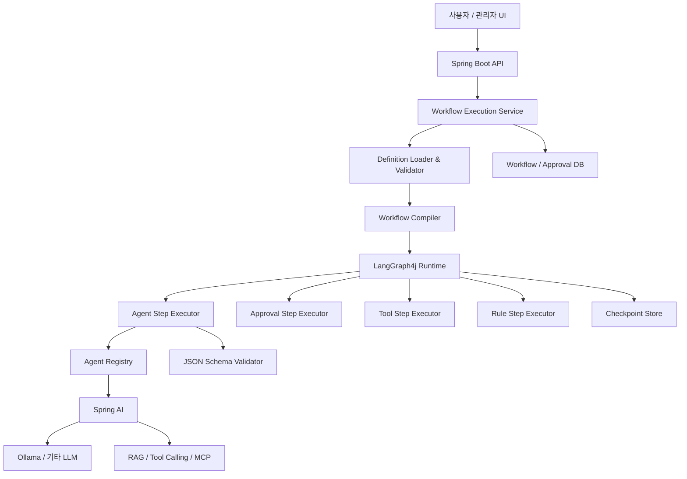

# dstone-workflow 설계 초안
## Spring AI + LangGraph4j 기반 선언형 AI Workflow Engine

- 문서 버전: v0.2
- 작성일: 2026-10-09
- 상태: 설계 초안 (Human Approval Pause/Resume 상세 설계 추가)
- 프로젝트명: `dstone-workflow`

---

## 1. 목적과 목표

`dstone-workflow`는 YAML/XML 등 외부 정의 파일을 기반으로 AI 기반 업무 Workflow를 구성하고 실행하는 재사용 가능한 Java 엔진이다.

목표는 Workflow 순서, Step 유형, Agent 프롬프트, 입출력 계약, 분기 조건, 승인 정책 등을 외부화하여, 새로운 업무 Workflow를 추가하거나 수정할 때 Java 코드를 매번 변경하지 않도록 하는 것이다.

주요 설계 원칙:

1. **Spring AI는 AI 실행 계층**으로 사용한다.
2. **LangGraph4j는 Workflow 그래프 실행 계층**으로 사용한다.
3. **YAML은 Workflow와 Agent의 선언적 정의**를 담당한다.
4. **JSON Schema는 입력·출력 데이터 계약**을 정의한다.
5. **Java는 검증, 컴파일, 실행, 보안 및 확장 가능한 실행기**를 제공한다.
6. **DB는 실행 상태, 체크포인트, 승인 이력 및 버전 정보를 영속화**한다.

## 2. 주요 요구사항

### 2.1 Workflow 정의 외부화

Workflow 정의에서 다음 항목을 관리한다.

- Workflow ID 및 버전
- Step 목록과 실행 순서
- Step 유형과 Agent 참조
- 입력값 매핑 및 출력값 저장 위치
- 조건 분기와 종료 조건
- 재시도 및 오류 처리 정책
- 관리자 승인 단계
- 체크포인트 및 재개 정책

### 2.2 Agent 정의 외부화

Agent 정의에서 다음 항목을 관리한다.

- Agent ID 및 버전
- 역할과 설명
- Prompt 파일 참조
- 모델 라우팅 정책 및 모델 파라미터
- 입력·출력 JSON Schema 참조
- 허용된 Tool 목록
- 출력 검증, 재시도 및 타임아웃 정책

### 2.3 Prompt 외부화

Prompt는 Agent YAML 내부에 큰 문자열로 포함하기보다 별도 파일로 관리한다. 이를 통해 Prompt 버전 관리와 리뷰가 쉬워진다.

### 2.4 입출력 계약

LLM의 출력은 문자열이라는 이유만으로 신뢰하지 않는다. JSON 파싱, 스키마 검증, 업무 규칙 검증을 거친 결과만 다음 Step의 입력으로 전달한다.

### 2.5 관리자 승인

AI 리뷰와 관리자 승인은 별개다.

- 리뷰 Agent: 누락, 모순, 품질 이슈를 분석한다.
- 승인 단계: 권한이 있는 실제 관리자가 승인 또는 반려한다.
- 승인 결과는 DB에 기록하고, 승인된 문서 버전과 연결한다.
- 승인 이후 산출물이 변경되면 이전 승인을 자동으로 재사용하지 않는다.

## 3. 기술 아키텍처



### 구성 요소별 책임

| 구성 요소 | 책임 |
|---|---|
| Spring Boot | REST API, DI, 설정, 보안, 트랜잭션 |
| LangGraph4j | 그래프, State, 노드/엣지, 조건 분기, 중단 및 재개 |
| Spring AI | ChatClient, 모델 호출, Prompt, Tool Calling, RAG |
| Definition Loader | YAML/XML/JSON 파일 로딩 |
| Definition Validator | 정의의 구조, 참조, 연결 및 정책 검증 |
| Workflow Compiler | 선언적 정의를 LangGraph4j 그래프로 변환 |
| Agent Registry | Agent YAML 및 버전 조회 |
| Agent Output Validator | JSON 파싱과 JSON Schema 검증 |
| Step Executor Registry | Step 유형별 실행기 선택 |
| Approval Service | 승인 권한, 결정, 반려 사유 및 승인 이력 |
| Checkpoint Store | 실행 중간 상태 및 재개 정보 저장 |
| Workflow Repository | 실행 상태, 정의 버전, 산출물 참조 및 이력 저장 |

## 4. 권장 프로젝트 디렉터리

```text
dstone-workflow/
├── pom.xml
├── src/main/java/
│   └── net/dstone/workflow/
│       ├── api/
│       ├── config/
│       ├── definition/
│       │   ├── WorkflowDefinition.java
│       │   ├── StepDefinition.java
│       │   ├── AgentDefinition.java
│       │   └── DefinitionLoader.java
│       ├── validation/
│       │   ├── WorkflowValidator.java
│       │   ├── AgentDefinitionValidator.java
│       │   └── AgentOutputValidator.java
│       ├── compiler/
│       │   └── WorkflowCompiler.java
│       ├── runtime/
│       │   ├── WorkflowExecutionService.java
│       │   ├── WorkflowState.java
│       │   └── WorkflowExecutionContext.java
│       ├── executor/
│       │   ├── StepExecutor.java
│       │   ├── AgentStepExecutor.java
│       │   ├── ApprovalStepExecutor.java
│       │   ├── ToolStepExecutor.java
│       │   ├── RuleStepExecutor.java
│       │   └── SubWorkflowExecutor.java
│       ├── agent/
│       │   ├── AgentRegistry.java
│       │   ├── AgentInvoker.java
│       │   └── SpringAiAgentInvoker.java
│       ├── expression/
│       │   └── ContextResolver.java
│       ├── approval/
│       │   ├── ApprovalService.java
│       │   └── ApprovalRepository.java
│       └── persistence/
│           └── WorkflowExecutionRepository.java
└── definitions/
    ├── workflows/
    │   └── pilot-modernization.yml
    ├── agents/
    │   ├── pilot-requirment-analyzer-agent.yml
    │   ├── pilot-impact-analyzer-agent.yml
    │   ├── pilot-impact-analyzer-review-agent.yml
    │   ├── pilot-architect-agent.yml
    │   └── pilot-developer-agent.yml
    ├── prompts/
    │   ├── requirement-analyzer/v1.st
    │   ├── impact-analyzer/v1.st
    │   ├── impact-analyzer-review/v1.st
    │   ├── architect/v1.st
    │   └── developer/v1.st
    ├── schemas/
    │   ├── workflow-state.schema.json
    │   ├── requirement-input.schema.json
    │   ├── requirement-analysis.schema.json
    │   ├── impact-analysis.schema.json
    │   └── architecture.schema.json
    └── tools/
        └── tool-registry.yml
```

디렉터리는 초기 권장안이다. 실제 모듈을 분리할지는 첫 번째 수직 기능을 구현한 뒤 결정한다.

## 5. Workflow YAML 예시

파일: `definitions/workflows/pilot-modernization.yml`

```yaml
workflow:
  id: pilot-modernization
  version: "1.0.0"
  description: "요구사항 분석부터 구현까지의 AI 개발 Workflow"

  state:
    schema: schemas/workflow-state.schema.json

  settings:
    checkpoint: true
    maxIterations: 3
    onError: STOP

  steps:
    - id: step01
      type: AGENT
      agent: pilot-requirment-analyzer-agent
      input:
        requirement: "${input.requirement}"
      output:
        result: "state.requirementAnalysis"
      next: step02

    - id: step02
      type: AGENT
      agent: pilot-impact-analyzer-agent
      input:
        requirement: "${state.requirementAnalysis}"
      output:
        result: "state.impactAnalysis"
      next: step03

    - id: step03
      type: AGENT
      agent: pilot-impact-analyzer-review-agent
      input:
        requirement: "${state.requirementAnalysis}"
        impact: "${state.impactAnalysis}"
      output:
        result: "state.analysisReview"
      next: step04

    - id: step04
      type: APPROVAL
      approval:
        artifact: analysis-document
        approverRole: ANALYSIS_MANAGER
        rejectTo: step03
      routes:
        APPROVED: step05
        REJECTED: step03

    - id: step05
      type: AGENT
      agent: pilot-architect-agent
      input:
        requirement: "${state.requirementAnalysis}"
        impact: "${state.impactAnalysis}"
        review: "${state.analysisReview}"
      output:
        result: "state.architecture"
      next: step06

    - id: step06
      type: APPROVAL
      approval:
        artifact: architecture-document
        approverRole: ARCHITECTURE_MANAGER
      routes:
        APPROVED: step07
        REJECTED: step05

    - id: step07
      type: AGENT
      agent: pilot-developer-agent
      input:
        requirement: "${state.requirementAnalysis}"
        architecture: "${state.architecture}"
      output:
        result: "state.implementation"
      next: END
```

### Workflow 정의 시 주의사항

- `${input.requirement}`와 `${state.requirementAnalysis}`는 `dstone-workflow`가 구현할 표현식 문법이다. LangGraph4j가 자동으로 해석하는 문법이 아니다.
- `ContextResolver`가 허용된 경로만 해석하도록 구현한다.
- `routes`와 `next`는 상호 일관성이 있어야 하며, 존재하지 않는 Step을 참조하면 컴파일 전에 오류로 처리한다.
- 승인 반려 시에는 반려 사유와 수정 지시를 State에 반영해야 한다.
- `maxIterations`는 무한 루프를 방지하는 런타임 제한으로 정의한다.

## 6. Agent YAML 예시

파일: `definitions/agents/pilot-requirment-analyzer-agent.yml`

```yaml
agent:
  id: pilot-requirment-analyzer-agent
  version: "1.0.0"
  role: REQUIREMENT_ANALYST
  description: "요구사항을 분석하고 구조화된 결과를 생성한다."

  model:
    routing: requirement-analysis
    temperature: 0.1

  prompt:
    system: prompts/requirement-analyzer/v1.st

  input:
    schema: schemas/requirement-input.schema.json

  output:
    format: JSON
    schema: schemas/requirement-analysis.schema.json
    validation: STRICT

  context:
    sources:
      - workflowInput
      - projectMetadata
      - retrievedDocuments

  tools:
    allowed:
      - project-document-search
      - requirement-rule-validator

  execution:
    maxAttempts: 2
    timeoutSeconds: 120
    onInvalidOutput: RETRY
```

`routing`은 구체적인 모델명 대신 모델 라우팅 정책을 참조한다. 실제 모델명, Ollama URL 및 인증 정보는 별도의 환경 설정과 비밀 관리 체계에서 관리한다.

`STRICT`, `RETRY` 등의 정책은 엔진에서 명시적으로 구현하고 허용값을 검증해야 한다.

## 7. Prompt 외부화

파일: `definitions/prompts/requirement-analyzer/v1.st`

```text
당신은 엔터프라이즈 소프트웨어 요구사항 분석 전문가다.

## 목표
입력된 요구사항을 분석하고, 모호성·누락·제약사항을 식별한다.

## 규칙
- 입력에 없는 사실을 임의로 만들어내지 않는다.
- 확인이 필요한 내용은 openQuestions에 기록한다.
- 요구사항별로 고유 ID를 부여한다.
- 출력 스키마에 정의된 JSON만 반환한다.
- Markdown 코드 펜스나 JSON 이외의 설명을 덧붙이지 않는다.

## 입력
요구사항: {{requirement}}

## 출력
requirement-analysis.schema.json의 구조를 따른다.
```

템플릿 문법은 Spring AI `PromptTemplate` 등 선택한 템플릿 엔진에 맞춰 통일한다. 템플릿 변수는 입력값과 명시적으로 매핑하고, 사용자 입력이 시스템 지침으로 오인되지 않도록 역할과 경계를 분리한다.

## 8. JSON Schema 예시

파일: `definitions/schemas/requirement-analysis.schema.json`

```json
{
  "$schema": "https://json-schema.org/draft/2020-12/schema",
  "title": "RequirementAnalysis",
  "type": "object",
  "additionalProperties": false,
  "required": ["summary", "requirements", "openQuestions"],
  "properties": {
    "summary": {
      "type": "string",
      "minLength": 1
    },
    "requirements": {
      "type": "array",
      "items": {
        "type": "object",
        "additionalProperties": false,
        "required": ["id", "description", "priority"],
        "properties": {
          "id": {"type": "string"},
          "description": {"type": "string"},
          "priority": {
            "type": "string",
            "enum": ["HIGH", "MEDIUM", "LOW"]
          }
        }
      }
    },
    "openQuestions": {
      "type": "array",
      "items": {"type": "string"}
    }
  }
}
```

Agent 출력 처리 절차:

1. 모델 응답을 수신한다.
2. JSON 파싱을 수행한다.
3. JSON Schema 검증을 수행한다.
4. 필요하면 업무 규칙 검증을 추가로 수행한다.
5. 검증 성공 결과만 Workflow State에 반영한다.
6. 실패 시 재시도 정책을 적용하고, 한도를 넘으면 명시적인 오류로 종료하거나 오류 경로로 이동한다.

## 9. Java 실행 계층의 핵심 인터페이스

### 9.1 정의 모델

```java
public enum StepType {
    AGENT,
    TOOL,
    APPROVAL,
    RULE,
    SUB_WORKFLOW
}

public record WorkflowDefinition(
    String id,
    String version,
    List<StepDefinition> steps
) {}

public record StepDefinition(
    String id,
    StepType type,
    String agent,
    Map<String, String> input,
    Map<String, String> output,
    String next,
    Map<String, String> routes
) {}
```

실제 모델에는 승인 설정, 재시도 정책, 오류 정책, 체크포인트 설정 등 추가 필드가 필요하다. 위 코드는 개념을 보여주는 최소 DTO다.

### 9.2 Step Executor

```java
public interface StepExecutor {
    StepType supportedType();

    Map<String, Object> execute(
        StepDefinition step,
        Map<String, Object> resolvedInput
    );
}
```

실행기 구현 예:

| 실행기 | 책임 |
|---|---|
| `AgentStepExecutor` | Agent 설정 로드, 입력 해석, Spring AI 호출, 출력 검증 |
| `ApprovalStepExecutor` | 승인 요청 생성, 승인 상태 확인, 반려 사유 처리 |
| `ToolStepExecutor` | 등록된 Java/Python/외부 Tool 실행 |
| `RuleStepExecutor` | 허용된 조건식과 업무 규칙 실행 |
| `SubWorkflowExecutor` | 하위 Workflow 실행과 결과 전달 |

### 9.3 Workflow 컴파일 흐름

```java
public CompiledGraph<PilotWorkflowState> compileWorkflow(
        WorkflowDefinition definition) {

    validator.validate(definition);

    var graph = graphFactory.create(definition);

    for (StepDefinition step : definition.steps()) {
        StepExecutor executor =
            executorRegistry.get(step.type());

        graphFactory.addStep(graph, step, executor);
    }

    graphFactory.connectEdges(graph, definition);

    return graphFactory.compile(graph, definition);
}
```

이 코드는 의사 코드다. `graphFactory`와 `executorRegistry`는 프로젝트에서 구현해야 한다. 실제 그래프 구성은 사용 중인 LangGraph4j 버전의 `StateGraph`, 노드·엣지 API 및 `compile()`을 이용한다.

## 10. Workflow 실행과 승인 재개

권장 실행 흐름:

1. Workflow ID와 버전을 지정해 실행을 생성한다.
2. 정의 파일을 로드하고 검증한다.
3. 정의를 그래프로 컴파일하거나 해당 버전의 컴파일 결과를 재사용한다.
4. 실행 ID와 정의 버전을 영속화한다.
5. 그래프를 실행한다.
6. 승인 노드에서 실행을 중단하고 체크포인트를 저장한다.
7. 관리자가 승인 또는 반려한다.
8. 승인 결과를 DB에 커밋한다.
9. 동일한 실행 식별자와 체크포인트로 그래프를 재개한다.

운영 요구사항:

- 동일 실행을 중복 재개하지 않도록 멱등성을 확보한다.
- 승인 권한은 서버에서 검증한다.
- 승인 대상 산출물의 버전 또는 해시를 승인 이력에 연결한다.
- 실행 중인 Workflow는 시작 시점의 정의 버전을 유지한다.
- 메모리 기반 체크포인터는 테스트용으로 사용하고, 운영에서는 영속 저장소를 검토한다.

체크포인트 저장소의 구체적인 모듈과 API는 선택한 LangGraph4j 릴리스에 맞춰 확정한다.

## 11. 외부 정의의 검증 및 보안

외부 정의를 동적으로 읽을 수 있게 되면, 잘못된 설정이나 악의적인 변경도 실행될 수 있다. 따라서 다음 검증을 컴파일 전에 수행한다.

- Workflow ID와 버전의 유효성
- 중복 Step ID 검사
- 모든 `next`, `routes`, Agent 및 Schema 참조 검사
- 도달 불가능한 노드 및 종료 불가능한 경로 검사
- 지원하지 않는 Step 타입과 정책값 거부
- 표현식에서 허용된 State 경로만 참조하도록 제한
- Tool은 등록된 ID만 호출하도록 제한
- 임의 Java 클래스 로딩, 임의 메서드 호출, 임의 셸 실행을 정의 파일에서 허용하지 않음
- Prompt 및 정의 파일의 변경 이력과 해시 관리
- 민감정보를 YAML과 Prompt에 직접 기록하지 않고 외부 비밀 관리 체계 사용

## 12. 버전 관리 전략

최소한 다음 버전을 분리해 관리한다.

- `workflow.id` / `workflow.version`
- `agent.id` / `agent.version`
- Prompt 버전
- Input/Output Schema 버전
- 실행 시 실제 사용한 모델 식별자 및 설정 버전

실행 기록에는 최소한 다음 정보를 보존한다.

- 실행 ID, Workflow ID, Workflow 버전
- 각 Step의 상태, 시작·종료 시각 및 재시도 횟수
- 입력·출력의 저장 참조 또는 마스킹된 요약
- 사용한 Agent와 Prompt 버전
- 승인자, 결정, 사유, 승인 대상 산출물 버전
- 실패 코드와 재개 이력

금융·기업 SI 환경에서는 감사와 재현성이 중요하므로, 변경된 정의를 과거 실행에 소급 적용하지 않는다.

## 13. 구현 로드맵

### Phase 1 — 최소 실행 엔진

- YAML 로더와 정의 DTO
- Workflow 및 Agent 정의 검증
- `AGENT`와 `APPROVAL` Step
- Spring AI `ChatClient` 연동
- JSON Schema 기반 출력 검증
- 단일 Workflow 실행 API

### Phase 2 — LangGraph4j 통합

- YAML에서 StateGraph 생성
- 순차 엣지와 조건 분기
- 체크포인트 및 중단·재개
- 승인 DB 연동과 멱등성 처리
- 오류 및 재시도 정책

### Phase 3 — 엔터프라이즈 기능

- `TOOL`, `RULE`, `SUB_WORKFLOW`
- RAG와 MCP Tool 연동
- 모델 라우팅
- 실행 이력과 관측성
- Workflow 정의 버전 관리 및 변경 검증

### Phase 4 — 운영 도구

- Workflow 정의 검증 CLI
- Dry-run 및 시뮬레이션
- 실행 현황과 승인 대기 목록 UI
- 정의 변경 비교 및 감사 로그
- 패키지 배포와 폐쇄망 설치 지원

## 14. 최종 권고

`dstone-workflow`는 다음 원칙으로 설계한다.

1. **YAML 중심의 선언형 Workflow**를 제공한다.
2. **LangGraph4j를 실행 그래프 엔진**으로 사용한다.
3. **Spring AI를 모델·Prompt·Tool 실행 계층**으로 사용한다.
4. **Agent YAML과 Prompt, JSON Schema를 독립적으로 버전 관리**한다.
5. **실행 상태와 승인 이력은 정의 파일과 분리해 영속화**한다.
6. **정의 파일은 검증 후 컴파일하고, 실행 중에는 고정된 버전을 사용**한다.
7. **AI의 리뷰 판단과 실제 관리자의 승인을 명확히 분리**한다.

이 구조를 통해 요구사항 분석, 영향도 분석, 아키텍처 설계, 구현뿐 아니라 Oracle→PostgreSQL 변환, Java 소스 분석 등 서로 다른 업무를 공통 엔진에서 구성하고 실행할 수 있다.

---

## 참고 자료

- LangGraph4j 문서: https://langgraph4j.github.io/langgraph4j/1.9/
- LangGraph4j Spring AI 통합 소스: https://github.com/langgraph4j/langgraph4j/tree/main/spring-ai
- Spring AI 문서: https://docs.spring.io/spring-ai/reference/
- JSON Schema: https://json-schema.org/

---

## 15. Human Approval 이후 Workflow 중단 및 재개 상세 설계

### 15.1 설계 목표

Human Approval은 단순히 승인 여부를 묻는 일반 Step이 아니다. 승인 대기 중 Workflow 실행을 안전하게 중단하고, 실행 상태와 그래프 체크포인트를 영속화한 뒤, 승인 결정이 도착했을 때 동일한 Workflow 실행을 재개하는 **상태 전이 기능**으로 설계한다.

핵심 원칙은 다음과 같다.

1. 승인 대기 중 HTTP 요청 스레드를 붙잡아 두지 않는다.
2. 승인 대기 상태, 체크포인트, 승인 요청을 영속화한다.
3. 승인 결정과 Workflow 재개 작업은 멱등성을 보장한다.
4. 승인·반려·수정 요청별 분기 경로는 Workflow YAML에서 정의한다.
5. 진행 중인 실행은 시작 당시의 Workflow 정의 버전에 고정한다.
6. 체크포인트 복원과 그래프 재개는 `WorkflowRuntime` 내부에서 캡슐화한다.

### 15.2 전체 구성

```text
Workflow YAML / Agent YAML / Prompt / JSON Schema
                    |
                    v
          Definition Loader / Validator
                    |
                    v
             Workflow Compiler
        (LangGraph4j StateGraph 생성)
                    |
                    v
              Workflow Runtime
          +---------+----------+
          |         |          |
       AGENT      ROUTER     APPROVAL
          |         |          |
          +---------+          v
                         Approval Service
                                |
                     승인 요청 및 결정 영속화
                                |
                                v
                    Workflow Resume Service
                                |
                      Checkpoint Store 복원
                                |
                                v
                       Workflow Runtime 재개

영속 저장소:
- Workflow Execution
- Graph Checkpoint / State
- Approval Request / Decision
- Step Execution History
- Workflow Event / Audit
```

구성 요소별 책임:

| 구성 요소 | 책임 |
|---|---|
| `WorkflowRuntime` | Workflow 시작, 중단, 재개, 실행 상태 전이 |
| `WorkflowCompiler` | 외부 정의를 검증된 그래프 구조로 컴파일 |
| `ApprovalService` | 승인 요청 생성, 승인자 권한 확인, 결정 기록 |
| `CheckpointStore` | 그래프 재개에 필요한 상태와 체크포인트 관리 |
| `WorkflowExecutionRepository` | 실행 ID, 상태, 정의 버전, 현재 Step 등 관리 |
| `WorkflowResumeService` | 승인 결과를 재개 입력으로 변환하고 재개 작업 수행 |
| `StepExecutionRepository` | Step별 입력·출력 참조, 실행 횟수, 오류 이력 관리 |
| `WorkflowEventRepository` | 상태 전이와 중요 업무 이벤트의 감사 이력 관리 |

`CheckpointStore`와 `WorkflowExecutionRepository`는 책임을 논리적으로 분리한다. 물리적으로 같은 DB를 사용할 수 있으나, 업무 실행 메타데이터와 그래프 엔진의 체크포인트를 동일한 개념으로 취급하지 않는다.

### 15.3 Workflow 상태와 Approval 상태 구분

Workflow 전체 상태와 개별 승인 요청 상태는 별도로 관리한다.

#### Workflow 실행 상태

| 상태 | 의미 |
|---|---|
| `RUNNING` | Workflow 실행 중 |
| `WAITING_APPROVAL` | 사람의 결정을 기다리는 중 |
| `RESUMING` | 재개 작업이 선점되어 처리 중 |
| `COMPLETED` | 정상 완료 |
| `REJECTED` | 업무 정책상 최종 반려 |
| `FAILED` | 실행 오류 |
| `CANCELLED` | 실행 취소 |
| `TIMED_OUT` | 정책에 따른 승인 대기 시간 초과 |

#### Approval 요청 상태

| 상태 | 의미 |
|---|---|
| `PENDING` | 승인 결정 대기 중 |
| `APPROVED` | 승인 |
| `REJECTED` | 반려 |
| `CHANGES_REQUESTED` | 수정 요청 |
| `EXPIRED` | 승인 요청 만료 또는 시간 초과 처리 |

`REJECTED`는 Approval 요청의 결과이고, Workflow 전체가 반드시 최종 `REJECTED` 상태가 되는 것은 아니다. 반려 후 이전 Step으로 돌아가 수정할 수 있다면 Workflow는 `RUNNING` 상태로 재개된다.

### 15.4 승인 경로를 선언하는 Workflow YAML

```yaml
workflow:
  id: pilot-modernization
  version: "1.0.0"

  settings:
    checkpoint: true
    maxIterations: 3

  steps:
    - id: step01
      type: AGENT
      agent: requirement-analyzer
      next: step02

    - id: step02
      type: AGENT
      agent: impact-analyzer
      next: step03

    - id: step03
      type: APPROVAL
      approval:
        artifact: impact-analysis-document
        approverRole: ANALYSIS_MANAGER
        timeout: 72h
        timeoutPolicy: ESCALATE
        requireCommentOnReject: true

      routes:
        APPROVED: step04
        REJECTED: rejection-handler
        CHANGES_REQUESTED: step02
        TIMEOUT: approval-escalation

    - id: step04
      type: AGENT
      agent: architecture-designer
      next: step05

    - id: step05
      type: END
```

`routes`는 `dstone-workflow`가 정의하는 DSL이다. LangGraph4j가 이 YAML 문법을 자동으로 해석하는 것은 아니다. `WorkflowCompiler`가 이를 조건부 엣지로 변환해야 한다.

경로의 의미:

- `APPROVED`: 다음 Step으로 진행한다.
- `REJECTED`: 최종 반려 처리 또는 별도 반려 핸들러로 이동한다.
- `CHANGES_REQUESTED`: 지정된 이전 Step부터 재작업한다.
- `TIMEOUT`: 에스컬레이션, 만료 처리 또는 별도 정책을 실행한다.

반려 후 재작업하는 정책과 최종 반려 정책은 구분한다. 동일한 Approval Step을 다시 방문하는 경우에도 새 `approval_id`를 발급하고 기존 승인 요청과 이력을 보존한다.

### 15.5 중단 시 저장할 정보

승인 대기 상태가 JVM 메모리에만 존재하면 서버 재시작이나 배포 이후 Workflow를 복구할 수 없다. 다음 정보를 영속화한다.

#### Workflow 실행 메타데이터

- `execution_id`
- `workflow_id`
- `workflow_version`
- `status`
- `current_step_id`
- `started_at`, `updated_at`
- `definition_hash` 또는 사용한 정의의 불변 버전 식별자

#### 그래프 체크포인트

- 그래프 엔진에서 재개에 필요한 체크포인트 식별자
- 현재 그래프 실행 위치와 재개 정보
- Workflow State 및 반복 횟수
- `execution_id`와 연결되는 그래프 실행 식별자
- 체크포인트 스키마 버전 및 직렬화 버전

#### Approval 요청

- `approval_id`, `execution_id`, `step_id`
- 승인자 역할 및 요청 상태
- 승인 대상 산출물 ID, 버전 또는 해시
- 요청자와 요청 시각
- 결정자, 결정 내용, 코멘트, 결정 시각
- 만료 시각 및 에스컬레이션 정책

#### Step 실행 및 감사 이력

- Step별 실행 ID, 시도 횟수, 실행 상태
- 입력·출력의 저장 위치 또는 참조 ID
- 시작·종료 시각, 오류 정보
- 승인 요청, 승인 결정, Workflow 중단·재개 이벤트

대규모 문서나 소스 코드를 매번 체크포인트에 통째로 넣기보다 산출물 저장소의 ID 또는 버전을 참조하는 방식을 권장한다.

### 15.6 권장 논리 테이블

| 테이블 | 목적 |
|---|---|
| `wf_execution` | Workflow 실행 상태와 정의 버전 |
| `wf_checkpoint` | 그래프 재개 상태 및 체크포인트 참조 |
| `wf_approval` | 승인 요청, 승인 결정, 대상 산출물 버전 |
| `wf_step_execution` | Step별 실행 및 재시도 이력 |
| `wf_event` | 상태 전이와 감사 이벤트 |

위 목록은 논리적인 데이터 모델이다. 실제 테이블 구성은 선택한 체크포인터 구현, 저장소 및 트랜잭션 전략에 맞춰 조정한다.

### 15.7 승인 API와 재개 처리 흐름

권장 API 예시:

```http
POST /api/workflows/{executionId}/approvals/{approvalId}/decision
Content-Type: application/json
```

```json
{
  "decision": "APPROVED",
  "comment": "영향도 분석 결과를 승인합니다."
}
```

처리 순서:

1. 실행이 `WAITING_APPROVAL` 상태인지 확인한다.
2. Approval 요청이 `PENDING`인지 확인한다.
3. 사용자가 해당 승인 역할을 수행할 권한이 있는지 검증한다.
4. 승인 대상 산출물 버전 또는 해시가 요청 당시와 일치하는지 확인한다.
5. 승인 결정을 저장하고 감사 이력을 기록한다.
6. 재개 작업을 영속적인 작업 큐 또는 작업 테이블에 등록한다.
7. `WorkflowResumeService`가 체크포인트를 복원한다.
8. 승인 결과를 Workflow State에 반영하고 선언된 경로로 그래프를 재개한다.
9. 실행 상태와 Step 실행 이력을 갱신한다.

API는 Workflow 전체가 끝날 때까지 대기하지 않고, 승인 결정 저장 및 재개 작업 등록이 성공하면 `RESUMING` 등의 상태를 반환한다. 완료 여부는 실행 조회 API로 확인한다.

응답 예시:

```json
{
  "executionId": "exec-20261009-0001",
  "approvalId": "approval-0001",
  "decision": "APPROVED",
  "status": "RESUMING"
}
```

### 15.8 Java 인터페이스 예시

아래는 `dstone-workflow` 내부의 논리적 계약 예시다. 실제 구현 시 Spring AI 및 LangGraph4j의 선택 버전에 맞춰 구체 API를 연결한다.

```java
public interface WorkflowRuntime {

    WorkflowExecution start(
        String workflowId,
        Map<String, Object> input
    );

    WorkflowExecution resume(
        String executionId,
        ResumeCommand command
    );

    WorkflowExecution getExecution(
        String executionId
    );
}
```

```java
public record ResumeCommand(
    String approvalId,
    String decision,
    String comment,
    String decidedBy
) {}
```

```java
public interface CheckpointStore {

    void save(
        String executionId,
        String checkpointId,
        Map<String, Object> state
    );

    Optional<WorkflowCheckpoint> loadLatest(
        String executionId
    );
}
```

```java
public interface WorkflowResumeService {

    WorkflowExecution resume(
        String executionId,
        ResumeCommand command
    );
}
```

이 인터페이스는 개념적인 설계다. LangGraph4j의 체크포인트 저장 API, 스레드/실행 식별자, interrupt/resume 지원 방식은 채택 버전에서 확인한 후 Adapter로 캡슐화한다.

### 15.9 LangGraph4j 통합 시 핵심 원칙

1. Workflow YAML을 검증한 뒤 `StateGraph`를 생성한다.
2. `APPROVAL` 노드에서 승인 요청과 대기 상태를 저장하고 그래프를 중단한다.
3. 재개할 때 같은 Workflow 실행의 체크포인트와 그래프 실행 식별자를 사용한다.
4. 승인 결과를 State에 반영한 뒤 조건부 엣지를 통해 다음 Step을 선택한다.
5. 그래프 재개가 중단 노드를 재실행하는지, 다음 노드로 이어지는지는 실제 프레임워크의 interrupt/resume 의미에 맞춰 구현한다.
6. Approval 요청 생성은 멱등성을 보장해 재실행 시 중복 요청이 생기지 않게 한다.

**중요:** 일반적인 JSON State를 저장하는 것과 그래프 엔진의 실행 체크포인트를 저장하는 것은 다르다. 체크포인트 저장만 구현했다고 중단 지점부터 자동 재개되는 것은 아니다. 실제 그래프 재개 기능은 프레임워크 Adapter를 통해 명확하게 구현하고 통합 테스트해야 한다.

### 15.10 동시성, 멱등성 및 장애 복구

운영 환경에서는 다음 조건을 설계에 포함한다.

#### 중복 승인 방지

동일한 `approval_id`가 이미 결정된 상태라면 두 번째 요청은 새 결정을 덮어쓰지 않는다. API는 이미 처리된 결정임을 반환하거나 정책에 따라 충돌 응답을 반환한다.

#### 중복 재개 방지

여러 요청이나 작업자가 동시에 같은 실행을 재개하지 못하도록 조건부 상태 전이, DB 락, 버전 컬럼을 이용한 낙관적 락 또는 큐의 단일 작업 선점을 적용한다.

#### 결정 저장과 재개 작업 등록의 일관성

승인 결정은 DB에 저장됐지만 재개 작업이 등록되지 않는 상황을 방지한다. 하나의 DB 트랜잭션 안에서 승인 결정과 Outbox 이벤트를 함께 기록하고 별도 Worker가 재개 작업을 처리하는 Transactional Outbox 패턴을 고려한다.

#### 재시도 가능한 재개 Worker

재개 Worker가 장애로 종료되면 재시도할 수 있어야 한다. 작업 상태, 재시도 횟수, 마지막 오류, 다음 실행 시각을 저장하고, 이미 성공한 재개를 다시 적용하지 않도록 한다.

#### 외부 Tool 중복 실행 방지

재개 과정에서 이전 Step 또는 Tool이 다시 실행될 수 있다. 외부 시스템 변경 작업에는 멱등성 키, 실행 이력 확인, 필요 시 보상 처리 정책을 적용한다.

#### 산출물 무결성

관리자가 승인한 문서가 변경되었다면 기존 승인을 재사용하지 않는다. 승인 대상 산출물의 ID와 버전 또는 해시를 결정 기록에 함께 저장한다.

#### Workflow 정의 버전 고정

실행 시작 시 `workflow_version`과 정의 해시를 고정한다. 운영 중 새 정의가 배포되더라도 이미 승인 대기 중인 실행은 원래 정의로 재개한다. 불가피한 마이그레이션은 명시적인 별도 절차로 처리한다.

### 15.11 Approval Step의 실행 규칙

`APPROVAL` Step Executor는 다음 원칙을 따른다.

- 승인 요청을 생성하기 전에 동일 실행·Step에 대한 활성 요청이 있는지 확인한다.
- 승인 요청을 생성하고 실행 상태를 `WAITING_APPROVAL`로 전이한다.
- 그래프 체크포인트를 저장한 후 실행 제어를 반환하거나 프레임워크가 지원하는 중단 메커니즘을 사용한다.
- 승인 API는 Approval 요청만 결정하고, 그래프 분기 규칙을 자체적으로 중복 구현하지 않는다.
- `WorkflowResumeService`가 승인 결과를 State에 전달하고 그래프 조건부 경로가 다음 Step을 결정한다.
- 같은 Step을 재방문할 때는 기존 승인 요청을 덮어쓰지 않고 새 승인 라운드를 생성한다.

### 15.12 구현 및 테스트 시나리오

최소한 다음 시나리오를 자동화 테스트로 검증한다.

| 시나리오 | 기대 결과 |
|---|---|
| 승인 후 재개 | 다음 Step부터 실행 |
| 수정 요청 후 재개 | 지정된 이전 Step부터 실행 |
| 최종 반려 | 정의된 반려 경로 또는 최종 상태로 전이 |
| 승인 대기 중 서버 재시작 | 저장된 실행 및 체크포인트 복원 |
| 같은 승인 API를 두 번 호출 | 중복 결정·중복 재개 없음 |
| 두 Worker가 동시에 재개 시도 | 하나의 작업만 실행 선점 |
| 승인 대상 산출물 변경 | 이전 승인 무효화 또는 재승인 요구 |
| 승인 대기 시간 초과 | 정의된 에스컬레이션/만료 정책 실행 |
| Workflow 정의 신규 버전 배포 | 기존 실행은 시작 당시 버전으로 재개 |
| 외부 Tool 실행 중 장애 | 재시도 시 중복 부작용 방지 |

### 15.13 구현 순서 권고

1. **1단계 — 상태 모델**: `wf_execution`, `wf_approval`, `wf_step_execution` 및 상태 전이 규칙 구현
2. **2단계 — 승인 대기**: `APPROVAL` Executor, 요청 생성, `WAITING_APPROVAL` 전이 구현
3. **3단계 — 영속 체크포인트**: 선택한 LangGraph4j 버전과 저장소를 연결하고 서버 재시작 테스트 수행
4. **4단계 — 재개 서비스**: `WorkflowResumeService`, 승인 결과 State 반영, 조건부 경로 재개 구현
5. **5단계 — 장애 복구**: 중복 요청 방지, 재개 Worker, Outbox 또는 재처리 테이블 구현
6. **6단계 — 운영 기능**: 승인 대기 목록, 승인·반려 UI, 타임아웃, 에스컬레이션, 감사 조회 구현

초기 프로토타입에서는 단일 DB와 단일 Worker로 시작할 수 있지만, 승인 상태와 체크포인트를 메모리에만 저장하는 방식은 운영 구조로 사용하지 않는다.

---

## 16. 최종 권고 — Human Approval을 포함한 Workflow 엔진

`dstone-workflow`의 Human Approval은 일반적인 Agent 실행과 분리된 영속적인 상태 전이로 구현한다.

- **정의 계층**: YAML에서 승인 대상, 승인자 역할, 타임아웃, 승인 결과별 경로를 선언한다.
- **컴파일 계층**: `APPROVAL` 정의와 `routes`를 검증하고 LangGraph4j 그래프의 노드 및 조건부 엣지로 변환한다.
- **실행 계층**: 승인 대기 시 실행을 중단하고 상태와 체크포인트를 저장한다.
- **승인 계층**: 권한을 검증하고 승인 결정과 감사 이력을 영속화한다.
- **재개 계층**: 체크포인트를 복원하고 동일한 Workflow 실행을 재개한다.
- **운영 계층**: 멱등성, 동시성 제어, 버전 고정, 타임아웃 및 장애 복구를 보장한다.

이 구조는 관리자 승인이 포함된 금융 SI 업무 Workflow, 요구사항 분석·영향도 분석·아키텍처 설계·구현 승인 프로세스에 재사용할 수 있다.

